# 2024 年江苏行测（A类） · 答案与解析

以下为来源原文的结构化转写；缺失及冲突答案不补写。

## 第 16 题 · 言语理解与表达

参考答案：**D**

【解析16—正确答案D】
文段首先指出改革开放以来中国经济发展取得的成就，接着通过转折词“但”指出在发展过程中存
在资源消耗过大、发展方式粗放以及资源约束长期偏紧等问题，接着指出党的十八大以来我国通过
一系列做法在资源节约方面取得了积极成效，进入了新发展阶段，最后尾句通过“提出了更高要求”
提出对策，强调新发展阶段需要更好地节约及高效利用资源，对应D 项。
A、B 两项，“以资源大量消耗作为代价”和“资源消耗总量曾经长期居高不下”均对应文段提出问
题部分的内容，非重点，排除；
C 项，“息息相关”偏离文段中心，文段重点强调新发展阶段提出的更高要求，并非强调关联性，排
除。
故正确答案为D。
【文段出处】人民日报《科学配置促进资源节约和高效利用（新论）》

来源：[2024年江苏省公务员录用考试《行测》（A类）答案+解析.pdf](https://github.com/dumarstoft-ship-it/xingce/blob/407016b55b49581efa3771bb59a2dee8761d982f/2024%E5%B9%B4%E6%B1%9F%E8%8B%8F%E7%9C%81%E5%85%AC%E5%8A%A1%E5%91%98%E5%BD%95%E7%94%A8%E8%80%83%E8%AF%95%E3%80%8A%E8%A1%8C%E6%B5%8B%E3%80%8B%EF%BC%88A%E7%B1%BB%EF%BC%89%E7%AD%94%E6%A1%88%2B%E8%A7%A3%E6%9E%90.pdf)，PDF 第 6、7 页。

## 第 17 题 · 言语理解与表达

参考答案：**C**

【解析17—正确答案C】
文段开篇引出话题，即在高科技的帮助下，人们可以通过古籍感受中华优秀传统文化。随后用“中
国古代的印刷术”及“VR 技术”举例，论证以古籍作为媒介，通过科技可以更好地传播和感受传统
文化。最后点明观点，即科技发展可以拓展传统文化传播的方式。故文段为“分—总”结构，重点
强调借助科技手段能更好地传播传统文化，对应C 项。
A 项：“技术推动了文明的发展与知识传播”对应举例论证部分，非重点，排除。
B 项：文段并未提及人们对古籍本身的认识和想法，“改变人们对古籍的认识”无中生有，排除。
D 项：“守护中华优秀传统文化”文段并未提及，无中生有，排除。
故正确答案为C。
【文段出处】《当古籍遇上高科技》

来源：[2024年江苏省公务员录用考试《行测》（A类）答案+解析.pdf](https://github.com/dumarstoft-ship-it/xingce/blob/407016b55b49581efa3771bb59a2dee8761d982f/2024%E5%B9%B4%E6%B1%9F%E8%8B%8F%E7%9C%81%E5%85%AC%E5%8A%A1%E5%91%98%E5%BD%95%E7%94%A8%E8%80%83%E8%AF%95%E3%80%8A%E8%A1%8C%E6%B5%8B%E3%80%8B%EF%BC%88A%E7%B1%BB%EF%BC%89%E7%AD%94%E6%A1%88%2B%E8%A7%A3%E6%9E%90.pdf)，PDF 第 7 页。

## 第 18 题 · 言语理解与表达

参考答案：**B**

【解析18—正确答案B】
文段开篇引出“个人碳账户”的话题，并介绍低碳行为的“减排量”在“个人碳账户”可以一目了
然，接着介绍在一些小程序中低碳行动能带来的好处，后文指出这些碳减排支持体系就属于“个人
碳账户”，最后通过指代词“它”进行总结，强调“个人碳账户”简便直观，能够帮助人们算清“碳
账”。故文段为“分—总”结构，重点强调“个人碳账户”简便直观，能帮助人们算清绿色消费相
关的“碳账”，更好地推动绿色消费，对应B 项。
A 项：文段重点论述“碳账”对于“消费”的作用，“采取低碳行动”不及B 项“绿色消费”与文
段对应准确，排除。
C 项：“完善碳减排系统建设”偏离文段重点，文段重点论述帮助人们算清“碳账”，推动绿色消
费，排除。
D 项：“采集个人碳排放数据”仅对应“数据采集核算”，表述片面，文段还介绍了“积分跨界兑
换”等，排除。
故正确答案为B。
【文段出处】《“个人碳账户”还应更多些》

来源：[2024年江苏省公务员录用考试《行测》（A类）答案+解析.pdf](https://github.com/dumarstoft-ship-it/xingce/blob/407016b55b49581efa3771bb59a2dee8761d982f/2024%E5%B9%B4%E6%B1%9F%E8%8B%8F%E7%9C%81%E5%85%AC%E5%8A%A1%E5%91%98%E5%BD%95%E7%94%A8%E8%80%83%E8%AF%95%E3%80%8A%E8%A1%8C%E6%B5%8B%E3%80%8B%EF%BC%88A%E7%B1%BB%EF%BC%89%E7%AD%94%E6%A1%88%2B%E8%A7%A3%E6%9E%90.pdf)，PDF 第 7 页。

## 第 19 题 · 言语理解与表达

参考答案：**C**

【解析19—正确答案C】
文段开篇指出雨水会将空气中的污染物、颗粒物冲刷下来，变成近似污水的“初期雨水”，即雨后
空气质量会变好。随后通过转折词“其实”引出重点，即只有降雨达到天气预报所说的“中雨”，
才会将空气中的污染物、颗粒物冲刷下来，空气质量才会变好。后文通过由“另外”构成的并列结
构分别论述“‘微微细雨’和‘强降雨’的情况下PM2.5 浓度会上升”以及“湿度大的时候空气会
更浑浊”，对前文观点进行解释说明。故文段为“分—总—分”结构，转折之后为重点，即只有降
雨达到天气预报所说的“中雨”时，才会将空气中的污染物、颗粒物冲刷下来，空气才会变好，而
非下雨后空气就会变好，对应C 项。
A 项：“雨后的空气质量”偏离文段核心话题，文段意在强调只有降雨达到天气预报所说的“中雨”
时，空气质量才会变好，而非介绍雨后的空气质量如何，排除；
B 项：“PM2.5”对应后文解释说明部分的内容，非重点，排除；
D 项：“雨后空气质量会变差”偏离文段核心话题，文段意在强调只有降雨达到天气预报所说的“中
雨”时，空气质量才会变好，而非介绍“为何雨后空气质量会变差”，且雨后空气质量变差的原因
对应后文解释说明部分的内容，非重点，排除。
故正确答案为C。

来源：[2024年江苏省公务员录用考试《行测》（A类）答案+解析.pdf](https://github.com/dumarstoft-ship-it/xingce/blob/407016b55b49581efa3771bb59a2dee8761d982f/2024%E5%B9%B4%E6%B1%9F%E8%8B%8F%E7%9C%81%E5%85%AC%E5%8A%A1%E5%91%98%E5%BD%95%E7%94%A8%E8%80%83%E8%AF%95%E3%80%8A%E8%A1%8C%E6%B5%8B%E3%80%8B%EF%BC%88A%E7%B1%BB%EF%BC%89%E7%AD%94%E6%A1%88%2B%E8%A7%A3%E6%9E%90.pdf)，PDF 第 7 页。

## 第 20 题 · 言语理解与表达

参考答案：**B**

【解析20—正确答案B】
文段开篇介绍传统产业可以通过“线下生产+线上数据分析”模式探索开展个性化定制服务，随后通
过“比如”进行举例说明，介绍“轻资产、快反应”的柔性供应链模式可以解决传统供应链模式下
的一系列问题，最后通过指代词“这样”总结前文，强调数字化可以帮助中小企业形成竞争优势，
对应B 项。
A 项：“借助数据分析突破固有局限”对应举例的内容，非重点，排除。
C 项：缺少文段主题词“数字化”，排除。
D 项：“柔性供应链”对应举例的内容，非重点，且“企业”范围扩大，文段强调“中小企业”，排
除。
故正确答案为B。
【文段出处】《促进数字技术和实体经济深度融合（人民时评）》

来源：[2024年江苏省公务员录用考试《行测》（A类）答案+解析.pdf](https://github.com/dumarstoft-ship-it/xingce/blob/407016b55b49581efa3771bb59a2dee8761d982f/2024%E5%B9%B4%E6%B1%9F%E8%8B%8F%E7%9C%81%E5%85%AC%E5%8A%A1%E5%91%98%E5%BD%95%E7%94%A8%E8%80%83%E8%AF%95%E3%80%8A%E8%A1%8C%E6%B5%8B%E3%80%8B%EF%BC%88A%E7%B1%BB%EF%BC%89%E7%AD%94%E6%A1%88%2B%E8%A7%A3%E6%9E%90.pdf)，PDF 第 8 页。

## 第 21 题 · 言语理解与表达

参考答案：**C**

【解析21—正确答案C】
A 项：根据“此前国际优质的大型光学望远镜几乎都集中在西半球”可知，西半球优质光学观测设
施较多，东半球优质光学观测设施相对稀缺，该项表述正确，排除。
B 项：根据“与射电望远镜相比，大型光学望远镜对环境的要求更加苛刻，比如晴夜数、天光背景亮
度、视宁度等，所以优质的光学观测台址是稀缺资源”可知，该项表述正确，排除。
C 项：文段并未比较大型光学望远镜与射电望远镜的“观测精度”，该项无中生有，且文段并未论述
“对环境要求高”与“观测精度高”之间的因果关系，该项强加因果，当选。
D 项：根据“冷湖所在的经度区域尚属世界大型光学望远镜的空白区，由于天文观测常需要接力观
测，随着冷湖天文观测基地的建设，这里将成为国际光学天文研究的重要基地”可知，该项表述正
确，排除。
本题为选非题，故正确答案为C。
【文段出处】《在冷湖，追逐最亮的星（科技自立自强）》

来源：[2024年江苏省公务员录用考试《行测》（A类）答案+解析.pdf](https://github.com/dumarstoft-ship-it/xingce/blob/407016b55b49581efa3771bb59a2dee8761d982f/2024%E5%B9%B4%E6%B1%9F%E8%8B%8F%E7%9C%81%E5%85%AC%E5%8A%A1%E5%91%98%E5%BD%95%E7%94%A8%E8%80%83%E8%AF%95%E3%80%8A%E8%A1%8C%E6%B5%8B%E3%80%8B%EF%BC%88A%E7%B1%BB%EF%BC%89%E7%AD%94%E6%A1%88%2B%E8%A7%A3%E6%9E%90.pdf)，PDF 第 8 页。

## 第 22 题 · 言语理解与表达

参考答案：**A**

【解析22—正确答案A】
横线位于文段尾句，且由横线前的“因此”可知，横线处是对前文的总结。文段开篇指出博物馆研
学要“研之有物”“学而广博”，随后强调博物馆研学要让年轻一代明白生而为中国人，最根本的
是有中国人独特的精神世界，接着指出近年来一系列重大工程的研究成果证实了我国的历史中包含
着各种文化，之后通过“这些”总结前文，指出文化都被缩影于文物之中，故前文强调文物对文化
的载体作用，对应A 项。
B、C 两项：B 项“中华文明的独特性”及C 项“提高自身文化素养”文段均未提及，无中生有，与
前文衔接不当，且均未提及文段核心话题“文物”，偏离文段核心话题，排除。
D 项：未提及文段核心话题“文物”，偏离文段核心话题，排除。
故正确答案为A。
【文段出处】《博物馆研学，如何研之有物、学而广博》

来源：[2024年江苏省公务员录用考试《行测》（A类）答案+解析.pdf](https://github.com/dumarstoft-ship-it/xingce/blob/407016b55b49581efa3771bb59a2dee8761d982f/2024%E5%B9%B4%E6%B1%9F%E8%8B%8F%E7%9C%81%E5%85%AC%E5%8A%A1%E5%91%98%E5%BD%95%E7%94%A8%E8%80%83%E8%AF%95%E3%80%8A%E8%A1%8C%E6%B5%8B%E3%80%8B%EF%BC%88A%E7%B1%BB%EF%BC%89%E7%AD%94%E6%A1%88%2B%E8%A7%A3%E6%9E%90.pdf)，PDF 第 8 页。

## 第 23 题 · 言语理解与表达

参考答案：**D**

【解析23—正确答案D】
文段开篇提出某人的观点，即知识本来是一个整体，学科拆散了它，接着引出“跨学科”的话题，
指出跨学科便是将分散的知识重新整合，随后通过转折词“不过”强调我们可能低估了跨学科的难
度，然后通过使用不同学科的概念和与其他学科的研究者合写一篇论文都不是真正的跨学科研究、
“跨学科”不同于“多学科”等内容进行具体解释说明。故文段意在强调我们当下对跨学科认识不
足，低估了跨学科的难度，对应D 项。
A 项：“对知识重新整合”属于转折词“不过”之前的内容，非重点，排除。
B 项：“需不同学科的交叉融合”文段未提及，无中生有，排除。
C 项：“存在着差异”属于后文解释说明的内容，非重点，排除。
故正确答案为D。
【文段出处】《文科人“跨学科”，一种修辞，一场苦修》

来源：[2024年江苏省公务员录用考试《行测》（A类）答案+解析.pdf](https://github.com/dumarstoft-ship-it/xingce/blob/407016b55b49581efa3771bb59a2dee8761d982f/2024%E5%B9%B4%E6%B1%9F%E8%8B%8F%E7%9C%81%E5%85%AC%E5%8A%A1%E5%91%98%E5%BD%95%E7%94%A8%E8%80%83%E8%AF%95%E3%80%8A%E8%A1%8C%E6%B5%8B%E3%80%8B%EF%BC%88A%E7%B1%BB%EF%BC%89%E7%AD%94%E6%A1%88%2B%E8%A7%A3%E6%9E%90.pdf)，PDF 第 8、9 页。

## 第 24 题 · 言语理解与表达

参考答案：**B**

【解析24—正确答案B】
文段开篇引出“电力”的话题，指出供求实时平衡对电力的重要性，接着介绍我国新能源发展成效
显著、装机规模大的背景，之后通过转折词“但”指出发展新能源需要多方面协同支撑，随后指出
新能源供给消纳体系能保障能源安全，推动绿色低碳发展，尾句通过“ 只
有······才······”强调推动新能源向好发展离不开供给和消纳的支持。故文段核心
话题为“新能源供给消纳体系”，对应B 项。
A 项：缺少文段主题词“新能源供给消纳体系”，并且“装机规模位居世界首位”为文段转折前的
内容，非重点，排除。
C、D 两项：均缺少文段主题词“新能源供给消纳体系”，排除。
故正确答案为B。
【文段出处】《让新能源发得出供得上用得好（经济新方位·巩固经济回升向好趋势）》

来源：[2024年江苏省公务员录用考试《行测》（A类）答案+解析.pdf](https://github.com/dumarstoft-ship-it/xingce/blob/407016b55b49581efa3771bb59a2dee8761d982f/2024%E5%B9%B4%E6%B1%9F%E8%8B%8F%E7%9C%81%E5%85%AC%E5%8A%A1%E5%91%98%E5%BD%95%E7%94%A8%E8%80%83%E8%AF%95%E3%80%8A%E8%A1%8C%E6%B5%8B%E3%80%8B%EF%BC%88A%E7%B1%BB%EF%BC%89%E7%AD%94%E6%A1%88%2B%E8%A7%A3%E6%9E%90.pdf)，PDF 第 9 页。

## 第 25 题 · 言语理解与表达

参考答案：**未确定 / 来源缺失**

> 现有来源未提供参考答案及解析。

【解析25—题目缺失，暂缺】

来源：[2024年江苏省公务员录用考试《行测》（A类）答案+解析.pdf](https://github.com/dumarstoft-ship-it/xingce/blob/407016b55b49581efa3771bb59a2dee8761d982f/2024%E5%B9%B4%E6%B1%9F%E8%8B%8F%E7%9C%81%E5%85%AC%E5%8A%A1%E5%91%98%E5%BD%95%E7%94%A8%E8%80%83%E8%AF%95%E3%80%8A%E8%A1%8C%E6%B5%8B%E3%80%8B%EF%BC%88A%E7%B1%BB%EF%BC%89%E7%AD%94%E6%A1%88%2B%E8%A7%A3%E6%9E%90.pdf)，PDF 第 9 页。

## 第 26 题 · 言语理解与表达

参考答案：**D**

【解析26—正确答案D】
文段开篇介绍我国数据产量每年递增的背景，并指出厘清各主体的数据权利与义务的意义。随后从
安全角度指出数据分类分级是数据安全的基础，并从公共数据和个人信息数据两方面具体论述数据
分级分类对数据安全的意义。故文段为“分—总—分”结构，重点强调数据分级分类对数据安全的
重要性，对应D 项。
A 项：“数据生产增长迅猛”对应文段开头背景引入部分，非重点，排除；
B 项：“创新研发数据使用流通技术手段”文段并未提及，无中生有，排除；
C 项：数据保护对国家安全的重要性对应后文解释说明部分，非重点，且后文除了国家安全还提到了
重大公共利益、个人信息数据，表述片面，排除。
故正确答案为D。
【文段出处】《加快建立完善数据产权制度（经济时评）》

来源：[2024年江苏省公务员录用考试《行测》（A类）答案+解析.pdf](https://github.com/dumarstoft-ship-it/xingce/blob/407016b55b49581efa3771bb59a2dee8761d982f/2024%E5%B9%B4%E6%B1%9F%E8%8B%8F%E7%9C%81%E5%85%AC%E5%8A%A1%E5%91%98%E5%BD%95%E7%94%A8%E8%80%83%E8%AF%95%E3%80%8A%E8%A1%8C%E6%B5%8B%E3%80%8B%EF%BC%88A%E7%B1%BB%EF%BC%89%E7%AD%94%E6%A1%88%2B%E8%A7%A3%E6%9E%90.pdf)，PDF 第 9 页。

## 第 27 题 · 言语理解与表达

参考答案：**C**

【解析27—正确答案C】
A 项，根据“若选择新线，工程、征拆、投资等规模都较大”可知，文段提及了利用既有高速公路改
扩建的“工程造价征拆投资等投入相对较低”，表述正确，排除；
B 项，根据“既有高速公路一般占据了通道内较为理想的线位”“另建新线，往往难以取代既有公路
承担的交通功能”可知，既有高速公路线位通常较为理想，建新线难以取代其交通功能，故“既有
高速公路线的线位已充分论证”表述正确，排除；
C 项，文段未提及“设计周期”“工期”相关的话题，无中生有，当选；
D 项，根据“既有高速公路······周边相关路网及配套产业设施已基本形成，另建新线，往往
难以取代既有公路承担的交通功能”可知，另建新线往往无法与现有的相关路网和配套产业设施相
匹配，故“与现有路网和经济带的适应性最佳”表述正确，排除。
本题为选非题，故正确答案为C。
【文段出处】人民日报《扩容改造，让高速公路筋骨更强健》

来源：[2024年江苏省公务员录用考试《行测》（A类）答案+解析.pdf](https://github.com/dumarstoft-ship-it/xingce/blob/407016b55b49581efa3771bb59a2dee8761d982f/2024%E5%B9%B4%E6%B1%9F%E8%8B%8F%E7%9C%81%E5%85%AC%E5%8A%A1%E5%91%98%E5%BD%95%E7%94%A8%E8%80%83%E8%AF%95%E3%80%8A%E8%A1%8C%E6%B5%8B%E3%80%8B%EF%BC%88A%E7%B1%BB%EF%BC%89%E7%AD%94%E6%A1%88%2B%E8%A7%A3%E6%9E%90.pdf)，PDF 第 9 页。

## 第 28 题 · 言语理解与表达

参考答案：**A**

【解析28—正确答案A】
文段开篇提出观点，即“传承不泥古，创新不离宗”是中医药长盛不衰的秘诀，随后通过并列的形
式分别介绍“传承不泥古”和“创新不离宗”的具体做法。故文段为“总—分”结构，重点强调中
医药如何长盛不衰、代代相传，对应A 项。
B 项：“超越古方的局限”仅对应“传承不泥古”的做法，表述片面，排除。
C 项：“坚守中医的根本”仅对应“创新不离宗”的做法，表述片面，排除。
D 项：文段重点强调中医药如何传承，“中医药创新”偏离文段重点，排除。
故正确答案为A。
【文段出处】《让中医代代薪火相传（无影灯）》

来源：[2024年江苏省公务员录用考试《行测》（A类）答案+解析.pdf](https://github.com/dumarstoft-ship-it/xingce/blob/407016b55b49581efa3771bb59a2dee8761d982f/2024%E5%B9%B4%E6%B1%9F%E8%8B%8F%E7%9C%81%E5%85%AC%E5%8A%A1%E5%91%98%E5%BD%95%E7%94%A8%E8%80%83%E8%AF%95%E3%80%8A%E8%A1%8C%E6%B5%8B%E3%80%8B%EF%BC%88A%E7%B1%BB%EF%BC%89%E7%AD%94%E6%A1%88%2B%E8%A7%A3%E6%9E%90.pdf)，PDF 第 9、10 页。

## 第 29 题 · 言语理解与表达

参考答案：**A**

【解析29—正确答案A】
文段开篇引出“生产性服务业”这一话题，接着介绍其对于制造业的重要性，随后提出我国生产性
服务业发展的突出问题，尾句通过“需要”针对前文问题提出对策，即要推动生产性服务业向专业
化和价值链高端延伸。故文段为分总结构，重点为尾句对策，对应A 项，其中“高质量发展”对应
“向专业化和价值链高端延伸”。
B 项“涉及多领域众多产业”、C 项“与制造业的发展息息相关”均对应对策前的内容，非重点，排
除；
D 项，没有体现生产性服务业未来的发展方向是“高质量”，且选项为非对策表述，排除。
故正确答案为A。
【文段出处】人民日报《进一步推动生产性服务业发展（观象台）》

来源：[2024年江苏省公务员录用考试《行测》（A类）答案+解析.pdf](https://github.com/dumarstoft-ship-it/xingce/blob/407016b55b49581efa3771bb59a2dee8761d982f/2024%E5%B9%B4%E6%B1%9F%E8%8B%8F%E7%9C%81%E5%85%AC%E5%8A%A1%E5%91%98%E5%BD%95%E7%94%A8%E8%80%83%E8%AF%95%E3%80%8A%E8%A1%8C%E6%B5%8B%E3%80%8B%EF%BC%88A%E7%B1%BB%EF%BC%89%E7%AD%94%E6%A1%88%2B%E8%A7%A3%E6%9E%90.pdf)，PDF 第 10 页。

## 第 30 题 · 言语理解与表达

参考答案：**B**

【解析30—正确答案B】
对比选项，判断首句。⑤句指出要在经济发展中实现“人尽其才，物尽其用”的目标，要求各种资
源作为生产要素都参与到经济活动中，③句提出问题，论述能不能让各种资源都参与到经济中并发
挥作用，对比发现，首句特征不明显，无法确定首句。
继续寻找文段线索发现，①句中出现指代词“这样”且结合后文的必要条件关联词“才”可知，重
在论述由对策带来的效果，即经济潜能得到充分释放，经济边界得到拓展，故“这样”应指代前文
中带来这种效果的对策。观察选项，①句前有②句、④句和⑥句，④句出现表示对策的标志词“通
过······”，论述借助有效的组合配置充分发挥要素的价值，产生更大的经济效益，可以与
①句构成指代词捆绑，而②句强调产权制度的重要性，⑥句通过“能不能”提出问题，均未出现具
体做法，无法与①句构成捆绑，排除C、D 两项，锁定B 项。
故正确答案为B。
【文段出处】人民网《社会主义市场经济本质上是法治经济》

来源：[2024年江苏省公务员录用考试《行测》（A类）答案+解析.pdf](https://github.com/dumarstoft-ship-it/xingce/blob/407016b55b49581efa3771bb59a2dee8761d982f/2024%E5%B9%B4%E6%B1%9F%E8%8B%8F%E7%9C%81%E5%85%AC%E5%8A%A1%E5%91%98%E5%BD%95%E7%94%A8%E8%80%83%E8%AF%95%E3%80%8A%E8%A1%8C%E6%B5%8B%E3%80%8B%EF%BC%88A%E7%B1%BB%EF%BC%89%E7%AD%94%E6%A1%88%2B%E8%A7%A3%E6%9E%90.pdf)，PDF 第 10 页。

## 第 31 题 · 言语理解与表达

参考答案：**A**

【解析31—正确答案A】
第一空，搭配“业绩”，且“创造了令人······的非凡业绩，留下了让世界······的
不朽······”相同句式表并列，故横线处应体现创造了令人惊叹的业绩之意。A 项“刮目相
看”指用新的眼光来看待，C 项“叹为观止”形容所见到的事物好到了极点，均符合文意，保留。B
项“另眼相待”指用另一种眼光看待，多指看待某个人（或某种人）不同于一般，与文意不符，排
除；D 项“拍案叫绝”指拍着桌子叫好，形容非常赞赏，强调对某人的作品或者话语等赞赏，与“业
绩”搭配不当，排除。
第二空，根据相同句式表并列可知，横线处需对应“业绩”，即所取得的事业成绩。A 项“成就”指
成绩、业绩，符合文意，当选。C 项“华章”指称颂他人诗文华丽的赞美之词，文段此处指有所建树
者自己所取得的事业成绩，并非称颂他人的赞美之词，与文意不符，排除。
故正确答案为A。
【文段出处】《“一辈子办成一件事”的人生价值》

来源：[2024年江苏省公务员录用考试《行测》（A类）答案+解析.pdf](https://github.com/dumarstoft-ship-it/xingce/blob/407016b55b49581efa3771bb59a2dee8761d982f/2024%E5%B9%B4%E6%B1%9F%E8%8B%8F%E7%9C%81%E5%85%AC%E5%8A%A1%E5%91%98%E5%BD%95%E7%94%A8%E8%80%83%E8%AF%95%E3%80%8A%E8%A1%8C%E6%B5%8B%E3%80%8B%EF%BC%88A%E7%B1%BB%EF%BC%89%E7%AD%94%E6%A1%88%2B%E8%A7%A3%E6%9E%90.pdf)，PDF 第 10 页。

## 第 32 题 · 言语理解与表达

参考答案：**A**

【解析32—正确答案A】
第一空，根据后文“面对人工智能等新兴科技带来的挑战······积极探索如何解决诸如人工
智能和机器人伦理问题”可知，横线处应体现一些科研单位敢于直面问题，主动寻求解决方法之意。
A 项“迎难而上”指就算遇到困难也不退缩，迎着困难去克服它，符合文意，保留。B 项“一马当先”
形容领先，走在前列，也比喻工作走在群众前面，积极带头，文段并未强调积极带头，且无对比的
语境，不符合文意，排除。C 项“因势利导”指顺着事物发展的趋势很好地加以引导，侧重强调发挥
引导作用，而文段强调主动探索解决问题的方法，与文意无关，排除。D 项“高瞻远瞩”形容目光远
大，文段并未提及有长远眼光，与文意不符，排除。
第二空，代入验证。横线处搭配“力量”。A 项“聚集”指集合、凑在一起，与“力量”搭配恰当，
填入文段意为集中各学科、领域的力量来解决问题，符合文意，当选。
故正确答案为A。

来源：[2024年江苏省公务员录用考试《行测》（A类）答案+解析.pdf](https://github.com/dumarstoft-ship-it/xingce/blob/407016b55b49581efa3771bb59a2dee8761d982f/2024%E5%B9%B4%E6%B1%9F%E8%8B%8F%E7%9C%81%E5%85%AC%E5%8A%A1%E5%91%98%E5%BD%95%E7%94%A8%E8%80%83%E8%AF%95%E3%80%8A%E8%A1%8C%E6%B5%8B%E3%80%8B%EF%BC%88A%E7%B1%BB%EF%BC%89%E7%AD%94%E6%A1%88%2B%E8%A7%A3%E6%9E%90.pdf)，PDF 第 11 页。

## 第 33 题 · 言语理解与表达

参考答案：**C**

【解析33—正确答案C】
第一空，横线前“那里”指代的是极地，根据前文“冰天雪地”“寒冷干燥”可知，横线处成语也
应体现极地的特点，且根据横线后转折词“却”可知，横线前后语义相反，横线后描写极地生态环
境别有洞天，各类动物在此处生存，故横线处成语应体现极地的环境不适合生物的生存。C 项“人迹
罕至”指人的足迹很少到达，符合文意，保留。A 项“与世隔绝”指与外界社会隔断往来，置于此处
程度过重，排除；B 项“寸草不生”形容土地贫瘠，环境恶劣，连一点儿草都不长，与后文的“生态
环境却别有洞天”相互矛盾，排除；D 项“冰冻三尺”比喻事态的严重不是一天造成的，是日积月累
而成的，形容长时间形成的问题，与文意无关，排除。
第二空，代入验证，根据前文“神奇的世界、迷人的景象”可知，横线处成语应形容极地景象带给
人类的美好感受，C 项“心驰神往”形容思想集中在追求和向往的事情或地方上，置于此处能够体
现极地风景美丽，人们想要到达之意，当选。
故正确答案为C。
【文段出处】人民日报《极地科考 造福人类》

来源：[2024年江苏省公务员录用考试《行测》（A类）答案+解析.pdf](https://github.com/dumarstoft-ship-it/xingce/blob/407016b55b49581efa3771bb59a2dee8761d982f/2024%E5%B9%B4%E6%B1%9F%E8%8B%8F%E7%9C%81%E5%85%AC%E5%8A%A1%E5%91%98%E5%BD%95%E7%94%A8%E8%80%83%E8%AF%95%E3%80%8A%E8%A1%8C%E6%B5%8B%E3%80%8B%EF%BC%88A%E7%B1%BB%EF%BC%89%E7%AD%94%E6%A1%88%2B%E8%A7%A3%E6%9E%90.pdf)，PDF 第 11 页。

## 第 34 题 · 言语理解与表达

参考答案：**B**

【解析34—正确答案B】
第一空，根据“面向全民”“不可能自发形成”“实现全民国防教育‘全覆盖’”可知，要让所有
人、行业、领域都参与到国防教育当中，B 项“置身事外”指把自己放在事情之外，毫不关心，与
“没有”搭配，可以体现出“国防教育应面向全民”，保留。A 项“漠不关心”指对人或事情一点儿
也不关心，侧重强调不关心，与文段“面向全民”对应不当，排除；C 项“袖手旁观”比喻置身事
外，既不过问，也不协助别人，D 项“作壁上观”比喻站在一旁看着，不动手帮助，均侧重强调“不
提供帮助”，文段并无“提供帮助”之意，排除。
第二空，代入验证，B 项“坚持不懈”指坚持到底，一点不松懈，与“不可能自发形成”“实现全民
国防教育‘全覆盖’”等内容相对应，可以体现进行国防教育是一个需要持续发力、久久为功的过
程，符合文意，当选。
故正确答案为B。
【文段出处】《新时代全民国防教育工作大家谈》

来源：[2024年江苏省公务员录用考试《行测》（A类）答案+解析.pdf](https://github.com/dumarstoft-ship-it/xingce/blob/407016b55b49581efa3771bb59a2dee8761d982f/2024%E5%B9%B4%E6%B1%9F%E8%8B%8F%E7%9C%81%E5%85%AC%E5%8A%A1%E5%91%98%E5%BD%95%E7%94%A8%E8%80%83%E8%AF%95%E3%80%8A%E8%A1%8C%E6%B5%8B%E3%80%8B%EF%BC%88A%E7%B1%BB%EF%BC%89%E7%AD%94%E6%A1%88%2B%E8%A7%A3%E6%9E%90.pdf)，PDF 第 11 页。

## 第 35 题 · 言语理解与表达

参考答案：**A**

【解析35—正确答案A】
本题可从第二空入手。横线处搭配“太阳活动”，且根据后文“引发的太阳风暴不断搅动着太阳系
空间和行星周围的环境”可知，横线处应表达太阳活动接连不断之意。A 项“此起彼伏”指这里起
来，那里落下，表示连续不断，与“太阳活动”搭配恰当，且与文意相符，保留。B 项“瞬息万变”
指在极短的时间内变化快而多，文段强调多种不同类型的太阳活动接连不断，而非变化多，与文意
不符，且置于此处程度过重，排除；C 项“接踵而至”指人们前脚跟着后脚，接连不断地来，形容人
接连而来或事情持续发生，侧重强调事情发生得很紧凑，间隔很短，而A 项“此起彼伏”强调多个
事物无规律地连续出现，两项对比，A 项“此起波伏”与“黑子、耀斑、日冕物质抛射等太阳活动”
的出现规律更契合，故排除C 项；D 项“绵延不绝”指接连不断，一直延续下去，多搭配“山川”“文
化”“文明”等，与“太阳活动”搭配不当，排除。
第一空，代入验证。根据“时而······时而······”可知，横线处词语与“猛烈”语
义相反。A 项“平缓”指平稳、缓慢，与“猛烈”语义相反，符合文意，当选。
故正确答案为A。
【文段出处】《“太空天气预报”的作用（开卷知新）》

来源：[2024年江苏省公务员录用考试《行测》（A类）答案+解析.pdf](https://github.com/dumarstoft-ship-it/xingce/blob/407016b55b49581efa3771bb59a2dee8761d982f/2024%E5%B9%B4%E6%B1%9F%E8%8B%8F%E7%9C%81%E5%85%AC%E5%8A%A1%E5%91%98%E5%BD%95%E7%94%A8%E8%80%83%E8%AF%95%E3%80%8A%E8%A1%8C%E6%B5%8B%E3%80%8B%EF%BC%88A%E7%B1%BB%EF%BC%89%E7%AD%94%E6%A1%88%2B%E8%A7%A3%E6%9E%90.pdf)，PDF 第 11、12 页。

## 第 36 题 · 言语理解与表达

参考答案：**B**

【解析36—正确答案B】
本题从第二空入手，搭配“凝结”。B 项“经验”指从多次实践中得到的知识或技能，与“凝结”搭
配恰当，保留。A 项“方法”指达到某种目的而采取的途径、步骤、手段等，C 项“举措”指举动、
行为，均非抽象概念，且与“凝结”搭配不当，排除；D 项“视野”即通过眼睛所能看到的事物，同
时也指人的思想或知识的领域，通常搭配“拓展”，与“凝结”搭配不当，排除。
再看第三空，代入验证。横线处形容“现代治理精神”和“中华善治传统”的关系，B 项“交相辉
映”指各种光亮、色彩等互相映照，置于此处可表示二者在新时代共同闪耀，均发展很好，符合文
意，保留。
第一空，代入验证。B 项“蕴含”指包含在内，置于此处表示社会治理现代化包含在中国式现代化道
路的生成脉络之中，符合文意，当选。
故正确答案为B。
【文段出处】《郭晔：中国社会治理为人类治理文明注入新内涵》

来源：[2024年江苏省公务员录用考试《行测》（A类）答案+解析.pdf](https://github.com/dumarstoft-ship-it/xingce/blob/407016b55b49581efa3771bb59a2dee8761d982f/2024%E5%B9%B4%E6%B1%9F%E8%8B%8F%E7%9C%81%E5%85%AC%E5%8A%A1%E5%91%98%E5%BD%95%E7%94%A8%E8%80%83%E8%AF%95%E3%80%8A%E8%A1%8C%E6%B5%8B%E3%80%8B%EF%BC%88A%E7%B1%BB%EF%BC%89%E7%AD%94%E6%A1%88%2B%E8%A7%A3%E6%9E%90.pdf)，PDF 第 12 页。

## 第 37 题 · 言语理解与表达

参考答案：**C**

【解析37—正确答案C】
第一空，根据“、”可知，横线处所填成语与“尊重人才”构成并列关系，语义相近，应体现出对
人才的重视，A 项“唯才是举”指只要是有才能的人就提拔或推荐，B 项“任人唯贤”指任用德才兼
备的人，而不管他跟自己的关系是否亲密，C 项“求贤若渴”指寻求贤才的心情非常迫切，均可体现
对于人才的重视，符合文意，保留。D 项“量才录用”指根据才能的大小来录取任用人才，更强调要
有选择性地任用人才而非重视人才，与文意无关，排除。
第二空，搭配“保障”，且根据“待遇适当”“钻研业务创造良好条件”可知，横线处应体现我们
党对人才的生活环境予以保障，B 项“全面”指所有方面，各个方面的总和，C 项“有力”指有力量，
分量重，均可体现我们党努力为人才创造良好的生活环境，符合文意，保留。A 项“合理”指合乎道
理或事理，与“保障”搭配不当，排除。
第三空，根据“我们必须积极营造尊重人才······竞争择优的制度环境”“待遇适
当······的生活环境”可知，横线处应体现我们党为人才提供良好制度环境和生活环境，是
为了让人才能够安心钻研业务，C 项“心无旁骛”指心中没有另外的杂念，形容心思集中，专心致
志，可体现让人才集中心思钻研业务，没有后顾之忧，符合文意，当选。B 项“凝神聚力”指统一思
想，团结力量，文段中并未体现人才要团结，与文意不符，排除。
故正确答案为C。
【文段出处】人民日报《建设人才强国，厚植人才资源竞争优势》

来源：[2024年江苏省公务员录用考试《行测》（A类）答案+解析.pdf](https://github.com/dumarstoft-ship-it/xingce/blob/407016b55b49581efa3771bb59a2dee8761d982f/2024%E5%B9%B4%E6%B1%9F%E8%8B%8F%E7%9C%81%E5%85%AC%E5%8A%A1%E5%91%98%E5%BD%95%E7%94%A8%E8%80%83%E8%AF%95%E3%80%8A%E8%A1%8C%E6%B5%8B%E3%80%8B%EF%BC%88A%E7%B1%BB%EF%BC%89%E7%AD%94%E6%A1%88%2B%E8%A7%A3%E6%9E%90.pdf)，PDF 第 12 页。

## 第 38 题 · 言语理解与表达

参考答案：**C**

【解析38—正确答案C】
第一空，根据“从······到······；从······到······”可知，后文内容
是对首句“构建高水平全民健身公共服务体系，体现在以人民为中心的系统性建构中”的具体展开，
“构建”指建立，侧重从无到有的过程，横线处也应体现从无到有之意，A 项“规划”指比较全面
的、长远的发展计划，C 项“统筹”指通盘筹划，均可体现从无到有的过程，保留。B 项“调整”指
重新调配整顿，D 项“优化”指采取一定措施使变得优秀，均侧重于在已有的基础上做些调配，并非
是从无到有的过程，排除。
第二空，搭配“发展”，形容全民健身公共服务城乡区域发展的情况，A 项“平衡”指倾向于保持稳
定的情况，C 项“均衡”指平衡，均与“发展”搭配恰当，保留。
第三空，搭配“内容”，C 项“不可或缺”表示非常重要，不能有一点点的缺失，通常形容必不可少
的因素或部分，与“内容”搭配恰当，当选。A 项“举足轻重”比喻能起到影响全局的关键作用，通
常搭配“地位”“作用”等，与“内容”搭配不当，排除。
故正确答案为C。
【文段出处】人民网《全民健身迎来全新发展契机（体坛观澜）》

来源：[2024年江苏省公务员录用考试《行测》（A类）答案+解析.pdf](https://github.com/dumarstoft-ship-it/xingce/blob/407016b55b49581efa3771bb59a2dee8761d982f/2024%E5%B9%B4%E6%B1%9F%E8%8B%8F%E7%9C%81%E5%85%AC%E5%8A%A1%E5%91%98%E5%BD%95%E7%94%A8%E8%80%83%E8%AF%95%E3%80%8A%E8%A1%8C%E6%B5%8B%E3%80%8B%EF%BC%88A%E7%B1%BB%EF%BC%89%E7%AD%94%E6%A1%88%2B%E8%A7%A3%E6%9E%90.pdf)，PDF 第 12、13 页。

## 第 39 题 · 言语理解与表达

参考答案：**D**

【解析39—正确答案D】
第一空，根据“从······变成······”可知，横线处应与“网红”语义相反，体现不
受关注，没人注意之意。A 项“鲜为人知”指很少有人知道，D 项“无人问津”比喻没有人来探问、
尝试或购买，均符合文意，保留。B 项“平淡无奇”指没有什么显著或出色的地方，强调平凡，C 项
“微不足道”指非常渺小，不值得一提，强调渺小、不重要，均与文意不符，排除。
第二空，搭配“自然”。横线处应体现花型有自然的感觉。A 项“风致”指风味、风趣，D 项“野趣”
指山野的情趣，均与“自然”搭配恰当，保留。
第三空，根据“并非······而是······”可知，横线处应与“虬曲苍劲，粗壮如树”
语义相反，体现没有力量之意。D 项“弱不禁风”形容身体娇弱，连风吹都经受不起，与文意相符，
当选。A 项“细若游丝”形容非常细小微弱，若有若无，与文意不符，排除。
故正确答案为D。
【文段出处】《鸟革翚飞 禾雀归巢》

来源：[2024年江苏省公务员录用考试《行测》（A类）答案+解析.pdf](https://github.com/dumarstoft-ship-it/xingce/blob/407016b55b49581efa3771bb59a2dee8761d982f/2024%E5%B9%B4%E6%B1%9F%E8%8B%8F%E7%9C%81%E5%85%AC%E5%8A%A1%E5%91%98%E5%BD%95%E7%94%A8%E8%80%83%E8%AF%95%E3%80%8A%E8%A1%8C%E6%B5%8B%E3%80%8B%EF%BC%88A%E7%B1%BB%EF%BC%89%E7%AD%94%E6%A1%88%2B%E8%A7%A3%E6%9E%90.pdf)，PDF 第 13 页。

## 第 40 题 · 言语理解与表达

参考答案：**未确定 / 来源缺失**

> 现有来源未提供参考答案及解析。

【解析40—题目缺失，暂缺】

来源：[2024年江苏省公务员录用考试《行测》（A类）答案+解析.pdf](https://github.com/dumarstoft-ship-it/xingce/blob/407016b55b49581efa3771bb59a2dee8761d982f/2024%E5%B9%B4%E6%B1%9F%E8%8B%8F%E7%9C%81%E5%85%AC%E5%8A%A1%E5%91%98%E5%BD%95%E7%94%A8%E8%80%83%E8%AF%95%E3%80%8A%E8%A1%8C%E6%B5%8B%E3%80%8B%EF%BC%88A%E7%B1%BB%EF%BC%89%E7%AD%94%E6%A1%88%2B%E8%A7%A3%E6%9E%90.pdf)，PDF 第 13 页。

## 第 41 题 · 言语理解与表达

参考答案：**B**

【解析41—正确答案B】
根据“初看这个新职业······说它是与AI 技术相关吧，它要求······法律、宗教、艺
术这样的领域；说它是内容生产吧，它······有产品经理思维打底”及“它非文非理、非农
非工，既跨界又难以充分量化”可知，横线处所填成语应体现新职业涉及专业较多，比较复杂，难
以描述之意。B 项“莫可名状”指事物极复杂微妙，无法描述，符合文意，当选。A 项“光彩耀目”
指光采鲜明，视之耀眼，文段并非强调新职业光彩耀眼，与文意不符，排除；C 项“不堪言状”指无
法用语言来形容，形容某种情况极其严重或恶劣，常用于贬义，与文段感情色彩不符，排除；D 项
“不知所以”指不知道事情发生的原因，文段并未讨论新职业产生的原因，与文意不符，排除。
故正确答案为B。
【文段出处】光明网《透过泡沫，看看那些不容易被替代的职业》

来源：[2024年江苏省公务员录用考试《行测》（A类）答案+解析.pdf](https://github.com/dumarstoft-ship-it/xingce/blob/407016b55b49581efa3771bb59a2dee8761d982f/2024%E5%B9%B4%E6%B1%9F%E8%8B%8F%E7%9C%81%E5%85%AC%E5%8A%A1%E5%91%98%E5%BD%95%E7%94%A8%E8%80%83%E8%AF%95%E3%80%8A%E8%A1%8C%E6%B5%8B%E3%80%8B%EF%BC%88A%E7%B1%BB%EF%BC%89%E7%AD%94%E6%A1%88%2B%E8%A7%A3%E6%9E%90.pdf)，PDF 第 13 页。

## 第 42 题 · 言语理解与表达

参考答案：**A**

【解析42—正确答案A】
定位文章第四段结尾，首先根据画横线句子“这就是一个人的社会化的基本内容”可知，“这”指
代的内容应属于人的社会化的基本内容，结合指代词之前的内容进行分析，前文先指出提示词工程
师所内含的职业精神指向人文精神与人工智能的动态调适，随后指出这种调适指向两个相辅相成的
方面，即人类对AI 的适应和规训，故画横线句子中的“这”指的是人类对AI 的适应和规训，对应
A 项。
B 项，“每个人对社会的适应过程”范围扩大，文段强调的是人类与“AI”之间的关系，排除；
C 项，“动态调适”属于提示词工程师的职业精神，并非人的社会化的基本内容，排除；
D 项，“提示词工程师适配的对象”文段并未提及，无中生有，排除。
故正确答案为A。
【文段出处】光明网《透过泡沫，看看那些不容易被替代的职业》

来源：[2024年江苏省公务员录用考试《行测》（A类）答案+解析.pdf](https://github.com/dumarstoft-ship-it/xingce/blob/407016b55b49581efa3771bb59a2dee8761d982f/2024%E5%B9%B4%E6%B1%9F%E8%8B%8F%E7%9C%81%E5%85%AC%E5%8A%A1%E5%91%98%E5%BD%95%E7%94%A8%E8%80%83%E8%AF%95%E3%80%8A%E8%A1%8C%E6%B5%8B%E3%80%8B%EF%BC%88A%E7%B1%BB%EF%BC%89%E7%AD%94%E6%A1%88%2B%E8%A7%A3%E6%9E%90.pdf)，PDF 第 13、14 页。

## 第 43 题 · 言语理解与表达

参考答案：**C**

【解析43—正确答案C】
A 项，根据第二段“······提示词工程师。在国内招聘平台上，这个岗位仍处于动态定义的过
程中”可知，“相关的岗位尚处于动态定义的过程之中”符合文意，排除；
B 项，根据第一段“提示词工程师，一个与人工智能（AI）相关的新职业悄然兴起”可知，该职业是
近期兴起的新职业，且与人工智能相关，符合文意，排除；
C 项，根据第四段“有论者分析，这个职业可能是暂时的······这个职业本身也正处于生成之
中，谁又能定论没有新的发育可能呢”可知，该职业并不一定是暂时的、易被替换的，表述过于绝
对，与文意不符，当选；
D 项，根据第三段“它非文非理、非农非工······以及一种高度开放的思维、技术伴随式学习
能力”可知，从业者是需要具备创新思维及较高学习能力的，符合文意，排除。
本题为选非题，故正确答案为C。
【文段出处】光明网《透过泡沫，看看那些不容易被替代的职业》

来源：[2024年江苏省公务员录用考试《行测》（A类）答案+解析.pdf](https://github.com/dumarstoft-ship-it/xingce/blob/407016b55b49581efa3771bb59a2dee8761d982f/2024%E5%B9%B4%E6%B1%9F%E8%8B%8F%E7%9C%81%E5%85%AC%E5%8A%A1%E5%91%98%E5%BD%95%E7%94%A8%E8%80%83%E8%AF%95%E3%80%8A%E8%A1%8C%E6%B5%8B%E3%80%8B%EF%BC%88A%E7%B1%BB%EF%BC%89%E7%AD%94%E6%A1%88%2B%E8%A7%A3%E6%9E%90.pdf)，PDF 第 14 页。

## 第 44 题 · 言语理解与表达

参考答案：**D**

【解析44—正确答案D】
根据文章第五段“未来，最容易被替代的工作是那些易于标准化的职业、易于模式化的流
程······在AI 的吞噬中稍稍保持的竞争性，要么来自一个确实高度复杂的思维，要么来自一
个可以面对面的肉身”可知，易于标准化、模式化的职业容易被替代，而拥有高度复杂的思维或需
要面对面服务的职业则不容易被替代。
A 项，“非遗传承人”符合“拥有高度复杂的思维”的特性，且非遗大部分只能依靠活态传承，不容
易被替代，排除；
B 项，“美发师”符合“面对面服务”的特性，不容易被替代，排除；
C 项，“幼儿保育员”符合“面对面服务”的特性，不容易被替代，排除；
D 项，“播音员”符合“易于标准化、模式化”的特性，最可能被替代，当选。
故正确答案为D。
【文段出处】光明网《透过泡沫，看看那些不容易被替代的职业》

来源：[2024年江苏省公务员录用考试《行测》（A类）答案+解析.pdf](https://github.com/dumarstoft-ship-it/xingce/blob/407016b55b49581efa3771bb59a2dee8761d982f/2024%E5%B9%B4%E6%B1%9F%E8%8B%8F%E7%9C%81%E5%85%AC%E5%8A%A1%E5%91%98%E5%BD%95%E7%94%A8%E8%80%83%E8%AF%95%E3%80%8A%E8%A1%8C%E6%B5%8B%E3%80%8B%EF%BC%88A%E7%B1%BB%EF%BC%89%E7%AD%94%E6%A1%88%2B%E8%A7%A3%E6%9E%90.pdf)，PDF 第 14 页。

## 第 45 题 · 言语理解与表达

参考答案：**B**

【解析45—正确答案B】
文章第一段引出提示词工程师这一职业，并说明这一职业产生的原因，文段第二段说明提示词工程
师的定义，第三段说明提示词工程师的特征，第四段指出提示词工程师尚在生成，有新发育的可能，
未来会成为每个现代人的一个侧面，第五段通过“值得注意的是”、第六段通过“需”引出文段对
策，即需要对职业选择进行思考，故文段主要通过对提示词工程师的讨论，说明我们在职业选择的
时候应进行长远思考，对应B 项。
A 项，仅对应第一段“人工智能已经开始进入无数具体的行业领域······助其快速适应业务、
成为‘熟手’”，非重点，排除；
C 项，仅对应第六段“此刻看似能‘上岸’的职业、此刻被争的‘饭碗’，是否有想象中那么稳定？”
问题表述部分，非重点，文章强调选择职业时需要谨慎思考，且缺少文段核心话题“提示词工程师”，
排除；
D 项，“职业特征与市场需求”对应第二段和第三段内容，非重点，排除。
故正确答案为B。
【文段出处】光明网《透过泡沫，看看那些不容易被替代的职业》

来源：[2024年江苏省公务员录用考试《行测》（A类）答案+解析.pdf](https://github.com/dumarstoft-ship-it/xingce/blob/407016b55b49581efa3771bb59a2dee8761d982f/2024%E5%B9%B4%E6%B1%9F%E8%8B%8F%E7%9C%81%E5%85%AC%E5%8A%A1%E5%91%98%E5%BD%95%E7%94%A8%E8%80%83%E8%AF%95%E3%80%8A%E8%A1%8C%E6%B5%8B%E3%80%8B%EF%BC%88A%E7%B1%BB%EF%BC%89%E7%AD%94%E6%A1%88%2B%E8%A7%A3%E6%9E%90.pdf)，PDF 第 14 页。

## 第 46 题 · 数量关系

参考答案：**未确定 / 来源缺失**

> 原文件答案栏与解析结论冲突；标准答案留空，保留原文各说法。

【解析46—正确答案B】
观察数列，无明显特征，优先考虑多级数列。后一项减前一项得到新数列：4，-8，16，-32，（ ），
是公比为-2 的等比数列，则下一项为（-32）×（-2）=64。故题干所求项为（-26）+64=38。
故正确答案为D。

来源：[2024年江苏省公务员录用考试《行测》（A类）答案+解析.pdf](https://github.com/dumarstoft-ship-it/xingce/blob/407016b55b49581efa3771bb59a2dee8761d982f/2024%E5%B9%B4%E6%B1%9F%E8%8B%8F%E7%9C%81%E5%85%AC%E5%8A%A1%E5%91%98%E5%BD%95%E7%94%A8%E8%80%83%E8%AF%95%E3%80%8A%E8%A1%8C%E6%B5%8B%E3%80%8B%EF%BC%88A%E7%B1%BB%EF%BC%89%E7%AD%94%E6%A1%88%2B%E8%A7%A3%E6%9E%90.pdf)，PDF 第 15 页。

## 第 47 题 · 数量关系

参考答案：**B**

【解析47—正确答案B】
观察数列，相邻两项之间存在明显的倍数关系，优先考虑作商数列。后一项除以前一项得到新数列：
1/3，2/3，1，4/3，（ ），是公差为1/3的等差数列，则下一项为4/3+1/3=5/3。故题干所求项为
24×(5/3)=40。
故正确答案为B。

来源：[2024年江苏省公务员录用考试《行测》（A类）答案+解析.pdf](https://github.com/dumarstoft-ship-it/xingce/blob/407016b55b49581efa3771bb59a2dee8761d982f/2024%E5%B9%B4%E6%B1%9F%E8%8B%8F%E7%9C%81%E5%85%AC%E5%8A%A1%E5%91%98%E5%BD%95%E7%94%A8%E8%80%83%E8%AF%95%E3%80%8A%E8%A1%8C%E6%B5%8B%E3%80%8B%EF%BC%88A%E7%B1%BB%EF%BC%89%E7%AD%94%E6%A1%88%2B%E8%A7%A3%E6%9E%90.pdf)，PDF 第 15 页。

## 第 48 题 · 数量关系

参考答案：**A**

【解析48—正确答案A】
观察数列，各项均为小数，优先考虑机械划分数列。整数部分和小数部分分开看无规律，考虑整体
看。观察发现，后一项整数部分=前一项整数部分+前一项小数部分，则所求项整数部分为34+55=89；
后一项小数部分=前一项小数部分+后一项整数部分，则所求项小数部分为55+89=144。故题干所求项
为89.144。
故正确答案为A。

来源：[2024年江苏省公务员录用考试《行测》（A类）答案+解析.pdf](https://github.com/dumarstoft-ship-it/xingce/blob/407016b55b49581efa3771bb59a2dee8761d982f/2024%E5%B9%B4%E6%B1%9F%E8%8B%8F%E7%9C%81%E5%85%AC%E5%8A%A1%E5%91%98%E5%BD%95%E7%94%A8%E8%80%83%E8%AF%95%E3%80%8A%E8%A1%8C%E6%B5%8B%E3%80%8B%EF%BC%88A%E7%B1%BB%EF%BC%89%E7%AD%94%E6%A1%88%2B%E8%A7%A3%E6%9E%90.pdf)，PDF 第 15 页。

## 第 49 题 · 数量关系

参考答案：**C**

【解析49—正确答案C】
方法一：观察数列，出现根号，将原数列统一转化为根号形式：√3，√18，√81，√324，
√1215，（ ），根号内数字变化趋势较大，可以考虑拆分。则原数列可转化为√(1×3)，√(2×9)，
√(3×27)，√(4×81)，√(5×243)，（ ）。根号内数列的左子列分别为1，2，3，4，5，（ ），
是自然数数列，则下一项为6；右子列分别为3，9，27，81，243，（ ），是公比为3 的等比数列，
则下一项为243×3=3⁶=27²。故题干所求项为√(6×27²)=27√6。
方法二：数列局部之间存在明显的倍数关系，优先考虑作商数列。后一项除以前一项得到新数列：
√6，√(9/2)，2，√15/2，（ ），进一步可转化为√(6/1)，√(9/2)，√(12/3)，√(15/4)，（ ）。根号
内分母部分分别为1，2，3，4，（ ），是自然数数列，则下一项分母部分为5；根号内分子部分分别
为6，9，12，15，（ ），是公差为3 的等差数列，则下一项分子部分为15+3=18。因此新数列下一项
为√(18/5)。故题干所求项为9√15×√(18/5)=27√6。
故正确答案为C。

来源：[2024年江苏省公务员录用考试《行测》（A类）答案+解析.pdf](https://github.com/dumarstoft-ship-it/xingce/blob/407016b55b49581efa3771bb59a2dee8761d982f/2024%E5%B9%B4%E6%B1%9F%E8%8B%8F%E7%9C%81%E5%85%AC%E5%8A%A1%E5%91%98%E5%BD%95%E7%94%A8%E8%80%83%E8%AF%95%E3%80%8A%E8%A1%8C%E6%B5%8B%E3%80%8B%EF%BC%88A%E7%B1%BB%EF%BC%89%E7%AD%94%E6%A1%88%2B%E8%A7%A3%E6%9E%90.pdf)，PDF 第 15 页。

## 第 50 题 · 数量关系

参考答案：**C**

【解析50—正确答案C】
数列各项均为分数，考虑分数数列。分子、分母分开看无明显规律，考虑整体看。各项分子、分母相
加得到新数列：3，6，12，24，48，（ ），是公比为2 的等比数列，则新数列下一项为48×2=96，即
所求项分子、分母之和为96，观察选项，只有C 项47+49=96 满足。
故正确答案为C。

来源：[2024年江苏省公务员录用考试《行测》（A类）答案+解析.pdf](https://github.com/dumarstoft-ship-it/xingce/blob/407016b55b49581efa3771bb59a2dee8761d982f/2024%E5%B9%B4%E6%B1%9F%E8%8B%8F%E7%9C%81%E5%85%AC%E5%8A%A1%E5%91%98%E5%BD%95%E7%94%A8%E8%80%83%E8%AF%95%E3%80%8A%E8%A1%8C%E6%B5%8B%E3%80%8B%EF%BC%88A%E7%B1%BB%EF%BC%89%E7%AD%94%E6%A1%88%2B%E8%A7%A3%E6%9E%90.pdf)，PDF 第 15、16 页。

## 第 51 题 · 数量关系

参考答案：**D**

【解析51—正确答案D】
根据公式：质量=密度×体积，可得500 毫升酒的质量=0.9×500=450 克，每颗巧克力含酒质量
=10×2%=0.2 克。则500 毫升酒做成的巧克力销售额=(450/0.2)×17.5=39375元。
故正确答案为D。

来源：[2024年江苏省公务员录用考试《行测》（A类）答案+解析.pdf](https://github.com/dumarstoft-ship-it/xingce/blob/407016b55b49581efa3771bb59a2dee8761d982f/2024%E5%B9%B4%E6%B1%9F%E8%8B%8F%E7%9C%81%E5%85%AC%E5%8A%A1%E5%91%98%E5%BD%95%E7%94%A8%E8%80%83%E8%AF%95%E3%80%8A%E8%A1%8C%E6%B5%8B%E3%80%8B%EF%BC%88A%E7%B1%BB%EF%BC%89%E7%AD%94%E6%A1%88%2B%E8%A7%A3%E6%9E%90.pdf)，PDF 第 16 页。

## 第 52 题 · 数量关系

参考答案：**B**

【解析52—正确答案B】
如下图所示，乘客拍到该高速列车即为车窗与平行列车的车头相对重合，该高速列车完全经过即为
车窗与平行列车的车尾相对重合，则本题可转化为车窗与平行列车车尾的相遇问题，相遇距离即为
平 行 列 车 的 车 长 。 根 据 相 遇 公 式 ： S_和=V_和×t ， 可 得
V_和=S_和/t=(420米/3.6秒)×3.6千米/时=420千米/时，则该高速列车的速度=420-180=240 千米/
时。

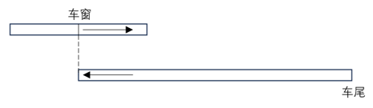

故正确答案为B。

来源：[2024年江苏省公务员录用考试《行测》（A类）答案+解析.pdf](https://github.com/dumarstoft-ship-it/xingce/blob/407016b55b49581efa3771bb59a2dee8761d982f/2024%E5%B9%B4%E6%B1%9F%E8%8B%8F%E7%9C%81%E5%85%AC%E5%8A%A1%E5%91%98%E5%BD%95%E7%94%A8%E8%80%83%E8%AF%95%E3%80%8A%E8%A1%8C%E6%B5%8B%E3%80%8B%EF%BC%88A%E7%B1%BB%EF%BC%89%E7%AD%94%E6%A1%88%2B%E8%A7%A3%E6%9E%90.pdf)，PDF 第 16 页。

## 第 53 题 · 数量关系

参考答案：**D**

【解析53—正确答案D】
设打7 折售出的无线路由器数量为x 个，打折前售出的无线路由器数量为y 个。根据题意则有：
30%×100y+[(100+30%×100)×0.7−100]x=7410；7410/[100(x+y)]=19%，整
理可得：30y-9x=7410⋯⋯①；x+y=390⋯⋯②，解得x=110。
故正确答案为D。

来源：[2024年江苏省公务员录用考试《行测》（A类）答案+解析.pdf](https://github.com/dumarstoft-ship-it/xingce/blob/407016b55b49581efa3771bb59a2dee8761d982f/2024%E5%B9%B4%E6%B1%9F%E8%8B%8F%E7%9C%81%E5%85%AC%E5%8A%A1%E5%91%98%E5%BD%95%E7%94%A8%E8%80%83%E8%AF%95%E3%80%8A%E8%A1%8C%E6%B5%8B%E3%80%8B%EF%BC%88A%E7%B1%BB%EF%BC%89%E7%AD%94%E6%A1%88%2B%E8%A7%A3%E6%9E%90.pdf)，PDF 第 16 页。

## 第 54 题 · 数量关系

参考答案：**A**

【解析54—正确答案A】
根据题意可知，小张、小王和小李每小时完结任务的单数分别为60/6=10单、60/5=12单和
60/4=15单，3 人一天最多可完结259 单，则一天工作时间为259/(10+12+15)=7小时。已知机
器人每小时可处理60/2=30单，处理工单中的80%可正常完结，剩余20%仍需人工重新办理，若机
器人剩余工单由人工重新办理，那么在相同时间内，人工少做的单数与其相同，故无需考虑机器人
处理失败的单数，由此可得当天小王、小李和机器人最多可完结30×7×80%+7×（12+15）=7×（24+27）
=357 单。
故正确答案为A。

来源：[2024年江苏省公务员录用考试《行测》（A类）答案+解析.pdf](https://github.com/dumarstoft-ship-it/xingce/blob/407016b55b49581efa3771bb59a2dee8761d982f/2024%E5%B9%B4%E6%B1%9F%E8%8B%8F%E7%9C%81%E5%85%AC%E5%8A%A1%E5%91%98%E5%BD%95%E7%94%A8%E8%80%83%E8%AF%95%E3%80%8A%E8%A1%8C%E6%B5%8B%E3%80%8B%EF%BC%88A%E7%B1%BB%EF%BC%89%E7%AD%94%E6%A1%88%2B%E8%A7%A3%E6%9E%90.pdf)，PDF 第 16、17 页。

## 第 55 题 · 数量关系

参考答案：**C**

【解析55—正确答案C】
设获得一、二、三等奖的人数分别为x 人、y 人、z 人，根据前100 个中奖者的奖金总额为2480 元，
可 列 方 程 组 ： 联立：x+y+z=100；888x+88y+8z=2480 ， 整 理 可 得 ：
联立方程：x+y+z=100……①；111x+11y+z=310……②。，①×11-②得到：10z-100x=790，即z=10x+79。若想
要获得三等奖的人数z 最少，则x 应尽量小，则当x=0 时，z=79，即获得三等奖的最少有79 人。
故正确答案为C。

来源：[2024年江苏省公务员录用考试《行测》（A类）答案+解析.pdf](https://github.com/dumarstoft-ship-it/xingce/blob/407016b55b49581efa3771bb59a2dee8761d982f/2024%E5%B9%B4%E6%B1%9F%E8%8B%8F%E7%9C%81%E5%85%AC%E5%8A%A1%E5%91%98%E5%BD%95%E7%94%A8%E8%80%83%E8%AF%95%E3%80%8A%E8%A1%8C%E6%B5%8B%E3%80%8B%EF%BC%88A%E7%B1%BB%EF%BC%89%E7%AD%94%E6%A1%88%2B%E8%A7%A3%E6%9E%90.pdf)，PDF 第 17 页。

## 第 56 题 · 数量关系

参考答案：**B**

【解析56—正确答案B】
根据选项可知，47 岁不是最年长者的年龄。又根据等差数列性质可知，4 位成员中，第二大和第三
大的年龄和为142/2=71岁，且由于47>142/4=35.5，则47 岁应是第二大的年龄，那么第三
大的年龄为71-47=24 岁，年龄公差为47-24=23 岁，故这4 人中最年长者的年龄为47+23=70 岁。
故正确答案为B。

来源：[2024年江苏省公务员录用考试《行测》（A类）答案+解析.pdf](https://github.com/dumarstoft-ship-it/xingce/blob/407016b55b49581efa3771bb59a2dee8761d982f/2024%E5%B9%B4%E6%B1%9F%E8%8B%8F%E7%9C%81%E5%85%AC%E5%8A%A1%E5%91%98%E5%BD%95%E7%94%A8%E8%80%83%E8%AF%95%E3%80%8A%E8%A1%8C%E6%B5%8B%E3%80%8B%EF%BC%88A%E7%B1%BB%EF%BC%89%E7%AD%94%E6%A1%88%2B%E8%A7%A3%E6%9E%90.pdf)，PDF 第 17 页。

## 第 57 题 · 数量关系

参考答案：**C**

【解析57—正确答案C】
方法一：赋值小王购买办公用品的经费为450（18、30 和50 的最小公倍数）元，则每个计算器为
450/18=25元，每个订书机为450/30=15元，每个档案盒为450/50=9元。若小王购买了6 个计
算器、8 个订书机，则剩余经费为450-25×6-15×8=180 元，还可购买档案盒180/9=20个。
方法二：设小王购买办公用品的经费为a 元，计算器的价格为x 元/个，订书机的价格为y 元/个，
档案盒的价格为z 元/个。根据题意可得：a=18x=30y=50z，即x=a/18，y=a/30，z=a/50。若
小王购买了6 个计算器、8 个订书机，则剩余经费为a−6×(a/18)−8×(a/30)=(2/5)a元，还可购
买档案盒(2/5)a÷(a/50)=20个。
故正确答案为C。

来源：[2024年江苏省公务员录用考试《行测》（A类）答案+解析.pdf](https://github.com/dumarstoft-ship-it/xingce/blob/407016b55b49581efa3771bb59a2dee8761d982f/2024%E5%B9%B4%E6%B1%9F%E8%8B%8F%E7%9C%81%E5%85%AC%E5%8A%A1%E5%91%98%E5%BD%95%E7%94%A8%E8%80%83%E8%AF%95%E3%80%8A%E8%A1%8C%E6%B5%8B%E3%80%8B%EF%BC%88A%E7%B1%BB%EF%BC%89%E7%AD%94%E6%A1%88%2B%E8%A7%A3%E6%9E%90.pdf)，PDF 第 17、18 页。

## 第 58 题 · 数量关系

参考答案：**B**

【解析58—正确答案B】
本题考查求圆台的侧面积，S_圆台侧=π(r+R)l，其中r 和R 分别为上、下底面的半径，l 为侧
面母线长（如下图所示）。M 型纸杯： r=50/2=25 毫米， R=70/2=35 毫米，则
l=√[80²+(35−25)²]=√(80²+10²)=10√(8²+1²)=10√65 毫米；N 型纸杯：
r=22.5 毫米，R=30 毫米，则l=√[60²+(30−22.5)²]=√(60²+7.5²)=7.5√65毫米。故
所求比例为[π×(25+35)×10√65]/[π×(22.5+30)×7.5√65]=32:21。

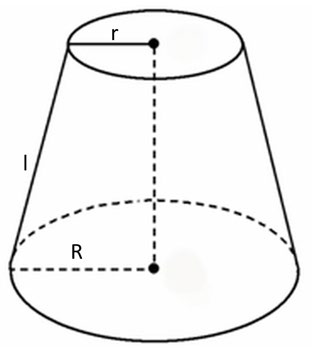

[代码描摹高清 PNG](../../../images/code_hd/435.png) · [SVG](../../../images/code_hd/435.svg)（原图为准）

故正确答案为B。

来源：[2024年江苏省公务员录用考试《行测》（A类）答案+解析.pdf](https://github.com/dumarstoft-ship-it/xingce/blob/407016b55b49581efa3771bb59a2dee8761d982f/2024%E5%B9%B4%E6%B1%9F%E8%8B%8F%E7%9C%81%E5%85%AC%E5%8A%A1%E5%91%98%E5%BD%95%E7%94%A8%E8%80%83%E8%AF%95%E3%80%8A%E8%A1%8C%E6%B5%8B%E3%80%8B%EF%BC%88A%E7%B1%BB%EF%BC%89%E7%AD%94%E6%A1%88%2B%E8%A7%A3%E6%9E%90.pdf)，PDF 第 18 页。

## 第 59 题 · 数量关系

参考答案：**D**

【解析59—正确答案D】
根据题意，总情况是从8 个节目中随机选出3 个，情况数为C(8,3)种；符合条件的情况是小张所在科
室出的2 个节目中至少有一个被选送，即有1 个节目或者2 个节目被选送。正面情况较复杂，可从
反面分析。反面情况为3 个选送节目均不来自小张所在的科室，则从另外8-2=6 个节目中随机选出
3 个，情况数为C(6,3)种。故题干所求概率P=1−P_{3个选送节目均不来自小张所在的科室}=1−C(6,3)/C(8,3)
=1−5/14=9/14。
故正确答案为D。

来源：[2024年江苏省公务员录用考试《行测》（A类）答案+解析.pdf](https://github.com/dumarstoft-ship-it/xingce/blob/407016b55b49581efa3771bb59a2dee8761d982f/2024%E5%B9%B4%E6%B1%9F%E8%8B%8F%E7%9C%81%E5%85%AC%E5%8A%A1%E5%91%98%E5%BD%95%E7%94%A8%E8%80%83%E8%AF%95%E3%80%8A%E8%A1%8C%E6%B5%8B%E3%80%8B%EF%BC%88A%E7%B1%BB%EF%BC%89%E7%AD%94%E6%A1%88%2B%E8%A7%A3%E6%9E%90.pdf)，PDF 第 18 页。

## 第 60 题 · 数量关系

参考答案：**C**

【解析60—正确答案C】
因丈夫每周一、三、五游泳，且2023 年12 月1 日为周五，所以2023 年12 月丈夫前三次游泳的日
期为1 日（周五）、4 日（周一）、6 日（周三），以7 天一星期的周期进行推算，2023 年12 月丈夫游
泳的日期如下表所示：
|周次|星期一|星期二|星期三|星期四|星期五|星期六|星期日|
|---|---|---|---|---|---|---|---|
|第1周|||||1日|||
|第2周|4日||6日||8日|||
|第3周|11日||13日||15日|||
|第4周|18日||20日||22日|||
|第5周|25日||27日||29日|||
其中日期为质数的有11 日、13 日、29 日，共3 天，即该夫妇2023 年12 月同日游泳的天数是3 天。
故正确答案为C。

来源：[2024年江苏省公务员录用考试《行测》（A类）答案+解析.pdf](https://github.com/dumarstoft-ship-it/xingce/blob/407016b55b49581efa3771bb59a2dee8761d982f/2024%E5%B9%B4%E6%B1%9F%E8%8B%8F%E7%9C%81%E5%85%AC%E5%8A%A1%E5%91%98%E5%BD%95%E7%94%A8%E8%80%83%E8%AF%95%E3%80%8A%E8%A1%8C%E6%B5%8B%E3%80%8B%EF%BC%88A%E7%B1%BB%EF%BC%89%E7%AD%94%E6%A1%88%2B%E8%A7%A3%E6%9E%90.pdf)，PDF 第 18、19 页。

## 第 61 题 · 数量关系

参考答案：**A**

【解析61—正确答案A】
根据题意可得，9×乙+6×（甲+乙）=60%×工作总量······①，10×丙=（1-60%）×工作总
量······②，①÷②可得：[9×乙+6×(甲+乙)]/(10×丙)=(60%×工作总量)/[(1−60%)×工作总量]，则2 甲
+5 乙=5 丙，依次代入选项：
A 项：赋值甲、乙、丙三人的工作效率分别为5、4、6，则2×5+5×4=30=5×6，满足题干条件，当
选；
B 项：赋值甲、乙、丙三人的工作效率分别为6、4、5，则2×6+5×4=32≠5×5，不满足题
干条件，排除；
C 项：赋值甲、乙、丙三人的工作效率分别为10、15、12，则2×10+5×15=95≠5×12，
不满足题干条件，排除；
D 项：赋值甲、乙、丙三人的工作效率分别为12、15、10，则2×12+5×15=99≠5×10，
不满足题干条件，排除。
故正确答案为A。

来源：[2024年江苏省公务员录用考试《行测》（A类）答案+解析.pdf](https://github.com/dumarstoft-ship-it/xingce/blob/407016b55b49581efa3771bb59a2dee8761d982f/2024%E5%B9%B4%E6%B1%9F%E8%8B%8F%E7%9C%81%E5%85%AC%E5%8A%A1%E5%91%98%E5%BD%95%E7%94%A8%E8%80%83%E8%AF%95%E3%80%8A%E8%A1%8C%E6%B5%8B%E3%80%8B%EF%BC%88A%E7%B1%BB%EF%BC%89%E7%AD%94%E6%A1%88%2B%E8%A7%A3%E6%9E%90.pdf)，PDF 第 19 页。

## 第 62 题 · 数量关系

参考答案：**C**

【解析62—正确答案C】
5 名专员分配到4 个城市，其中每个一线城市至少派1 名专员，每个二线城市只派1 名专员，则5 名
专员中有3 名专员分配到2 个一线城市（分别为2 名专员和1 名专员），其余2 名专员分配到2 个二
线城市（各1 名专员）。从5 名专员中选出2 名专员，再从剩下3 名专员中选出1 名专员，这两组人
分配到2 个一线城市，有C(5,2)×C(3,1)×A(2,2)=60种；剩下2 名专员分配到2 个二线城市，有A(2,2)=2
种。分步用乘法，则不同的派出方法共有60×2=120 种。
故正确答案为C。

来源：[2024年江苏省公务员录用考试《行测》（A类）答案+解析.pdf](https://github.com/dumarstoft-ship-it/xingce/blob/407016b55b49581efa3771bb59a2dee8761d982f/2024%E5%B9%B4%E6%B1%9F%E8%8B%8F%E7%9C%81%E5%85%AC%E5%8A%A1%E5%91%98%E5%BD%95%E7%94%A8%E8%80%83%E8%AF%95%E3%80%8A%E8%A1%8C%E6%B5%8B%E3%80%8B%EF%BC%88A%E7%B1%BB%EF%BC%89%E7%AD%94%E6%A1%88%2B%E8%A7%A3%E6%9E%90.pdf)，PDF 第 19 页。

## 第 63 题 · 数量关系

参考答案：**A**

【解析63—正确答案A】
根据题意，小陆在第一排剩余的任意点位上植树，都恰好有一个相邻点位有人在植树，且要求预设
点位数尽可能多，则每个已有人在植树的点位之间应该有两个无人植树的点位，如下图所示。（圆形
和三角形分别代表无人植树和已有人在植树的点位）
…… △ ○ ○ △ ○ ○ △ ……（各符号沿同一直线等间距排列。）
为使预设点位数尽可能多，则第一个已有人在植树的点位左侧最多可安排一个无人植树的点位，最
后一个已有人在植树的点位右侧最多可安排一个无人植树的点位，如下图所示。
○ △ ○ ○ △ ○ ○ △ …… ○ ○ △ ○（各符号沿同一直线等间距排列。）
即相当于每3 个点位为一个周期，每个周期中有1 个已有人在植树的点位，且位于中间位置。根据
已有人在植树的点位有9 个，则该植树点第一排最多有9×3=27 个预设点位。
故正确答案为A。

来源：[2024年江苏省公务员录用考试《行测》（A类）答案+解析.pdf](https://github.com/dumarstoft-ship-it/xingce/blob/407016b55b49581efa3771bb59a2dee8761d982f/2024%E5%B9%B4%E6%B1%9F%E8%8B%8F%E7%9C%81%E5%85%AC%E5%8A%A1%E5%91%98%E5%BD%95%E7%94%A8%E8%80%83%E8%AF%95%E3%80%8A%E8%A1%8C%E6%B5%8B%E3%80%8B%EF%BC%88A%E7%B1%BB%EF%BC%89%E7%AD%94%E6%A1%88%2B%E8%A7%A3%E6%9E%90.pdf)，PDF 第 19、20 页。

## 第 64 题 · 数量关系

参考答案：**C**

【解析64—正确答案C】
根据题意可得，参加甲活动的会员人数为180×60%=108 人，参加乙活动的会员人数为180×50%=90
人，根据“只参加甲活动的会员有80 人”，可得甲、乙两项活动都参加的会员人数为108-80=28 人，
如下图所示：
集合示意：甲活动共108人，乙活动共90人；只参加甲活动80人，同时参加甲、乙活动28人。原图未在“只参加乙”区域填写数字。
则只参加乙活动的会员有90-28=62 人。
故正确答案为C。

来源：[2024年江苏省公务员录用考试《行测》（A类）答案+解析.pdf](https://github.com/dumarstoft-ship-it/xingce/blob/407016b55b49581efa3771bb59a2dee8761d982f/2024%E5%B9%B4%E6%B1%9F%E8%8B%8F%E7%9C%81%E5%85%AC%E5%8A%A1%E5%91%98%E5%BD%95%E7%94%A8%E8%80%83%E8%AF%95%E3%80%8A%E8%A1%8C%E6%B5%8B%E3%80%8B%EF%BC%88A%E7%B1%BB%EF%BC%89%E7%AD%94%E6%A1%88%2B%E8%A7%A3%E6%9E%90.pdf)，PDF 第 20 页。

## 第 65 题 · 数量关系

参考答案：**A**

【解析65—正确答案A】
方法一：由于ABCDEF 是正六边形，可得AC=CE=EA，即△ACE为正三角形，则△ACE内切圆
的圆心O 即为正六边形ABCDEF 的中心。作△ACE的中线AH，连接FO，△AOF为正三角形，
如下图所示：

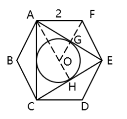

[代码描摹高清 PNG](../../../images/code_hd/1085.png) · [SVG](../../../images/code_hd/1085.svg)（原图为准）

已知 AF=FE=2 ，且正六边形内角 ∠AFE=120° ，则 ∠FAE=∠FEA=30° ，
AE=√3×AF=2√3 。 在 直 角 △AEH 中 ， ∠AEH=60° ，
AH=(√3/2)×AE=(√3/2)×2√3=3，且AO=AF=2，所以所求圆半径OH=AH-AO=3-2=1，所求圆
面积=πr²=π×1²=π。
方法二：如下图所示，连接AO、FO，△AOF为正三角形，由于AO 为△ACE的中线且
∠CAF=90°，则∠CAO=∠OAG=∠GAF=30°，AG 为△AOF的中线，即所求圆半
径OG=GF=(1/2)OF=(1/2)AF=1，所求圆面积=πr²=π×1²=π。

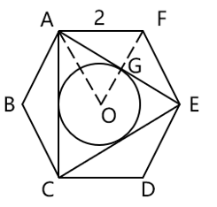

[代码描摹高清 PNG](../../../images/code_hd/677.png) · [SVG](../../../images/code_hd/677.svg)（原图为准）

故正确答案为A。

来源：[2024年江苏省公务员录用考试《行测》（A类）答案+解析.pdf](https://github.com/dumarstoft-ship-it/xingce/blob/407016b55b49581efa3771bb59a2dee8761d982f/2024%E5%B9%B4%E6%B1%9F%E8%8B%8F%E7%9C%81%E5%85%AC%E5%8A%A1%E5%91%98%E5%BD%95%E7%94%A8%E8%80%83%E8%AF%95%E3%80%8A%E8%A1%8C%E6%B5%8B%E3%80%8B%EF%BC%88A%E7%B1%BB%EF%BC%89%E7%AD%94%E6%A1%88%2B%E8%A7%A3%E6%9E%90.pdf)，PDF 第 20、21 页。

## 第 66 题 · 判断推理

参考答案：**D**

【解析66—正确答案D】
第一步：判断题干词语间逻辑关系。
“保护知识产权”是“保护创新”的重要手段和举措，通过“保护知识产权”能达到“保护创新”
的目的，二者为方式与目的的对应关系。
第二步：判断选项词语间逻辑关系。
A 项：“人之初，性本善”的意思是人出生之初，禀性本身都是善良的。“人之初”与“性本善”不
是方式与目的的对应关系，与题干逻辑关系不一致，排除。
B 项：“德不孤，必有邻”的意思是有道德的人是不会孤单的，必定会有志同道合的人来与他为伴。
“德不孤”与“必有邻”不是方式与目的的对应关系，与题干逻辑关系不一致，排除。
C 项：“勤有功，戏无益”的意思是人只要勤奋努力，就会有所成就；而嬉戏贪玩则对人没有任何好
处。“勤有功”与“戏无益”不是方式与目的的对应关系，与题干逻辑关系不一致，排除。
D 项：“经一事，长一智”的意思是亲身经历了某件事情，就能增长关于这方面的知识。通过“经一
事”能达到“长一智”的目的，二者为方式与目的的对应关系，与题干逻辑关系一致，当选。
故正确答案为D。

来源：[2024年江苏省公务员录用考试《行测》（A类）答案+解析.pdf](https://github.com/dumarstoft-ship-it/xingce/blob/407016b55b49581efa3771bb59a2dee8761d982f/2024%E5%B9%B4%E6%B1%9F%E8%8B%8F%E7%9C%81%E5%85%AC%E5%8A%A1%E5%91%98%E5%BD%95%E7%94%A8%E8%80%83%E8%AF%95%E3%80%8A%E8%A1%8C%E6%B5%8B%E3%80%8B%EF%BC%88A%E7%B1%BB%EF%BC%89%E7%AD%94%E6%A1%88%2B%E8%A7%A3%E6%9E%90.pdf)，PDF 第 21 页。

## 第 67 题 · 判断推理

参考答案：**C**

【解析67—正确答案C】
第一步：判断题干词语间逻辑关系。
“年华未暮，容貌先秋”的意思是未到衰老的年纪，而容颜已经老去，虽然“年华未暮”，但是“容
貌先秋”，二者为转折的对应关系。
第二步：判断选项词语间逻辑关系。
A 项：“十年树木，百年树人”的意思是培植树木需要十年，培育人才需要百年，指培养人才很不容
易，二者为并列关系，与题干逻辑关系不一致，排除；
B 项：“宁为玉碎，不为瓦全”的意思是宁愿做高贵的玉器而破碎，也不愿做低贱的瓦器得以保全，
比喻宁为正义事业而牺牲，也不苟且偷生，二者为并列关系，与题干逻辑关系不一致，排除；
C 项：“言者无心，听者有意”的意思是说话的人不注意，而听话的人却很留神，虽然“言者无心”，
但是“听者有意”，二者为转折的对应关系，与题干逻辑关系一致，当选；
D 项：“人无远虑，必有近忧”的意思是人若没有长远的谋虑，一定很快就有忧患，二者为条件的对
应关系，与题干逻辑关系不一致，排除。
故正确答案为C。

来源：[2024年江苏省公务员录用考试《行测》（A类）答案+解析.pdf](https://github.com/dumarstoft-ship-it/xingce/blob/407016b55b49581efa3771bb59a2dee8761d982f/2024%E5%B9%B4%E6%B1%9F%E8%8B%8F%E7%9C%81%E5%85%AC%E5%8A%A1%E5%91%98%E5%BD%95%E7%94%A8%E8%80%83%E8%AF%95%E3%80%8A%E8%A1%8C%E6%B5%8B%E3%80%8B%EF%BC%88A%E7%B1%BB%EF%BC%89%E7%AD%94%E6%A1%88%2B%E8%A7%A3%E6%9E%90.pdf)，PDF 第 21、22 页。

## 第 68 题 · 判断推理

参考答案：**D**

【解析68—正确答案D】
第一步：判断题干词语间逻辑关系。
“吴王好剑客，百姓多创瘢”的意思是吴王喜爱精通剑术的侠客，为此老百姓身上伤痕累累。因为
“吴王好剑客”，所以“百姓多创瘢”，二者为因果对应关系。
第二步：判断选项词语间逻辑关系。
A 项：“白日依山尽，黄河入海流”的意思是太阳依傍着西山慢慢地沉落，滔滔黄河朝着大海汹涌奔
流。“白日依山尽”与“黄河入海流”为并列关系，与题干逻辑关系不一致，排除。
B 项：“问君何能尔？心远地自偏”的意思是问我如何能做到这样，只要心中所想远离世俗，自然就
会觉得所处地方僻静了。“问君何能尔”不是“心远地自偏”的原因，二者不是因果对应关系，与
题干逻辑关系不一致，排除。
C 项：“海上生明月，天涯共此时”的意思是茫茫的海上升起一轮明月，使人忆起远隔天涯海角的亲
友，此时应该都在望着这轮明月。“海上生明月”不是“天涯共此时”的原因，二者不是因果对应
关系，与题干逻辑关系不一致，排除。
D 项：“烽火连三月，家书抵万金”的意思是连绵的战火已经持续很长时间了，家书难得，一封抵得
上万两黄金。因为“烽火连三月”，所以“家书抵万金”，二者为因果对应关系，与题干逻辑关系
一致，当选。
故正确答案为D。

来源：[2024年江苏省公务员录用考试《行测》（A类）答案+解析.pdf](https://github.com/dumarstoft-ship-it/xingce/blob/407016b55b49581efa3771bb59a2dee8761d982f/2024%E5%B9%B4%E6%B1%9F%E8%8B%8F%E7%9C%81%E5%85%AC%E5%8A%A1%E5%91%98%E5%BD%95%E7%94%A8%E8%80%83%E8%AF%95%E3%80%8A%E8%A1%8C%E6%B5%8B%E3%80%8B%EF%BC%88A%E7%B1%BB%EF%BC%89%E7%AD%94%E6%A1%88%2B%E8%A7%A3%E6%9E%90.pdf)，PDF 第 22 页。

## 第 69 题 · 判断推理

参考答案：**C**

【解析69—正确答案C】
第一步：判断题干词语间逻辑关系。
“停”和“止”均指“停止”，第一词与第三词为全同关系，“行”指“走、移动”，“停”、“止”
与“行”是两种不同的状态，且除了“停（止）”就是“行”，第一词和第三词均与第二词构成矛
盾关系。
第二步：判断选项词语间逻辑关系。
A 项：“日”、“月”、“星”三者为并列关系，与题干逻辑关系不一致，排除；
B 项：“满”指“达到容量的极点”，“盈”指“充满、多出来”，第一词与第三词为近义关系，
“亏”指“受损失、欠缺”，“盈”和“亏”语义相反，第二词与第三词构成反义关系，且生意除
了“盈”和“亏”外还有“不盈不亏”，第一词和第三词与第二词并不构成矛盾关系，与题干逻辑
关系不一致，排除；
C 项：“没”和“无”均指“没有、不存在”，第一词与第三词为全同关系，“有”指“存在”，
“没”、“无”与“有”是两种不同的状态，且除了“没（无）”就是“有”，第一词和第三词均
与第二词构成矛盾关系，与题干逻辑关系一致，当选；
D 项：“萌”、“荣”、“枯”分别指植物或草木“发芽”、“茂盛”、“失去水分”，三者为状态
先后顺序的对应关系，与题干逻辑关系不一致，排除。
故正确答案为C。

来源：[2024年江苏省公务员录用考试《行测》（A类）答案+解析.pdf](https://github.com/dumarstoft-ship-it/xingce/blob/407016b55b49581efa3771bb59a2dee8761d982f/2024%E5%B9%B4%E6%B1%9F%E8%8B%8F%E7%9C%81%E5%85%AC%E5%8A%A1%E5%91%98%E5%BD%95%E7%94%A8%E8%80%83%E8%AF%95%E3%80%8A%E8%A1%8C%E6%B5%8B%E3%80%8B%EF%BC%88A%E7%B1%BB%EF%BC%89%E7%AD%94%E6%A1%88%2B%E8%A7%A3%E6%9E%90.pdf)，PDF 第 22、23 页。

## 第 70 题 · 判断推理

参考答案：**B**

【解析70—正确答案B】
第一步：判断题干词语间逻辑关系。
“球员”参与“球赛”，二者为活动与主体的对应关系；“裁判”判罚“球员”，二者为主体与被
判罚对象的对应关系。
第二步：判断选项词语间逻辑关系。
A 项：“教师”参与“教学”，二者为活动与主体的对应关系，但“家长”不能判罚“教师”，与题
干逻辑关系不一致，排除。
B 项：“被告”参与“庭审”，二者为活动与主体的对应关系；“法官”判罚“被告”，二者为主体
与被判罚对象的对应关系。与题干逻辑关系一致，当选。
C 项：“球员”在“球场”打球，二者是地点与主体的对应关系，与题干逻辑关系不一致，排除。
D 项：“患者”接受“手术”，而不是参与“手术”，且“护士”不能判罚“患者”，与题干逻辑关
系不一致，排除。
故正确答案为B。

来源：[2024年江苏省公务员录用考试《行测》（A类）答案+解析.pdf](https://github.com/dumarstoft-ship-it/xingce/blob/407016b55b49581efa3771bb59a2dee8761d982f/2024%E5%B9%B4%E6%B1%9F%E8%8B%8F%E7%9C%81%E5%85%AC%E5%8A%A1%E5%91%98%E5%BD%95%E7%94%A8%E8%80%83%E8%AF%95%E3%80%8A%E8%A1%8C%E6%B5%8B%E3%80%8B%EF%BC%88A%E7%B1%BB%EF%BC%89%E7%AD%94%E6%A1%88%2B%E8%A7%A3%E6%9E%90.pdf)，PDF 第 23 页。

## 第 71 题 · 判断推理

参考答案：**A**

【解析71—正确答案A】
第一步：判断题干词语间逻辑关系。
“戏剧”和“壁画”是两种不同的艺术形式，二者为并列关系中的反对关系；“戏剧”和“壁画”
都能够反映“生活”，前两个词分别与第三个词构成反映对象的对应关系。
第二步：判断选项词语间逻辑关系。
A 项：“陈设”和“衣饰”是两种不同的外在表现，二者为并列关系中的反对关系；“陈设”和“衣
饰”都能够反映“性格”，前两个词分别与第三个词构成反映对象的对应关系。与题干逻辑关系一
致，当选。
B 项：“字形”指字的形体，“字音”指字的读音，二者为并列关系中的反对关系，但二者均不能反
映“情感”，与题干逻辑关系不一致，排除。
C 项：“文章”和“书法”是两种不同的艺术作品，二者为并列关系中的反对关系，但“书法”不能
反映“人品”，与题干逻辑关系不一致，排除。
D 项：“时针”是“钟表”的组成部分，二者为包容关系中的组成关系，与题干逻辑关系不一致，排
除。
故正确答案为A。

来源：[2024年江苏省公务员录用考试《行测》（A类）答案+解析.pdf](https://github.com/dumarstoft-ship-it/xingce/blob/407016b55b49581efa3771bb59a2dee8761d982f/2024%E5%B9%B4%E6%B1%9F%E8%8B%8F%E7%9C%81%E5%85%AC%E5%8A%A1%E5%91%98%E5%BD%95%E7%94%A8%E8%80%83%E8%AF%95%E3%80%8A%E8%A1%8C%E6%B5%8B%E3%80%8B%EF%BC%88A%E7%B1%BB%EF%BC%89%E7%AD%94%E6%A1%88%2B%E8%A7%A3%E6%9E%90.pdf)，PDF 第 23 页。

## 第 72 题 · 判断推理

参考答案：**B**

【解析72—正确答案B】
第一步：判断题干词语间逻辑关系。
“海军装备”是一种“军事装备”，二者为包容关系中的种属关系；“维护海军装备”“维护军事
装备”，第三个词与前两个词分别构成动宾关系。
第二步：判断选项词语间逻辑关系。
A 项：“跳高比赛”是一种“田径比赛”，二者为包容关系中的种属关系，但词语顺序与题干相反，
与题干逻辑关系不一致，排除。
B 项：“舞蹈表演”是一种“艺术表演”，二者为包容关系中的种属关系；“观赏舞蹈表演”“观赏
艺术表演”，第三个词与前两个词分别构成动宾关系。与题干逻辑关系一致，当选。
C 项：“购车补贴”和“购房补贴”是两种不同的补贴，二者为并列关系，与题干逻辑关系不一致，
排除。
D 项：“数字贸易”是一种“新兴贸易”，二者为包容关系中的种属关系；“互惠”是贸易的特点，
第三个词与前两个词分别构成属性对应关系。与题干逻辑关系不一致，排除。
故正确答案为B。

来源：[2024年江苏省公务员录用考试《行测》（A类）答案+解析.pdf](https://github.com/dumarstoft-ship-it/xingce/blob/407016b55b49581efa3771bb59a2dee8761d982f/2024%E5%B9%B4%E6%B1%9F%E8%8B%8F%E7%9C%81%E5%85%AC%E5%8A%A1%E5%91%98%E5%BD%95%E7%94%A8%E8%80%83%E8%AF%95%E3%80%8A%E8%A1%8C%E6%B5%8B%E3%80%8B%EF%BC%88A%E7%B1%BB%EF%BC%89%E7%AD%94%E6%A1%88%2B%E8%A7%A3%E6%9E%90.pdf)，PDF 第 23、24 页。

## 第 73 题 · 判断推理

参考答案：**D**

【解析73—正确答案D】
第一步：判断题干词语间逻辑关系。
根据获取途径的不同，成果可分为“实践成果”和“理论成果”，二者为矛盾关系；“阶段成果”
指一定时间或任务阶段取得的工作成果，与“实践成果”和“理论成果”分别构成交叉关系。
第二步：判断选项词语间逻辑关系。
A 项：创新可分为“经济创新”“文化创新”“政治创新”等，三者为并列关系，与题干逻辑关系不
一致，排除。
B 项：“读写辅导”是针对阅读、写作开展的辅导，由“阅读辅导”和“写作辅导”组成，第二个词
与第一、三个词分别构成组成关系，与题干逻辑关系不一致，排除。
C 项：根据旅行的目的地不同，旅行可分为“环岛旅行”“太空旅行”等，二者为反对关系，与题干
逻辑关系不一致，排除。
D 项：根据形式不同，文明可分为“物质文明”和“精神文明”，二者为矛盾关系；“现代文明”与
“物质文明”和“精神文明”分别构成交叉关系。与题干逻辑关系一致，当选。
故正确答案为D。

来源：[2024年江苏省公务员录用考试《行测》（A类）答案+解析.pdf](https://github.com/dumarstoft-ship-it/xingce/blob/407016b55b49581efa3771bb59a2dee8761d982f/2024%E5%B9%B4%E6%B1%9F%E8%8B%8F%E7%9C%81%E5%85%AC%E5%8A%A1%E5%91%98%E5%BD%95%E7%94%A8%E8%80%83%E8%AF%95%E3%80%8A%E8%A1%8C%E6%B5%8B%E3%80%8B%EF%BC%88A%E7%B1%BB%EF%BC%89%E7%AD%94%E6%A1%88%2B%E8%A7%A3%E6%9E%90.pdf)，PDF 第 24 页。

## 第 74 题 · 判断推理

参考答案：**D**

【解析74—正确答案D】
逐一代入选项。
A 项：“敬重”指恭敬尊重，“尊重”指尊敬，敬重，二者为近义关系；“谨慎”指对外界事物或自
己的言行密切注意，以免发生不利或不幸的事情，“拘谨”指（言语、行动）过分谨慎，拘束，二者
无明显逻辑关系，前后逻辑关系不一致，排除；
B 项：“敬重”指恭敬尊重，“蔑视”指轻视、小看，二者为反义关系；“拘束”指过分约束自己，
显得不自然，“拘谨”指（言语、行动）过分谨慎，拘束，二者为近义关系，前后逻辑关系不一致，
排除；
C 项：“敬重”指恭敬尊重，“尊崇”指尊敬推崇，二者为近义关系；“豪放”指气魄大而无所拘
束，“拘谨”指（言语、行动）过分谨慎，拘束，二者为反义关系，前后逻辑关系不一致，排除；
D 项：“敬重”指恭敬尊重，“鄙视”指轻视、看不起，二者为反义关系；“洒脱”指（言谈、举止、
风格）自然、不拘束，“拘谨”指（言语、行动）过分谨慎，拘束，二者为反义关系，前后逻辑关系
一致，当选。
故正确答案为D。

来源：[2024年江苏省公务员录用考试《行测》（A类）答案+解析.pdf](https://github.com/dumarstoft-ship-it/xingce/blob/407016b55b49581efa3771bb59a2dee8761d982f/2024%E5%B9%B4%E6%B1%9F%E8%8B%8F%E7%9C%81%E5%85%AC%E5%8A%A1%E5%91%98%E5%BD%95%E7%94%A8%E8%80%83%E8%AF%95%E3%80%8A%E8%A1%8C%E6%B5%8B%E3%80%8B%EF%BC%88A%E7%B1%BB%EF%BC%89%E7%AD%94%E6%A1%88%2B%E8%A7%A3%E6%9E%90.pdf)，PDF 第 24 页。

## 第 75 题 · 判断推理

参考答案：**A**

【解析75—正确答案A】
逐一代入选项。
A 项：牙齿磨损程度可以反映年龄大小，用电总量大小可以反映经济活力，二者均为对应关系，前后
逻辑关系一致，当选；
B 项：牙齿磨损可能会导致牙齿脱落，二者为因果关系；经济活力是指一国一定时期内经济中总供给
和总需求的增长速度及其潜力，社会效益是指各种经济活动及科学技术、教育、文学、艺术等在社
会上产生的非经济性效果和利益，与经济活力为并列关系，前后逻辑关系不一致，排除；
C 项：牙齿磨损不是一种骨骼磨损，二者无明显逻辑关系；经济活力是指一国一定时期内经济中总供
给和总需求的增长速度及其潜力，而发展指数是指衡量某一领域发展程度的一种数据标准，经济活
力会影响发展指数，二者为对应关系，前后逻辑关系不一致，排除；
D 项：食用坚硬食物会导致牙齿磨损，二者为因果关系；经济疲软说明经济活力低，二者为对应关
系，前后逻辑关系不一致，排除。
故正确答案为A。

来源：[2024年江苏省公务员录用考试《行测》（A类）答案+解析.pdf](https://github.com/dumarstoft-ship-it/xingce/blob/407016b55b49581efa3771bb59a2dee8761d982f/2024%E5%B9%B4%E6%B1%9F%E8%8B%8F%E7%9C%81%E5%85%AC%E5%8A%A1%E5%91%98%E5%BD%95%E7%94%A8%E8%80%83%E8%AF%95%E3%80%8A%E8%A1%8C%E6%B5%8B%E3%80%8B%EF%BC%88A%E7%B1%BB%EF%BC%89%E7%AD%94%E6%A1%88%2B%E8%A7%A3%E6%9E%90.pdf)，PDF 第 24 页。

## 第 76 题 · 判断推理

参考答案：**未确定 / 来源缺失**

> 现有来源未提供参考答案及解析。

【解析76—题目缺失，暂缺】

来源：[2024年江苏省公务员录用考试《行测》（A类）答案+解析.pdf](https://github.com/dumarstoft-ship-it/xingce/blob/407016b55b49581efa3771bb59a2dee8761d982f/2024%E5%B9%B4%E6%B1%9F%E8%8B%8F%E7%9C%81%E5%85%AC%E5%8A%A1%E5%91%98%E5%BD%95%E7%94%A8%E8%80%83%E8%AF%95%E3%80%8A%E8%A1%8C%E6%B5%8B%E3%80%8B%EF%BC%88A%E7%B1%BB%EF%BC%89%E7%AD%94%E6%A1%88%2B%E8%A7%A3%E6%9E%90.pdf)，PDF 第 25 页。

## 第 77 题 · 判断推理

参考答案：**未确定 / 来源缺失**

> 现有来源未提供参考答案及解析。

【解析77—题目缺失，暂缺】

来源：[2024年江苏省公务员录用考试《行测》（A类）答案+解析.pdf](https://github.com/dumarstoft-ship-it/xingce/blob/407016b55b49581efa3771bb59a2dee8761d982f/2024%E5%B9%B4%E6%B1%9F%E8%8B%8F%E7%9C%81%E5%85%AC%E5%8A%A1%E5%91%98%E5%BD%95%E7%94%A8%E8%80%83%E8%AF%95%E3%80%8A%E8%A1%8C%E6%B5%8B%E3%80%8B%EF%BC%88A%E7%B1%BB%EF%BC%89%E7%AD%94%E6%A1%88%2B%E8%A7%A3%E6%9E%90.pdf)，PDF 第 25 页。

## 第 78 题 · 判断推理

参考答案：**未确定 / 来源缺失**

> 现有来源未提供参考答案及解析。

【解析78—题目缺失，暂缺】

来源：[2024年江苏省公务员录用考试《行测》（A类）答案+解析.pdf](https://github.com/dumarstoft-ship-it/xingce/blob/407016b55b49581efa3771bb59a2dee8761d982f/2024%E5%B9%B4%E6%B1%9F%E8%8B%8F%E7%9C%81%E5%85%AC%E5%8A%A1%E5%91%98%E5%BD%95%E7%94%A8%E8%80%83%E8%AF%95%E3%80%8A%E8%A1%8C%E6%B5%8B%E3%80%8B%EF%BC%88A%E7%B1%BB%EF%BC%89%E7%AD%94%E6%A1%88%2B%E8%A7%A3%E6%9E%90.pdf)，PDF 第 25 页。

## 第 79 题 · 判断推理

参考答案：**B**

【解析79—正确答案B】
元素组成相同，优先考虑位置规律。九宫格优先横向看，第一行中，图一经过逆时针旋转90°得到图
二，图二经过上下翻转得到图三；第二行经验证，符合该规律；第三行应用规律，只有B 项符合。
故正确答案为B。

来源：[2024年江苏省公务员录用考试《行测》（A类）答案+解析.pdf](https://github.com/dumarstoft-ship-it/xingce/blob/407016b55b49581efa3771bb59a2dee8761d982f/2024%E5%B9%B4%E6%B1%9F%E8%8B%8F%E7%9C%81%E5%85%AC%E5%8A%A1%E5%91%98%E5%BD%95%E7%94%A8%E8%80%83%E8%AF%95%E3%80%8A%E8%A1%8C%E6%B5%8B%E3%80%8B%EF%BC%88A%E7%B1%BB%EF%BC%89%E7%AD%94%E6%A1%88%2B%E8%A7%A3%E6%9E%90.pdf)，PDF 第 25 页。

## 第 80 题 · 判断推理

参考答案：**A**

【解析80—正确答案A】
元素组成相同，但无位置规律和属性规律，考虑数量规律。九宫格优先横向看，观察发现，题干已
知图形中黑球的数量均为7，排除B 项。继续观察发现，题干已知图形中黑球和白球分堆明显，考虑
部分数，题干已知图形中黑球和白球的部分数均为3，问号处图形也应遵循此规律，只有A 项符合。
故正确答案为A。

来源：[2024年江苏省公务员录用考试《行测》（A类）答案+解析.pdf](https://github.com/dumarstoft-ship-it/xingce/blob/407016b55b49581efa3771bb59a2dee8761d982f/2024%E5%B9%B4%E6%B1%9F%E8%8B%8F%E7%9C%81%E5%85%AC%E5%8A%A1%E5%91%98%E5%BD%95%E7%94%A8%E8%80%83%E8%AF%95%E3%80%8A%E8%A1%8C%E6%B5%8B%E3%80%8B%EF%BC%88A%E7%B1%BB%EF%BC%89%E7%AD%94%E6%A1%88%2B%E8%A7%A3%E6%9E%90.pdf)，PDF 第 25 页。

## 第 81 题 · 判断推理

参考答案：**B**

【解析81—正确答案B】
元素组成相同，优先考虑位置规律。观察发现，题干已知图形均可看作九宫格，考虑内、外圈分开

[代码描摹高清 PNG](../../../images/code_hd/81.png) · [SVG](../../../images/code_hd/81.svg)（原图为准）

看。从第一幅图到第五幅图，外圈的 依次顺时针移动1、2、3、4 格，故从第五幅图到问号处

[代码描摹高清 PNG](../../../images/code_hd/81.png) · [SVG](../../../images/code_hd/81.svg)（原图为准）

[代码描摹高清 PNG](../../../images/code_hd/81.png) · [SVG](../../../images/code_hd/81.svg)（原图为准）

图形，外圈的 应顺时针移动5 格，排除C、D 两项；内部的 依次顺时针旋转90°，只有
B 项符合。
故正确答案为B。

来源：[2024年江苏省公务员录用考试《行测》（A类）答案+解析.pdf](https://github.com/dumarstoft-ship-it/xingce/blob/407016b55b49581efa3771bb59a2dee8761d982f/2024%E5%B9%B4%E6%B1%9F%E8%8B%8F%E7%9C%81%E5%85%AC%E5%8A%A1%E5%91%98%E5%BD%95%E7%94%A8%E8%80%83%E8%AF%95%E3%80%8A%E8%A1%8C%E6%B5%8B%E3%80%8B%EF%BC%88A%E7%B1%BB%EF%BC%89%E7%AD%94%E6%A1%88%2B%E8%A7%A3%E6%9E%90.pdf)，PDF 第 25 页。

## 第 82 题 · 判断推理

参考答案：**A**

【解析82—正确答案A】
本题考查平面拼合，可采用平行且等长相消的方法解题。消去平行且等长的线段后进行拼合可得到
轮廓图，即为A 项。平行且等长相消的方式如下图所示。

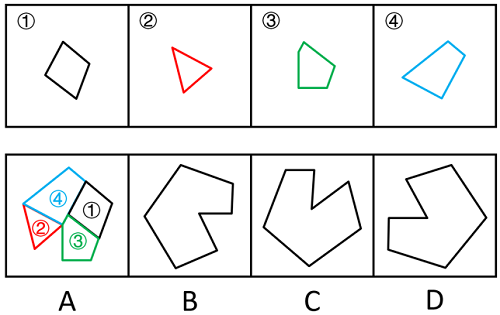

故正确答案为A。

来源：[2024年江苏省公务员录用考试《行测》（A类）答案+解析.pdf](https://github.com/dumarstoft-ship-it/xingce/blob/407016b55b49581efa3771bb59a2dee8761d982f/2024%E5%B9%B4%E6%B1%9F%E8%8B%8F%E7%9C%81%E5%85%AC%E5%8A%A1%E5%91%98%E5%BD%95%E7%94%A8%E8%80%83%E8%AF%95%E3%80%8A%E8%A1%8C%E6%B5%8B%E3%80%8B%EF%BC%88A%E7%B1%BB%EF%BC%89%E7%AD%94%E6%A1%88%2B%E8%A7%A3%E6%9E%90.pdf)，PDF 第 25 页。

## 第 83 题 · 判断推理

参考答案：**B**

【解析83—正确答案B】
本题考查平面拼合，可采用平行且等长相消的方法解题。消去平行且等长的线段后进行拼合可得到
轮廓图，即为B 项。平行且等长相消的方式如下图所示。

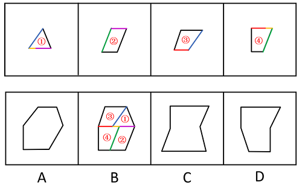

故正确答案为B。

来源：[2024年江苏省公务员录用考试《行测》（A类）答案+解析.pdf](https://github.com/dumarstoft-ship-it/xingce/blob/407016b55b49581efa3771bb59a2dee8761d982f/2024%E5%B9%B4%E6%B1%9F%E8%8B%8F%E7%9C%81%E5%85%AC%E5%8A%A1%E5%91%98%E5%BD%95%E7%94%A8%E8%80%83%E8%AF%95%E3%80%8A%E8%A1%8C%E6%B5%8B%E3%80%8B%EF%BC%88A%E7%B1%BB%EF%BC%89%E7%AD%94%E6%A1%88%2B%E8%A7%A3%E6%9E%90.pdf)，PDF 第 26 页。

## 第 84 题 · 判断推理

参考答案：**B**

【解析84—正确答案B】
本题考查平面拼合，可采用平行且等长相消的方法解题。消去平行且等长的线段后进行组合可得到
轮廓图，即为B 项。平行且等长相消的方式如下图所示。

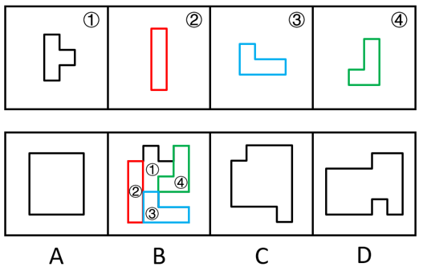

故正确答案为B。

来源：[2024年江苏省公务员录用考试《行测》（A类）答案+解析.pdf](https://github.com/dumarstoft-ship-it/xingce/blob/407016b55b49581efa3771bb59a2dee8761d982f/2024%E5%B9%B4%E6%B1%9F%E8%8B%8F%E7%9C%81%E5%85%AC%E5%8A%A1%E5%91%98%E5%BD%95%E7%94%A8%E8%80%83%E8%AF%95%E3%80%8A%E8%A1%8C%E6%B5%8B%E3%80%8B%EF%BC%88A%E7%B1%BB%EF%BC%89%E7%AD%94%E6%A1%88%2B%E8%A7%A3%E6%9E%90.pdf)，PDF 第 26 页。

## 第 85 题 · 判断推理

参考答案：**D**

【解析85—正确答案D】
本题考查平面拼合。曲线类图形，消去弯曲程度一致且等长的线条后进行拼合可得到轮廓图，即为
D 项，拼合方式如下图所示。

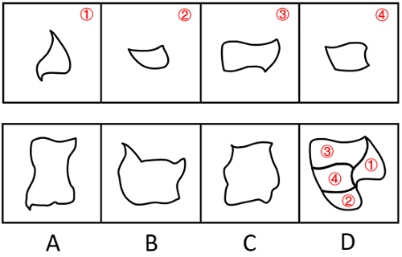

故正确答案为D。

来源：[2024年江苏省公务员录用考试《行测》（A类）答案+解析.pdf](https://github.com/dumarstoft-ship-it/xingce/blob/407016b55b49581efa3771bb59a2dee8761d982f/2024%E5%B9%B4%E6%B1%9F%E8%8B%8F%E7%9C%81%E5%85%AC%E5%8A%A1%E5%91%98%E5%BD%95%E7%94%A8%E8%80%83%E8%AF%95%E3%80%8A%E8%A1%8C%E6%B5%8B%E3%80%8B%EF%BC%88A%E7%B1%BB%EF%BC%89%E7%AD%94%E6%A1%88%2B%E8%A7%A3%E6%9E%90.pdf)，PDF 第 26、27 页。

## 第 86 题 · 判断推理

参考答案：**B**

【解析86—正确答案B】
本题考查平面拼合。A、D 两项图形旋转后与C 项图形进行拼合，可得到题干轮廓图，拼合方式如下
图所示。

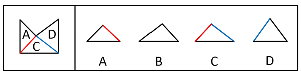

本题为选非题，故正确答案为B。

来源：[2024年江苏省公务员录用考试《行测》（A类）答案+解析.pdf](https://github.com/dumarstoft-ship-it/xingce/blob/407016b55b49581efa3771bb59a2dee8761d982f/2024%E5%B9%B4%E6%B1%9F%E8%8B%8F%E7%9C%81%E5%85%AC%E5%8A%A1%E5%91%98%E5%BD%95%E7%94%A8%E8%80%83%E8%AF%95%E3%80%8A%E8%A1%8C%E6%B5%8B%E3%80%8B%EF%BC%88A%E7%B1%BB%EF%BC%89%E7%AD%94%E6%A1%88%2B%E8%A7%A3%E6%9E%90.pdf)，PDF 第 27 页。

## 第 87 题 · 判断推理

参考答案：**A**

【解析87—正确答案A】
将题干展开图中的面依次标上序号，如下图所示，逐一分析选项。

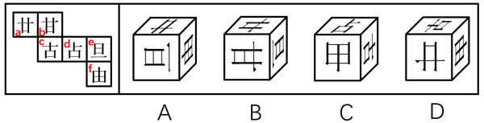

A 项：选项由面a、面e 与面f 构成，选项与题干展开图一致，当选。
B 项：选项由面a、面b 与面e 构成，题干展开图中面e 内“旦”字的单一长横线紧挨着面f，而选
项中面e 内“旦”字的单一长横线紧挨着面b，选项与题干展开图不一致，排除。
C 项：选项由面c、面d 与面f 构成，题干展开图中面c 与面d 的公共边不挨着面d 内“占”字上半
部分的短横线，而选项中面c 与面d 的公共边挨着面d 内“占”字上半部分的短横线，选项与题干
展开图不一致，排除。
D 项：选项由面a、面c 与面f 构成，题干展开图中面c 与面f 的公共边与面f 内“由”字的最长线
垂直，而选项中面c 与面f 的公共边与面f 内“由”字的最长线平行，选项与题干展开图不一致，
排除。

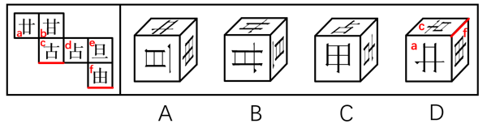

故正确答案为A。

来源：[2024年江苏省公务员录用考试《行测》（A类）答案+解析.pdf](https://github.com/dumarstoft-ship-it/xingce/blob/407016b55b49581efa3771bb59a2dee8761d982f/2024%E5%B9%B4%E6%B1%9F%E8%8B%8F%E7%9C%81%E5%85%AC%E5%8A%A1%E5%91%98%E5%BD%95%E7%94%A8%E8%80%83%E8%AF%95%E3%80%8A%E8%A1%8C%E6%B5%8B%E3%80%8B%EF%BC%88A%E7%B1%BB%EF%BC%89%E7%AD%94%E6%A1%88%2B%E8%A7%A3%E6%9E%90.pdf)，PDF 第 27、28 页。

## 第 88 题 · 判断推理

参考答案：**C**

【解析88—正确答案C】
若想展开图还原成正方体后，存在同一个公共顶点的三个面上的数字之和为8，需要“面1、面2、
面5”或者“面1、面3、面4”相邻，即三个面存在公共点。
A 项：面1 和面4 为相对面，故面1、面3 和面4 不存在公共点；面2 和面5 为相对面，故面1、面
2 和面5 不存在公共点。两种情况均不符合要求，排除。
B 项：面1 和面4 为相对面，故面1、面3 和面4 不存在公共点；面2 和面5 为相对面，故面1、面
2 和面5 不存在公共点。两种情况均不符合要求，排除。
C 项：面1、面2 和面5 两两相邻，即三个面存在公共点，符合要求，当选。
D 项：面3 和面4 为相对面，故面1、面3 和面4 不存在公共点；面1 和面5 为相对面，故面1、面
2 和面5 不存在公共点。两种情况均不符合要求，排除。
故正确答案为C。

来源：[2024年江苏省公务员录用考试《行测》（A类）答案+解析.pdf](https://github.com/dumarstoft-ship-it/xingce/blob/407016b55b49581efa3771bb59a2dee8761d982f/2024%E5%B9%B4%E6%B1%9F%E8%8B%8F%E7%9C%81%E5%85%AC%E5%8A%A1%E5%91%98%E5%BD%95%E7%94%A8%E8%80%83%E8%AF%95%E3%80%8A%E8%A1%8C%E6%B5%8B%E3%80%8B%EF%BC%88A%E7%B1%BB%EF%BC%89%E7%AD%94%E6%A1%88%2B%E8%A7%A3%E6%9E%90.pdf)，PDF 第 28 页。

## 第 89 题 · 判断推理

参考答案：**D**

【解析89—正确答案D】
本题考查空间重构。在选项展开图中，以只有两个扇形的面上的空白顶点作为起始点，进行顺时针
画边，如下图所示，逐一分析选项。

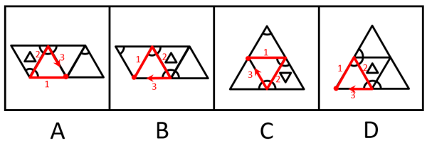

A 项：只有两个扇形的面的边1 不挨着相邻面上的扇形；
B 项：只有两个扇形的面的边1 不挨着相邻面上的扇形；
C 项：只有两个扇形的面的边1 不挨着相邻面上的扇形；
D 项：只有两个扇形的面的边1 挨着相邻面上的扇形。
综上所述，只有D 项与其他三项不一样。
本题为选非题，故正确答案为D。

来源：[2024年江苏省公务员录用考试《行测》（A类）答案+解析.pdf](https://github.com/dumarstoft-ship-it/xingce/blob/407016b55b49581efa3771bb59a2dee8761d982f/2024%E5%B9%B4%E6%B1%9F%E8%8B%8F%E7%9C%81%E5%85%AC%E5%8A%A1%E5%91%98%E5%BD%95%E7%94%A8%E8%80%83%E8%AF%95%E3%80%8A%E8%A1%8C%E6%B5%8B%E3%80%8B%EF%BC%88A%E7%B1%BB%EF%BC%89%E7%AD%94%E6%A1%88%2B%E8%A7%A3%E6%9E%90.pdf)，PDF 第 28 页。

## 第 90 题 · 判断推理

参考答案：**A**

【解析90—正确答案A】
本题考查三视图。B、C、D 三项：如下图所示，按图中箭头方向观察，均可看到，排除。

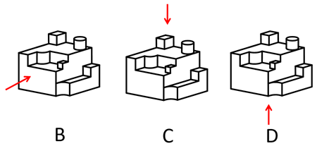

A 项：如下图所示，按图中箭头方向观察立体图形，圆柱与下方立体图形的连接处应有一条横线，故
该项不是题干立体图形的视图，当选。

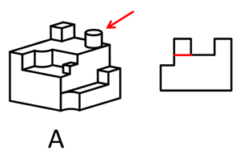

本题为选非题，故正确答案为A。

来源：[2024年江苏省公务员录用考试《行测》（A类）答案+解析.pdf](https://github.com/dumarstoft-ship-it/xingce/blob/407016b55b49581efa3771bb59a2dee8761d982f/2024%E5%B9%B4%E6%B1%9F%E8%8B%8F%E7%9C%81%E5%85%AC%E5%8A%A1%E5%91%98%E5%BD%95%E7%94%A8%E8%80%83%E8%AF%95%E3%80%8A%E8%A1%8C%E6%B5%8B%E3%80%8B%EF%BC%88A%E7%B1%BB%EF%BC%89%E7%AD%94%E6%A1%88%2B%E8%A7%A3%E6%9E%90.pdf)，PDF 第 28、29 页。

## 第 91 题 · 判断推理

参考答案：**B**

【解析91—正确答案B】
第一步：翻译题干。
题干翻译为：飞向天空→两翼健壮 且 以共同的力量来推动身体。
第二步：逐一分析选项。
①翻译为：两翼健壮 且 以共同的力量来推动身体→飞向天空，是对题干逻辑关系的肯后，肯后无
必然结论，无法推出；
②翻译为：飞向天空→两翼健壮 且 以共同的力量来推动身体，是对题干逻辑关系的肯前，肯前必
肯后，可以推出；
−
③翻译为：两翼健壮 或 −以共同的力量来推动身体→¬飞向天空，是对题干逻辑关系的否后，
否后必否前，可以推出；
−
④翻译为：飞向天空→¬两翼健壮 或 −以共同的力量来推动身体，是对题干逻辑关系的否前，
否前无必然结论，无法推出。
综上所述，②③可以推出，对应B 项。
故正确答案为B。

来源：[2024年江苏省公务员录用考试《行测》（A类）答案+解析.pdf](https://github.com/dumarstoft-ship-it/xingce/blob/407016b55b49581efa3771bb59a2dee8761d982f/2024%E5%B9%B4%E6%B1%9F%E8%8B%8F%E7%9C%81%E5%85%AC%E5%8A%A1%E5%91%98%E5%BD%95%E7%94%A8%E8%80%83%E8%AF%95%E3%80%8A%E8%A1%8C%E6%B5%8B%E3%80%8B%EF%BC%88A%E7%B1%BB%EF%BC%89%E7%AD%94%E6%A1%88%2B%E8%A7%A3%E6%9E%90.pdf)，PDF 第 29 页。

## 第 92 题 · 判断推理

参考答案：**C**

【解析92—正确答案C】
第一步：分析题干条件。
（1）甲→乙；
（2）丙→¬丁；
（3）乙→丙。
将（1）（2）（3）串联可得：（4）甲→乙→丙→¬丁。
第二步：根据题干条件进行推理。
根据条件（4）可知，甲参加时丁一定不参加，因此C 项不可能为真。
本题为选非题，故正确答案为C。

来源：[2024年江苏省公务员录用考试《行测》（A类）答案+解析.pdf](https://github.com/dumarstoft-ship-it/xingce/blob/407016b55b49581efa3771bb59a2dee8761d982f/2024%E5%B9%B4%E6%B1%9F%E8%8B%8F%E7%9C%81%E5%85%AC%E5%8A%A1%E5%91%98%E5%BD%95%E7%94%A8%E8%80%83%E8%AF%95%E3%80%8A%E8%A1%8C%E6%B5%8B%E3%80%8B%EF%BC%88A%E7%B1%BB%EF%BC%89%E7%AD%94%E6%A1%88%2B%E8%A7%A3%E6%9E%90.pdf)，PDF 第 29、30 页。

## 第 93 题 · 判断推理

参考答案：**未确定 / 来源缺失**

> 现有来源未提供参考答案及解析。

【解析93 至96—题目缺失，暂缺】

来源：[2024年江苏省公务员录用考试《行测》（A类）答案+解析.pdf](https://github.com/dumarstoft-ship-it/xingce/blob/407016b55b49581efa3771bb59a2dee8761d982f/2024%E5%B9%B4%E6%B1%9F%E8%8B%8F%E7%9C%81%E5%85%AC%E5%8A%A1%E5%91%98%E5%BD%95%E7%94%A8%E8%80%83%E8%AF%95%E3%80%8A%E8%A1%8C%E6%B5%8B%E3%80%8B%EF%BC%88A%E7%B1%BB%EF%BC%89%E7%AD%94%E6%A1%88%2B%E8%A7%A3%E6%9E%90.pdf)，PDF 第 30 页。

## 第 94 题 · 判断推理

参考答案：**未确定 / 来源缺失**

> 现有来源未提供参考答案及解析。

【解析93 至96—题目缺失，暂缺】

来源：[2024年江苏省公务员录用考试《行测》（A类）答案+解析.pdf](https://github.com/dumarstoft-ship-it/xingce/blob/407016b55b49581efa3771bb59a2dee8761d982f/2024%E5%B9%B4%E6%B1%9F%E8%8B%8F%E7%9C%81%E5%85%AC%E5%8A%A1%E5%91%98%E5%BD%95%E7%94%A8%E8%80%83%E8%AF%95%E3%80%8A%E8%A1%8C%E6%B5%8B%E3%80%8B%EF%BC%88A%E7%B1%BB%EF%BC%89%E7%AD%94%E6%A1%88%2B%E8%A7%A3%E6%9E%90.pdf)，PDF 第 30 页。

## 第 95 题 · 判断推理

参考答案：**未确定 / 来源缺失**

> 现有来源未提供参考答案及解析。

【解析93 至96—题目缺失，暂缺】

来源：[2024年江苏省公务员录用考试《行测》（A类）答案+解析.pdf](https://github.com/dumarstoft-ship-it/xingce/blob/407016b55b49581efa3771bb59a2dee8761d982f/2024%E5%B9%B4%E6%B1%9F%E8%8B%8F%E7%9C%81%E5%85%AC%E5%8A%A1%E5%91%98%E5%BD%95%E7%94%A8%E8%80%83%E8%AF%95%E3%80%8A%E8%A1%8C%E6%B5%8B%E3%80%8B%EF%BC%88A%E7%B1%BB%EF%BC%89%E7%AD%94%E6%A1%88%2B%E8%A7%A3%E6%9E%90.pdf)，PDF 第 30 页。

## 第 96 题 · 判断推理

参考答案：**未确定 / 来源缺失**

> 现有来源未提供参考答案及解析。

【解析93 至96—题目缺失，暂缺】

来源：[2024年江苏省公务员录用考试《行测》（A类）答案+解析.pdf](https://github.com/dumarstoft-ship-it/xingce/blob/407016b55b49581efa3771bb59a2dee8761d982f/2024%E5%B9%B4%E6%B1%9F%E8%8B%8F%E7%9C%81%E5%85%AC%E5%8A%A1%E5%91%98%E5%BD%95%E7%94%A8%E8%80%83%E8%AF%95%E3%80%8A%E8%A1%8C%E6%B5%8B%E3%80%8B%EF%BC%88A%E7%B1%BB%EF%BC%89%E7%AD%94%E6%A1%88%2B%E8%A7%A3%E6%9E%90.pdf)，PDF 第 30 页。

## 第 97 题 · 判断推理

参考答案：**C**

【解析97—正确答案C】
第一步：分析题干条件。
（1）生产部录用本科生→研发部录用硕士生；
（2）研发部录用博士生→生产部录用博士生；
（3）财务部录用本科生 或 财务部录用硕士生→研发部录用本科生；
（4）有3 名博士生、3 名硕士生和3 名本科生；
（5）3 个部门录用的人员学历各不相同。
第二步：根据题干条件进行推理。
根据条件（2）和条件（5）可以推出研发部没有录用博士生，因为如果“研发部录用博士生”，根据
条件（2）可以推出生产部也录用博士生，与条件（5）矛盾，所以研发部没有录用博士生，排除B 项；
根据条件（3）和条件（5）可以推出财务部没有录用本科生，因为如果“财务部录用本科生”，根据
条件（3）可以推出研发部也录用本科生，与条件（5）矛盾，所以财务部没用录用本科生，排除A、
D 两项。
故正确答案为C。

来源：[2024年江苏省公务员录用考试《行测》（A类）答案+解析.pdf](https://github.com/dumarstoft-ship-it/xingce/blob/407016b55b49581efa3771bb59a2dee8761d982f/2024%E5%B9%B4%E6%B1%9F%E8%8B%8F%E7%9C%81%E5%85%AC%E5%8A%A1%E5%91%98%E5%BD%95%E7%94%A8%E8%80%83%E8%AF%95%E3%80%8A%E8%A1%8C%E6%B5%8B%E3%80%8B%EF%BC%88A%E7%B1%BB%EF%BC%89%E7%AD%94%E6%A1%88%2B%E8%A7%A3%E6%9E%90.pdf)，PDF 第 30 页。

## 第 98 题 · 判断推理

参考答案：**D**

【解析98—正确答案D】
第一步：分析题干条件。
（1）生产部录用本科生→研发部录用硕士生；
（2）研发部录用博士生→生产部录用博士生；
（3）财务部录用本科生 或 财务部录用硕士生→研发部录用本科生；
（4）有3 名博士生、3 名硕士生和3 名本科生；
（5）研发部录用硕士生。
第二步：根据题干条件进行推理。
条件（5）为确定信息，以此为起点开始推理。
根据条件（5）“研发部录用硕士生”以及题干条件“每个部门只招聘1 名员工”，可以推出“研发
部没有录用本科生”，是对条件（3）的否后，否后必否前，可以推出“财务部没有录用本科生 且
财务部没有录用硕士生”，即财务部只能录用博士生，D 项不符合小王的预测，当选。
本题为选非题，故正确答案为D。

来源：[2024年江苏省公务员录用考试《行测》（A类）答案+解析.pdf](https://github.com/dumarstoft-ship-it/xingce/blob/407016b55b49581efa3771bb59a2dee8761d982f/2024%E5%B9%B4%E6%B1%9F%E8%8B%8F%E7%9C%81%E5%85%AC%E5%8A%A1%E5%91%98%E5%BD%95%E7%94%A8%E8%80%83%E8%AF%95%E3%80%8A%E8%A1%8C%E6%B5%8B%E3%80%8B%EF%BC%88A%E7%B1%BB%EF%BC%89%E7%AD%94%E6%A1%88%2B%E8%A7%A3%E6%9E%90.pdf)，PDF 第 30 页。

## 第 99 题 · 判断推理

参考答案：**A**

【解析99—正确答案A】
第一步：分析题干逻辑关系。
甲根据“小明十岁就能用英语与英国人流利对话”的现象，得出“小明的语言天赋出类拔萃”的结
论，而乙提出“小明跟着父母在英国住了两年”的理由来解释现象，用“能流利对话不足为奇”来
否定甲的结论。
第二步：逐一分析选项。
A 项：甲根据“这款热水器的价格比市面上常见的热水器高出一倍”的现象，得出“这款热水器不
划算”的结论，乙提出“这款产品用的是航天级别的材料”的理由来解释现象，用“在同材质热水
器中性价比很高”来否定甲的结论，与题干对话方式一致，当选；
B 项：甲提出“小李以前容易冲动，进入职场一年后稳重多了”的结论，乙提出“小李承担了单位大
量重要工作，变得稳重一点理所当然”的理由来解释甲的结论，与题干对话方式不一致，排除；
C 项：甲提出“小张的数学一直很好，进入高中后，物理、化学等科目的学习很轻松”的结论，乙提
出“数学强调科学思维，掌握科学思维的人学习物理、化学当然没有难度”的理由来解释甲的结论，
与题干对话方式不一致，排除；
D 项：甲根据“小刘在过去的一年中连续犯下三起盗窃案”的现象，得出“小刘无可救药”的结论，
乙得出的观点“相信在经过改造之后小刘会洗心革面”是一种预测，而非事实，用预测否定甲的结
论，与题干对话方式不一致，排除。
故正确答案为A。

来源：[2024年江苏省公务员录用考试《行测》（A类）答案+解析.pdf](https://github.com/dumarstoft-ship-it/xingce/blob/407016b55b49581efa3771bb59a2dee8761d982f/2024%E5%B9%B4%E6%B1%9F%E8%8B%8F%E7%9C%81%E5%85%AC%E5%8A%A1%E5%91%98%E5%BD%95%E7%94%A8%E8%80%83%E8%AF%95%E3%80%8A%E8%A1%8C%E6%B5%8B%E3%80%8B%EF%BC%88A%E7%B1%BB%EF%BC%89%E7%AD%94%E6%A1%88%2B%E8%A7%A3%E6%9E%90.pdf)，PDF 第 30、31 页。

## 第 100 题 · 判断推理

参考答案：**B**

【解析100—正确答案B】
第一步：找出论点和论据。
论点：家门口商业服务的完善，在给居民生活带来便利的同时可能也会使快递业逐步萎缩。
论据：无。
本题提问为“缓解上述专家的担忧”即削弱上述专家的担忧，且只有论点没有论据，削弱优先考虑
削弱论点，即说明家门口商业服务的完善不会使快递业逐步萎缩。
第二步：逐一分析选项。
A 项：该项说的是很多城市将快递驿站作为社区商业的重要组成部分，说明家门口商业服务完善后
快递驿站依然很重要，可能不会使快递业逐步萎缩，削弱论点，可以削弱，保留；
B 项：该项说的是社区购物在居民整体购物消费中占比很少，说明社区商业的建设对居民原有的购
物方式影响不大，也就不会使快递业逐步萎缩，削弱论点，可以削弱，保留；
C 项：该项说的是社区商业吸纳了大量传统行业的劳动者就业，是在说社区商业促进了就业，并未提
及对快递业的影响，为无关项，无法削弱，排除；
D 项：该项说的是许多大型商超提供限时配送服务，大型商超不属于社区商业，提供的配送服务不属
于快递业，为无关项，无法削弱，排除。
对比A、B 两项，A 项说的是快递驿站的重要性，但是快递驿站重要并不能明确说明快递业的情况，
而B 项明确说明了对居民原有的购物方式影响不大，即不会对快递业有影响，综合对比，B 项比A 项
更加明确，因此优选B 项。
故正确答案为B。

来源：[2024年江苏省公务员录用考试《行测》（A类）答案+解析.pdf](https://github.com/dumarstoft-ship-it/xingce/blob/407016b55b49581efa3771bb59a2dee8761d982f/2024%E5%B9%B4%E6%B1%9F%E8%8B%8F%E7%9C%81%E5%85%AC%E5%8A%A1%E5%91%98%E5%BD%95%E7%94%A8%E8%80%83%E8%AF%95%E3%80%8A%E8%A1%8C%E6%B5%8B%E3%80%8B%EF%BC%88A%E7%B1%BB%EF%BC%89%E7%AD%94%E6%A1%88%2B%E8%A7%A3%E6%9E%90.pdf)，PDF 第 31 页。

## 第 101 题 · 判断推理

参考答案：**D**

【解析101—正确答案D】
第一步：翻译题干。
（1）参加800 米跑→参加100 米跑；
（2）参加100 米跑→参加跳高；
（3）有的参加跳远→参加投掷链球；
（4）参加跳远→−参加跳高。
将（1）（2）（4）串联可得：（5）参加800 米跑→参加100 米跑→参加跳高→¬参加跳远。
第二步：逐一分析选项。
A 项：翻译为“参加800 米跑→参加跳高”，“参加800 米跑”是对条件（5）的肯前，肯前必肯后，
可以推出，排除。
B 项：翻译为“参加投掷链球→−参加跳高”，将条件（3）换位可得“有的参加投掷链球→参加跳
远”，与条件（4）串联可得“有的参加投掷链球→参加跳远→−参加跳高”，“有的”无法推出
“所有”，即“所有参加投掷链球的运动员都没有参加跳高”可能为真，也可能为假，保留。
C 项：翻译为“参加跳远→−参加100 米跑”，“参加跳远”是对条件（5）的否后，否后必否前，
可以推出，排除。
D 项：翻译为“有的参加800 米跑→参加跳远”，与条件（5）矛盾，无法推出，保留。
对比B、D 两项，B 项可能为真，D 项一定为假，择优选D 项。
本题为选非题，故正确答案为D。

来源：[2024年江苏省公务员录用考试《行测》（A类）答案+解析.pdf](https://github.com/dumarstoft-ship-it/xingce/blob/407016b55b49581efa3771bb59a2dee8761d982f/2024%E5%B9%B4%E6%B1%9F%E8%8B%8F%E7%9C%81%E5%85%AC%E5%8A%A1%E5%91%98%E5%BD%95%E7%94%A8%E8%80%83%E8%AF%95%E3%80%8A%E8%A1%8C%E6%B5%8B%E3%80%8B%EF%BC%88A%E7%B1%BB%EF%BC%89%E7%AD%94%E6%A1%88%2B%E8%A7%A3%E6%9E%90.pdf)，PDF 第 31、32 页。

## 第 102 题 · 判断推理

参考答案：**D**

【解析102—正确答案D】
日常结论题，根据题干信息逐一分析选项。
A 项：若一道单选题的难度为1，意味着参加测验的所有人都答对了，则高分组和低分组的人都答对
了，说明高分组该题的难度P_H=1，低分组该题的难度P_L=1，则区分度指数D=0，而不是0.1，
该项表述错误，排除；
B 项：若有一道题高分组答对的人数少于低分组，此时高分组该题的难度小于低分组该题的难度，即
P_H<P_L，则这道题的区分度指数D 为负数，该项表述错误，排除；
C 项：若一道单选题的难度为0.27，说明正确选择试题答案的人数与参加测验的总人数的比值为0.27，
假设参加测验的总人数为100 人，则正确选择试题答案的人数为27 人，并且此时高分组与低分组均
各有27 人，如果想要计算最大区分度指数，则需要使D=P_H−P_L的值尽可能大，即P_H尽可能
取最大值，同时P_L 尽可能取最小值，即需要使正确选择试题答案的27 人均属于高分组，即
P_H=高分组正确选择试题答案的人数/高分组人数=27/27=1 ，同时，低分组全部答错，即
P_L=低分组正确选择试题答案的人数/低分组人数=0/27=0，则此时这道题的最大区分度指数
D=1，而不是0.5，该项表述错误，排除；
D 项 ： 该题的平均得分/该题分值=[(正确选择试题答案的人数×该题分值)/参加测验的总人数]/该题分值
=正确选择试题答案的人数/参加测验的总人数=难度，该项表述正确，当选。
故正确答案为D。

来源：[2024年江苏省公务员录用考试《行测》（A类）答案+解析.pdf](https://github.com/dumarstoft-ship-it/xingce/blob/407016b55b49581efa3771bb59a2dee8761d982f/2024%E5%B9%B4%E6%B1%9F%E8%8B%8F%E7%9C%81%E5%85%AC%E5%8A%A1%E5%91%98%E5%BD%95%E7%94%A8%E8%80%83%E8%AF%95%E3%80%8A%E8%A1%8C%E6%B5%8B%E3%80%8B%EF%BC%88A%E7%B1%BB%EF%BC%89%E7%AD%94%E6%A1%88%2B%E8%A7%A3%E6%9E%90.pdf)，PDF 第 32 页。

## 第 103 题 · 判断推理

参考答案：**C**

【解析103—正确答案C】
第一步：找出论点和论据。
论点：昼夜节律缺失对健康的危害可能没有我们想象得那么大。
论据：成年小白鼠去除一个关键生物钟基因后，昼夜节律完全消失，虽然生活质量有所下降，但寿
命并未受到显著影响，心血管健康状况甚至有所改善。
本题论点讨论的是“昼夜节律缺失”和“整体健康状况”之间的关系，论据讨论的是“昼夜节律缺
失”和“寿命、心血管健康状况”之间的关系，二者话题不一致，且提问方式为“最有助于”评价
研究人员的推断，可以考虑搭桥，即建立“寿命、心血管健康状况”与“整体健康状况”之间的关
系。
第二步：逐一分析选项。
A 项：该项讨论的是“心血管健康状况”与“寿命”之间的关系，而不是“寿命、心血管健康状况”
与“整体健康状况”之间的关系，即使心血管状况改善能够延长寿命，仍无法得知整体健康状况如
何，无助于评价研究人员的推断，排除；
B 项：该项讨论的是“去除生物钟基因前后的休息时间”，论点说的是“昼夜节律缺失”和“整体
健康状况”的关系，话题不一致，无助于评价研究人员的推断，排除；
C 项：该项讨论的是“寿命、心血管健康状况”与“整体健康状况”之间的关系，如果寿命和心血管
健康状况能代表整体健康状况，则说明研究人员的推断成立，有助于评价研究人员的推断，当选；
D 项：该项讨论的是“生活质量”与“整体健康状况”之间的关系，但研究人员是通过“寿命”与
“心血管健康状况”得出的论点，不如C 项更有助于评价研究人员的推断，排除。
故正确答案为C。

来源：[2024年江苏省公务员录用考试《行测》（A类）答案+解析.pdf](https://github.com/dumarstoft-ship-it/xingce/blob/407016b55b49581efa3771bb59a2dee8761d982f/2024%E5%B9%B4%E6%B1%9F%E8%8B%8F%E7%9C%81%E5%85%AC%E5%8A%A1%E5%91%98%E5%BD%95%E7%94%A8%E8%80%83%E8%AF%95%E3%80%8A%E8%A1%8C%E6%B5%8B%E3%80%8B%EF%BC%88A%E7%B1%BB%EF%BC%89%E7%AD%94%E6%A1%88%2B%E8%A7%A3%E6%9E%90.pdf)，PDF 第 32、33 页。

## 第 104 题 · 判断推理

参考答案：**C**

【解析104—正确答案C】
第一步：分析题干条件。
（1）每位工作人员参加的项目都必须有教授指导，每位教授至少指导一位工作人员；
（2）每位工作人员只能参加一个项目，提倡多人合作；
（3）每位教授只能指导一个项目，一个项目也可由多位教授共同指导；
（4）小郑参加小微堵点改造或跨区断头路建设项目，钱教授指导历史街区微改造项目。
第二步：根据题干条件进行推理。
提问方式为“不可能”，优先考虑代入法。
代入A 项，若指导小微堵点改造项目的是王教授和马教授，由条件（4）可知，指导历史街区微改造
项目的是钱教授，结合条件（1）中的“每位教授至少指导一位工作人员”可知，历史街区微改造项
目必须有工作人员参加，此时只要这两个项目都分别有至少一位工作人员参加即可，与题干条件不
矛盾，该项可能成立，排除；
代入B 项，若指导小微堵点改造项目的是马教授，参加小微堵点改造项目的是小刘，由条件（4）可
知，指导历史街区微改造项目的是钱教授，结合条件（1）中的“每位教授至少指导一位工作人员”
可知，历史街区微改造项目必须有工作人员参加，小郑参加小微堵点改造或跨区断头路建设项目，
那么此时小周参加历史街区微改造项目即可，与题干条件不矛盾，该项可能成立，排除；
代入C 项，若参加小微堵点改造项目的是小刘和小周，由条件（4）可知，小郑参加小微堵点改造或
跨区断头路建设项目，此时3 名工作人员中没有人可以参加由钱教授指导的历史街区微改造项目，
不符合条件（1）中的“每位教授至少指导一位工作人员”，该项不可能成立，当选；
代入D 项，若参加小微堵点改造项目的是小周，指导小微堵点改造项目的是王教授，由条件（4）可
知，小郑参加小微堵点改造或跨区断头路建设项目，钱教授指导历史街区微改造项目，结合条件（1）
中的“每位教授至少指导一位工作人员”可知，历史街区微改造项目必须有工作人员参加，此时小
刘参加历史街区微改造项目即可，与题干条件不矛盾，该项可能成立，排除。
本题为选非题，故正确答案为C。

来源：[2024年江苏省公务员录用考试《行测》（A类）答案+解析.pdf](https://github.com/dumarstoft-ship-it/xingce/blob/407016b55b49581efa3771bb59a2dee8761d982f/2024%E5%B9%B4%E6%B1%9F%E8%8B%8F%E7%9C%81%E5%85%AC%E5%8A%A1%E5%91%98%E5%BD%95%E7%94%A8%E8%80%83%E8%AF%95%E3%80%8A%E8%A1%8C%E6%B5%8B%E3%80%8B%EF%BC%88A%E7%B1%BB%EF%BC%89%E7%AD%94%E6%A1%88%2B%E8%A7%A3%E6%9E%90.pdf)，PDF 第 33 页。

## 第 105 题 · 判断推理

参考答案：**A**

【解析105—正确答案A】
第一步：分析题干条件。
（1）每位工作人员参加的项目都必须有教授指导，每位教授至少指导一位工作人员；
（2）每位工作人员只能参加一个项目，提倡多人合作；
（3）每位教授只能指导一个项目，一个项目也可由多位教授共同指导；
（4）小郑参加小微堵点改造或跨区断头路建设项目，钱教授指导历史街区微改造项目；
（5）小周参加小型城市客厅打造项目。
第二步：根据题干条件进行推理。
条件（4）与条件（5）中有确定信息，优先从确定信息入手推理。由条件（4）可知，钱教授指导历
史街区微改造项目，结合条件（1）中的“每位教授至少指导一位工作人员”可知，历史街区微改造
项目一定有工作人员参加；由条件（4）可知，小郑参加小微堵点改造或跨区断头路建设项目，由条
件（5）可知，小周参加小型城市客厅打造项目，结合条件（2）中的“每位工作人员只能参加一个项
目”可知，参加历史街区微改造项目的工作人员不可能是小郑、小周，且只有3 名工作人员，所以
小刘一定参加历史街区微改造项目，对应A 项。
故正确答案为A。

来源：[2024年江苏省公务员录用考试《行测》（A类）答案+解析.pdf](https://github.com/dumarstoft-ship-it/xingce/blob/407016b55b49581efa3771bb59a2dee8761d982f/2024%E5%B9%B4%E6%B1%9F%E8%8B%8F%E7%9C%81%E5%85%AC%E5%8A%A1%E5%91%98%E5%BD%95%E7%94%A8%E8%80%83%E8%AF%95%E3%80%8A%E8%A1%8C%E6%B5%8B%E3%80%8B%EF%BC%88A%E7%B1%BB%EF%BC%89%E7%AD%94%E6%A1%88%2B%E8%A7%A3%E6%9E%90.pdf)，PDF 第 33、34 页。

## 第 106 题 · 判断推理

参考答案：**D**

【解析106—正确答案D】
第一步：找出定义关键词。
“学习者”、“通过不间断的目标训练”、“更好地理解学习内容，不断提升技能完善自身能力”。
第二步：逐一分析选项。
A 项：小周通过不断强化训练，从一开始参加专业技能大赛的实操环节丢不少分，到再次参加获得二
等奖，到最后综合技能显著提高，符合“学习者”、“通过不间断的目标训练”、“更好地理解学
习内容，不断提升技能完善自身能力”，符合定义，排除；
B 项：学习者通过不断的学习，掌握的数学运算从一开始的加减法、乘除法到混合运算，到最后进入
更高阶的运算，符合“学习者”、“通过不间断的目标训练”、“更好地理解学习内容，不断提升
技能完善自身能力”，符合定义，排除；
C 项：李教授的科普讲座从一开始的专业性强、听众少到引入市民关注的案例后听众越来越多，到最
后融入文化元素、感染力越来越强，符合“学习者”、“通过不间断的目标训练”、“更好地理解
学习内容，不断提升技能完善自身能力”，符合定义，排除；
D 项：多家公司推出各自的AI 自然语言处理模型，有的只能简单与人对话，有的能写作业，有的已
能给出比较专业的建议，这些是不同AI 对于自然语言处理的不同结果，并没有体现AI 不间断学习
的过程，不符合“学习者”、“通过不间断的目标训练”、“更好地理解学习内容，不断提升技能
完善自身能力”，不符合定义，当选。
本题为选非题，故正确答案为D。

来源：[2024年江苏省公务员录用考试《行测》（A类）答案+解析.pdf](https://github.com/dumarstoft-ship-it/xingce/blob/407016b55b49581efa3771bb59a2dee8761d982f/2024%E5%B9%B4%E6%B1%9F%E8%8B%8F%E7%9C%81%E5%85%AC%E5%8A%A1%E5%91%98%E5%BD%95%E7%94%A8%E8%80%83%E8%AF%95%E3%80%8A%E8%A1%8C%E6%B5%8B%E3%80%8B%EF%BC%88A%E7%B1%BB%EF%BC%89%E7%AD%94%E6%A1%88%2B%E8%A7%A3%E6%9E%90.pdf)，PDF 第 34 页。

## 第 107 题 · 判断推理

参考答案：**C**

【解析107—正确答案C】
第一步：找出定义关键词。
“能够尽快摆脱消极情绪或困扰，从容应对外部压力”“冷静面对个人成绩，坚持既定目标”。
第二步：逐一分析选项。
A 项：谷先生创业时始终没有被困难打倒，一直沿着目标不断地向前，说明其没有因困难长期处于消
极情绪之中，符合“能够尽快摆脱消极情绪或困扰，从容应对外部压力”，符合定义，排除。
B 项：邱奶奶认为自己长寿的秘诀是迅速忘掉不愉快的事，保持乐观情绪，符合“能够尽快摆脱消极
情绪或困扰，从容应对外部压力”，符合定义，排除。
C 项：杜先生坚持健身，身体素质明显提高，未提及心理和思想方面的感受，不符合“能够尽快摆脱
消极情绪或困扰，从容应对外部压力”“冷静面对个人成绩，坚持既定目标”，不符合定义，当选。
D 项：钟先生听到表扬从不得意忘形，符合“冷静面对个人成绩，坚持既定目标”，遇到批评也不垂
头丧气，符合“能够尽快摆脱消极情绪或困扰，从容应对外部压力”，符合定义，排除。
本题为选非题，故正确答案为C。

来源：[2024年江苏省公务员录用考试《行测》（A类）答案+解析.pdf](https://github.com/dumarstoft-ship-it/xingce/blob/407016b55b49581efa3771bb59a2dee8761d982f/2024%E5%B9%B4%E6%B1%9F%E8%8B%8F%E7%9C%81%E5%85%AC%E5%8A%A1%E5%91%98%E5%BD%95%E7%94%A8%E8%80%83%E8%AF%95%E3%80%8A%E8%A1%8C%E6%B5%8B%E3%80%8B%EF%BC%88A%E7%B1%BB%EF%BC%89%E7%AD%94%E6%A1%88%2B%E8%A7%A3%E6%9E%90.pdf)，PDF 第 34 页。

## 第 108 题 · 判断推理

参考答案：**C**

【解析108—正确答案C】
第一步：找出定义关键词。
“管理者根据时间的不同”、“差异化、精细化管理特定公共资源”、“最大限度开发和利用现有
资源，有效提升公众幸福指数”。
第二步：逐一分析选项。
A 项：某市划定特殊停车位，实行“夜停晨走”制度，符合“管理者根据时间的不同”、“差异化、
精细化管理特定公共资源”，停车位不足的问题得到了有效缓解，符合“最大限度开发和利用现有
资源，有效提升公众幸福指数”，符合定义，排除。
B 项：某街道对摆摊经营实行定时定点画线管理，符合“管理者根据时间的不同”、“差异化、精细
化管理特定公共资源”，商贩出摊既不影响交通又方便了周围居民生活，符合“最大限度开发和利
用现有资源，有效提升公众幸福指数”，符合定义，排除。
C 项：某居民小区让外地游客免费使用地下停车场车位，该举措是小区做的，没有提及管理者管理公
共资源，不符合“管理者根据时间的不同”、“差异化、精细化管理特定公共资源”，并且只是免
费使用了车位，体现不出对资源的最大限度开发，不符合“最大限度开发和利用现有资源，有效提
升公众幸福指数”，不符合定义，当选。
D 项：某市实行居民电动汽车充电桩分时电价政策，峰谷收费标准不同，符合“管理者根据时间的不
同”、“差异化、精细化管理特定公共资源”，低谷时段优惠收费，符合“最大限度开发和利用现
有资源，有效提升公众幸福指数”，符合定义，排除。
本题为选非题，故正确答案为C。

来源：[2024年江苏省公务员录用考试《行测》（A类）答案+解析.pdf](https://github.com/dumarstoft-ship-it/xingce/blob/407016b55b49581efa3771bb59a2dee8761d982f/2024%E5%B9%B4%E6%B1%9F%E8%8B%8F%E7%9C%81%E5%85%AC%E5%8A%A1%E5%91%98%E5%BD%95%E7%94%A8%E8%80%83%E8%AF%95%E3%80%8A%E8%A1%8C%E6%B5%8B%E3%80%8B%EF%BC%88A%E7%B1%BB%EF%BC%89%E7%AD%94%E6%A1%88%2B%E8%A7%A3%E6%9E%90.pdf)，PDF 第 35 页。

## 第 109 题 · 判断推理

参考答案：**D**

【解析109—正确答案D】
第一步：找出定义关键词。
“漫步城市街区”、“在向导带领下”、“深度体验城市变迁或历史文化”。
第二步：逐一分析选项。
A 项：韩先生带外地同学游览步行街，并不是向导带领，不符合“在向导带领下”，且只是在路牌下
拍照，没有深度体验城市变迁或历史文化，不符合“深度体验城市变迁或历史文化”，不符合定义，
排除。
B 项：小方父母是在小方的陪同下游玩景点，不符合“在向导带领下”，且游玩的景点不确定是否在
城市街区，不符合“漫步城市街区”，不符合定义，排除。
C 项：任女士回到故乡并自己走遍了大街小巷，并没有向导带领，不符合“在向导带领下”，不符合
定义，排除。
D 项：某旅行社推出了穿城徒步的产品，且该产品让游客像本地人一样体验当地文化，符合“漫步城
市街区”、“在向导带领下”、“深度体验城市变迁或历史文化”，符合定义，当选。
故正确答案为D。

来源：[2024年江苏省公务员录用考试《行测》（A类）答案+解析.pdf](https://github.com/dumarstoft-ship-it/xingce/blob/407016b55b49581efa3771bb59a2dee8761d982f/2024%E5%B9%B4%E6%B1%9F%E8%8B%8F%E7%9C%81%E5%85%AC%E5%8A%A1%E5%91%98%E5%BD%95%E7%94%A8%E8%80%83%E8%AF%95%E3%80%8A%E8%A1%8C%E6%B5%8B%E3%80%8B%EF%BC%88A%E7%B1%BB%EF%BC%89%E7%AD%94%E6%A1%88%2B%E8%A7%A3%E6%9E%90.pdf)，PDF 第 35 页。

## 第 110 题 · 判断推理

参考答案：**未确定 / 来源缺失**

> 现有来源未提供参考答案及解析。

【解析110 至111—题目缺失，暂缺】

来源：[2024年江苏省公务员录用考试《行测》（A类）答案+解析.pdf](https://github.com/dumarstoft-ship-it/xingce/blob/407016b55b49581efa3771bb59a2dee8761d982f/2024%E5%B9%B4%E6%B1%9F%E8%8B%8F%E7%9C%81%E5%85%AC%E5%8A%A1%E5%91%98%E5%BD%95%E7%94%A8%E8%80%83%E8%AF%95%E3%80%8A%E8%A1%8C%E6%B5%8B%E3%80%8B%EF%BC%88A%E7%B1%BB%EF%BC%89%E7%AD%94%E6%A1%88%2B%E8%A7%A3%E6%9E%90.pdf)，PDF 第 35 页。

## 第 111 题 · 判断推理

参考答案：**未确定 / 来源缺失**

> 现有来源未提供参考答案及解析。

【解析110 至111—题目缺失，暂缺】

来源：[2024年江苏省公务员录用考试《行测》（A类）答案+解析.pdf](https://github.com/dumarstoft-ship-it/xingce/blob/407016b55b49581efa3771bb59a2dee8761d982f/2024%E5%B9%B4%E6%B1%9F%E8%8B%8F%E7%9C%81%E5%85%AC%E5%8A%A1%E5%91%98%E5%BD%95%E7%94%A8%E8%80%83%E8%AF%95%E3%80%8A%E8%A1%8C%E6%B5%8B%E3%80%8B%EF%BC%88A%E7%B1%BB%EF%BC%89%E7%AD%94%E6%A1%88%2B%E8%A7%A3%E6%9E%90.pdf)，PDF 第 35 页。

## 第 112 题 · 判断推理

参考答案：**A**

【解析112—正确答案A】
第一步：找出定义关键词。
“工作时间不受限制”、“地域可以自主选择”、“利用网络数字手段完成本职工作”。
第二步：逐一分析选项。
A 项：小雷作为自媒体从业者，游走在不同城市，符合“地域可以自主选择”，随时随地向粉丝直
播，说明其工作并不受时间的限制，且利用互联网完成工作，符合“工作时间不受限制”、“利用
网络数字手段完成本职工作”，符合定义，当选。
B 项：康女士因通勤时间很长申请了居家办公，说明其工作地点虽然是家里但还是受公司管理，工作
时间受到限制，不符合“工作时间不受限制”，不符合定义，排除。
C 项：黄先生被公司派驻到某山区工作，说明其工作地点比较固定，不符合“地域可以自主选择”，
不符合定义，排除。
D 项：周先生的新工作不需要考虑迟到早退，但仍需要每天晚上汇报工作，说明其工作时间仍受到一
定的限制，不符合“工作时间不受限制”，同时，未明确体现周先生可自由选择办公地点，不符合
“地域可以自主选择”，不符合定义，排除。
故正确答案为A。

来源：[2024年江苏省公务员录用考试《行测》（A类）答案+解析.pdf](https://github.com/dumarstoft-ship-it/xingce/blob/407016b55b49581efa3771bb59a2dee8761d982f/2024%E5%B9%B4%E6%B1%9F%E8%8B%8F%E7%9C%81%E5%85%AC%E5%8A%A1%E5%91%98%E5%BD%95%E7%94%A8%E8%80%83%E8%AF%95%E3%80%8A%E8%A1%8C%E6%B5%8B%E3%80%8B%EF%BC%88A%E7%B1%BB%EF%BC%89%E7%AD%94%E6%A1%88%2B%E8%A7%A3%E6%9E%90.pdf)，PDF 第 35、36 页。

## 第 113 题 · 判断推理

参考答案：**C**

【解析113—正确答案C】
第一步：找出定义关键词。
“不超出自身能力的前提下”、“相邻两代人”、“一方向另一方主动提供经济帮扶、生活照顾、
健康保障、精神抚慰等各种支持”。
第二步：逐一分析选项。
A 项：苏女士将把父母接到身边，且主动协助他们其适应环境、找到“组织”，符合“相邻两代人”、
“一方向另一方主动提供经济帮扶、生活照顾、健康保障、精神抚慰等各种支持”，符合定义，排
除。
B 项：邵先生的父母会在寒暑假时专程把孙女接回农村老家，这减轻了忙于工作的邵先生夫妇的负
担，符合“相邻两代人”、“一方向另一方主动提供经济帮扶、生活照顾、健康保障、精神抚慰等
各种支持”，符合定义，排除。
C 项：罗奶奶乐此不疲地去相亲角浏览照片、简历以帮助孙女完成婚事，但这属于祖孙之间的支持，
不符合“相邻两代人”，不符合定义，当选。
D 项：毛先生因不能得到期待的回应而生气退群，儿子请回他，且邀约了几位有同样爱好的长辈，使
父亲情绪好转，符合“相邻两代人”、“一方向另一方主动提供经济帮扶、生活照顾、健康保障、
精神抚慰等各种支持”，符合定义，排除。
本题为选非题，故正确答案为C。

来源：[2024年江苏省公务员录用考试《行测》（A类）答案+解析.pdf](https://github.com/dumarstoft-ship-it/xingce/blob/407016b55b49581efa3771bb59a2dee8761d982f/2024%E5%B9%B4%E6%B1%9F%E8%8B%8F%E7%9C%81%E5%85%AC%E5%8A%A1%E5%91%98%E5%BD%95%E7%94%A8%E8%80%83%E8%AF%95%E3%80%8A%E8%A1%8C%E6%B5%8B%E3%80%8B%EF%BC%88A%E7%B1%BB%EF%BC%89%E7%AD%94%E6%A1%88%2B%E8%A7%A3%E6%9E%90.pdf)，PDF 第 36 页。

## 第 114 题 · 判断推理

参考答案：**B**

【解析114—正确答案B】
第一步：找出定义关键词。
“有计划的宣传或培训”、“引导民众更新消费观念，掌握消费技能，培养消费习惯”、“形成产
品购买的合理预期”。
第二步：逐一分析选项。
A 项：丁先生写出新疆自驾游攻略，目的是为了方便大家更便捷的出游，并非为了引导民众更新消费
观念，不符合“引导民众更新消费观念，掌握消费技能，培养消费习惯”，不符合定义，排除；
B 项：某网站分析了一些小家电的优缺点，让消费者了解相关产品的不同性能，符合“有计划的宣传
或培训”，其中推荐了一款“破壁机”，并附上商家的二维码，目的是为了让消费者选择购买，符
合“引导民众更新消费观念，掌握消费技能，培养消费习惯”、“形成产品购买的合理预期”，符
合定义，当选；
C 项：某购物网站邀请网络写手连载长篇小说，并为熬夜追更的粉丝免费提供缓解眼睛疲劳的新产
品，目的是为了提高网站的访问量和营业额，并非为了引导民众更新消费观念，不符合“引导民众
更新消费观念，掌握消费技能，培养消费习惯”，不符合定义，排除；
D 项：厂家对菜刀质量问题的回应，目的是为了解释菜刀因拍蒜而刀身断裂的原因，并非为了引导民
众更新消费观念，不符合“引导民众更新消费观念，掌握消费技能，培养消费习惯”，不符合定义，
排除。
故正确答案为B。

来源：[2024年江苏省公务员录用考试《行测》（A类）答案+解析.pdf](https://github.com/dumarstoft-ship-it/xingce/blob/407016b55b49581efa3771bb59a2dee8761d982f/2024%E5%B9%B4%E6%B1%9F%E8%8B%8F%E7%9C%81%E5%85%AC%E5%8A%A1%E5%91%98%E5%BD%95%E7%94%A8%E8%80%83%E8%AF%95%E3%80%8A%E8%A1%8C%E6%B5%8B%E3%80%8B%EF%BC%88A%E7%B1%BB%EF%BC%89%E7%AD%94%E6%A1%88%2B%E8%A7%A3%E6%9E%90.pdf)，PDF 第 36 页。

## 第 115 题 · 判断推理

参考答案：**B**

【解析115—正确答案B】
第一步：找出定义关键词。
摘顶格：“去掉谜底的共同部首就扣合谜面”；
秋千格：“从后往前读谜底就扣合谜面”；
白头格：“谜底的第一个字作谐音读就扣合谜面”。
第二步：逐一分析选项。
（1）“洛”谐音“落”，太阳落下就是黄昏，符合“谜底的第一个字作谐音读就扣合谜面”，属于
白头格。
（2）“芙蓉”去掉共同部首“艹”即为夫容，也就是郎貌，符合“去掉谜底的共同部首就扣合谜面”，
属于摘顶格。
（3）“算盘”从后往前读即为“盘算”，“盘算”有思量的意思，符合“从后往前读谜底就扣合谜
面”，属于秋千格。
综上，（1）为白头格，（2）为摘顶格，（3）为秋千格。
故正确答案为B。

来源：[2024年江苏省公务员录用考试《行测》（A类）答案+解析.pdf](https://github.com/dumarstoft-ship-it/xingce/blob/407016b55b49581efa3771bb59a2dee8761d982f/2024%E5%B9%B4%E6%B1%9F%E8%8B%8F%E7%9C%81%E5%85%AC%E5%8A%A1%E5%91%98%E5%BD%95%E7%94%A8%E8%80%83%E8%AF%95%E3%80%8A%E8%A1%8C%E6%B5%8B%E3%80%8B%EF%BC%88A%E7%B1%BB%EF%BC%89%E7%AD%94%E6%A1%88%2B%E8%A7%A3%E6%9E%90.pdf)，PDF 第 37 页。
