# 2024 年江苏行测（A类） · 题目

保留原题号。来源页码按 PDF 实际页数计，从 1 开始。答案及解析另见 answers.md。

## 第 16 题 · 言语理解与表达

`JS2024-A类-016`

改革开放以来，中国经济发展取得了举世瞩目的成就，但在加速工业化和城镇化过程中消耗了大量能源、水、
土地、矿产等资源。“高投入、高消耗、低产出”的粗放发展方式未得到彻底扭转，高质量发展面临的资源约
束长期偏紧。党的十八大以来，我国部署实施全面节约战略，大幅降低能源、水、土地利用强度。大力发展循
环经济，推动资源节约集约高效利用，取得积极成效，进入新发展阶段。实现高质量发展、推动产业转型升
级、更好满足美好生活需要，都对资源节约和高效利用提出了更高要求。
这段文字意在强调：
A.高质量发展以资源大量消耗作为代价 B.我国资源消耗总量曾经长期居高不下
C.经济发展与资源的开发利用息息相关 D.新发展阶段需科学配置高效利用资源

来源：[2024年江苏省公务员录用考试《行测》题（A类）.pdf](https://github.com/dumarstoft-ship-it/xingce/blob/407016b55b49581efa3771bb59a2dee8761d982f/2024%E5%B9%B4%E6%B1%9F%E8%8B%8F%E7%9C%81%E5%85%AC%E5%8A%A1%E5%91%98%E5%BD%95%E7%94%A8%E8%80%83%E8%AF%95%E3%80%8A%E8%A1%8C%E6%B5%8B%E3%80%8B%E9%A2%98%EF%BC%88A%E7%B1%BB%EF%BC%89.pdf)，PDF 第 3 页。

## 第 17 题 · 言语理解与表达

`JS2024-A类-017`

当古籍遇上高科技，人们可以从一个特别的角度触摸到中华优秀传统文化细腻的肌理。文明与技艺相生相伴，
中国古代的印刷术对书籍制作和知识传播产生了深远的影响，深刻改变了世界文明发展的进程。当我们通过VR
技术沉浸式体验古人制作书籍的过程时，当我们借助数字博物馆点开一本古籍时，源远流长的传统文化不仅是
可知的，更是可感的。随着科技的发展，传统文化传播的方式也获得了新拓展。
这段文字意在说明：
A.技术推动了文明的发展与知识传播 B.高科技正在改变人们对古籍的认识
C.借助科技手段能更好传播传统文化 D.应以高科技守护中华优秀传统文化

来源：[2024年江苏省公务员录用考试《行测》题（A类）.pdf](https://github.com/dumarstoft-ship-it/xingce/blob/407016b55b49581efa3771bb59a2dee8761d982f/2024%E5%B9%B4%E6%B1%9F%E8%8B%8F%E7%9C%81%E5%85%AC%E5%8A%A1%E5%91%98%E5%BD%95%E7%94%A8%E8%80%83%E8%AF%95%E3%80%8A%E8%A1%8C%E6%B5%8B%E3%80%8B%E9%A2%98%EF%BC%88A%E7%B1%BB%EF%BC%89.pdf)，PDF 第 3 页。

## 第 18 题 · 言语理解与表达

`JS2024-A类-018`

近年来，“个人碳账户”逐渐走进人们的日常生活。打开手机应用软件，骑行、购买节能产品、不选一次性餐
具等都可折算成“减排量”，在个人账户里一目了然。登录“碳普惠”“碳积分”“碳宝包”等小程序，低碳
行动就可转换为减碳积分，积分还能进行绿色消费。这些包含个人碳排放场景应用、数据采集核算、积分跨界
兑换等功能在内的碳减排支持体系，就属于“个人碳账户”。它简便又直观，能够帮助普通人算清“碳账”。
根据文意，建立“个人碳账户”的主要意义在于：
A.引导人们在日常生活中采取低碳行动 B.通过个人“碳账”管理推动绿色消费
C.可利用信息技术完善碳减排系统建设 D.有助于更好地采集个人碳排放数据

来源：[2024年江苏省公务员录用考试《行测》题（A类）.pdf](https://github.com/dumarstoft-ship-it/xingce/blob/407016b55b49581efa3771bb59a2dee8761d982f/2024%E5%B9%B4%E6%B1%9F%E8%8B%8F%E7%9C%81%E5%85%AC%E5%8A%A1%E5%91%98%E5%BD%95%E7%94%A8%E8%80%83%E8%AF%95%E3%80%8A%E8%A1%8C%E6%B5%8B%E3%80%8B%E9%A2%98%EF%BC%88A%E7%B1%BB%EF%BC%89.pdf)，PDF 第 3 页。

## 第 19 题 · 言语理解与表达

`JS2024-A类-019`

我们常说，雨水会将空气中的污染物、颗粒物冲刷下来，变成近似污水的“初期雨水”。其实，只有降雨达到
天气预报所说的“中雨”，才有这种效果。如果只是微微细雨，不足以将颗粒物沉降。空气湿度增大，颗粒物
尤其细颗粒物的吸湿性会增长，就是说PM2.5遇到湿气会膨胀，导致浓度不降反升。即使在强降雨时，前两个
小时PM2.5浓度也有可能出现不降反升的情况。另外，湿度大的时候，近地面大气一般比较稳定，扩散能力
弱，许多污染物易溶于水并发生化学反应，产生新的污染物，导致空气更浑浊。
最适合做这段文字标题的是：
A.雨后的空气质量 B.当PM2.5遇到雨水
C.雨后空气就会清新吗 D.为何雨后空气质量会变差

来源：[2024年江苏省公务员录用考试《行测》题（A类）.pdf](https://github.com/dumarstoft-ship-it/xingce/blob/407016b55b49581efa3771bb59a2dee8761d982f/2024%E5%B9%B4%E6%B1%9F%E8%8B%8F%E7%9C%81%E5%85%AC%E5%8A%A1%E5%91%98%E5%BD%95%E7%94%A8%E8%80%83%E8%AF%95%E3%80%8A%E8%A1%8C%E6%B5%8B%E3%80%8B%E9%A2%98%EF%BC%88A%E7%B1%BB%EF%BC%89.pdf)，PDF 第 3 页。

## 第 20 题 · 言语理解与表达

`JS2024-A类-020`

通过“线下生产+线上数据分析”模式，传统产业能够在规模化生产之外，探索开展个性化定制服务。比如，
先生产小批量产品投放市场，再通过数据分析细分需求决定是否扩大生产。这种“轻资产、快反应”的柔性供
应链模式，增加了产品研发、制造和流通的弹性，能帮助解决传统供应链模式下机会成本高、运转周期长等问
题。这样的生产变革，能够通过精细化运营实现供需精准匹配，是一种更加适合中小企业数字化转型的模式，
能让中小企业以“小单快返”的新模式轻装上阵，形成独特的竞争优势。
这段文字意在说明：
A.传统产业需借助数据分析突破固有局限 B.数字赋能可助力中小企业提升竞争优势
C.供需的动态平衡是中小企业发展的关键 D.企业的数字化转型重在构建柔性供应链

来源：[2024年江苏省公务员录用考试《行测》题（A类）.pdf](https://github.com/dumarstoft-ship-it/xingce/blob/407016b55b49581efa3771bb59a2dee8761d982f/2024%E5%B9%B4%E6%B1%9F%E8%8B%8F%E7%9C%81%E5%85%AC%E5%8A%A1%E5%91%98%E5%BD%95%E7%94%A8%E8%80%83%E8%AF%95%E3%80%8A%E8%A1%8C%E6%B5%8B%E3%80%8B%E9%A2%98%EF%BC%88A%E7%B1%BB%EF%BC%89.pdf)，PDF 第 3、4 页。

## 第 21 题 · 言语理解与表达

`JS2024-A类-021`

与射电望远镜相比，大型光学望远镜对环境的要求更加苛刻，比如晴夜数、天光背景亮度、视宁度等，所以优
质的光学观测台址是稀缺资源。此前国际优质的大型光学望远镜几乎都集中在西半球。而我国青海省冷湖台址
区域每年可观测时间达300天，可沉降水汽柱也远优于其他地区的大型光学天文台。冷湖所在的经度区域尚属
世界大型光学望远镜的空白区，由于天文观测常需要接力观测，随着冷湖天文观测基地的建设，这里将成为国
际光学天文研究的重要基地。
下列说法与文意不符的是：
A.东半球优质光学观测设施相对稀缺
B.大型光学天文台建设选址难度大
C.大型光学望远镜对环境要求高，故观测精度高于射电望远镜
D.冷湖地区得天独厚的环境将使其成为天文科学研究重镇

来源：[2024年江苏省公务员录用考试《行测》题（A类）.pdf](https://github.com/dumarstoft-ship-it/xingce/blob/407016b55b49581efa3771bb59a2dee8761d982f/2024%E5%B9%B4%E6%B1%9F%E8%8B%8F%E7%9C%81%E5%85%AC%E5%8A%A1%E5%91%98%E5%BD%95%E7%94%A8%E8%80%83%E8%AF%95%E3%80%8A%E8%A1%8C%E6%B5%8B%E3%80%8B%E9%A2%98%EF%BC%88A%E7%B1%BB%EF%BC%89.pdf)，PDF 第 4 页。

## 第 22 题 · 言语理解与表达

`JS2024-A类-022`

博物馆研学，要“研之有物”“学而广博”。博物馆研学不是“打卡”拍照的旅游，也不仅是提供托管服务，
而是要让年轻一代明白，生而为中国人，最根本的是有中国人独特的精神世界，有百姓日用而不觉的价值观。
近年来，中华文明探源工程等重大工程的研究成果，进一步证实了我国悠久的人类史和璀璨的文化史，其中也
包含着中华优秀传统文化、革命文化和社会主义先进文化。这些都被缩影于文物当中。因此，博物馆研学，就
是要 ____ 。
填入画横线部分最恰当的一项是：
A.从文物中学习这些文化 B.深入了解中华文明的独特性
C.不断提高自身文化素养 D.有的放矢地学习历史和文化

来源：[2024年江苏省公务员录用考试《行测》题（A类）.pdf](https://github.com/dumarstoft-ship-it/xingce/blob/407016b55b49581efa3771bb59a2dee8761d982f/2024%E5%B9%B4%E6%B1%9F%E8%8B%8F%E7%9C%81%E5%85%AC%E5%8A%A1%E5%91%98%E5%BD%95%E7%94%A8%E8%80%83%E8%AF%95%E3%80%8A%E8%A1%8C%E6%B5%8B%E3%80%8B%E9%A2%98%EF%BC%88A%E7%B1%BB%EF%BC%89.pdf)，PDF 第 4 页。

## 第 23 题 · 言语理解与表达

`JS2024-A类-023`

有人认为，知识本来是一个整体，学科拆散了它，跨学科便是将分散的知识重新整合，是对过度专业化的反
对。不过，我们可能低估了跨学科的难度。使用几个不同学科的概念，或与其他学科的研究者合写一篇论文，
把那些本无多少新意的内容转换成混杂多个学科术语的表述，并不是真正的跨学科研究。“跨学科”不同
于“多学科”，后者指两个或两个以上学科的简单组合，例如由不同学科教师团队讲授的特定课程。在这种情
况下，学科之间仅是一种相邻关系，并没有真正结合。
这段文字意在说明：
A.跨学科需要对知识重新整合 B.跨学科需不同学科的交叉融合
C.多学科和跨学科存在着差异 D.当下对跨学科的认识存在误区

来源：[2024年江苏省公务员录用考试《行测》题（A类）.pdf](https://github.com/dumarstoft-ship-it/xingce/blob/407016b55b49581efa3771bb59a2dee8761d982f/2024%E5%B9%B4%E6%B1%9F%E8%8B%8F%E7%9C%81%E5%85%AC%E5%8A%A1%E5%91%98%E5%BD%95%E7%94%A8%E8%80%83%E8%AF%95%E3%80%8A%E8%A1%8C%E6%B5%8B%E3%80%8B%E9%A2%98%EF%BC%88A%E7%B1%BB%EF%BC%89.pdf)，PDF 第 4 页。

## 第 24 题 · 言语理解与表达

`JS2024-A类-024`

电力作为一种特殊商品，供求实时平衡尤其重要。近年来，我国以风电、光伏发电为代表的新能源发展成效显
著，装机规模连续多年稳居全球首位。发展新能源综合效益巨大，但要立得住、立得稳、立得好，需要电网输
配、电源、储能等协同支撑。新能源供给消纳体系有助于提升能源安全保障能力，推动绿色低碳发展。只有供
给和消纳双管齐下、整体谋划，才能切实推动新能源大规模、高比例、市场化、高质量发展。
这段文字意在强调：
A.我国新能源的装机规模位居世界首位 B.我国应完善新能源供给消纳体系建设
C.新能源高质量发展事关国家能源安全 D.新能源电力需要具有实时平衡的特性

来源：[2024年江苏省公务员录用考试《行测》题（A类）.pdf](https://github.com/dumarstoft-ship-it/xingce/blob/407016b55b49581efa3771bb59a2dee8761d982f/2024%E5%B9%B4%E6%B1%9F%E8%8B%8F%E7%9C%81%E5%85%AC%E5%8A%A1%E5%91%98%E5%BD%95%E7%94%A8%E8%80%83%E8%AF%95%E3%80%8A%E8%A1%8C%E6%B5%8B%E3%80%8B%E9%A2%98%EF%BC%88A%E7%B1%BB%EF%BC%89.pdf)，PDF 第 4 页。

## 第 25 题 · 言语理解与表达

`JS2024-A类-025`

> 原文件未收录此题，保留缺题占位；默认 A 不是有效答案。

题目正在全力以赴征集，将会第一时间上传（正确答案默认设置为A项）
A.暂缺 B.暂缺 C.暂缺 D.暂缺

来源：[2024年江苏省公务员录用考试《行测》题（A类）.pdf](https://github.com/dumarstoft-ship-it/xingce/blob/407016b55b49581efa3771bb59a2dee8761d982f/2024%E5%B9%B4%E6%B1%9F%E8%8B%8F%E7%9C%81%E5%85%AC%E5%8A%A1%E5%91%98%E5%BD%95%E7%94%A8%E8%80%83%E8%AF%95%E3%80%8A%E8%A1%8C%E6%B5%8B%E3%80%8B%E9%A2%98%EF%BC%88A%E7%B1%BB%EF%BC%89.pdf)，PDF 第 4 页。

## 第 26 题 · 言语理解与表达

`JS2024-A类-026`

近年来，我国数据产量每年保持约30%的增速，厘清各主体的数据权利与义务，有利于优化数据资产管理，促
进数据有序流通。从安全角度看，数据分类分级是数据安全的基础。对于关系国家安全或重大公共利益的公共
数据，要明确其公有性质，所有权归国家，根据数据级别采取不同的保护措施。对于承载个人信息的数据，应
划定隐私与一般数据的边界，在保护隐私的同时通过脱敏、加密等技术手段促进一般数据流通使用。
这段文字意在强调：
A.我国数据生产增长迅猛 B.需创新研发数据使用流通技术手段
C.数据保护事关国家安全 D.应分类分级推进数据确权授权使用

来源：[2024年江苏省公务员录用考试《行测》题（A类）.pdf](https://github.com/dumarstoft-ship-it/xingce/blob/407016b55b49581efa3771bb59a2dee8761d982f/2024%E5%B9%B4%E6%B1%9F%E8%8B%8F%E7%9C%81%E5%85%AC%E5%8A%A1%E5%91%98%E5%BD%95%E7%94%A8%E8%80%83%E8%AF%95%E3%80%8A%E8%A1%8C%E6%B5%8B%E3%80%8B%E9%A2%98%EF%BC%88A%E7%B1%BB%EF%BC%89.pdf)，PDF 第 5 页。

## 第 27 题 · 言语理解与表达

`JS2024-A类-027`

一般来说，高速公路扩容改造方案主要有两种：一种是改扩建，即通过对既有高速公路进行拼宽或分离增建车
道，提高通行能力；另一种是在既有高速公路通道内另建新线。在无特殊条件制约情况下，扩容改造项目应优
先利用既有高速公路改扩建。因为既有高速公路一般占据了通道内较为理想的线位，周边相关路网及配套产业
设施已基本形成，另建新线，往往难以取代既有公路承担的交通功能，若选择新线，工程、征拆、投资等规模
都较大。
关于优先利用既有高速公路改扩建的理由，文段未涉及的是：
A.工程造价征拆投资等投入相对较低 B.既有高速公路线的线位已充分论证
C.可以大大减少设计周期以缩短工期 D.与现有路网和经济带的适应性最佳

来源：[2024年江苏省公务员录用考试《行测》题（A类）.pdf](https://github.com/dumarstoft-ship-it/xingce/blob/407016b55b49581efa3771bb59a2dee8761d982f/2024%E5%B9%B4%E6%B1%9F%E8%8B%8F%E7%9C%81%E5%85%AC%E5%8A%A1%E5%91%98%E5%BD%95%E7%94%A8%E8%80%83%E8%AF%95%E3%80%8A%E8%A1%8C%E6%B5%8B%E3%80%8B%E9%A2%98%EF%BC%88A%E7%B1%BB%EF%BC%89.pdf)，PDF 第 5 页。

## 第 28 题 · 言语理解与表达

`JS2024-A类-028`

几千年来，中医药生生不息。“传承不泥古，创新不离宗”，是中医药长盛不衰的秘诀。所谓“传承不泥
古”，就是要领悟和把握中医药的精髓，不拘泥于经典，不死记方药，而是举一反三、灵活应用，不断超越古
人的局限。所谓“创新不离宗”，就是在守住中医根本的基础上，与时俱进，大胆创新，正确处理变与不变的
关系，因时制宜、因地制宜、因人制宜，使古老的中医药焕发新光彩。
这段文字主要说明的是：
A.中医药应如何承前启后代代相传 B.中医药发展需要超越古方的局限
C.中医药传承必须坚守中医的根本 D.中医药创新需要处理好哪些问题

来源：[2024年江苏省公务员录用考试《行测》题（A类）.pdf](https://github.com/dumarstoft-ship-it/xingce/blob/407016b55b49581efa3771bb59a2dee8761d982f/2024%E5%B9%B4%E6%B1%9F%E8%8B%8F%E7%9C%81%E5%85%AC%E5%8A%A1%E5%91%98%E5%BD%95%E7%94%A8%E8%80%83%E8%AF%95%E3%80%8A%E8%A1%8C%E6%B5%8B%E3%80%8B%E9%A2%98%EF%BC%88A%E7%B1%BB%EF%BC%89.pdf)，PDF 第 5 页。

## 第 29 题 · 言语理解与表达

`JS2024-A类-029`

生产性服务业包括研发设计、信息数据、人力资源、现代物流等领域，涉及农业、工业等产业的多个环节，具
有专业性强、创新活跃、产业融合度高、带动作用显著等特点。国际经验表明，制造业发展到一定阶段后，其
附加值和市场竞争力的提升更多的是靠现代生产性服务业的支撑。相较而言，我国生产性服务业发展相对滞
后，总量不足、结构不合理等问题仍较突出。推动中国制造由大到强，需要我们推动生产性服务业向专业化和
价值链高端延伸，更好服务制造业高质量发展。
这段文字意在强调：
A.应进一步推动生产性服务业高质量发展 B.生产性服务业包括涉及多领域众多产业
C.生产性服务业与制造业的发展息息相关 D.更好服务制造业是生产性服务业的目标

来源：[2024年江苏省公务员录用考试《行测》题（A类）.pdf](https://github.com/dumarstoft-ship-it/xingce/blob/407016b55b49581efa3771bb59a2dee8761d982f/2024%E5%B9%B4%E6%B1%9F%E8%8B%8F%E7%9C%81%E5%85%AC%E5%8A%A1%E5%91%98%E5%BD%95%E7%94%A8%E8%80%83%E8%AF%95%E3%80%8A%E8%A1%8C%E6%B5%8B%E3%80%8B%E9%A2%98%EF%BC%88A%E7%B1%BB%EF%BC%89.pdf)，PDF 第 5 页。

## 第 30 题 · 言语理解与表达

`JS2024-A类-030`

①这样经济潜能才能得到充分释放，经济增长的边界才会不断拓展
②产权制度发挥着重要作用
③能不能让各种资源都参与到经济活动中并充分发挥作用
④通过有效的组合配置充分发挥要素价值，进而产生更大的经济效益
⑤在经济发展中实现“人尽其才，物尽其用”，就是要求各种资源作为生产要素都参与到经济活动中
⑥能不能保证生产要素的组合配置以最优的方式稳定地实现进而提高全要素生产率
将以上6个句子重新排列，语序正确的是：
A.⑤⑥②①③④ B.⑤④①③⑥② C.③⑥②①⑤④ D.③④⑤⑥①②

来源：[2024年江苏省公务员录用考试《行测》题（A类）.pdf](https://github.com/dumarstoft-ship-it/xingce/blob/407016b55b49581efa3771bb59a2dee8761d982f/2024%E5%B9%B4%E6%B1%9F%E8%8B%8F%E7%9C%81%E5%85%AC%E5%8A%A1%E5%91%98%E5%BD%95%E7%94%A8%E8%80%83%E8%AF%95%E3%80%8A%E8%A1%8C%E6%B5%8B%E3%80%8B%E9%A2%98%EF%BC%88A%E7%B1%BB%EF%BC%89.pdf)，PDF 第 5 页。

## 第 31 题 · 言语理解与表达

`JS2024-A类-031`

“不一则不专，不专则不能。”持之以恒的专注追求，不仅是科研求索的唯一捷径，也是成就一切事业的关键
基石。古往今来，多少有所建树者，正是在坚守一个人、一辈子、一件事的信念中，创造了令人 ____ 的非凡
业绩，留下了让世界惊叹的不朽 ____ 。
依次填入画横线部分最恰当的一项是：
A.刮目相看 成就 B.另眼相待 丰碑 C.叹为观止 华章 D.拍案叫绝 功绩

来源：[2024年江苏省公务员录用考试《行测》题（A类）.pdf](https://github.com/dumarstoft-ship-it/xingce/blob/407016b55b49581efa3771bb59a2dee8761d982f/2024%E5%B9%B4%E6%B1%9F%E8%8B%8F%E7%9C%81%E5%85%AC%E5%8A%A1%E5%91%98%E5%BD%95%E7%94%A8%E8%80%83%E8%AF%95%E3%80%8A%E8%A1%8C%E6%B5%8B%E3%80%8B%E9%A2%98%EF%BC%88A%E7%B1%BB%EF%BC%89.pdf)，PDF 第 5、6 页。

## 第 32 题 · 言语理解与表达

`JS2024-A类-032`

随着人工智能和机器人研发的迅猛发展，与此相关的伦理问题也引起多方关注。令人欣慰的是，一些科研单位
____ ，面对人工智能等新兴科技带来的挑战， ____ 不同学科、不同领域的力量，积极探索如何解决诸如人工
智能和机器人伦理问题。
依次填入画横线部分最恰当的一项是：
A.迎难而上 聚集 B.一马当先 汇聚 C.因势利导 融合 D.高瞻远瞩 整合

来源：[2024年江苏省公务员录用考试《行测》题（A类）.pdf](https://github.com/dumarstoft-ship-it/xingce/blob/407016b55b49581efa3771bb59a2dee8761d982f/2024%E5%B9%B4%E6%B1%9F%E8%8B%8F%E7%9C%81%E5%85%AC%E5%8A%A1%E5%91%98%E5%BD%95%E7%94%A8%E8%80%83%E8%AF%95%E3%80%8A%E8%A1%8C%E6%B5%8B%E3%80%8B%E9%A2%98%EF%BC%88A%E7%B1%BB%EF%BC%89.pdf)，PDF 第 6 页。

## 第 33 题 · 言语理解与表达

`JS2024-A类-033`

北极和南极是地球的极巅，它们遥相呼应，各据一方。冰天雪地是极地的特色，寒冷干燥是那里的常态，那里
____ ，生态环境却别有洞天，企鹅在南极雪地疾走，白熊在北极冰水游泳，苍鹰在高峰之巅盘旋
······神奇的世界、迷人的景象，令人 ____ 。
依次填入画横线部分最恰当的一项是：
A.与世隔绝 心旷神怡 B.寸草不生 怦然心动 C.人迹罕至 心驰神往 D.冰冻三尺 赏心悦目

来源：[2024年江苏省公务员录用考试《行测》题（A类）.pdf](https://github.com/dumarstoft-ship-it/xingce/blob/407016b55b49581efa3771bb59a2dee8761d982f/2024%E5%B9%B4%E6%B1%9F%E8%8B%8F%E7%9C%81%E5%85%AC%E5%8A%A1%E5%91%98%E5%BD%95%E7%94%A8%E8%80%83%E8%AF%95%E3%80%8A%E8%A1%8C%E6%B5%8B%E3%80%8B%E9%A2%98%EF%BC%88A%E7%B1%BB%EF%BC%89.pdf)，PDF 第 6 页。

## 第 34 题 · 言语理解与表达

`JS2024-A类-034`

国防教育应面向全民，没有一个人、一个行业、一个领域可以 ____ ，国防意识和国防素养不可能自发形成，
必须 ____ 地推动国防教育进机关、进学校、进企业、进社区、进乡村、进军营、进网络等，实现全民国防教
育“全覆盖”。
依次填入画横线部分最恰当的一项是：
A.漠不关心 全力以赴 B.置身事外 坚持不懈 C.袖手旁观 持之以恒 D.作壁上观 矢志不渝

来源：[2024年江苏省公务员录用考试《行测》题（A类）.pdf](https://github.com/dumarstoft-ship-it/xingce/blob/407016b55b49581efa3771bb59a2dee8761d982f/2024%E5%B9%B4%E6%B1%9F%E8%8B%8F%E7%9C%81%E5%85%AC%E5%8A%A1%E5%91%98%E5%BD%95%E7%94%A8%E8%80%83%E8%AF%95%E3%80%8A%E8%A1%8C%E6%B5%8B%E3%80%8B%E9%A2%98%EF%BC%88A%E7%B1%BB%EF%BC%89.pdf)，PDF 第 6 页。

## 第 35 题 · 言语理解与表达

`JS2024-A类-035`

人们很早就发现太阳并非一成不变，而是源源不断地往外喷发物质和能量，时而 ____ 、时而猛烈。黑子、耀
斑、日冕物质抛射等太阳活动 ____ ，所引发的太阳风暴不断搅动着日地、太阳系空间和行星周围的环境，在
太空中产生各种各样短时间尺度的变化。
依次填入画横线部分最恰当的一项是：
A.平缓 此起彼伏 B.舒缓 瞬息万变 C.温和 接踵而至 D.平和 绵延不绝

来源：[2024年江苏省公务员录用考试《行测》题（A类）.pdf](https://github.com/dumarstoft-ship-it/xingce/blob/407016b55b49581efa3771bb59a2dee8761d982f/2024%E5%B9%B4%E6%B1%9F%E8%8B%8F%E7%9C%81%E5%85%AC%E5%8A%A1%E5%91%98%E5%BD%95%E7%94%A8%E8%80%83%E8%AF%95%E3%80%8A%E8%A1%8C%E6%B5%8B%E3%80%8B%E9%A2%98%EF%BC%88A%E7%B1%BB%EF%BC%89.pdf)，PDF 第 6 页。

## 第 36 题 · 言语理解与表达

`JS2024-A类-036`

社会治理现代化是中国式现代化社会治理领域的具体表现， ____ 于中国式现代化道路的生成脉络中，凝结了改
革开放以来特别是新时代以来我国社会治理的新理念、 ____ ，现代治理精神和中华善治传统在新时
代 ____ 。
依次填入画横线部分最恰当的一项是：
A.孕育 新方法 一脉相承 B.蕴含 新经验 交相辉映
C.贯通 新举措 并驾齐驱 D.发轫 新视野 相辅相成

来源：[2024年江苏省公务员录用考试《行测》题（A类）.pdf](https://github.com/dumarstoft-ship-it/xingce/blob/407016b55b49581efa3771bb59a2dee8761d982f/2024%E5%B9%B4%E6%B1%9F%E8%8B%8F%E7%9C%81%E5%85%AC%E5%8A%A1%E5%91%98%E5%BD%95%E7%94%A8%E8%80%83%E8%AF%95%E3%80%8A%E8%A1%8C%E6%B5%8B%E3%80%8B%E9%A2%98%EF%BC%88A%E7%B1%BB%EF%BC%89.pdf)，PDF 第 6 页。

## 第 37 题 · 言语理解与表达

`JS2024-A类-037`

识才爱才敬才用才，是我们党的优秀传统。我们必须积极营造尊重人才、 ____ 的社会环境，公正平等、竞争
择优的制度环境，待遇适当、保障 ____ 的生活环境，为人才 ____ 钻研业务创造良好条件。
依次填入画横线处最恰当的一项是：
A.唯才是举 合理 坚定不移 B.任人唯贤 全面 凝神聚力
C.求贤若渴 有力 心无旁骛 D.量才录用 完善 竭尽所能

来源：[2024年江苏省公务员录用考试《行测》题（A类）.pdf](https://github.com/dumarstoft-ship-it/xingce/blob/407016b55b49581efa3771bb59a2dee8761d982f/2024%E5%B9%B4%E6%B1%9F%E8%8B%8F%E7%9C%81%E5%85%AC%E5%8A%A1%E5%91%98%E5%BD%95%E7%94%A8%E8%80%83%E8%AF%95%E3%80%8A%E8%A1%8C%E6%B5%8B%E3%80%8B%E9%A2%98%EF%BC%88A%E7%B1%BB%EF%BC%89.pdf)，PDF 第 6 页。

## 第 38 题 · 言语理解与表达

`JS2024-A类-038`

构建高水平全民健身公共服务体系，体现在以人民为中心的系统性建构中。从按人口要素 ____ 资源布局，到推
动全民健身公共服务城乡区域 ____ 发展；从构建多层级健身设施网络和城镇社区15分钟健身圈，到建立分学
段、跨区域的四级青少年体育赛事体系，人民对高品质生活的需求，决定了体育是 ____ 的内容。
依次填入画横线部分最恰当的一项是：
A.规划 平衡 举足轻重 B.调整 协同 必不可少 C.统筹 均衡 不可或缺 D.优化 协调 至关重要

来源：[2024年江苏省公务员录用考试《行测》题（A类）.pdf](https://github.com/dumarstoft-ship-it/xingce/blob/407016b55b49581efa3771bb59a2dee8761d982f/2024%E5%B9%B4%E6%B1%9F%E8%8B%8F%E7%9C%81%E5%85%AC%E5%8A%A1%E5%91%98%E5%BD%95%E7%94%A8%E8%80%83%E8%AF%95%E3%80%8A%E8%A1%8C%E6%B5%8B%E3%80%8B%E9%A2%98%EF%BC%88A%E7%B1%BB%EF%BC%89.pdf)，PDF 第 6 页。

## 第 39 题 · 言语理解与表达

`JS2024-A类-039`

没想到，它们有朝一日会从 ____ 的乡土植物变成“网红”。它明明是花，长得像鸟，花型奇特，形似禾雀，
三五成群，憨态可掬，颇具自然 ____ 。它明明是藤，但茎干直径30多厘米，并非 ____ ，而是虬曲苍劲，粗壮
如树。
依次填入画横线部分最恰当的一项是：
A.鲜为人知 风致 细若游丝 B.平淡无奇 情趣 攀缘依附
C.微不足道 风韵 柔若无骨 D.无人问津 野趣 弱不禁风

来源：[2024年江苏省公务员录用考试《行测》题（A类）.pdf](https://github.com/dumarstoft-ship-it/xingce/blob/407016b55b49581efa3771bb59a2dee8761d982f/2024%E5%B9%B4%E6%B1%9F%E8%8B%8F%E7%9C%81%E5%85%AC%E5%8A%A1%E5%91%98%E5%BD%95%E7%94%A8%E8%80%83%E8%AF%95%E3%80%8A%E8%A1%8C%E6%B5%8B%E3%80%8B%E9%A2%98%EF%BC%88A%E7%B1%BB%EF%BC%89.pdf)，PDF 第 6、7 页。

## 第 40 题 · 言语理解与表达

`JS2024-A类-040`

> 原文件未收录此题，保留缺题占位；默认 A 不是有效答案。

题目正在全力以赴征集，将会第一时间上传。（正确答案默认设置为A项。）
A.暂缺 B.暂缺 C.暂缺 D.暂缺

来源：[2024年江苏省公务员录用考试《行测》题（A类）.pdf](https://github.com/dumarstoft-ship-it/xingce/blob/407016b55b49581efa3771bb59a2dee8761d982f/2024%E5%B9%B4%E6%B1%9F%E8%8B%8F%E7%9C%81%E5%85%AC%E5%8A%A1%E5%91%98%E5%BD%95%E7%94%A8%E8%80%83%E8%AF%95%E3%80%8A%E8%A1%8C%E6%B5%8B%E3%80%8B%E9%A2%98%EF%BC%88A%E7%B1%BB%EF%BC%89.pdf)，PDF 第 7 页。

## 第 41 题 · 言语理解与表达

`JS2024-A类-041`

### 共用材料

____ 提示词工程师，一个与人工智能（AI）相关的新职业悄然兴起。其职责是与生成式人工智能进行高质量对
话，用设计、管理与优化相关行业的提示词来进行大模型训练，配合技术提升整体产品表现。可以这么理解：
人工智能已经开始进入无数具体的行业领域，如同刚入职的“新人”，需要一位行业资深前辈贴身“传帮
带”，助其快速适应业务、成为“熟手”。
____ 这些“传帮带”的师父们，就是AI训练应用场景下的提示词工程师。在国内招聘平台上，这个岗位仍处于
动态定义的过程中，未必严谨地以“提示词工程师”的字样出现，可能名为AI训练师，或是AI产品运营，也可
能叫作AI“文生图”绘画师，但岗位描述都指向人工智能生成内容训练。毫无疑问，从需求端已经能感受到这
一职业的水涨船高。
____ 初看这个新职业，总有些 ____ ，因为它超出了专业对口的思维方式。说它是与AI技术相关吧，它要求从
业者有其他垂直领域的专业性，尤其是法律、宗教、艺术这样的领域；说它是内容生产吧，它的从业者又必须
高度理解AI逻辑，有产品经理思维打底。它非文非理、非农非工，既跨界又难以充分量化，要求的是一种人文
与技术的综合性，以及一种高度开放的思维、技术伴随式学习能力。
____ 有论者分析，这个职业可能是暂时的，因为它适配的是大语言模型进入具体应用场景的阶段。但其实，这
个职业本身也正处于生成之中，谁又能定论没有新的发育可能呢？其所内含的职业精神本就指向人文精神与人
工智能的动态调适。当AI快速进入人类生存的各个层面、各个细分领域，这种调适每个人都要经历，并指向了
两个相辅相成的方面——既包含我们对AI的适应（使用、伴随学习、合作创造），也包括我们对AI的规训（日
常训练、伦理制约）。未来，<u>这就是一个人的社会化的基本内容</u>，而“提示词工程师”则会成为每个现代人的
一个侧面。
____ 值得注意的是，对于我们怎么找工作、怎么看待工作，“提示词工程师”兴起还带来了另外一个重要的信
号：未来，最容易被替代的工作是那些易于标准化的职业、易于模式化的流程，不容易被替代的则是那些具
有“人”的综合性特征的职业。后者，可能是独特的艺术家、具有原创性的创作者、技术人文复合性人才，也
可能是插花师、护士、电工这样具有人的“具身性”的职业。换句话说，在AI的吞噬中稍稍保持的竞争性，要
么来自一个确实高度复杂的思维，要么来自一个可以面对面的肉身。
____ 风吹云走，这样的职业分化已经近在眼前。此刻看似能“上岸”的职业、此刻被争抢的“饭碗”，是否有
想象中那么稳定？可能还需选择者长思。

填入文章第三自然段画横线处最恰当的一项是：
A.光彩耀目 B.莫可名状 C.不堪言状 D.不知所以

来源：[2024年江苏省公务员录用考试《行测》题（A类）.pdf](https://github.com/dumarstoft-ship-it/xingce/blob/407016b55b49581efa3771bb59a2dee8761d982f/2024%E5%B9%B4%E6%B1%9F%E8%8B%8F%E7%9C%81%E5%85%AC%E5%8A%A1%E5%91%98%E5%BD%95%E7%94%A8%E8%80%83%E8%AF%95%E3%80%8A%E8%A1%8C%E6%B5%8B%E3%80%8B%E9%A2%98%EF%BC%88A%E7%B1%BB%EF%BC%89.pdf)，PDF 第 7 页。

## 第 42 题 · 言语理解与表达

`JS2024-A类-042`

### 共用材料

____ 提示词工程师，一个与人工智能（AI）相关的新职业悄然兴起。其职责是与生成式人工智能进行高质量对
话，用设计、管理与优化相关行业的提示词来进行大模型训练，配合技术提升整体产品表现。可以这么理解：
人工智能已经开始进入无数具体的行业领域，如同刚入职的“新人”，需要一位行业资深前辈贴身“传帮
带”，助其快速适应业务、成为“熟手”。
____ 这些“传帮带”的师父们，就是AI训练应用场景下的提示词工程师。在国内招聘平台上，这个岗位仍处于
动态定义的过程中，未必严谨地以“提示词工程师”的字样出现，可能名为AI训练师，或是AI产品运营，也可
能叫作AI“文生图”绘画师，但岗位描述都指向人工智能生成内容训练。毫无疑问，从需求端已经能感受到这
一职业的水涨船高。
____ 初看这个新职业，总有些 ____ ，因为它超出了专业对口的思维方式。说它是与AI技术相关吧，它要求从
业者有其他垂直领域的专业性，尤其是法律、宗教、艺术这样的领域；说它是内容生产吧，它的从业者又必须
高度理解AI逻辑，有产品经理思维打底。它非文非理、非农非工，既跨界又难以充分量化，要求的是一种人文
与技术的综合性，以及一种高度开放的思维、技术伴随式学习能力。
____ 有论者分析，这个职业可能是暂时的，因为它适配的是大语言模型进入具体应用场景的阶段。但其实，这
个职业本身也正处于生成之中，谁又能定论没有新的发育可能呢？其所内含的职业精神本就指向人文精神与人
工智能的动态调适。当AI快速进入人类生存的各个层面、各个细分领域，这种调适每个人都要经历，并指向了
两个相辅相成的方面——既包含我们对AI的适应（使用、伴随学习、合作创造），也包括我们对AI的规训（日
常训练、伦理制约）。未来，<u>这就是一个人的社会化的基本内容</u>，而“提示词工程师”则会成为每个现代人的
一个侧面。
____ 值得注意的是，对于我们怎么找工作、怎么看待工作，“提示词工程师”兴起还带来了另外一个重要的信
号：未来，最容易被替代的工作是那些易于标准化的职业、易于模式化的流程，不容易被替代的则是那些具
有“人”的综合性特征的职业。后者，可能是独特的艺术家、具有原创性的创作者、技术人文复合性人才，也
可能是插花师、护士、电工这样具有人的“具身性”的职业。换句话说，在AI的吞噬中稍稍保持的竞争性，要
么来自一个确实高度复杂的思维，要么来自一个可以面对面的肉身。
____ 风吹云走，这样的职业分化已经近在眼前。此刻看似能“上岸”的职业、此刻被争抢的“饭碗”，是否有
想象中那么稳定？可能还需选择者长思。

文章第四自然段画横线句子中的“这”指的是：
A.人类对AI的适应和规训 B.每个人对社会的适应过程
C.人文精神与AI动态调适 D.提示词工程师适配的对象

来源：[2024年江苏省公务员录用考试《行测》题（A类）.pdf](https://github.com/dumarstoft-ship-it/xingce/blob/407016b55b49581efa3771bb59a2dee8761d982f/2024%E5%B9%B4%E6%B1%9F%E8%8B%8F%E7%9C%81%E5%85%AC%E5%8A%A1%E5%91%98%E5%BD%95%E7%94%A8%E8%80%83%E8%AF%95%E3%80%8A%E8%A1%8C%E6%B5%8B%E3%80%8B%E9%A2%98%EF%BC%88A%E7%B1%BB%EF%BC%89.pdf)，PDF 第 7 页。

## 第 43 题 · 言语理解与表达

`JS2024-A类-043`

### 共用材料

____ 提示词工程师，一个与人工智能（AI）相关的新职业悄然兴起。其职责是与生成式人工智能进行高质量对
话，用设计、管理与优化相关行业的提示词来进行大模型训练，配合技术提升整体产品表现。可以这么理解：
人工智能已经开始进入无数具体的行业领域，如同刚入职的“新人”，需要一位行业资深前辈贴身“传帮
带”，助其快速适应业务、成为“熟手”。
____ 这些“传帮带”的师父们，就是AI训练应用场景下的提示词工程师。在国内招聘平台上，这个岗位仍处于
动态定义的过程中，未必严谨地以“提示词工程师”的字样出现，可能名为AI训练师，或是AI产品运营，也可
能叫作AI“文生图”绘画师，但岗位描述都指向人工智能生成内容训练。毫无疑问，从需求端已经能感受到这
一职业的水涨船高。
____ 初看这个新职业，总有些 ____ ，因为它超出了专业对口的思维方式。说它是与AI技术相关吧，它要求从
业者有其他垂直领域的专业性，尤其是法律、宗教、艺术这样的领域；说它是内容生产吧，它的从业者又必须
高度理解AI逻辑，有产品经理思维打底。它非文非理、非农非工，既跨界又难以充分量化，要求的是一种人文
与技术的综合性，以及一种高度开放的思维、技术伴随式学习能力。
____ 有论者分析，这个职业可能是暂时的，因为它适配的是大语言模型进入具体应用场景的阶段。但其实，这
个职业本身也正处于生成之中，谁又能定论没有新的发育可能呢？其所内含的职业精神本就指向人文精神与人
工智能的动态调适。当AI快速进入人类生存的各个层面、各个细分领域，这种调适每个人都要经历，并指向了
两个相辅相成的方面——既包含我们对AI的适应（使用、伴随学习、合作创造），也包括我们对AI的规训（日
常训练、伦理制约）。未来，<u>这就是一个人的社会化的基本内容</u>，而“提示词工程师”则会成为每个现代人的
一个侧面。
____ 值得注意的是，对于我们怎么找工作、怎么看待工作，“提示词工程师”兴起还带来了另外一个重要的信
号：未来，最容易被替代的工作是那些易于标准化的职业、易于模式化的流程，不容易被替代的则是那些具
有“人”的综合性特征的职业。后者，可能是独特的艺术家、具有原创性的创作者、技术人文复合性人才，也
可能是插花师、护士、电工这样具有人的“具身性”的职业。换句话说，在AI的吞噬中稍稍保持的竞争性，要
么来自一个确实高度复杂的思维，要么来自一个可以面对面的肉身。
____ 风吹云走，这样的职业分化已经近在眼前。此刻看似能“上岸”的职业、此刻被争抢的“饭碗”，是否有
想象中那么稳定？可能还需选择者长思。

关于提示词工程师，下列说法与文意不符的是：
A.与之相关的岗位尚处于动态定义的过程之中 B.是近期兴起的一个与人工智能相关的新职业
C.是一个暂时存在但又较容易被替换掉的职业 D.从业者需要具备创新思维和较高的学习能力

来源：[2024年江苏省公务员录用考试《行测》题（A类）.pdf](https://github.com/dumarstoft-ship-it/xingce/blob/407016b55b49581efa3771bb59a2dee8761d982f/2024%E5%B9%B4%E6%B1%9F%E8%8B%8F%E7%9C%81%E5%85%AC%E5%8A%A1%E5%91%98%E5%BD%95%E7%94%A8%E8%80%83%E8%AF%95%E3%80%8A%E8%A1%8C%E6%B5%8B%E3%80%8B%E9%A2%98%EF%BC%88A%E7%B1%BB%EF%BC%89.pdf)，PDF 第 7 页。

## 第 44 题 · 言语理解与表达

`JS2024-A类-044`

### 共用材料

____ 提示词工程师，一个与人工智能（AI）相关的新职业悄然兴起。其职责是与生成式人工智能进行高质量对
话，用设计、管理与优化相关行业的提示词来进行大模型训练，配合技术提升整体产品表现。可以这么理解：
人工智能已经开始进入无数具体的行业领域，如同刚入职的“新人”，需要一位行业资深前辈贴身“传帮
带”，助其快速适应业务、成为“熟手”。
____ 这些“传帮带”的师父们，就是AI训练应用场景下的提示词工程师。在国内招聘平台上，这个岗位仍处于
动态定义的过程中，未必严谨地以“提示词工程师”的字样出现，可能名为AI训练师，或是AI产品运营，也可
能叫作AI“文生图”绘画师，但岗位描述都指向人工智能生成内容训练。毫无疑问，从需求端已经能感受到这
一职业的水涨船高。
____ 初看这个新职业，总有些 ____ ，因为它超出了专业对口的思维方式。说它是与AI技术相关吧，它要求从
业者有其他垂直领域的专业性，尤其是法律、宗教、艺术这样的领域；说它是内容生产吧，它的从业者又必须
高度理解AI逻辑，有产品经理思维打底。它非文非理、非农非工，既跨界又难以充分量化，要求的是一种人文
与技术的综合性，以及一种高度开放的思维、技术伴随式学习能力。
____ 有论者分析，这个职业可能是暂时的，因为它适配的是大语言模型进入具体应用场景的阶段。但其实，这
个职业本身也正处于生成之中，谁又能定论没有新的发育可能呢？其所内含的职业精神本就指向人文精神与人
工智能的动态调适。当AI快速进入人类生存的各个层面、各个细分领域，这种调适每个人都要经历，并指向了
两个相辅相成的方面——既包含我们对AI的适应（使用、伴随学习、合作创造），也包括我们对AI的规训（日
常训练、伦理制约）。未来，<u>这就是一个人的社会化的基本内容</u>，而“提示词工程师”则会成为每个现代人的
一个侧面。
____ 值得注意的是，对于我们怎么找工作、怎么看待工作，“提示词工程师”兴起还带来了另外一个重要的信
号：未来，最容易被替代的工作是那些易于标准化的职业、易于模式化的流程，不容易被替代的则是那些具
有“人”的综合性特征的职业。后者，可能是独特的艺术家、具有原创性的创作者、技术人文复合性人才，也
可能是插花师、护士、电工这样具有人的“具身性”的职业。换句话说，在AI的吞噬中稍稍保持的竞争性，要
么来自一个确实高度复杂的思维，要么来自一个可以面对面的肉身。
____ 风吹云走，这样的职业分化已经近在眼前。此刻看似能“上岸”的职业、此刻被争抢的“饭碗”，是否有
想象中那么稳定？可能还需选择者长思。

根据文意，下列职业在未来最有可能被AI替代的是：
A.非遗传承人 B.美发师 C.幼儿保育员 D.播音员

来源：[2024年江苏省公务员录用考试《行测》题（A类）.pdf](https://github.com/dumarstoft-ship-it/xingce/blob/407016b55b49581efa3771bb59a2dee8761d982f/2024%E5%B9%B4%E6%B1%9F%E8%8B%8F%E7%9C%81%E5%85%AC%E5%8A%A1%E5%91%98%E5%BD%95%E7%94%A8%E8%80%83%E8%AF%95%E3%80%8A%E8%A1%8C%E6%B5%8B%E3%80%8B%E9%A2%98%EF%BC%88A%E7%B1%BB%EF%BC%89.pdf)，PDF 第 8 页。

## 第 45 题 · 言语理解与表达

`JS2024-A类-045`

### 共用材料

____ 提示词工程师，一个与人工智能（AI）相关的新职业悄然兴起。其职责是与生成式人工智能进行高质量对
话，用设计、管理与优化相关行业的提示词来进行大模型训练，配合技术提升整体产品表现。可以这么理解：
人工智能已经开始进入无数具体的行业领域，如同刚入职的“新人”，需要一位行业资深前辈贴身“传帮
带”，助其快速适应业务、成为“熟手”。
____ 这些“传帮带”的师父们，就是AI训练应用场景下的提示词工程师。在国内招聘平台上，这个岗位仍处于
动态定义的过程中，未必严谨地以“提示词工程师”的字样出现，可能名为AI训练师，或是AI产品运营，也可
能叫作AI“文生图”绘画师，但岗位描述都指向人工智能生成内容训练。毫无疑问，从需求端已经能感受到这
一职业的水涨船高。
____ 初看这个新职业，总有些 ____ ，因为它超出了专业对口的思维方式。说它是与AI技术相关吧，它要求从
业者有其他垂直领域的专业性，尤其是法律、宗教、艺术这样的领域；说它是内容生产吧，它的从业者又必须
高度理解AI逻辑，有产品经理思维打底。它非文非理、非农非工，既跨界又难以充分量化，要求的是一种人文
与技术的综合性，以及一种高度开放的思维、技术伴随式学习能力。
____ 有论者分析，这个职业可能是暂时的，因为它适配的是大语言模型进入具体应用场景的阶段。但其实，这
个职业本身也正处于生成之中，谁又能定论没有新的发育可能呢？其所内含的职业精神本就指向人文精神与人
工智能的动态调适。当AI快速进入人类生存的各个层面、各个细分领域，这种调适每个人都要经历，并指向了
两个相辅相成的方面——既包含我们对AI的适应（使用、伴随学习、合作创造），也包括我们对AI的规训（日
常训练、伦理制约）。未来，<u>这就是一个人的社会化的基本内容</u>，而“提示词工程师”则会成为每个现代人的
一个侧面。
____ 值得注意的是，对于我们怎么找工作、怎么看待工作，“提示词工程师”兴起还带来了另外一个重要的信
号：未来，最容易被替代的工作是那些易于标准化的职业、易于模式化的流程，不容易被替代的则是那些具
有“人”的综合性特征的职业。后者，可能是独特的艺术家、具有原创性的创作者、技术人文复合性人才，也
可能是插花师、护士、电工这样具有人的“具身性”的职业。换句话说，在AI的吞噬中稍稍保持的竞争性，要
么来自一个确实高度复杂的思维，要么来自一个可以面对面的肉身。
____ 风吹云走，这样的职业分化已经近在眼前。此刻看似能“上岸”的职业、此刻被争抢的“饭碗”，是否有
想象中那么稳定？可能还需选择者长思。

这篇文章的主要意图是：
A.告知读者提示词工程师这一职业悄然兴起的原因 B.引导读者透过提示词工程师对职业选择进行思考
C.说明现在的热门职业未来不一定具有良好的前景 D.介绍提示词工程师所具有的职业特征与市场需求

来源：[2024年江苏省公务员录用考试《行测》题（A类）.pdf](https://github.com/dumarstoft-ship-it/xingce/blob/407016b55b49581efa3771bb59a2dee8761d982f/2024%E5%B9%B4%E6%B1%9F%E8%8B%8F%E7%9C%81%E5%85%AC%E5%8A%A1%E5%91%98%E5%BD%95%E7%94%A8%E8%80%83%E8%AF%95%E3%80%8A%E8%A1%8C%E6%B5%8B%E3%80%8B%E9%A2%98%EF%BC%88A%E7%B1%BB%EF%BC%89.pdf)，PDF 第 8 页。

## 第 46 题 · 数量关系

`JS2024-A类-046`

-6，-2，-10，6，-26，（    ）
A.-90 B.90 C.-38 D.38

来源：[2024年江苏省公务员录用考试《行测》题（A类）.pdf](https://github.com/dumarstoft-ship-it/xingce/blob/407016b55b49581efa3771bb59a2dee8761d982f/2024%E5%B9%B4%E6%B1%9F%E8%8B%8F%E7%9C%81%E5%85%AC%E5%8A%A1%E5%91%98%E5%BD%95%E7%94%A8%E8%80%83%E8%AF%95%E3%80%8A%E8%A1%8C%E6%B5%8B%E3%80%8B%E9%A2%98%EF%BC%88A%E7%B1%BB%EF%BC%89.pdf)，PDF 第 8 页。

## 第 47 题 · 数量关系

`JS2024-A类-047`

81，27，18，18，24，（    ）
A.36 B.40 C.44 D.48

来源：[2024年江苏省公务员录用考试《行测》题（A类）.pdf](https://github.com/dumarstoft-ship-it/xingce/blob/407016b55b49581efa3771bb59a2dee8761d982f/2024%E5%B9%B4%E6%B1%9F%E8%8B%8F%E7%9C%81%E5%85%AC%E5%8A%A1%E5%91%98%E5%BD%95%E7%94%A8%E8%80%83%E8%AF%95%E3%80%8A%E8%A1%8C%E6%B5%8B%E3%80%8B%E9%A2%98%EF%BC%88A%E7%B1%BB%EF%BC%89.pdf)，PDF 第 8 页。

## 第 48 题 · 数量关系

`JS2024-A类-048`

1.1，2.3，5.8，13.21，34.55，（    ）
A.89.144 B.89.151 C.99.144 D.99.151

来源：[2024年江苏省公务员录用考试《行测》题（A类）.pdf](https://github.com/dumarstoft-ship-it/xingce/blob/407016b55b49581efa3771bb59a2dee8761d982f/2024%E5%B9%B4%E6%B1%9F%E8%8B%8F%E7%9C%81%E5%85%AC%E5%8A%A1%E5%91%98%E5%BD%95%E7%94%A8%E8%80%83%E8%AF%95%E3%80%8A%E8%A1%8C%E6%B5%8B%E3%80%8B%E9%A2%98%EF%BC%88A%E7%B1%BB%EF%BC%89.pdf)，PDF 第 8 页。

## 第 49 题 · 数量关系

`JS2024-A类-049`

√3，3√2，9，18，9√15，（ ）
A.27
B.30√5
C.27√6
D.54

来源：[2024年江苏省公务员录用考试《行测》题（A类）.pdf](https://github.com/dumarstoft-ship-it/xingce/blob/407016b55b49581efa3771bb59a2dee8761d982f/2024%E5%B9%B4%E6%B1%9F%E8%8B%8F%E7%9C%81%E5%85%AC%E5%8A%A1%E5%91%98%E5%BD%95%E7%94%A8%E8%80%83%E8%AF%95%E3%80%8A%E8%A1%8C%E6%B5%8B%E3%80%8B%E9%A2%98%EF%BC%88A%E7%B1%BB%EF%BC%89.pdf)，PDF 第 8 页。

## 第 50 题 · 数量关系

`JS2024-A类-050`

1/2，1/5，5/7，7/17，23/25，（ ）。
A.27/31
B.39/43
C.47/49
D.35/64

来源：[2024年江苏省公务员录用考试《行测》题（A类）.pdf](https://github.com/dumarstoft-ship-it/xingce/blob/407016b55b49581efa3771bb59a2dee8761d982f/2024%E5%B9%B4%E6%B1%9F%E8%8B%8F%E7%9C%81%E5%85%AC%E5%8A%A1%E5%91%98%E5%BD%95%E7%94%A8%E8%80%83%E8%AF%95%E3%80%8A%E8%A1%8C%E6%B5%8B%E3%80%8B%E9%A2%98%EF%BC%88A%E7%B1%BB%EF%BC%89.pdf)，PDF 第 8 页。

## 第 51 题 · 数量关系

`JS2024-A类-051`

某厂推出含酒的新品种巧克力，每颗的质量为10克，其中含酒2%，售价为17.5元，若酒的密度为0.9克/毫升，
则500毫升酒做成的巧克力销售额为（    ）。
A.35875元 B.36375元 C.37625元 D.39375元

来源：[2024年江苏省公务员录用考试《行测》题（A类）.pdf](https://github.com/dumarstoft-ship-it/xingce/blob/407016b55b49581efa3771bb59a2dee8761d982f/2024%E5%B9%B4%E6%B1%9F%E8%8B%8F%E7%9C%81%E5%85%AC%E5%8A%A1%E5%91%98%E5%BD%95%E7%94%A8%E8%80%83%E8%AF%95%E3%80%8A%E8%A1%8C%E6%B5%8B%E3%80%8B%E9%A2%98%EF%BC%88A%E7%B1%BB%EF%BC%89.pdf)，PDF 第 8 页。

## 第 52 题 · 数量关系

`JS2024-A类-052`

一列长为210米的动车以180千米/小时的速度行驶。某乘客拍窗外风景视频时，恰好拍到平行铁轨上一列长420
米、相向而行的高速列车，该高速列车经过窗户的时间是3.6秒。若不计窗户长度，则该高速列车的速度为
（    ）。
A.210千米/时 B.240千米/时 C.450千米/时 D.630千米/时

来源：[2024年江苏省公务员录用考试《行测》题（A类）.pdf](https://github.com/dumarstoft-ship-it/xingce/blob/407016b55b49581efa3771bb59a2dee8761d982f/2024%E5%B9%B4%E6%B1%9F%E8%8B%8F%E7%9C%81%E5%85%AC%E5%8A%A1%E5%91%98%E5%BD%95%E7%94%A8%E8%80%83%E8%AF%95%E3%80%8A%E8%A1%8C%E6%B5%8B%E3%80%8B%E9%A2%98%EF%BC%88A%E7%B1%BB%EF%BC%89.pdf)，PDF 第 8 页。

## 第 53 题 · 数量关系

`JS2024-A类-053`

某商店购进一款无线路由器，进价100元/个，加价30%出售，半年后将剩下的打7折全部售出，共盈利7410元。
若成本利润率为19%，则打7折售出的无线路由器共有（    ）。
A.90个 B.100个 C.105个 D.110个

来源：[2024年江苏省公务员录用考试《行测》题（A类）.pdf](https://github.com/dumarstoft-ship-it/xingce/blob/407016b55b49581efa3771bb59a2dee8761d982f/2024%E5%B9%B4%E6%B1%9F%E8%8B%8F%E7%9C%81%E5%85%AC%E5%8A%A1%E5%91%98%E5%BD%95%E7%94%A8%E8%80%83%E8%AF%95%E3%80%8A%E8%A1%8C%E6%B5%8B%E3%80%8B%E9%A2%98%EF%BC%88A%E7%B1%BB%EF%BC%89.pdf)，PDF 第 8 页。

## 第 54 题 · 数量关系

`JS2024-A类-054`

市社保中心引进机器人提高服务效率。某岗位小张、小王和小李完结一单任务分别需要6分钟、5分钟和4分
钟，3人一天最多可完结259单。机器人处理一单仅需2分钟，处理工单中的80%可正常完结，剩余的20%仍需人
工重新办理。若某天小张出差，则当天小王、小李和机器人（机器人与人的工作时间相同）最多可以完结的工
单总量为：
A.357单 B.399单 C.427单 D.469单

来源：[2024年江苏省公务员录用考试《行测》题（A类）.pdf](https://github.com/dumarstoft-ship-it/xingce/blob/407016b55b49581efa3771bb59a2dee8761d982f/2024%E5%B9%B4%E6%B1%9F%E8%8B%8F%E7%9C%81%E5%85%AC%E5%8A%A1%E5%91%98%E5%BD%95%E7%94%A8%E8%80%83%E8%AF%95%E3%80%8A%E8%A1%8C%E6%B5%8B%E3%80%8B%E9%A2%98%EF%BC%88A%E7%B1%BB%EF%BC%89.pdf)，PDF 第 8、9 页。

## 第 55 题 · 数量关系

`JS2024-A类-055`

某超市为回馈消费者，将举办购物抽奖活动。每人只能抽奖一次，奖金有三种：一等奖888元，二等奖88元，
三等奖8元。若前100个中奖者的奖金总额为2480元，则其中获得三等奖的最少有：
A.95人 B.89人 C.79人 D.69人

来源：[2024年江苏省公务员录用考试《行测》题（A类）.pdf](https://github.com/dumarstoft-ship-it/xingce/blob/407016b55b49581efa3771bb59a2dee8761d982f/2024%E5%B9%B4%E6%B1%9F%E8%8B%8F%E7%9C%81%E5%85%AC%E5%8A%A1%E5%91%98%E5%BD%95%E7%94%A8%E8%80%83%E8%AF%95%E3%80%8A%E8%A1%8C%E6%B5%8B%E3%80%8B%E9%A2%98%EF%BC%88A%E7%B1%BB%EF%BC%89.pdf)，PDF 第 9 页。

## 第 56 题 · 数量关系

`JS2024-A类-056`

已知某家族4位成员的年龄总和为142岁，且他们的年龄恰好成等差数列，若其中一位的年龄为47岁，则这4人
中最年长者的年龄为（    ）。
A.65岁 B.70岁 C.83岁 D.90岁

来源：[2024年江苏省公务员录用考试《行测》题（A类）.pdf](https://github.com/dumarstoft-ship-it/xingce/blob/407016b55b49581efa3771bb59a2dee8761d982f/2024%E5%B9%B4%E6%B1%9F%E8%8B%8F%E7%9C%81%E5%85%AC%E5%8A%A1%E5%91%98%E5%BD%95%E7%94%A8%E8%80%83%E8%AF%95%E3%80%8A%E8%A1%8C%E6%B5%8B%E3%80%8B%E9%A2%98%EF%BC%88A%E7%B1%BB%EF%BC%89.pdf)，PDF 第 9 页。

## 第 57 题 · 数量关系

`JS2024-A类-057`

小王去超市买办公用品，经费恰好可以买18个计算器或者买30个订书机或者买50个档案盒，若购买了6个计算
器、8个订书机后，剩下的经费全部购买了档案盒，则他购买档案盒的个数是：
A.10 B.14 C.20 D.26

来源：[2024年江苏省公务员录用考试《行测》题（A类）.pdf](https://github.com/dumarstoft-ship-it/xingce/blob/407016b55b49581efa3771bb59a2dee8761d982f/2024%E5%B9%B4%E6%B1%9F%E8%8B%8F%E7%9C%81%E5%85%AC%E5%8A%A1%E5%91%98%E5%BD%95%E7%94%A8%E8%80%83%E8%AF%95%E3%80%8A%E8%A1%8C%E6%B5%8B%E3%80%8B%E9%A2%98%EF%BC%88A%E7%B1%BB%EF%BC%89.pdf)，PDF 第 9 页。

## 第 58 题 · 数量关系

`JS2024-A类-058`

某品牌奶茶所用纸杯均为圆台型。已知M型纸杯的上、下口直径分别为70毫米、50毫米，高为80毫米；N型纸杯
的上、下口直径分别为60毫米、45毫米，高为60毫米。则M型纸杯与N型纸杯的侧面积之比为（    ）。
A.16：7 B.32：21 C.48：35 D.64：49

来源：[2024年江苏省公务员录用考试《行测》题（A类）.pdf](https://github.com/dumarstoft-ship-it/xingce/blob/407016b55b49581efa3771bb59a2dee8761d982f/2024%E5%B9%B4%E6%B1%9F%E8%8B%8F%E7%9C%81%E5%85%AC%E5%8A%A1%E5%91%98%E5%BD%95%E7%94%A8%E8%80%83%E8%AF%95%E3%80%8A%E8%A1%8C%E6%B5%8B%E3%80%8B%E9%A2%98%EF%BC%88A%E7%B1%BB%EF%BC%89.pdf)，PDF 第 9 页。

## 第 59 题 · 数量关系

`JS2024-A类-059`

小张所在单位共有4个科室，现以科室为单位组织文艺演出，每个科室出2个节目。演出结束后，因8个节目都
非常精彩，决定从中随机选3个节目参加上级组织的汇演。则小张所在科室出的节目至少有一个被选送参加汇
演的概率是：
A.9/20
B.5/14
C.11/20
D.9/14

来源：[2024年江苏省公务员录用考试《行测》题（A类）.pdf](https://github.com/dumarstoft-ship-it/xingce/blob/407016b55b49581efa3771bb59a2dee8761d982f/2024%E5%B9%B4%E6%B1%9F%E8%8B%8F%E7%9C%81%E5%85%AC%E5%8A%A1%E5%91%98%E5%BD%95%E7%94%A8%E8%80%83%E8%AF%95%E3%80%8A%E8%A1%8C%E6%B5%8B%E3%80%8B%E9%A2%98%EF%BC%88A%E7%B1%BB%EF%BC%89.pdf)，PDF 第 9 页。

## 第 60 题 · 数量关系

`JS2024-A类-060`

某夫妇拟从2023年12月1日（星期五）起实施健身计划。妻子的计划是当天的日期为质数就游泳，丈夫的计划
是每周一、三、五游泳。按该夫妇的计划，他们2023年12月同日游泳的天数是（    ）。
A.5 B.4 C.3 D.2

来源：[2024年江苏省公务员录用考试《行测》题（A类）.pdf](https://github.com/dumarstoft-ship-it/xingce/blob/407016b55b49581efa3771bb59a2dee8761d982f/2024%E5%B9%B4%E6%B1%9F%E8%8B%8F%E7%9C%81%E5%85%AC%E5%8A%A1%E5%91%98%E5%BD%95%E7%94%A8%E8%80%83%E8%AF%95%E3%80%8A%E8%A1%8C%E6%B5%8B%E3%80%8B%E9%A2%98%EF%BC%88A%E7%B1%BB%EF%BC%89.pdf)，PDF 第 9 页。

## 第 61 题 · 数量关系

`JS2024-A类-061`

甲、乙、丙三人合作完成一项任务。乙先做9天，再和甲合作6天，完成了任务的60%，剩下的任务，若由丙
做，恰好10天完成。甲、乙、丙三人的工作效率之比是：
A.5：4：6 B.6：4：5 C.10：15：12 D.12：15：10

来源：[2024年江苏省公务员录用考试《行测》题（A类）.pdf](https://github.com/dumarstoft-ship-it/xingce/blob/407016b55b49581efa3771bb59a2dee8761d982f/2024%E5%B9%B4%E6%B1%9F%E8%8B%8F%E7%9C%81%E5%85%AC%E5%8A%A1%E5%91%98%E5%BD%95%E7%94%A8%E8%80%83%E8%AF%95%E3%80%8A%E8%A1%8C%E6%B5%8B%E3%80%8B%E9%A2%98%EF%BC%88A%E7%B1%BB%EF%BC%89.pdf)，PDF 第 9 页。

## 第 62 题 · 数量关系

`JS2024-A类-062`

某公司派出5名人力资源专员去2个一线城市和2个二线城市参加秋季招聘会。若每名专员只去其中1个城市，每
个一线城市至少派1名专员，每个二线城市只派1名专员，则不同的派出方法共有（    ）。
A.60种 B.72种 C.120种 D.144种

来源：[2024年江苏省公务员录用考试《行测》题（A类）.pdf](https://github.com/dumarstoft-ship-it/xingce/blob/407016b55b49581efa3771bb59a2dee8761d982f/2024%E5%B9%B4%E6%B1%9F%E8%8B%8F%E7%9C%81%E5%85%AC%E5%8A%A1%E5%91%98%E5%BD%95%E7%94%A8%E8%80%83%E8%AF%95%E3%80%8A%E8%A1%8C%E6%B5%8B%E3%80%8B%E9%A2%98%EF%BC%88A%E7%B1%BB%EF%BC%89.pdf)，PDF 第 9 页。

## 第 63 题 · 数量关系

`JS2024-A类-063`

小陆参加植树活动，他到达植树地点时，第一排预设点位中的9个已有人在植树，若他在第一排剩余的任意点
位上植树，都恰好有一个相邻点位有人在植树，则该植树点第一排的预设点位最多有：
A.27个 B.28个 C.29个 D.30个

来源：[2024年江苏省公务员录用考试《行测》题（A类）.pdf](https://github.com/dumarstoft-ship-it/xingce/blob/407016b55b49581efa3771bb59a2dee8761d982f/2024%E5%B9%B4%E6%B1%9F%E8%8B%8F%E7%9C%81%E5%85%AC%E5%8A%A1%E5%91%98%E5%BD%95%E7%94%A8%E8%80%83%E8%AF%95%E3%80%8A%E8%A1%8C%E6%B5%8B%E3%80%8B%E9%A2%98%EF%BC%88A%E7%B1%BB%EF%BC%89.pdf)，PDF 第 9 页。

## 第 64 题 · 数量关系

`JS2024-A类-064`

某基层工会共有180名会员，举行甲、乙两项工会活动，60%的会员参加甲活动，50%的会员参加参加乙活动，
若只参加甲活动的会员有80人，则只参加乙活动的会员有（    ）。
A.10人 B.28人 C.62人 D.72人

来源：[2024年江苏省公务员录用考试《行测》题（A类）.pdf](https://github.com/dumarstoft-ship-it/xingce/blob/407016b55b49581efa3771bb59a2dee8761d982f/2024%E5%B9%B4%E6%B1%9F%E8%8B%8F%E7%9C%81%E5%85%AC%E5%8A%A1%E5%91%98%E5%BD%95%E7%94%A8%E8%80%83%E8%AF%95%E3%80%8A%E8%A1%8C%E6%B5%8B%E3%80%8B%E9%A2%98%EF%BC%88A%E7%B1%BB%EF%BC%89.pdf)，PDF 第 9、10 页。

## 第 65 题 · 数量关系

`JS2024-A类-065`

如图所示，ABCDEF是一个边长为2的正六边形，圆O是△ACE的内切圆，则圆O的面积是（ ）。

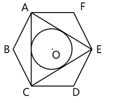

[代码描摹高清 PNG](../../../images/code_hd/763.png) · [SVG](../../../images/code_hd/763.svg)（原图为准）

A.π
B.2π
C.5π/4
D.3π/2

来源：[2024年江苏省公务员录用考试《行测》题（A类）.pdf](https://github.com/dumarstoft-ship-it/xingce/blob/407016b55b49581efa3771bb59a2dee8761d982f/2024%E5%B9%B4%E6%B1%9F%E8%8B%8F%E7%9C%81%E5%85%AC%E5%8A%A1%E5%91%98%E5%BD%95%E7%94%A8%E8%80%83%E8%AF%95%E3%80%8A%E8%A1%8C%E6%B5%8B%E3%80%8B%E9%A2%98%EF%BC%88A%E7%B1%BB%EF%BC%89.pdf)，PDF 第 10 页。

## 第 66 题 · 判断推理

`JS2024-A类-066`

保护知识产权：保护创新
A.人之初：性本善 B.德不孤：必有邻 C.勤有功：戏无益 D.经一事：长一智

来源：[2024年江苏省公务员录用考试《行测》题（A类）.pdf](https://github.com/dumarstoft-ship-it/xingce/blob/407016b55b49581efa3771bb59a2dee8761d982f/2024%E5%B9%B4%E6%B1%9F%E8%8B%8F%E7%9C%81%E5%85%AC%E5%8A%A1%E5%91%98%E5%BD%95%E7%94%A8%E8%80%83%E8%AF%95%E3%80%8A%E8%A1%8C%E6%B5%8B%E3%80%8B%E9%A2%98%EF%BC%88A%E7%B1%BB%EF%BC%89.pdf)，PDF 第 10 页。

## 第 67 题 · 判断推理

`JS2024-A类-067`

年华未暮：容貌先秋
A.十年树木：百年树人 B.宁为玉碎：不为瓦全 C.言者无心：听者有意 D.人无远虑：必有近忧

来源：[2024年江苏省公务员录用考试《行测》题（A类）.pdf](https://github.com/dumarstoft-ship-it/xingce/blob/407016b55b49581efa3771bb59a2dee8761d982f/2024%E5%B9%B4%E6%B1%9F%E8%8B%8F%E7%9C%81%E5%85%AC%E5%8A%A1%E5%91%98%E5%BD%95%E7%94%A8%E8%80%83%E8%AF%95%E3%80%8A%E8%A1%8C%E6%B5%8B%E3%80%8B%E9%A2%98%EF%BC%88A%E7%B1%BB%EF%BC%89.pdf)，PDF 第 10 页。

## 第 68 题 · 判断推理

`JS2024-A类-068`

吴王好剑客：百姓多创瘢
A.白日依山尽：黄河入海流 B.问君何能尔：心远地自偏
C.海上生明月：天涯共此时 D.烽火连三月：家书抵万金

来源：[2024年江苏省公务员录用考试《行测》题（A类）.pdf](https://github.com/dumarstoft-ship-it/xingce/blob/407016b55b49581efa3771bb59a2dee8761d982f/2024%E5%B9%B4%E6%B1%9F%E8%8B%8F%E7%9C%81%E5%85%AC%E5%8A%A1%E5%91%98%E5%BD%95%E7%94%A8%E8%80%83%E8%AF%95%E3%80%8A%E8%A1%8C%E6%B5%8B%E3%80%8B%E9%A2%98%EF%BC%88A%E7%B1%BB%EF%BC%89.pdf)，PDF 第 10 页。

## 第 69 题 · 判断推理

`JS2024-A类-069`

停：行：止
A.日：月：星 B.满：亏：盈 C.没：有：无 D.萌：荣：枯

来源：[2024年江苏省公务员录用考试《行测》题（A类）.pdf](https://github.com/dumarstoft-ship-it/xingce/blob/407016b55b49581efa3771bb59a2dee8761d982f/2024%E5%B9%B4%E6%B1%9F%E8%8B%8F%E7%9C%81%E5%85%AC%E5%8A%A1%E5%91%98%E5%BD%95%E7%94%A8%E8%80%83%E8%AF%95%E3%80%8A%E8%A1%8C%E6%B5%8B%E3%80%8B%E9%A2%98%EF%BC%88A%E7%B1%BB%EF%BC%89.pdf)，PDF 第 10 页。

## 第 70 题 · 判断推理

`JS2024-A类-070`

球赛：球员：裁判
A.教学：教师：家长 B.庭审：被告：法官 C.球场：球员：观众 D.手术：患者：护士

来源：[2024年江苏省公务员录用考试《行测》题（A类）.pdf](https://github.com/dumarstoft-ship-it/xingce/blob/407016b55b49581efa3771bb59a2dee8761d982f/2024%E5%B9%B4%E6%B1%9F%E8%8B%8F%E7%9C%81%E5%85%AC%E5%8A%A1%E5%91%98%E5%BD%95%E7%94%A8%E8%80%83%E8%AF%95%E3%80%8A%E8%A1%8C%E6%B5%8B%E3%80%8B%E9%A2%98%EF%BC%88A%E7%B1%BB%EF%BC%89.pdf)，PDF 第 10 页。

## 第 71 题 · 判断推理

`JS2024-A类-071`

戏剧：壁画：生活
A.陈设：衣饰：性格 B.字形：字音：情感 C.文章：书法：人品 D.时针：钟表：时间

来源：[2024年江苏省公务员录用考试《行测》题（A类）.pdf](https://github.com/dumarstoft-ship-it/xingce/blob/407016b55b49581efa3771bb59a2dee8761d982f/2024%E5%B9%B4%E6%B1%9F%E8%8B%8F%E7%9C%81%E5%85%AC%E5%8A%A1%E5%91%98%E5%BD%95%E7%94%A8%E8%80%83%E8%AF%95%E3%80%8A%E8%A1%8C%E6%B5%8B%E3%80%8B%E9%A2%98%EF%BC%88A%E7%B1%BB%EF%BC%89.pdf)，PDF 第 10 页。

## 第 72 题 · 判断推理

`JS2024-A类-072`

海军装备：军事装备：维护
A.田径比赛：跳高比赛：举行 B.舞蹈表演：艺术表演：观赏
C.购车补贴：购房补贴：发放 D.数字贸易：新兴贸易：互惠

来源：[2024年江苏省公务员录用考试《行测》题（A类）.pdf](https://github.com/dumarstoft-ship-it/xingce/blob/407016b55b49581efa3771bb59a2dee8761d982f/2024%E5%B9%B4%E6%B1%9F%E8%8B%8F%E7%9C%81%E5%85%AC%E5%8A%A1%E5%91%98%E5%BD%95%E7%94%A8%E8%80%83%E8%AF%95%E3%80%8A%E8%A1%8C%E6%B5%8B%E3%80%8B%E9%A2%98%EF%BC%88A%E7%B1%BB%EF%BC%89.pdf)，PDF 第 10 页。

## 第 73 题 · 判断推理

`JS2024-A类-073`

实践成果：阶段成果：理论成果
A.经济创新：文化创新：政治创新 B.阅读辅导：读写辅导：写作辅导
C.环岛旅行：红色旅行：太空旅行 D.物质文明：现代文明：精神文明

来源：[2024年江苏省公务员录用考试《行测》题（A类）.pdf](https://github.com/dumarstoft-ship-it/xingce/blob/407016b55b49581efa3771bb59a2dee8761d982f/2024%E5%B9%B4%E6%B1%9F%E8%8B%8F%E7%9C%81%E5%85%AC%E5%8A%A1%E5%91%98%E5%BD%95%E7%94%A8%E8%80%83%E8%AF%95%E3%80%8A%E8%A1%8C%E6%B5%8B%E3%80%8B%E9%A2%98%EF%BC%88A%E7%B1%BB%EF%BC%89.pdf)，PDF 第 10 页。

## 第 74 题 · 判断推理

`JS2024-A类-074`

敬重 之于 （    ） 相当于 （    ） 之于 拘谨
A.尊重；谨慎 B.蔑视；拘束 C.尊崇；豪放 D.鄙视；洒脱

来源：[2024年江苏省公务员录用考试《行测》题（A类）.pdf](https://github.com/dumarstoft-ship-it/xingce/blob/407016b55b49581efa3771bb59a2dee8761d982f/2024%E5%B9%B4%E6%B1%9F%E8%8B%8F%E7%9C%81%E5%85%AC%E5%8A%A1%E5%91%98%E5%BD%95%E7%94%A8%E8%80%83%E8%AF%95%E3%80%8A%E8%A1%8C%E6%B5%8B%E3%80%8B%E9%A2%98%EF%BC%88A%E7%B1%BB%EF%BC%89.pdf)，PDF 第 10 页。

## 第 75 题 · 判断推理

`JS2024-A类-075`

牙齿磨损 之于 （    ） 相当于 （    ） 之于 经济活力
A.年龄大小；用电总量 B.牙齿脱落；社会效益 C.骨骼磨损；发展指数 D.坚硬食物；经济疲软

来源：[2024年江苏省公务员录用考试《行测》题（A类）.pdf](https://github.com/dumarstoft-ship-it/xingce/blob/407016b55b49581efa3771bb59a2dee8761d982f/2024%E5%B9%B4%E6%B1%9F%E8%8B%8F%E7%9C%81%E5%85%AC%E5%8A%A1%E5%91%98%E5%BD%95%E7%94%A8%E8%80%83%E8%AF%95%E3%80%8A%E8%A1%8C%E6%B5%8B%E3%80%8B%E9%A2%98%EF%BC%88A%E7%B1%BB%EF%BC%89.pdf)，PDF 第 10、11 页。

## 第 76 题 · 判断推理

`JS2024-A类-076`

> 原文件未收录此题，保留缺题占位；默认 A 不是有效答案。

题目正在全力以赴征集，将会第一时间上传（正确答案默认设置为A项）
A.暂缺 B.暂缺 C.暂缺 D.暂缺

来源：[2024年江苏省公务员录用考试《行测》题（A类）.pdf](https://github.com/dumarstoft-ship-it/xingce/blob/407016b55b49581efa3771bb59a2dee8761d982f/2024%E5%B9%B4%E6%B1%9F%E8%8B%8F%E7%9C%81%E5%85%AC%E5%8A%A1%E5%91%98%E5%BD%95%E7%94%A8%E8%80%83%E8%AF%95%E3%80%8A%E8%A1%8C%E6%B5%8B%E3%80%8B%E9%A2%98%EF%BC%88A%E7%B1%BB%EF%BC%89.pdf)，PDF 第 11 页。

## 第 77 题 · 判断推理

`JS2024-A类-077`

> 原文件未收录此题，保留缺题占位；默认 A 不是有效答案。

题目正在全力以赴征集，将会第一时间上传（正确答案默认设置为A项）
A.暂缺 B.暂缺 C.暂缺 D.暂缺

来源：[2024年江苏省公务员录用考试《行测》题（A类）.pdf](https://github.com/dumarstoft-ship-it/xingce/blob/407016b55b49581efa3771bb59a2dee8761d982f/2024%E5%B9%B4%E6%B1%9F%E8%8B%8F%E7%9C%81%E5%85%AC%E5%8A%A1%E5%91%98%E5%BD%95%E7%94%A8%E8%80%83%E8%AF%95%E3%80%8A%E8%A1%8C%E6%B5%8B%E3%80%8B%E9%A2%98%EF%BC%88A%E7%B1%BB%EF%BC%89.pdf)，PDF 第 11 页。

## 第 78 题 · 判断推理

`JS2024-A类-078`

> 原文件未收录此题，保留缺题占位；默认 A 不是有效答案。

题目正在全力以赴征集，将会第一时间上传（正确答案默认设置为A项）
A.缺失 B.缺失 C.缺失 D.缺失

来源：[2024年江苏省公务员录用考试《行测》题（A类）.pdf](https://github.com/dumarstoft-ship-it/xingce/blob/407016b55b49581efa3771bb59a2dee8761d982f/2024%E5%B9%B4%E6%B1%9F%E8%8B%8F%E7%9C%81%E5%85%AC%E5%8A%A1%E5%91%98%E5%BD%95%E7%94%A8%E8%80%83%E8%AF%95%E3%80%8A%E8%A1%8C%E6%B5%8B%E3%80%8B%E9%A2%98%EF%BC%88A%E7%B1%BB%EF%BC%89.pdf)，PDF 第 11 页。

## 第 79 题 · 判断推理

`JS2024-A类-079`

从所给的四个选项中，选择最合适的一个填入问号处，使之呈现一定的规律性。

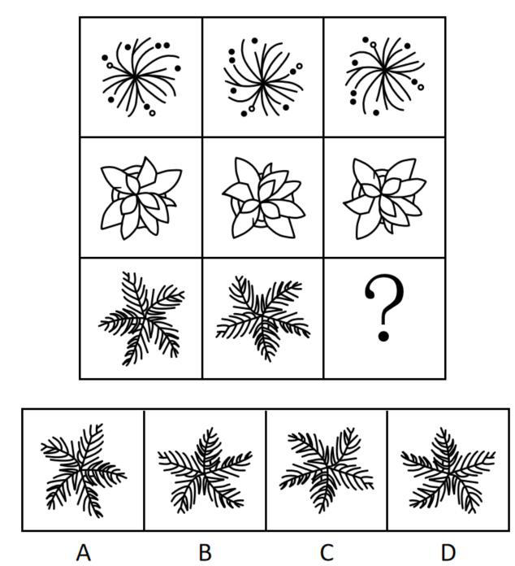

A.A B.B C.C D.D

来源：[2024年江苏省公务员录用考试《行测》题（A类）.pdf](https://github.com/dumarstoft-ship-it/xingce/blob/407016b55b49581efa3771bb59a2dee8761d982f/2024%E5%B9%B4%E6%B1%9F%E8%8B%8F%E7%9C%81%E5%85%AC%E5%8A%A1%E5%91%98%E5%BD%95%E7%94%A8%E8%80%83%E8%AF%95%E3%80%8A%E8%A1%8C%E6%B5%8B%E3%80%8B%E9%A2%98%EF%BC%88A%E7%B1%BB%EF%BC%89.pdf)，PDF 第 11 页。

## 第 80 题 · 判断推理

`JS2024-A类-080`

从所给的四个选项中，选择最合适的一个填入问号处，使之呈现一定的规律性。

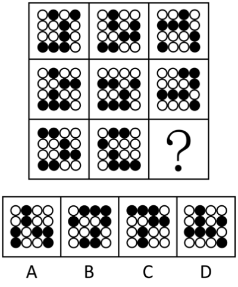

A.A B.B C.C D.D

来源：[2024年江苏省公务员录用考试《行测》题（A类）.pdf](https://github.com/dumarstoft-ship-it/xingce/blob/407016b55b49581efa3771bb59a2dee8761d982f/2024%E5%B9%B4%E6%B1%9F%E8%8B%8F%E7%9C%81%E5%85%AC%E5%8A%A1%E5%91%98%E5%BD%95%E7%94%A8%E8%80%83%E8%AF%95%E3%80%8A%E8%A1%8C%E6%B5%8B%E3%80%8B%E9%A2%98%EF%BC%88A%E7%B1%BB%EF%BC%89.pdf)，PDF 第 11、12 页。

## 第 81 题 · 判断推理

`JS2024-A类-081`

从所给的四个选项中，选择最合适的一个填入问号处，使之呈现一定的规律性。

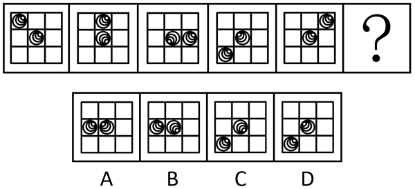

A.A B.B C.C D.D

来源：[2024年江苏省公务员录用考试《行测》题（A类）.pdf](https://github.com/dumarstoft-ship-it/xingce/blob/407016b55b49581efa3771bb59a2dee8761d982f/2024%E5%B9%B4%E6%B1%9F%E8%8B%8F%E7%9C%81%E5%85%AC%E5%8A%A1%E5%91%98%E5%BD%95%E7%94%A8%E8%80%83%E8%AF%95%E3%80%8A%E8%A1%8C%E6%B5%8B%E3%80%8B%E9%A2%98%EF%BC%88A%E7%B1%BB%EF%BC%89.pdf)，PDF 第 12 页。

## 第 82 题 · 判断推理

`JS2024-A类-082`

选项四个图形中，只有一个是由题干的四个图形拼合（只能通过上、下、左、右平移）而成的，请把它找出
来。

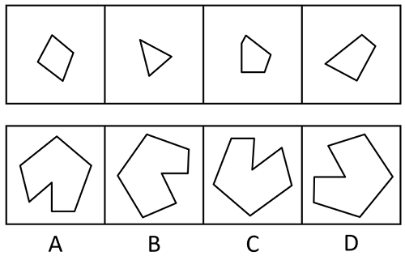

A.A B.B C.C D.D

来源：[2024年江苏省公务员录用考试《行测》题（A类）.pdf](https://github.com/dumarstoft-ship-it/xingce/blob/407016b55b49581efa3771bb59a2dee8761d982f/2024%E5%B9%B4%E6%B1%9F%E8%8B%8F%E7%9C%81%E5%85%AC%E5%8A%A1%E5%91%98%E5%BD%95%E7%94%A8%E8%80%83%E8%AF%95%E3%80%8A%E8%A1%8C%E6%B5%8B%E3%80%8B%E9%A2%98%EF%BC%88A%E7%B1%BB%EF%BC%89.pdf)，PDF 第 12、13 页。

## 第 83 题 · 判断推理

`JS2024-A类-083`

选项四个图形中，只有一个是由题干的四个图形拼合（只能通过上、下、左、右平移）而成的，请把它找出
来。

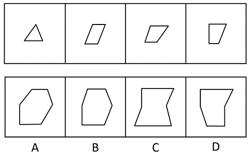

A.A B.B C.C D.D

来源：[2024年江苏省公务员录用考试《行测》题（A类）.pdf](https://github.com/dumarstoft-ship-it/xingce/blob/407016b55b49581efa3771bb59a2dee8761d982f/2024%E5%B9%B4%E6%B1%9F%E8%8B%8F%E7%9C%81%E5%85%AC%E5%8A%A1%E5%91%98%E5%BD%95%E7%94%A8%E8%80%83%E8%AF%95%E3%80%8A%E8%A1%8C%E6%B5%8B%E3%80%8B%E9%A2%98%EF%BC%88A%E7%B1%BB%EF%BC%89.pdf)，PDF 第 13 页。

## 第 84 题 · 判断推理

`JS2024-A类-084`

选项四个图形中，只有一个是由题干的四个图形拼合（只能通过上、下、左、右平移）而成的，请把它找出
来。

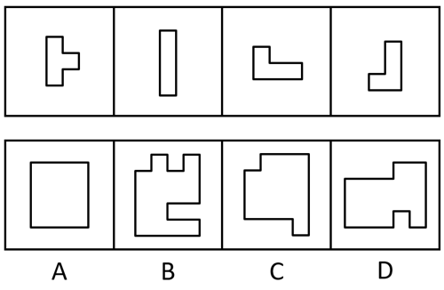

A.A B.B C.C D.D

来源：[2024年江苏省公务员录用考试《行测》题（A类）.pdf](https://github.com/dumarstoft-ship-it/xingce/blob/407016b55b49581efa3771bb59a2dee8761d982f/2024%E5%B9%B4%E6%B1%9F%E8%8B%8F%E7%9C%81%E5%85%AC%E5%8A%A1%E5%91%98%E5%BD%95%E7%94%A8%E8%80%83%E8%AF%95%E3%80%8A%E8%A1%8C%E6%B5%8B%E3%80%8B%E9%A2%98%EF%BC%88A%E7%B1%BB%EF%BC%89.pdf)，PDF 第 13 页。

## 第 85 题 · 判断推理

`JS2024-A类-085`

选项四个图形中，只有一个是由题干的四个图形拼合（只能通过上、下、左、右平移）而成的，请把它找出
来。

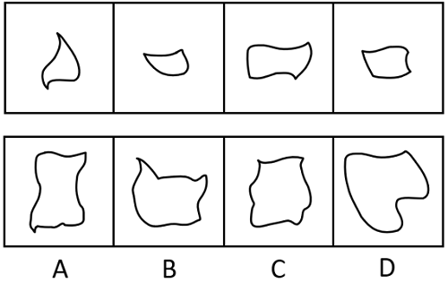

A.A B.B C.C D.D

来源：[2024年江苏省公务员录用考试《行测》题（A类）.pdf](https://github.com/dumarstoft-ship-it/xingce/blob/407016b55b49581efa3771bb59a2dee8761d982f/2024%E5%B9%B4%E6%B1%9F%E8%8B%8F%E7%9C%81%E5%85%AC%E5%8A%A1%E5%91%98%E5%BD%95%E7%94%A8%E8%80%83%E8%AF%95%E3%80%8A%E8%A1%8C%E6%B5%8B%E3%80%8B%E9%A2%98%EF%BC%88A%E7%B1%BB%EF%BC%89.pdf)，PDF 第 14 页。

## 第 86 题 · 判断推理

`JS2024-A类-086`

左边图形恰好可以分割为右边的某三个图形（可以平移、旋转，但不可翻转），请找出不属于分割所得的图
形。

A.A B.B C.C D.D

来源：[2024年江苏省公务员录用考试《行测》题（A类）.pdf](https://github.com/dumarstoft-ship-it/xingce/blob/407016b55b49581efa3771bb59a2dee8761d982f/2024%E5%B9%B4%E6%B1%9F%E8%8B%8F%E7%9C%81%E5%85%AC%E5%8A%A1%E5%91%98%E5%BD%95%E7%94%A8%E8%80%83%E8%AF%95%E3%80%8A%E8%A1%8C%E6%B5%8B%E3%80%8B%E9%A2%98%EF%BC%88A%E7%B1%BB%EF%BC%89.pdf)，PDF 第 14 页。

## 第 87 题 · 判断推理

`JS2024-A类-087`

左边给定的是六面体的外表面展开图，右边哪一项能由它折叠而成？

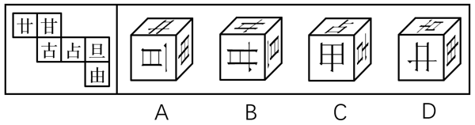

A.A B.B C.C D.D

来源：[2024年江苏省公务员录用考试《行测》题（A类）.pdf](https://github.com/dumarstoft-ship-it/xingce/blob/407016b55b49581efa3771bb59a2dee8761d982f/2024%E5%B9%B4%E6%B1%9F%E8%8B%8F%E7%9C%81%E5%85%AC%E5%8A%A1%E5%91%98%E5%BD%95%E7%94%A8%E8%80%83%E8%AF%95%E3%80%8A%E8%A1%8C%E6%B5%8B%E3%80%8B%E9%A2%98%EF%BC%88A%E7%B1%BB%EF%BC%89.pdf)，PDF 第 14 页。

## 第 88 题 · 判断推理

`JS2024-A类-088`

下列是四个正方体的外表面展开图，其中哪个展开图还原成正方体后，存在同一个公共顶点的三个面上的数字
之和为8？

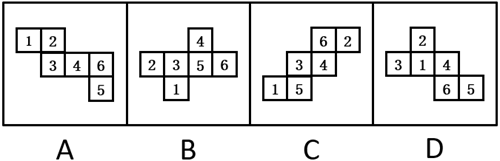

A.A B.B C.C D.D

来源：[2024年江苏省公务员录用考试《行测》题（A类）.pdf](https://github.com/dumarstoft-ship-it/xingce/blob/407016b55b49581efa3771bb59a2dee8761d982f/2024%E5%B9%B4%E6%B1%9F%E8%8B%8F%E7%9C%81%E5%85%AC%E5%8A%A1%E5%91%98%E5%BD%95%E7%94%A8%E8%80%83%E8%AF%95%E3%80%8A%E8%A1%8C%E6%B5%8B%E3%80%8B%E9%A2%98%EF%BC%88A%E7%B1%BB%EF%BC%89.pdf)，PDF 第 14 页。

## 第 89 题 · 判断推理

`JS2024-A类-089`

将下列三棱锥的展开图还原成三棱锥后，有一个与其他三个不一样，请把它找出来。

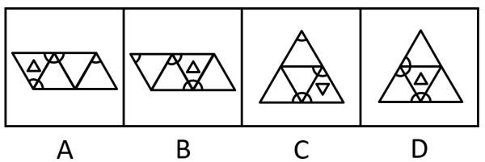

A.A B.B C.C D.D

来源：[2024年江苏省公务员录用考试《行测》题（A类）.pdf](https://github.com/dumarstoft-ship-it/xingce/blob/407016b55b49581efa3771bb59a2dee8761d982f/2024%E5%B9%B4%E6%B1%9F%E8%8B%8F%E7%9C%81%E5%85%AC%E5%8A%A1%E5%91%98%E5%BD%95%E7%94%A8%E8%80%83%E8%AF%95%E3%80%8A%E8%A1%8C%E6%B5%8B%E3%80%8B%E9%A2%98%EF%BC%88A%E7%B1%BB%EF%BC%89.pdf)，PDF 第 14、15 页。

## 第 90 题 · 判断推理

`JS2024-A类-090`

下列立体图形的视图不可能是所给四个选项中的哪一个？

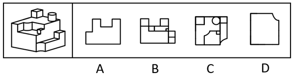

A.A B.B C.C D.D

来源：[2024年江苏省公务员录用考试《行测》题（A类）.pdf](https://github.com/dumarstoft-ship-it/xingce/blob/407016b55b49581efa3771bb59a2dee8761d982f/2024%E5%B9%B4%E6%B1%9F%E8%8B%8F%E7%9C%81%E5%85%AC%E5%8A%A1%E5%91%98%E5%BD%95%E7%94%A8%E8%80%83%E8%AF%95%E3%80%8A%E8%A1%8C%E6%B5%8B%E3%80%8B%E9%A2%98%EF%BC%88A%E7%B1%BB%EF%BC%89.pdf)，PDF 第 15 页。

## 第 91 题 · 判断推理

`JS2024-A类-091`

一只鸟除非两翼健壮并以共同的力量来推动身体，否则它不能飞向天空。根据以上陈述，可以推出以下哪些结
论？
①一只鸟如果两翼健壮并以共同的力量来推动身体，那么它能够飞向天空
②一只鸟如果能够飞向天空，那么它两翼健壮并以共同的力量来推动身体
③一只鸟若两翼不健壮或不能以共同的力量来推动身体，那么它不能飞向天空
④一只鸟如果不能飞向天空，那么它两翼不健壮或不能以共同力量来推动身体
A.①② B.②③ C.③④ D.②④

来源：[2024年江苏省公务员录用考试《行测》题（A类）.pdf](https://github.com/dumarstoft-ship-it/xingce/blob/407016b55b49581efa3771bb59a2dee8761d982f/2024%E5%B9%B4%E6%B1%9F%E8%8B%8F%E7%9C%81%E5%85%AC%E5%8A%A1%E5%91%98%E5%BD%95%E7%94%A8%E8%80%83%E8%AF%95%E3%80%8A%E8%A1%8C%E6%B5%8B%E3%80%8B%E9%A2%98%EF%BC%88A%E7%B1%BB%EF%BC%89.pdf)，PDF 第 15 页。

## 第 92 题 · 判断推理

`JS2024-A类-092`

某学校模拟派出骨干教师指导山区教师人才培训项目。甲、乙、丙、丁四位教师积极报名参加，学校决定从他
们四人中挑选出若干人员，考虑到各方面情况，派出人员要符合以下要求：
①只有乙参加，甲才参加；
②如果丙参加，那么丁不参加；
③如果乙参加，那么丙也参加。
根据以上信息，以下哪项不可能为真？
A.甲和丙参加 B.丁参加，乙不参加 C.甲和丁参加 D.甲参加，丁不参加

来源：[2024年江苏省公务员录用考试《行测》题（A类）.pdf](https://github.com/dumarstoft-ship-it/xingce/blob/407016b55b49581efa3771bb59a2dee8761d982f/2024%E5%B9%B4%E6%B1%9F%E8%8B%8F%E7%9C%81%E5%85%AC%E5%8A%A1%E5%91%98%E5%BD%95%E7%94%A8%E8%80%83%E8%AF%95%E3%80%8A%E8%A1%8C%E6%B5%8B%E3%80%8B%E9%A2%98%EF%BC%88A%E7%B1%BB%EF%BC%89.pdf)，PDF 第 15 页。

## 第 93 题 · 判断推理

`JS2024-A类-093`

> 原文件未收录此题，保留缺题占位；默认 A 不是有效答案。

题目正在全力以赴征集，将会第一时间上传（正确答案默认设置为A项）
A.缺失 B.缺失 C.缺失 D.缺失

来源：[2024年江苏省公务员录用考试《行测》题（A类）.pdf](https://github.com/dumarstoft-ship-it/xingce/blob/407016b55b49581efa3771bb59a2dee8761d982f/2024%E5%B9%B4%E6%B1%9F%E8%8B%8F%E7%9C%81%E5%85%AC%E5%8A%A1%E5%91%98%E5%BD%95%E7%94%A8%E8%80%83%E8%AF%95%E3%80%8A%E8%A1%8C%E6%B5%8B%E3%80%8B%E9%A2%98%EF%BC%88A%E7%B1%BB%EF%BC%89.pdf)，PDF 第 15 页。

## 第 94 题 · 判断推理

`JS2024-A类-094`

> 原文件未收录此题，保留缺题占位；默认 A 不是有效答案。

题目正在全力以赴征集，将会第一时间上传（正确答案默认设置为A项）
A.缺失 B.缺失 C.缺失 D.缺失

来源：[2024年江苏省公务员录用考试《行测》题（A类）.pdf](https://github.com/dumarstoft-ship-it/xingce/blob/407016b55b49581efa3771bb59a2dee8761d982f/2024%E5%B9%B4%E6%B1%9F%E8%8B%8F%E7%9C%81%E5%85%AC%E5%8A%A1%E5%91%98%E5%BD%95%E7%94%A8%E8%80%83%E8%AF%95%E3%80%8A%E8%A1%8C%E6%B5%8B%E3%80%8B%E9%A2%98%EF%BC%88A%E7%B1%BB%EF%BC%89.pdf)，PDF 第 15 页。

## 第 95 题 · 判断推理

`JS2024-A类-095`

> 原文件未收录此题，保留缺题占位；默认 A 不是有效答案。

题目正在全力以赴征集，将会第一时间上传。（正确答案默认设置为A项。）
A.缺失 B.缺失 C.缺失 D.缺失

来源：[2024年江苏省公务员录用考试《行测》题（A类）.pdf](https://github.com/dumarstoft-ship-it/xingce/blob/407016b55b49581efa3771bb59a2dee8761d982f/2024%E5%B9%B4%E6%B1%9F%E8%8B%8F%E7%9C%81%E5%85%AC%E5%8A%A1%E5%91%98%E5%BD%95%E7%94%A8%E8%80%83%E8%AF%95%E3%80%8A%E8%A1%8C%E6%B5%8B%E3%80%8B%E9%A2%98%EF%BC%88A%E7%B1%BB%EF%BC%89.pdf)，PDF 第 15 页。

## 第 96 题 · 判断推理

`JS2024-A类-096`

> 原文件未收录此题，保留缺题占位；默认 A 不是有效答案。

题目正在全力以赴征集，将会第一时间上传。（正确答案默认设置为A项。）
A.缺失 B.缺失 C.缺失 D.缺失

来源：[2024年江苏省公务员录用考试《行测》题（A类）.pdf](https://github.com/dumarstoft-ship-it/xingce/blob/407016b55b49581efa3771bb59a2dee8761d982f/2024%E5%B9%B4%E6%B1%9F%E8%8B%8F%E7%9C%81%E5%85%AC%E5%8A%A1%E5%91%98%E5%BD%95%E7%94%A8%E8%80%83%E8%AF%95%E3%80%8A%E8%A1%8C%E6%B5%8B%E3%80%8B%E9%A2%98%EF%BC%88A%E7%B1%BB%EF%BC%89.pdf)，PDF 第 15 页。

## 第 97 题 · 判断推理

`JS2024-A类-097`

### 共用材料

某企业的生产部、研发部和财务部分别需要招聘1名员工，有3名博士生、3名硕士生和3名本科生前来应聘。该
公司人事部小王对招聘结果做了如下预测：
（1）如果生产部录用本科生，那么研发部录用硕士生；
（2）如果研发部录用博士生，那么生产部录用博士生；
（3）如果财务部录用本科生或者硕士生，那么研发部录用本科生。

如果3个部门录用的人员学历各不相同，那么以下哪种情况符合小王的预测？
A.生产部录用硕士生，财务部录用本科生 B.研发部录用博士生，财务部录用硕士生
C.生产部录用博士生，研发部录用本科生 D.财务部录用本科生，研发部录用硕士生

来源：[2024年江苏省公务员录用考试《行测》题（A类）.pdf](https://github.com/dumarstoft-ship-it/xingce/blob/407016b55b49581efa3771bb59a2dee8761d982f/2024%E5%B9%B4%E6%B1%9F%E8%8B%8F%E7%9C%81%E5%85%AC%E5%8A%A1%E5%91%98%E5%BD%95%E7%94%A8%E8%80%83%E8%AF%95%E3%80%8A%E8%A1%8C%E6%B5%8B%E3%80%8B%E9%A2%98%EF%BC%88A%E7%B1%BB%EF%BC%89.pdf)，PDF 第 16 页。

## 第 98 题 · 判断推理

`JS2024-A类-098`

### 共用材料

某企业的生产部、研发部和财务部分别需要招聘1名员工，有3名博士生、3名硕士生和3名本科生前来应聘。该
公司人事部小王对招聘结果做了如下预测：
（1）如果生产部录用本科生，那么研发部录用硕士生；
（2）如果研发部录用博士生，那么生产部录用博士生；
（3）如果财务部录用本科生或者硕士生，那么研发部录用本科生。

如果研发部录用硕士生，那么以下哪种情况不符合小王的预测？
A.生产部录用博士生 B.财务部录用博士生 C.生产部录用本科生 D.财务部录用硕士生

来源：[2024年江苏省公务员录用考试《行测》题（A类）.pdf](https://github.com/dumarstoft-ship-it/xingce/blob/407016b55b49581efa3771bb59a2dee8761d982f/2024%E5%B9%B4%E6%B1%9F%E8%8B%8F%E7%9C%81%E5%85%AC%E5%8A%A1%E5%91%98%E5%BD%95%E7%94%A8%E8%80%83%E8%AF%95%E3%80%8A%E8%A1%8C%E6%B5%8B%E3%80%8B%E9%A2%98%EF%BC%88A%E7%B1%BB%EF%BC%89.pdf)，PDF 第 16 页。

## 第 99 题 · 判断推理

`JS2024-A类-099`

甲：小明十岁就能用英语与英国人流利对话，语言天赋真是出类拔萃。
乙：小明跟着父母在英国住了两年，能流利对话不足为奇。
以下哪项与题干对话方式最为相似？
A.甲：这款热水器的价格比市面上常见的热水器高出一倍，太不划算了
乙：这款产品用的是航天级别的材料，在同材质热水器中性价比很高
B.甲：小李以前容易冲动，进入职场一年后稳重多了
乙：小李承担了单位大量重要工作，变得稳重一点理所当然
C.甲：小张的数学一直很好，进入高中后，物理、化学等科目的学习很轻松
乙：数学强调科学思维，掌握科学思维的人学习物理、化学当然没有难度
D.甲：小刘在过去的一年中连续犯下三起盗窃案，真是无可救药
乙：人非圣贤，孰能无过，相信在经过改造之后他会洗心革面

来源：[2024年江苏省公务员录用考试《行测》题（A类）.pdf](https://github.com/dumarstoft-ship-it/xingce/blob/407016b55b49581efa3771bb59a2dee8761d982f/2024%E5%B9%B4%E6%B1%9F%E8%8B%8F%E7%9C%81%E5%85%AC%E5%8A%A1%E5%91%98%E5%BD%95%E7%94%A8%E8%80%83%E8%AF%95%E3%80%8A%E8%A1%8C%E6%B5%8B%E3%80%8B%E9%A2%98%EF%BC%88A%E7%B1%BB%EF%BC%89.pdf)，PDF 第 16 页。

## 第 100 题 · 判断推理

`JS2024-A类-100`

卖早点、修家电、配钥匙·····老百姓家门口的社区商业，是以社区居民为服务对象、服务半径为步行15
分钟左右范围内的商业形态。近年来，许多城市大力推进社区商业建设，以更好地满足居民的消费需求。不
过，也有专家担忧，家门口商业服务的完善，在给居民生活带来便利的同时可能也会使快递业逐步萎缩。
以下哪项如果为真，最能缓解上述专家的担忧？
A.为了方便居民，很多城市推进社区商业建设时，都将快递驿站作为社区商业的重要组成部分
B.社区商业主要提供汽车保养、幼儿托管等服务类业态，社区购物在居民整体购物消费中占比很少
C.社会经济发展必然包含新旧行业的更迭，社区商业作为新的消费增长点，吸纳了大量传统行业的劳动者就业
D.许多大型商超组建了自己的配送车队，可为周边5公里范围内居民提供商品一小时送达服务

来源：[2024年江苏省公务员录用考试《行测》题（A类）.pdf](https://github.com/dumarstoft-ship-it/xingce/blob/407016b55b49581efa3771bb59a2dee8761d982f/2024%E5%B9%B4%E6%B1%9F%E8%8B%8F%E7%9C%81%E5%85%AC%E5%8A%A1%E5%91%98%E5%BD%95%E7%94%A8%E8%80%83%E8%AF%95%E3%80%8A%E8%A1%8C%E6%B5%8B%E3%80%8B%E9%A2%98%EF%BC%88A%E7%B1%BB%EF%BC%89.pdf)，PDF 第 16 页。

## 第 101 题 · 判断推理

`JS2024-A类-101`

某学校举办田径运动会，所有参加800米跑的运动员都参加了100米跑，所有参加100米跑的运动员都参加了跳
高，有些参加跳远的运动员参加了投掷链球，所有参加跳远的运动员都没有参加跳高。
根据以上陈述，不能推出以下哪项？
A.所有参加800米跑的运动员都参加了跳高 B.所有参加投掷链球的运动员都没有参加跳高
C.所有参加跳远的运动员都没有参加100米跑 D.有些参加800米跑的运动员参加了跳远

来源：[2024年江苏省公务员录用考试《行测》题（A类）.pdf](https://github.com/dumarstoft-ship-it/xingce/blob/407016b55b49581efa3771bb59a2dee8761d982f/2024%E5%B9%B4%E6%B1%9F%E8%8B%8F%E7%9C%81%E5%85%AC%E5%8A%A1%E5%91%98%E5%BD%95%E7%94%A8%E8%80%83%E8%AF%95%E3%80%8A%E8%A1%8C%E6%B5%8B%E3%80%8B%E9%A2%98%EF%BC%88A%E7%B1%BB%EF%BC%89.pdf)，PDF 第 16 页。

## 第 102 题 · 判断推理

`JS2024-A类-102`

评价某份试卷中的试题质量通常有难度和区分度等指标，一道单选题的难度通常用正确选择试题答案的人数与
参加测验的总人数的比值来表示。区分度指的是试题对考生实际水平的区分程度和区分的有效性，一道单选题
的区分度指数D的计算公式为：D=P_H−P_L，其中P_H为高分组（试卷总得分排在前27%的考生）该题的难度，
P_L为低分组（试卷总得分排在后27%的考生）该题的难度。
根据以上陈述，可以推出以下哪项？
A.一道难度为1的单选题区分度指数为0.1
B.任一单选题的区分度指数不可能为负值
C.一道难度为0.27的单选题的最大区分度指数为0.5
D.一道单选题的难度也可以表示为该题的平均得分与该题分值的比值

来源：[2024年江苏省公务员录用考试《行测》题（A类）.pdf](https://github.com/dumarstoft-ship-it/xingce/blob/407016b55b49581efa3771bb59a2dee8761d982f/2024%E5%B9%B4%E6%B1%9F%E8%8B%8F%E7%9C%81%E5%85%AC%E5%8A%A1%E5%91%98%E5%BD%95%E7%94%A8%E8%80%83%E8%AF%95%E3%80%8A%E8%A1%8C%E6%B5%8B%E3%80%8B%E9%A2%98%EF%BC%88A%E7%B1%BB%EF%BC%89.pdf)，PDF 第 16、17 页。

## 第 103 题 · 判断推理

`JS2024-A类-103`

一项研究发现，成年小白鼠去除一个关键生物钟基因后，昼夜节律完全消失，虽然生活质量有所下降，但寿命
并未受到显著影响，心血管健康状况甚至有所改善。据此，研究人员推断昼夜节律缺失对健康的危害可能没有
我们想象得那么大。
回答以下哪个问题最有助于评价上述研究人员所做出的推断？
A.成年小白鼠去除生物钟基因后出现的心血管情况改善是否会延长小白鼠的寿命
B.成年小白鼠去除生物钟基因之后的休息时间是否与未去除之前的休息时间相同
C.成年小白鼠去除生物钟基因后的寿命和心血管健康状况能否代表整体健康状况
D.成年小白鼠去除生物钟基因之后的生活质量是否会影响小白鼠的整体健康状况

来源：[2024年江苏省公务员录用考试《行测》题（A类）.pdf](https://github.com/dumarstoft-ship-it/xingce/blob/407016b55b49581efa3771bb59a2dee8761d982f/2024%E5%B9%B4%E6%B1%9F%E8%8B%8F%E7%9C%81%E5%85%AC%E5%8A%A1%E5%91%98%E5%BD%95%E7%94%A8%E8%80%83%E8%AF%95%E3%80%8A%E8%A1%8C%E6%B5%8B%E3%80%8B%E9%A2%98%EF%BC%88A%E7%B1%BB%EF%BC%89.pdf)，PDF 第 17 页。

## 第 104 题 · 判断推理

`JS2024-A类-104`

### 共用材料

市住建局3名工作人员小郑、小周、小刘打算参加“青年党员下基层”调研活动。可选的有小微堵点改造、跨
区断头路建设、小型城市客厅打造、历史街区微改造4个调研项目。指导调研的有王教授、钱教授、马教授，
且他们只能指导上述三位工作人员，已知：
（1）每位工作人员参加的项目都必须有教授指导，每位教授至少指导一位工作人员；
（2）每位工作人员只能参加一个项目，提倡多人合作；
（3）每位教授只能指导一个项目，一个项目也可由多位教授共同指导；
（4）小郑参加小微堵点改造或跨区断头路建设项目，钱教授指导历史街区微改造项目。

参加或指导小微堵点改造项目的不可能同时有以下哪两个人？
A.王教授和马教授 B.马教授和小刘 C.小刘和小周 D.小周和王教授

来源：[2024年江苏省公务员录用考试《行测》题（A类）.pdf](https://github.com/dumarstoft-ship-it/xingce/blob/407016b55b49581efa3771bb59a2dee8761d982f/2024%E5%B9%B4%E6%B1%9F%E8%8B%8F%E7%9C%81%E5%85%AC%E5%8A%A1%E5%91%98%E5%BD%95%E7%94%A8%E8%80%83%E8%AF%95%E3%80%8A%E8%A1%8C%E6%B5%8B%E3%80%8B%E9%A2%98%EF%BC%88A%E7%B1%BB%EF%BC%89.pdf)，PDF 第 17 页。

## 第 105 题 · 判断推理

`JS2024-A类-105`

### 共用材料

市住建局3名工作人员小郑、小周、小刘打算参加“青年党员下基层”调研活动。可选的有小微堵点改造、跨
区断头路建设、小型城市客厅打造、历史街区微改造4个调研项目。指导调研的有王教授、钱教授、马教授，
且他们只能指导上述三位工作人员，已知：
（1）每位工作人员参加的项目都必须有教授指导，每位教授至少指导一位工作人员；
（2）每位工作人员只能参加一个项目，提倡多人合作；
（3）每位教授只能指导一个项目，一个项目也可由多位教授共同指导；
（4）小郑参加小微堵点改造或跨区断头路建设项目，钱教授指导历史街区微改造项目。

如果小周参加小型城市客厅打造项目，则以下哪一项一定为真？
A.小刘参加历史街区微改造项目 B.王教授指导小型城市客厅打造项目
C.马教授指导小微堵点改造项目 D.小郑参加跨区断头路建设项目

来源：[2024年江苏省公务员录用考试《行测》题（A类）.pdf](https://github.com/dumarstoft-ship-it/xingce/blob/407016b55b49581efa3771bb59a2dee8761d982f/2024%E5%B9%B4%E6%B1%9F%E8%8B%8F%E7%9C%81%E5%85%AC%E5%8A%A1%E5%91%98%E5%BD%95%E7%94%A8%E8%80%83%E8%AF%95%E3%80%8A%E8%A1%8C%E6%B5%8B%E3%80%8B%E9%A2%98%EF%BC%88A%E7%B1%BB%EF%BC%89.pdf)，PDF 第 17 页。

## 第 106 题 · 判断推理

`JS2024-A类-106`

迭代学习：指学习者通过不间断的目标训练，更好地理解学习内容，不断提升技能完善自身能力的学习方式。
下列不属于迭代学习的是：
A.小周参加专业技能大赛，实操环节丢了不少分，他不断强化训练，再次参加就获得了二等奖。又经过一年训
练，综合技能有了显著提高，自己也十分自信
B.学习者要熟练掌握数学运算需经历数年大致相同的过程，先是加减法，之后是乘除法，接下来是混合运算，
逐渐进入更高阶的运算
C.李教授经常深入社区举办科普讲座，最初因为专业性过强，听众很少，后来引入了市民关注的鲜活案例，听
众越来越多；最近又融入了不少优秀传统文化元素，感染力越来越强
D.多家公司推出了各自的AI自然语言处理模型，有的只能与人进行简单对话，有的能在收到指令后几秒钟内交
出一份质量不错的作业，有些已经能够针对各种问题给出比较专业的建议

来源：[2024年江苏省公务员录用考试《行测》题（A类）.pdf](https://github.com/dumarstoft-ship-it/xingce/blob/407016b55b49581efa3771bb59a2dee8761d982f/2024%E5%B9%B4%E6%B1%9F%E8%8B%8F%E7%9C%81%E5%85%AC%E5%8A%A1%E5%91%98%E5%BD%95%E7%94%A8%E8%80%83%E8%AF%95%E3%80%8A%E8%A1%8C%E6%B5%8B%E3%80%8B%E9%A2%98%EF%BC%88A%E7%B1%BB%EF%BC%89.pdf)，PDF 第 17 页。

## 第 107 题 · 判断推理

`JS2024-A类-107`

钝感力：指在工作、生活中能够尽快摆脱消极情绪或困扰，从容应对外部压力，或者冷静面对个人成绩，坚持
既定目标的心理防御机制。
下列不属于钝感力的是：
A.谷先生每次回顾自己的创业经历，都把成功归因于百折不挠的韧劲：无论碰到多少磨难，始终没有被困难打
倒，一直沿着目标不断地向前
B.邱奶奶已经90岁，眼不花，耳不聋，腿脚麻利。她的体会是：人生在世，不如意事十之八九，迅速忘掉不愉
快的事，保持乐观情绪就能长寿
C.杜先生从去年开始坚持在健身中心锻炼，提高身体素质，缓解工作压力。现在再也不像以前那样容易感冒，
即使工作到深夜也不觉得累
D.钟先生性格稳重，听到表扬从不得意忘形，遇到批评也不垂头丧气，心无旁骛地钻研业务，近几年取得了很
多令人羡慕的专业成就

来源：[2024年江苏省公务员录用考试《行测》题（A类）.pdf](https://github.com/dumarstoft-ship-it/xingce/blob/407016b55b49581efa3771bb59a2dee8761d982f/2024%E5%B9%B4%E6%B1%9F%E8%8B%8F%E7%9C%81%E5%85%AC%E5%8A%A1%E5%91%98%E5%BD%95%E7%94%A8%E8%80%83%E8%AF%95%E3%80%8A%E8%A1%8C%E6%B5%8B%E3%80%8B%E9%A2%98%EF%BC%88A%E7%B1%BB%EF%BC%89.pdf)，PDF 第 17、18 页。

## 第 108 题 · 判断推理

`JS2024-A类-108`

潮汐式管理：指管理者根据时间的不同，差异化、精细化管理特定公共资源，最大限度开发和利用现有资源，
有效提升公众幸福指数的管理方法。
下列不属于潮汐式管理的是：
A.某市在主城区的一些特定道路上划定特殊停车位，实行“夜停晨走”制度，老城区停车位不足的问题得到了
有效缓解
B.某街道对摆摊经营实行定时定点画线管理，商贩按指定时间、地点出摊，既不影响交通，又方便了周围居民
生活
C.每年的旅游旺季，某景区附近的居民小区让外地游客免费使用地下停车场车位，大家在网上对此纷纷点赞
D.某市实行居民电动汽车充电桩分时电价政策，峰谷收费标准不同。高峰时段按照正常标准，低谷时段则按照
不同的优惠幅度收费

来源：[2024年江苏省公务员录用考试《行测》题（A类）.pdf](https://github.com/dumarstoft-ship-it/xingce/blob/407016b55b49581efa3771bb59a2dee8761d982f/2024%E5%B9%B4%E6%B1%9F%E8%8B%8F%E7%9C%81%E5%85%AC%E5%8A%A1%E5%91%98%E5%BD%95%E7%94%A8%E8%80%83%E8%AF%95%E3%80%8A%E8%A1%8C%E6%B5%8B%E3%80%8B%E9%A2%98%EF%BC%88A%E7%B1%BB%EF%BC%89.pdf)，PDF 第 18 页。

## 第 109 题 · 判断推理

`JS2024-A类-109`

城市漫游：指按照预定主题和路线，漫步城市街区，在向导带领下深度体验城市变迁或历史文化的旅游方式。
下列属于城市漫游的是：
A.韩先生周末带外地同学游览本市的步行街——河西大道，聊得口干舌燥，买了两杯竹筒奶茶，在“我在河西
大道很想你”路牌下拍了很多照片
B.小方周六日经常把年迈的父母接到城里游玩。由于父母腿脚不太利索，一天通常只游玩一两个景点。周围邻
居都夸小方很孝顺
C.在外漂泊多年的任女士今年回到了故乡，昔日一览无余的小城现在到处高楼林立，为了寻找童年的记忆，她
已经走遍了这里的大街小巷
D.某地旅行社推出了主打“像本地人一样行走在运河边”的新产品，三四个小时的穿城徒步让游客累得抬不起
腿，大家仍觉得意犹未尽

来源：[2024年江苏省公务员录用考试《行测》题（A类）.pdf](https://github.com/dumarstoft-ship-it/xingce/blob/407016b55b49581efa3771bb59a2dee8761d982f/2024%E5%B9%B4%E6%B1%9F%E8%8B%8F%E7%9C%81%E5%85%AC%E5%8A%A1%E5%91%98%E5%BD%95%E7%94%A8%E8%80%83%E8%AF%95%E3%80%8A%E8%A1%8C%E6%B5%8B%E3%80%8B%E9%A2%98%EF%BC%88A%E7%B1%BB%EF%BC%89.pdf)，PDF 第 18 页。

## 第 110 题 · 判断推理

`JS2024-A类-110`

> 原文件未收录此题，保留缺题占位；默认 A 不是有效答案。

题目正在全力以赴征集，将会第一时间上传。（正确答案默认设置为A项。）
A.缺失 B.缺失 C.缺失 D.缺失

来源：[2024年江苏省公务员录用考试《行测》题（A类）.pdf](https://github.com/dumarstoft-ship-it/xingce/blob/407016b55b49581efa3771bb59a2dee8761d982f/2024%E5%B9%B4%E6%B1%9F%E8%8B%8F%E7%9C%81%E5%85%AC%E5%8A%A1%E5%91%98%E5%BD%95%E7%94%A8%E8%80%83%E8%AF%95%E3%80%8A%E8%A1%8C%E6%B5%8B%E3%80%8B%E9%A2%98%EF%BC%88A%E7%B1%BB%EF%BC%89.pdf)，PDF 第 18 页。

## 第 111 题 · 判断推理

`JS2024-A类-111`

> 原文件未收录此题，保留缺题占位；默认 A 不是有效答案。

题目正在全力以赴征集，将会第一时间上传。（正确答案默认设置为A项。）
A.缺失 B.缺失 C.缺失 D.缺失

来源：[2024年江苏省公务员录用考试《行测》题（A类）.pdf](https://github.com/dumarstoft-ship-it/xingce/blob/407016b55b49581efa3771bb59a2dee8761d982f/2024%E5%B9%B4%E6%B1%9F%E8%8B%8F%E7%9C%81%E5%85%AC%E5%8A%A1%E5%91%98%E5%BD%95%E7%94%A8%E8%80%83%E8%AF%95%E3%80%8A%E8%A1%8C%E6%B5%8B%E3%80%8B%E9%A2%98%EF%BC%88A%E7%B1%BB%EF%BC%89.pdf)，PDF 第 18 页。

## 第 112 题 · 判断推理

`JS2024-A类-112`

数字游民：指工作时间不受限制，地域可以自主选择，利用网络数字手段完成本职工作的从业人员。
下列属于数字游民的是：
A.小雷辞职后游走在不同的城市，白天在市区游玩特色街区，晚上到热闹的广场跟着市民一起跳舞，随时随地
向天南地北的粉丝直播，月收入比以前多得多
B.康女士居住在很远的小区，每天通勤时间差不多需要三四个小时，工作十分辛苦。最近，她的居家办公申请
得到了批准，不用天天去公司打卡了
C.黄先生年初被公司派驻到某山区工作，闲暇之余利用微信公众号帮助当地乡亲销售土特产，并通过网络众筹
建起了雪乡旅舍，有时亲自担任导游。默默无闻的小山村很快变成了远近闻名的旅游村
D.潮玩设计师周先生到新公司后，再也不担心迟到早退。昨天也许还是短裤、T恤和凉鞋，明天就换成了密不透
风的户外运动装。他要做的只是每天晚上将自己的灵感、新想法报告给部门主管

来源：[2024年江苏省公务员录用考试《行测》题（A类）.pdf](https://github.com/dumarstoft-ship-it/xingce/blob/407016b55b49581efa3771bb59a2dee8761d982f/2024%E5%B9%B4%E6%B1%9F%E8%8B%8F%E7%9C%81%E5%85%AC%E5%8A%A1%E5%91%98%E5%BD%95%E7%94%A8%E8%80%83%E8%AF%95%E3%80%8A%E8%A1%8C%E6%B5%8B%E3%80%8B%E9%A2%98%EF%BC%88A%E7%B1%BB%EF%BC%89.pdf)，PDF 第 18、19 页。

## 第 113 题 · 判断推理

`JS2024-A类-113`

代际责任：指在不超出自身能力的前提下，相邻两代人的一方向另一方主动提供经济帮扶、生活照顾、健康保
障、精神抚慰等各种支持的行为。
下列不属于代际责任的是：
A.苏女士把父母接到身边后，忙乎了一个多月，带着父母熟悉小区健身器材，到社区老年活动中心打牌下棋，
在公园找人聊天，终于帮他们重新找到了“组织”
B.邵先生和妻子一直在城里忙于打拼，女儿正在读小学。每到寒暑假，邵先生的父母都会专程赶到城里，把孙
女接回农村老家痛痛快快地玩上整个假期
C.罗奶奶像无数为孩子婚事发愁的长辈一样，每到周末就去附近公园的相亲角浏览展板上的照片、简历，觉得
合适的就记下基本情况、电话号码。虽然快三十岁的孙女根本不着急，她却一直乐此不疲
D.毛先生喜欢第一时间把遇到的趣事分享到家族微信群，却很少得到期待的回应，一怒之下退了群。后来，儿
子又把他请回，还邀约了几位有同样爱好的长辈，群里逐渐热闹起来，他也时不时点赞或评论几句

来源：[2024年江苏省公务员录用考试《行测》题（A类）.pdf](https://github.com/dumarstoft-ship-it/xingce/blob/407016b55b49581efa3771bb59a2dee8761d982f/2024%E5%B9%B4%E6%B1%9F%E8%8B%8F%E7%9C%81%E5%85%AC%E5%8A%A1%E5%91%98%E5%BD%95%E7%94%A8%E8%80%83%E8%AF%95%E3%80%8A%E8%A1%8C%E6%B5%8B%E3%80%8B%E9%A2%98%EF%BC%88A%E7%B1%BB%EF%BC%89.pdf)，PDF 第 19 页。

## 第 114 题 · 判断推理

`JS2024-A类-114`

消费者教育：指通过有计划的宣传或培训，引导民众更新消费观念，掌握消费技能，培养消费习惯，使其形成
产品购买的合理预期。
下列属于消费者教育的是：
A.丁先生根据亲身经历写出了一份新疆自驾游的攻略，包括具体线路、沿途景点门票、酒店、美食等，还推荐
了几个口碑很好的当地导游发布到了多家网站上，大批网友经过验证后给予了好评
B.某网站的帖子图文并茂地分析了各种榨汁机、豆浆机、养生壶、料理机的优缺点，推荐了一款黑科技“破壁
机”，详细介绍了它的材质、功能、操作方法以及明星的使用体验，最后还附上了商家的二维码
C.某购物网站邀请网络写手连载长篇小说，让员工发动亲朋好友评论转发，大批粉丝追更到凌晨，网站贴心地
附上了缓解眼睛疲劳的新产品供大家免费试用，两三个月后，访问量和营业额都有了显著提高
D.某知名品牌菜刀拍蒜后刀身断裂的视频在多个社交网站引发网友吐槽，厂家回应称视频中的菜刀属于高科技
新品，硬度高，材质脆，受横向冲击时容易断裂，不适合拍蒜

来源：[2024年江苏省公务员录用考试《行测》题（A类）.pdf](https://github.com/dumarstoft-ship-it/xingce/blob/407016b55b49581efa3771bb59a2dee8761d982f/2024%E5%B9%B4%E6%B1%9F%E8%8B%8F%E7%9C%81%E5%85%AC%E5%8A%A1%E5%91%98%E5%BD%95%E7%94%A8%E8%80%83%E8%AF%95%E3%80%8A%E8%A1%8C%E6%B5%8B%E3%80%8B%E9%A2%98%EF%BC%88A%E7%B1%BB%EF%BC%89.pdf)，PDF 第 19 页。

## 第 115 题 · 判断推理

`JS2024-A类-115`

灯谜是独具特色的中华优秀传统文化，可以根据谜面和谜底的关系分为多种类型。其中，摘顶格指去掉谜底的
共同部首就扣合谜面；秋千格指从后往前读谜底就扣合谜面；白头格指谜底的第一个字作谐音读就扣合谜面。
根据上述定义，对下列三个灯谜的类型判断正确的是：
（1）谜面：黄昏（打一地名）。谜底：洛阳
（2）谜面：郎貌（打一花名）。谜底：芙蓉
（3）谜面：思量（打一文具）。谜底：算盘
A.（1）秋千格，（2）白头格，（3）摘顶格 B.（1）白头格，（2）摘顶格，（3）秋千格
C.（1）白头格，（2）秋千格，（3）摘顶格 D.（1）秋千格，（2）摘顶格，（3）白头格

来源：[2024年江苏省公务员录用考试《行测》题（A类）.pdf](https://github.com/dumarstoft-ship-it/xingce/blob/407016b55b49581efa3771bb59a2dee8761d982f/2024%E5%B9%B4%E6%B1%9F%E8%8B%8F%E7%9C%81%E5%85%AC%E5%8A%A1%E5%91%98%E5%BD%95%E7%94%A8%E8%80%83%E8%AF%95%E3%80%8A%E8%A1%8C%E6%B5%8B%E3%80%8B%E9%A2%98%EF%BC%88A%E7%B1%BB%EF%BC%89.pdf)，PDF 第 19 页。
