# 2025 年江苏行测（A类） · 答案与解析

以下为来源原文的结构化转写；缺失及冲突答案不补写。

## 第 21 题 · 言语理解与表达

参考答案：**C**

题目21 解析
文段开篇指出自动驾驶成为江苏地区创新技术重塑物流运输产业的重要载体，接着通过智慧重型卡车、
自动驾驶集装箱卡车、自动驾驶物流车的例子具体说明自动驾驶在江苏物流运输领域的应用和积极影
响，对前文进行举例论证。故文段重点强调自动驾驶促进江苏地区重塑物流运输产业，对应C 项。
A 项，“应用场景已经越来越广阔”表述不明确，文段强调自动驾驶在物流运输业的应用，排除；
B 项，“驾驶员获得了解放”对应举例论证部分内容，非重点，排除；
D 项，“智能技术”范围扩大，文段的主题词为“自动驾驶”，排除。
故正确答案为C。
【文段出处】人民日报《自动驾驶，让货运更智慧》

来源：[2025年江苏省公务员录用考试《行测》题（A类）答案及解析（121后暂缺）.pdf](https://github.com/dumarstoft-ship-it/xingce/blob/407016b55b49581efa3771bb59a2dee8761d982f/2025%E5%B9%B4%E6%B1%9F%E8%8B%8F%E7%9C%81%E5%85%AC%E5%8A%A1%E5%91%98%E5%BD%95%E7%94%A8%E8%80%83%E8%AF%95%E3%80%8A%E8%A1%8C%E6%B5%8B%E3%80%8B%E9%A2%98%EF%BC%88A%E7%B1%BB%EF%BC%89%E7%AD%94%E6%A1%88%E5%8F%8A%E8%A7%A3%E6%9E%90%EF%BC%88121%E5%90%8E%E6%9A%82%E7%BC%BA%EF%BC%89.pdf)，PDF 第 13 页。

## 第 22 题 · 言语理解与表达

参考答案：**B**

题目22 解析
文段开篇表明讲故事的人的灵感源于口口相传的经验。接着指出讲故事的人会在故事中留下自己的痕
迹，并用制陶人作类比，强调讲故事的人会在故事中留下属于自己的印记。然后从听故事人角度，阐
述听故事人与讲故事人之间的互动关系。最后把讲故事的人比作智者，强调他们既能讲出自己的人生
经验，也能传达他人的经验和历史的经验，进一步说明讲故事的人会在故事中留下属于自己的独特印
记。故而“在故事中留下自己的痕迹”指的是讲故事的人会在故事中加入自己的人生经验，对应B 项。
A、D 两项，“每个故事”主体错误，文段“留下自己的痕迹”的主体应该是“讲故事的人”，均排除；
C 项，“讲自己的人生经验”表述片面，文段提到讲故事的人还能讲他人经验、历史经验等，排除。
故正确答案为B。
【文段出处】网易《火与灯芯》

来源：[2025年江苏省公务员录用考试《行测》题（A类）答案及解析（121后暂缺）.pdf](https://github.com/dumarstoft-ship-it/xingce/blob/407016b55b49581efa3771bb59a2dee8761d982f/2025%E5%B9%B4%E6%B1%9F%E8%8B%8F%E7%9C%81%E5%85%AC%E5%8A%A1%E5%91%98%E5%BD%95%E7%94%A8%E8%80%83%E8%AF%95%E3%80%8A%E8%A1%8C%E6%B5%8B%E3%80%8B%E9%A2%98%EF%BC%88A%E7%B1%BB%EF%BC%89%E7%AD%94%E6%A1%88%E5%8F%8A%E8%A7%A3%E6%9E%90%EF%BC%88121%E5%90%8E%E6%9A%82%E7%BC%BA%EF%BC%89.pdf)，PDF 第 13、14 页。

## 第 23 题 · 言语理解与表达

参考答案：**C**

题目23 解析
A 项，根据“近年来，司法建议的适用范围不断拓展······”可知，表述正确，排除。
B 项，根据“有效的司法建议不仅能预先准确找出矛盾纠纷产生的原因，还能进一步提升法院的权威······”
可知，表述正确，排除。
C 项，根据“近年来，司法建议的适用范围不断拓展，从保障法院裁判执行措施，进阶升级为社会矛
盾纠纷的预防性机制”“通过司法建议，对案件审理过程中发现的可能影响社会和谐的隐患或因素提出
建议，以预防纠纷再次发生”可知，司法建议目前只能起到“预防社会矛盾纠纷”“预防纠纷再次发生”
的作用，“有效避免”表述过于绝对，当选。
D 项，根据“有效的司法建议不仅能······还能······彰显司法的人文关怀”可知，表述正确，排除。
本题为选非题，故正确答案为C。
【文段出处】光明日报《司法建议：为柔性治理提供一副“良方”》

来源：[2025年江苏省公务员录用考试《行测》题（A类）答案及解析（121后暂缺）.pdf](https://github.com/dumarstoft-ship-it/xingce/blob/407016b55b49581efa3771bb59a2dee8761d982f/2025%E5%B9%B4%E6%B1%9F%E8%8B%8F%E7%9C%81%E5%85%AC%E5%8A%A1%E5%91%98%E5%BD%95%E7%94%A8%E8%80%83%E8%AF%95%E3%80%8A%E8%A1%8C%E6%B5%8B%E3%80%8B%E9%A2%98%EF%BC%88A%E7%B1%BB%EF%BC%89%E7%AD%94%E6%A1%88%E5%8F%8A%E8%A7%A3%E6%9E%90%EF%BC%88121%E5%90%8E%E6%9A%82%E7%BC%BA%EF%BC%89.pdf)，PDF 第 14 页。

## 第 24 题 · 言语理解与表达

参考答案：**C**

题目24 解析
文段首先列举2024 年1-7 月高端装备制造业销售收入增长的数据，接着通过分号进行衔接，列举了
智能设备制造业销售收入增长、高耗能制造业销售收入降低的数据，以及制造业企业采购环境治理服
务金额增长的数据。故文段为分号衔接的并列结构，需全面概括，强调制造业正在向着高端、智能、
低耗能、少污染的方向发展，对应C 项。
A 项，“领跑作用”文段并未提及，无中生有，排除；
B、D 两项，均缺少文段核心话题“制造业”，排除。
故正确答案为C。
【文段出处】人民日报《透过增值税发票看经济亮点（经济新方位）》

来源：[2025年江苏省公务员录用考试《行测》题（A类）答案及解析（121后暂缺）.pdf](https://github.com/dumarstoft-ship-it/xingce/blob/407016b55b49581efa3771bb59a2dee8761d982f/2025%E5%B9%B4%E6%B1%9F%E8%8B%8F%E7%9C%81%E5%85%AC%E5%8A%A1%E5%91%98%E5%BD%95%E7%94%A8%E8%80%83%E8%AF%95%E3%80%8A%E8%A1%8C%E6%B5%8B%E3%80%8B%E9%A2%98%EF%BC%88A%E7%B1%BB%EF%BC%89%E7%AD%94%E6%A1%88%E5%8F%8A%E8%A7%A3%E6%9E%90%EF%BC%88121%E5%90%8E%E6%9A%82%E7%BC%BA%EF%BC%89.pdf)，PDF 第 14 页。

## 第 25 题 · 言语理解与表达

参考答案：**B**

题目25 解析
文段开篇以何尊的铭文中“德”字的变化引出“德政”理念，阐述了青铜器研究对理解中国政治传统的意
义。接着介绍了一些亟待破译的“青铜密码”，并提出对策，强调需要运用多种方法手段进行综合分析
从而推动相关学科发展，故文段重在强调青铜器亟待进一步深入研究，对应B 项。
A 项，文段重点强调要对青铜器进行深入研究，而非强调青铜器的研究领域广阔，偏离文段重点，排
除；
C 项“有益于挖掘传统文化”，D 项“具有极其重要的价值”均为意义表述，文段重点强调对策，排除。
故正确答案为B。
【文段出处】人民网《打开青铜器这本“大书”（现场评论）》

来源：[2025年江苏省公务员录用考试《行测》题（A类）答案及解析（121后暂缺）.pdf](https://github.com/dumarstoft-ship-it/xingce/blob/407016b55b49581efa3771bb59a2dee8761d982f/2025%E5%B9%B4%E6%B1%9F%E8%8B%8F%E7%9C%81%E5%85%AC%E5%8A%A1%E5%91%98%E5%BD%95%E7%94%A8%E8%80%83%E8%AF%95%E3%80%8A%E8%A1%8C%E6%B5%8B%E3%80%8B%E9%A2%98%EF%BC%88A%E7%B1%BB%EF%BC%89%E7%AD%94%E6%A1%88%E5%8F%8A%E8%A7%A3%E6%9E%90%EF%BC%88121%E5%90%8E%E6%9A%82%E7%BC%BA%EF%BC%89.pdf)，PDF 第 14、15 页。

## 第 26 题 · 言语理解与表达

参考答案：**D**

题目26 解析
文段首先引出“蛭石”的话题，并说明蛭石是备受青睐的建筑保温材料，接着介绍蛭石的成分、性状和
名称由来，然后介绍了蛭石保温的原理，尾句通过“更重要的是”引出重点，故文段为分总结构，强调
蛭石具有环保的特性，符合建筑领域的可持续发展理念，对应D 项。
A 项，“为什么可以保温”对应前文内容，非重点，且未体现文段核心话题“建筑”，排除；
B 项，“神奇的矿石”表述不明确，未体现蛭石节能环保的特点，且未体现文段核心话题“建筑”，排除；
C 项，“你所不知道的‘蛭石’真面貌”侧重与普遍认知不相符的实际情况，而文段未涉及对“蛭石”的普遍
认知，无中生有，排除。
故正确答案为D。
【文段出处】响水日报《蛭石：让建筑物更加绿色节能》

来源：[2025年江苏省公务员录用考试《行测》题（A类）答案及解析（121后暂缺）.pdf](https://github.com/dumarstoft-ship-it/xingce/blob/407016b55b49581efa3771bb59a2dee8761d982f/2025%E5%B9%B4%E6%B1%9F%E8%8B%8F%E7%9C%81%E5%85%AC%E5%8A%A1%E5%91%98%E5%BD%95%E7%94%A8%E8%80%83%E8%AF%95%E3%80%8A%E8%A1%8C%E6%B5%8B%E3%80%8B%E9%A2%98%EF%BC%88A%E7%B1%BB%EF%BC%89%E7%AD%94%E6%A1%88%E5%8F%8A%E8%A7%A3%E6%9E%90%EF%BC%88121%E5%90%8E%E6%9A%82%E7%BC%BA%EF%BC%89.pdf)，PDF 第 15 页。

## 第 27 题 · 言语理解与表达

参考答案：**B**

题目27 解析
A 项，根据“各种‘无’的随意搭配组合。他们取消有当众表演之嫌的过度煽情催泪环节，使用简单环保
的装饰，将婚礼上布置场地的鲜花送给宾客，直接用蔬果布置现场和婚车”可知，“随意搭配组合”体
现出个性，结合“使用简单环保的装饰，将婚礼上布置场地的鲜花送给宾客，直接用蔬果布置现场和
婚车”可知，既有对传统环节的沿用，也体现出现代性，表述正确，排除；
B 项，文段未提及“对固有的婚礼模式和长辈安排的反抗”，无中生有，当选；
C 项，根据“使用简单环保的装饰，将婚礼上布置场地的鲜花送给宾客，直接用蔬果布置现场和婚车”
可知，“简单环保的装饰”及“蔬果布置”体现出年轻人在婚礼消费中的理性，表述正确，排除；
D 项，根据“这些对婚礼的‘整顿’，实则是年轻人追求‘实用主义’与自我满足在婚礼中的表现”可知，“尊
重内心”表述正确，排除。
本题为选非题，故正确答案为B。
【文段出处】中国青年报《“整顿”的风吹到了婚礼》

来源：[2025年江苏省公务员录用考试《行测》题（A类）答案及解析（121后暂缺）.pdf](https://github.com/dumarstoft-ship-it/xingce/blob/407016b55b49581efa3771bb59a2dee8761d982f/2025%E5%B9%B4%E6%B1%9F%E8%8B%8F%E7%9C%81%E5%85%AC%E5%8A%A1%E5%91%98%E5%BD%95%E7%94%A8%E8%80%83%E8%AF%95%E3%80%8A%E8%A1%8C%E6%B5%8B%E3%80%8B%E9%A2%98%EF%BC%88A%E7%B1%BB%EF%BC%89%E7%AD%94%E6%A1%88%E5%8F%8A%E8%A7%A3%E6%9E%90%EF%BC%88121%E5%90%8E%E6%9A%82%E7%BC%BA%EF%BC%89.pdf)，PDF 第 15、16 页。

## 第 28 题 · 言语理解与表达

参考答案：**C**

题目28 解析
文段开篇指出非遗最重要的记忆和技艺都保存在传承人的身上是存在不确定性的，接着指出传承人的
口述记录对于保存这些无形的记忆和技艺的重要性，最后通过“故而”得出结论，指出对传承人的口述
调查很重要。故文段为分总结构，核心话题为“传承人”“口述调查”，重在强调对传承人的口述调查是
保存非遗内容的重要工作，对应C 项。
A 项，缺少文段核心话题“传承人”“口述调查”，排除；
B 项，缺少文段核心话题“传承人”，排除；
D 项，缺少文段核心话题“口述调查”，排除。
故正确答案为C。
【文段出处】光明日报《视觉记录：传承人口述调查的新方法》

来源：[2025年江苏省公务员录用考试《行测》题（A类）答案及解析（121后暂缺）.pdf](https://github.com/dumarstoft-ship-it/xingce/blob/407016b55b49581efa3771bb59a2dee8761d982f/2025%E5%B9%B4%E6%B1%9F%E8%8B%8F%E7%9C%81%E5%85%AC%E5%8A%A1%E5%91%98%E5%BD%95%E7%94%A8%E8%80%83%E8%AF%95%E3%80%8A%E8%A1%8C%E6%B5%8B%E3%80%8B%E9%A2%98%EF%BC%88A%E7%B1%BB%EF%BC%89%E7%AD%94%E6%A1%88%E5%8F%8A%E8%A7%A3%E6%9E%90%EF%BC%88121%E5%90%8E%E6%9A%82%E7%BC%BA%EF%BC%89.pdf)，PDF 第 16 页。

## 第 29 题 · 言语理解与表达

参考答案：**A**

题目29 解析
文段开篇引出数字货币这一概念，指出其利用大数据与区块链技术使得货币的创造、流通和监控过程
变得更加透明和高效。接下来通过“具体来说”分别从大数据技术可提高数据的准确性、政策制定的针
对性以及区块链技术能降低监控成本并减少实施滞后这两方面对数字货币的作用进行解释说明。尾句
通过指代词“此类技术革新”指代前文内容，得出结论，强调数字货币能为央行制定和实施货币政策时
提供数据支撑，让政策更精准匹配需求，故文段重点强调数字货币对货币政策的正向作用，主题词为
“数字货币”与“货币政策”，对应A 项。
B 项，“在金融监管方面具有较大的应用价值”对应文段中数字货币的一项作用，除此之外，还有“创
造”“流通”等方面的作用，选项表述片面，且选项并未提及文段主题词“货币政策”，偏离文段重点，排
除；
C 项，“推动宏观经济发展”概念范围扩大，文段仅论述“货币政策”，且选项并未提及文段主题词“数字
货币”与“货币政策”，排除；
D 项，“安全保障”对应文段解释说明中“区块链技术”的作用，属于数字货币中的一项技术运用，非重
点且表述片面，另外选项并未提及文段主题词“数字货币”与“货币政策”，排除。
故正确答案为A。

来源：[2025年江苏省公务员录用考试《行测》题（A类）答案及解析（121后暂缺）.pdf](https://github.com/dumarstoft-ship-it/xingce/blob/407016b55b49581efa3771bb59a2dee8761d982f/2025%E5%B9%B4%E6%B1%9F%E8%8B%8F%E7%9C%81%E5%85%AC%E5%8A%A1%E5%91%98%E5%BD%95%E7%94%A8%E8%80%83%E8%AF%95%E3%80%8A%E8%A1%8C%E6%B5%8B%E3%80%8B%E9%A2%98%EF%BC%88A%E7%B1%BB%EF%BC%89%E7%AD%94%E6%A1%88%E5%8F%8A%E8%A7%A3%E6%9E%90%EF%BC%88121%E5%90%8E%E6%9A%82%E7%BC%BA%EF%BC%89.pdf)，PDF 第 16、17 页。

## 第 30 题 · 言语理解与表达

参考答案：**A**

题目30 解析
横线出现在文段开头，前半句论述了更新改造古村落时应如何做，后文首先论述了如今的古村落物质
空间形态是不同历史发展阶段多种原因叠加的产物，既有精心谋划的精髓也有认识不足的问题，随后
通过“因此”强调了在古村落更新改造的过程中应去芜存菁，从而更能体现古村落的生态智慧、人文内
涵、整体风貌特色和历史文化价值。故后文强调古村落更新改造应去芜存菁，对应A 项。
B 项，“文化遗产保护与文旅资源开发相结合”文段并未提及，无中生有，排除；
C 项，“历史文化价值”、D 项“文化内涵”均对应文段尾句中对策的意义效果，非重点内容，且“特色产
业发展”“特色文化品牌”文段均未提及，无中生有，排除。
故正确答案为A。
【文段出处】《发展文化经济，为古村落添活力》

来源：[2025年江苏省公务员录用考试《行测》题（A类）答案及解析（121后暂缺）.pdf](https://github.com/dumarstoft-ship-it/xingce/blob/407016b55b49581efa3771bb59a2dee8761d982f/2025%E5%B9%B4%E6%B1%9F%E8%8B%8F%E7%9C%81%E5%85%AC%E5%8A%A1%E5%91%98%E5%BD%95%E7%94%A8%E8%80%83%E8%AF%95%E3%80%8A%E8%A1%8C%E6%B5%8B%E3%80%8B%E9%A2%98%EF%BC%88A%E7%B1%BB%EF%BC%89%E7%AD%94%E6%A1%88%E5%8F%8A%E8%A7%A3%E6%9E%90%EF%BC%88121%E5%90%8E%E6%9A%82%E7%BC%BA%EF%BC%89.pdf)，PDF 第 17 页。

## 第 31 题 · 言语理解与表达

参考答案：**A**

题目31 解析
A 项，根据“地震预警不等于预测······一种是速度较慢但震动较大的横波”可知，“地震预测”偷换概念，
当选；
B 项，根据“一种是速度较快但震动较弱的纵波，一种是速度较慢但震动较大的横波”可知，通常震动
越大危害相对越大，表述正确，排除；
C 项，根据“地震发生后，地震仪捕捉到纵波······抢在横波到达之前······”可知，表述正确，排除；
D 项，根据“地震发生后，地震仪捕捉到纵波，对地震波信息进行快速处理······将信息通过更快的电磁
波形式分发”可知，表述正确，排除。
本题为选非题，故正确答案为A。
【文段出处】澎湃新闻《地震预警来临的几秒钟内，我们可以做什么？》

来源：[2025年江苏省公务员录用考试《行测》题（A类）答案及解析（121后暂缺）.pdf](https://github.com/dumarstoft-ship-it/xingce/blob/407016b55b49581efa3771bb59a2dee8761d982f/2025%E5%B9%B4%E6%B1%9F%E8%8B%8F%E7%9C%81%E5%85%AC%E5%8A%A1%E5%91%98%E5%BD%95%E7%94%A8%E8%80%83%E8%AF%95%E3%80%8A%E8%A1%8C%E6%B5%8B%E3%80%8B%E9%A2%98%EF%BC%88A%E7%B1%BB%EF%BC%89%E7%AD%94%E6%A1%88%E5%8F%8A%E8%A7%A3%E6%9E%90%EF%BC%88121%E5%90%8E%E6%9A%82%E7%BC%BA%EF%BC%89.pdf)，PDF 第 17、18 页。

## 第 32 题 · 言语理解与表达

参考答案：**D**

题目32 解析
文段开篇指出私家车辆全周期内的充电次数，随后表明观点，即每辆新能源汽车的动力电池在全周期
内有大量剩余充电次数可参与车网互动给电网送电，后文通过相关验证，先说明在特定充放电工况下，
车辆经过多次V2G 充放电循环后电池容量仍能保持在较高水平，再用“此外”引导并列，说明即便V2G
技术会增加电池充放电次数，但合理的管理策略可优化电池使用效率、减少电池老化降解，通过“V2G
（电动汽车给电网送电）”可知，V2G 技术即为前文提及的车网互动，故整个文段围绕新能源汽车参
与车网互动（V2G）对电池使用寿命的影响展开论述，对应D 项。
A 项，缺少文段核心话题“电池使用寿命”，且“必要性和优越性”文段并未提及，无中生有，排除；
B 项，文段核心话题为“电池使用寿命”，而非“电池使用效率”，排除；
C 项，缺少文段核心话题“车网互动（V2G）”“电池使用寿命”，排除。
故正确答案为D。
【文段出处】人民日报海外版《有效解决新型电力系统建设过程中供需协同不足——灵活电网怎么
建？新能源车来出力（能源转型看中国②）》

来源：[2025年江苏省公务员录用考试《行测》题（A类）答案及解析（121后暂缺）.pdf](https://github.com/dumarstoft-ship-it/xingce/blob/407016b55b49581efa3771bb59a2dee8761d982f/2025%E5%B9%B4%E6%B1%9F%E8%8B%8F%E7%9C%81%E5%85%AC%E5%8A%A1%E5%91%98%E5%BD%95%E7%94%A8%E8%80%83%E8%AF%95%E3%80%8A%E8%A1%8C%E6%B5%8B%E3%80%8B%E9%A2%98%EF%BC%88A%E7%B1%BB%EF%BC%89%E7%AD%94%E6%A1%88%E5%8F%8A%E8%A7%A3%E6%9E%90%EF%BC%88121%E5%90%8E%E6%9A%82%E7%BC%BA%EF%BC%89.pdf)，PDF 第 18 页。

## 第 33 题 · 言语理解与表达

参考答案：**D**

题目33 解析
文段开篇提出问题，即南极磷虾如何度过极夜。随后给出解释，指出南极磷虾会在浮游植物停止生长
时捕食中小型浮游动物，而南极冰藻成为了磷虾在冬天的天然“粮仓”。尾句介绍了南极磷虾在没有饵
料时的存活天数，以及其在食物极其匮乏的情况下，会通过消耗体内脂肪维持生命。故文段以南极磷
虾为例，重点介绍了南极磷虾在极端环境下具备了适应环境的特殊能力，故可用来例证生物为应对特
殊环境产生了独特的生存本领，对应D 项。
A 项，“南极磷虾”属于举例内容，非重点，排除；
B 项，“特别的环境会孕育出特别的生命体”强调的是环境对生命体的影响，而文段重点介绍了南极磷
虾在极端环境下如何“生存”，故重点为“生存能力”，排除；
C 项，“南极冰藻”属于举例内容，非重点，排除。
故正确答案为D。
【文段出处】科普时报《生命渴望阳光》

来源：[2025年江苏省公务员录用考试《行测》题（A类）答案及解析（121后暂缺）.pdf](https://github.com/dumarstoft-ship-it/xingce/blob/407016b55b49581efa3771bb59a2dee8761d982f/2025%E5%B9%B4%E6%B1%9F%E8%8B%8F%E7%9C%81%E5%85%AC%E5%8A%A1%E5%91%98%E5%BD%95%E7%94%A8%E8%80%83%E8%AF%95%E3%80%8A%E8%A1%8C%E6%B5%8B%E3%80%8B%E9%A2%98%EF%BC%88A%E7%B1%BB%EF%BC%89%E7%AD%94%E6%A1%88%E5%8F%8A%E8%A7%A3%E6%9E%90%EF%BC%88121%E5%90%8E%E6%9A%82%E7%BC%BA%EF%BC%89.pdf)，PDF 第 18、19 页。

## 第 34 题 · 言语理解与表达

参考答案：**D**

题目34 解析
文段开篇引出“光合细菌”这一话题，指出其可以制备多种多样的生物制剂，接着指出虽然目前光合细
菌在医药产品开发领域的研究处于起步阶段，但是随着科技的进步，光合细菌的产业化潜力将被激发，
可用于生产药物或替代化学制药技术，尾句通过“总体而言”进行总结，强调拓展光合细菌在医药研究
领域的研究有良好的应用前景与实践意义。故文段围绕光合细菌的代谢功能及在医药方面的应用展开
论述，D 项“光合细菌”“代谢功能”“医药应用”能够很好地概括文段重点，当选。
A 项，“生物制药”偷换概念，文段重点是光合细菌在医药方面的应用，排除；
B 项，缺少文段主题词“光合细菌”，排除；
C 项，“产业化”并非文段重点，文段重点是光合细菌在医药方面的应用，排除。
故正确答案为D。
【文段出处】知网《光合细菌代谢与其在医药领域的应用》

来源：[2025年江苏省公务员录用考试《行测》题（A类）答案及解析（121后暂缺）.pdf](https://github.com/dumarstoft-ship-it/xingce/blob/407016b55b49581efa3771bb59a2dee8761d982f/2025%E5%B9%B4%E6%B1%9F%E8%8B%8F%E7%9C%81%E5%85%AC%E5%8A%A1%E5%91%98%E5%BD%95%E7%94%A8%E8%80%83%E8%AF%95%E3%80%8A%E8%A1%8C%E6%B5%8B%E3%80%8B%E9%A2%98%EF%BC%88A%E7%B1%BB%EF%BC%89%E7%AD%94%E6%A1%88%E5%8F%8A%E8%A7%A3%E6%9E%90%EF%BC%88121%E5%90%8E%E6%9A%82%E7%BC%BA%EF%BC%89.pdf)，PDF 第 19 页。

## 第 35 题 · 言语理解与表达

参考答案：**B**

题目35 解析
对比选项，确定首句。②句指出花样游泳比赛时水上水下都要有音响设备，④句提出“为什么空气中
和水下难以共享一个声音世界”的问题，根据逻辑顺序可知，④句是围绕②句内容进行的进一步论述，
故②句应在④句之前，排除C、D 两项，保留A、B 两项。
继续观察选项，②句后分别衔接①句与④句，①句指出声波的传播依赖于机械振动在介质中的传递，
是对④句“为什么空气中和水下难以共享一个声音世界”的回答，故④句应在①句之前，排除A 项，B
项当选。
故正确答案为B。
【文段出处】科普中国网《“我是你的破壁人！”空气&水：······》

来源：[2025年江苏省公务员录用考试《行测》题（A类）答案及解析（121后暂缺）.pdf](https://github.com/dumarstoft-ship-it/xingce/blob/407016b55b49581efa3771bb59a2dee8761d982f/2025%E5%B9%B4%E6%B1%9F%E8%8B%8F%E7%9C%81%E5%85%AC%E5%8A%A1%E5%91%98%E5%BD%95%E7%94%A8%E8%80%83%E8%AF%95%E3%80%8A%E8%A1%8C%E6%B5%8B%E3%80%8B%E9%A2%98%EF%BC%88A%E7%B1%BB%EF%BC%89%E7%AD%94%E6%A1%88%E5%8F%8A%E8%A7%A3%E6%9E%90%EF%BC%88121%E5%90%8E%E6%9A%82%E7%BC%BA%EF%BC%89.pdf)，PDF 第 19 页。

## 第 36 题 · 言语理解与表达

参考答案：**A**

题目36 解析
第一空，根据“工信部公布了2024 年先进制造业集群‘国家队’名单”“其中江苏有4 个入选”可知，横线
处应体现全国共有35 个先进制造业集群进入名单之意。A 项“上榜”、B 项“入围”都有进入名单之意，
符合文意，保留；D 项“胜出”指在比赛或竞争中胜过对手，符合文意，保留。C 项“荣膺”指光荣地接
受或承当，一般搭配“称号”“荣誉”等，搭配不当，排除。
第二空，根据“江苏高端制造不断刷新纪录，取得创新成果”“其中江苏有4 个入选，在这场国家级的
选拔赛中，江苏······有何过人之处”可知，横线处应体现江苏表现突出、成绩不凡之意。A 项“一路凯歌”
形容在前进的过程中不断取得成功和胜利，充满了喜悦和荣耀，符合文意，当选。B 项“一枝独秀”形
容在同类事物中最为突出，最为优秀，文段没有强调江苏是最出色的，只是强调江苏自身表现出色，
与文意不符，排除；D 项“独占鳌头”指在竞争中夺得首位，文段并未强调江苏排名第一，与文意不符，
排除。
故正确答案为A。
【文段出处】现代快报《长江策｜先进制造业集群“国家队”，江苏+4》

来源：[2025年江苏省公务员录用考试《行测》题（A类）答案及解析（121后暂缺）.pdf](https://github.com/dumarstoft-ship-it/xingce/blob/407016b55b49581efa3771bb59a2dee8761d982f/2025%E5%B9%B4%E6%B1%9F%E8%8B%8F%E7%9C%81%E5%85%AC%E5%8A%A1%E5%91%98%E5%BD%95%E7%94%A8%E8%80%83%E8%AF%95%E3%80%8A%E8%A1%8C%E6%B5%8B%E3%80%8B%E9%A2%98%EF%BC%88A%E7%B1%BB%EF%BC%89%E7%AD%94%E6%A1%88%E5%8F%8A%E8%A7%A3%E6%9E%90%EF%BC%88121%E5%90%8E%E6%9A%82%E7%BC%BA%EF%BC%89.pdf)，PDF 第 19、20 页。

## 第 37 题 · 言语理解与表达

参考答案：**B**

题目37 解析
本题所给选项较为接近，需对比择优。第一空，根据“目前，我国快递业务已经达到了前所未有的新
高度，业务量已突破1000 亿件大关”与“快递物流是经济活力······的‘风向标’”可知，横线处应该体现快
递物流作为经济活力的“风向标”这个名称与实际是相符的，B 项“名副其实”指名称或名声与实际相符
合，符合文意，保留。A 项“毋庸置疑”指无需怀疑，侧重强调确定性，D 项“理所当然”指从道理上讲
应该这样，侧重强调合理性，C 项“当之无愧”指完全当得起，没有惭愧和不足的地方，多用于积极的
语境，而“风向标”指能够反映事物发展的趋势与方向，感情色彩为中性，且文段中“业务量已突破1000
亿件大关”仅为客观事实的陈述，侧重于客观和名称相符合，均排除。
第二空，代入验证，根据“更彰显了我国经济的繁荣活力与无限潜能”可知，快递行业的业务量能够体
现出行业的蓬勃发展之意，B 项“映照”指照射，能形象地表达出快递物流映射出行业的蓬勃跃升，当
选。
故正确答案为B。
【文段出处】红网《快递业务突破千亿件：“小包裹”跑出“大经济”》

来源：[2025年江苏省公务员录用考试《行测》题（A类）答案及解析（121后暂缺）.pdf](https://github.com/dumarstoft-ship-it/xingce/blob/407016b55b49581efa3771bb59a2dee8761d982f/2025%E5%B9%B4%E6%B1%9F%E8%8B%8F%E7%9C%81%E5%85%AC%E5%8A%A1%E5%91%98%E5%BD%95%E7%94%A8%E8%80%83%E8%AF%95%E3%80%8A%E8%A1%8C%E6%B5%8B%E3%80%8B%E9%A2%98%EF%BC%88A%E7%B1%BB%EF%BC%89%E7%AD%94%E6%A1%88%E5%8F%8A%E8%A7%A3%E6%9E%90%EF%BC%88121%E5%90%8E%E6%9A%82%E7%BC%BA%EF%BC%89.pdf)，PDF 第 20、21 页。

## 第 38 题 · 言语理解与表达

参考答案：**A**

题目38 解析
第一空，根据文意可知，横线处应体现技术更迭中，很多产业在竞争和发展中被淘汰，A 项“大浪淘
沙”比喻在激烈的斗争中经受考验、筛选，B 项“百舸争流”指上百条船，争着在水上疾驰，均符合文意，
保留。C 项“白衣苍狗”指浮云像白衣裳，顷刻又变得像灰色的狗，比喻世事变幻无定，不易揣测，强
调世事变化之快，难以预料，与文意不符，排除；D 项“波谲云诡”多用于形容事物变幻诡异莫测，强
调变化的难以捉摸，与文意不符，排除。
第二空，根据“从纸质介质到电子介质，从印刷术到激光照排技术，再到人工智能的广泛应用与数字
产品的研发推广”可知，横线处应体现出版业不断创新发展自身技术之意，A 项“推陈出新”指去掉旧事
物的糟粕，取其精华，并使它向新的方向发展，符合文意，当选。B 项“独辟蹊径”比喻独创一种风格
或新的方法，文段并非强调出版社“独创”了这些技术，与文意不符，排除。
故正确答案为A。
【文段出处】科技日报《数智化时代，出版业如何拥抱新技术》

来源：[2025年江苏省公务员录用考试《行测》题（A类）答案及解析（121后暂缺）.pdf](https://github.com/dumarstoft-ship-it/xingce/blob/407016b55b49581efa3771bb59a2dee8761d982f/2025%E5%B9%B4%E6%B1%9F%E8%8B%8F%E7%9C%81%E5%85%AC%E5%8A%A1%E5%91%98%E5%BD%95%E7%94%A8%E8%80%83%E8%AF%95%E3%80%8A%E8%A1%8C%E6%B5%8B%E3%80%8B%E9%A2%98%EF%BC%88A%E7%B1%BB%EF%BC%89%E7%AD%94%E6%A1%88%E5%8F%8A%E8%A7%A3%E6%9E%90%EF%BC%88121%E5%90%8E%E6%9A%82%E7%BC%BA%EF%BC%89.pdf)，PDF 第 21 页。

## 第 39 题 · 言语理解与表达

参考答案：**C**

题目39 解析
第一空，根据“‘领导细胞’在肝脏受损后进行自我修复方面发挥了主要作用”可知，横线处所填成语应
体现发挥重要作用之意，B 项“身先士卒”指作战时将帅亲自带头，冲在士兵前面，现多泛指领导带头
走在群众前面，C 项“一马当先”指作战时策马冲锋在前，形容领先或带头，均符合文意，保留。A 项“争
先恐后”指争着向前，唯恐落后，侧重积极性，不能体现起主要作用之意，排除；D 项“首当其冲”指最
先受到攻击或遭遇灾难，与文意无关，排除。
第二空，搭配“新组织”，C 项“生成”指（自然现象）形成，经过化学反应而形成，产生，与“新组织”
搭配恰当，当选。B 项“形成”指通过发展变化而成为具有某种特点的事物，或者出现某种情形或局面，
多搭配局势、趋势、问题等，与“新组织”搭配不当，排除。
故正确答案为C。
【文段出处】科技日报《修复受损肝脏的新型细胞发现》

来源：[2025年江苏省公务员录用考试《行测》题（A类）答案及解析（121后暂缺）.pdf](https://github.com/dumarstoft-ship-it/xingce/blob/407016b55b49581efa3771bb59a2dee8761d982f/2025%E5%B9%B4%E6%B1%9F%E8%8B%8F%E7%9C%81%E5%85%AC%E5%8A%A1%E5%91%98%E5%BD%95%E7%94%A8%E8%80%83%E8%AF%95%E3%80%8A%E8%A1%8C%E6%B5%8B%E3%80%8B%E9%A2%98%EF%BC%88A%E7%B1%BB%EF%BC%89%E7%AD%94%E6%A1%88%E5%8F%8A%E8%A7%A3%E6%9E%90%EF%BC%88121%E5%90%8E%E6%9A%82%E7%BC%BA%EF%BC%89.pdf)，PDF 第 21 页。

## 第 40 题 · 言语理解与表达

参考答案：**B**

题目40 解析
第一空，根据“中华法系形成于秦朝······形成了影响深远的成文法典”“延续性”可知，横线处所填词语应
体现时间的连续性，A 项“陆续”表示前后相继，时断时续，B 项“相继”指一个跟着一个，连续不断，C
项“渐次”指逐步、渐渐，均符合文意，保留。D 项“稳步”比喻有把握地按一定步骤进行，不符合文意，
排除。
第二空，根据文意可知，横线处所填词语应体现中华法系不断完善的形成过程，A 项“积淀”指积累沉
淀，B 项“淬炼”指反复经受考验，磨练，均符合文意，保留。C 项“聚集”指集合、凑在一起，多指不
同空间的事物聚合在一块，无法体现前文所述的不断完善的过程，与文意不符，排除。
第三空，根据“中华法系形成于秦朝······形成了影响深远的成文法典”“中华法系彰显了中华优秀传统法
律文化自我发展······的延续性”可知，横线处所填成语应体现连贯性、连续性，B 项“一脉相承”指从同
一个血统或派别世代承接流传下来，符合文意，当选。A 项“源远流长”比喻历史悠久，根底深厚，与
文意不符，排除。
故正确答案为B。
【文段出处】光明日报《从优秀传统法律文化看中华文明的突出特性》

来源：[2025年江苏省公务员录用考试《行测》题（A类）答案及解析（121后暂缺）.pdf](https://github.com/dumarstoft-ship-it/xingce/blob/407016b55b49581efa3771bb59a2dee8761d982f/2025%E5%B9%B4%E6%B1%9F%E8%8B%8F%E7%9C%81%E5%85%AC%E5%8A%A1%E5%91%98%E5%BD%95%E7%94%A8%E8%80%83%E8%AF%95%E3%80%8A%E8%A1%8C%E6%B5%8B%E3%80%8B%E9%A2%98%EF%BC%88A%E7%B1%BB%EF%BC%89%E7%AD%94%E6%A1%88%E5%8F%8A%E8%A7%A3%E6%9E%90%EF%BC%88121%E5%90%8E%E6%9A%82%E7%BC%BA%EF%BC%89.pdf)，PDF 第 22 页。

## 第 41 题 · 言语理解与表达

参考答案：**C**

题目41 解析
第一空，根据“奠基之作”“作为我国建设的第一项原子能设施，彰显了新中国的硬实力”“我们对‘一堆
一器’并不完全陌生”可知，横线处词语应体现“一堆一器”具有重要地位，能够对外彰显我国实力，大
家都有所了解。A 项“闻名遐迩”形容名声很大，B 项“声名显赫”形容名声盛大，C 项“大名鼎鼎”形容名
气很大，极其有名，均符合文意，保留。D 项“举世无双”指世界上再没有第二个这样的人或物，形容
极其罕见稀有，强调独特性，文段中没有对“一堆一器” 的唯一性和独特性进行介绍，与文意不符，
排除。
第二空，根据“奠基之作”可知，横线处词语应体现“一堆一器”在基础研究等过程中的重要作用，A 项“举
足轻重”形容身份或地位特殊，一举一动足以影响全局，C 项“功不可没”指功劳极大，不可抹灭，均符
合文意，保留。B 项“劳苦功高”形容做事勤苦辛苦，功劳很大，多用以慰问和赞颂别人，文段并未体
现“一堆一器”在基础研究等过程中劳累勤苦，与文意不符，排除。
第三空，根据“关于它们的故事与传奇、过往与现状，依然牵动人心”可知，横线处词语应体现人们看
到“一堆一器”出现在眼前时，还是会惊喜、感动，C 项“油然而生”形容某种好的思想感情自然而然地
产生，符合文意，当选。A 项“情不自胜”指感情悲痛得无法忍受，与文意不符，排除。
故正确答案为C。
【文段出处】人民日报《把“历史数据”转化为“当代记忆”》

来源：[2025年江苏省公务员录用考试《行测》题（A类）答案及解析（121后暂缺）.pdf](https://github.com/dumarstoft-ship-it/xingce/blob/407016b55b49581efa3771bb59a2dee8761d982f/2025%E5%B9%B4%E6%B1%9F%E8%8B%8F%E7%9C%81%E5%85%AC%E5%8A%A1%E5%91%98%E5%BD%95%E7%94%A8%E8%80%83%E8%AF%95%E3%80%8A%E8%A1%8C%E6%B5%8B%E3%80%8B%E9%A2%98%EF%BC%88A%E7%B1%BB%EF%BC%89%E7%AD%94%E6%A1%88%E5%8F%8A%E8%A7%A3%E6%9E%90%EF%BC%88121%E5%90%8E%E6%9A%82%E7%BC%BA%EF%BC%89.pdf)，PDF 第 22、23 页。

## 第 42 题 · 言语理解与表达

参考答案：**D**

题目42 解析
第一空，根据“人们难以遏制对‘起源’的遐想”以及“追问”可知，横线处应体现出人对探索、追求“起源”
的坚决、执着之意，B 项“愚公移山”比喻以顽强的毅力和不怕困难、人定胜天的斗争精神去征服自然、
改造世界，C 项“精卫填海”比喻不畏艰难，不达目的誓不罢休的坚强意志，D 项“夸父逐日”比喻决心
很大，均符合文意，保留。A 项“剥茧抽丝”形容分析事物极为细致，而且一步一步很有层次，无法体
现出执着之意，与文意不符，排除。
第二空，横线处应与“物证”及“历史的图景”搭配，且应体现出通过物证来让历史图景重现之意，D 项“还
原”指事物恢复原状，与“物证”“历史的图景”均搭配恰当，且符合文意，保留。B 项“组合”指组织成为
整体，C 项“拼合”指合在一起，组合，均无法体现“重现”之意，且均与“历史的图景”搭配不当，排除。
第三空，代入验证，横线处应与“美”搭配，且根据“‘逝去之物’总具有独特的魅力”可知，横线处应体现
出文物、文明之美的特殊性，D 项“不可替代”指某人或某物是不能够用他人或他物来进行代替的，符
合文意且与“美”搭配恰当，当选。
故正确答案为D。
【文段出处】中国社会科学网《文物中的文明与艺术》

来源：[2025年江苏省公务员录用考试《行测》题（A类）答案及解析（121后暂缺）.pdf](https://github.com/dumarstoft-ship-it/xingce/blob/407016b55b49581efa3771bb59a2dee8761d982f/2025%E5%B9%B4%E6%B1%9F%E8%8B%8F%E7%9C%81%E5%85%AC%E5%8A%A1%E5%91%98%E5%BD%95%E7%94%A8%E8%80%83%E8%AF%95%E3%80%8A%E8%A1%8C%E6%B5%8B%E3%80%8B%E9%A2%98%EF%BC%88A%E7%B1%BB%EF%BC%89%E7%AD%94%E6%A1%88%E5%8F%8A%E8%A7%A3%E6%9E%90%EF%BC%88121%E5%90%8E%E6%9A%82%E7%BC%BA%EF%BC%89.pdf)，PDF 第 23 页。

## 第 43 题 · 言语理解与表达

参考答案：**C**

题目43 解析
第一空，根据后文可知，中国探月20 年拉近了太空与普通公众生活的距离，B 项“浩瀚苍穹”形容广
阔的宇宙，符合文意，保留。C 项“星辰大海”比喻未知的领域或遥远的目标，置于文段可用来形容人
们所知甚少的太空，符合文意，保留。A 项“碧海青天”形容嫦娥在广寒宫夜夜看着空阔的碧海青天，
心情孤寂凄凉，后比喻女子对爱情的坚贞，D 项“蟾宫折桂”意思是在月宫中攀折桂花，比喻科举登第，
均无法用来形容太空，排除。
第二空，根据“当一粒棉花种子······换上了崭新的中国月面图”可知，横线处应体现越来越多的人接触到
了探月成果，C 项“不期而遇”指未经约定而意外相遇，可以体现人们接触到了探月工程的某项成果或
某个侧面，符合文意，保留。B 项“心心相印”形容彼此的思想感情完全一致，无法与“成果”“侧面”搭配，
排除。
第三空，代入验证，搭配“共识”，C 项“凝聚”指聚集、积聚，“凝聚共识”为惯用搭配，当选。
故正确答案为C。
【文段出处】《一场跨越时空的征途（新语）》

来源：[2025年江苏省公务员录用考试《行测》题（A类）答案及解析（121后暂缺）.pdf](https://github.com/dumarstoft-ship-it/xingce/blob/407016b55b49581efa3771bb59a2dee8761d982f/2025%E5%B9%B4%E6%B1%9F%E8%8B%8F%E7%9C%81%E5%85%AC%E5%8A%A1%E5%91%98%E5%BD%95%E7%94%A8%E8%80%83%E8%AF%95%E3%80%8A%E8%A1%8C%E6%B5%8B%E3%80%8B%E9%A2%98%EF%BC%88A%E7%B1%BB%EF%BC%89%E7%AD%94%E6%A1%88%E5%8F%8A%E8%A7%A3%E6%9E%90%EF%BC%88121%E5%90%8E%E6%9A%82%E7%BC%BA%EF%BC%89.pdf)，PDF 第 23、24 页。

## 第 44 题 · 言语理解与表达

参考答案：**D**

题目44 解析
第一空，搭配“辉煌篇章”。A 项“谱写”指创造（值得记载的事物）、D 项“开启”指开创，二者均搭配得
当，保留。B 项“铸就”意思为铸造成，多用于比喻，常见搭配有“铸就辉煌”“铸就伟业”“铸就传奇”等，
C 项“绘制”指用笔或其他绘图工具描画制作，常见搭配有“绘制地图”“绘制蓝图”“绘制图表”等，常与图、
表进行搭配，二者均与“辉煌篇章”搭配不当，排除。
第二空，根据文意可知，横线处词语强调文化传承发展建立在上述发明的基础上，D 项“依托”指依靠，
凭借，符合文意，当选。A 项“借鉴”指把别的人或事当镜子，对照自己，以便吸取经验或教训，文段
并无“吸取经验或教训”的语境，排除。
第三空，代入验证。D 项“革故鼎新”指革除旧的，建立新的，与“与时俱进”意思相近，可构成近义并
列，符合文意，当选。
故正确答案为D。
【文段出处】人民日报《为推动科技创新提供文化支撑——大力培育创新文化（有的放矢）》

来源：[2025年江苏省公务员录用考试《行测》题（A类）答案及解析（121后暂缺）.pdf](https://github.com/dumarstoft-ship-it/xingce/blob/407016b55b49581efa3771bb59a2dee8761d982f/2025%E5%B9%B4%E6%B1%9F%E8%8B%8F%E7%9C%81%E5%85%AC%E5%8A%A1%E5%91%98%E5%BD%95%E7%94%A8%E8%80%83%E8%AF%95%E3%80%8A%E8%A1%8C%E6%B5%8B%E3%80%8B%E9%A2%98%EF%BC%88A%E7%B1%BB%EF%BC%89%E7%AD%94%E6%A1%88%E5%8F%8A%E8%A7%A3%E6%9E%90%EF%BC%88121%E5%90%8E%E6%9A%82%E7%BC%BA%EF%BC%89.pdf)，PDF 第 24 页。

## 第 45 题 · 言语理解与表达

参考答案：**B**

题目45 解析
第一空，根据“巍巍华山阻住了奔腾南来的黄河”及“一旦向东越过三门峡进入华北平原，顿时就变成
了在平地上 的‘野马’”可知，横线处所填词语应体现出黄河被高原土层所限制、所约束之意，B
项“挟持”原意为依仗权势或抓住别人的弱点，强迫其服从，这里形象地将高原土层对黄河的约束比作
一种强制性的挟持，可生动地展现出黄河被高原土层限制、引导流向的状态，D 项“束缚”指使受到约
束限制、使停留在狭窄的范围里，均符合文意，保留。A 项“环抱”意思是环绕，围绕在中间，侧重描
述一种自然的、静态的环绕格局，无法体现出黄河被限制、约束的状态，与文意不符，排除；C 项“裹
挟”意为（风、流水等）把别的东西卷入，使随着移动，例如“洪水裹挟着杂物奔腾而下”，文段侧重
强调黄河被高原土层限制流向，并非黄河被卷入并随其他事物移动，与文意不符，排除。
第二空，横线处所填成语修饰“野马”，且根据“成了到处滚动、狂奔的地上河，一会儿从东北方向流
入渤海，一会儿又从东南方向夺取淮河河道注入黄海”可知，横线处所填成语应体现出黄河进入华北
平原后，摆脱了高原土层的约束，肆意流动、到处滚动狂奔的状态，B 项“肆无忌惮”指恣意妄行，毫
无顾忌，置于此处可准确地体现出黄河不受控制的特点，且可以与“野马”进行呼应，符合文意，保留。
D 项“风驰电掣”形容非常迅速，像风吹闪电一样快，文段侧重强调黄河像野马一样不受控制，并非强
调其流速快，与文意不符，排除。
第三空，代入验证，B 项“淤积”指（水里的泥沙等）沉积，置于此处可准确地体现出黄河泥沙经过万
年千年堆积形成平原的过程，符合文意，当选。
故正确答案为B。
【文段出处】人民日报《黄河之水天上来（大地风华）》

来源：[2025年江苏省公务员录用考试《行测》题（A类）答案及解析（121后暂缺）.pdf](https://github.com/dumarstoft-ship-it/xingce/blob/407016b55b49581efa3771bb59a2dee8761d982f/2025%E5%B9%B4%E6%B1%9F%E8%8B%8F%E7%9C%81%E5%85%AC%E5%8A%A1%E5%91%98%E5%BD%95%E7%94%A8%E8%80%83%E8%AF%95%E3%80%8A%E8%A1%8C%E6%B5%8B%E3%80%8B%E9%A2%98%EF%BC%88A%E7%B1%BB%EF%BC%89%E7%AD%94%E6%A1%88%E5%8F%8A%E8%A7%A3%E6%9E%90%EF%BC%88121%E5%90%8E%E6%9A%82%E7%BC%BA%EF%BC%89.pdf)，PDF 第 24、25 页。

## 第 46 题 · 言语理解与表达

参考答案：**A**

题目46 解析
本题可从第二空入手，根据“种子诺亚方舟”可知，横线处应体现国家作物种质库像诺亚方舟一样，将
无数跨越时空的种子安置起来，使其存活下来，A 项“安家”指安置家庭，置于此处能够生动形象地体
现出种子在种质库中存活的状态，符合文意，保留。B 项“休憩”指休息，C 项“冬眠”指某些动物在寒
冷的冬季休眠，D 项“修炼”指道家修养练功、炼丹等活动，均与文意不符，排除。
第一空，代入验证。横线处应体现种子与生命力量之间的关系，且根据“一粒粒种子正悄然从土壤中
苏醒”可知，横线处应体现种子具有了生命的力量，A 项“积蓄”指积聚储存，符合文意，当选。
故正确答案为A。
【文段出处】科普时报《在“种子诺亚方舟”守护农业火种》

来源：[2025年江苏省公务员录用考试《行测》题（A类）答案及解析（121后暂缺）.pdf](https://github.com/dumarstoft-ship-it/xingce/blob/407016b55b49581efa3771bb59a2dee8761d982f/2025%E5%B9%B4%E6%B1%9F%E8%8B%8F%E7%9C%81%E5%85%AC%E5%8A%A1%E5%91%98%E5%BD%95%E7%94%A8%E8%80%83%E8%AF%95%E3%80%8A%E8%A1%8C%E6%B5%8B%E3%80%8B%E9%A2%98%EF%BC%88A%E7%B1%BB%EF%BC%89%E7%AD%94%E6%A1%88%E5%8F%8A%E8%A7%A3%E6%9E%90%EF%BC%88121%E5%90%8E%E6%9A%82%E7%BC%BA%EF%BC%89.pdf)，PDF 第 25 页。

## 第 47 题 · 言语理解与表达

参考答案：**C**

题目47 解析
A 项，根据文章第四段“超低温保存需要用到的工具是液氮罐”可知，选项表述与文意相悖，排除；
B 项，根据文章第五段“但是植株在露天环境中，会面临自然灾害以及病虫害威胁。为了应对这个情
况，在种质资源圃保存的基础上，配套超低温保存，······，这样就能够永久保存下来”可知，种质资源
圃保存法与超低温保存法配套使用效果会更好，但并未提及大都需要配套使用，无中生有，排除；
C 项，根据文章第五段“但是植株在露天环境中，会面临自然灾害以及病虫害威胁。为了应对这个情
况，在种质资源圃保存的基础上，配套超低温保存，······，这样就能够永久保存下来”可知，选项表述
正确，当选；
D 项，根据文章第六段“虽然芒果有种子，但很多芒果果核很大，不能忍耐脱水、不能耐受低温，所
以一般也不能放在低温种子库保存，就需要把芒果种子的胚，即生长点取下来，经过一系列处理之后
放到液氮里保存”可知，选项表述与文意相悖，排除。
故正确答案为C。
【文段出处】科普时报《在“种子诺亚方舟”守护农业火种》

来源：[2025年江苏省公务员录用考试《行测》题（A类）答案及解析（121后暂缺）.pdf](https://github.com/dumarstoft-ship-it/xingce/blob/407016b55b49581efa3771bb59a2dee8761d982f/2025%E5%B9%B4%E6%B1%9F%E8%8B%8F%E7%9C%81%E5%85%AC%E5%8A%A1%E5%91%98%E5%BD%95%E7%94%A8%E8%80%83%E8%AF%95%E3%80%8A%E8%A1%8C%E6%B5%8B%E3%80%8B%E9%A2%98%EF%BC%88A%E7%B1%BB%EF%BC%89%E7%AD%94%E6%A1%88%E5%8F%8A%E8%A7%A3%E6%9E%90%EF%BC%88121%E5%90%8E%E6%9A%82%E7%BC%BA%EF%BC%89.pdf)，PDF 第 26 页。

## 第 48 题 · 言语理解与表达

参考答案：**A**

题目48 解析
A 项，根据第四段“种质资源最主要的保存方式是低温种子保存，国家作物种质库采用−18°C低温和
45%以下相对湿度保存种子。全球约有90%的种质资源是以种子形式保存的”可知，玉米作为有种子
的作物，最有可能采用低温种子保存的方式，表述正确，当选。
B、C 两项，根据第七段“超低温和试管苗，主要都是用来保存无性繁殖作物和一些多年生的作物”可
知，玉米并非无性繁殖或多年生作物，通常不会通过试管苗、超低温的方式保存，均表述错误，排除。
D 项，根据第五段“像香蕉这些没有种子的作物，通常是把一棵一棵的植株种到种质资源圃里保存，
这是无性繁殖作物种质资源非常重要的一种保存方式”可知，玉米为有种子的作物，通常不会通过种
质资源圃方式保存，表述错误，排除。
故正确答案为A。
【文段出处】科普时报《在“种子诺亚方舟”守护农业火种》

来源：[2025年江苏省公务员录用考试《行测》题（A类）答案及解析（121后暂缺）.pdf](https://github.com/dumarstoft-ship-it/xingce/blob/407016b55b49581efa3771bb59a2dee8761d982f/2025%E5%B9%B4%E6%B1%9F%E8%8B%8F%E7%9C%81%E5%85%AC%E5%8A%A1%E5%91%98%E5%BD%95%E7%94%A8%E8%80%83%E8%AF%95%E3%80%8A%E8%A1%8C%E6%B5%8B%E3%80%8B%E9%A2%98%EF%BC%88A%E7%B1%BB%EF%BC%89%E7%AD%94%E6%A1%88%E5%8F%8A%E8%A7%A3%E6%9E%90%EF%BC%88121%E5%90%8E%E6%9A%82%E7%BC%BA%EF%BC%89.pdf)，PDF 第 26 页。

## 第 49 题 · 言语理解与表达

参考答案：**B**

题目49 解析
文章第二段总体介绍了国家作物种质库“容量大”“保存方式体系化”“实现了自动化信息化管理”这三个
特点，但文章第四至八段，作者分别详细介绍了低温种子保存、超低温保存、种质资源圃保存、试管
苗保存等多种保存方式及其适用情况等内容，故作者在介绍国家作物种质库诸多特点时，重点说明的
是其保存方式多样化、体系化，对应B 项。
A 项“容量大”、C 项“管理方式”、D 项“设计理念”均只是简单提及，并未展开重点说明，排除。
故正确答案为B。
【文段出处】科普时报《在“种子诺亚方舟”守护农业火种》

来源：[2025年江苏省公务员录用考试《行测》题（A类）答案及解析（121后暂缺）.pdf](https://github.com/dumarstoft-ship-it/xingce/blob/407016b55b49581efa3771bb59a2dee8761d982f/2025%E5%B9%B4%E6%B1%9F%E8%8B%8F%E7%9C%81%E5%85%AC%E5%8A%A1%E5%91%98%E5%BD%95%E7%94%A8%E8%80%83%E8%AF%95%E3%80%8A%E8%A1%8C%E6%B5%8B%E3%80%8B%E9%A2%98%EF%BC%88A%E7%B1%BB%EF%BC%89%E7%AD%94%E6%A1%88%E5%8F%8A%E8%A7%A3%E6%9E%90%EF%BC%88121%E5%90%8E%E6%9A%82%E7%BC%BA%EF%BC%89.pdf)，PDF 第 27 页。

## 第 50 题 · 言语理解与表达

参考答案：**D**

题目50 解析
文章第一段引出“种子诺亚方舟”的话题，即国家作物种质库的概念，第二段介绍了国家作物种质库的
三个特点，第三至第八段详细介绍了种质资源的保存方式，最后一段总结全文，再次指出种子和国家
作物种质库的重要意义，即国家作物种质库不仅是种子的守护者，更是未来农业发展的基石。故文章
主要围绕“种子诺亚方舟”即国家作物种质库展开，强调其对于保护种子、支撑我国成为农业强国的重
要性，D 项契合文章中心且表述生动形象，当选。
A 项，文章强调的是国家作物种质库对种子的保存及其重要意义，而非单纯阐述“作物种质库”与“未来
农业”的关系，偏离文章中心，排除；
B 项，“不平凡的‘家’”表述不明确，没有突出国家作物种质库对保护种子、农业发展的关键作用，排除；
C 项，“生命的起点”概念扩大，文章仅强调“保护种子”，偏离文章中心，排除。
故正确答案为D。
【文段出处】科普时报《在“种子诺亚方舟”守护农业火种》

来源：[2025年江苏省公务员录用考试《行测》题（A类）答案及解析（121后暂缺）.pdf](https://github.com/dumarstoft-ship-it/xingce/blob/407016b55b49581efa3771bb59a2dee8761d982f/2025%E5%B9%B4%E6%B1%9F%E8%8B%8F%E7%9C%81%E5%85%AC%E5%8A%A1%E5%91%98%E5%BD%95%E7%94%A8%E8%80%83%E8%AF%95%E3%80%8A%E8%A1%8C%E6%B5%8B%E3%80%8B%E9%A2%98%EF%BC%88A%E7%B1%BB%EF%BC%89%E7%AD%94%E6%A1%88%E5%8F%8A%E8%A7%A3%E6%9E%90%EF%BC%88121%E5%90%8E%E6%9A%82%E7%BC%BA%EF%BC%89.pdf)，PDF 第 27 页。

## 第 51 题 · 数量关系

参考答案：**D**

题目51 解析
数列无明显特征，优先考虑多级数列。后项减前项得到新数列：3，9，21，39，（），无明显特征，
再次作差，后项减前项得到数列：6，12，18，（），是公差为6 的等差数列，下一项为18+6=24，
则新数列下一项为39+24=63。故所求项=74+63=137。
故正确答案为D。

来源：[2025年江苏省公务员录用考试《行测》题（A类）答案及解析（121后暂缺）.pdf](https://github.com/dumarstoft-ship-it/xingce/blob/407016b55b49581efa3771bb59a2dee8761d982f/2025%E5%B9%B4%E6%B1%9F%E8%8B%8F%E7%9C%81%E5%85%AC%E5%8A%A1%E5%91%98%E5%BD%95%E7%94%A8%E8%80%83%E8%AF%95%E3%80%8A%E8%A1%8C%E6%B5%8B%E3%80%8B%E9%A2%98%EF%BC%88A%E7%B1%BB%EF%BC%89%E7%AD%94%E6%A1%88%E5%8F%8A%E8%A7%A3%E6%9E%90%EF%BC%88121%E5%90%8E%E6%9A%82%E7%BC%BA%EF%BC%89.pdf)，PDF 第 27、28 页。

## 第 52 题 · 数量关系

参考答案：**B**

题目52 解析
观察发现，数列大部分为多位数，考虑机械划分。将每项的各位数字相加得到新数列：3，5，7，9，
11，（），是公差为2 的等差数列，则新数列的下一项为11+2=13。观察选项，只有B 项9+4=13
符合。
故正确答案为B。

来源：[2025年江苏省公务员录用考试《行测》题（A类）答案及解析（121后暂缺）.pdf](https://github.com/dumarstoft-ship-it/xingce/blob/407016b55b49581efa3771bb59a2dee8761d982f/2025%E5%B9%B4%E6%B1%9F%E8%8B%8F%E7%9C%81%E5%85%AC%E5%8A%A1%E5%91%98%E5%BD%95%E7%94%A8%E8%80%83%E8%AF%95%E3%80%8A%E8%A1%8C%E6%B5%8B%E3%80%8B%E9%A2%98%EF%BC%88A%E7%B1%BB%EF%BC%89%E7%AD%94%E6%A1%88%E5%8F%8A%E8%A7%A3%E6%9E%90%EF%BC%88121%E5%90%8E%E6%9A%82%E7%BC%BA%EF%BC%89.pdf)，PDF 第 28 页。

## 第 53 题 · 数量关系

参考答案：**B**

题目53 解析
数列各项均为小数，优先考虑机械划分。观察整数和小数部分，组间无明显规律，考虑组内规律，小
数部分-整数部分得到新数列：12，15，18，21，24，（），是公差为3 的等差数列。则所求项小
数部分-整数部分=24+3=27，只有B 项35-8=27 满足。
故正确答案为B。

来源：[2025年江苏省公务员录用考试《行测》题（A类）答案及解析（121后暂缺）.pdf](https://github.com/dumarstoft-ship-it/xingce/blob/407016b55b49581efa3771bb59a2dee8761d982f/2025%E5%B9%B4%E6%B1%9F%E8%8B%8F%E7%9C%81%E5%85%AC%E5%8A%A1%E5%91%98%E5%BD%95%E7%94%A8%E8%80%83%E8%AF%95%E3%80%8A%E8%A1%8C%E6%B5%8B%E3%80%8B%E9%A2%98%EF%BC%88A%E7%B1%BB%EF%BC%89%E7%AD%94%E6%A1%88%E5%8F%8A%E8%A7%A3%E6%9E%90%EF%BC%88121%E5%90%8E%E6%9A%82%E7%BC%BA%EF%BC%89.pdf)，PDF 第 28 页。

## 第 54 题 · 数量关系

参考答案：**A**

题目54 解析
数列各项均为分数，考虑分数数列。观察分母特点：28=3³+1，65=4³+1，则对数列进行反
约分可得：1/2， 6/9，23/28，58/65，117/126，（），分母规律为：n³+1，即依次为：1³+1，2³+1，
3³+1，4³+1，5³+1，则所求项分母为6³+1=217；分子部分为：1，6，23，58，117，
（），后项-前项可得：5，17，35，59，（），无明显规律，继续作差可得：12，18，24，（），
是公差为6 的等差数列，则所求项分子为117+（59+24+6）=206，即所求项为206/217。
故正确答案为A。

来源：[2025年江苏省公务员录用考试《行测》题（A类）答案及解析（121后暂缺）.pdf](https://github.com/dumarstoft-ship-it/xingce/blob/407016b55b49581efa3771bb59a2dee8761d982f/2025%E5%B9%B4%E6%B1%9F%E8%8B%8F%E7%9C%81%E5%85%AC%E5%8A%A1%E5%91%98%E5%BD%95%E7%94%A8%E8%80%83%E8%AF%95%E3%80%8A%E8%A1%8C%E6%B5%8B%E3%80%8B%E9%A2%98%EF%BC%88A%E7%B1%BB%EF%BC%89%E7%AD%94%E6%A1%88%E5%8F%8A%E8%A7%A3%E6%9E%90%EF%BC%88121%E5%90%8E%E6%9A%82%E7%BC%BA%EF%BC%89.pdf)，PDF 第 28 页。

## 第 55 题 · 数量关系

参考答案：**C**

题目55 解析
观察数列，有特殊符号“+”，考虑机械划分。原数列可转化为：5+√6，7+√8，11+√9，
13+√10，17+√12，（）。“+”之前部分：5，7，11，13，17，（），是质数数列，则下一
项为19；“+”之后部分：√6，√8，√9，√10，√12，（），根号下是合数数列，则下一项
为√14。故所求项为19+√14。
故正确答案为C。

来源：[2025年江苏省公务员录用考试《行测》题（A类）答案及解析（121后暂缺）.pdf](https://github.com/dumarstoft-ship-it/xingce/blob/407016b55b49581efa3771bb59a2dee8761d982f/2025%E5%B9%B4%E6%B1%9F%E8%8B%8F%E7%9C%81%E5%85%AC%E5%8A%A1%E5%91%98%E5%BD%95%E7%94%A8%E8%80%83%E8%AF%95%E3%80%8A%E8%A1%8C%E6%B5%8B%E3%80%8B%E9%A2%98%EF%BC%88A%E7%B1%BB%EF%BC%89%E7%AD%94%E6%A1%88%E5%8F%8A%E8%A7%A3%E6%9E%90%EF%BC%88121%E5%90%8E%E6%9A%82%E7%BC%BA%EF%BC%89.pdf)，PDF 第 28、29 页。

## 第 56 题 · 数量关系

参考答案：**C**

题目56 解析
由题意可知，基础地质实验结束时，海洋科学实验完成了40-8=32 次，地球物理实验完成了40-16=24
次，则在相同时间内海洋科学、地球物理两个实验室完成的实验次数之比为32：24=4：3。当海洋
科学实验结束时，地球物理实验已完成(40/4)×3=30次，尚需进行40-30=10 次。
故正确答案为C。

来源：[2025年江苏省公务员录用考试《行测》题（A类）答案及解析（121后暂缺）.pdf](https://github.com/dumarstoft-ship-it/xingce/blob/407016b55b49581efa3771bb59a2dee8761d982f/2025%E5%B9%B4%E6%B1%9F%E8%8B%8F%E7%9C%81%E5%85%AC%E5%8A%A1%E5%91%98%E5%BD%95%E7%94%A8%E8%80%83%E8%AF%95%E3%80%8A%E8%A1%8C%E6%B5%8B%E3%80%8B%E9%A2%98%EF%BC%88A%E7%B1%BB%EF%BC%89%E7%AD%94%E6%A1%88%E5%8F%8A%E8%A7%A3%E6%9E%90%EF%BC%88121%E5%90%8E%E6%9A%82%E7%BC%BA%EF%BC%89.pdf)，PDF 第 29 页。

## 第 57 题 · 数量关系

参考答案：**A**

题目57 解析
根据题意，靶纸如下图所示：

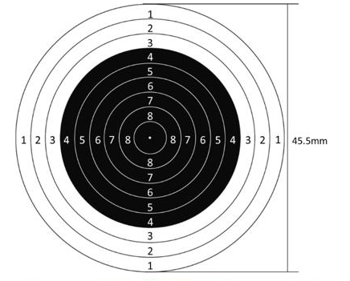

靶纸上10个同心圆的直径构成首项为45.5mm、公差为−5mm的等差数列。根据等差数列通项公式：a_n=a₁+(n−1)d，则6环所处同心圆的直径为45.5+(6−1)×(−5)=20.5mm，半径为20.5/2=10.25mm；7环所处同心圆的直径为20.5−5=15.5mm，半径为15.5/2=7.75mm。
根据公式：概率=满足条件的情况数/总情况数，总情况为随机向靶纸射击且未脱靶，其面积为(45.5/2)²π=22.75²π（mm²）；满足条件的情况为命中6环到6.9环，即处在6环所在圆环中，其面积为(10.25²−7.75²)π（mm²），则命中6环到6.9环的概率P=[(10.25²−7.75²)π]/(22.75²π)=(10.25²−7.75²)/22.75²≈(105−60)/518=45/518<0.1，只有A项符合。
故正确答案为A。

来源：[2025年江苏省公务员录用考试《行测》题（A类）答案及解析（121后暂缺）.pdf](https://github.com/dumarstoft-ship-it/xingce/blob/407016b55b49581efa3771bb59a2dee8761d982f/2025%E5%B9%B4%E6%B1%9F%E8%8B%8F%E7%9C%81%E5%85%AC%E5%8A%A1%E5%91%98%E5%BD%95%E7%94%A8%E8%80%83%E8%AF%95%E3%80%8A%E8%A1%8C%E6%B5%8B%E3%80%8B%E9%A2%98%EF%BC%88A%E7%B1%BB%EF%BC%89%E7%AD%94%E6%A1%88%E5%8F%8A%E8%A7%A3%E6%9E%90%EF%BC%88121%E5%90%8E%E6%9A%82%E7%BC%BA%EF%BC%89.pdf)，PDF 第 29 页。

## 第 58 题 · 数量关系

参考答案：**D**

题目58 解析
根据题意，设参观两种展览的员工有x 人，参观三种展览的员工有y 人。根据三集合容斥原理非标准
型公式：A+B+C-满足两项-2×满足三项=总数-都不，可列式：21+22+19-x-2y=45-5，整理得：
x+2y=22······①；根据“至少参观两种的有12 人”，可得：x+y=12······②，①式减②式可得：y=10，故
这三种展览都参观的有10 人。
故正确答案为D。

来源：[2025年江苏省公务员录用考试《行测》题（A类）答案及解析（121后暂缺）.pdf](https://github.com/dumarstoft-ship-it/xingce/blob/407016b55b49581efa3771bb59a2dee8761d982f/2025%E5%B9%B4%E6%B1%9F%E8%8B%8F%E7%9C%81%E5%85%AC%E5%8A%A1%E5%91%98%E5%BD%95%E7%94%A8%E8%80%83%E8%AF%95%E3%80%8A%E8%A1%8C%E6%B5%8B%E3%80%8B%E9%A2%98%EF%BC%88A%E7%B1%BB%EF%BC%89%E7%AD%94%E6%A1%88%E5%8F%8A%E8%A7%A3%E6%9E%90%EF%BC%88121%E5%90%8E%E6%9A%82%E7%BC%BA%EF%BC%89.pdf)，PDF 第 29、30 页。

## 第 59 题 · 数量关系

参考答案：**C**

题目59 解析
根据题意可作图如下，令小王身高为BC、平顶建筑为DE、尖顶建筑为FH，过点C作垂线交ED于M点，过点E作垂线交FH于N点。平顶建筑（DE）、尖顶建筑（FH）、小王（BC）在同一水平面上，即BC∥DE∥FG，则CM∥EN。因此，△ECM∽△GEN，则CM/EN=ME/NG……①。根据下图可知，EN=DF=200米，ME=DE−DM=DE−BC=23.7−1.7=22米，NG=FH−FN−GH=FH−DE−GH=133.7−23.7−22=88米，代入①式可得：CM/200=22/88，解得CM=50米，即BD=50米，故小王所站位置和平顶建筑物的直线距离为50米。

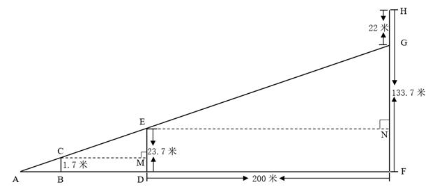

故正确答案为C。

来源：[2025年江苏省公务员录用考试《行测》题（A类）答案及解析（121后暂缺）.pdf](https://github.com/dumarstoft-ship-it/xingce/blob/407016b55b49581efa3771bb59a2dee8761d982f/2025%E5%B9%B4%E6%B1%9F%E8%8B%8F%E7%9C%81%E5%85%AC%E5%8A%A1%E5%91%98%E5%BD%95%E7%94%A8%E8%80%83%E8%AF%95%E3%80%8A%E8%A1%8C%E6%B5%8B%E3%80%8B%E9%A2%98%EF%BC%88A%E7%B1%BB%EF%BC%89%E7%AD%94%E6%A1%88%E5%8F%8A%E8%A7%A3%E6%9E%90%EF%BC%88121%E5%90%8E%E6%9A%82%E7%BC%BA%EF%BC%89.pdf)，PDF 第 30 页。

## 第 60 题 · 数量关系

参考答案：**D**

题目60 解析
设上坡路段儿子的速度为x，则父亲的速度为1.2x；设下坡路段儿子的速度为y，则父亲的速度为0.8y；赋值上、下坡路段的距离分别为1、2。根据“父子同时到达终点”，可列式：1/x+2/y=1/(1.2x)+2/(0.8y)，化简可得：y=3x，则父亲上、下坡路段的速度之比为1.2x:0.8y=1.2x:(0.8×3x)=1:2。
故正确答案为D。

来源：[2025年江苏省公务员录用考试《行测》题（A类）答案及解析（121后暂缺）.pdf](https://github.com/dumarstoft-ship-it/xingce/blob/407016b55b49581efa3771bb59a2dee8761d982f/2025%E5%B9%B4%E6%B1%9F%E8%8B%8F%E7%9C%81%E5%85%AC%E5%8A%A1%E5%91%98%E5%BD%95%E7%94%A8%E8%80%83%E8%AF%95%E3%80%8A%E8%A1%8C%E6%B5%8B%E3%80%8B%E9%A2%98%EF%BC%88A%E7%B1%BB%EF%BC%89%E7%AD%94%E6%A1%88%E5%8F%8A%E8%A7%A3%E6%9E%90%EF%BC%88121%E5%90%8E%E6%9A%82%E7%BC%BA%EF%BC%89.pdf)，PDF 第 30 页。

## 第 61 题 · 数量关系

参考答案：**B**

题目61 解析
用M、N分别表示两架无人机的工作效率，根据题意可得：2M+5N=[(M+N)×1]/(1−2/3)，化简得M:N=2:1。赋值M无人机的工作效率为2，N无人机的工作效率为1，则喷洒整片农田的工作量为2×2+5×1=9，仅由M无人机喷洒农药，那么喷洒完整片农田需要9÷2=4.5小时。
故正确答案为B。

来源：[2025年江苏省公务员录用考试《行测》题（A类）答案及解析（121后暂缺）.pdf](https://github.com/dumarstoft-ship-it/xingce/blob/407016b55b49581efa3771bb59a2dee8761d982f/2025%E5%B9%B4%E6%B1%9F%E8%8B%8F%E7%9C%81%E5%85%AC%E5%8A%A1%E5%91%98%E5%BD%95%E7%94%A8%E8%80%83%E8%AF%95%E3%80%8A%E8%A1%8C%E6%B5%8B%E3%80%8B%E9%A2%98%EF%BC%88A%E7%B1%BB%EF%BC%89%E7%AD%94%E6%A1%88%E5%8F%8A%E8%A7%A3%E6%9E%90%EF%BC%88121%E5%90%8E%E6%9A%82%E7%BC%BA%EF%BC%89.pdf)，PDF 第 30 页。

## 第 62 题 · 数量关系

参考答案：**B**

题目62 解析
设已完成升级的规模以上企业有x 家，则未完成升级的规模以上企业有（1+0.6）x=1.6x 家。根据题
意可得：x+1.6x=2080，解得x=800。
故正确答案为B。

来源：[2025年江苏省公务员录用考试《行测》题（A类）答案及解析（121后暂缺）.pdf](https://github.com/dumarstoft-ship-it/xingce/blob/407016b55b49581efa3771bb59a2dee8761d982f/2025%E5%B9%B4%E6%B1%9F%E8%8B%8F%E7%9C%81%E5%85%AC%E5%8A%A1%E5%91%98%E5%BD%95%E7%94%A8%E8%80%83%E8%AF%95%E3%80%8A%E8%A1%8C%E6%B5%8B%E3%80%8B%E9%A2%98%EF%BC%88A%E7%B1%BB%EF%BC%89%E7%AD%94%E6%A1%88%E5%8F%8A%E8%A7%A3%E6%9E%90%EF%BC%88121%E5%90%8E%E6%9A%82%E7%BC%BA%EF%BC%89.pdf)，PDF 第 30 页。

## 第 63 题 · 数量关系

参考答案：**A**

题目63 解析
设甲、乙两瓶酒精溶液最初的质量均为m克，浓度均为n。根据题意可知：在甲瓶中加入20克水后，继续在甲瓶中加入30克纯酒精，溶液又恢复到最初浓度。结合公式：浓度=溶质/溶液，可列式：(m×n+30)/(m+20+30)=n，解得n=60%；根据“在甲瓶中加入20克水、乙瓶中加入50克浓度为30%的酒精溶液后，浓度仍然相等”，可列式：(m×60%)/(m+20)=(m×60%+50×30%)/(m+50)。
方法一：根据公式：A/B=C/D=(A±C)/(B±D)，可将方程化简为：0.6m/(m+20)=(50×30%)/30=1/2，解得m=100。
方法二：方程正面求解比较复杂，可将选项代入验证，代入A项：(100×60%)/(100+20)=(100×60%+50×30%)/(100+50)=50%，等式成立，符合题意，当选。
故正确答案为A。

来源：[2025年江苏省公务员录用考试《行测》题（A类）答案及解析（121后暂缺）.pdf](https://github.com/dumarstoft-ship-it/xingce/blob/407016b55b49581efa3771bb59a2dee8761d982f/2025%E5%B9%B4%E6%B1%9F%E8%8B%8F%E7%9C%81%E5%85%AC%E5%8A%A1%E5%91%98%E5%BD%95%E7%94%A8%E8%80%83%E8%AF%95%E3%80%8A%E8%A1%8C%E6%B5%8B%E3%80%8B%E9%A2%98%EF%BC%88A%E7%B1%BB%EF%BC%89%E7%AD%94%E6%A1%88%E5%8F%8A%E8%A7%A3%E6%9E%90%EF%BC%88121%E5%90%8E%E6%9A%82%E7%BC%BA%EF%BC%89.pdf)，PDF 第 30 页。

## 第 64 题 · 数量关系

参考答案：**A**

题目64 解析
根据题意，要求两首歌曲分别作为开头曲和结尾曲，有A(2,2)=2种情况；要求舞蹈与杂技相邻演出，
故可先将舞蹈和杂技捆绑起来，由于演出有先后顺序，有A(2,2)=2种情况；要求小品和魔术不能相邻
演出，可用插空法，先将舞蹈和杂技作为整体安排到两首歌曲中间，再将小品和魔术插入中间的2
个空中，有A(2,2)=2种情况。分步用乘法，则共有2×2×2=8 种节目演出的排列顺序。
故正确答案为A。

来源：[2025年江苏省公务员录用考试《行测》题（A类）答案及解析（121后暂缺）.pdf](https://github.com/dumarstoft-ship-it/xingce/blob/407016b55b49581efa3771bb59a2dee8761d982f/2025%E5%B9%B4%E6%B1%9F%E8%8B%8F%E7%9C%81%E5%85%AC%E5%8A%A1%E5%91%98%E5%BD%95%E7%94%A8%E8%80%83%E8%AF%95%E3%80%8A%E8%A1%8C%E6%B5%8B%E3%80%8B%E9%A2%98%EF%BC%88A%E7%B1%BB%EF%BC%89%E7%AD%94%E6%A1%88%E5%8F%8A%E8%A7%A3%E6%9E%90%EF%BC%88121%E5%90%8E%E6%9A%82%E7%BC%BA%EF%BC%89.pdf)，PDF 第 31 页。

## 第 65 题 · 数量关系

参考答案：**C**

题目65 解析

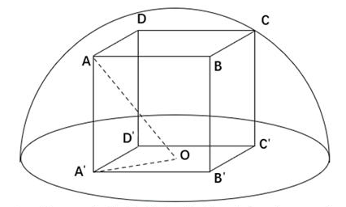

如图所示，使半球形保护罩既能罩住长方体又表面积最小，则长方体顶点A、B、C、D均与球面相切，O为底面中点，连接OA即为球体的半径。连接OA′，则OA′是长方形A′B′C′D′对角线A′C′的一半，且A′B′=60cm、B′C′=40cm，则根据勾股定理，A′C′=√(A′B′²+B′C′²)=√(60²+40²)=20√13cm，OA′=10√13cm。因为三角形AA′O为直角三角形，且AA′=60cm，则根据勾股定理，OA=√(AA′²+OA′²)=√[60²+(10√13)²]=70cm=0.7m。根据公式：球体表面积=4πr²，可得该保护罩的表面积为(1/2)×4π×0.7²=0.98πm²。
故正确答案为C。
备注：①本题所求保护罩的表面积不包含底面。因为通常所说的“罩子”是没有底面的，即使罩子有底面，往往底面材质和罩子材质也不一样，会更厚一些，和题目中忽略不计矛盾，故本题答案不能为A。
②由于本题的长方体是文物，因此不能随意调整摆放的情况，即不能以40cm为高算最值，故本题答案不能为B。

来源：[2025年江苏省公务员录用考试《行测》题（A类）答案及解析（121后暂缺）.pdf](https://github.com/dumarstoft-ship-it/xingce/blob/407016b55b49581efa3771bb59a2dee8761d982f/2025%E5%B9%B4%E6%B1%9F%E8%8B%8F%E7%9C%81%E5%85%AC%E5%8A%A1%E5%91%98%E5%BD%95%E7%94%A8%E8%80%83%E8%AF%95%E3%80%8A%E8%A1%8C%E6%B5%8B%E3%80%8B%E9%A2%98%EF%BC%88A%E7%B1%BB%EF%BC%89%E7%AD%94%E6%A1%88%E5%8F%8A%E8%A7%A3%E6%9E%90%EF%BC%88121%E5%90%8E%E6%9A%82%E7%BC%BA%EF%BC%89.pdf)，PDF 第 31 页。

## 第 66 题 · 数量关系

参考答案：**C**

题目66 解析
根据题意：中间三个分数之和×3=66，可知中间三个分数之和为22。要使7 名裁判打分的平均数最
多，则需让其他4 名裁判打的分数尽量多。第一、第二高的两个分数最高可取10 分，第六、第七高
的分数最多可与第五高的分数相同，故应让第五高的分数尽量高。设第五高的分数为x，因为中间三
个分数（第三、第四、第五）总和为定值22，若想第五高的分数x 尽量高，则第三、第四高的分数
应尽量低，列表构造如下：
|次序|1|2|3↓|4↓|5↑|6|7|
|---|---|---|---|---|---|---|---|
|分数|10|10|x|x|x|||

则有3x=22，解得x≈7.3，因为裁判所打分数均为0.5的整数倍，故第五高的分数最高取7分。第六、第七高的分数最多也均可取7分。此时具体分数如下：

|次序|1|2|3|4|5|6|7|
|---|---|---|---|---|---|---|---|
|分数|10|10|7.5|7.5|7|7|7|

或者

|次序|1|2|3|4|5|6|7|
|---|---|---|---|---|---|---|---|
|分数|10|10|8|7|7|7|7|

此时7名裁判给这名运动员第一跳打分的平均数最多为(10+10+22+7+7)/7=8分。
故正确答案为C。

来源：[2025年江苏省公务员录用考试《行测》题（A类）答案及解析（121后暂缺）.pdf](https://github.com/dumarstoft-ship-it/xingce/blob/407016b55b49581efa3771bb59a2dee8761d982f/2025%E5%B9%B4%E6%B1%9F%E8%8B%8F%E7%9C%81%E5%85%AC%E5%8A%A1%E5%91%98%E5%BD%95%E7%94%A8%E8%80%83%E8%AF%95%E3%80%8A%E8%A1%8C%E6%B5%8B%E3%80%8B%E9%A2%98%EF%BC%88A%E7%B1%BB%EF%BC%89%E7%AD%94%E6%A1%88%E5%8F%8A%E8%A7%A3%E6%9E%90%EF%BC%88121%E5%90%8E%E6%9A%82%E7%BC%BA%EF%BC%89.pdf)，PDF 第 31、32 页。

## 第 67 题 · 数量关系

参考答案：**C**

题目67 解析
设每束8枝有a束，每束9枝有b束，根据玫瑰花总枝数相同可列式：8a+3=9b+5，整理可得：8a=9b+2。
根据奇偶特性可知，8a 和2 均为偶数，则9b 为偶数，即b 为偶数。根据要求数量最多的一束玫瑰花
最少，那么玫瑰花总枝数要最少，即b 取值要尽量小，分情况讨论：
若b=2，则a=2.5，不是整数，不符合题意；
若b=4，则a=4.75，不是整数，不符合题意；
若b=6，则a=7，符合题意，则此时玫瑰花总枝数最少为8×7+3=59 枝。要使数量最多的一束玫瑰
花枝数最少，则另外两束玫瑰花枝数要尽可能多，设数量最多的一束玫瑰花最少有x 枝，又因3 束玫
瑰花枝数各不相同，可得玫瑰花枝数如下：
|数量排名|一|二|三|
|---|---|---|---|
|玫瑰花枝数|x|x−1|x−2|

根据玫瑰花总共有59枝，可列式：x+x−1+x−2=59，解得x≈20.7，问最少，向上取整21枝。
故正确答案为C。

来源：[2025年江苏省公务员录用考试《行测》题（A类）答案及解析（121后暂缺）.pdf](https://github.com/dumarstoft-ship-it/xingce/blob/407016b55b49581efa3771bb59a2dee8761d982f/2025%E5%B9%B4%E6%B1%9F%E8%8B%8F%E7%9C%81%E5%85%AC%E5%8A%A1%E5%91%98%E5%BD%95%E7%94%A8%E8%80%83%E8%AF%95%E3%80%8A%E8%A1%8C%E6%B5%8B%E3%80%8B%E9%A2%98%EF%BC%88A%E7%B1%BB%EF%BC%89%E7%AD%94%E6%A1%88%E5%8F%8A%E8%A7%A3%E6%9E%90%EF%BC%88121%E5%90%8E%E6%9A%82%E7%BC%BA%EF%BC%89.pdf)，PDF 第 32 页。

## 第 68 题 · 数量关系

参考答案：**D**

题目68 解析
设参与研学的教师有x 人，则参与研学的大学生有（110-x）人；设乘坐索道的有y 人，则未乘坐索
道的有（110-y）人。根据题意，大学生半票后为90×(1/2)=45元/人，则门票费共45×(110−x)
元；索道费共70y 元。根据“若支付的门票和索道费共11750 元”，可列方程45×（110-x）+70y=11750，
整理得14y-9x=1360。优先考虑代入选项进行验证，代入x=6，解得y=101，符合题意；代入x=10，
解得y=725/7，为非整数，不符合题意，排除；代入x=20，解得y=110，符合题意。综上，参与研
学的教师有6 人或20 人。
故正确答案为D。
备注：此题表述不太严谨，可以选择乘坐索道也可以选择不乘坐索道，若更改表述为“若乘坐索道另
付70 元/人”，会更加严谨。

来源：[2025年江苏省公务员录用考试《行测》题（A类）答案及解析（121后暂缺）.pdf](https://github.com/dumarstoft-ship-it/xingce/blob/407016b55b49581efa3771bb59a2dee8761d982f/2025%E5%B9%B4%E6%B1%9F%E8%8B%8F%E7%9C%81%E5%85%AC%E5%8A%A1%E5%91%98%E5%BD%95%E7%94%A8%E8%80%83%E8%AF%95%E3%80%8A%E8%A1%8C%E6%B5%8B%E3%80%8B%E9%A2%98%EF%BC%88A%E7%B1%BB%EF%BC%89%E7%AD%94%E6%A1%88%E5%8F%8A%E8%A7%A3%E6%9E%90%EF%BC%88121%E5%90%8E%E6%9A%82%E7%BC%BA%EF%BC%89.pdf)，PDF 第 32、33 页。

## 第 69 题 · 数量关系

参考答案：**A**

题目69 解析
小张每隔4 天去医院做一次理疗，即每5 天做一次理疗。如果7 月2 日去做理疗，则7 月做理疗的
日期分别为2 日、7 日、12 日、17 日、22 日、27 日；如果7 月3 日去做理疗，则7 月做理疗的日
期分别为3 日、8 日、13 日、18 日、23 日、28 日，代入选项：
A 项：7 月31 日是星期四，则7 月日历如下表所示：
|星期一|星期二|星期三|星期四|星期五|星期六|星期日|
|---|---|---|---|---|---|---|
||1|2|3|4|5|6|
|7|8|9|10|11|12|13|
|14|15|16|17|18|19|20|
|21|22|23|24|25|26|27|
|28|29|30|31||||
即7 月2 日为星期三，7 日为星期一，12 日为星期六，17 日为星期四，22 日为星期二，27 日为星
期日，满足“如果他7 月2 日去，则7 月的理疗有1 次在星期六、1 次在星期日，其余都在工作日”的
条件；7 月3 日为星期四，8 日为星期二，13 日为星期日，18 日为星期五，23 日为星期三，28 日为
星期一，满足“如果他7 月3 日去，则7 月的理疗只有1 次在星期日，其余都在工作日”的条件。满足
所有条件，当选。其他选项无需验证。
故正确答案为A。

来源：[2025年江苏省公务员录用考试《行测》题（A类）答案及解析（121后暂缺）.pdf](https://github.com/dumarstoft-ship-it/xingce/blob/407016b55b49581efa3771bb59a2dee8761d982f/2025%E5%B9%B4%E6%B1%9F%E8%8B%8F%E7%9C%81%E5%85%AC%E5%8A%A1%E5%91%98%E5%BD%95%E7%94%A8%E8%80%83%E8%AF%95%E3%80%8A%E8%A1%8C%E6%B5%8B%E3%80%8B%E9%A2%98%EF%BC%88A%E7%B1%BB%EF%BC%89%E7%AD%94%E6%A1%88%E5%8F%8A%E8%A7%A3%E6%9E%90%EF%BC%88121%E5%90%8E%E6%9A%82%E7%BC%BA%EF%BC%89.pdf)，PDF 第 33 页。

## 第 70 题 · 数量关系

参考答案：**B**

题目70 解析
若要铺设电缆总长度最短，则铺设的线路应尽量少且每条线路的长度应尽量短。六栋办公楼，最少需
要5 条线路即可联通。最短路径优先，选择AB、AC、CF、BE、AD，此时六栋楼均被连通且铺设电
缆的总长度最短，故所求为（4+5+6+7+7）×10=290 米。
故正确答案为B。

来源：[2025年江苏省公务员录用考试《行测》题（A类）答案及解析（121后暂缺）.pdf](https://github.com/dumarstoft-ship-it/xingce/blob/407016b55b49581efa3771bb59a2dee8761d982f/2025%E5%B9%B4%E6%B1%9F%E8%8B%8F%E7%9C%81%E5%85%AC%E5%8A%A1%E5%91%98%E5%BD%95%E7%94%A8%E8%80%83%E8%AF%95%E3%80%8A%E8%A1%8C%E6%B5%8B%E3%80%8B%E9%A2%98%EF%BC%88A%E7%B1%BB%EF%BC%89%E7%AD%94%E6%A1%88%E5%8F%8A%E8%A7%A3%E6%9E%90%EF%BC%88121%E5%90%8E%E6%9A%82%E7%BC%BA%EF%BC%89.pdf)，PDF 第 33、34 页。

## 第 71 题 · 判断推理

参考答案：**D**

题目71 解析
第一步：判断题干词语间逻辑关系。
元宇宙是通过虚拟增强的物理现实，是呈现收敛性和物理持久性特征的、基于未来互联网的具有链接
感知和共享特征的3D 虚拟空间。元宇宙一定具有虚拟性，二者是必然属性的对应关系。
第二步：判断选项词语间逻辑关系。
A 项：实验不一定具有前瞻性，二者是或然属性的对应关系，与题干逻辑关系不一致，排除；
B 项：决策不一定具有可行性，二者是或然属性的对应关系，与题干逻辑关系不一致，排除；
C 项：宣传不一定具有普遍性，二者是或然属性的对应关系，与题干逻辑关系不一致，排除；
D 项：总结指总结后概括出来的结论。总结一定具有概括性，二者是必然属性的对应关系，与题干逻
辑关系一致，当选。
故正确答案为D。

来源：[2025年江苏省公务员录用考试《行测》题（A类）答案及解析（121后暂缺）.pdf](https://github.com/dumarstoft-ship-it/xingce/blob/407016b55b49581efa3771bb59a2dee8761d982f/2025%E5%B9%B4%E6%B1%9F%E8%8B%8F%E7%9C%81%E5%85%AC%E5%8A%A1%E5%91%98%E5%BD%95%E7%94%A8%E8%80%83%E8%AF%95%E3%80%8A%E8%A1%8C%E6%B5%8B%E3%80%8B%E9%A2%98%EF%BC%88A%E7%B1%BB%EF%BC%89%E7%AD%94%E6%A1%88%E5%8F%8A%E8%A7%A3%E6%9E%90%EF%BC%88121%E5%90%8E%E6%9A%82%E7%BC%BA%EF%BC%89.pdf)，PDF 第 34 页。

## 第 72 题 · 判断推理

参考答案：**C**

题目72 解析
第一步：判断题干词语间逻辑关系。
“舍本逐末”指舍弃事物的根本的、主要的部分，而去追求细枝末节，指轻重倒置。“舍本”和“逐末”是
并列关系，且“舍”和“逐”、“本”和“末”均是反义关系。
第二步：判断选项词语间逻辑关系。
A 项：“买椟还珠”指买了装了珍珠的木匣退还了珍珠。“买椟”和“还珠”是并列关系，但“买”和“还”、“椟”
和“珠”均不是反义关系，与题干逻辑关系不一致，排除；
B 项：“取长补短”指吸取别人的长处，弥补自己的短处。“取长”是为了“补短”，二者是方式目的的对应
关系，且“取”和“补”不是反义关系，与题干逻辑关系不一致，排除；
C 项：“避重就轻”指避开重要的而拣次要的来承担，也指回避主要的问题，只谈无关紧要的方面。“避
重”和“就轻”是并列关系，其中“就”指凑近、靠近，“避”和“就”、“重”和“轻”均是反义关系，与题干逻辑
关系一致，当选；
D 项：“趋炎附势”指奉承、依附有权有势的人。“趋炎”和“附势”是并列关系，但“趋”和“附”、“炎”和“势”
均不是反义关系，与题干逻辑关系不一致，排除。
故正确答案为C。

来源：[2025年江苏省公务员录用考试《行测》题（A类）答案及解析（121后暂缺）.pdf](https://github.com/dumarstoft-ship-it/xingce/blob/407016b55b49581efa3771bb59a2dee8761d982f/2025%E5%B9%B4%E6%B1%9F%E8%8B%8F%E7%9C%81%E5%85%AC%E5%8A%A1%E5%91%98%E5%BD%95%E7%94%A8%E8%80%83%E8%AF%95%E3%80%8A%E8%A1%8C%E6%B5%8B%E3%80%8B%E9%A2%98%EF%BC%88A%E7%B1%BB%EF%BC%89%E7%AD%94%E6%A1%88%E5%8F%8A%E8%A7%A3%E6%9E%90%EF%BC%88121%E5%90%8E%E6%9A%82%E7%BC%BA%EF%BC%89.pdf)，PDF 第 34、35 页。

## 第 73 题 · 判断推理

参考答案：**C**

题目73 解析
第一步：判断题干词语间逻辑关系。
“热极生风”意思是一个地方热得太厉害，不久便会产生大风；“穷极思变”意思是在穷困艰难的时候，
就要想办法改变现状。二者无明显语义关系，考虑拆分。因为“热极”所以“生风”，因为“穷极”所以“思
变”，二者拆分之后均为因果关系，且“热极生风”和“穷极思变”均可指“事物在极端状态下会发生变化”。
第二步：判断选项词语间逻辑关系。
A 项：“鼓空声高”意思是鼓里面是空的时候声音反而大；“人狂话大”意思是没有真才实学的人往往狂
妄自大，好说大话，喜欢吹牛。因为“鼓空”所以“声高”，因为“人狂”所以“话大”，二者拆分之后均为因
果关系，但“鼓空声高”无法指“事物在极端状态下会发生变化”，与题干逻辑关系不一致，排除；
B 项：“绳锯木断”意思是以绳当锯，也能锯断木头；“水滴石穿”意思是水滴不断地滴，可以滴穿石头。
因为“绳锯”所以“木断”，因为“水滴”所以“石穿”，二者拆分之后均为因果关系，但“绳锯木断”和“水滴
石穿”均无法指“事物在极端状态下会发生变化”，与题干逻辑关系不一致，排除；
C 项：“人闲生病”意思是人闲得无聊就容易生病；“石闲生苔”意思是闲置的石头很容易长出青苔。因
为“人闲”所以“生病”，因为“石闲”所以“生苔”，二者拆分之后均为因果关系，且“人闲生病”和“石闲生
苔”均可指“事物在极端状态下会发生变化”，与题干逻辑关系一致，当选；
D 项：“得道多助”意思是坚持正义就能得到多方面的支持与帮助；“失道寡助”意思是违背正义必然陷
于孤立。因为“得道”所以“多助”，因为“失道”所以“寡助”，二者拆分之后均为因果关系，但“得道多助”
和“失道寡助”均无法指“事物在极端持续状态下会发生变化”，与题干逻辑关系不一致，排除。
故正确答案为C。
本题为争议题。若看题干第一个词“热极生风”与物有关，第二个词“穷极思变”与人有关；A 项第一个
词“鼓空声高”与物有关，第二个词“人狂话大”与人有关，C 项刚好顺序反了，也有同学会选择A 项，
此考法历年真题也确实考过。两种理解方式均有合理之处，考生无需过于纠结不严谨的题，重点学习
此类题的解题思路即可，这种同时涉及物和人的成语或诗句可能会考查的两个角度，一是具体意思的
类似，二是由物到人或由人到物的类比。

来源：[2025年江苏省公务员录用考试《行测》题（A类）答案及解析（121后暂缺）.pdf](https://github.com/dumarstoft-ship-it/xingce/blob/407016b55b49581efa3771bb59a2dee8761d982f/2025%E5%B9%B4%E6%B1%9F%E8%8B%8F%E7%9C%81%E5%85%AC%E5%8A%A1%E5%91%98%E5%BD%95%E7%94%A8%E8%80%83%E8%AF%95%E3%80%8A%E8%A1%8C%E6%B5%8B%E3%80%8B%E9%A2%98%EF%BC%88A%E7%B1%BB%EF%BC%89%E7%AD%94%E6%A1%88%E5%8F%8A%E8%A7%A3%E6%9E%90%EF%BC%88121%E5%90%8E%E6%9A%82%E7%BC%BA%EF%BC%89.pdf)，PDF 第 35、36 页。

## 第 74 题 · 判断推理

参考答案：**B**

题目74 解析
第一步：判断题干词语间逻辑关系。
“苍鹰”和“鸿雁”都是鸟类，二者为并列关系；“鸿雁”是书信的代称，可以比喻“书信”，第二个词与第三
个词构成比喻象征义。
第二步：判断选项词语间逻辑关系。
A 项：“加油”和“注水”都是动作，二者为并列关系；“加油”可用于支持，指勉励他人或自己，可以比
喻“鼓劲”，第一个词与第三个词构成比喻象征义，词语顺序与题干不一致，与题干逻辑关系不一致，
排除；
B 项：“下海”和“上岸”都是动作，二者为并列关系；“上岸”指舍舟登陆，也指考生被录取，可以比喻“录
取”，第二个词与第三个词构成比喻象征义，与题干逻辑关系一致，当选；
C 项：“须眉”指胡须和眉毛，也可以比喻男子，“巾帼”指古代妇女的头巾和发饰，也可以比喻女子，
二者为并列关系；但“巾帼”不能比喻“围脖”，与题干逻辑关系不一致，排除；
D 项：“疆域”指国家领土，“河山”指国家的疆土，“国土”指国家的领土，第一个词和第三个词意思一
致，二者为全同关系，与题干逻辑关系不一致，排除。
故正确答案为B。

来源：[2025年江苏省公务员录用考试《行测》题（A类）答案及解析（121后暂缺）.pdf](https://github.com/dumarstoft-ship-it/xingce/blob/407016b55b49581efa3771bb59a2dee8761d982f/2025%E5%B9%B4%E6%B1%9F%E8%8B%8F%E7%9C%81%E5%85%AC%E5%8A%A1%E5%91%98%E5%BD%95%E7%94%A8%E8%80%83%E8%AF%95%E3%80%8A%E8%A1%8C%E6%B5%8B%E3%80%8B%E9%A2%98%EF%BC%88A%E7%B1%BB%EF%BC%89%E7%AD%94%E6%A1%88%E5%8F%8A%E8%A7%A3%E6%9E%90%EF%BC%88121%E5%90%8E%E6%9A%82%E7%BC%BA%EF%BC%89.pdf)，PDF 第 36 页。

## 第 75 题 · 判断推理

参考答案：**C**

题目75 解析
第一步：判断题干词语间逻辑关系。
“货币”是“购物”的工具，且通常来说没有“货币”就无法“购物”，二者为必要工具的对应关系；“购物车”
是“购物”的工具，但没有“购物车”也能“购物”，二者为非必要工具的对应关系。
第二步：判断选项词语间逻辑关系。
A 项：“山峰”是“攀登”的对象而非工具，二者不是必要工具的对应关系，与题干逻辑关系不一致，排
除；
B 项：“鱼竿”和“鱼钩”都是“垂钓”的工具，且都是“垂钓”的必要工具，二者分别与“垂钓”构成必要工具
的对应关系，与题干逻辑关系不一致，排除；
C 项：“文字”是人类用符号记录表达信息以传之久远的方式和工具。“文字”是“写作”的工具，且没有“文
字”就无法“写作”，二者为必要工具的对应关系；“电脑”是“写作”的工具，但没有“电脑”也能“写作”，
二者为非必要工具的对应关系，与题干逻辑关系一致，当选；
D 项：“景点”是“旅游”的对象而非工具，二者不是必要工具的对应关系，与题干逻辑关系不一致，排
除。
故正确答案为C。

来源：[2025年江苏省公务员录用考试《行测》题（A类）答案及解析（121后暂缺）.pdf](https://github.com/dumarstoft-ship-it/xingce/blob/407016b55b49581efa3771bb59a2dee8761d982f/2025%E5%B9%B4%E6%B1%9F%E8%8B%8F%E7%9C%81%E5%85%AC%E5%8A%A1%E5%91%98%E5%BD%95%E7%94%A8%E8%80%83%E8%AF%95%E3%80%8A%E8%A1%8C%E6%B5%8B%E3%80%8B%E9%A2%98%EF%BC%88A%E7%B1%BB%EF%BC%89%E7%AD%94%E6%A1%88%E5%8F%8A%E8%A7%A3%E6%9E%90%EF%BC%88121%E5%90%8E%E6%9A%82%E7%BC%BA%EF%BC%89.pdf)，PDF 第 36、37 页。

## 第 76 题 · 判断推理

参考答案：**B**

题目76 解析
第一步：判断题干词语间逻辑关系。
“压舱石”本意为船舶、飞机等交通工具上为了保持平衡和稳定而放置的重物，后比喻对事物发展起到
稳定、支撑作用的关键因素、重要力量或基础保障。“就业”是“社会稳定”的“压舱石”，三者为对应关
系。
第二步：判断选项词语间逻辑关系。
A 项：“先手棋”本来指围棋、象棋等棋类游戏中，先走的一方所下的第一步棋，具有争取主动的优势，
后引申为在竞争、行动等过程中，为了占据主动地位而采取的第一步或关键的起始行动、策略等。“专
利”不是“科技创新”的“先手棋”，三者不构成对应关系，与题干逻辑关系不一致，排除；
B 项：“基本盘”指事物最基础、最根本的部分。“耕地”是“粮食生产”的“基本盘”，三者为对应关系，与
题干逻辑关系一致，保留；
C 项：“晴雨表”比喻能敏锐地反映某种变化或在事情发生前出现征兆的事物。“管理”不是“人才培养”
的“晴雨表”，三者不构成对应关系，与题干逻辑关系不一致，排除；
D 项：“主阵地”指在军事作战中，军队主要据守和作战的地区或位置，现在常用来指在某个领域、行
业或工作中，起主导、核心作用，集中力量进行主要活动或发挥主要作用的地方、领域或平台等。“学
校”是“知识传播”的“主阵地”，三者为对应关系，与题干逻辑关系一致，保留。
对比B、D 两项，题干的“压舱石”强调“就业”是维持“社会稳定”的重要基础和关键因素，对“社会稳定”
起着支撑作用，B 项的“基本盘”强调“耕地”是“粮食生产”的根本和基础，对“粮食生产”起着支撑作用，
而D 项的“主阵地”没有体现这种基础和支撑作用。且题干的“压舱石”和B 项的“基本盘”都是物品，而
D 项的“主阵地”为地点，故B 项与题干逻辑关系更为一致，当选。
故正确答案为B。

来源：[2025年江苏省公务员录用考试《行测》题（A类）答案及解析（121后暂缺）.pdf](https://github.com/dumarstoft-ship-it/xingce/blob/407016b55b49581efa3771bb59a2dee8761d982f/2025%E5%B9%B4%E6%B1%9F%E8%8B%8F%E7%9C%81%E5%85%AC%E5%8A%A1%E5%91%98%E5%BD%95%E7%94%A8%E8%80%83%E8%AF%95%E3%80%8A%E8%A1%8C%E6%B5%8B%E3%80%8B%E9%A2%98%EF%BC%88A%E7%B1%BB%EF%BC%89%E7%AD%94%E6%A1%88%E5%8F%8A%E8%A7%A3%E6%9E%90%EF%BC%88121%E5%90%8E%E6%9A%82%E7%BC%BA%EF%BC%89.pdf)，PDF 第 37、38 页。

## 第 77 题 · 判断推理

参考答案：**B**

题目77 解析
第一步：判断题干词语间逻辑关系。
“温室效应”导致“冰川融化”，“冰川融化”导致“海面上升”，三者为连续因果对应关系。
第二步：判断选项词语间逻辑关系。
A 项：“博览群书”导致“视野开阔”；“博览群书”也可以导致“见解深刻”，第二词和第三词都是第一词的
结果，与题干逻辑关系不一致，排除；
B 项：“连日降雪”导致“道路结冰”，“道路结冰”导致“出行困难”，三者为连续因果对应关系，与题干逻
辑关系一致，保留；
C 项：“电闪雷鸣”“狂风大作”“沙尘肆虐”是不同的天气现象，三者不是连续因果对应关系，与题干逻
辑关系不一致，排除；
D 项：“刻苦训练”导致“技能提高”，“技能提高”导致“获得金牌”，三者为连续因果对应关系，与题干逻
辑关系一致，保留。
对比B、D 两项，题干和B 项的初始原因均为自然原因，带来的均为消极结果，但D 项初始原因为人
为原因，带来的为积极结果，B 项与题干逻辑关系更为一致，当选。
故正确答案为B。

来源：[2025年江苏省公务员录用考试《行测》题（A类）答案及解析（121后暂缺）.pdf](https://github.com/dumarstoft-ship-it/xingce/blob/407016b55b49581efa3771bb59a2dee8761d982f/2025%E5%B9%B4%E6%B1%9F%E8%8B%8F%E7%9C%81%E5%85%AC%E5%8A%A1%E5%91%98%E5%BD%95%E7%94%A8%E8%80%83%E8%AF%95%E3%80%8A%E8%A1%8C%E6%B5%8B%E3%80%8B%E9%A2%98%EF%BC%88A%E7%B1%BB%EF%BC%89%E7%AD%94%E6%A1%88%E5%8F%8A%E8%A7%A3%E6%9E%90%EF%BC%88121%E5%90%8E%E6%9A%82%E7%BC%BA%EF%BC%89.pdf)，PDF 第 38 页。

## 第 78 题 · 判断推理

参考答案：**A**

题目78 解析
第一步：判断题干词语间逻辑关系。
本土药材、野生药材、名贵药材是从不同的划分角度去命名的，三者互为交叉关系。
第二步：判断选项词语间逻辑关系。
A 项：沿海高铁、跨省高铁、城际高铁是从不同的划分角度去命名的，三者互为交叉关系，与题干逻
辑关系一致，当选；
B 项：“传统产业”主要指劳动力密集型的、以制造加工为主的行业。“牛奶产业”是“传统产业”，二者为
种属关系，与题干逻辑关系不一致，排除；
C 项：“超限”是指车辆的轴载质量、车货总质量或装载总尺寸超过国家规定的限值；“超载”是指车辆
载客或载货超过了其额定的承载能力；“超重”是指车辆的单轴或总质量超过了其设计或核定的最大重
量，这是对车辆行驶管理的三个规定，三者为并列关系，与题干逻辑关系不一致，排除；
D 项：“社区治理”是“社会治理”的一个重要组成部分，二者为组成关系，与题干逻辑关系不一致，排
除。
故正确答案为A。

来源：[2025年江苏省公务员录用考试《行测》题（A类）答案及解析（121后暂缺）.pdf](https://github.com/dumarstoft-ship-it/xingce/blob/407016b55b49581efa3771bb59a2dee8761d982f/2025%E5%B9%B4%E6%B1%9F%E8%8B%8F%E7%9C%81%E5%85%AC%E5%8A%A1%E5%91%98%E5%BD%95%E7%94%A8%E8%80%83%E8%AF%95%E3%80%8A%E8%A1%8C%E6%B5%8B%E3%80%8B%E9%A2%98%EF%BC%88A%E7%B1%BB%EF%BC%89%E7%AD%94%E6%A1%88%E5%8F%8A%E8%A7%A3%E6%9E%90%EF%BC%88121%E5%90%8E%E6%9A%82%E7%BC%BA%EF%BC%89.pdf)，PDF 第 38、39 页。

## 第 79 题 · 判断推理

参考答案：**A**

题目79 解析
逐一代入选项。
A 项：森林会调节气候，二者为对应关系；法制会约束或调节社会，二者为对应关系，前后逻辑关系
一致，当选；
B 项：森林会释放氧气，二者为产物的对应关系；自然会影响社会，而社会也会改造自然，二者为互
相影响的对应关系，前后逻辑关系不一致，排除；
C 项：森林是一种生态系统，二者为种属关系；国家可以指阶级统治的工具，也可以指一个国家的整
个区域，但国家不是一种社会，二者不是种属关系，前后逻辑关系不一致，排除；
D 项：树木是森林的组成部分，二者为组成关系；家庭是社会的组成部分，二者为组成关系，但前后
词语顺序相反，前后逻辑关系不一致，排除。
故正确答案为A。

来源：[2025年江苏省公务员录用考试《行测》题（A类）答案及解析（121后暂缺）.pdf](https://github.com/dumarstoft-ship-it/xingce/blob/407016b55b49581efa3771bb59a2dee8761d982f/2025%E5%B9%B4%E6%B1%9F%E8%8B%8F%E7%9C%81%E5%85%AC%E5%8A%A1%E5%91%98%E5%BD%95%E7%94%A8%E8%80%83%E8%AF%95%E3%80%8A%E8%A1%8C%E6%B5%8B%E3%80%8B%E9%A2%98%EF%BC%88A%E7%B1%BB%EF%BC%89%E7%AD%94%E6%A1%88%E5%8F%8A%E8%A7%A3%E6%9E%90%EF%BC%88121%E5%90%8E%E6%9A%82%E7%BC%BA%EF%BC%89.pdf)，PDF 第 39 页。

## 第 80 题 · 判断推理

参考答案：**D**

题目80 解析
逐一代入选项。
A 项：飞禽指会飞的鸟类，也泛指鸟类。有的生肖是飞禽（如，鸡），有的生肖不是飞禽，有的飞禽
是生肖，有的飞禽不是生肖，二者为交叉关系；在路口可以禁行，二者为对应关系，前后逻辑关系不
一致，排除；
B 项：走兽泛指兽类。有的生肖是走兽（如，牛），有的生肖不是走兽，有的走兽是生肖，有的走兽
不是生肖，二者为交叉关系；禁行是一种信号，二者为种属关系，前后逻辑关系不一致，排除；
C 项：天干是对甲、乙、丙、丁、戊、己、庚、辛、壬、癸的统称，传统用作表示次序的符号，和生
肖无明显逻辑关系；通行和禁行为反义关系，前后逻辑关系不一致，排除；
D 项：地支是对子、丑、寅、卯、辰、巳、午、未、申、酉、戌、亥的统称，生肖是代表十二地支而
用来记人的出生年的十二种动物，子属鼠、丑属牛、寅属虎、卯属兔、辰属龙、巳属蛇、午属马、未
属羊、申属猴、酉属鸡、戌属狗、亥属猪，二者有紧密的对应关系；红灯指红色的交通信号灯，红灯
亮时表示禁止通行，二者有紧密的对应关系，前后逻辑关系一致，当选。
故正确答案为D。

来源：[2025年江苏省公务员录用考试《行测》题（A类）答案及解析（121后暂缺）.pdf](https://github.com/dumarstoft-ship-it/xingce/blob/407016b55b49581efa3771bb59a2dee8761d982f/2025%E5%B9%B4%E6%B1%9F%E8%8B%8F%E7%9C%81%E5%85%AC%E5%8A%A1%E5%91%98%E5%BD%95%E7%94%A8%E8%80%83%E8%AF%95%E3%80%8A%E8%A1%8C%E6%B5%8B%E3%80%8B%E9%A2%98%EF%BC%88A%E7%B1%BB%EF%BC%89%E7%AD%94%E6%A1%88%E5%8F%8A%E8%A7%A3%E6%9E%90%EF%BC%88121%E5%90%8E%E6%9A%82%E7%BC%BA%EF%BC%89.pdf)，PDF 第 39、40 页。

## 第 81 题 · 判断推理

参考答案：**B**

题目81 解析
元素组成不同，优先考虑属性规律。题干图形规整，且出现明显的等腰元素，考虑对称性。观察发现，
题干图形均为轴对称图形，且对称轴数量分别是6、5、4、3、2，因此？处图形应仅有1 条对称轴，
只有B 项符合。
故正确答案为B。

来源：[2025年江苏省公务员录用考试《行测》题（A类）答案及解析（121后暂缺）.pdf](https://github.com/dumarstoft-ship-it/xingce/blob/407016b55b49581efa3771bb59a2dee8761d982f/2025%E5%B9%B4%E6%B1%9F%E8%8B%8F%E7%9C%81%E5%85%AC%E5%8A%A1%E5%91%98%E5%BD%95%E7%94%A8%E8%80%83%E8%AF%95%E3%80%8A%E8%A1%8C%E6%B5%8B%E3%80%8B%E9%A2%98%EF%BC%88A%E7%B1%BB%EF%BC%89%E7%AD%94%E6%A1%88%E5%8F%8A%E8%A7%A3%E6%9E%90%EF%BC%88121%E5%90%8E%E6%9A%82%E7%BC%BA%EF%BC%89.pdf)，PDF 第 40 页。

## 第 82 题 · 判断推理

参考答案：**A**

题目82 解析
元素组成相同，但无明显位置规律。观察发现，题干图形均出现两个黑块，且两个黑块之间均间隔一
个白块，？处应用规律，只有A 项符合。
故正确答案为A。

来源：[2025年江苏省公务员录用考试《行测》题（A类）答案及解析（121后暂缺）.pdf](https://github.com/dumarstoft-ship-it/xingce/blob/407016b55b49581efa3771bb59a2dee8761d982f/2025%E5%B9%B4%E6%B1%9F%E8%8B%8F%E7%9C%81%E5%85%AC%E5%8A%A1%E5%91%98%E5%BD%95%E7%94%A8%E8%80%83%E8%AF%95%E3%80%8A%E8%A1%8C%E6%B5%8B%E3%80%8B%E9%A2%98%EF%BC%88A%E7%B1%BB%EF%BC%89%E7%AD%94%E6%A1%88%E5%8F%8A%E8%A7%A3%E6%9E%90%EF%BC%88121%E5%90%8E%E6%9A%82%E7%BC%BA%EF%BC%89.pdf)，PDF 第 40 页。

## 第 83 题 · 判断推理

参考答案：**C**

题目83 解析
题干中每幅图形均由1 个单独小矩形和4 个相连的小矩形构成。观察发现，单独小矩形的方向在每幅
图中依次呈水平、竖直，交替放置，故？处应选择一个单独小矩形竖直放置的图形，排除A、D 两项；
继续观察发现，4 个相连的小矩形中，与单独小矩形方向一致的数量依次为2、1、2、1、2，交替出
现，只有C 项符合。
故正确答案为C。

来源：[2025年江苏省公务员录用考试《行测》题（A类）答案及解析（121后暂缺）.pdf](https://github.com/dumarstoft-ship-it/xingce/blob/407016b55b49581efa3771bb59a2dee8761d982f/2025%E5%B9%B4%E6%B1%9F%E8%8B%8F%E7%9C%81%E5%85%AC%E5%8A%A1%E5%91%98%E5%BD%95%E7%94%A8%E8%80%83%E8%AF%95%E3%80%8A%E8%A1%8C%E6%B5%8B%E3%80%8B%E9%A2%98%EF%BC%88A%E7%B1%BB%EF%BC%89%E7%AD%94%E6%A1%88%E5%8F%8A%E8%A7%A3%E6%9E%90%EF%BC%88121%E5%90%8E%E6%9A%82%E7%BC%BA%EF%BC%89.pdf)，PDF 第 40 页。

## 第 84 题 · 判断推理

参考答案：**C**

题目84 解析
元素组成不同，且无明显属性规律，考虑数量规律。观察发现，题干出现多个“日”字变形图，考虑
笔画数。题干图形均为一笔画图形，？处应用规律，排除A、B 两项；继续观察发现，题干每幅图形
均存在两个三角形面，故？处应选一个存在两个三角形面的图形，只有C 项符合。
故正确答案为C。

来源：[2025年江苏省公务员录用考试《行测》题（A类）答案及解析（121后暂缺）.pdf](https://github.com/dumarstoft-ship-it/xingce/blob/407016b55b49581efa3771bb59a2dee8761d982f/2025%E5%B9%B4%E6%B1%9F%E8%8B%8F%E7%9C%81%E5%85%AC%E5%8A%A1%E5%91%98%E5%BD%95%E7%94%A8%E8%80%83%E8%AF%95%E3%80%8A%E8%A1%8C%E6%B5%8B%E3%80%8B%E9%A2%98%EF%BC%88A%E7%B1%BB%EF%BC%89%E7%AD%94%E6%A1%88%E5%8F%8A%E8%A7%A3%E6%9E%90%EF%BC%88121%E5%90%8E%E6%9A%82%E7%BC%BA%EF%BC%89.pdf)，PDF 第 40 页。

## 第 85 题 · 判断推理

参考答案：**D**

题目85 解析
元素组成不同，优先考虑属性规律。观察发现，题干图形出现明显的等腰元素，考虑对称性。九宫格
优先看横行，第一行中，图一为横轴对称图形，图二为竖轴对称图形，图三为既轴对称又中心对称图
形，且对称轴只有一条横轴和一条竖轴；第二行经验证符合此规律；第三行应用此规律，排除A、B
两项。继续观察发现，题干图形封闭面明显，考虑面数量。第一行中，面数量依次为3、4、5；第二
行经验证符合此规律；第三行应用此规律，故“？”处图形应有5 个面，只有D 项符合。
故正确答案为D。

来源：[2025年江苏省公务员录用考试《行测》题（A类）答案及解析（121后暂缺）.pdf](https://github.com/dumarstoft-ship-it/xingce/blob/407016b55b49581efa3771bb59a2dee8761d982f/2025%E5%B9%B4%E6%B1%9F%E8%8B%8F%E7%9C%81%E5%85%AC%E5%8A%A1%E5%91%98%E5%BD%95%E7%94%A8%E8%80%83%E8%AF%95%E3%80%8A%E8%A1%8C%E6%B5%8B%E3%80%8B%E9%A2%98%EF%BC%88A%E7%B1%BB%EF%BC%89%E7%AD%94%E6%A1%88%E5%8F%8A%E8%A7%A3%E6%9E%90%EF%BC%88121%E5%90%8E%E6%9A%82%E7%BC%BA%EF%BC%89.pdf)，PDF 第 41 页。

## 第 86 题 · 判断推理

参考答案：**D**

题目86 解析
本题考查平面拼合，可采用平行且等长相消的方式解题，左边给定的图形是由右边①③④⑤拼合而成的，平行且等长相消的方式如下图所示：

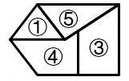

[代码描摹高清 PNG](../../../images/code_hd/906-1.png) · [SVG](../../../images/code_hd/906-1.svg)（原图为准）

故正确答案为D。

来源：[2025年江苏省公务员录用考试《行测》题（A类）答案及解析（121后暂缺）.pdf](https://github.com/dumarstoft-ship-it/xingce/blob/407016b55b49581efa3771bb59a2dee8761d982f/2025%E5%B9%B4%E6%B1%9F%E8%8B%8F%E7%9C%81%E5%85%AC%E5%8A%A1%E5%91%98%E5%BD%95%E7%94%A8%E8%80%83%E8%AF%95%E3%80%8A%E8%A1%8C%E6%B5%8B%E3%80%8B%E9%A2%98%EF%BC%88A%E7%B1%BB%EF%BC%89%E7%AD%94%E6%A1%88%E5%8F%8A%E8%A7%A3%E6%9E%90%EF%BC%88121%E5%90%8E%E6%9A%82%E7%BC%BA%EF%BC%89.pdf)，PDF 第 41 页。

## 第 87 题 · 判断推理

参考答案：**C**

题目87 解析
本题考查平面拼合，可以平移、旋转、翻转，且每张纸片一面是黑色，另一面是白色，需要考虑翻转
后的颜色变化。将题干图形标上序号，如下图所示，逐一进行分析。

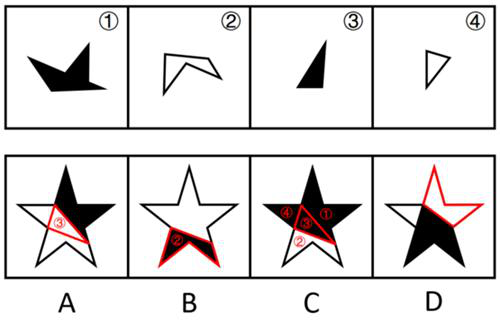

A 项：中间的三角形是由图③旋转后平移过去的，颜色应该是黑色，而选项是白色，排除；
B 项：下方的多边形是由图②旋转后平移过去的，颜色应该是白色，而选项是黑色，排除；
C 项：可以由题干图形拼合而成，拼合方式如图所示，当选；
D 项：右上角的多边形与题干四张纸片的形状均不相同，无法由题干图形拼合而成，排除。
故正确答案为C。

来源：[2025年江苏省公务员录用考试《行测》题（A类）答案及解析（121后暂缺）.pdf](https://github.com/dumarstoft-ship-it/xingce/blob/407016b55b49581efa3771bb59a2dee8761d982f/2025%E5%B9%B4%E6%B1%9F%E8%8B%8F%E7%9C%81%E5%85%AC%E5%8A%A1%E5%91%98%E5%BD%95%E7%94%A8%E8%80%83%E8%AF%95%E3%80%8A%E8%A1%8C%E6%B5%8B%E3%80%8B%E9%A2%98%EF%BC%88A%E7%B1%BB%EF%BC%89%E7%AD%94%E6%A1%88%E5%8F%8A%E8%A7%A3%E6%9E%90%EF%BC%88121%E5%90%8E%E6%9A%82%E7%BC%BA%EF%BC%89.pdf)，PDF 第 41 页。

## 第 88 题 · 判断推理

参考答案：**D**

题目88 解析
将题干立体图和选项展开图的面均标上序号，如下图所示，逐一进行分析。

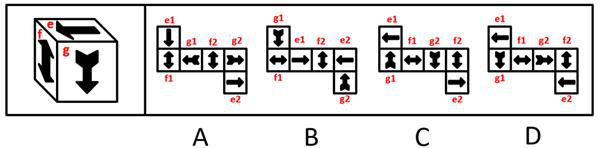

A 项：题干立体图中g 面中箭头的箭尾对着e 面，而选项中无论是g1 面还是g2 面，箭头的箭尾均
对着f2 面，选项展开图与题干立体图不一致，排除；

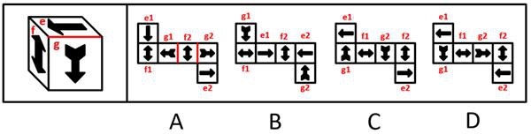

B 项：题干立体图中e 面中箭头指向f 面中箭头的尖，而选项中无论是e1 面还是e2 面，箭头均指向
f2 面中箭头的箭身，选项展开图与题干立体图不一致，排除；

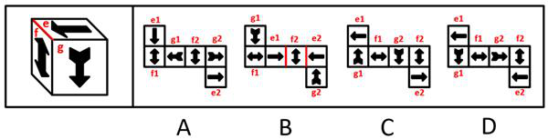

C 项：以e 面中单箭头尖指向的边为起始边，在题干立体图和选项展开图中进行顺时针画边（如下图
所示），题干立体图中边4 对应g 面中的箭尾，而选项中无论是e1 面还是e2 面，边4 均不对应g
面中的箭尾，选项展开图与题干立体图不一致，排除；

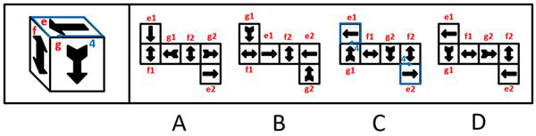

D 项：题干由e1 面、g1 面和f2 面组成，选项展开图与题干立体图一致，当选。
故正确答案为D。

来源：[2025年江苏省公务员录用考试《行测》题（A类）答案及解析（121后暂缺）.pdf](https://github.com/dumarstoft-ship-it/xingce/blob/407016b55b49581efa3771bb59a2dee8761d982f/2025%E5%B9%B4%E6%B1%9F%E8%8B%8F%E7%9C%81%E5%85%AC%E5%8A%A1%E5%91%98%E5%BD%95%E7%94%A8%E8%80%83%E8%AF%95%E3%80%8A%E8%A1%8C%E6%B5%8B%E3%80%8B%E9%A2%98%EF%BC%88A%E7%B1%BB%EF%BC%89%E7%AD%94%E6%A1%88%E5%8F%8A%E8%A7%A3%E6%9E%90%EF%BC%88121%E5%90%8E%E6%9A%82%E7%BC%BA%EF%BC%89.pdf)，PDF 第 42、43 页。

## 第 89 题 · 判断推理

参考答案：**A**

题目89 解析
本题为空间重构题。将题干展开图右侧的面进行移动，并为每个面标上序号，如下图所示，逐一分析
选项。

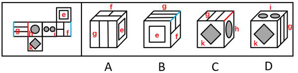

A 项：选项由面e、面f 和面g 构成，选项与题干展开图一致，当选；
B 项：选项由面e、面f 和面g 构成，题干展开图中面f 和面g 的公共边挨着面f 中的大长方形，而
选项中面f 和面g 的公共边不挨着面f 中的大长方形，选项与题干展开图不一致，排除；
C 项：选项由面g、面h 和面k 构成，题干展开图中面g 和面h 的公共边与面g 中的线条垂直，而选
项中面g 和面h 的公共边与面g 中的线条平行，选项与题干展开图不一致，排除；
D 项：选项由面g、面i 和面k 构成，题干展开图中面g 和面i 是相对面，两者不能同时出现，选项
与题干展开图不一致，排除。
故正确答案为A。

来源：[2025年江苏省公务员录用考试《行测》题（A类）答案及解析（121后暂缺）.pdf](https://github.com/dumarstoft-ship-it/xingce/blob/407016b55b49581efa3771bb59a2dee8761d982f/2025%E5%B9%B4%E6%B1%9F%E8%8B%8F%E7%9C%81%E5%85%AC%E5%8A%A1%E5%91%98%E5%BD%95%E7%94%A8%E8%80%83%E8%AF%95%E3%80%8A%E8%A1%8C%E6%B5%8B%E3%80%8B%E9%A2%98%EF%BC%88A%E7%B1%BB%EF%BC%89%E7%AD%94%E6%A1%88%E5%8F%8A%E8%A7%A3%E6%9E%90%EF%BC%88121%E5%90%8E%E6%9A%82%E7%BC%BA%EF%BC%89.pdf)，PDF 第 43 页。

## 第 90 题 · 判断推理

参考答案：**D**

题目90 解析
本题考查三视图。A、B、C 三项中的立体图形不可能某一视图由纯白小方格组成，排除。D 项中，立
体图形的正面能看到7 个白色小立方体和3 个灰色小立方体，所以其背面应还有1 个白色小立方体
和1 个灰色小立方体。如下图所示，当灰色小立方体在最下层摆放，白色小立方体摆放在该灰色小立
方体的上方时，其俯视图由纯白小方格组成。

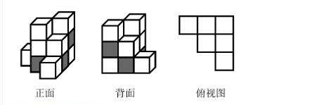

故正确答案为D。

来源：[2025年江苏省公务员录用考试《行测》题（A类）答案及解析（121后暂缺）.pdf](https://github.com/dumarstoft-ship-it/xingce/blob/407016b55b49581efa3771bb59a2dee8761d982f/2025%E5%B9%B4%E6%B1%9F%E8%8B%8F%E7%9C%81%E5%85%AC%E5%8A%A1%E5%91%98%E5%BD%95%E7%94%A8%E8%80%83%E8%AF%95%E3%80%8A%E8%A1%8C%E6%B5%8B%E3%80%8B%E9%A2%98%EF%BC%88A%E7%B1%BB%EF%BC%89%E7%AD%94%E6%A1%88%E5%8F%8A%E8%A7%A3%E6%9E%90%EF%BC%88121%E5%90%8E%E6%9A%82%E7%BC%BA%EF%BC%89.pdf)，PDF 第 43、44 页。

## 第 91 题 · 判断推理

参考答案：**A**

题目91 解析
第一步：翻译题干。
①现代化有意义→为了人民的现代化；
②现代化有动力→依靠人民的现代化；
③坚持一切为了人民且坚持一切依靠人民→充分调动广大人民的积极性。
第二步：逐一分析选项。
A 项：翻译为“−为了人民的现代化→−现代化有意义”，是对①的否后，否后必否前，可以推出，
当选；
B 项：翻译为“−坚持民生为大→−创造快速发展和社会长期稳定两大奇迹”，二者不存在逻辑关系，
无法推出，排除；
C 项：翻译为“−调动广大人民的积极性→−坚持一切为了人民”，是对③的否后，否后必否前，即
“−充分调动广大人民的积极性→−坚持一切为了人民或 −坚持一切依靠人民”，无法得出“−坚
持一切为了人民”一定为真，无法推出，排除；
D 项：翻译为“充分调动广大人民的积极性→坚持一切依靠人民”，是对③的肯后，但肯后得不到确
定性的结论，无法推出，排除。
故正确答案为A。

来源：[2025年江苏省公务员录用考试《行测》题（A类）答案及解析（121后暂缺）.pdf](https://github.com/dumarstoft-ship-it/xingce/blob/407016b55b49581efa3771bb59a2dee8761d982f/2025%E5%B9%B4%E6%B1%9F%E8%8B%8F%E7%9C%81%E5%85%AC%E5%8A%A1%E5%91%98%E5%BD%95%E7%94%A8%E8%80%83%E8%AF%95%E3%80%8A%E8%A1%8C%E6%B5%8B%E3%80%8B%E9%A2%98%EF%BC%88A%E7%B1%BB%EF%BC%89%E7%AD%94%E6%A1%88%E5%8F%8A%E8%A7%A3%E6%9E%90%EF%BC%88121%E5%90%8E%E6%9A%82%E7%BC%BA%EF%BC%89.pdf)，PDF 第 44 页。

## 第 92 题 · 判断推理

参考答案：**C**

题目92 解析
第一步：分析题干逻辑关系。
甲根据“折叠屏手机销量连续多年保持两位数的增长”的现象，得出“折叠屏手机将是手机研发的下一
个风口”的结论，而乙提出“折叠屏手机经历多年发展仍只占手机整体销量的1.6%”，通过说明折叠屏
手机在手机整体销量中的占比仍很低反驳了甲的结论。
第二步：逐一分析选项。
A 项：甲根据“企业应用AI 技术比例在2023 年提高至50%”的现象，得出“AI 技术将是国家经济发展
的重点”的结论，乙提出“传统行业仍是经济中的重要部分，同样需要重视”，并未反驳甲的结论，与
题干对话方式不一致，排除；
B 项：甲根据“张明的成绩平均每科提高了5 分”的现象，得出“张明过去一年在学习上认真了许多”的
结论，而乙提出“全班同学各科平均分都提高了10 分之多”，通过说明张明的成绩提升幅度小于全班
同学的平均水平反驳了甲的结论，与题干对话方式不一致，排除；
C 项：甲根据“过去三年某出版社的错别字检出量大大增加”的现象，得出“必须增加相应的人手以避免
错别字检出数量继续增加”的结论，而乙提出“过去三年该出版社出版总量大大增加，但错别字检出率
维持在万分之一左右”，通过说明错别字的数量占文本总字数的比例很低反驳了甲的结论，与题干对
话方式一致，当选；
D 项：甲根据“一项调查显示，超过90%的大学生在不请假的情况下缺过课”的现象，得出“课堂纪律
没有得到很好的遵守”的结论，而乙提出“这项调查主要针对大四学生，如果是大一学生，则缺过课的
比例不超过20%”，通过说明调查的样本不具代表性反驳了甲的结论，与题干对话方式不一致，排除。
故正确答案为C。

来源：[2025年江苏省公务员录用考试《行测》题（A类）答案及解析（121后暂缺）.pdf](https://github.com/dumarstoft-ship-it/xingce/blob/407016b55b49581efa3771bb59a2dee8761d982f/2025%E5%B9%B4%E6%B1%9F%E8%8B%8F%E7%9C%81%E5%85%AC%E5%8A%A1%E5%91%98%E5%BD%95%E7%94%A8%E8%80%83%E8%AF%95%E3%80%8A%E8%A1%8C%E6%B5%8B%E3%80%8B%E9%A2%98%EF%BC%88A%E7%B1%BB%EF%BC%89%E7%AD%94%E6%A1%88%E5%8F%8A%E8%A7%A3%E6%9E%90%EF%BC%88121%E5%90%8E%E6%9A%82%E7%BC%BA%EF%BC%89.pdf)，PDF 第 44、45 页。

## 第 93 题 · 判断推理

参考答案：**B**

题目93 解析
第一步：找出论点和论据。
论点：相对于其他季节，秋天人们很容易想起家乡的种种美好，更容易产生思乡情绪。
论据：无。
本题只有论点，没有论据，加强优先考虑补充论据。
第二步：逐一分析选项。
A 项：该项指出秋天让人感受到“时间的流逝和生命的脆弱”，但并未说明此种感受是否会引发“思乡情
绪”，话题不一致，无法加强，排除；
B 项：该项指出秋天正是收获的时节，那些“从小经历的美好场景”深深刻在每个人的心底，解释了为
什么秋天容易让人们想起“家乡的种种美好”，更容易让人们产生“思乡情绪”，补充论据，可以加强，
当选；
C 项：该项指出文人骚客关于秋天思乡的名篇影响着国人，但并未说明人们是否是因秋天本身产生思
乡情绪，为不明确项，无法加强，排除；
D 项：该项指出“中秋”会触发游子的“思乡情绪”，“中秋”是秋天的一个节日，无法判断是节日还是秋
天这个季节容易让人们产生思乡情绪，为不明确项，无法加强，排除。
故正确答案为B。

来源：[2025年江苏省公务员录用考试《行测》题（A类）答案及解析（121后暂缺）.pdf](https://github.com/dumarstoft-ship-it/xingce/blob/407016b55b49581efa3771bb59a2dee8761d982f/2025%E5%B9%B4%E6%B1%9F%E8%8B%8F%E7%9C%81%E5%85%AC%E5%8A%A1%E5%91%98%E5%BD%95%E7%94%A8%E8%80%83%E8%AF%95%E3%80%8A%E8%A1%8C%E6%B5%8B%E3%80%8B%E9%A2%98%EF%BC%88A%E7%B1%BB%EF%BC%89%E7%AD%94%E6%A1%88%E5%8F%8A%E8%A7%A3%E6%9E%90%EF%BC%88121%E5%90%8E%E6%9A%82%E7%BC%BA%EF%BC%89.pdf)，PDF 第 45、46 页。

## 第 94 题 · 判断推理

参考答案：**D**

题目94 解析
第一步：分析题干条件。
（1）丙是历史学专业学生，丁是文学专业学生；
（2）交换书后，甲持有社会学书，乙不持有文学书；
（3）交换书后，每个人所持有的书不是原来所携带的专业书。
第二步：根据题干条件进行推理。
根据条件（2）（3）可以推出，甲不是社会学专业的学生；
再结合条件（1）可以推出，甲是经济学专业的学生，乙是社会学专业的学生。
根据条件（2）甲持有社会学书（不持有文学书）、乙不持有文学书，且丁是文学专业的学生，结合
条件（3）可以推出，持有文学书的学生是丙；
综上，可以推出乙和丁持有经济学书或历史学书，但无法确定具体书籍，如下表所示，A、B、C 三项
均可推出。
|人员|甲|乙|丙|丁|
|---|---|---|---|---|
|专业|经济学|社会学|历史学|文学|
|交换后书籍|社会学|经济学/历史学|文学|历史学/经济学|

本题为选非题，故正确答案为D。

来源：[2025年江苏省公务员录用考试《行测》题（A类）答案及解析（121后暂缺）.pdf](https://github.com/dumarstoft-ship-it/xingce/blob/407016b55b49581efa3771bb59a2dee8761d982f/2025%E5%B9%B4%E6%B1%9F%E8%8B%8F%E7%9C%81%E5%85%AC%E5%8A%A1%E5%91%98%E5%BD%95%E7%94%A8%E8%80%83%E8%AF%95%E3%80%8A%E8%A1%8C%E6%B5%8B%E3%80%8B%E9%A2%98%EF%BC%88A%E7%B1%BB%EF%BC%89%E7%AD%94%E6%A1%88%E5%8F%8A%E8%A7%A3%E6%9E%90%EF%BC%88121%E5%90%8E%E6%9A%82%E7%BC%BA%EF%BC%89.pdf)，PDF 第 46 页。

## 第 95 题 · 判断推理

参考答案：**C**

题目95 解析
第一步：分析题干条件。
（1）甲入职的部门是人事处；
（2）乙入职的部门不是财务处；
（3）丙入职的部门不是人事处；
（4）三个猜测只有一个是对的。
题干条件没有矛盾关系，也没有反对关系，考虑题干假设或选项代入，选项信息充分，优先考虑代入
法。
第二步：逐一代入选项。
代入A 项：条件（1）为真，条件（2）为假，条件（3）为真，有两个猜测为真，与条件（4）矛盾，
排除；
代入B 项：条件（1）为假，条件（2）为假，条件（3）为假，三个猜测均为假，与条件（4）矛盾，
排除；
代入C 项：条件（1）为假，条件（2）为真，条件（3）为假，只有一个猜测为真，符合条件（4），
当选；
代入D 项：条件（1）为真，条件（2）为真，条件（3）为真，三个猜测均为真，与条件（4）矛盾，
排除。
故正确答案为C。

来源：[2025年江苏省公务员录用考试《行测》题（A类）答案及解析（121后暂缺）.pdf](https://github.com/dumarstoft-ship-it/xingce/blob/407016b55b49581efa3771bb59a2dee8761d982f/2025%E5%B9%B4%E6%B1%9F%E8%8B%8F%E7%9C%81%E5%85%AC%E5%8A%A1%E5%91%98%E5%BD%95%E7%94%A8%E8%80%83%E8%AF%95%E3%80%8A%E8%A1%8C%E6%B5%8B%E3%80%8B%E9%A2%98%EF%BC%88A%E7%B1%BB%EF%BC%89%E7%AD%94%E6%A1%88%E5%8F%8A%E8%A7%A3%E6%9E%90%EF%BC%88121%E5%90%8E%E6%9A%82%E7%BC%BA%EF%BC%89.pdf)，PDF 第 46、47 页。

## 第 96 题 · 判断推理

参考答案：**C**

题目96 解析
本题属于数独型推理，优先考虑利用信息量最大法。
根据题干信息“每行、每列、每个粗线条框内均不能重复也不能遗漏”可知，信息量最大的空格为a、b。
根据最后一行中的“衡山”以及右下角粗线条框可知，①、②、③、④均不是衡山，所以a 是衡山。
继续观察发现，考虑“每行、每列不能重复”，图形最下方的“Z 型”粗线条框内的圆形位置均不能是衡
山，所以b 是衡山。
再根据第三行“泰山”所在的“L 型”粗线条框，结合第三列中的“华山”“嵩山”和“b 衡山”可知，c 只能是恒
山，则d 一定是泰山，即①不能是泰山，②不能是恒山，排除A、B 两项。
根据右上角粗线条框内“华山”“a 衡山”“d 泰山”以及第二行“恒山”可以推出e 是嵩山，即①不能是嵩山，
排除D 项。

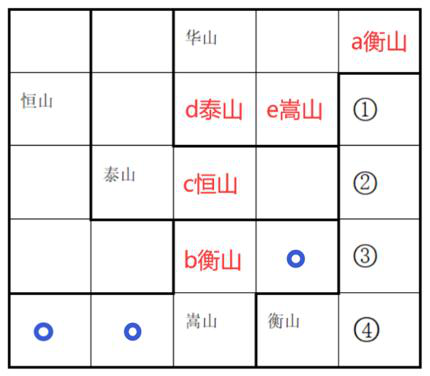

故正确答案为C。

来源：[2025年江苏省公务员录用考试《行测》题（A类）答案及解析（121后暂缺）.pdf](https://github.com/dumarstoft-ship-it/xingce/blob/407016b55b49581efa3771bb59a2dee8761d982f/2025%E5%B9%B4%E6%B1%9F%E8%8B%8F%E7%9C%81%E5%85%AC%E5%8A%A1%E5%91%98%E5%BD%95%E7%94%A8%E8%80%83%E8%AF%95%E3%80%8A%E8%A1%8C%E6%B5%8B%E3%80%8B%E9%A2%98%EF%BC%88A%E7%B1%BB%EF%BC%89%E7%AD%94%E6%A1%88%E5%8F%8A%E8%A7%A3%E6%9E%90%EF%BC%88121%E5%90%8E%E6%9A%82%E7%BC%BA%EF%BC%89.pdf)，PDF 第 47、48 页。

## 第 97 题 · 判断推理

参考答案：**A**

题目97 解析
第一步：找出论点和论据。
论点：亟需开展“海底种草”生态修复工作，加强对海草床的保护。
论据：海草床是最高效的碳捕获和碳封存系统之一，贮存碳的效率比森林高90 倍，碳封存时间可达
上千年。然而海草床是脆弱的生态系统，受自然环境变化和人类活动影响较大，全球范围内海草床正
面临严峻退化趋势。
本题论点说的是亟需修复和保护海草床，论据说的是海草床是最高效的碳捕获和碳封存系统之一，但
正面临严峻退化趋势，根据论据可以合理推出论点，二者话题一致，加强优先考虑补充论据。
第二步：逐一分析选项。
A 项：该项说的是全球气候变暖日益加剧，而其主要元凶是人类生产生活排放的碳化合物，那么固碳
就显得尤为重要，而海草床可以固碳，故应亟需开展“海底种草”生态修复工作，加强对海草床的保护，
补充论据，当选；
B 项：该项说的是海草床固碳和转化为有机碳的过程，与论点讨论的是否应亟需开展“海底种草”生态
修复工作无关，话题不一致，无法加强，排除；
C 项：该项说有些地方海岸线侵蚀严重，加强海草床保护和修复，能有效防止或减缓海滩和海岸遭受
侵蚀，但未提及其与碳化合物的关系，话题不一致，无法加强，排除；
D 项：该项说的是海草床具有水质净化和调控功能，但没有体现这些功能对碳化合物的作用，无法证
明“亟需”修复和保护海草床，无法加强，排除。
故正确答案为A。

来源：[2025年江苏省公务员录用考试《行测》题（A类）答案及解析（121后暂缺）.pdf](https://github.com/dumarstoft-ship-it/xingce/blob/407016b55b49581efa3771bb59a2dee8761d982f/2025%E5%B9%B4%E6%B1%9F%E8%8B%8F%E7%9C%81%E5%85%AC%E5%8A%A1%E5%91%98%E5%BD%95%E7%94%A8%E8%80%83%E8%AF%95%E3%80%8A%E8%A1%8C%E6%B5%8B%E3%80%8B%E9%A2%98%EF%BC%88A%E7%B1%BB%EF%BC%89%E7%AD%94%E6%A1%88%E5%8F%8A%E8%A7%A3%E6%9E%90%EF%BC%88121%E5%90%8E%E6%9A%82%E7%BC%BA%EF%BC%89.pdf)，PDF 第 48、49 页。

## 第 98 题 · 判断推理

参考答案：**A**

题目98 解析
第一步：找出论点和论据。
论点：有初诊患者担心，医院此举（实施“一次挂号管三天”的做法）会延长他们的等待时间，挤压他
们的就诊机会。
论据：无。
本题只有论点，没有论据，削弱优先考虑削弱论点。
第二步：逐一分析选项。
A 项：该项说的是该做法实施后医院将根据情况合理安排初诊患者与复诊患者的接诊次序，这样就可
以尽量避免出现长时间排队现象，不会延长初诊患者的等待时间，说明了他们的担心是不必要的，削
弱论点，当选；
B 项：该项说的是该做法不会导致科室接诊的患者明显增多，但在患者数量不增加的情况下，初诊患
者与复诊患者的排队次序和等待时间不明确，复诊患者的就诊次序可能都排在初诊患者之前，仍然会
延长初诊患者的等待时间，不能证明他们的担心是不必要的，无法削弱，排除；
C 项：该项说的是该做法实施前的情况，无法判断实施后是否会延长初诊患者的等待时间，无法削弱，
排除；
D 项：该项说的是该做法对患者的好处，但与初诊患者等待时间和就诊机会无关，话题不一致，无法
削弱，排除。
故正确答案为A。

来源：[2025年江苏省公务员录用考试《行测》题（A类）答案及解析（121后暂缺）.pdf](https://github.com/dumarstoft-ship-it/xingce/blob/407016b55b49581efa3771bb59a2dee8761d982f/2025%E5%B9%B4%E6%B1%9F%E8%8B%8F%E7%9C%81%E5%85%AC%E5%8A%A1%E5%91%98%E5%BD%95%E7%94%A8%E8%80%83%E8%AF%95%E3%80%8A%E8%A1%8C%E6%B5%8B%E3%80%8B%E9%A2%98%EF%BC%88A%E7%B1%BB%EF%BC%89%E7%AD%94%E6%A1%88%E5%8F%8A%E8%A7%A3%E6%9E%90%EF%BC%88121%E5%90%8E%E6%9A%82%E7%BC%BA%EF%BC%89.pdf)，PDF 第 49 页。

## 第 99 题 · 判断推理

参考答案：**B**

题目99 解析
第一步：分析题干条件。
（1）甲9472、乙9496、丙9480、丁9502；
（2）1 个人少计了17 张；
（3）1 个人少计了9 张；
（4）1 个人多计了13 张；
（5）1 个人仅粗略估计出一个票数。
第二步：根据题干条件进行推理。
根据条件（1）（2）可以推出四个人中数量最少的人少计了17 张，即甲9472 少计了17 张，那正确
票数应为9472+17=9489，排除A 项；
结合条件（1）（3）可以推出丙9480 少计了9 张，排除C 项；
结合条件（1）（4）可以推出票数最多的丁9502 多计了13 张，排除D 项。
综上，乙9496 是仅粗略估计出的一个票数，B 项当选。
故正确答案为B。

来源：[2025年江苏省公务员录用考试《行测》题（A类）答案及解析（121后暂缺）.pdf](https://github.com/dumarstoft-ship-it/xingce/blob/407016b55b49581efa3771bb59a2dee8761d982f/2025%E5%B9%B4%E6%B1%9F%E8%8B%8F%E7%9C%81%E5%85%AC%E5%8A%A1%E5%91%98%E5%BD%95%E7%94%A8%E8%80%83%E8%AF%95%E3%80%8A%E8%A1%8C%E6%B5%8B%E3%80%8B%E9%A2%98%EF%BC%88A%E7%B1%BB%EF%BC%89%E7%AD%94%E6%A1%88%E5%8F%8A%E8%A7%A3%E6%9E%90%EF%BC%88121%E5%90%8E%E6%9A%82%E7%BC%BA%EF%BC%89.pdf)，PDF 第 49、50 页。

## 第 100 题 · 判断推理

参考答案：**C**

题目100 解析
第一步：找出论点和论据。
论点：这样的评分很有可能影响文化产品的创新发展。
论据：无。
本题只有论点，没有论据，加强优先考虑补充论据，且本题为选非题，排除三个能够加强的选项即可。
第二步：逐一分析选项。
A 项：选项指出试图突破常规、探索新风格或新形式的文化产品往往只得到较低的评分，证明了评分
会影响文化产品的创新发展，补充论据，可以加强，排除；
B 项：选项指出评分的即时性会抑制新文化产品的成长空间，证明了评分会影响文化产品的创新发展，
补充论据，可以加强，排除；
C 项：选项指出粉丝群体打高分会影响公正性和客观性，而论点说的是评分对创新的影响，话题不一
致，无法加强，当选；
D 项：选项指出评分会让很多创作者重复已成功的模式和题材，这样不利于文化产品的创新发展，补
充论据，可以加强，排除。
本题为选非题，故正确答案为C。

来源：[2025年江苏省公务员录用考试《行测》题（A类）答案及解析（121后暂缺）.pdf](https://github.com/dumarstoft-ship-it/xingce/blob/407016b55b49581efa3771bb59a2dee8761d982f/2025%E5%B9%B4%E6%B1%9F%E8%8B%8F%E7%9C%81%E5%85%AC%E5%8A%A1%E5%91%98%E5%BD%95%E7%94%A8%E8%80%83%E8%AF%95%E3%80%8A%E8%A1%8C%E6%B5%8B%E3%80%8B%E9%A2%98%EF%BC%88A%E7%B1%BB%EF%BC%89%E7%AD%94%E6%A1%88%E5%8F%8A%E8%A7%A3%E6%9E%90%EF%BC%88121%E5%90%8E%E6%9A%82%E7%BC%BA%EF%BC%89.pdf)，PDF 第 50 页。

## 第 101 题 · 判断推理

参考答案：**A**

题目101 解析
第一步：找出论点和论据。
论点：设立“健康角”能改善员工的身心状态，提高整体工作效率。
论据：无。
本题只有论点，没有论据，且提问方式为“最有助于”评价公司管理层作出的预测，问题对预测成立越
重要越有帮助，可优先考虑必要条件。
第二步：逐一分析选项。
A 项：该项讨论的是员工是否有需求和兴趣参与“健康角”，如果员工对“健康角”没有需求和兴趣，就
不会参与该活动，那设立“健康角”就达不到预期效果，即该问题成立是预测成立的必要条件，有助于
评价公司管理层的预测，当选；
B 项：该项讨论的是其他公司，而论点讨论的是该公司，主体不一致，无助于评价公司管理层的预测，
排除；
C 项：该项讨论的是该调查数据是否反映公司员工真实的身心状况，即使该数据不能反映真实情况，
也不代表该公司员工身心状况是良好的，因此无法据此判断“健康角”是否能实现预期效果，无助于评
价公司管理层的预测，排除；
D 项：该项讨论的是该公司是否有足够预算用于“健康角”长期运营，而论点讨论的是该公司设立“健康
角”能否取得预期效果，话题不一致，无助于评价公司管理层的预测，排除。
故正确答案为A。

来源：[2025年江苏省公务员录用考试《行测》题（A类）答案及解析（121后暂缺）.pdf](https://github.com/dumarstoft-ship-it/xingce/blob/407016b55b49581efa3771bb59a2dee8761d982f/2025%E5%B9%B4%E6%B1%9F%E8%8B%8F%E7%9C%81%E5%85%AC%E5%8A%A1%E5%91%98%E5%BD%95%E7%94%A8%E8%80%83%E8%AF%95%E3%80%8A%E8%A1%8C%E6%B5%8B%E3%80%8B%E9%A2%98%EF%BC%88A%E7%B1%BB%EF%BC%89%E7%AD%94%E6%A1%88%E5%8F%8A%E8%A7%A3%E6%9E%90%EF%BC%88121%E5%90%8E%E6%9A%82%E7%BC%BA%EF%BC%89.pdf)，PDF 第 50、51 页。

## 第 102 题 · 判断推理

参考答案：**D**

题目102 解析
第一步：找出题干矛盾。
《百家姓》的内容没有文理，仅仅只是姓氏的合集，但却是古代中国儿童启蒙教育中不可或缺的经典
作品，与《三字经》《千字文》并称为古代三大启蒙读物，在古代儿童教育中占据了重要地位。
第二步：逐一分析选项。
A 项：选项指出《百家姓》中姓氏的逐步丰富反映了社会的发展和进步，解释了为什么《百家姓》没
有文理却在古代儿童教育中占据了重要地位，可以解释题干矛盾，排除；
B 项：选项指出《百家姓》中姓氏的排序反映了当时的政治和社会结构，解释了为什么《百家姓》没
有文理却在古代儿童教育中占据了重要地位，可以解释题干矛盾，排除；
C 项：选项指出姓氏文化不仅透露出家族的来源、迁徙历史和谱系，还包括了宗祠、名人和家训等方
面的信息，承载着丰富的文化内涵，说明了姓氏文化的重要作用，解释了为什么《百家姓》没有文理
却在古代儿童教育中占据了重要地位，可以解释题干矛盾，排除；
D 项：选项指出在南宋《百家姓》已经成为普及读物，历朝历代都编写了各种版本的《百家姓》，但
没有说明为什么会出现这种情况，无法解释题干矛盾，当选。
本题为选非题，故正确答案为D。

来源：[2025年江苏省公务员录用考试《行测》题（A类）答案及解析（121后暂缺）.pdf](https://github.com/dumarstoft-ship-it/xingce/blob/407016b55b49581efa3771bb59a2dee8761d982f/2025%E5%B9%B4%E6%B1%9F%E8%8B%8F%E7%9C%81%E5%85%AC%E5%8A%A1%E5%91%98%E5%BD%95%E7%94%A8%E8%80%83%E8%AF%95%E3%80%8A%E8%A1%8C%E6%B5%8B%E3%80%8B%E9%A2%98%EF%BC%88A%E7%B1%BB%EF%BC%89%E7%AD%94%E6%A1%88%E5%8F%8A%E8%A7%A3%E6%9E%90%EF%BC%88121%E5%90%8E%E6%9A%82%E7%BC%BA%EF%BC%89.pdf)，PDF 第 51 页。

## 第 103 题 · 判断推理

参考答案：**A**

题目103 解析
第一步：翻译题干。
（1）小全游泳→¬大陈跳水；
（2）大刘水球→大陈跳水；
（3）要么小吴游泳，要么小全游泳；
（4）要么−小全赛艇，要么大刘水球。
第二步：根据题干条件进行推理。
提问中给出了“小吴游泳”的结论，需要从结论出发倒推条件。
根据条件（3）可知，要想得到“小吴游泳”，需要“小全不游泳”成立；
根据条件（1）可知，要想得到“小全不游泳”，需要“大陈跳水”成立；
根据条件（2）可知，要想得到“大陈跳水”，需要“大刘水球”成立；
根据条件（4）可知，要想得到“大刘水球”，需要“小全赛艇”成立。
综上，要想得到“小吴游泳”的结论，需要满足“小全赛艇”这一前提，对应A 项。
故正确答案为A。

来源：[2025年江苏省公务员录用考试《行测》题（A类）答案及解析（121后暂缺）.pdf](https://github.com/dumarstoft-ship-it/xingce/blob/407016b55b49581efa3771bb59a2dee8761d982f/2025%E5%B9%B4%E6%B1%9F%E8%8B%8F%E7%9C%81%E5%85%AC%E5%8A%A1%E5%91%98%E5%BD%95%E7%94%A8%E8%80%83%E8%AF%95%E3%80%8A%E8%A1%8C%E6%B5%8B%E3%80%8B%E9%A2%98%EF%BC%88A%E7%B1%BB%EF%BC%89%E7%AD%94%E6%A1%88%E5%8F%8A%E8%A7%A3%E6%9E%90%EF%BC%88121%E5%90%8E%E6%9A%82%E7%BC%BA%EF%BC%89.pdf)，PDF 第 51、52 页。

## 第 104 题 · 判断推理

参考答案：**B**

题目104 解析
第一步：分析题干条件。
（1）江苏选手在选手丙的东南面；
（2）上海选手在赛道的东部位置，他所骑自行车是蓝色的；
（3）骑灰色自行车的选手不是排在第四位；
（4）选手丁排在第三位，选手乙来自浙江；
（5）安徽选手排在骑黄色自行车的选手之前，排在选手甲之后。
第二步：根据题干条件进行推理。
根据条件（1）江苏选手在丙的东南面，可以推出丙是第2 名，江苏选手是第3 名；
根据条件（2）上海选手在赛道东部以及江苏选手是第3 名，可以推出上海选手是第1 名，且自行车
是蓝色的；
根据条件（3）以及第1 名自行车是蓝色的，可以推出灰色自行车的选手不是第2 名，就是第3 名；
根据条件（4）以及江苏选手是第3 名，可以推出丁是江苏选手；
根据条件（5）、上海选手是第1 名以及江苏选手是第3 名，可以推出安徽选手是第2 名，甲是第1
名，具体如下表所示。
|排序条件|名次|选手|省市|颜色|
|---|---|---|---|---|
||第1名|甲|上海|蓝色|
|第2名||丙|安徽||
||第3名|丁|江苏||
|第4名|||||

综合上述结论，可以推出第4名是乙，来自浙江，B项当选。
故正确答案为B。

来源：[2025年江苏省公务员录用考试《行测》题（A类）答案及解析（121后暂缺）.pdf](https://github.com/dumarstoft-ship-it/xingce/blob/407016b55b49581efa3771bb59a2dee8761d982f/2025%E5%B9%B4%E6%B1%9F%E8%8B%8F%E7%9C%81%E5%85%AC%E5%8A%A1%E5%91%98%E5%BD%95%E7%94%A8%E8%80%83%E8%AF%95%E3%80%8A%E8%A1%8C%E6%B5%8B%E3%80%8B%E9%A2%98%EF%BC%88A%E7%B1%BB%EF%BC%89%E7%AD%94%E6%A1%88%E5%8F%8A%E8%A7%A3%E6%9E%90%EF%BC%88121%E5%90%8E%E6%9A%82%E7%BC%BA%EF%BC%89.pdf)，PDF 第 52、53 页。

## 第 105 题 · 判断推理

参考答案：**D**

题目105 解析
第一步：分析题干条件。
（1）江苏选手在选手丙的东南面；
（2）上海选手在赛道的东部位置，他所骑自行车是蓝色的；
（3）骑灰色自行车的选手不是排在第四位；
（4）选手丁排在第三位，选手乙来自浙江；
（5）安徽选手排在骑黄色自行车的选手之前，排在选手甲之后；
（6）丙的自行车是白色的。
第二步：根据题干条件进行推理。
根据上一题的结论，第1 名为选手甲，来自上海，自行车是蓝色的，排除A 项；
根据条件（6）丙的自行车是白色的，结合上一题的结论可以推出第2 名为选手丙，来自安徽，自行
车是白色的，排除C 项；
再根据条件（3）骑灰色自行车的选手不是排在第四位，结合上一题的结论可以推出第3 名选手丁来
自江苏，自行车是灰色的，那么第4 名选手乙来自浙江，自行车是黄色的（具体如下表所示），D 项
当选。
|名次|选手|省市|颜色|
|---|---|---|---|
|第1名|甲|上海|蓝色|
|第2名|丙|安徽|白色|
|第3名|丁|江苏|灰色|
|第4名|乙|浙江|黄色|

故正确答案为D。

来源：[2025年江苏省公务员录用考试《行测》题（A类）答案及解析（121后暂缺）.pdf](https://github.com/dumarstoft-ship-it/xingce/blob/407016b55b49581efa3771bb59a2dee8761d982f/2025%E5%B9%B4%E6%B1%9F%E8%8B%8F%E7%9C%81%E5%85%AC%E5%8A%A1%E5%91%98%E5%BD%95%E7%94%A8%E8%80%83%E8%AF%95%E3%80%8A%E8%A1%8C%E6%B5%8B%E3%80%8B%E9%A2%98%EF%BC%88A%E7%B1%BB%EF%BC%89%E7%AD%94%E6%A1%88%E5%8F%8A%E8%A7%A3%E6%9E%90%EF%BC%88121%E5%90%8E%E6%9A%82%E7%BC%BA%EF%BC%89.pdf)，PDF 第 53、54 页。

## 第 106 题 · 判断推理

参考答案：**C**

题目106 解析
第一步：找出定义关键词。
“政府、社会组织、公民等主体共同参与”、“多方合作的社会治理模式”。
第二步：逐一分析选项。
A 项：某县水利、环保等部门联合治理河道污染，不涉及社会组织和公民等主体，不符合“政府、社
会组织、公民等主体共同参与”，不符合定义，排除；
B 项：某街道统筹规划电动自行车停放充电区域，优化地下非机动车库安全设施，不涉及社会组织和
公民等主体，不符合“政府、社会组织、公民等主体共同参与”、“多方合作的社会治理模式”，不符合
定义，排除；
C 项：某区政府在社区工作中，鼓励业委会、志愿者充分发挥各自作用，符合“政府、社会组织、公
民等主体共同参与”、“多方合作的社会治理模式”，符合定义，当选；
D 项：村民自发组织巡查队，检测上报森林火情，不涉及政府等主体，不符合“政府、社会组织、公
民等主体共同参与”、“多方合作的社会治理模式”，不符合定义，排除。
故正确答案为C。

来源：[2025年江苏省公务员录用考试《行测》题（A类）答案及解析（121后暂缺）.pdf](https://github.com/dumarstoft-ship-it/xingce/blob/407016b55b49581efa3771bb59a2dee8761d982f/2025%E5%B9%B4%E6%B1%9F%E8%8B%8F%E7%9C%81%E5%85%AC%E5%8A%A1%E5%91%98%E5%BD%95%E7%94%A8%E8%80%83%E8%AF%95%E3%80%8A%E8%A1%8C%E6%B5%8B%E3%80%8B%E9%A2%98%EF%BC%88A%E7%B1%BB%EF%BC%89%E7%AD%94%E6%A1%88%E5%8F%8A%E8%A7%A3%E6%9E%90%EF%BC%88121%E5%90%8E%E6%9A%82%E7%BC%BA%EF%BC%89.pdf)，PDF 第 54 页。

## 第 107 题 · 判断推理

参考答案：**A**

题目107 解析
第一步：找出定义关键词。
“企业”、“借助内外部竞争不断克服自身短板”、“带动行业和谐发展、形成群体优势”。
第二步：逐一分析选项。
A 项：某家具厂针对市场动态需求，研发出一系列新产品，本地其他厂家也加大了研发力度，符合“企
业”、“借助内外部竞争不断克服自身短板”，家具行业成了当地的支柱产业，符合“带动行业和谐发展、
形成群体优势”，符合定义，当选；
B 项：某公司员工与国内外同行进行交流，取长补短，提高业务素质，符合“企业”，但不明确该公司
是否带动了所在行业的发展，不符合“带动行业和谐发展、形成群体优势”，不符合定义，排除；
C 项：某林区推进一体化生产经营模式，保持与周围环境和谐发展的良好势头，符合“企业”，该林区
成为了样板林区，但不明确其是否带动了所在行业的发展，不符合“带动行业和谐发展、形成群体优
势”，不符合定义，排除；
D 项：某公司实行末位淘汰制，规模和影响力越来越大，符合“企业”、“借助内外部竞争不断克服自身
短板”，但不明确该公司是否带动了所在行业的发展，不符合“带动行业和谐发展、形成群体优势”，
不符合定义，排除。
故正确答案为A。

来源：[2025年江苏省公务员录用考试《行测》题（A类）答案及解析（121后暂缺）.pdf](https://github.com/dumarstoft-ship-it/xingce/blob/407016b55b49581efa3771bb59a2dee8761d982f/2025%E5%B9%B4%E6%B1%9F%E8%8B%8F%E7%9C%81%E5%85%AC%E5%8A%A1%E5%91%98%E5%BD%95%E7%94%A8%E8%80%83%E8%AF%95%E3%80%8A%E8%A1%8C%E6%B5%8B%E3%80%8B%E9%A2%98%EF%BC%88A%E7%B1%BB%EF%BC%89%E7%AD%94%E6%A1%88%E5%8F%8A%E8%A7%A3%E6%9E%90%EF%BC%88121%E5%90%8E%E6%9A%82%E7%BC%BA%EF%BC%89.pdf)，PDF 第 54、55 页。

## 第 108 题 · 判断推理

参考答案：**B**

题目108 解析
第一步：找出定义关键词。
“有意降低社交期望值”、“在互动过程中保持距离感和独立性”、“使心情更加轻松愉悦的社交方式”。
第二步：逐一分析选项。
A 项：吴女士和好友虽多年未见，但在得知她生病的消息后，好友立刻放下工作赶了过来，说明双方
互动过程中并未保持距离感和独立性，不符合“在互动过程中保持距离感和独立性”，不符合定义，排
除；
B 项：李先生经常周末约骑友游玩，当天往返且所有费用AA 制，大家只知道彼此的微信昵称，说明
李先生与骑友之间进行社交主要是为了游玩，互相保持着距离感和独立性，符合“有意降低社交期望
值”、“在互动过程中保持距离感和独立性”，玩得非常开心，符合“使心情更加轻松愉悦的社交方式”，
符合定义，当选；
C 项：小王每天晚上都要和AI 对话机器人闲聊，其中AI 对话机器人不是人，不涉及人与人之间的社
交，不符合“使心情更加轻松愉悦的社交方式”，不符合定义，排除；
D 项：小赵因工作繁忙日常生活是“独行侠”，收到母校的校庆邀请，为了不增加招待负担便婉言谢绝
了，未体现小赵的心情状态，不符合“使心情更加轻松愉悦的社交方式”，不符合定义，排除。
故正确答案为B。

来源：[2025年江苏省公务员录用考试《行测》题（A类）答案及解析（121后暂缺）.pdf](https://github.com/dumarstoft-ship-it/xingce/blob/407016b55b49581efa3771bb59a2dee8761d982f/2025%E5%B9%B4%E6%B1%9F%E8%8B%8F%E7%9C%81%E5%85%AC%E5%8A%A1%E5%91%98%E5%BD%95%E7%94%A8%E8%80%83%E8%AF%95%E3%80%8A%E8%A1%8C%E6%B5%8B%E3%80%8B%E9%A2%98%EF%BC%88A%E7%B1%BB%EF%BC%89%E7%AD%94%E6%A1%88%E5%8F%8A%E8%A7%A3%E6%9E%90%EF%BC%88121%E5%90%8E%E6%9A%82%E7%BC%BA%EF%BC%89.pdf)，PDF 第 55 页。

## 第 109 题 · 判断推理

参考答案：**A**

题目109 解析
第一步：找出定义关键词。
“培养青少年生态环保意识”、“与单向教育模式不同”、“互动性课外活动”。
第二步：逐一分析选项。
A 项：刘老师带领小小昆虫“发烧友”在山林、草坪中探索昆虫世界，是在户外由老师带领开展的活动，
且探讨了人与自然的和谐关系，说明老师与学生之间存在互动，是为了培养生态环保意识，符合“培
养青少年生态环保意识”、“与单向教育模式不同”、“互动性课外活动”，符合定义，当选；
B 项：王先生给儿子买了许多书，儿子通过看书萌生了更强的环保意识，是儿子单向学习书籍知识，
不符合“互动性课外活动”，不符合定义，排除；
C 项：家长群的通知要求学生提交用空牛奶盒完成的手工环保作业，刘女士为了帮孩子完成作业网购
空盒子，没有体现环保，且只是为了完成作业，也未体现互动性，不符合“培养青少年生态环保意识”、
“互动性课外活动”，不符合定义，排除；
D 项：清江社区对废旧电池回收问题进行讲解，居民表示再也不会乱扔电池，说明清江社区的讲解是
针对居民，而非青少年，不符合“培养青少年生态环保意识”，不符合定义，排除。
故正确答案为A。

来源：[2025年江苏省公务员录用考试《行测》题（A类）答案及解析（121后暂缺）.pdf](https://github.com/dumarstoft-ship-it/xingce/blob/407016b55b49581efa3771bb59a2dee8761d982f/2025%E5%B9%B4%E6%B1%9F%E8%8B%8F%E7%9C%81%E5%85%AC%E5%8A%A1%E5%91%98%E5%BD%95%E7%94%A8%E8%80%83%E8%AF%95%E3%80%8A%E8%A1%8C%E6%B5%8B%E3%80%8B%E9%A2%98%EF%BC%88A%E7%B1%BB%EF%BC%89%E7%AD%94%E6%A1%88%E5%8F%8A%E8%A7%A3%E6%9E%90%EF%BC%88121%E5%90%8E%E6%9A%82%E7%BC%BA%EF%BC%89.pdf)，PDF 第 56 页。

## 第 110 题 · 判断推理

参考答案：**D**

题目110 解析
第一步：找出定义关键词。
“商业平台主体借助自身技术或数据优势地位”、“通过特定手段取得优惠待遇以获得竞争优势”。
第二步：逐一分析选项。
A 项：相比其他卖家，该电商平台利用从卖家经营过程中收集到的海量销售数据，优化了自家产品的
推荐策略，并在平台搜索引擎中把它们排列在前面，是借助自身技术和数据优势获得竞争优势，符合
“商业平台主体借助自身技术或数据优势地位”、“通过特定手段取得优惠待遇以获得竞争优势”，符合
定义，排除；
B 项：相比其他的保险产品，该在线旅游平台默认搭售自己代理的旅游保险产品，却没有在显著位置
提醒用户可以取消这项服务，是借助自身技术优势获得竞争优势，符合“商业平台主体借助自身技术
或数据优势地位”、“通过特定手段取得优惠待遇以获得竞争优势”，符合定义，排除；
C 项：该应用商店运营商对自家程序软件给了更高的评分星级，对第三方开发者则设置了更为严格的
审核评级标准，是借助自身技术优势获得竞争优势，符合“商业平台主体借助自身技术或数据优势地
位”、“通过特定手段取得优惠待遇以获得竞争优势”，符合定义，排除；
D 项：该供水公司利用在区域供水市场的支配地位，要求用水单位必须邀请己方做事，是借助市场优
势，不是借助自身技术或数据优势，不符合“商业平台主体借助自身技术或数据优势地位”，不符合定
义，当选。
本题为选非题，故正确答案为D。

来源：[2025年江苏省公务员录用考试《行测》题（A类）答案及解析（121后暂缺）.pdf](https://github.com/dumarstoft-ship-it/xingce/blob/407016b55b49581efa3771bb59a2dee8761d982f/2025%E5%B9%B4%E6%B1%9F%E8%8B%8F%E7%9C%81%E5%85%AC%E5%8A%A1%E5%91%98%E5%BD%95%E7%94%A8%E8%80%83%E8%AF%95%E3%80%8A%E8%A1%8C%E6%B5%8B%E3%80%8B%E9%A2%98%EF%BC%88A%E7%B1%BB%EF%BC%89%E7%AD%94%E6%A1%88%E5%8F%8A%E8%A7%A3%E6%9E%90%EF%BC%88121%E5%90%8E%E6%9A%82%E7%BC%BA%EF%BC%89.pdf)，PDF 第 56、57 页。

## 第 111 题 · 判断推理

参考答案：**D**

题目111 解析
第一步：找出定义关键词。
“现实生活中难以得到心理慰藉的中老年人”、“在网络世界中”、“受到情感诱导而盲目消费”、“导致个
人钱财严重受损”。
第二步：逐一分析选项。
A 项：母亲退休后购买“三无”保健品，该产品的推销员几乎每周都会来陪母亲聊家常，没有体现利用
“网络”，不符合“在网络世界中”，不符合定义，排除；
B 项：赵先生每天都能得到不少来自妈妈级粉丝的打赏，但未提到这些妈妈级粉丝的钱财是否严重受
损，不符合“导致个人钱财严重受损”，不符合定义，排除；
C 项：刘女士每天晚上都会定时打开手机，偶尔为主播们刷一些小礼物，未提到刘女士的钱财是否严
重受损，不符合“导致个人钱财严重受损”，不符合定义，排除；
D 项：独居的李奶奶每天都泡在“50 后时光”直播间，符合“现实生活中难以得到心理慰藉的中老年人”、
“在网络世界中”，为主播刷礼物，两个月内花掉了多年的积蓄，符合“受到情感诱导而盲目消费”、“导
致个人钱财严重受损”，符合定义，当选。
故正确答案为D。

来源：[2025年江苏省公务员录用考试《行测》题（A类）答案及解析（121后暂缺）.pdf](https://github.com/dumarstoft-ship-it/xingce/blob/407016b55b49581efa3771bb59a2dee8761d982f/2025%E5%B9%B4%E6%B1%9F%E8%8B%8F%E7%9C%81%E5%85%AC%E5%8A%A1%E5%91%98%E5%BD%95%E7%94%A8%E8%80%83%E8%AF%95%E3%80%8A%E8%A1%8C%E6%B5%8B%E3%80%8B%E9%A2%98%EF%BC%88A%E7%B1%BB%EF%BC%89%E7%AD%94%E6%A1%88%E5%8F%8A%E8%A7%A3%E6%9E%90%EF%BC%88121%E5%90%8E%E6%9A%82%E7%BC%BA%EF%BC%89.pdf)，PDF 第 57 页。

## 第 112 题 · 判断推理

参考答案：**D**

题目112 解析
第一步：找出定义关键词。
“通过积极性的言语或行动”、“为他人带来良性感受”、“人际交往能力”。
第二步：逐一分析选项。
A 项：林女士是一位经验丰富的住家月嫂，她照护的孩子健康成长和新手父母们的满意说明林女士具
备一定的专业能力，但没有体现“人际交往能力”，不符合定义，排除；
B 项：陈先生大学毕业后做过多种工作，父母尊重他的选择而不加干涉，不符合“通过积极性的言语
或行动”、“为他人带来良性感受”，不符合定义，排除；
C 项：营业员拼命夸秦女士身材好，秦女士对此半信半疑，说明营业员的话没有给秦女士带来良性感
受，不符合“为他人带来良性感受”，不符合定义，排除；
D 项：赵先生在每次与同事的聚会中，都能让大家笑得前仰后合，工作压力一扫而空，体现了赵先生
良好的人际交往能力，符合“通过积极性的言语或行动”、“为他人带来良性感受”、“人际交往能力”，
符合定义，当选。
故正确答案为D。

来源：[2025年江苏省公务员录用考试《行测》题（A类）答案及解析（121后暂缺）.pdf](https://github.com/dumarstoft-ship-it/xingce/blob/407016b55b49581efa3771bb59a2dee8761d982f/2025%E5%B9%B4%E6%B1%9F%E8%8B%8F%E7%9C%81%E5%85%AC%E5%8A%A1%E5%91%98%E5%BD%95%E7%94%A8%E8%80%83%E8%AF%95%E3%80%8A%E8%A1%8C%E6%B5%8B%E3%80%8B%E9%A2%98%EF%BC%88A%E7%B1%BB%EF%BC%89%E7%AD%94%E6%A1%88%E5%8F%8A%E8%A7%A3%E6%9E%90%EF%BC%88121%E5%90%8E%E6%9A%82%E7%BC%BA%EF%BC%89.pdf)，PDF 第 57、58 页。

## 第 113 题 · 判断推理

参考答案：**A**

题目113 解析
第一步：找出定义关键词。
“面对复杂多变、难以定性的客观事物或现象”、“采用弹性手法灵活应对”。
第二步：逐一分析选项。
A 项：小张面对的是父母吵架的事，且“清官难断家务事”，符合“面对复杂多变、难以定性的客观事物
或现象”，坐在一块儿和稀泥，符合“采用弹性手法灵活应对”，符合定义，当选；
B 项：多位老师对小婷论文的观点是一致的，说明小婷的论文好坏是可以定性的，不符合“面对复杂
多变、难以定性的客观事物或现象”，不符合定义，排除；
C 项：小袁排查多种故障可能性，并经过分析很快排除故障，说明故障并非难以定性，不符合“面对
复杂多变、难以定性的客观事物或现象”，不符合定义，排除；
D 项：当下许多影视剧中的正面人物形象更贴近真实生活，没有体现复杂多变、难以定性的事物或现
象，也没有体现灵活应对，不符合“面对复杂多变、难以定性的客观事物或现象”、“采用弹性手法灵
活应对”，不符合定义，排除。
故正确答案为A。

来源：[2025年江苏省公务员录用考试《行测》题（A类）答案及解析（121后暂缺）.pdf](https://github.com/dumarstoft-ship-it/xingce/blob/407016b55b49581efa3771bb59a2dee8761d982f/2025%E5%B9%B4%E6%B1%9F%E8%8B%8F%E7%9C%81%E5%85%AC%E5%8A%A1%E5%91%98%E5%BD%95%E7%94%A8%E8%80%83%E8%AF%95%E3%80%8A%E8%A1%8C%E6%B5%8B%E3%80%8B%E9%A2%98%EF%BC%88A%E7%B1%BB%EF%BC%89%E7%AD%94%E6%A1%88%E5%8F%8A%E8%A7%A3%E6%9E%90%EF%BC%88121%E5%90%8E%E6%9A%82%E7%BC%BA%EF%BC%89.pdf)，PDF 第 58、59 页。

## 第 114 题 · 判断推理

参考答案：**B**

题目114 解析
第一步：找出定义关键词。
“利用自然元素构建出的具有引导性的空间布局”、“促进建筑内外部的能量交换，引导建筑内部的人
员流动，提升建筑物的生态效能及使用舒适度”。
第二步：逐一分析选项。
A 项：将空调出风口设置在走廊顶部，利用空气对流原理，未体现引导人员流动，不符合“促进建筑
内外部的能量交换，引导建筑内部的人员流动，提升建筑物的生态效能及使用舒适度”，不符合定义，
排除；
B 项：某图书馆设置了巨大的玻璃穹顶，阳光直接透过穹顶洒在中庭绿植上，符合“利用自然元素构
建出的具有引导性的空间布局”，各个方向的读者都能自然而然进入中庭四周的阅读区域，符合“促进
建筑内外部的能量交换，引导建筑内部的人员流动，提升建筑物的生态效能及使用舒适度”，符合定
义，当选；
C 项：茶餐厅前造型别致的霓虹灯招牌，未体现自然元素，不符合“利用自然元素构建出的具有引导
性的空间布局”，不符合定义，排除；
D 项：郑女士老屋外的院墙上爬满了千姿百态的凌霄，阳光完全晒不进庭院，不符合“促进建筑内外
部的能量交换，引导建筑内部的人员流动，提升建筑物的生态效能及使用舒适度”，不符合定义，排
除。
故正确答案为B。

来源：[2025年江苏省公务员录用考试《行测》题（A类）答案及解析（121后暂缺）.pdf](https://github.com/dumarstoft-ship-it/xingce/blob/407016b55b49581efa3771bb59a2dee8761d982f/2025%E5%B9%B4%E6%B1%9F%E8%8B%8F%E7%9C%81%E5%85%AC%E5%8A%A1%E5%91%98%E5%BD%95%E7%94%A8%E8%80%83%E8%AF%95%E3%80%8A%E8%A1%8C%E6%B5%8B%E3%80%8B%E9%A2%98%EF%BC%88A%E7%B1%BB%EF%BC%89%E7%AD%94%E6%A1%88%E5%8F%8A%E8%A7%A3%E6%9E%90%EF%BC%88121%E5%90%8E%E6%9A%82%E7%BC%BA%EF%BC%89.pdf)，PDF 第 59 页。

## 第 115 题 · 判断推理

参考答案：**B**

题目115 解析
第一步：找出定义关键词。
“通过数字技术赋能”、“将优秀传统文化以沉浸式的艺术形式进行创新表达”、“凸显视觉效果呈现”。
第二步：逐一分析选项。
A 项：某电视台文化节目中，大学生们来到文化古迹现场，与考古专家互动，未体现数字技术，不符
合“通过数字技术赋能”，不符合定义，排除；
B 项：利用三维动画技术，体现了数字技术，符合“通过数字技术赋能”，复原了石窟壁画中飞天与金
刚的舞蹈，使静止的文化符号变成了动感的形象，符合“将优秀传统文化以沉浸式的艺术形式进行创
新表达”、“凸显视觉效果呈现”，符合定义，当选；
C 项：对古代编钟复制件进行高精细度的音源采集，最终实现对这一传统瑰宝的数字化复原，只是对
其音源进行复原，不涉及创新表达，不符合“将优秀传统文化以沉浸式的艺术形式进行创新表达”、“凸
显视觉效果呈现”，不符合定义，排除；
D 项：某博物馆从古代名画中选取“意象”元素，实景搭建了沉浸式体验展厅，观众犹如身临其境，不
明确是否使用了数字技术，不符合“通过数字技术赋能”，不符合定义，排除。
故正确答案为B。

来源：[2025年江苏省公务员录用考试《行测》题（A类）答案及解析（121后暂缺）.pdf](https://github.com/dumarstoft-ship-it/xingce/blob/407016b55b49581efa3771bb59a2dee8761d982f/2025%E5%B9%B4%E6%B1%9F%E8%8B%8F%E7%9C%81%E5%85%AC%E5%8A%A1%E5%91%98%E5%BD%95%E7%94%A8%E8%80%83%E8%AF%95%E3%80%8A%E8%A1%8C%E6%B5%8B%E3%80%8B%E9%A2%98%EF%BC%88A%E7%B1%BB%EF%BC%89%E7%AD%94%E6%A1%88%E5%8F%8A%E8%A7%A3%E6%9E%90%EF%BC%88121%E5%90%8E%E6%9A%82%E7%BC%BA%EF%BC%89.pdf)，PDF 第 59、60 页。
