# 2025 年江苏行测（A类） · 题目

保留原题号。来源页码按 PDF 实际页数计，从 1 开始。答案及解析另见 answers.md。

## 第 21 题 · 言语理解与表达

`JS2025-A类-021`

在江苏，自动驾驶已成为创新技术重塑物流运输产业的重要载体。搭载多类型传感器的智慧重型卡车，一旦切
换到智能辅助驾驶状态，驾驶员就变身为安全员，只需坐在车上监管，智慧重型卡车会根据实时路况减速、避
让或变道。除了智慧重型卡车，应用于港口的自动驾驶集装箱卡车也已完成技术验证的初始阶段，驶入了大规
模商业应用的快车道。行驶在物流园区与制造业企业之间的自动驾驶物流车，则在智驾系统助力下，实现了物
流业与制造业的深度融合。
这段文字重在说明：
A.自动驾驶在江苏的应用场景已经越来越广阔 B.物流车应用智能技术使得驾驶员获得了解放
C.自动驾驶促进了江苏物流运输业的发展升级 D.物流车因智能技术的加持应用范围不断扩大

来源：[2025年江苏省公务员录用考试《行测》题（A类）.pdf](https://github.com/dumarstoft-ship-it/xingce/blob/407016b55b49581efa3771bb59a2dee8761d982f/2025%E5%B9%B4%E6%B1%9F%E8%8B%8F%E7%9C%81%E5%85%AC%E5%8A%A1%E5%91%98%E5%BD%95%E7%94%A8%E8%80%83%E8%AF%95%E3%80%8A%E8%A1%8C%E6%B5%8B%E3%80%8B%E9%A2%98%EF%BC%88A%E7%B1%BB%EF%BC%89.pdf)，PDF 第 6 页。

## 第 22 题 · 言语理解与表达

`JS2025-A类-022`

口口相传的经验是讲故事的人的灵感来源。在劳动的氛围中讲故事，是一种交流方式。每一个讲故事的人都会
在故事中留下自己的痕迹，就像制陶人会在陶器上留下自己的印记一样。人在放松的状态下听故事，内心会想
记下这些故事，并有对他人转述故事的愿望，这就构成了听故事的人与讲故事的人之间的关系。讲故事的人就
像智者一样，能讲出自己的人生经验，也能讲出他人的经验、历史的经验，他们能让故事的火把生活的灯芯点
燃。
这段文字中“在故事中留下自己的痕迹”的含义最有可能是：
A.每个故事都会被讲故事的人加入一些自身经历 B.讲故事的人会结合个人阅历对故事进行再加工
C.讲故事的人会向听故事的人讲自己的人生经验 D.每个故事在被多个人讲述之后内容会发生变化

来源：[2025年江苏省公务员录用考试《行测》题（A类）.pdf](https://github.com/dumarstoft-ship-it/xingce/blob/407016b55b49581efa3771bb59a2dee8761d982f/2025%E5%B9%B4%E6%B1%9F%E8%8B%8F%E7%9C%81%E5%85%AC%E5%8A%A1%E5%91%98%E5%BD%95%E7%94%A8%E8%80%83%E8%AF%95%E3%80%8A%E8%A1%8C%E6%B5%8B%E3%80%8B%E9%A2%98%EF%BC%88A%E7%B1%BB%EF%BC%89.pdf)，PDF 第 6 页。

## 第 23 题 · 言语理解与表达

`JS2025-A类-023`

司法建议最初源于行政诉讼。近年来，司法建议的适用范围不断拓展，从保障法院裁判执行措施，进阶升级为
社会矛盾纠纷的预防性机制。司法建议既是对传统“治未病”理念的继承，也是对新时代“枫桥经验”的一项
创新性实践。通过司法建议，对案件审理过程中发现的可能影响社会和谐的隐患或因素提出建议，以预防纠纷
再次发生。有效的司法建议不仅能预先准确找出矛盾纠纷产生的原因，还能进一步提升法院的权威，彰显司法
的人文关怀。
下列关于司法建议的说法，与文意不符的是：
A.适用范围正在逐步地扩大 B.不会弱化司法机关的权威
C.可有效避免社会矛盾产生 D.是一种更柔性的治理方式

来源：[2025年江苏省公务员录用考试《行测》题（A类）.pdf](https://github.com/dumarstoft-ship-it/xingce/blob/407016b55b49581efa3771bb59a2dee8761d982f/2025%E5%B9%B4%E6%B1%9F%E8%8B%8F%E7%9C%81%E5%85%AC%E5%8A%A1%E5%91%98%E5%BD%95%E7%94%A8%E8%80%83%E8%AF%95%E3%80%8A%E8%A1%8C%E6%B5%8B%E3%80%8B%E9%A2%98%EF%BC%88A%E7%B1%BB%EF%BC%89.pdf)，PDF 第 6 页。

## 第 24 题 · 言语理解与表达

`JS2025-A类-024`

有关数据显示：2024年1-7月，高端装备制造业销售收入同比增长8.3%，占制造业总销售收入的比重为16.5%，
较上年同期提高0.5个百分点；智能设备制造业销售收入同比增长12.4%；高耗能制造业销售收入占制造业比重
为30.7%，较上年同期下降0.8个百分点，节能降耗工作有序推进；制造业企业采购环境治理服务金额同比增长
6.2%，增速较2023年加快2.4个百分点，治污投入不断加大。
这段文字重在说明：
A.制造业持续不断在国民经济发展中起领跑作用 B.经济发展亮点频现呈现出持续向好的发展态势
C.制造业正向高端化智能化绿色化发展扎实推进 D.经济发展与生态治理齐头并进为实现双赢努力

来源：[2025年江苏省公务员录用考试《行测》题（A类）.pdf](https://github.com/dumarstoft-ship-it/xingce/blob/407016b55b49581efa3771bb59a2dee8761d982f/2025%E5%B9%B4%E6%B1%9F%E8%8B%8F%E7%9C%81%E5%85%AC%E5%8A%A1%E5%91%98%E5%BD%95%E7%94%A8%E8%80%83%E8%AF%95%E3%80%8A%E8%A1%8C%E6%B5%8B%E3%80%8B%E9%A2%98%EF%BC%88A%E7%B1%BB%EF%BC%89.pdf)，PDF 第 6 页。

## 第 25 题 · 言语理解与表达

`JS2025-A类-025`

在何尊的铭文中，有一句话是“恭德裕天”。其中的“德”字，相较甲骨文，底部多出“心”字部首。有专家
认为，有“心”方为“德”，表明在三千多年前“德政”这一政治理念业已出现，这为人们理解中国的政治传
统提供了有益启示。不同时代、地域青铜器之间的关系“图谱”，青铜器的材质分析、工艺重建和产地溯源，
青铜器不同器型与纹饰的来源、演变······亟待破译的“青铜密码”还有很多，需要我们拓宽视野，运
用多种研究方法、技术手段进行综合分析，进一步推动相关学科发展。
这段文字意在强调：
A.青铜器的研究领域十分广阔 B.青铜器亟待进一步深入研究
C.青铜器研究有益于挖掘传统文化 D.青铜器研究具有极其重要的价值

来源：[2025年江苏省公务员录用考试《行测》题（A类）.pdf](https://github.com/dumarstoft-ship-it/xingce/blob/407016b55b49581efa3771bb59a2dee8761d982f/2025%E5%B9%B4%E6%B1%9F%E8%8B%8F%E7%9C%81%E5%85%AC%E5%8A%A1%E5%91%98%E5%BD%95%E7%94%A8%E8%80%83%E8%AF%95%E3%80%8A%E8%A1%8C%E6%B5%8B%E3%80%8B%E9%A2%98%EF%BC%88A%E7%B1%BB%EF%BC%89.pdf)，PDF 第 6 页。

## 第 26 题 · 言语理解与表达

`JS2025-A类-026`

在众多用于建筑的保温材料中，蛭石因其良好的保温性能而广受青睐。蛭石是一种含镁的水铝硅酸盐次生变质
矿物，具有二维层状结构，受热时会失水膨胀，因形状类似水蛭而得名。经高温煅烧后，蛭石体积能瞬间膨胀
十几倍，每块膨胀蛭石里有很多毛细孔，且每个毛细孔都是微纳米级孔径。这些小空隙就是一个个保温空间。
蛭石膨胀倍数越高，空隙越发达，保温性能也就越好。更重要的是，蛭石在生产加工过程中对生态环境污染很
小，产品废弃后还能回收再利用，非常符合建筑领域十分推崇的可持续发展理念。
最适合做这段文字标题的是：
A.蛭石为什么可以保温 B.蛭石：一种神奇的矿石
C.你所不知道的“蛭石”真面貌 D.蛭石：让建筑物更加绿色节能

来源：[2025年江苏省公务员录用考试《行测》题（A类）.pdf](https://github.com/dumarstoft-ship-it/xingce/blob/407016b55b49581efa3771bb59a2dee8761d982f/2025%E5%B9%B4%E6%B1%9F%E8%8B%8F%E7%9C%81%E5%85%AC%E5%8A%A1%E5%91%98%E5%BD%95%E7%94%A8%E8%80%83%E8%AF%95%E3%80%8A%E8%A1%8C%E6%B5%8B%E3%80%8B%E9%A2%98%EF%BC%88A%E7%B1%BB%EF%BC%89.pdf)，PDF 第 7 页。

## 第 27 题 · 言语理解与表达

`JS2025-A类-027`

“N无”的极简婚礼已成为年轻人婚礼的新趋势，包括“三无”“四无”“五无”婚礼。具体指的是无早起、
无接亲、无仪式、无车队、无煽情、无主持、无婚纱、无接亲堵门、无场地布置、无伴娘伴郎等各种“无”的
随意搭配组合。他们取消有当众表演之嫌的过度煽情催泪环节，使用简单环保的装饰，将婚礼上布置场地的鲜
花送给宾客，直接用蔬果布置现场和婚车，结束后作为伴手礼赠予亲朋。这些对婚礼的“整顿”，实则是年轻
人追求“实用主义”与自我满足在婚礼中的表现。
下列关于极简婚礼的说法，与文意不符的是：
A.让传统、现代和个性在婚礼中更好融合 B.是对固有的婚礼模式和长辈安排的反抗
C.年轻人在婚礼中的消费越来越回归理性 D.年轻人在婚礼中的表现越来越尊重内心

来源：[2025年江苏省公务员录用考试《行测》题（A类）.pdf](https://github.com/dumarstoft-ship-it/xingce/blob/407016b55b49581efa3771bb59a2dee8761d982f/2025%E5%B9%B4%E6%B1%9F%E8%8B%8F%E7%9C%81%E5%85%AC%E5%8A%A1%E5%91%98%E5%BD%95%E7%94%A8%E8%80%83%E8%AF%95%E3%80%8A%E8%A1%8C%E6%B5%8B%E3%80%8B%E9%A2%98%EF%BC%88A%E7%B1%BB%EF%BC%89.pdf)，PDF 第 7 页。

## 第 28 题 · 言语理解与表达

`JS2025-A类-028`

由于历史上非物质文化遗产没有文字著录，而非遗最重要的内容——记忆和技艺，都保存在传承人的身上，这
就带来了巨大的不确定性。如果传承中断，记忆和技艺就会立即丢失，这项非遗也就消失了。只有通过传承人
的口述记录，将这些无形的记忆和技艺转化为文字，才能将其确凿地保存下来。故而本世纪以来，自民间文化
遗产抢救工作和非遗名录建立肇始，对传承人的口述调查便成了为非遗立档普遍采用的不可或缺的方式，有时
甚至是唯一的方式，也是最可靠的方法。
这段文字意在强调：
A.为非遗立档是亟待完成的非遗传承工作 B.口述调查是进行非遗研究最可靠的方法
C.对传承人口述调查于保存非遗作用很大 D.传承人是做好非遗抢救工作的关键因素

来源：[2025年江苏省公务员录用考试《行测》题（A类）.pdf](https://github.com/dumarstoft-ship-it/xingce/blob/407016b55b49581efa3771bb59a2dee8761d982f/2025%E5%B9%B4%E6%B1%9F%E8%8B%8F%E7%9C%81%E5%85%AC%E5%8A%A1%E5%91%98%E5%BD%95%E7%94%A8%E8%80%83%E8%AF%95%E3%80%8A%E8%A1%8C%E6%B5%8B%E3%80%8B%E9%A2%98%EF%BC%88A%E7%B1%BB%EF%BC%89.pdf)，PDF 第 7 页。

## 第 29 题 · 言语理解与表达

`JS2025-A类-029`

数字货币利用大数据与区块链技术，能够高效记录并存储交易信息及货币流向。这种技术的应用使得货币的创
造、流通和监控过程变得更加透明和高效。具体来说，大数据技术的运用使得货币政策的制定者可以快速获取
大量实时的经济活动数据，极大提高了数据的准确性和政策制定的针对性。区块链技术的特性——分布式账
本，为货币流通提供了一个安全可靠的环境，确保了交易信息的不可篡改和实时追踪，降低了监控成本并减少
了实施滞后。此类技术革新为中央银行在制定和实施货币政策时提供了强大的数据支撑，使政策更加精准地匹
配经济情况的实际需求。
这段文字重在说明：
A.数字货币使货币政策的制定实施更精准和高效 B.数字货币在金融监管方面具有较大的应用价值
C.大数据与区块链技术有利于推动宏观经济发展 D.大数据与区块链技术为货币流通提供安全保障

来源：[2025年江苏省公务员录用考试《行测》题（A类）.pdf](https://github.com/dumarstoft-ship-it/xingce/blob/407016b55b49581efa3771bb59a2dee8761d982f/2025%E5%B9%B4%E6%B1%9F%E8%8B%8F%E7%9C%81%E5%85%AC%E5%8A%A1%E5%91%98%E5%BD%95%E7%94%A8%E8%80%83%E8%AF%95%E3%80%8A%E8%A1%8C%E6%B5%8B%E3%80%8B%E9%A2%98%EF%BC%88A%E7%B1%BB%EF%BC%89.pdf)，PDF 第 7 页。

## 第 30 题 · 言语理解与表达

`JS2025-A类-030`

从古村落整体发展的层面来看，其更新改造过程中应 ____ 。如今的古村落物质空间形态是不同历史发展
阶段不断叠加的产物，其中既有人们在村落整体空间布局结构、街巷空间肌理等方面的精心谋划，体现了人与
自然和谐共生、文化追求等方面的精髓，也有人们在不同年代由于认识不足或其他原因导致的种种改变。因
此，要深入研究古村落历史发展沿革，提取古村落选址和布局中的山水田园人居精华，做到去芜存菁，通过更
新改造，更好体现古村落在整体空间布局方面的生态智慧和人文内涵，凸显古村落的整体风貌特色和历史文化
价值。
填入画横线处最恰当的一项是：
A.辩证处理“取”与“舍”的关系 B.将文化遗产保护与文旅资源开发相结合
C.正确对待历史文化价值同特色产业发展的关系 D.把挖掘历史文化内涵同打造特色文化品牌统一起来

来源：[2025年江苏省公务员录用考试《行测》题（A类）.pdf](https://github.com/dumarstoft-ship-it/xingce/blob/407016b55b49581efa3771bb59a2dee8761d982f/2025%E5%B9%B4%E6%B1%9F%E8%8B%8F%E7%9C%81%E5%85%AC%E5%8A%A1%E5%91%98%E5%BD%95%E7%94%A8%E8%80%83%E8%AF%95%E3%80%8A%E8%A1%8C%E6%B5%8B%E3%80%8B%E9%A2%98%EF%BC%88A%E7%B1%BB%EF%BC%89.pdf)，PDF 第 7 页。

## 第 31 题 · 言语理解与表达

`JS2025-A类-031`

地震预警不等于预测。地震预警简单来说，就是利用两个“时间差”。地震发生时，会产生两种重要的地震
波：一种是速度较快但震动较弱的纵波，一种是速度较慢但震动较大的横波。地震发生后，地震仪捕捉到纵
波，对地震波信息进行快速处理，计算出地震参数、影响程度和预警时间。抢在横波到达之前，将信息通过更
快的电磁波形式分发。目前我国已建设了很多地震预警监测台站，覆盖数十个省份，形成了世界上规模最大的
地震预警网。
下列说法与文意不符的是：
A.可以凭借纵横波时间差进行地震预测 B.地震横波比地震纵波产生的危害更大
C.地震纵波可先于横波被地震仪捕捉到 D.通过地震预警可以尽早得知地震信息

来源：[2025年江苏省公务员录用考试《行测》题（A类）.pdf](https://github.com/dumarstoft-ship-it/xingce/blob/407016b55b49581efa3771bb59a2dee8761d982f/2025%E5%B9%B4%E6%B1%9F%E8%8B%8F%E7%9C%81%E5%85%AC%E5%8A%A1%E5%91%98%E5%BD%95%E7%94%A8%E8%80%83%E8%AF%95%E3%80%8A%E8%A1%8C%E6%B5%8B%E3%80%8B%E9%A2%98%EF%BC%88A%E7%B1%BB%EF%BC%89.pdf)，PDF 第 8 页。

## 第 32 题 · 言语理解与表达

`JS2025-A类-032`

绝大多数私家车辆平均充电频率约为每年50次。按照汽车10年寿命测算，全周期内车主使用的充电次数约为
500次。而目前，动力电池的实际使用寿命至少为2000次，每辆新能源汽车在全周期内仍有超过1000次的电池
充电次数可参与车网互动给电网送电。经过相关验证，车辆以小倍率进行充放电，在浅充浅放的工况下，经过
数千天的使用，在完成200余次V2G（电动汽车给电网送电）充放电循环后，电池容量仍保持在93%以上。此
外，虽然V2G技术会增加新能源汽车电池的充放电次数，但合理的充放电管理策略可优化电池的使用效率，减
少电池的老化和降解。
这段文字讨论的核心问题是：
A.新能源汽车参与车网互动有何必要性和优越性 B.V2G技术对新能源汽车电池使用效率有无影响
C.适当地充放电与优化汽车电池使用效率有何关系 D.参与车网互动是否会影响到汽车电池的使用寿命

来源：[2025年江苏省公务员录用考试《行测》题（A类）.pdf](https://github.com/dumarstoft-ship-it/xingce/blob/407016b55b49581efa3771bb59a2dee8761d982f/2025%E5%B9%B4%E6%B1%9F%E8%8B%8F%E7%9C%81%E5%85%AC%E5%8A%A1%E5%91%98%E5%BD%95%E7%94%A8%E8%80%83%E8%AF%95%E3%80%8A%E8%A1%8C%E6%B5%8B%E3%80%8B%E9%A2%98%EF%BC%88A%E7%B1%BB%EF%BC%89.pdf)，PDF 第 8 页。

## 第 33 题 · 言语理解与表达

`JS2025-A类-033`

在生态系统中起着至关重要作用的南极磷虾，是如何度过寒冷、黑暗而漫长的极夜的？科学家发现，当浮游植
物因缺少阳光而停止生长时，南极磷虾就会转向捕食中小型浮游动物。储藏在海冰中的微生物——南极冰藻，
是南极磷虾在冬天的天然“粮仓”。在没有饵料的情况下，南极磷虾能存活200天左右；在食物极其匮乏时，
南极磷虾会逐渐变小，靠消耗体内的脂肪来维持生命。
这段文字最有可能用来例证：
A.南极磷虾在极端环境中有特殊能力 B.特别的环境会孕育出特别的生命体
C.南极冰藻在生态系统中有重要作用 D.生物具有应对特殊环境的生存本领

来源：[2025年江苏省公务员录用考试《行测》题（A类）.pdf](https://github.com/dumarstoft-ship-it/xingce/blob/407016b55b49581efa3771bb59a2dee8761d982f/2025%E5%B9%B4%E6%B1%9F%E8%8B%8F%E7%9C%81%E5%85%AC%E5%8A%A1%E5%91%98%E5%BD%95%E7%94%A8%E8%80%83%E8%AF%95%E3%80%8A%E8%A1%8C%E6%B5%8B%E3%80%8B%E9%A2%98%EF%BC%88A%E7%B1%BB%EF%BC%89.pdf)，PDF 第 8 页。

## 第 34 题 · 言语理解与表达

`JS2025-A类-034`

作为一类代谢功能多样的特殊微生物，光合细菌具有强大的生化催化能力和营养益生功能，可以制备多种多样
的生物制剂。目前国内科研院所和医药厂商对光合细菌在医药产品开发领域的研究仍处于起步阶段。随着科学
技术水平不断进步，研究者对光合细菌类群特殊代谢能力的理解将进一步加深，有助于持续激发该类细菌的产
业化潜力。除生产新式治疗药物外，还可利用光合细菌适应极端环境的生存优势，结合基因工程技术，设计开
发工程菌株，通过微生物催化作用实现分子结构重组，用以大量生产重要原料药物，或可替代化学制药技术。
总体而言，深度拓展光合细菌在医药研究领域的研究，具有良好的应用前景与实践意义，有望推动微生物制药
工程可持续发展。
从这段文字提取关键词最恰当的一项是：
A.特殊微生物 光合细菌 生物制药 B.特殊微生物 代谢能力 产业化
C.光合细菌 产业化 制药技术 D.光合细菌 代谢功能 医药应用

来源：[2025年江苏省公务员录用考试《行测》题（A类）.pdf](https://github.com/dumarstoft-ship-it/xingce/blob/407016b55b49581efa3771bb59a2dee8761d982f/2025%E5%B9%B4%E6%B1%9F%E8%8B%8F%E7%9C%81%E5%85%AC%E5%8A%A1%E5%91%98%E5%BD%95%E7%94%A8%E8%80%83%E8%AF%95%E3%80%8A%E8%A1%8C%E6%B5%8B%E3%80%8B%E9%A2%98%EF%BC%88A%E7%B1%BB%EF%BC%89.pdf)，PDF 第 8 页。

## 第 35 题 · 言语理解与表达

`JS2025-A类-035`

①因为声波是一种机械波，声波的传播依赖于机械振动在介质中的传递
②花样游泳比赛时，水上水下都要有音响设备
③因此，当声波入射到水和空气的交界面时，仅有0.1%的声能量能透过水气交界面
④为什么空气中和水下难以共享一个声音世界呢
⑤在不同介质中，声波的传递能力会因介质声阻抗的差异而有所不同，常温下，空气与水的声阻抗相差约3600
倍
⑥声音在水和空气之间的极低透射，使得潜入水中的花样游泳运动员难以听到岸上音乐，所以需要水上和水下
同时布置音响设备
将以上六个句子重新排列，语序正确的是：
A.②①④⑥⑤③ B.②④①⑤③⑥ C.④①⑤③②⑥ D.④①②⑤⑥③

来源：[2025年江苏省公务员录用考试《行测》题（A类）.pdf](https://github.com/dumarstoft-ship-it/xingce/blob/407016b55b49581efa3771bb59a2dee8761d982f/2025%E5%B9%B4%E6%B1%9F%E8%8B%8F%E7%9C%81%E5%85%AC%E5%8A%A1%E5%91%98%E5%BD%95%E7%94%A8%E8%80%83%E8%AF%95%E3%80%8A%E8%A1%8C%E6%B5%8B%E3%80%8B%E9%A2%98%EF%BC%88A%E7%B1%BB%EF%BC%89.pdf)，PDF 第 8、9 页。

## 第 36 题 · 言语理解与表达

`JS2025-A类-036`

在发展新质生产力的当下，江苏高端制造不断刷新纪录，取得创新成果。近日，工信部公布了2024年先进制造
业集群“国家队”名单，全国共有35个先进制造业集群 ____ ，其中江苏有4个入选，在这场国家级的选拔赛
中，江苏 ____ ，有何过人之处？
依次填入画横线处最恰当的一项是：
A.上榜 一路凯歌 B.入围 一枝独秀 C.荣膺 技压群芳 D.胜出 独占鳌头

来源：[2025年江苏省公务员录用考试《行测》题（A类）.pdf](https://github.com/dumarstoft-ship-it/xingce/blob/407016b55b49581efa3771bb59a2dee8761d982f/2025%E5%B9%B4%E6%B1%9F%E8%8B%8F%E7%9C%81%E5%85%AC%E5%8A%A1%E5%91%98%E5%BD%95%E7%94%A8%E8%80%83%E8%AF%95%E3%80%8A%E8%A1%8C%E6%B5%8B%E3%80%8B%E9%A2%98%EF%BC%88A%E7%B1%BB%EF%BC%89.pdf)，PDF 第 9 页。

## 第 37 题 · 言语理解与表达

`JS2025-A类-037`

目前，我国快递业务已经达到了前所未有的新高度，业务量已突破1000亿件大关。快递物流是经济活力 ____
的“风向标”，不仅 ____ 出行业的蓬勃跃升，更彰显了我国经济的繁荣活力与无限潜能。
依次填入画横线处最恰当的一项是：
A.毋庸置疑 显示 B.名副其实 映照 C.当之无愧 折射 D.理所当然 展示

来源：[2025年江苏省公务员录用考试《行测》题（A类）.pdf](https://github.com/dumarstoft-ship-it/xingce/blob/407016b55b49581efa3771bb59a2dee8761d982f/2025%E5%B9%B4%E6%B1%9F%E8%8B%8F%E7%9C%81%E5%85%AC%E5%8A%A1%E5%91%98%E5%BD%95%E7%94%A8%E8%80%83%E8%AF%95%E3%80%8A%E8%A1%8C%E6%B5%8B%E3%80%8B%E9%A2%98%EF%BC%88A%E7%B1%BB%EF%BC%89.pdf)，PDF 第 9 页。

## 第 38 题 · 言语理解与表达

`JS2025-A类-038`

古往今来，在技术的不断更迭中，无数产业在 ____ 中被淘汰。出版业却始终屹立不倒，从纸质介质到电子介
质，从印刷术到激光照排技术，再到人工智能的广泛应用与数字产品的研发推广，出版社不断 ____ ，被人们
看作是“永不凋落”的朝阳产业。
依次填入画横线处最恰当的一项是：
A.大浪淘沙 推陈出新 B.百舸争流 独辟蹊径 C.白衣苍狗 励精图治 D.波谲云诡 精益求精

来源：[2025年江苏省公务员录用考试《行测》题（A类）.pdf](https://github.com/dumarstoft-ship-it/xingce/blob/407016b55b49581efa3771bb59a2dee8761d982f/2025%E5%B9%B4%E6%B1%9F%E8%8B%8F%E7%9C%81%E5%85%AC%E5%8A%A1%E5%91%98%E5%BD%95%E7%94%A8%E8%80%83%E8%AF%95%E3%80%8A%E8%A1%8C%E6%B5%8B%E3%80%8B%E9%A2%98%EF%BC%88A%E7%B1%BB%EF%BC%89.pdf)，PDF 第 9 页。

## 第 39 题 · 言语理解与表达

`JS2025-A类-039`

“领导细胞”在肝脏受损后进行自我修复方面发挥了主要作用。在伤口愈合过程中，这些细胞 ____ ，迅速闭
合伤口，然后细胞快速增殖，进一步密封伤口。这表明，在 ____ 新组织前，肝脏优先考虑闭合伤口，防止细菌
进入器官引起广泛感染。
依次填入画横线处最恰当的一项是：
A.争先恐后 繁殖 B.身先士卒 形成 C.一马当先 生成 D.首当其冲 产生

来源：[2025年江苏省公务员录用考试《行测》题（A类）.pdf](https://github.com/dumarstoft-ship-it/xingce/blob/407016b55b49581efa3771bb59a2dee8761d982f/2025%E5%B9%B4%E6%B1%9F%E8%8B%8F%E7%9C%81%E5%85%AC%E5%8A%A1%E5%91%98%E5%BD%95%E7%94%A8%E8%80%83%E8%AF%95%E3%80%8A%E8%A1%8C%E6%B5%8B%E3%80%8B%E9%A2%98%EF%BC%88A%E7%B1%BB%EF%BC%89.pdf)，PDF 第 9 页。

## 第 40 题 · 言语理解与表达

`JS2025-A类-040`

中华法系形成于秦朝，至隋唐日趋成熟，宋元明清时期 ____ 形成了影响深远的成文法典，在历史发展中 ____ 而
成的中华法系彰显了中华优秀传统法律文化自我发展、回应挑战的主体性与生命力，也反映了中华文
明 ____ 的延续性。
依次填入画横线部分最恰当的一项是：
A.陆续 积淀 源远流长 B.相继 淬炼 一脉相承 C.渐次 聚集 薪火相传 D.稳步 嬗变 生生不息

来源：[2025年江苏省公务员录用考试《行测》题（A类）.pdf](https://github.com/dumarstoft-ship-it/xingce/blob/407016b55b49581efa3771bb59a2dee8761d982f/2025%E5%B9%B4%E6%B1%9F%E8%8B%8F%E7%9C%81%E5%85%AC%E5%8A%A1%E5%91%98%E5%BD%95%E7%94%A8%E8%80%83%E8%AF%95%E3%80%8A%E8%A1%8C%E6%B5%8B%E3%80%8B%E9%A2%98%EF%BC%88A%E7%B1%BB%EF%BC%89.pdf)，PDF 第 9 页。

## 第 41 题 · 言语理解与表达

`JS2025-A类-041`

在新中国科技史和工业史上，中国核事业的奠基之作、 ____ 的“一堆一器”，作为我国建设的第一项原子能
设施，彰显了新中国的硬实力。从基础研究，到“两弹一艇”研制，再到和平利用原子能，“一堆一
器” ____ 。虽然，通过报刊书本、影视荧屏，我们对“一堆一器”并不完全陌生。然而，当它们“活生
生”地出现在眼前时，惊喜与感动依旧 ____ ，关于它们的故事与传奇、过往与现状，依然牵动人心。
依次填入画横线处最恰当的一项是：
A.闻名遐迩 举足轻重 情不自胜 B.声名显赫 劳苦功高 不期而至
C.大名鼎鼎 功不可没 油然而生 D.举世无双 功勋卓著 汹涌澎湃

来源：[2025年江苏省公务员录用考试《行测》题（A类）.pdf](https://github.com/dumarstoft-ship-it/xingce/blob/407016b55b49581efa3771bb59a2dee8761d982f/2025%E5%B9%B4%E6%B1%9F%E8%8B%8F%E7%9C%81%E5%85%AC%E5%8A%A1%E5%91%98%E5%BD%95%E7%94%A8%E8%80%83%E8%AF%95%E3%80%8A%E8%A1%8C%E6%B5%8B%E3%80%8B%E9%A2%98%EF%BC%88A%E7%B1%BB%EF%BC%89.pdf)，PDF 第 9 页。

## 第 42 题 · 言语理解与表达

`JS2025-A类-042`

对于人类而言，“逝去之物”总具有独特的魅力。人们难以遏制对“起源”的遐想，并做出 ____ 般的追问。
考古发掘让早已湮灭的文明再见天日，通过窥探遗迹的里里外外、角角落落，用发现的物证来 ____ 历史的图
景。文物既旧也新，它不仅可以证实或证伪我们关于历史的记忆和想象，更重要的是复活了被遗忘的文明的璀
璨艺术，让那些 ____ 的美再次绽放。
依次填入画横线处最恰当的一项是：
A.剥茧抽丝 再现 深藏不露 B.愚公移山 组合 巧夺天工
C.精卫填海 拼合 不为人知 D.夸父逐日 还原 不可替代

来源：[2025年江苏省公务员录用考试《行测》题（A类）.pdf](https://github.com/dumarstoft-ship-it/xingce/blob/407016b55b49581efa3771bb59a2dee8761d982f/2025%E5%B9%B4%E6%B1%9F%E8%8B%8F%E7%9C%81%E5%85%AC%E5%8A%A1%E5%91%98%E5%BD%95%E7%94%A8%E8%80%83%E8%AF%95%E3%80%8A%E8%A1%8C%E6%B5%8B%E3%80%8B%E9%A2%98%EF%BC%88A%E7%B1%BB%EF%BC%89.pdf)，PDF 第 9 页。

## 第 43 题 · 言语理解与表达

`JS2025-A类-043`

中国探月20年，拉近了 ____ 与普通公众生活的距离。当一粒棉花种子在月球上生根发芽，当月球车玉兔微博
下满是网友的祝福，当中小学教材换上了崭新的中国月面图······越来越多的人与探月工程的某项成
果、某个侧面 ____ ，一个共识在人们心中不断 ____ ：我们离月球并不遥远！
依次填入画横线处最恰当的一项是：
A.碧海青天 邂逅相逢 汇集 B.浩瀚苍穹 心心相印 回响
C.星辰大海 不期而遇 凝聚 D.蟾宫折桂 情投意合 激荡

来源：[2025年江苏省公务员录用考试《行测》题（A类）.pdf](https://github.com/dumarstoft-ship-it/xingce/blob/407016b55b49581efa3771bb59a2dee8761d982f/2025%E5%B9%B4%E6%B1%9F%E8%8B%8F%E7%9C%81%E5%85%AC%E5%8A%A1%E5%91%98%E5%BD%95%E7%94%A8%E8%80%83%E8%AF%95%E3%80%8A%E8%A1%8C%E6%B5%8B%E3%80%8B%E9%A2%98%EF%BC%88A%E7%B1%BB%EF%BC%89.pdf)，PDF 第 10 页。

## 第 44 题 · 言语理解与表达

`JS2025-A类-044`

自上古时期以来，华夏先民就通过粟和黍的栽培、陶器的烧制、冶铁的发明， ____ 了农业文明的辉煌篇章；汉
唐之际，从造纸术到雕版印刷，这些发明创造为文化传承发展提供了重要 ____ ；宋元以降，《梦溪笔谈》《授
时历》《天工开物》《本草纲目》等科学典籍的问世，无一不是中华民族 ____ 、与时俱进的优秀典范。
依次填入画横线处最恰当的一项是：
A.谱写 借鉴 除旧布新 B.铸就 载体 蜕故孳新 C.绘制 支撑 吐故纳新 D.开启 依托 革故鼎新

来源：[2025年江苏省公务员录用考试《行测》题（A类）.pdf](https://github.com/dumarstoft-ship-it/xingce/blob/407016b55b49581efa3771bb59a2dee8761d982f/2025%E5%B9%B4%E6%B1%9F%E8%8B%8F%E7%9C%81%E5%85%AC%E5%8A%A1%E5%91%98%E5%BD%95%E7%94%A8%E8%80%83%E8%AF%95%E3%80%8A%E8%A1%8C%E6%B5%8B%E3%80%8B%E9%A2%98%EF%BC%88A%E7%B1%BB%EF%BC%89.pdf)，PDF 第 10 页。

## 第 45 题 · 言语理解与表达

`JS2025-A类-045`

巍巍华山阻住了奔腾南来的黄河，逼其90度大拐弯。原来被高原土层 ____ 着的黄河，一旦向东越过三门峡进入
华北平原，顿时就变成了在平地上 ____ 的“野马”，成了到处滚动、狂奔的地上河，一会儿从东北方向流入
渤海，一会儿又从东南方向夺取淮河河道注入黄海。万年千年间，黄河携带的泥沙渐渐 ____ 出了美丽富饶的华
北平原。
依次填入画横线处最恰当的一项是：
A.环抱 狂放不羁 凝固 B.挟持 肆无忌惮 淤积 C.裹挟 自由驰骋 沉淀 D.束缚 风驰电掣 积累

来源：[2025年江苏省公务员录用考试《行测》题（A类）.pdf](https://github.com/dumarstoft-ship-it/xingce/blob/407016b55b49581efa3771bb59a2dee8761d982f/2025%E5%B9%B4%E6%B1%9F%E8%8B%8F%E7%9C%81%E5%85%AC%E5%8A%A1%E5%91%98%E5%BD%95%E7%94%A8%E8%80%83%E8%AF%95%E3%80%8A%E8%A1%8C%E6%B5%8B%E3%80%8B%E9%A2%98%EF%BC%88A%E7%B1%BB%EF%BC%89.pdf)，PDF 第 10 页。

## 第 46 题 · 言语理解与表达

`JS2025-A类-046`

### 共用材料

大地的深处，一粒粒种子正悄然从土壤中苏醒。它们曾在土壤的怀抱中沉睡，身上 ____ 着生命的力量。
在被称为“种子诺亚方舟”的国家作物种质库里，借助科技的力量，无数跨越时空的种子在此“ ____ ”。
国家作物种质库有几个特点：第一是容量大——拥有150万份的总容量，是目前全球最大的国家级农作物
种质资源库；第二是保存方式体系化，它囊括了现在所有植物种质资源保存的技术条件，包括低温种子保存、
试管苗保存、超低温保存和DNA保存；第三是实现了自动化信息化管理。
农稳社稷，种子为基。作物种质资源是支撑粮食丰收的一个重要基础——正如国家作物种质库的设计理
念“承接上苍之甘露，孕育万物之繁衍”。因此，种质资源库的使命就是长久、安全地保存好这些种质资源，
为农业发展提供支撑。
种质资源最主要的保存方式是低温种子保存，国家作物种质库采用−18°C低温和45%以下相对湿度保存种
子。全球约有90%的种质资源是以种子形式保存的。种质资源保存的方式还有超低温。超低温保存需要用到的
工具是液氮罐，国家作物种质库的一个液氮罐大概能够保存1万份种质资源。
像香蕉这些没有种子的作物，通常是把一棵一棵的植株种到种质资源圃里保存，这是无性繁殖作物种质资
源非常重要的一种保存方式。但是植株在露天环境中，会面临自然灾害以及病虫害威胁。为了应对这个情况，
在种质资源圃保存的基础上，配套超低温保存，把植株的一些关键组织取下来，经过一系列处理后，放到
−196°C的液氮里去，这样就能够永久保存下来。
芒果等热带水果也需要液氮保存。虽然芒果有种子，但很多芒果果核很大，不能忍耐脱水、不能耐受低
温，所以一般也不能放在低温种子库保存，就需要把芒果种子的胚，即生长点取下来，经过一系列处理之后放
到液氮里保存。
种质资源还可以采用试管苗保存。把植株的茎尖等生长点取下来，放在瓶子里——瓶子下面有看上去像果
冻一样的培养基，它能提供营养让茎尖在上面慢慢生长。超低温和试管苗，主要都是用来保存无性繁殖作物和
一些多年生的作物。如果作物方便转化成试管苗，那么就会用这种方式来保存。如果不太方便转化成试管苗，
作物就先在液氮罐里进行超低温保存。
试管苗方式保存的种质资源处在活跃的生长状态。试管苗属于真正的“温室里的花朵”，但是如果需要的
话，把它们从瓶子里拿出来以后，再经过一些“锻炼”，就可以迅速恢复生产。种子在瓶子里是在不断生长
的，因此也会不断消耗，当培养基的营养用完之后，或苗子长“老”了之后，就需要把它的生长点再拿下来，
换一个瓶子，让它的生命周而复始无限循环下去。
每一粒种子都承载着生命的希望，从一粒小小的种子到丰收的田野，这是一场科技与自然的默契合作。国
家作物种质库不仅是种子的守护者，更是未来农业发展的基石。这些看似平凡的种子，正汇聚成中华民族的繁
荣根基，支撑着农业强国的梦想。

依次填入文中画横线处最恰当的一项是：
A.积蓄 安家 B.蕴藏 休憩 C.涵养 冬眠 D.勃发 修炼

来源：[2025年江苏省公务员录用考试《行测》题（A类）.pdf](https://github.com/dumarstoft-ship-it/xingce/blob/407016b55b49581efa3771bb59a2dee8761d982f/2025%E5%B9%B4%E6%B1%9F%E8%8B%8F%E7%9C%81%E5%85%AC%E5%8A%A1%E5%91%98%E5%BD%95%E7%94%A8%E8%80%83%E8%AF%95%E3%80%8A%E8%A1%8C%E6%B5%8B%E3%80%8B%E9%A2%98%EF%BC%88A%E7%B1%BB%EF%BC%89.pdf)，PDF 第 11 页。

## 第 47 题 · 言语理解与表达

`JS2025-A类-047`

### 共用材料

大地的深处，一粒粒种子正悄然从土壤中苏醒。它们曾在土壤的怀抱中沉睡，身上 ____ 着生命的力量。
在被称为“种子诺亚方舟”的国家作物种质库里，借助科技的力量，无数跨越时空的种子在此“ ____ ”。
国家作物种质库有几个特点：第一是容量大——拥有150万份的总容量，是目前全球最大的国家级农作物
种质资源库；第二是保存方式体系化，它囊括了现在所有植物种质资源保存的技术条件，包括低温种子保存、
试管苗保存、超低温保存和DNA保存；第三是实现了自动化信息化管理。
农稳社稷，种子为基。作物种质资源是支撑粮食丰收的一个重要基础——正如国家作物种质库的设计理
念“承接上苍之甘露，孕育万物之繁衍”。因此，种质资源库的使命就是长久、安全地保存好这些种质资源，
为农业发展提供支撑。
种质资源最主要的保存方式是低温种子保存，国家作物种质库采用−18°C低温和45%以下相对湿度保存种
子。全球约有90%的种质资源是以种子形式保存的。种质资源保存的方式还有超低温。超低温保存需要用到的
工具是液氮罐，国家作物种质库的一个液氮罐大概能够保存1万份种质资源。
像香蕉这些没有种子的作物，通常是把一棵一棵的植株种到种质资源圃里保存，这是无性繁殖作物种质资
源非常重要的一种保存方式。但是植株在露天环境中，会面临自然灾害以及病虫害威胁。为了应对这个情况，
在种质资源圃保存的基础上，配套超低温保存，把植株的一些关键组织取下来，经过一系列处理后，放到
−196°C的液氮里去，这样就能够永久保存下来。
芒果等热带水果也需要液氮保存。虽然芒果有种子，但很多芒果果核很大，不能忍耐脱水、不能耐受低
温，所以一般也不能放在低温种子库保存，就需要把芒果种子的胚，即生长点取下来，经过一系列处理之后放
到液氮里保存。
种质资源还可以采用试管苗保存。把植株的茎尖等生长点取下来，放在瓶子里——瓶子下面有看上去像果
冻一样的培养基，它能提供营养让茎尖在上面慢慢生长。超低温和试管苗，主要都是用来保存无性繁殖作物和
一些多年生的作物。如果作物方便转化成试管苗，那么就会用这种方式来保存。如果不太方便转化成试管苗，
作物就先在液氮罐里进行超低温保存。
试管苗方式保存的种质资源处在活跃的生长状态。试管苗属于真正的“温室里的花朵”，但是如果需要的
话，把它们从瓶子里拿出来以后，再经过一些“锻炼”，就可以迅速恢复生产。种子在瓶子里是在不断生长
的，因此也会不断消耗，当培养基的营养用完之后，或苗子长“老”了之后，就需要把它的生长点再拿下来，
换一个瓶子，让它的生命周而复始无限循环下去。
每一粒种子都承载着生命的希望，从一粒小小的种子到丰收的田野，这是一场科技与自然的默契合作。国
家作物种质库不仅是种子的守护者，更是未来农业发展的基石。这些看似平凡的种子，正汇聚成中华民族的繁
荣根基，支撑着农业强国的梦想。

关于“超低温保存”种质资源，下列表述与文意相符的是：
A.未必都需要使用液氮罐保存作物的种子 B.大都需要与种质资源圃保存法配套使用
C.可有效减少自然灾害对种质资源的影响 D.可以直接保存芒果这类热带水果的种子

来源：[2025年江苏省公务员录用考试《行测》题（A类）.pdf](https://github.com/dumarstoft-ship-it/xingce/blob/407016b55b49581efa3771bb59a2dee8761d982f/2025%E5%B9%B4%E6%B1%9F%E8%8B%8F%E7%9C%81%E5%85%AC%E5%8A%A1%E5%91%98%E5%BD%95%E7%94%A8%E8%80%83%E8%AF%95%E3%80%8A%E8%A1%8C%E6%B5%8B%E3%80%8B%E9%A2%98%EF%BC%88A%E7%B1%BB%EF%BC%89.pdf)，PDF 第 11 页。

## 第 48 题 · 言语理解与表达

`JS2025-A类-048`

### 共用材料

大地的深处，一粒粒种子正悄然从土壤中苏醒。它们曾在土壤的怀抱中沉睡，身上 ____ 着生命的力量。
在被称为“种子诺亚方舟”的国家作物种质库里，借助科技的力量，无数跨越时空的种子在此“ ____ ”。
国家作物种质库有几个特点：第一是容量大——拥有150万份的总容量，是目前全球最大的国家级农作物
种质资源库；第二是保存方式体系化，它囊括了现在所有植物种质资源保存的技术条件，包括低温种子保存、
试管苗保存、超低温保存和DNA保存；第三是实现了自动化信息化管理。
农稳社稷，种子为基。作物种质资源是支撑粮食丰收的一个重要基础——正如国家作物种质库的设计理
念“承接上苍之甘露，孕育万物之繁衍”。因此，种质资源库的使命就是长久、安全地保存好这些种质资源，
为农业发展提供支撑。
种质资源最主要的保存方式是低温种子保存，国家作物种质库采用−18°C低温和45%以下相对湿度保存种
子。全球约有90%的种质资源是以种子形式保存的。种质资源保存的方式还有超低温。超低温保存需要用到的
工具是液氮罐，国家作物种质库的一个液氮罐大概能够保存1万份种质资源。
像香蕉这些没有种子的作物，通常是把一棵一棵的植株种到种质资源圃里保存，这是无性繁殖作物种质资
源非常重要的一种保存方式。但是植株在露天环境中，会面临自然灾害以及病虫害威胁。为了应对这个情况，
在种质资源圃保存的基础上，配套超低温保存，把植株的一些关键组织取下来，经过一系列处理后，放到
−196°C的液氮里去，这样就能够永久保存下来。
芒果等热带水果也需要液氮保存。虽然芒果有种子，但很多芒果果核很大，不能忍耐脱水、不能耐受低
温，所以一般也不能放在低温种子库保存，就需要把芒果种子的胚，即生长点取下来，经过一系列处理之后放
到液氮里保存。
种质资源还可以采用试管苗保存。把植株的茎尖等生长点取下来，放在瓶子里——瓶子下面有看上去像果
冻一样的培养基，它能提供营养让茎尖在上面慢慢生长。超低温和试管苗，主要都是用来保存无性繁殖作物和
一些多年生的作物。如果作物方便转化成试管苗，那么就会用这种方式来保存。如果不太方便转化成试管苗，
作物就先在液氮罐里进行超低温保存。
试管苗方式保存的种质资源处在活跃的生长状态。试管苗属于真正的“温室里的花朵”，但是如果需要的
话，把它们从瓶子里拿出来以后，再经过一些“锻炼”，就可以迅速恢复生产。种子在瓶子里是在不断生长
的，因此也会不断消耗，当培养基的营养用完之后，或苗子长“老”了之后，就需要把它的生长点再拿下来，
换一个瓶子，让它的生命周而复始无限循环下去。
每一粒种子都承载着生命的希望，从一粒小小的种子到丰收的田野，这是一场科技与自然的默契合作。国
家作物种质库不仅是种子的守护者，更是未来农业发展的基石。这些看似平凡的种子，正汇聚成中华民族的繁
荣根基，支撑着农业强国的梦想。

根据文意推断，在国家作物种质库里，玉米最可能采用的保存方式是：
A.低温种子保存 B.试管苗保存 C.超低温保存 D.种质资源圃保存

来源：[2025年江苏省公务员录用考试《行测》题（A类）.pdf](https://github.com/dumarstoft-ship-it/xingce/blob/407016b55b49581efa3771bb59a2dee8761d982f/2025%E5%B9%B4%E6%B1%9F%E8%8B%8F%E7%9C%81%E5%85%AC%E5%8A%A1%E5%91%98%E5%BD%95%E7%94%A8%E8%80%83%E8%AF%95%E3%80%8A%E8%A1%8C%E6%B5%8B%E3%80%8B%E9%A2%98%EF%BC%88A%E7%B1%BB%EF%BC%89.pdf)，PDF 第 11 页。

## 第 49 题 · 言语理解与表达

`JS2025-A类-049`

### 共用材料

大地的深处，一粒粒种子正悄然从土壤中苏醒。它们曾在土壤的怀抱中沉睡，身上 ____ 着生命的力量。
在被称为“种子诺亚方舟”的国家作物种质库里，借助科技的力量，无数跨越时空的种子在此“ ____ ”。
国家作物种质库有几个特点：第一是容量大——拥有150万份的总容量，是目前全球最大的国家级农作物
种质资源库；第二是保存方式体系化，它囊括了现在所有植物种质资源保存的技术条件，包括低温种子保存、
试管苗保存、超低温保存和DNA保存；第三是实现了自动化信息化管理。
农稳社稷，种子为基。作物种质资源是支撑粮食丰收的一个重要基础——正如国家作物种质库的设计理
念“承接上苍之甘露，孕育万物之繁衍”。因此，种质资源库的使命就是长久、安全地保存好这些种质资源，
为农业发展提供支撑。
种质资源最主要的保存方式是低温种子保存，国家作物种质库采用−18°C低温和45%以下相对湿度保存种
子。全球约有90%的种质资源是以种子形式保存的。种质资源保存的方式还有超低温。超低温保存需要用到的
工具是液氮罐，国家作物种质库的一个液氮罐大概能够保存1万份种质资源。
像香蕉这些没有种子的作物，通常是把一棵一棵的植株种到种质资源圃里保存，这是无性繁殖作物种质资
源非常重要的一种保存方式。但是植株在露天环境中，会面临自然灾害以及病虫害威胁。为了应对这个情况，
在种质资源圃保存的基础上，配套超低温保存，把植株的一些关键组织取下来，经过一系列处理后，放到
−196°C的液氮里去，这样就能够永久保存下来。
芒果等热带水果也需要液氮保存。虽然芒果有种子，但很多芒果果核很大，不能忍耐脱水、不能耐受低
温，所以一般也不能放在低温种子库保存，就需要把芒果种子的胚，即生长点取下来，经过一系列处理之后放
到液氮里保存。
种质资源还可以采用试管苗保存。把植株的茎尖等生长点取下来，放在瓶子里——瓶子下面有看上去像果
冻一样的培养基，它能提供营养让茎尖在上面慢慢生长。超低温和试管苗，主要都是用来保存无性繁殖作物和
一些多年生的作物。如果作物方便转化成试管苗，那么就会用这种方式来保存。如果不太方便转化成试管苗，
作物就先在液氮罐里进行超低温保存。
试管苗方式保存的种质资源处在活跃的生长状态。试管苗属于真正的“温室里的花朵”，但是如果需要的
话，把它们从瓶子里拿出来以后，再经过一些“锻炼”，就可以迅速恢复生产。种子在瓶子里是在不断生长
的，因此也会不断消耗，当培养基的营养用完之后，或苗子长“老”了之后，就需要把它的生长点再拿下来，
换一个瓶子，让它的生命周而复始无限循环下去。
每一粒种子都承载着生命的希望，从一粒小小的种子到丰收的田野，这是一场科技与自然的默契合作。国
家作物种质库不仅是种子的守护者，更是未来农业发展的基石。这些看似平凡的种子，正汇聚成中华民族的繁
荣根基，支撑着农业强国的梦想。

作者在介绍国家作物种质库诸多特点时，重点说明的是：
A.容量大且独一无二 B.保存方式齐备完善 C.管理方式精准智能 D.设计理念别具匠心

来源：[2025年江苏省公务员录用考试《行测》题（A类）.pdf](https://github.com/dumarstoft-ship-it/xingce/blob/407016b55b49581efa3771bb59a2dee8761d982f/2025%E5%B9%B4%E6%B1%9F%E8%8B%8F%E7%9C%81%E5%85%AC%E5%8A%A1%E5%91%98%E5%BD%95%E7%94%A8%E8%80%83%E8%AF%95%E3%80%8A%E8%A1%8C%E6%B5%8B%E3%80%8B%E9%A2%98%EF%BC%88A%E7%B1%BB%EF%BC%89.pdf)，PDF 第 11 页。

## 第 50 题 · 言语理解与表达

`JS2025-A类-050`

### 共用材料

大地的深处，一粒粒种子正悄然从土壤中苏醒。它们曾在土壤的怀抱中沉睡，身上 ____ 着生命的力量。
在被称为“种子诺亚方舟”的国家作物种质库里，借助科技的力量，无数跨越时空的种子在此“ ____ ”。
国家作物种质库有几个特点：第一是容量大——拥有150万份的总容量，是目前全球最大的国家级农作物
种质资源库；第二是保存方式体系化，它囊括了现在所有植物种质资源保存的技术条件，包括低温种子保存、
试管苗保存、超低温保存和DNA保存；第三是实现了自动化信息化管理。
农稳社稷，种子为基。作物种质资源是支撑粮食丰收的一个重要基础——正如国家作物种质库的设计理
念“承接上苍之甘露，孕育万物之繁衍”。因此，种质资源库的使命就是长久、安全地保存好这些种质资源，
为农业发展提供支撑。
种质资源最主要的保存方式是低温种子保存，国家作物种质库采用−18°C低温和45%以下相对湿度保存种
子。全球约有90%的种质资源是以种子形式保存的。种质资源保存的方式还有超低温。超低温保存需要用到的
工具是液氮罐，国家作物种质库的一个液氮罐大概能够保存1万份种质资源。
像香蕉这些没有种子的作物，通常是把一棵一棵的植株种到种质资源圃里保存，这是无性繁殖作物种质资
源非常重要的一种保存方式。但是植株在露天环境中，会面临自然灾害以及病虫害威胁。为了应对这个情况，
在种质资源圃保存的基础上，配套超低温保存，把植株的一些关键组织取下来，经过一系列处理后，放到
−196°C的液氮里去，这样就能够永久保存下来。
芒果等热带水果也需要液氮保存。虽然芒果有种子，但很多芒果果核很大，不能忍耐脱水、不能耐受低
温，所以一般也不能放在低温种子库保存，就需要把芒果种子的胚，即生长点取下来，经过一系列处理之后放
到液氮里保存。
种质资源还可以采用试管苗保存。把植株的茎尖等生长点取下来，放在瓶子里——瓶子下面有看上去像果
冻一样的培养基，它能提供营养让茎尖在上面慢慢生长。超低温和试管苗，主要都是用来保存无性繁殖作物和
一些多年生的作物。如果作物方便转化成试管苗，那么就会用这种方式来保存。如果不太方便转化成试管苗，
作物就先在液氮罐里进行超低温保存。
试管苗方式保存的种质资源处在活跃的生长状态。试管苗属于真正的“温室里的花朵”，但是如果需要的
话，把它们从瓶子里拿出来以后，再经过一些“锻炼”，就可以迅速恢复生产。种子在瓶子里是在不断生长
的，因此也会不断消耗，当培养基的营养用完之后，或苗子长“老”了之后，就需要把它的生长点再拿下来，
换一个瓶子，让它的生命周而复始无限循环下去。
每一粒种子都承载着生命的希望，从一粒小小的种子到丰收的田野，这是一场科技与自然的默契合作。国
家作物种质库不仅是种子的守护者，更是未来农业发展的基石。这些看似平凡的种子，正汇聚成中华民族的繁
荣根基，支撑着农业强国的梦想。

下列最适合做这篇文章标题的是：
A.作物种质库里的未来农业 B.平凡的种子，不平凡的“家”
C.国家作物种质库：生命的起点 D.“种子诺亚方舟”守护农业火种

来源：[2025年江苏省公务员录用考试《行测》题（A类）.pdf](https://github.com/dumarstoft-ship-it/xingce/blob/407016b55b49581efa3771bb59a2dee8761d982f/2025%E5%B9%B4%E6%B1%9F%E8%8B%8F%E7%9C%81%E5%85%AC%E5%8A%A1%E5%91%98%E5%BD%95%E7%94%A8%E8%80%83%E8%AF%95%E3%80%8A%E8%A1%8C%E6%B5%8B%E3%80%8B%E9%A2%98%EF%BC%88A%E7%B1%BB%EF%BC%89.pdf)，PDF 第 11 页。

## 第 51 题 · 数量关系

`JS2025-A类-051`

2，5，14，35，74，（    ）
A.88 B.105 C.126 D.137

来源：[2025年江苏省公务员录用考试《行测》题（A类）.pdf](https://github.com/dumarstoft-ship-it/xingce/blob/407016b55b49581efa3771bb59a2dee8761d982f/2025%E5%B9%B4%E6%B1%9F%E8%8B%8F%E7%9C%81%E5%85%AC%E5%8A%A1%E5%91%98%E5%BD%95%E7%94%A8%E8%80%83%E8%AF%95%E3%80%8A%E8%A1%8C%E6%B5%8B%E3%80%8B%E9%A2%98%EF%BC%88A%E7%B1%BB%EF%BC%89.pdf)，PDF 第 11 页。

## 第 52 题 · 数量关系

`JS2025-A类-052`

12，311，7，234，83，（    ）
A.152 B.94 C.47 D.15

来源：[2025年江苏省公务员录用考试《行测》题（A类）.pdf](https://github.com/dumarstoft-ship-it/xingce/blob/407016b55b49581efa3771bb59a2dee8761d982f/2025%E5%B9%B4%E6%B1%9F%E8%8B%8F%E7%9C%81%E5%85%AC%E5%8A%A1%E5%91%98%E5%BD%95%E7%94%A8%E8%80%83%E8%AF%95%E3%80%8A%E8%A1%8C%E6%B5%8B%E3%80%8B%E9%A2%98%EF%BC%88A%E7%B1%BB%EF%BC%89.pdf)，PDF 第 11 页。

## 第 53 题 · 数量关系

`JS2025-A类-053`

1.13，3.18，7.25，4.25，9.33，（    ）
A.6.34 B.8.35 C.10.43 D.12.45

来源：[2025年江苏省公务员录用考试《行测》题（A类）.pdf](https://github.com/dumarstoft-ship-it/xingce/blob/407016b55b49581efa3771bb59a2dee8761d982f/2025%E5%B9%B4%E6%B1%9F%E8%8B%8F%E7%9C%81%E5%85%AC%E5%8A%A1%E5%91%98%E5%BD%95%E7%94%A8%E8%80%83%E8%AF%95%E3%80%8A%E8%A1%8C%E6%B5%8B%E3%80%8B%E9%A2%98%EF%BC%88A%E7%B1%BB%EF%BC%89.pdf)，PDF 第 11 页。

## 第 54 题 · 数量关系

`JS2025-A类-054`

1/2，2/3，23/28，58/65，13/14，（ ）
A.206/217
B.103/108
C.205/217
D.205/216

来源：[2025年江苏省公务员录用考试《行测》题（A类）.pdf](https://github.com/dumarstoft-ship-it/xingce/blob/407016b55b49581efa3771bb59a2dee8761d982f/2025%E5%B9%B4%E6%B1%9F%E8%8B%8F%E7%9C%81%E5%85%AC%E5%8A%A1%E5%91%98%E5%BD%95%E7%94%A8%E8%80%83%E8%AF%95%E3%80%8A%E8%A1%8C%E6%B5%8B%E3%80%8B%E9%A2%98%EF%BC%88A%E7%B1%BB%EF%BC%89.pdf)，PDF 第 11 页。

## 第 55 题 · 数量关系

`JS2025-A类-055`

5+√6，7+2√2，14，13+√10，17+2√3，（ ）
A.17+√13
B.18+√15
C.19+√14
D.23

来源：[2025年江苏省公务员录用考试《行测》题（A类）.pdf](https://github.com/dumarstoft-ship-it/xingce/blob/407016b55b49581efa3771bb59a2dee8761d982f/2025%E5%B9%B4%E6%B1%9F%E8%8B%8F%E7%9C%81%E5%85%AC%E5%8A%A1%E5%91%98%E5%BD%95%E7%94%A8%E8%80%83%E8%AF%95%E3%80%8A%E8%A1%8C%E6%B5%8B%E3%80%8B%E9%A2%98%EF%BC%88A%E7%B1%BB%EF%BC%89.pdf)，PDF 第 11 页。

## 第 56 题 · 数量关系

`JS2025-A类-056`

2024年11月17日，我国自主设计建造的首艘大洋钻探船“梦想”号正式入列，船上建有基础地质、海洋科学、
地球物理等实验室。假设这三个实验室各有1项实验需连续重复进行40次。3项科学实验同时开始，且各实验室
单次实验时长不变，若基础地质实验结束时，海洋科学实验还有8次未进行，地球物理实验还有16次未进行，
则海洋科学实验结束时，地球物理实验尚需进行（    ）。
A.4次 B.8次 C.10次 D.12次

来源：[2025年江苏省公务员录用考试《行测》题（A类）.pdf](https://github.com/dumarstoft-ship-it/xingce/blob/407016b55b49581efa3771bb59a2dee8761d982f/2025%E5%B9%B4%E6%B1%9F%E8%8B%8F%E7%9C%81%E5%85%AC%E5%8A%A1%E5%91%98%E5%BD%95%E7%94%A8%E8%80%83%E8%AF%95%E3%80%8A%E8%A1%8C%E6%B5%8B%E3%80%8B%E9%A2%98%EF%BC%88A%E7%B1%BB%EF%BC%89.pdf)，PDF 第 12 页。

## 第 57 题 · 数量关系

`JS2025-A类-057`

在巴黎奥运会男子10米气步枪射击决赛中，江苏选手以252.2环的成绩夺得金牌并打破奥运会纪录。10米气步枪
射击比赛用的靶纸上有10个同心圆，最大圆的直径为45.5mm，相邻两个圆的直径均相差5mm（10环直径为
0.5mm），如果随机向靶纸射击且未脱靶。那么命中6环到6.9环的概率（    ）。
A.小于0.1 B.介于0.1~0.2之间
C.介于0.2~0.3之间 D.介于0.3~0.4之间

来源：[2025年江苏省公务员录用考试《行测》题（A类）.pdf](https://github.com/dumarstoft-ship-it/xingce/blob/407016b55b49581efa3771bb59a2dee8761d982f/2025%E5%B9%B4%E6%B1%9F%E8%8B%8F%E7%9C%81%E5%85%AC%E5%8A%A1%E5%91%98%E5%BD%95%E7%94%A8%E8%80%83%E8%AF%95%E3%80%8A%E8%A1%8C%E6%B5%8B%E3%80%8B%E9%A2%98%EF%BC%88A%E7%B1%BB%EF%BC%89.pdf)，PDF 第 12 页。

## 第 58 题 · 数量关系

`JS2025-A类-058`

某单位组织45名员工参观第十五届中国国际航空航天博览会。其中，21人参观了新一代隐身战斗机歼-35A，22
人参观了嫦娥六号取回的月背月壤样品，19人参观了大型无人机战舰“虎鲸”。所有员工中，这三种展览都未
参观的有5人，至少参观两种的有12人，则这三种展览都参观的有（    ）。
A.7人 B.8人 C.9人 D.10人

来源：[2025年江苏省公务员录用考试《行测》题（A类）.pdf](https://github.com/dumarstoft-ship-it/xingce/blob/407016b55b49581efa3771bb59a2dee8761d982f/2025%E5%B9%B4%E6%B1%9F%E8%8B%8F%E7%9C%81%E5%85%AC%E5%8A%A1%E5%91%98%E5%BD%95%E7%94%A8%E8%80%83%E8%AF%95%E3%80%8A%E8%A1%8C%E6%B5%8B%E3%80%8B%E9%A2%98%EF%BC%88A%E7%B1%BB%EF%BC%89.pdf)，PDF 第 12 页。

## 第 59 题 · 数量关系

`JS2025-A类-059`

借景是古典园林建筑常用的构景手段之一，已知某景区中轴线（在同一水平面）上有两座相距200米的建筑
物，其中一座建筑物为平顶，高度为23.7米；另一座建筑物为顶尖，高度为133.7米，其中顶尖的部分高度为22
米。若身高为1.7米的小王从中轴线上某处看向平顶建筑物时，发现恰好能够看到尖顶建筑物的整个尖顶部分
（如图所示）。则小王所站位置和平顶建筑物的直线距离为（    ）。

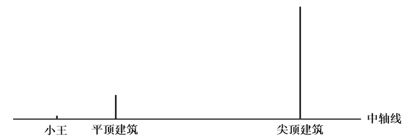

A.30米 B.40米 C.50米 D.60米

来源：[2025年江苏省公务员录用考试《行测》题（A类）.pdf](https://github.com/dumarstoft-ship-it/xingce/blob/407016b55b49581efa3771bb59a2dee8761d982f/2025%E5%B9%B4%E6%B1%9F%E8%8B%8F%E7%9C%81%E5%85%AC%E5%8A%A1%E5%91%98%E5%BD%95%E7%94%A8%E8%80%83%E8%AF%95%E3%80%8A%E8%A1%8C%E6%B5%8B%E3%80%8B%E9%A2%98%EF%BC%88A%E7%B1%BB%EF%BC%89.pdf)，PDF 第 12 页。

## 第 60 题 · 数量关系

`JS2025-A类-060`

为探访诗意乡村，聆听城市脉搏，父子两人报名参加半程马拉松，已知上坡路段父亲的速度是儿子的1.2倍，下
坡路段父亲的速度是儿子的80%，其他路段两人速度相同，结果父子同时到达终点，若上、下坡路段的距离之
比为1：2，则父亲上、下坡路段的速度之比为（    ）。
A.1：3 B.2：5 C.5：12 D.1：2

来源：[2025年江苏省公务员录用考试《行测》题（A类）.pdf](https://github.com/dumarstoft-ship-it/xingce/blob/407016b55b49581efa3771bb59a2dee8761d982f/2025%E5%B9%B4%E6%B1%9F%E8%8B%8F%E7%9C%81%E5%85%AC%E5%8A%A1%E5%91%98%E5%BD%95%E7%94%A8%E8%80%83%E8%AF%95%E3%80%8A%E8%A1%8C%E6%B5%8B%E3%80%8B%E9%A2%98%EF%BC%88A%E7%B1%BB%EF%BC%89.pdf)，PDF 第 12 页。

## 第 61 题 · 数量关系

`JS2025-A类-061`

某农场使用M、N两架无人机喷洒农药，先由M无人机工作2小时，再由N无人机工作5小时，可喷洒完整片农
田；两架无人机同时工作1小时后，有三分之二的农田尚未喷洒。如果仅由M无人机喷洒农药，那么喷洒完整片
农田需要（    ）。
A.3.5小时 B.4.5小时 C.5小时 D.5.5小时

来源：[2025年江苏省公务员录用考试《行测》题（A类）.pdf](https://github.com/dumarstoft-ship-it/xingce/blob/407016b55b49581efa3771bb59a2dee8761d982f/2025%E5%B9%B4%E6%B1%9F%E8%8B%8F%E7%9C%81%E5%85%AC%E5%8A%A1%E5%91%98%E5%BD%95%E7%94%A8%E8%80%83%E8%AF%95%E3%80%8A%E8%A1%8C%E6%B5%8B%E3%80%8B%E9%A2%98%EF%BC%88A%E7%B1%BB%EF%BC%89.pdf)，PDF 第 12 页。

## 第 62 题 · 数量关系

`JS2025-A类-062`

某市正在深入推进“智改数转网联”升级行动计划，力争实现全市规模以上企业全覆盖。目前，全市规模以上
企业2080家，其中未完成升级的规模以上企业比已完成升级的多0.6倍，那么已完成升级的规模以上企业有（
）。
A.780家 B.800家 C.1280家 D.1300家

来源：[2025年江苏省公务员录用考试《行测》题（A类）.pdf](https://github.com/dumarstoft-ship-it/xingce/blob/407016b55b49581efa3771bb59a2dee8761d982f/2025%E5%B9%B4%E6%B1%9F%E8%8B%8F%E7%9C%81%E5%85%AC%E5%8A%A1%E5%91%98%E5%BD%95%E7%94%A8%E8%80%83%E8%AF%95%E3%80%8A%E8%A1%8C%E6%B5%8B%E3%80%8B%E9%A2%98%EF%BC%88A%E7%B1%BB%EF%BC%89.pdf)，PDF 第 12 页。

## 第 63 题 · 数量关系

`JS2025-A类-063`

甲、乙两瓶质量和浓度均相同的酒精溶液，在甲瓶中加入20克水、乙瓶中加入50克浓度为30%的酒精溶液后，
浓度仍然相等。若继续在甲瓶中加入30克纯酒精，溶液又恢复到最初浓度，则乙瓶酒精溶液最初的质量是（
）。
A.100克 B.110克 C.120克 D.150克

来源：[2025年江苏省公务员录用考试《行测》题（A类）.pdf](https://github.com/dumarstoft-ship-it/xingce/blob/407016b55b49581efa3771bb59a2dee8761d982f/2025%E5%B9%B4%E6%B1%9F%E8%8B%8F%E7%9C%81%E5%85%AC%E5%8A%A1%E5%91%98%E5%BD%95%E7%94%A8%E8%80%83%E8%AF%95%E3%80%8A%E8%A1%8C%E6%B5%8B%E3%80%8B%E9%A2%98%EF%BC%88A%E7%B1%BB%EF%BC%89.pdf)，PDF 第 12、13 页。

## 第 64 题 · 数量关系

`JS2025-A类-064`

一场演出的节目有舞蹈《水韵江苏》、歌曲《让世界充满爱》和《绣红旗》、小品《幸福一家人》、魔术《奇
幻之旅》、杂技《力量》。若要求两首歌曲分别作为开头曲和结尾曲，舞蹈与杂技相邻演出，小品和魔术不能
相邻演出，则节目演出的排列顺序有（    ）。
A.8种 B.12种 C.18种 D.24种

来源：[2025年江苏省公务员录用考试《行测》题（A类）.pdf](https://github.com/dumarstoft-ship-it/xingce/blob/407016b55b49581efa3771bb59a2dee8761d982f/2025%E5%B9%B4%E6%B1%9F%E8%8B%8F%E7%9C%81%E5%85%AC%E5%8A%A1%E5%91%98%E5%BD%95%E7%94%A8%E8%80%83%E8%AF%95%E3%80%8A%E8%A1%8C%E6%B5%8B%E3%80%8B%E9%A2%98%EF%BC%88A%E7%B1%BB%EF%BC%89.pdf)，PDF 第 13 页。

## 第 65 题 · 数量关系

`JS2025-A类-065`

某地考古出土了一种呈长方体的青铜器，测得其长、宽、高分别为60cm、40cm、60cm。为了防止氧化，有关
部门为其做个半球形的保护罩，则该保护罩（厚度忽略不计）的表面积至少为（    ）。
A.1.47π m²
B.1.02π m²
C.0.98π m²
D.0.68πm²

来源：[2025年江苏省公务员录用考试《行测》题（A类）.pdf](https://github.com/dumarstoft-ship-it/xingce/blob/407016b55b49581efa3771bb59a2dee8761d982f/2025%E5%B9%B4%E6%B1%9F%E8%8B%8F%E7%9C%81%E5%85%AC%E5%8A%A1%E5%91%98%E5%BD%95%E7%94%A8%E8%80%83%E8%AF%95%E3%80%8A%E8%A1%8C%E6%B5%8B%E3%80%8B%E9%A2%98%EF%BC%88A%E7%B1%BB%EF%BC%89.pdf)，PDF 第 13 页。

## 第 66 题 · 数量关系

`JS2025-A类-066`

某场国际跳水比赛设有7名裁判，分别给运动员每一跳打分，所打分数均为0.5的整数倍，且最低为0分，最高为
10分。运动员每一跳得分的具体计算规则为：去掉两个最高分和两个最低分，剩下的3个分数之和乘以难度系
数即为这一跳的得分。若某运动员第一跳的难度系数为3.0，得分为66分，则7名裁判给这名运动员第一跳打分
的平均数最多为（    ）。
A.7.5分 B.7.8分 C.8.0分 D.8.2分

来源：[2025年江苏省公务员录用考试《行测》题（A类）.pdf](https://github.com/dumarstoft-ship-it/xingce/blob/407016b55b49581efa3771bb59a2dee8761d982f/2025%E5%B9%B4%E6%B1%9F%E8%8B%8F%E7%9C%81%E5%85%AC%E5%8A%A1%E5%91%98%E5%BD%95%E7%94%A8%E8%80%83%E8%AF%95%E3%80%8A%E8%A1%8C%E6%B5%8B%E3%80%8B%E9%A2%98%EF%BC%88A%E7%B1%BB%EF%BC%89.pdf)，PDF 第 13 页。

## 第 67 题 · 数量关系

`JS2025-A类-067`

用若干玫瑰花制作玫瑰花束，若每束8枝余3枝，9枝余5枝，如果将这些玫瑰花全部用完，制成数量各不相同的
3束玫瑰花，那么数量最多的那一束至少有玫瑰花（    ）。
A.18枝 B.20枝 C.21枝 D.23枝

来源：[2025年江苏省公务员录用考试《行测》题（A类）.pdf](https://github.com/dumarstoft-ship-it/xingce/blob/407016b55b49581efa3771bb59a2dee8761d982f/2025%E5%B9%B4%E6%B1%9F%E8%8B%8F%E7%9C%81%E5%85%AC%E5%8A%A1%E5%91%98%E5%BD%95%E7%94%A8%E8%80%83%E8%AF%95%E3%80%8A%E8%A1%8C%E6%B5%8B%E3%80%8B%E9%A2%98%EF%BC%88A%E7%B1%BB%EF%BC%89.pdf)，PDF 第 13 页。

## 第 68 题 · 数量关系

`JS2025-A类-068`

某5A级景区门票90元/人，教师免票、大学生半票，乘坐索道另付70元/人。某校教师和大学生共110人到该景区
研学，若支付的门票和索道费共11750元，则参与研学的教师有（    ）。
A.6人 B.10人或20人 C.10人 D.6人或20人

来源：[2025年江苏省公务员录用考试《行测》题（A类）.pdf](https://github.com/dumarstoft-ship-it/xingce/blob/407016b55b49581efa3771bb59a2dee8761d982f/2025%E5%B9%B4%E6%B1%9F%E8%8B%8F%E7%9C%81%E5%85%AC%E5%8A%A1%E5%91%98%E5%BD%95%E7%94%A8%E8%80%83%E8%AF%95%E3%80%8A%E8%A1%8C%E6%B5%8B%E3%80%8B%E9%A2%98%EF%BC%88A%E7%B1%BB%EF%BC%89.pdf)，PDF 第 13 页。

## 第 69 题 · 数量关系

`JS2025-A类-069`

小张打羽毛球膝盖受伤，需每隔4天去医院做一次理疗，如果他7月2日去，则7月的理疗有1次在星期六、1次在
星期日，其余都在工作日；如果他7月3日去，则7月的理疗只有1次在星期日，其余都在工作日，那么7月31日
是（    ）。
A.星期四 B.星期三 C.星期二 D.星期一

来源：[2025年江苏省公务员录用考试《行测》题（A类）.pdf](https://github.com/dumarstoft-ship-it/xingce/blob/407016b55b49581efa3771bb59a2dee8761d982f/2025%E5%B9%B4%E6%B1%9F%E8%8B%8F%E7%9C%81%E5%85%AC%E5%8A%A1%E5%91%98%E5%BD%95%E7%94%A8%E8%80%83%E8%AF%95%E3%80%8A%E8%A1%8C%E6%B5%8B%E3%80%8B%E9%A2%98%EF%BC%88A%E7%B1%BB%EF%BC%89.pdf)，PDF 第 13 页。

## 第 70 题 · 数量关系

`JS2025-A类-070`

某科技园区计划铺设电缆联通A、B、C、D、E、F六栋办公楼，可以铺设电缆的线路如下图所示，每条边上的
数字表示两栋楼之间线路的长度（单位：10米），则铺设电缆的总长度最短是（    ）。

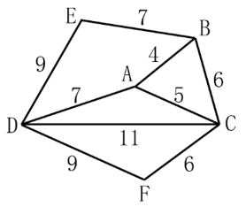

[代码描摹高清 PNG](../../../images/code_hd/798.png) · [SVG](../../../images/code_hd/798.svg)（原图为准）

A.280米 B.290米 C.310米 D.350米

来源：[2025年江苏省公务员录用考试《行测》题（A类）.pdf](https://github.com/dumarstoft-ship-it/xingce/blob/407016b55b49581efa3771bb59a2dee8761d982f/2025%E5%B9%B4%E6%B1%9F%E8%8B%8F%E7%9C%81%E5%85%AC%E5%8A%A1%E5%91%98%E5%BD%95%E7%94%A8%E8%80%83%E8%AF%95%E3%80%8A%E8%A1%8C%E6%B5%8B%E3%80%8B%E9%A2%98%EF%BC%88A%E7%B1%BB%EF%BC%89.pdf)，PDF 第 13 页。

## 第 71 题 · 判断推理

`JS2025-A类-071`

元宇宙：虚拟性
A.实验：前瞻性 B.决策：可行性 C.宣传：普遍性 D.总结：概括性

来源：[2025年江苏省公务员录用考试《行测》题（A类）.pdf](https://github.com/dumarstoft-ship-it/xingce/blob/407016b55b49581efa3771bb59a2dee8761d982f/2025%E5%B9%B4%E6%B1%9F%E8%8B%8F%E7%9C%81%E5%85%AC%E5%8A%A1%E5%91%98%E5%BD%95%E7%94%A8%E8%80%83%E8%AF%95%E3%80%8A%E8%A1%8C%E6%B5%8B%E3%80%8B%E9%A2%98%EF%BC%88A%E7%B1%BB%EF%BC%89.pdf)，PDF 第 14 页。

## 第 72 题 · 判断推理

`JS2025-A类-072`

舍本：逐末
A.买椟：还珠 B.取长：补短 C.避重：就轻 D.趋炎：附势

来源：[2025年江苏省公务员录用考试《行测》题（A类）.pdf](https://github.com/dumarstoft-ship-it/xingce/blob/407016b55b49581efa3771bb59a2dee8761d982f/2025%E5%B9%B4%E6%B1%9F%E8%8B%8F%E7%9C%81%E5%85%AC%E5%8A%A1%E5%91%98%E5%BD%95%E7%94%A8%E8%80%83%E8%AF%95%E3%80%8A%E8%A1%8C%E6%B5%8B%E3%80%8B%E9%A2%98%EF%BC%88A%E7%B1%BB%EF%BC%89.pdf)，PDF 第 14 页。

## 第 73 题 · 判断推理

`JS2025-A类-073`

热极生风：穷极思变
A.鼓空声高：人狂话大 B.绳锯木断：水滴石穿 C.人闲生病：石闲生苔 D.得道多助：失道寡助

来源：[2025年江苏省公务员录用考试《行测》题（A类）.pdf](https://github.com/dumarstoft-ship-it/xingce/blob/407016b55b49581efa3771bb59a2dee8761d982f/2025%E5%B9%B4%E6%B1%9F%E8%8B%8F%E7%9C%81%E5%85%AC%E5%8A%A1%E5%91%98%E5%BD%95%E7%94%A8%E8%80%83%E8%AF%95%E3%80%8A%E8%A1%8C%E6%B5%8B%E3%80%8B%E9%A2%98%EF%BC%88A%E7%B1%BB%EF%BC%89.pdf)，PDF 第 14 页。

## 第 74 题 · 判断推理

`JS2025-A类-074`

苍鹰：鸿雁：书信
A.加油：注水：鼓劲 B.下海：上岸：录取 C.须眉：巾帼：围脖 D.疆域：河山：国土

来源：[2025年江苏省公务员录用考试《行测》题（A类）.pdf](https://github.com/dumarstoft-ship-it/xingce/blob/407016b55b49581efa3771bb59a2dee8761d982f/2025%E5%B9%B4%E6%B1%9F%E8%8B%8F%E7%9C%81%E5%85%AC%E5%8A%A1%E5%91%98%E5%BD%95%E7%94%A8%E8%80%83%E8%AF%95%E3%80%8A%E8%A1%8C%E6%B5%8B%E3%80%8B%E9%A2%98%EF%BC%88A%E7%B1%BB%EF%BC%89.pdf)，PDF 第 14 页。

## 第 75 题 · 判断推理

`JS2025-A类-075`

购物：货币：购物车
A.攀登：山峰：手杖 B.垂钓：鱼竿：鱼钩 C.写作：文字：电脑 D.旅游：景点：导游

来源：[2025年江苏省公务员录用考试《行测》题（A类）.pdf](https://github.com/dumarstoft-ship-it/xingce/blob/407016b55b49581efa3771bb59a2dee8761d982f/2025%E5%B9%B4%E6%B1%9F%E8%8B%8F%E7%9C%81%E5%85%AC%E5%8A%A1%E5%91%98%E5%BD%95%E7%94%A8%E8%80%83%E8%AF%95%E3%80%8A%E8%A1%8C%E6%B5%8B%E3%80%8B%E9%A2%98%EF%BC%88A%E7%B1%BB%EF%BC%89.pdf)，PDF 第 14 页。

## 第 76 题 · 判断推理

`JS2025-A类-076`

压舱石：就业：社会稳定
A.先手棋：专利：科技创新 B.基本盘：耕地：粮食生产
C.晴雨表：管理：人才培养 D.主阵地：学校：知识传播

来源：[2025年江苏省公务员录用考试《行测》题（A类）.pdf](https://github.com/dumarstoft-ship-it/xingce/blob/407016b55b49581efa3771bb59a2dee8761d982f/2025%E5%B9%B4%E6%B1%9F%E8%8B%8F%E7%9C%81%E5%85%AC%E5%8A%A1%E5%91%98%E5%BD%95%E7%94%A8%E8%80%83%E8%AF%95%E3%80%8A%E8%A1%8C%E6%B5%8B%E3%80%8B%E9%A2%98%EF%BC%88A%E7%B1%BB%EF%BC%89.pdf)，PDF 第 14 页。

## 第 77 题 · 判断推理

`JS2025-A类-077`

温室效应：冰山融化：海面上升
A.博览群书：视野开阔：见解深刻 B.连日降雪：道路结冰：出行困难
C.电闪雷鸣：狂风大作：沙尘肆虐 D.刻苦训练：技能提高：获得金牌

来源：[2025年江苏省公务员录用考试《行测》题（A类）.pdf](https://github.com/dumarstoft-ship-it/xingce/blob/407016b55b49581efa3771bb59a2dee8761d982f/2025%E5%B9%B4%E6%B1%9F%E8%8B%8F%E7%9C%81%E5%85%AC%E5%8A%A1%E5%91%98%E5%BD%95%E7%94%A8%E8%80%83%E8%AF%95%E3%80%8A%E8%A1%8C%E6%B5%8B%E3%80%8B%E9%A2%98%EF%BC%88A%E7%B1%BB%EF%BC%89.pdf)，PDF 第 14 页。

## 第 78 题 · 判断推理

`JS2025-A类-078`

本土药材：野生药材：名贵药材
A.沿海高铁：跨省高铁：城际高铁 B.牛奶产业：传统产业：养殖产业
C.超限车辆：超载车辆：超重车辆 D.社区治理：社会治理：水土治理

来源：[2025年江苏省公务员录用考试《行测》题（A类）.pdf](https://github.com/dumarstoft-ship-it/xingce/blob/407016b55b49581efa3771bb59a2dee8761d982f/2025%E5%B9%B4%E6%B1%9F%E8%8B%8F%E7%9C%81%E5%85%AC%E5%8A%A1%E5%91%98%E5%BD%95%E7%94%A8%E8%80%83%E8%AF%95%E3%80%8A%E8%A1%8C%E6%B5%8B%E3%80%8B%E9%A2%98%EF%BC%88A%E7%B1%BB%EF%BC%89.pdf)，PDF 第 14 页。

## 第 79 题 · 判断推理

`JS2025-A类-079`

森林 之于 （    ） 相当于 （    ） 之于 社会
A.气候 法制 B.氧气 自然 C.系统 国家 D.树木 家庭

来源：[2025年江苏省公务员录用考试《行测》题（A类）.pdf](https://github.com/dumarstoft-ship-it/xingce/blob/407016b55b49581efa3771bb59a2dee8761d982f/2025%E5%B9%B4%E6%B1%9F%E8%8B%8F%E7%9C%81%E5%85%AC%E5%8A%A1%E5%91%98%E5%BD%95%E7%94%A8%E8%80%83%E8%AF%95%E3%80%8A%E8%A1%8C%E6%B5%8B%E3%80%8B%E9%A2%98%EF%BC%88A%E7%B1%BB%EF%BC%89.pdf)，PDF 第 14 页。

## 第 80 题 · 判断推理

`JS2025-A类-080`

生肖 之于 （    ） 相当于 （    ） 之于 禁行
A.飞禽 路口 B.走兽 信号 C.天干 通行 D.地支 红灯

来源：[2025年江苏省公务员录用考试《行测》题（A类）.pdf](https://github.com/dumarstoft-ship-it/xingce/blob/407016b55b49581efa3771bb59a2dee8761d982f/2025%E5%B9%B4%E6%B1%9F%E8%8B%8F%E7%9C%81%E5%85%AC%E5%8A%A1%E5%91%98%E5%BD%95%E7%94%A8%E8%80%83%E8%AF%95%E3%80%8A%E8%A1%8C%E6%B5%8B%E3%80%8B%E9%A2%98%EF%BC%88A%E7%B1%BB%EF%BC%89.pdf)，PDF 第 14 页。

## 第 81 题 · 判断推理

`JS2025-A类-081`

从所给的四个选项中，选出最合适的一个填入问号处，使图形呈现一定的规律性。

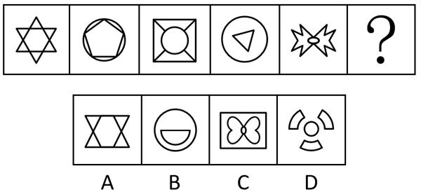

A.A B.B C.C D.D

来源：[2025年江苏省公务员录用考试《行测》题（A类）.pdf](https://github.com/dumarstoft-ship-it/xingce/blob/407016b55b49581efa3771bb59a2dee8761d982f/2025%E5%B9%B4%E6%B1%9F%E8%8B%8F%E7%9C%81%E5%85%AC%E5%8A%A1%E5%91%98%E5%BD%95%E7%94%A8%E8%80%83%E8%AF%95%E3%80%8A%E8%A1%8C%E6%B5%8B%E3%80%8B%E9%A2%98%EF%BC%88A%E7%B1%BB%EF%BC%89.pdf)，PDF 第 14 页。

## 第 82 题 · 判断推理

`JS2025-A类-082`

请从四个选项中选出最恰当的一项填入问号处，使题干图形呈现一定的规律性。

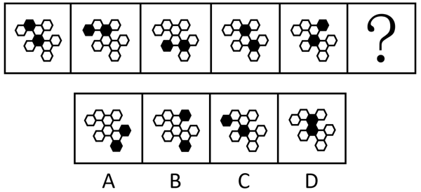

A.A B.B C.C D.D

来源：[2025年江苏省公务员录用考试《行测》题（A类）.pdf](https://github.com/dumarstoft-ship-it/xingce/blob/407016b55b49581efa3771bb59a2dee8761d982f/2025%E5%B9%B4%E6%B1%9F%E8%8B%8F%E7%9C%81%E5%85%AC%E5%8A%A1%E5%91%98%E5%BD%95%E7%94%A8%E8%80%83%E8%AF%95%E3%80%8A%E8%A1%8C%E6%B5%8B%E3%80%8B%E9%A2%98%EF%BC%88A%E7%B1%BB%EF%BC%89.pdf)，PDF 第 14、15 页。

## 第 83 题 · 判断推理

`JS2025-A类-083`

请从四个选项中选出最恰当的一项填入问号处，使题干图形呈现一定的规律性。

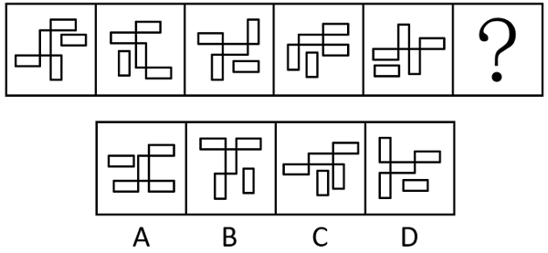

A.A B.B C.C D.D

来源：[2025年江苏省公务员录用考试《行测》题（A类）.pdf](https://github.com/dumarstoft-ship-it/xingce/blob/407016b55b49581efa3771bb59a2dee8761d982f/2025%E5%B9%B4%E6%B1%9F%E8%8B%8F%E7%9C%81%E5%85%AC%E5%8A%A1%E5%91%98%E5%BD%95%E7%94%A8%E8%80%83%E8%AF%95%E3%80%8A%E8%A1%8C%E6%B5%8B%E3%80%8B%E9%A2%98%EF%BC%88A%E7%B1%BB%EF%BC%89.pdf)，PDF 第 15 页。

## 第 84 题 · 判断推理

`JS2025-A类-084`

请从四个选项中选出最恰当的一项填入问号处，使题干图形呈现一定的规律性。

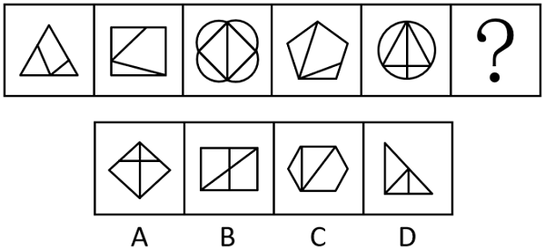

A.A B.B C.C D.D

来源：[2025年江苏省公务员录用考试《行测》题（A类）.pdf](https://github.com/dumarstoft-ship-it/xingce/blob/407016b55b49581efa3771bb59a2dee8761d982f/2025%E5%B9%B4%E6%B1%9F%E8%8B%8F%E7%9C%81%E5%85%AC%E5%8A%A1%E5%91%98%E5%BD%95%E7%94%A8%E8%80%83%E8%AF%95%E3%80%8A%E8%A1%8C%E6%B5%8B%E3%80%8B%E9%A2%98%EF%BC%88A%E7%B1%BB%EF%BC%89.pdf)，PDF 第 15 页。

## 第 85 题 · 判断推理

`JS2025-A类-085`

请从四个选项中选出最恰当的一项填入问号处，使题干图形呈现一定的规律性。

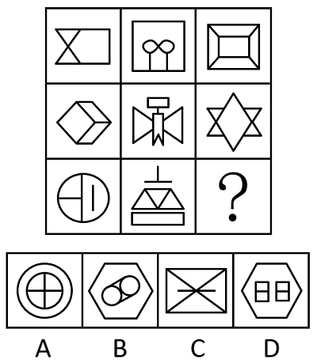

A.A B.B C.C D.D

来源：[2025年江苏省公务员录用考试《行测》题（A类）.pdf](https://github.com/dumarstoft-ship-it/xingce/blob/407016b55b49581efa3771bb59a2dee8761d982f/2025%E5%B9%B4%E6%B1%9F%E8%8B%8F%E7%9C%81%E5%85%AC%E5%8A%A1%E5%91%98%E5%BD%95%E7%94%A8%E8%80%83%E8%AF%95%E3%80%8A%E8%A1%8C%E6%B5%8B%E3%80%8B%E9%A2%98%EF%BC%88A%E7%B1%BB%EF%BC%89.pdf)，PDF 第 15、16 页。

## 第 86 题 · 判断推理

`JS2025-A类-086`

左边给定的图形是由右边哪些图形拼合（只可平移，不可旋转和翻转）而成的？

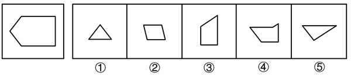

A.①②③④ B.①②③⑤ C.②③④⑤ D.①③④⑤

来源：[2025年江苏省公务员录用考试《行测》题（A类）.pdf](https://github.com/dumarstoft-ship-it/xingce/blob/407016b55b49581efa3771bb59a2dee8761d982f/2025%E5%B9%B4%E6%B1%9F%E8%8B%8F%E7%9C%81%E5%85%AC%E5%8A%A1%E5%91%98%E5%BD%95%E7%94%A8%E8%80%83%E8%AF%95%E3%80%8A%E8%A1%8C%E6%B5%8B%E3%80%8B%E9%A2%98%EF%BC%88A%E7%B1%BB%EF%BC%89.pdf)，PDF 第 16 页。

## 第 87 题 · 判断推理

`JS2025-A类-087`

上边四张纸片，每张纸片一面是黑色，另一面是白色，下边仅有一项能由它们拼合（可以平移、旋转、翻转）
而成，请把它找出来。

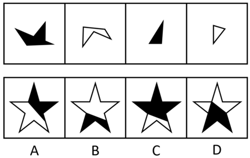

A.A B.B C.C D.D

来源：[2025年江苏省公务员录用考试《行测》题（A类）.pdf](https://github.com/dumarstoft-ship-it/xingce/blob/407016b55b49581efa3771bb59a2dee8761d982f/2025%E5%B9%B4%E6%B1%9F%E8%8B%8F%E7%9C%81%E5%85%AC%E5%8A%A1%E5%91%98%E5%BD%95%E7%94%A8%E8%80%83%E8%AF%95%E3%80%8A%E8%A1%8C%E6%B5%8B%E3%80%8B%E9%A2%98%EF%BC%88A%E7%B1%BB%EF%BC%89.pdf)，PDF 第 16 页。

## 第 88 题 · 判断推理

`JS2025-A类-088`

左边给定的是一个立方体，右边哪一项可能是它的外表面展开图？

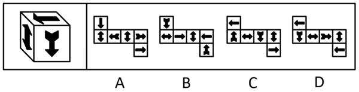

A.A B.B C.C D.D

来源：[2025年江苏省公务员录用考试《行测》题（A类）.pdf](https://github.com/dumarstoft-ship-it/xingce/blob/407016b55b49581efa3771bb59a2dee8761d982f/2025%E5%B9%B4%E6%B1%9F%E8%8B%8F%E7%9C%81%E5%85%AC%E5%8A%A1%E5%91%98%E5%BD%95%E7%94%A8%E8%80%83%E8%AF%95%E3%80%8A%E8%A1%8C%E6%B5%8B%E3%80%8B%E9%A2%98%EF%BC%88A%E7%B1%BB%EF%BC%89.pdf)，PDF 第 16、17 页。

## 第 89 题 · 判断推理

`JS2025-A类-089`

左边给定的是六面体的外表面展开图，右边哪一项是由它折叠而成？

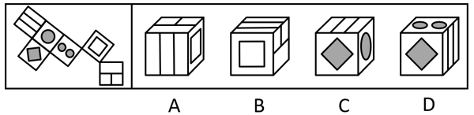

A.A B.B C.C D.D

来源：[2025年江苏省公务员录用考试《行测》题（A类）.pdf](https://github.com/dumarstoft-ship-it/xingce/blob/407016b55b49581efa3771bb59a2dee8761d982f/2025%E5%B9%B4%E6%B1%9F%E8%8B%8F%E7%9C%81%E5%85%AC%E5%8A%A1%E5%91%98%E5%BD%95%E7%94%A8%E8%80%83%E8%AF%95%E3%80%8A%E8%A1%8C%E6%B5%8B%E3%80%8B%E9%A2%98%EF%BC%88A%E7%B1%BB%EF%BC%89.pdf)，PDF 第 17 页。

## 第 90 题 · 判断推理

`JS2025-A类-090`

下面4个立体图形均由大小相同的8个白色小立方体和4个灰色小立方体堆叠而成，其中一个立体图形的某一视
图可能是由纯白小方格组成的，请把它找出来。

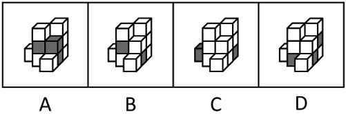

A.A B.B C.C D.D

来源：[2025年江苏省公务员录用考试《行测》题（A类）.pdf](https://github.com/dumarstoft-ship-it/xingce/blob/407016b55b49581efa3771bb59a2dee8761d982f/2025%E5%B9%B4%E6%B1%9F%E8%8B%8F%E7%9C%81%E5%85%AC%E5%8A%A1%E5%91%98%E5%BD%95%E7%94%A8%E8%80%83%E8%AF%95%E3%80%8A%E8%A1%8C%E6%B5%8B%E3%80%8B%E9%A2%98%EF%BC%88A%E7%B1%BB%EF%BC%89.pdf)，PDF 第 17 页。

## 第 91 题 · 判断推理

`JS2025-A类-091`

只有为了人民的现代化，才有意义；只有依靠人民的现代化，才有动力。新时代以来，我们坚持民生为大，书
写了经济快速发展和社会长期稳定两大奇迹新篇章。只要坚持一切为了人民、一切依靠人民，就能充分调动广
大人民的积极性。
根据以上信息，可以推出以下哪项？
A.不是为了人民的现代化，就是没有意义的现代化
B.不坚持民生为大，就不能创造快速发展和社会长期稳定两大奇迹
C.如果没能调动广大人民的积极性，则没有坚持一切为了人民
D.只有坚持一切依靠人民，才能充分调动广大人民的积极性

来源：[2025年江苏省公务员录用考试《行测》题（A类）.pdf](https://github.com/dumarstoft-ship-it/xingce/blob/407016b55b49581efa3771bb59a2dee8761d982f/2025%E5%B9%B4%E6%B1%9F%E8%8B%8F%E7%9C%81%E5%85%AC%E5%8A%A1%E5%91%98%E5%BD%95%E7%94%A8%E8%80%83%E8%AF%95%E3%80%8A%E8%A1%8C%E6%B5%8B%E3%80%8B%E9%A2%98%EF%BC%88A%E7%B1%BB%EF%BC%89.pdf)，PDF 第 17 页。

## 第 92 题 · 判断推理

`JS2025-A类-092`

甲：在手机市场增长缓慢的大环境下，折叠屏手机销量连续多年保持两位数的增长，折叠屏手机将是手机研发
的下一个风口
乙：折叠屏手机经历多年发展仍只占手机整体销量的1.6%，由此来看，折叠屏手机不值得手机厂商投入太多精
力
以下哪项与上述对话方式最为相似？
A.甲：2017年企业应用AI技术比例约为20%，到2023年提高至50%，AI技术将是国家经济发展的重点
乙：AI技术经历多年发展已经在社会方方面面起着重要作用，但传统行业仍是经济中的重要部分，同样需要重
视
B.甲：这次期末考试，张明的成绩平均每科提高了5分，这表明张明过去一年在学习上认真了许多
乙：这次期末考试比较简单，全班同学各科平均分都提高了10分之多，由此看来，张明在过去一年没有认真学
习
C.甲：过去三年某出版社的错别字检出量大大增加，必须增加相应的人手以避免错别字检出数量继续增加
乙：过去三年该出版社出版总量大大增加，但错别字检出率维持在万分之一左右，远低于国家标准，无需增加
人手
D.甲：一项调查显示，超过90%的大学生在不请假的情况下缺过课，这一现象说明课堂纪律没有得到很好的遵
守
乙：这项调查主要针对大四学生，如果是大一学生，则缺过课的比例不超过20%，可见大学课堂纪律得到了很
好的遵守

来源：[2025年江苏省公务员录用考试《行测》题（A类）.pdf](https://github.com/dumarstoft-ship-it/xingce/blob/407016b55b49581efa3771bb59a2dee8761d982f/2025%E5%B9%B4%E6%B1%9F%E8%8B%8F%E7%9C%81%E5%85%AC%E5%8A%A1%E5%91%98%E5%BD%95%E7%94%A8%E8%80%83%E8%AF%95%E3%80%8A%E8%A1%8C%E6%B5%8B%E3%80%8B%E9%A2%98%EF%BC%88A%E7%B1%BB%EF%BC%89.pdf)，PDF 第 17、18 页。

## 第 93 题 · 判断推理

`JS2025-A类-093`

“露从今夜白，月是故乡明。”唐代诗人杜甫这一千古名句表达了诗人在秋天对故乡的思念和对亲人的牵挂。
在国人心中，秋天总是和思乡联系在一起。对此，有学者称，相对于其他季节，秋天人们很容易想起家乡的种
种美好，更容易产生思乡情绪。
以下哪项如果为真，最能支持上述学者的观点？
A.秋天大自然由生机勃勃转向秋风萧瑟，让人感受到时间的流逝和生命的脆弱
B.秋天正是收获的时节，那些从小经历的美好场景深深刻在每个人的心底
C.中国历史上有无数文人骚客在秋天写下思乡的千古名篇，影响着一代又一代国人
D.每逢中秋，在外漂泊的游子会意识到已经离家很久，渴望和家人团聚

来源：[2025年江苏省公务员录用考试《行测》题（A类）.pdf](https://github.com/dumarstoft-ship-it/xingce/blob/407016b55b49581efa3771bb59a2dee8761d982f/2025%E5%B9%B4%E6%B1%9F%E8%8B%8F%E7%9C%81%E5%85%AC%E5%8A%A1%E5%91%98%E5%BD%95%E7%94%A8%E8%80%83%E8%AF%95%E3%80%8A%E8%A1%8C%E6%B5%8B%E3%80%8B%E9%A2%98%EF%BC%88A%E7%B1%BB%EF%BC%89.pdf)，PDF 第 18 页。

## 第 94 题 · 判断推理

`JS2025-A类-094`

文学、经济学、历史学、社会学四个专业的学生甲、乙、丙、丁各自携带本专业的一本书参加读书会。读书会
期间，四人交换了所带的书，已知：
（1）丙是历史学专业学生，丁是文学专业学生；
（2）交换书后，甲持有社会学书，乙不持有文学书；
（3）交换书后，每个人所持有的书不是原来所携带的专业书。
根据以上信息，不能推出以下哪项？
A.甲是经济学专业学生 B.丙持有文学书 C.乙是社会学专业学生 D.丁持有历史书

来源：[2025年江苏省公务员录用考试《行测》题（A类）.pdf](https://github.com/dumarstoft-ship-it/xingce/blob/407016b55b49581efa3771bb59a2dee8761d982f/2025%E5%B9%B4%E6%B1%9F%E8%8B%8F%E7%9C%81%E5%85%AC%E5%8A%A1%E5%91%98%E5%BD%95%E7%94%A8%E8%80%83%E8%AF%95%E3%80%8A%E8%A1%8C%E6%B5%8B%E3%80%8B%E9%A2%98%EF%BC%88A%E7%B1%BB%EF%BC%89.pdf)，PDF 第 18 页。

## 第 95 题 · 判断推理

`JS2025-A类-095`

甲、乙、丙三人毕业后同时进入某单位实习，由于表现较好，实习结束后他们将分到人事处、财务处、办公室
正式入职。有人对他们各自的工作部门进行了如下猜测：
（1）甲入职的部门是人事处；
（2）乙入职的部门不是财务处；
（3）丙入职的部门不是人事处。
实际上，上述三个猜测只有一个是对的。
根据上述信息，可以推出甲、乙、丙入职的部门依次为：
A.人事处 财务处 办公室 B.办公室 财务处 人事处
C.财务处 办公室 人事处 D.人事处 办公室 财务处

来源：[2025年江苏省公务员录用考试《行测》题（A类）.pdf](https://github.com/dumarstoft-ship-it/xingce/blob/407016b55b49581efa3771bb59a2dee8761d982f/2025%E5%B9%B4%E6%B1%9F%E8%8B%8F%E7%9C%81%E5%85%AC%E5%8A%A1%E5%91%98%E5%BD%95%E7%94%A8%E8%80%83%E8%AF%95%E3%80%8A%E8%A1%8C%E6%B5%8B%E3%80%8B%E9%A2%98%EF%BC%88A%E7%B1%BB%EF%BC%89.pdf)，PDF 第 18 页。

## 第 96 题 · 判断推理

`JS2025-A类-096`

在下边5×5的表格中填入泰山、华山、衡山、恒山和嵩山5个词，要求每行、每列、每个粗线条框内均不能重
复也不能遗漏，则依次填入序号①-④处的是：

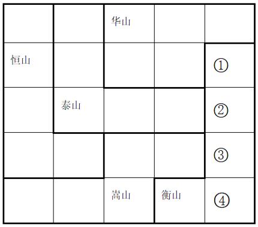

A.泰山 华山 嵩山 恒山 B.华山 恒山 嵩山 泰山
C.华山 嵩山 恒山 泰山 D.嵩山 恒山 泰山 华山

来源：[2025年江苏省公务员录用考试《行测》题（A类）.pdf](https://github.com/dumarstoft-ship-it/xingce/blob/407016b55b49581efa3771bb59a2dee8761d982f/2025%E5%B9%B4%E6%B1%9F%E8%8B%8F%E7%9C%81%E5%85%AC%E5%8A%A1%E5%91%98%E5%BD%95%E7%94%A8%E8%80%83%E8%AF%95%E3%80%8A%E8%A1%8C%E6%B5%8B%E3%80%8B%E9%A2%98%EF%BC%88A%E7%B1%BB%EF%BC%89.pdf)，PDF 第 18、19 页。

## 第 97 题 · 判断推理

`JS2025-A类-097`

海草是由陆地植物演化到适应海洋环境的高等植物。一种或几种海草连片生长，共同形成广袤柔软的“海草
床”。海草床是最高效的碳捕获和碳封存系统之一，贮存碳的效率比森林高90倍，碳封存时间可达上千年。然
而海草床是脆弱的生态系统，受自然环境变化和人类活动影响较大，全球范围内海草床正面临严峻退化趋势。
基于如上原因，有专家建议，亟需开展“海底种草”生态修复工作，加强对海草床的保护。
以下哪项如果为真，最能支持上述专家的建议？
A.当前全球气候变暖日益加剧，科学家已发现人类生产生活排放的碳化合物是变暖的主要元凶
B.海草床可以通过光合作用吸收环境中的无机碳，将其高效地固定、转化为有机碳并进行积累
C.有些地方海岸线侵蚀严重，加强海草床保护和修复，能有效防止或减缓海滩和海岸遭受侵蚀
D.海草床具有水质净化和调控功能，能吸收水体中的营养盐和重金属，降低海水悬浮物的浓度

来源：[2025年江苏省公务员录用考试《行测》题（A类）.pdf](https://github.com/dumarstoft-ship-it/xingce/blob/407016b55b49581efa3771bb59a2dee8761d982f/2025%E5%B9%B4%E6%B1%9F%E8%8B%8F%E7%9C%81%E5%85%AC%E5%8A%A1%E5%91%98%E5%BD%95%E7%94%A8%E8%80%83%E8%AF%95%E3%80%8A%E8%A1%8C%E6%B5%8B%E3%80%8B%E9%A2%98%EF%BC%88A%E7%B1%BB%EF%BC%89.pdf)，PDF 第 19 页。

## 第 98 题 · 判断推理

`JS2025-A类-098`

一直以来，患者在初诊后第二天拿着检查报告找医生复诊时需要再挂号，这大大增加患者的就医负担。针对这
一情况，某医院开始实施“一次挂号管三天”的做法，让当天不能完成检查或不能领取检查报告的患者，在三
天内可携带报告到同一科室复诊，无需再次挂号。对此，有初诊患者担心，医院此举会延长他们的等待时间，
挤压他们的就诊机会。
以下哪项如果为真，最能说明上述患者的担心是不必要的？
A.该做法实施后，医院将根据医生的接诊情况，合理安排初诊患者与复诊患者的接诊次序，尽量避免出现长时
间排队现象
B.无论是否需要再次挂号，患者都会去同一科室进行复诊，该做法的实施不会导致科室接诊的患者明显增多
C.该做法实施前，医生也会接待手持检查报告的复诊患者，但他们需要重新挂号，与初诊患者一起按挂号次序
就诊
D.该做法实施后，患者可在挂号三天有效期内从容完成检查、治疗等就医环节，保障诊治的连续性和有效性

来源：[2025年江苏省公务员录用考试《行测》题（A类）.pdf](https://github.com/dumarstoft-ship-it/xingce/blob/407016b55b49581efa3771bb59a2dee8761d982f/2025%E5%B9%B4%E6%B1%9F%E8%8B%8F%E7%9C%81%E5%85%AC%E5%8A%A1%E5%91%98%E5%BD%95%E7%94%A8%E8%80%83%E8%AF%95%E3%80%8A%E8%A1%8C%E6%B5%8B%E3%80%8B%E9%A2%98%EF%BC%88A%E7%B1%BB%EF%BC%89.pdf)，PDF 第 19 页。

## 第 99 题 · 判断推理

`JS2025-A类-099`

对某项调查的“同意”票进行计数，甲、乙、丙、丁四人给出的结果分别是：9472、9496、9480、9502张。四
人计数结果不一致后重新计数，发现有三人分别少计了17张、少计了9张、多计了13张，还有一人仅粗略估计
出一个票数。
根据上述信息，可以推出粗略估计票数的人是：
A.甲 B.乙 C.丙 D.丁

来源：[2025年江苏省公务员录用考试《行测》题（A类）.pdf](https://github.com/dumarstoft-ship-it/xingce/blob/407016b55b49581efa3771bb59a2dee8761d982f/2025%E5%B9%B4%E6%B1%9F%E8%8B%8F%E7%9C%81%E5%85%AC%E5%8A%A1%E5%91%98%E5%BD%95%E7%94%A8%E8%80%83%E8%AF%95%E3%80%8A%E8%A1%8C%E6%B5%8B%E3%80%8B%E9%A2%98%EF%BC%88A%E7%B1%BB%EF%BC%89.pdf)，PDF 第 19 页。

## 第 100 题 · 判断推理

`JS2025-A类-100`

买电影票前，去电影网站查看待映影片的评分；看电视剧前，要等到有评分后才决定是否观看······各
种文化产品似乎都有了属于自己的分数。一个高分能为相关文化产品带来较高的关注度和较大的影响力，这反
过来又影响文化产品的创作。然而，有专家表示，这样的评分很有可能影响文化产品的创新发展。
以下除哪项外，均能支持上述专家的观点？
A.那些试图突破常规、探索新风格或新形式的文化产品，往往会因为不符合评分者的偏好，而只得到较低的评
分
B.新的文化产品往往需要一定的时间周期，才能培养出口碑和受众基础，而评分的即时性会抑制这种成长空间
C.在评分的过程中，粉丝群体会毫无理由地对自己喜爱的作品给出高分评价，从而影响评分的公正性和客观性
D.为获得更高的评分和更多的市场认可，许多文化产品的创作者会迎合评分标准和大众喜好，重复已成功的模
式和题材

来源：[2025年江苏省公务员录用考试《行测》题（A类）.pdf](https://github.com/dumarstoft-ship-it/xingce/blob/407016b55b49581efa3771bb59a2dee8761d982f/2025%E5%B9%B4%E6%B1%9F%E8%8B%8F%E7%9C%81%E5%85%AC%E5%8A%A1%E5%91%98%E5%BD%95%E7%94%A8%E8%80%83%E8%AF%95%E3%80%8A%E8%A1%8C%E6%B5%8B%E3%80%8B%E9%A2%98%EF%BC%88A%E7%B1%BB%EF%BC%89.pdf)，PDF 第 19、20 页。

## 第 101 题 · 判断推理

`JS2025-A类-101`

一项调查显示，某公司有70%的员工存在压力过大、健康隐患等问题。为此，公司计划建立一个“健康角”，
提供瑜伽课程和心理咨询服务。公司管理层预测，设立“健康角”能改善员工的身心状态，提高整体工作效
率。
回答以下哪个问题，最有助于评价公司管理层作出的上述预测？
A.员工是否有需求和兴趣参与“健康角”活动 B.其他实施类似福利计划的公司是否取得了成效
C.该调查数据是否反映公司员工真实的身心状况 D.该公司是否有足够预算用于“健康角”长期运营

来源：[2025年江苏省公务员录用考试《行测》题（A类）.pdf](https://github.com/dumarstoft-ship-it/xingce/blob/407016b55b49581efa3771bb59a2dee8761d982f/2025%E5%B9%B4%E6%B1%9F%E8%8B%8F%E7%9C%81%E5%85%AC%E5%8A%A1%E5%91%98%E5%BD%95%E7%94%A8%E8%80%83%E8%AF%95%E3%80%8A%E8%A1%8C%E6%B5%8B%E3%80%8B%E9%A2%98%EF%BC%88A%E7%B1%BB%EF%BC%89.pdf)，PDF 第 20 页。

## 第 102 题 · 判断推理

`JS2025-A类-102`

《百家姓》是一部关于汉字姓氏的作品，成文于北宋初期，原收集姓氏411个，后增补到504个，其中单姓444
个，复姓60个。《百家姓》的内容没有文理，仅仅只是姓氏的合集，但却是古代中国儿童启蒙教育中不可或缺
的经典作品，与《三字经》《千字文》并称为古代三大启蒙读物，在古代儿童教育中占据了重要地位。
以下除哪项外，均能解释《百家姓》在古代儿童教育中的重要地位？
A.姓氏可以反映出社会各阶层的权力传承和财产继承，《百家姓》中姓氏的逐步丰富反映了社会的发展和进步
B.姓氏的作用主要是区分血缘关系和婚姻关系，随着门阀政治的出现，《百家姓》中姓氏的排序反映了当时的
政治和社会结构
C.姓氏文化不仅透露出家族的来源、迁徙历史和谱系，还包括了宗祠、名人和家训等方面的信息，承载着丰富
的文化内涵
D.在南宋《百家姓》已经成为普及读物，历朝历代都编写了各种版本的《百家姓》，其中不乏名家编撰和御制
的版本

来源：[2025年江苏省公务员录用考试《行测》题（A类）.pdf](https://github.com/dumarstoft-ship-it/xingce/blob/407016b55b49581efa3771bb59a2dee8761d982f/2025%E5%B9%B4%E6%B1%9F%E8%8B%8F%E7%9C%81%E5%85%AC%E5%8A%A1%E5%91%98%E5%BD%95%E7%94%A8%E8%80%83%E8%AF%95%E3%80%8A%E8%A1%8C%E6%B5%8B%E3%80%8B%E9%A2%98%EF%BC%88A%E7%B1%BB%EF%BC%89.pdf)，PDF 第 20 页。

## 第 103 题 · 判断推理

`JS2025-A类-103`

小全、大陈、小吴、大刘四人都是水上项目运动员，他们专攻的运动项目有游泳、跳水、水球、赛艇。已知：
（1）只有大陈不练跳水，小全才练游泳；
（2）只有大陈练跳水，大刘才练水球；
（3）或者小吴练游泳，或者小全练游泳，二者仅有其一；
（4）或者小全不练赛艇，或者大刘练水球，二者仅有其一。
增加以下哪个选项作为前提，可以推出小吴练游泳？
A.小全练赛艇 B.大陈不练跳水 C.大陈练水球 D.大刘不练水球

来源：[2025年江苏省公务员录用考试《行测》题（A类）.pdf](https://github.com/dumarstoft-ship-it/xingce/blob/407016b55b49581efa3771bb59a2dee8761d982f/2025%E5%B9%B4%E6%B1%9F%E8%8B%8F%E7%9C%81%E5%85%AC%E5%8A%A1%E5%91%98%E5%BD%95%E7%94%A8%E8%80%83%E8%AF%95%E3%80%8A%E8%A1%8C%E6%B5%8B%E3%80%8B%E9%A2%98%EF%BC%88A%E7%B1%BB%EF%BC%89.pdf)，PDF 第 20 页。

## 第 104 题 · 判断推理

`JS2025-A类-104`

### 共用材料

在环太湖自行车比赛中，冲刺阶段排在前四位的是甲、乙、丙、丁四名选手（如图，圆圈表示选手），他
们来自江苏、上海、浙江和安徽，所骑自行车颜色是蓝色、灰色、白色和黄色。已知：
（1）江苏选手在选手丙的东南面；
（2）上海选手在赛道的东部位置，他所骑自行车是蓝色的；
（3）骑灰色自行车的选手不是排在第四位；
（4）选手丁排在第三位，选手乙来自浙江；
（5）安徽选手排在骑黄色自行车的选手之前，排在选手甲之后。

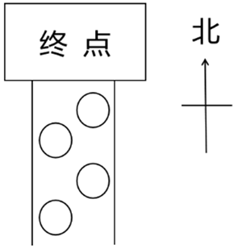

[代码描摹高清 PNG](../../../images/code_hd/318.png) · [SVG](../../../images/code_hd/318.svg)（原图为准）

根据上述信息，可以推出以下哪项？
A.甲来自江苏，排第二位 B.乙来自浙江，排第四位 C.丙来自安徽，排第一位 D.丁来自上海，排第三位

来源：[2025年江苏省公务员录用考试《行测》题（A类）.pdf](https://github.com/dumarstoft-ship-it/xingce/blob/407016b55b49581efa3771bb59a2dee8761d982f/2025%E5%B9%B4%E6%B1%9F%E8%8B%8F%E7%9C%81%E5%85%AC%E5%8A%A1%E5%91%98%E5%BD%95%E7%94%A8%E8%80%83%E8%AF%95%E3%80%8A%E8%A1%8C%E6%B5%8B%E3%80%8B%E9%A2%98%EF%BC%88A%E7%B1%BB%EF%BC%89.pdf)，PDF 第 21 页。

## 第 105 题 · 判断推理

`JS2025-A类-105`

### 共用材料

在环太湖自行车比赛中，冲刺阶段排在前四位的是甲、乙、丙、丁四名选手（如图，圆圈表示选手），他
们来自江苏、上海、浙江和安徽，所骑自行车颜色是蓝色、灰色、白色和黄色。已知：
（1）江苏选手在选手丙的东南面；
（2）上海选手在赛道的东部位置，他所骑自行车是蓝色的；
（3）骑灰色自行车的选手不是排在第四位；
（4）选手丁排在第三位，选手乙来自浙江；
（5）安徽选手排在骑黄色自行车的选手之前，排在选手甲之后。

[代码描摹高清 PNG](../../../images/code_hd/318.png) · [SVG](../../../images/code_hd/318.svg)（原图为准）

如果丙所骑自行车是白色，则可以推出以下哪项？
A.选手甲所骑自行车不是蓝色的 B.选手乙所骑自行车是灰色的
C.安徽选手所骑自行车是黄色的 D.江苏选手所骑自行车是灰色的

来源：[2025年江苏省公务员录用考试《行测》题（A类）.pdf](https://github.com/dumarstoft-ship-it/xingce/blob/407016b55b49581efa3771bb59a2dee8761d982f/2025%E5%B9%B4%E6%B1%9F%E8%8B%8F%E7%9C%81%E5%85%AC%E5%8A%A1%E5%91%98%E5%BD%95%E7%94%A8%E8%80%83%E8%AF%95%E3%80%8A%E8%A1%8C%E6%B5%8B%E3%80%8B%E9%A2%98%EF%BC%88A%E7%B1%BB%EF%BC%89.pdf)，PDF 第 21 页。

## 第 106 题 · 判断推理

`JS2025-A类-106`

多元共治：指针对社会运行中的复杂问题，由政府、社会组织、公民等主体共同参与，多方合作的社会治理模
式。
下列属于多元共治的是：
A.针对辖区内河道持续多年的污染问题，某县水利、环保等部门成立联合工作小组，决心打赢河道污染治理的
攻坚战
B.针对居民停车位、充电桩严重不足的问题，某街道统筹规划电动自行车停放充电区域，优化地下非机动车库
安全设施，消除电动自行车“上楼入户”的隐患
C.某区政府在老旧小区改造、公共服务等社区工作中，鼓励业委会、志愿者充分发挥各自作用，遇到问题加强
沟通，满足居民的合理诉求
D.某村两面临山，农林交错，靠近交通要道，火灾防治压力巨大。村民自发组织巡查队，检测上报森林火情，
有效遏制了火灾多发的势头

来源：[2025年江苏省公务员录用考试《行测》题（A类）.pdf](https://github.com/dumarstoft-ship-it/xingce/blob/407016b55b49581efa3771bb59a2dee8761d982f/2025%E5%B9%B4%E6%B1%9F%E8%8B%8F%E7%9C%81%E5%85%AC%E5%8A%A1%E5%91%98%E5%BD%95%E7%94%A8%E8%80%83%E8%AF%95%E3%80%8A%E8%A1%8C%E6%B5%8B%E3%80%8B%E9%A2%98%EF%BC%88A%E7%B1%BB%EF%BC%89.pdf)，PDF 第 21 页。

## 第 107 题 · 判断推理

`JS2025-A类-107`

森林模式：指企业在发展过程中借助内外部竞争不断克服自身短板，带动行业和谐发展，最终形成群体优势的
发展模式。
下列属于森林模式的是：
A.某家具厂针对市场动态需求，研发出一系列新产品，市场占有率不断攀升。本地其他厂家也加大了研发力
度，家具行业很快成了当地的支柱产业
B.某公司定期举办专题研讨会，让员工与国内外同行进行交流，开阔眼界，取长补短，提高业务素质
C.近年来，某林区大力推进“种、苗、造、抚、管”一体化生产经营模式，保持与周围环境和谐发展的良好势
头，培育出了森林可持续经营的样板林区
D.某公司实行末位淘汰制，业绩排名靠后的员工将被调换工作岗位。每个人都感受到了巨大的压力，产品销售
额直线上升，企业的规模和影响力越来越大

来源：[2025年江苏省公务员录用考试《行测》题（A类）.pdf](https://github.com/dumarstoft-ship-it/xingce/blob/407016b55b49581efa3771bb59a2dee8761d982f/2025%E5%B9%B4%E6%B1%9F%E8%8B%8F%E7%9C%81%E5%85%AC%E5%8A%A1%E5%91%98%E5%BD%95%E7%94%A8%E8%80%83%E8%AF%95%E3%80%8A%E8%A1%8C%E6%B5%8B%E3%80%8B%E9%A2%98%EF%BC%88A%E7%B1%BB%EF%BC%89.pdf)，PDF 第 21 页。

## 第 108 题 · 判断推理

`JS2025-A类-108`

零糖社交：有意降低社交期望值，在互动过程中保持距离感和独立性，尽量减轻双方的精神负担，使心情更加
轻松愉悦的社交方式。
下列属于零糖社交的是：
A.吴女士和好友多年未见，平时只是逢年过节发条问候短信。前几天，得知她生病的消息后，好友立刻放下工
作赶了过来
B.李先生经常周末约上三五个骑友到附近城市游玩，每次当天往返，所有费用AA制，虽然大家只知道彼此的微
信昵称，却玩得非常开心
C.小王每天晚上都要和自家的AI对话机器人闲聊半个多小时，就像交往多年亲密无间的好友，他很享受这样的
交流，没有一点心理包袱
D.小赵工作很忙，日常生活中也是个“独行侠”。收到母校的校庆邀请后，他毫不犹豫就婉言谢绝了。因为他
不想跑去给人家增加招待负担

来源：[2025年江苏省公务员录用考试《行测》题（A类）.pdf](https://github.com/dumarstoft-ship-it/xingce/blob/407016b55b49581efa3771bb59a2dee8761d982f/2025%E5%B9%B4%E6%B1%9F%E8%8B%8F%E7%9C%81%E5%85%AC%E5%8A%A1%E5%91%98%E5%BD%95%E7%94%A8%E8%80%83%E8%AF%95%E3%80%8A%E8%A1%8C%E6%B5%8B%E3%80%8B%E9%A2%98%EF%BC%88A%E7%B1%BB%EF%BC%89.pdf)，PDF 第 21、22 页。

## 第 109 题 · 判断推理

`JS2025-A类-109`

创意环保教育：指为了培养青少年生态环保意识而开展的与单向教育模式不同的互动性课外活动。
下列属于创意环保教育的是：
A.每周六晚上，刘老师都会带领一群小小昆虫“发烧友”，在山林、草坪中探索奇妙的昆虫世界，探讨人与自
然的和谐关系
B.王先生发现儿子对地理、生物知识很感兴趣，就给他买了许多书。儿子在增长知识的同时也萌生了更强的环
保意识
C.刘女士收到家长群的通知，要求学生提交用空牛奶盒完成的手工环保作业，她只好网购一些空盒子，因为家
里几乎不喝牛奶
D.清江社区利用微信公众号、户外海报等载体，对废旧电池回收问题进行通俗易懂的讲解，居民纷纷表示再也
不会随意乱扔电池

来源：[2025年江苏省公务员录用考试《行测》题（A类）.pdf](https://github.com/dumarstoft-ship-it/xingce/blob/407016b55b49581efa3771bb59a2dee8761d982f/2025%E5%B9%B4%E6%B1%9F%E8%8B%8F%E7%9C%81%E5%85%AC%E5%8A%A1%E5%91%98%E5%BD%95%E7%94%A8%E8%80%83%E8%AF%95%E3%80%8A%E8%A1%8C%E6%B5%8B%E3%80%8B%E9%A2%98%EF%BC%88A%E7%B1%BB%EF%BC%89.pdf)，PDF 第 22 页。

## 第 110 题 · 判断推理

`JS2025-A类-110`

平台自我优待：指商业平台主体借助自身技术或数据优势地位，通过特定手段取得优惠待遇以获得竞争优势的
行为。
下列不属于平台自我优待的是：
A.某电商平台利用从卖家经营过程中收集到的海量销售数据，优化了自家产品的推荐策略，并在平台搜索引擎
中把它们排列在前面
B.某在线旅游平台在用户自行预订车票、门票时，默认搭售自己代理的旅游保险产品，却没有在显著位置提醒
用户可以取消这项服务
C.某应用商店运营商对自家程序软件给了更高的评分星级，对第三方开发者则设置了更为严格的审核评级标准
D.某供水公司利用在区域供水市场的支配地位，要求用水单位必须邀请己方对供水工程进行勘察、施工和安装

来源：[2025年江苏省公务员录用考试《行测》题（A类）.pdf](https://github.com/dumarstoft-ship-it/xingce/blob/407016b55b49581efa3771bb59a2dee8761d982f/2025%E5%B9%B4%E6%B1%9F%E8%8B%8F%E7%9C%81%E5%85%AC%E5%8A%A1%E5%91%98%E5%BD%95%E7%94%A8%E8%80%83%E8%AF%95%E3%80%8A%E8%A1%8C%E6%B5%8B%E3%80%8B%E9%A2%98%EF%BC%88A%E7%B1%BB%EF%BC%89.pdf)，PDF 第 22 页。

## 第 111 题 · 判断推理

`JS2025-A类-111`

情感虹吸：指现实生活中难以得到心理慰藉的中老年人，在网络世界中因为受到情感诱导而盲目消费，导致个
人钱财严重受损的现象。
下列属于情感虹吸的是：
A.在外地工作的朱先生发现母亲退休后将退休金的一大半都用于购买一种“三无”保健品，原来该产品的推销
员几乎每周都会来陪母亲聊家常
B.酒店大厨赵先生在网络平台上免费教授烹饪知识，因其手艺精湛，说话幽默，嘴巴又甜，受到了无数妈妈级
粉丝的喜爱，每天都能得到不少打赏
C.儿子考上大学后，刘女士每天晚上都会定时打开手机，在主播们的嘘寒问暖中感受一丝安慰，偶尔也为他们
刷一些小礼物
D.独居的李奶奶每天都泡在“50后时光”直播间，为主播刷“火箭”“跑车”等礼物，成为了“榜一大哥”，
两个月内花掉了多年的积蓄

来源：[2025年江苏省公务员录用考试《行测》题（A类）.pdf](https://github.com/dumarstoft-ship-it/xingce/blob/407016b55b49581efa3771bb59a2dee8761d982f/2025%E5%B9%B4%E6%B1%9F%E8%8B%8F%E7%9C%81%E5%85%AC%E5%8A%A1%E5%91%98%E5%BD%95%E7%94%A8%E8%80%83%E8%AF%95%E3%80%8A%E8%A1%8C%E6%B5%8B%E3%80%8B%E9%A2%98%EF%BC%88A%E7%B1%BB%EF%BC%89.pdf)，PDF 第 22 页。

## 第 112 题 · 判断推理

`JS2025-A类-112`

正向情绪价值：指通过积极性的言语或行动，为他人带来舒服、愉悦、安全等良性感受的人际交往能力。
下列属于正向情绪价值的是：
A.林女士是一位经验丰富的住家月嫂，看到自己照护的孩子健康成长和新手父母们满意的笑容，她体会到了自
己的价值
B.陈先生大学毕业后当过游戏主播、网络写手、保险推销员，不久前又在酒吧驻唱。父母很尊重他的选择，从
不横加干涉
C.秦女士到时装店买衣服，刚一进门，几个营业员就围了上来，拼命夸她身材好，穿什么都好看。她虽然半信
半疑，还是忍不住买了几件
D.赵先生是同事心目中的“显眼包”，每次聚会的时候，只要他一开口，大家就会笑得前仰后合，工作中的压
力一扫而空

来源：[2025年江苏省公务员录用考试《行测》题（A类）.pdf](https://github.com/dumarstoft-ship-it/xingce/blob/407016b55b49581efa3771bb59a2dee8761d982f/2025%E5%B9%B4%E6%B1%9F%E8%8B%8F%E7%9C%81%E5%85%AC%E5%8A%A1%E5%91%98%E5%BD%95%E7%94%A8%E8%80%83%E8%AF%95%E3%80%8A%E8%A1%8C%E6%B5%8B%E3%80%8B%E9%A2%98%EF%BC%88A%E7%B1%BB%EF%BC%89.pdf)，PDF 第 22、23 页。

## 第 113 题 · 判断推理

`JS2025-A类-113`

灰度认知：指面对复杂多变、难以定性的客观事物或现象，采用弹性手法进行灵活应对，放弃非黑即白的思维
方式。
下列属于灰度认知的是：
A.父母每次吵完架都会找小张评理，虽然清官难断家务事，他却有自己的绝招：听他们一个个地诉苦，然后坐
在一块儿和稀泥，半天后肯定就会重归于好
B.虽然多位老师认为小婷的论文“论点值得推敲、论证不够充分”，但她觉得一定会有编辑欣赏，于是她毫不
犹豫直接投了稿
C.公司的设备在运行中突发故障，工程师小袁排查出造成故障的多种可能性，并对每一种可能性进行分析，很
快就排除了故障
D.当下许多影视剧中的正面人物通常不再是“高大全”的形象，身上往往也存在一些无伤大雅的缺点，更贴近
真实生活

来源：[2025年江苏省公务员录用考试《行测》题（A类）.pdf](https://github.com/dumarstoft-ship-it/xingce/blob/407016b55b49581efa3771bb59a2dee8761d982f/2025%E5%B9%B4%E6%B1%9F%E8%8B%8F%E7%9C%81%E5%85%AC%E5%8A%A1%E5%91%98%E5%BD%95%E7%94%A8%E8%80%83%E8%AF%95%E3%80%8A%E8%A1%8C%E6%B5%8B%E3%80%8B%E9%A2%98%EF%BC%88A%E7%B1%BB%EF%BC%89.pdf)，PDF 第 23 页。

## 第 114 题 · 判断推理

`JS2025-A类-114`

生态建筑诱导空间：指在建筑设计中巧妙利用自然元素构建出的具有引导性的空间布局，以促进建筑内外部的
能量交换，引导建筑内部的人员流动，提升建筑物的生态效能及使用舒适度。
下列属于生态建筑诱导空间的是：
A.某办公大楼将空调出风口设置在走廊顶部，利用空气对流原理，使冷气能够在整层楼内均匀分布
B.某图书馆设置了巨大的玻璃穹顶，阳光直接透过穹顶洒在中庭绿植上，各个方向的读者都能自然而然进入中
庭四周的阅读区域
C.李先生的茶餐厅前面竖立着两个造型别致的霓虹灯招牌，灯光闪烁，五颜六色，周边街道的游客一眼就能看
见
D.郑女士很喜欢自家的老屋，四周院墙上爬满了千姿百态的凌霄，阳光完全晒不进庭院，堂屋内仿佛自带空调

来源：[2025年江苏省公务员录用考试《行测》题（A类）.pdf](https://github.com/dumarstoft-ship-it/xingce/blob/407016b55b49581efa3771bb59a2dee8761d982f/2025%E5%B9%B4%E6%B1%9F%E8%8B%8F%E7%9C%81%E5%85%AC%E5%8A%A1%E5%91%98%E5%BD%95%E7%94%A8%E8%80%83%E8%AF%95%E3%80%8A%E8%A1%8C%E6%B5%8B%E3%80%8B%E9%A2%98%EF%BC%88A%E7%B1%BB%EF%BC%89.pdf)，PDF 第 23 页。

## 第 115 题 · 判断推理

`JS2025-A类-115`

数字意境：指通过数字技术赋能将优秀传统文化以沉浸式的艺术形式进行创新表达，凸显视觉效果呈现，以展
现其文化韵味和审美意境。
下列属于数字意境的是：
A.某电视台文化节目中，大学生们来到文化古迹现场，与考古专家互动，在诵读、观察、探究中加深对中华传
统文化的理解
B.某景区排练的舞蹈节目中，以当地石窟为真实背景，利用三维动画技术复原了壁画中飞天与金刚的舞蹈，使
静止的文化符号变成了动感的形象
C.某艺术研究院和多家企业合作，对古代编钟复制件进行高精细度的音源采集，最终实现对这一传统瑰宝的数
字化复原
D.某博物馆从古代名画《千里江山图》《百花图卷》中选取“意象”元素，实景搭建了沉浸式体验展厅，观众
犹如身临其境

来源：[2025年江苏省公务员录用考试《行测》题（A类）.pdf](https://github.com/dumarstoft-ship-it/xingce/blob/407016b55b49581efa3771bb59a2dee8761d982f/2025%E5%B9%B4%E6%B1%9F%E8%8B%8F%E7%9C%81%E5%85%AC%E5%8A%A1%E5%91%98%E5%BD%95%E7%94%A8%E8%80%83%E8%AF%95%E3%80%8A%E8%A1%8C%E6%B5%8B%E3%80%8B%E9%A2%98%EF%BC%88A%E7%B1%BB%EF%BC%89.pdf)，PDF 第 23 页。
