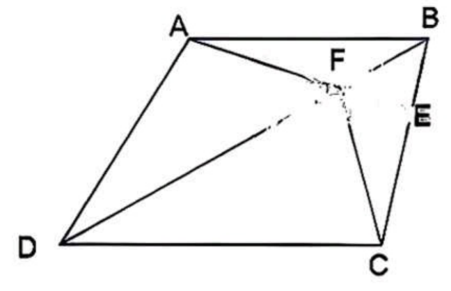

# 2026 年江苏行测（卷别未注明） · 题目

保留原题号。来源页码按 PDF 实际页数计，从 1 开始。答案及解析另见 answers.md。

## 第 51 题 · 数量关系

`JS2026-卷别未注明-051`

−1，−6，−7，0，23，（ ）
A. −24
B. 39
C. 55
D. 78

来源：[2026年江苏公务员考试数量关系答案pdf.pdf](https://github.com/dumarstoft-ship-it/xingce/blob/407016b55b49581efa3771bb59a2dee8761d982f/2026%E5%B9%B4%E6%B1%9F%E8%8B%8F%E5%85%AC%E5%8A%A1%E5%91%98%E8%80%83%E8%AF%95%E6%95%B0%E9%87%8F%E5%85%B3%E7%B3%BB%E7%AD%94%E6%A1%88pdf.pdf)，PDF 第 1 页。

## 第 52 题 · 数量关系

`JS2026-卷别未注明-052`

5.8，4.12，9.15，7.23，17.29，（ ）
A. 13.45
B. 13.47
C. 15.45
D. 15.47

来源：[2026年江苏公务员考试数量关系答案pdf.pdf](https://github.com/dumarstoft-ship-it/xingce/blob/407016b55b49581efa3771bb59a2dee8761d982f/2026%E5%B9%B4%E6%B1%9F%E8%8B%8F%E5%85%AC%E5%8A%A1%E5%91%98%E8%80%83%E8%AF%95%E6%95%B0%E9%87%8F%E5%85%B3%E7%B3%BB%E7%AD%94%E6%A1%88pdf.pdf)，PDF 第 1 页。

## 第 53 题 · 数量关系

`JS2026-卷别未注明-053`

1，√2/2，−√6/3，√15/5，√10/4，（ ）
A. 3√2/7
B. 3√5/8
C. 7√23/11
D. 2√26/13

来源：[2026年江苏公务员考试数量关系答案pdf.pdf](https://github.com/dumarstoft-ship-it/xingce/blob/407016b55b49581efa3771bb59a2dee8761d982f/2026%E5%B9%B4%E6%B1%9F%E8%8B%8F%E5%85%AC%E5%8A%A1%E5%91%98%E8%80%83%E8%AF%95%E6%95%B0%E9%87%8F%E5%85%B3%E7%B3%BB%E7%AD%94%E6%A1%88pdf.pdf)，PDF 第 1 页。

## 第 54 题 · 数量关系

`JS2026-卷别未注明-054`

2/3，1/10，9/22，13/62，49/150，（ ）
A. 79/349
B. 101/398
C. 77/416
D. 103/459

来源：[2026年江苏公务员考试数量关系答案pdf.pdf](https://github.com/dumarstoft-ship-it/xingce/blob/407016b55b49581efa3771bb59a2dee8761d982f/2026%E5%B9%B4%E6%B1%9F%E8%8B%8F%E5%85%AC%E5%8A%A1%E5%91%98%E8%80%83%E8%AF%95%E6%95%B0%E9%87%8F%E5%85%B3%E7%B3%BB%E7%AD%94%E6%A1%88pdf.pdf)，PDF 第 1 页。

## 第 55 题 · 数量关系

`JS2026-卷别未注明-055`

0，6，23，56，109，（ ）
A. 147
B. 169
C. 184
D. 218

来源：[2026年江苏公务员考试数量关系答案pdf.pdf](https://github.com/dumarstoft-ship-it/xingce/blob/407016b55b49581efa3771bb59a2dee8761d982f/2026%E5%B9%B4%E6%B1%9F%E8%8B%8F%E5%85%AC%E5%8A%A1%E5%91%98%E8%80%83%E8%AF%95%E6%95%B0%E9%87%8F%E5%85%B3%E7%B3%BB%E7%AD%94%E6%A1%88pdf.pdf)，PDF 第 1 页。

## 第 56 题 · 数量关系

`JS2026-卷别未注明-056`

> 原文件以省略号省略了部分题意或条件；未补写。

……，需安排3名员工负责后勤保障。若安排3名男员工，则参与徒步的男女员工人数之比是3:5；若安3名女员工，……男女员工人数之比是3:4。若安排2名男员工和1名女员工，则参与徒步的男女员工人数之比是（ ）
A. 2:3
B. 8:11
C. 11:17
D. 13:20

来源：[2026年江苏公务员考试数量关系答案pdf.pdf](https://github.com/dumarstoft-ship-it/xingce/blob/407016b55b49581efa3771bb59a2dee8761d982f/2026%E5%B9%B4%E6%B1%9F%E8%8B%8F%E5%85%AC%E5%8A%A1%E5%91%98%E8%80%83%E8%AF%95%E6%95%B0%E9%87%8F%E5%85%B3%E7%B3%BB%E7%AD%94%E6%A1%88pdf.pdf)，PDF 第 1 页。

## 第 57 题 · 数量关系

`JS2026-卷别未注明-057`

> 原文件以省略号省略了部分题意或条件；未补写。

……甲队每天植树20棵，乙队每天植树35棵。两个队伍均从3月1日开始植树，甲队每天都植树，乙队相邻两天植树一天、休息一天，则今年3月甲队植树的数量比乙队多
A. 40棵
B. 60棵
C. 75棵
D. 55棵

来源：[2026年江苏公务员考试数量关系答案pdf.pdf](https://github.com/dumarstoft-ship-it/xingce/blob/407016b55b49581efa3771bb59a2dee8761d982f/2026%E5%B9%B4%E6%B1%9F%E8%8B%8F%E5%85%AC%E5%8A%A1%E5%91%98%E8%80%83%E8%AF%95%E6%95%B0%E9%87%8F%E5%85%B3%E7%B3%BB%E7%AD%94%E6%A1%88pdf.pdf)，PDF 第 1 页。

## 第 58 题 · 数量关系

`JS2026-卷别未注明-058`

某博览会场馆内设有23个展区，计划举办77场配套活动。若每个展区最多举办5场配套活动，则举办4场及以上配套活动的展区至少有
A. 4个
B. 6个
C. 8个
D. 9个

来源：[2026年江苏公务员考试数量关系答案pdf.pdf](https://github.com/dumarstoft-ship-it/xingce/blob/407016b55b49581efa3771bb59a2dee8761d982f/2026%E5%B9%B4%E6%B1%9F%E8%8B%8F%E5%85%AC%E5%8A%A1%E5%91%98%E8%80%83%E8%AF%95%E6%95%B0%E9%87%8F%E5%85%B3%E7%B3%BB%E7%AD%94%E6%A1%88pdf.pdf)，PDF 第 1 页。

## 第 59 题 · 数量关系

`JS2026-卷别未注明-059`

> 原文件以省略号省略了部分题意或条件；未补写。

某单位后勤部门每周一召开协调会……7月召开的协调会与总结会次数相同，则该年的8月1日是
A. 星期二
B. 星期三
C. 星期四
D. 星期五

来源：[2026年江苏公务员考试数量关系答案pdf.pdf](https://github.com/dumarstoft-ship-it/xingce/blob/407016b55b49581efa3771bb59a2dee8761d982f/2026%E5%B9%B4%E6%B1%9F%E8%8B%8F%E5%85%AC%E5%8A%A1%E5%91%98%E8%80%83%E8%AF%95%E6%95%B0%E9%87%8F%E5%85%B3%E7%B3%BB%E7%AD%94%E6%A1%88pdf.pdf)，PDF 第 2 页。

## 第 60 题 · 数量关系

`JS2026-卷别未注明-060`

> 原文件以省略号省略了部分题意或条件；未补写。

某智能工厂新开3条生产线，安排5名员工管理，……线，每条生产线都恰有2名员工管理。若这5名员工中有2名员工能管理2条生产线，其余3名员工都只能管理一条生产线，则不同的安排方式共有
A. 72种
B. 108种
C. 144种
D. 180种

来源：[2026年江苏公务员考试数量关系答案pdf.pdf](https://github.com/dumarstoft-ship-it/xingce/blob/407016b55b49581efa3771bb59a2dee8761d982f/2026%E5%B9%B4%E6%B1%9F%E8%8B%8F%E5%85%AC%E5%8A%A1%E5%91%98%E8%80%83%E8%AF%95%E6%95%B0%E9%87%8F%E5%85%B3%E7%B3%BB%E7%AD%94%E6%A1%88pdf.pdf)，PDF 第 2 页。

## 第 61 题 · 数量关系

`JS2026-卷别未注明-061`

> 原文件以省略号省略了部分题意或条件；未补写。

> 原文件存在明显错字或不通顺表述，按可见原文保留。

某商场购进一家运动鞋20双，定价每双800元。按定价售出一些后，国庆促销时按定价优惠15%又售出部分，剩余的在换季……这20双鞋的销售额为14000元，且按定价售出的运动鞋比国庆促销售出的多，则……运动鞋数量是
A. 5双
B. 7双
C. 9双
D. 11双

来源：[2026年江苏公务员考试数量关系答案pdf.pdf](https://github.com/dumarstoft-ship-it/xingce/blob/407016b55b49581efa3771bb59a2dee8761d982f/2026%E5%B9%B4%E6%B1%9F%E8%8B%8F%E5%85%AC%E5%8A%A1%E5%91%98%E8%80%83%E8%AF%95%E6%95%B0%E9%87%8F%E5%85%B3%E7%B3%BB%E7%AD%94%E6%A1%88pdf.pdf)，PDF 第 2 页。

## 第 62 题 · 数量关系

`JS2026-卷别未注明-062`

> 原文件以省略号省略了部分题意或条件；未补写。

一种实心……成，内芯也是圆柱形，和外壳高……隙。该配件的底面直径为8cm；内芯的密度为3g/cm3，底面直径为4cm；外壳的密度为8g/cm3，质量为16kg，则内芯的质量为
A. 2kg
B. 3kg
C. 4kg
D. 6kg

来源：[2026年江苏公务员考试数量关系答案pdf.pdf](https://github.com/dumarstoft-ship-it/xingce/blob/407016b55b49581efa3771bb59a2dee8761d982f/2026%E5%B9%B4%E6%B1%9F%E8%8B%8F%E5%85%AC%E5%8A%A1%E5%91%98%E8%80%83%E8%AF%95%E6%95%B0%E9%87%8F%E5%85%B3%E7%B3%BB%E7%AD%94%E6%A1%88pdf.pdf)，PDF 第 2 页。

## 第 63 题 · 数量关系

`JS2026-卷别未注明-063`

> 原文件以省略号省略了部分题意或条件；未补写。

个人技能大赛初赛共安排3个任务，选……。已知小王完成这3个任务的概率分别是0.8、0.7、0.6，且各项任务是否完成相互独立，则他成功晋级的概率是
A. 0.596
B. 0.648
C. 0.788
D. 0.812

来源：[2026年江苏公务员考试数量关系答案pdf.pdf](https://github.com/dumarstoft-ship-it/xingce/blob/407016b55b49581efa3771bb59a2dee8761d982f/2026%E5%B9%B4%E6%B1%9F%E8%8B%8F%E5%85%AC%E5%8A%A1%E5%91%98%E8%80%83%E8%AF%95%E6%95%B0%E9%87%8F%E5%85%B3%E7%B3%BB%E7%AD%94%E6%A1%88pdf.pdf)，PDF 第 2 页。

## 第 64 题 · 数量关系

`JS2026-卷别未注明-064`

> 原文件以省略号省略了部分题意或条件；未补写。

……从M、N两地同时出发，甲开往N地，乙开往M地，到达目的地后均立即沿原路返回。甲从M地到N地时，前1/4路程的平均速度为60km/h，后3/4路程的平均速度为90km/h；从N地返回M地时，以75km/h的速度匀速行驶。乙全程匀速行驶，速度为80km/h。若甲从出发到第二次与乙相遇，行驶的总路程比乙少10km，则M、N两地的距离是
A. 290km
B. 300km
C. 310km
D. 320km

来源：[2026年江苏公务员考试数量关系答案pdf.pdf](https://github.com/dumarstoft-ship-it/xingce/blob/407016b55b49581efa3771bb59a2dee8761d982f/2026%E5%B9%B4%E6%B1%9F%E8%8B%8F%E5%85%AC%E5%8A%A1%E5%91%98%E8%80%83%E8%AF%95%E6%95%B0%E9%87%8F%E5%85%B3%E7%B3%BB%E7%AD%94%E6%A1%88pdf.pdf)，PDF 第 2 页。

## 第 65 题 · 数量关系

`JS2026-卷别未注明-065`

> 原文件以省略号省略了部分题意或条件；未补写。

今年……。大赛设有舞龙、舞狮和彩带龙共3个比赛项目。已知参加舞龙的有10支代表队，参加舞狮的有12支代表队，参加……3个项目都参加的有2支代表队，则这20支代表队中，至少参加2个比赛项目的代表队共有
A. 12支
B. 14支
C. 15支
D. 16支

来源：[2026年江苏公务员考试数量关系答案pdf.pdf](https://github.com/dumarstoft-ship-it/xingce/blob/407016b55b49581efa3771bb59a2dee8761d982f/2026%E5%B9%B4%E6%B1%9F%E8%8B%8F%E5%85%AC%E5%8A%A1%E5%91%98%E8%80%83%E8%AF%95%E6%95%B0%E9%87%8F%E5%85%B3%E7%B3%BB%E7%AD%94%E6%A1%88pdf.pdf)，PDF 第 2 页。

## 第 66 题 · 数量关系

`JS2026-卷别未注明-066`

> 原文件以省略号省略了部分题意或条件；未补写。

某超市销售……，小王分别购买了2只、5只、8只，共花费22元；小李分别购买了3只、7只、11只，共花费31.5元。若在……燕尾夹各1只，则共花费的金额是
A. 6.5元
B. 7元
C. 7.5元
D. 8元

来源：[2026年江苏公务员考试数量关系答案pdf.pdf](https://github.com/dumarstoft-ship-it/xingce/blob/407016b55b49581efa3771bb59a2dee8761d982f/2026%E5%B9%B4%E6%B1%9F%E8%8B%8F%E5%85%AC%E5%8A%A1%E5%91%98%E8%80%83%E8%AF%95%E6%95%B0%E9%87%8F%E5%85%B3%E7%B3%BB%E7%AD%94%E6%A1%88pdf.pdf)，PDF 第 2 页。

## 第 67 题 · 数量关系

`JS2026-卷别未注明-067`

> 原文件以省略号省略了部分题意或条件；未补写。

> 原文件存在明显错字或不通顺表述，按可见原文保留。

某团队共有5名成员，他们共同完成一项工作需要4天时间，从该团队选3人完成此项工作，最快的组合需要配5天时间，最慢的组合需要10天。……最慢的组合需奖的时间是
A. 12天
B. 15天
C. 18天
D. 20天

来源：[2026年江苏公务员考试数量关系答案pdf.pdf](https://github.com/dumarstoft-ship-it/xingce/blob/407016b55b49581efa3771bb59a2dee8761d982f/2026%E5%B9%B4%E6%B1%9F%E8%8B%8F%E5%85%AC%E5%8A%A1%E5%91%98%E8%80%83%E8%AF%95%E6%95%B0%E9%87%8F%E5%85%B3%E7%B3%BB%E7%AD%94%E6%A1%88pdf.pdf)，PDF 第 2 页。

## 第 68 题 · 数量关系

`JS2026-卷别未注明-068`

> 原文件以省略号省略了部分题意或条件；未补写。

> 原文件存在明显错字或不通顺表述，按可见原文保留。

有E、E、G、H个瓶子，H为空瓶，E、F、G中均装有……，浓度分别为70%、50%、30%……，测得E、F、H中酒精溶液的浓度分别为35%、45%、65%，则H中酒精溶液的质量为
A. 180克
B. 197克
C. 228克
D. 240克

来源：[2026年江苏公务员考试数量关系答案pdf.pdf](https://github.com/dumarstoft-ship-it/xingce/blob/407016b55b49581efa3771bb59a2dee8761d982f/2026%E5%B9%B4%E6%B1%9F%E8%8B%8F%E5%85%AC%E5%8A%A1%E5%91%98%E8%80%83%E8%AF%95%E6%95%B0%E9%87%8F%E5%85%B3%E7%B3%BB%E7%AD%94%E6%A1%88pdf.pdf)，PDF 第 2、3 页。

## 第 69 题 · 数量关系

`JS2026-卷别未注明-069`

> 原文件以省略号省略了部分题意或条件；未补写。

……，其中S型20台、T型10台，同……这30台机器工作1小时共生产玩具240个。改进工艺后，S、T型机器的生产效率分别提升20%和25%，这30台机器工作1小时比改进工艺前多生产玩具50个。改进工艺后，S型机器的生产效率是T型的
A. 1.5倍
B. 2.4倍
C. 2.5倍
D. 3倍

来源：[2026年江苏公务员考试数量关系答案pdf.pdf](https://github.com/dumarstoft-ship-it/xingce/blob/407016b55b49581efa3771bb59a2dee8761d982f/2026%E5%B9%B4%E6%B1%9F%E8%8B%8F%E5%85%AC%E5%8A%A1%E5%91%98%E8%80%83%E8%AF%95%E6%95%B0%E9%87%8F%E5%85%B3%E7%B3%BB%E7%AD%94%E6%A1%88pdf.pdf)，PDF 第 3 页。

## 第 70 题 · 数量关系

`JS2026-卷别未注明-070`

> 原图局部受损，未推断或补全被遮挡线条。

> 原文件以省略号省略了部分题意或条件；未补写。

> 原题文字与图中可见连线存在不一致，保留两者。

> 文字写“AE 与 BD 相交”，图中可见 A—F—C 连线；原图在 F 周围受损，未作修正。

……，点E在边BC上，CE=2BE，AE与BD相交于点F。已知△ADF与BEF的面积分别为28和4，则DFC的面积为

A. 40
B. 42
C. 50
D. 56

来源：[2026年江苏公务员考试数量关系答案pdf.pdf](https://github.com/dumarstoft-ship-it/xingce/blob/407016b55b49581efa3771bb59a2dee8761d982f/2026%E5%B9%B4%E6%B1%9F%E8%8B%8F%E5%85%AC%E5%8A%A1%E5%91%98%E8%80%83%E8%AF%95%E6%95%B0%E9%87%8F%E5%85%B3%E7%B3%BB%E7%AD%94%E6%A1%88pdf.pdf)，PDF 第 3 页。
