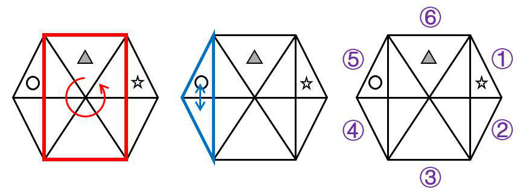

# 2020 年浙江行测（B卷） · 答案与解析

以下为来源原文的结构化转写；缺失及冲突答案不补写。

## 第 1 题 · 数量关系

参考答案：**A**

正确答案：A，全站正确率：42%，易错项：C。
解析
第一步，本题考查多级数列。
第二步，相邻两项做减法（后－前），得一级差数列为2，－3，0，－5，……再做一次差得二级差数列为－5，
3，－5，3，－5……是周期数列，那么一级差数列的下一项为－5＋3＝－2，则（ ）为－3－2＝－5。
因此，选择A 选项。

来源：[2020年0726浙江公务员考试《行测》真题（B卷）参考答案及解析.pdf](https://github.com/dumarstoft-ship-it/xingce/blob/407016b55b49581efa3771bb59a2dee8761d982f/2020%E5%B9%B40726%E6%B5%99%E6%B1%9F%E5%85%AC%E5%8A%A1%E5%91%98%E8%80%83%E8%AF%95%E3%80%8A%E8%A1%8C%E6%B5%8B%E3%80%8B%E7%9C%9F%E9%A2%98%EF%BC%88B%E5%8D%B7%EF%BC%89%E5%8F%82%E8%80%83%E7%AD%94%E6%A1%88%E5%8F%8A%E8%A7%A3%E6%9E%90.pdf)，PDF 第 1 页。

## 第 2 题 · 数量关系

参考答案：**B**

正确答案：B，全站正确率：67%，易错项：C。
解析
第一步，本题考查多级数列。
第二步，相邻两项做除法（后÷前），得商数列为1/2，2/3，3/4……那么商数列的下一项是4/5，再下一项是
5/6，则（ ）为12×4/5＝9.6，验证发现9÷9.6＝5/6，满足商数列。
因此，选择B 选项。

来源：[2020年0726浙江公务员考试《行测》真题（B卷）参考答案及解析.pdf](https://github.com/dumarstoft-ship-it/xingce/blob/407016b55b49581efa3771bb59a2dee8761d982f/2020%E5%B9%B40726%E6%B5%99%E6%B1%9F%E5%85%AC%E5%8A%A1%E5%91%98%E8%80%83%E8%AF%95%E3%80%8A%E8%A1%8C%E6%B5%8B%E3%80%8B%E7%9C%9F%E9%A2%98%EF%BC%88B%E5%8D%B7%EF%BC%89%E5%8F%82%E8%80%83%E7%AD%94%E6%A1%88%E5%8F%8A%E8%A7%A3%E6%9E%90.pdf)，PDF 第 1 页。

## 第 3 题 · 数量关系

参考答案：**B**

正确答案：B，全站正确率：64%，易错项：C。
解析
第一步，本题考查递推数列。
第二步，原数列中36＝（30－12）×2，12＝（36－30）×2，30＝（51－36）×2，相邻三项中第一项＝（第三
项－第二项）×2，那么[（ ）－51]×2＝36，（ ）为69。
因此，选择B 选项。

来源：[2020年0726浙江公务员考试《行测》真题（B卷）参考答案及解析.pdf](https://github.com/dumarstoft-ship-it/xingce/blob/407016b55b49581efa3771bb59a2dee8761d982f/2020%E5%B9%B40726%E6%B5%99%E6%B1%9F%E5%85%AC%E5%8A%A1%E5%91%98%E8%80%83%E8%AF%95%E3%80%8A%E8%A1%8C%E6%B5%8B%E3%80%8B%E7%9C%9F%E9%A2%98%EF%BC%88B%E5%8D%B7%EF%BC%89%E5%8F%82%E8%80%83%E7%AD%94%E6%A1%88%E5%8F%8A%E8%A7%A3%E6%9E%90.pdf)，PDF 第 1 页。

## 第 4 题 · 数量关系

参考答案：**C**

正确答案：C，全站正确率：87%，易错项：B。
解析
第一步，本题考查幂次数列。
第二步，原数列1＝1¹，4＝2²，27＝3³，256＝4⁴，那么数列的下一项应该为5⁵＝3125，即（ ）为3125。
因此，选择C 选项。

来源：[2020年0726浙江公务员考试《行测》真题（B卷）参考答案及解析.pdf](https://github.com/dumarstoft-ship-it/xingce/blob/407016b55b49581efa3771bb59a2dee8761d982f/2020%E5%B9%B40726%E6%B5%99%E6%B1%9F%E5%85%AC%E5%8A%A1%E5%91%98%E8%80%83%E8%AF%95%E3%80%8A%E8%A1%8C%E6%B5%8B%E3%80%8B%E7%9C%9F%E9%A2%98%EF%BC%88B%E5%8D%B7%EF%BC%89%E5%8F%82%E8%80%83%E7%AD%94%E6%A1%88%E5%8F%8A%E8%A7%A3%E6%9E%90.pdf)，PDF 第 1 页。

## 第 5 题 · 数量关系

参考答案：**D**

正确答案：D，全站正确率：75%，易错项：C。
解析
第一步，本题考查多级数列。
第二步，相邻两项做差（前－后）得差数列为2，3，5，7……为质数数列，那么差数列的下一项为11，则（ ）
为25－11＝14。
因此，选择D 选项。

来源：[2020年0726浙江公务员考试《行测》真题（B卷）参考答案及解析.pdf](https://github.com/dumarstoft-ship-it/xingce/blob/407016b55b49581efa3771bb59a2dee8761d982f/2020%E5%B9%B40726%E6%B5%99%E6%B1%9F%E5%85%AC%E5%8A%A1%E5%91%98%E8%80%83%E8%AF%95%E3%80%8A%E8%A1%8C%E6%B5%8B%E3%80%8B%E7%9C%9F%E9%A2%98%EF%BC%88B%E5%8D%B7%EF%BC%89%E5%8F%82%E8%80%83%E7%AD%94%E6%A1%88%E5%8F%8A%E8%A7%A3%E6%9E%90.pdf)，PDF 第 1 页。

## 第 6 题 · 数量关系

参考答案：**A**

正确答案：A，全站正确率：80%，易错项：D。
解析
第一步，本题考查数图推理。
第二步，第一个圆内8＋14＝18＋4，第二个圆内7＋5＝3＋9，第三个圆内6＋4＝8＋2，圆内存在规律左上＋左
下＝右上＋右下，那么5＋5＝？＋10，？为0。
因此，选择A 选项。

来源：[2020年0726浙江公务员考试《行测》真题（B卷）参考答案及解析.pdf](https://github.com/dumarstoft-ship-it/xingce/blob/407016b55b49581efa3771bb59a2dee8761d982f/2020%E5%B9%B40726%E6%B5%99%E6%B1%9F%E5%85%AC%E5%8A%A1%E5%91%98%E8%80%83%E8%AF%95%E3%80%8A%E8%A1%8C%E6%B5%8B%E3%80%8B%E7%9C%9F%E9%A2%98%EF%BC%88B%E5%8D%B7%EF%BC%89%E5%8F%82%E8%80%83%E7%AD%94%E6%A1%88%E5%8F%8A%E8%A7%A3%E6%9E%90.pdf)，PDF 第 1 页。

## 第 7 题 · 数量关系

参考答案：**C**

正确答案：C，全站正确率：91%，易错项：B。
解析
第一步，本题考查数图推理。
第二步，第一个圆内12×4＝6×8，第二个圆内10×2＝5×4，第三个圆内4×4＝8×2，圆内存在规律左上×右
上＝左下×右下，那么1×3＝5×？，？为3/5。
因此，选择C 选项。

来源：[2020年0726浙江公务员考试《行测》真题（B卷）参考答案及解析.pdf](https://github.com/dumarstoft-ship-it/xingce/blob/407016b55b49581efa3771bb59a2dee8761d982f/2020%E5%B9%B40726%E6%B5%99%E6%B1%9F%E5%85%AC%E5%8A%A1%E5%91%98%E8%80%83%E8%AF%95%E3%80%8A%E8%A1%8C%E6%B5%8B%E3%80%8B%E7%9C%9F%E9%A2%98%EF%BC%88B%E5%8D%B7%EF%BC%89%E5%8F%82%E8%80%83%E7%AD%94%E6%A1%88%E5%8F%8A%E8%A7%A3%E6%9E%90.pdf)，PDF 第 1 页。

## 第 8 题 · 数量关系

参考答案：**D**

正确答案：D，全站正确率：72%，易错项：C。
解析
第一步，本题考查数图推理。
第二步，第一个圆内2×6＝4＋8，第二个圆内5×6＝12＋18，第三个圆内7×3＝12＋9，圆内存在规律左上×
左下＝右上＋右下，那么6×4＝16＋？，？为8。
因此，选择D 选项。

来源：[2020年0726浙江公务员考试《行测》真题（B卷）参考答案及解析.pdf](https://github.com/dumarstoft-ship-it/xingce/blob/407016b55b49581efa3771bb59a2dee8761d982f/2020%E5%B9%B40726%E6%B5%99%E6%B1%9F%E5%85%AC%E5%8A%A1%E5%91%98%E8%80%83%E8%AF%95%E3%80%8A%E8%A1%8C%E6%B5%8B%E3%80%8B%E7%9C%9F%E9%A2%98%EF%BC%88B%E5%8D%B7%EF%BC%89%E5%8F%82%E8%80%83%E7%AD%94%E6%A1%88%E5%8F%8A%E8%A7%A3%E6%9E%90.pdf)，PDF 第 1、2 页。

## 第 9 题 · 数量关系

参考答案：**C**

正确答案：C，全站正确率：82%，易错项：B。
解析
第一步，本题考查数图推理。
第二步，第一个圆内（5－3）×7＝14，第二个圆内（4－2）×4＝8，第三个圆内（9－6）×3＝9，圆内存在规
律（右上－左上）×右下＝左下，那么（？－10）×5＝15，？为13。
因此，选择C 选项。

来源：[2020年0726浙江公务员考试《行测》真题（B卷）参考答案及解析.pdf](https://github.com/dumarstoft-ship-it/xingce/blob/407016b55b49581efa3771bb59a2dee8761d982f/2020%E5%B9%B40726%E6%B5%99%E6%B1%9F%E5%85%AC%E5%8A%A1%E5%91%98%E8%80%83%E8%AF%95%E3%80%8A%E8%A1%8C%E6%B5%8B%E3%80%8B%E7%9C%9F%E9%A2%98%EF%BC%88B%E5%8D%B7%EF%BC%89%E5%8F%82%E8%80%83%E7%AD%94%E6%A1%88%E5%8F%8A%E8%A7%A3%E6%9E%90.pdf)，PDF 第 2 页。

## 第 10 题 · 数量关系

参考答案：**B**

正确答案：B，全站正确率：83%，易错项：C。
解析
第一步，本题考查数图推理。
第二步，第一个圆内（1＋2）×3＝9，第二个圆内（2＋4）×2＝12，第三个圆内（1＋5）×1＝6，圆内存在规
律（左上＋右上）×左下＝右下，那么（3＋6）×2＝？，？为18。
因此，选择B 选项。

来源：[2020年0726浙江公务员考试《行测》真题（B卷）参考答案及解析.pdf](https://github.com/dumarstoft-ship-it/xingce/blob/407016b55b49581efa3771bb59a2dee8761d982f/2020%E5%B9%B40726%E6%B5%99%E6%B1%9F%E5%85%AC%E5%8A%A1%E5%91%98%E8%80%83%E8%AF%95%E3%80%8A%E8%A1%8C%E6%B5%8B%E3%80%8B%E7%9C%9F%E9%A2%98%EF%BC%88B%E5%8D%B7%EF%BC%89%E5%8F%82%E8%80%83%E7%AD%94%E6%A1%88%E5%8F%8A%E8%A7%A3%E6%9E%90.pdf)，PDF 第 2 页。

## 第 11 题 · 数量关系

参考答案：**A**

正确答案：A，全站正确率：36%，易错项：B。
解析
第一步，本题考查不定方程问题，用数字特性法解题。
第二步，根据20 多辆车将2220 人，满载2 趟正好送完，设大车有x 辆，小车有y 辆，建立等量关系式:2×x×
50＋2×y×36＝2220，将此式化解得：25x＋18y＝555,根据因子特性，18y 能被5 整除，即：y 是5 的整数倍，
当y＝5 时，x 不是正整数，排除；y＝10 时，x＝15，符合车辆总数20 多辆的条件，所以大车比小车多5 辆。
因此，选择A 选项。

来源：[2020年0726浙江公务员考试《行测》真题（B卷）参考答案及解析.pdf](https://github.com/dumarstoft-ship-it/xingce/blob/407016b55b49581efa3771bb59a2dee8761d982f/2020%E5%B9%B40726%E6%B5%99%E6%B1%9F%E5%85%AC%E5%8A%A1%E5%91%98%E8%80%83%E8%AF%95%E3%80%8A%E8%A1%8C%E6%B5%8B%E3%80%8B%E7%9C%9F%E9%A2%98%EF%BC%88B%E5%8D%B7%EF%BC%89%E5%8F%82%E8%80%83%E7%AD%94%E6%A1%88%E5%8F%8A%E8%A7%A3%E6%9E%90.pdf)，PDF 第 2 页。

## 第 12 题 · 数量关系

参考答案：**C**

正确答案：C，全站正确率：59%，易错项：B。
解析
解法一：
第一步，本题考查几何问题，属于平面几何类。
第二步，一个边长为1m 的正六边形可以分解成6 个边长为1m 的正三角形，正三角形的地砖边长为0.2m，正六
边形分解出来的正三角形和正三角形地砖的边长比为1∶0.2=5∶1，因此面积比为25∶1，故一块分解出来的正
三角形需要25 块地砖，正六边形可以分解成6 个正三角形，因此共需要150 块地砖。
因此，选择C 选项。
解法二：
第一步，本题考查几何问题，属于平面几何类。
第二步，一个边长为1m 的正六边形可以分解成6 个边长为1m 的正三角形，和正三角形地砖的边长比为1∶0.2=5∶
1，因此面积比为25∶1，那么需要的小正三角形地砖肯定是25 的倍数，只有C 符合。
因此，选择C 选项。

来源：[2020年0726浙江公务员考试《行测》真题（B卷）参考答案及解析.pdf](https://github.com/dumarstoft-ship-it/xingce/blob/407016b55b49581efa3771bb59a2dee8761d982f/2020%E5%B9%B40726%E6%B5%99%E6%B1%9F%E5%85%AC%E5%8A%A1%E5%91%98%E8%80%83%E8%AF%95%E3%80%8A%E8%A1%8C%E6%B5%8B%E3%80%8B%E7%9C%9F%E9%A2%98%EF%BC%88B%E5%8D%B7%EF%BC%89%E5%8F%82%E8%80%83%E7%AD%94%E6%A1%88%E5%8F%8A%E8%A7%A3%E6%9E%90.pdf)，PDF 第 2 页。

## 第 13 题 · 数量关系

参考答案：**D**

正确答案：D，全站正确率：13%，易错项：B。
解析
第一步，本题考查不定方程问题。
第二步，设答对、答错、不答的题目数分别为x、y、z 道，根据总得分列方程：10x-5y-3z=95，则z 一定为5 的
倍数，当z=5 时，x、y、z 无法构成等差数列；当z=10 时，x=20、y=15 符合题意，共有x+y+z=45 道题。
因此，选择D 选项。

来源：[2020年0726浙江公务员考试《行测》真题（B卷）参考答案及解析.pdf](https://github.com/dumarstoft-ship-it/xingce/blob/407016b55b49581efa3771bb59a2dee8761d982f/2020%E5%B9%B40726%E6%B5%99%E6%B1%9F%E5%85%AC%E5%8A%A1%E5%91%98%E8%80%83%E8%AF%95%E3%80%8A%E8%A1%8C%E6%B5%8B%E3%80%8B%E7%9C%9F%E9%A2%98%EF%BC%88B%E5%8D%B7%EF%BC%89%E5%8F%82%E8%80%83%E7%AD%94%E6%A1%88%E5%8F%8A%E8%A7%A3%E6%9E%90.pdf)，PDF 第 2 页。

## 第 14 题 · 数量关系

参考答案：**A**

正确答案：A，全站正确率：10%，易错项：B。
解析
第一步，本题考查行程问题，属于基本行程类。
第二步，根据第一天和第二天的行驶时间之比为3∶4，设第一天跟第二天的时间分别为3t 和4t，第二天和第三
天的路程相等，设第二天第三天的路程都为s，并且第三天行驶5 小时，第一天的路程为400 千米，前三天的平
均速度为80 千米/小时，根据路程=速度×时间，可以得到方程 （3t+4t+5）×80=2s+400，解得s=280t。
第三步，第二天的平均速度为280t÷4t=70（千米/小时）。
因此，选择A 选项。

来源：[2020年0726浙江公务员考试《行测》真题（B卷）参考答案及解析.pdf](https://github.com/dumarstoft-ship-it/xingce/blob/407016b55b49581efa3771bb59a2dee8761d982f/2020%E5%B9%B40726%E6%B5%99%E6%B1%9F%E5%85%AC%E5%8A%A1%E5%91%98%E8%80%83%E8%AF%95%E3%80%8A%E8%A1%8C%E6%B5%8B%E3%80%8B%E7%9C%9F%E9%A2%98%EF%BC%88B%E5%8D%B7%EF%BC%89%E5%8F%82%E8%80%83%E7%AD%94%E6%A1%88%E5%8F%8A%E8%A7%A3%E6%9E%90.pdf)，PDF 第 2、3 页。

## 第 15 题 · 数量关系

参考答案：**B**

正确答案：B，全站正确率：49%，易错项：C。
解析
第一步，本题考查最值问题，用枚举法解题。
第二步，根据甲企业预计最多正好购买92 盒，构造数量最多的情况，即：购买4 份20 盒装的圆珠笔，购买1 份
10 盒装圆珠笔，购买2 份单盒装圆珠笔，甲的费用＝4×120＋1×70＋2×10＝570 元。
第三步，同理，根据乙企业最多正好购买103 盒，构造数量最多的情况，即：购买5 份20 盒装的圆珠笔，购买
3 份单盒装圆珠笔，乙的费用＝5×120＋3×10＝630 元。两人合买的总费用为570＋630＝1200 元，全部购买20
盒装的圆珠笔可以购买10 份，即200 盒，比分开购买多了200－92－103＝5 盒。
因此，选择B 选项。

来源：[2020年0726浙江公务员考试《行测》真题（B卷）参考答案及解析.pdf](https://github.com/dumarstoft-ship-it/xingce/blob/407016b55b49581efa3771bb59a2dee8761d982f/2020%E5%B9%B40726%E6%B5%99%E6%B1%9F%E5%85%AC%E5%8A%A1%E5%91%98%E8%80%83%E8%AF%95%E3%80%8A%E8%A1%8C%E6%B5%8B%E3%80%8B%E7%9C%9F%E9%A2%98%EF%BC%88B%E5%8D%B7%EF%BC%89%E5%8F%82%E8%80%83%E7%AD%94%E6%A1%88%E5%8F%8A%E8%A7%A3%E6%9E%90.pdf)，PDF 第 3 页。

## 第 16 题 · 数量关系

参考答案：**D**

正确答案：D，全站正确率：8%，易错项：C。
解析
第一步，本题考查排列组合问题，用枚举法做题。
第二步，根据排列形成的四位数能被75 整除，得出这个四位数能被25 和3 整除，即这个四位数末两位能被25
整除且各个位数加和是3 的整数倍。对于此题，末两位能被25 整除，分为两类情况，末两位是25 或者末两位是
75。
第一类，当末两位为25 时，根据各个位数数字加和是三的整数倍，得出前两位加和为5（1 和4）、8（1 和7）、
11（3 和8；4 和7）、14（6 和8）、17（8 和9），考虑到前两位有顺序之分，故第一类情况数＝2＋2＋4＋2
＋2＝12 种。
第三步，同理，当末两位为75 时，前两位数字加和为3（1 和2）、6（2 和4）、9（1 和8；3 和6）、12（3 和
9；4 和8）、15（6 和9），故第二类情况数＝2＋2＋4＋4＋2＝14 种，总情况数＝12＋14＝26 种。
因此，选择D 选项。

来源：[2020年0726浙江公务员考试《行测》真题（B卷）参考答案及解析.pdf](https://github.com/dumarstoft-ship-it/xingce/blob/407016b55b49581efa3771bb59a2dee8761d982f/2020%E5%B9%B40726%E6%B5%99%E6%B1%9F%E5%85%AC%E5%8A%A1%E5%91%98%E8%80%83%E8%AF%95%E3%80%8A%E8%A1%8C%E6%B5%8B%E3%80%8B%E7%9C%9F%E9%A2%98%EF%BC%88B%E5%8D%B7%EF%BC%89%E5%8F%82%E8%80%83%E7%AD%94%E6%A1%88%E5%8F%8A%E8%A7%A3%E6%9E%90.pdf)，PDF 第 3 页。

## 第 17 题 · 数量关系

参考答案：**A**

正确答案：A，全站正确率：32%，易错项：C。
解析
第一步，本题考查牛吃草问题。
第二步，当开放3 个窗口时，需耗时90 分钟，开放5 个窗口时需耗时45 分钟，根据牛吃草问题公式Y=（N-X）
T,可以得到方程 Y=（3-X）×90 ①；Y=（5-x）×45 ②，解得X=1,Y=180。
第三步，当开放6 个窗口时，可以得到方程 180=（6-1）t，解得t=36。
因此，选择A 选项。

来源：[2020年0726浙江公务员考试《行测》真题（B卷）参考答案及解析.pdf](https://github.com/dumarstoft-ship-it/xingce/blob/407016b55b49581efa3771bb59a2dee8761d982f/2020%E5%B9%B40726%E6%B5%99%E6%B1%9F%E5%85%AC%E5%8A%A1%E5%91%98%E8%80%83%E8%AF%95%E3%80%8A%E8%A1%8C%E6%B5%8B%E3%80%8B%E7%9C%9F%E9%A2%98%EF%BC%88B%E5%8D%B7%EF%BC%89%E5%8F%82%E8%80%83%E7%AD%94%E6%A1%88%E5%8F%8A%E8%A7%A3%E6%9E%90.pdf)，PDF 第 3 页。

## 第 18 题 · 数量关系

参考答案：**C**

正确答案：C，全站正确率：55%，易错项：B。
解析
解法一：
第一步，本题考查几何问题，属于平面几何类。
第二步，两个圆面积之比为16∶9，半径之比为4∶3，小圆直径为15 米，则大圆直径为20 米，两个圆的周长共
20π+15π=35π。独轮车直径50 厘米=0.5 米，周长为0.5π，小丑沿8 字形轨迹骑行一圈，车轮转动了
35π/(0.5π)=70 （圈）。
因此，选择C 选项。
解法二：
第一步，本题考查几何问题，属于平面几何类。
第二步，两个圆面积之比为16∶9，半径之比为4∶3，那么周长之和应该是4+3=7 的倍数，而独轮车直径不含7
因子，那么转动圈数应该是7 的倍数。只有C 满足。
因此，选择C 选项。

来源：[2020年0726浙江公务员考试《行测》真题（B卷）参考答案及解析.pdf](https://github.com/dumarstoft-ship-it/xingce/blob/407016b55b49581efa3771bb59a2dee8761d982f/2020%E5%B9%B40726%E6%B5%99%E6%B1%9F%E5%85%AC%E5%8A%A1%E5%91%98%E8%80%83%E8%AF%95%E3%80%8A%E8%A1%8C%E6%B5%8B%E3%80%8B%E7%9C%9F%E9%A2%98%EF%BC%88B%E5%8D%B7%EF%BC%89%E5%8F%82%E8%80%83%E7%AD%94%E6%A1%88%E5%8F%8A%E8%A7%A3%E6%9E%90.pdf)，PDF 第 3 页。

## 第 19 题 · 数量关系

参考答案：**B**

> 来源解析中存在疑似计算或论述错误；保留原文，不代为改题或重写解析。

正确答案：B，全站正确率：37%，易错项：C。
解析
第一步，本题考查概率问题。
第二步，依次分析各选项概率。
A 选项：有一排正好停2 辆车，用分步概率有1×(5/11)=5/11。
B 选项：甲和乙停在同一排不相邻车位，概率为：(4/12)×(4/11)+(8/12)×(3/11)=10/33 。
C 选项：甲停在某一排的中间两个车位之一：C(4,1)/C(12,1)=1/3 。
D 选项：甲、乙中至少有1 辆停在靠边的车位：1−C(8,2)/C(12,2)=1−38/66=19/33 。
AD 都大于1/3可以首先排除，C 选项即11/33，大于B 选项。
因此，选择B 选项。

来源：[2020年0726浙江公务员考试《行测》真题（B卷）参考答案及解析.pdf](https://github.com/dumarstoft-ship-it/xingce/blob/407016b55b49581efa3771bb59a2dee8761d982f/2020%E5%B9%B40726%E6%B5%99%E6%B1%9F%E5%85%AC%E5%8A%A1%E5%91%98%E8%80%83%E8%AF%95%E3%80%8A%E8%A1%8C%E6%B5%8B%E3%80%8B%E7%9C%9F%E9%A2%98%EF%BC%88B%E5%8D%B7%EF%BC%89%E5%8F%82%E8%80%83%E7%AD%94%E6%A1%88%E5%8F%8A%E8%A7%A3%E6%9E%90.pdf)，PDF 第 3、4 页。

## 第 20 题 · 数量关系

参考答案：**B**

正确答案：B，全站正确率：42%，易错项：C。
解析
第一步，本题考查最值问题，属于最不利构造。
第二步，首先将25 个人分成A、B、C、D、E 五个小组进行无领导小组讨论，按每个人的能力水平排序，进行五
场得到如下表格：
|组别|第一名|第二名|第三名|第四名|第五名|
|---|---|---|---|---|---|
|A|A1|A2|A3|A4|A5|
|B|B1|B2|B3|B4|B5|
|C|C1|C2|C3|C4|C5|
|D|D1|D2|D3|D4|D5|
|E|E1|E2|E3|E4|E5|
第三步，将每组第一名五个人进行小组讨论，这样可以评选出25 人中的第一名。在此假定为按能力水平从大到
小排序分别是A1＞B1＞C1＞D1＞E1，进行一场即第六场能确定A1 是25 人中的第一名。
第四步，将有可能是第二名或第三名的人放在一个小组进行评选，由于A1＞B1＞C1＞D1，C 组后四名、D 组和E
组都不可能出二三名，第二名只能是A2 或者B1，第三名只能是A3、B2 或者C1。那么将A2、B1、A3、B2、C1 五
个人进行评选，进行一场即第七场能确定第二名和第三名。
第五步，第七场排名可能情况如下：
①A2 能力最好，B1 其次。第四名只能是A3、B2、C1 中的一个，恰好都在本场中，那么这7 场已经全部搞定前四
名。
②A2 能力最好，A3 其次。那么第四名只能是B1 或者A4，将两人同时放到一场讨论即可知道谁是25 人中的第四
名，一共需要8 场。
③B1 能力最好，A2 其次。第四名只能是A3、B2、C1 中的一个，恰好都在本场中，那么这7 场已经全部搞定前四
名。
④B1 能力最好，B2 其次。如果C1＞A2，那么第四名只能是B3 或者C1，将两人同时放到一场讨论即可知道谁是
25 人中的第四名，一共需要8 场；如果C1＜A2，那么第四名只能是B3 或者A2，将两人同时放到一场讨论即可
知道谁是25 人中的第四名，一共需要8 场。
⑤B1 能力最好，C1 其次。如果接下来是A2 最好，那么第四名可能是A2、C2、D1，将三人同时放到一场讨论即
可知道谁是25 人中的第四名，一共需要8 场；如果接下来是B2 最好，那么第四名可能是B3、C2、D1，将三人
同时放到一场讨论即可知道谁是25 人中的第四名，一共需要8 场。
综上所述，8 场就可以选出前四名。
因此，选择B 选项。

来源：[2020年0726浙江公务员考试《行测》真题（B卷）参考答案及解析.pdf](https://github.com/dumarstoft-ship-it/xingce/blob/407016b55b49581efa3771bb59a2dee8761d982f/2020%E5%B9%B40726%E6%B5%99%E6%B1%9F%E5%85%AC%E5%8A%A1%E5%91%98%E8%80%83%E8%AF%95%E3%80%8A%E8%A1%8C%E6%B5%8B%E3%80%8B%E7%9C%9F%E9%A2%98%EF%BC%88B%E5%8D%B7%EF%BC%89%E5%8F%82%E8%80%83%E7%AD%94%E6%A1%88%E5%8F%8A%E8%A7%A3%E6%9E%90.pdf)，PDF 第 4 页。

## 第 21 题 · 言语理解与表达

参考答案：**D**

正确答案：D，全站正确率：59%，易错项：B。
解析
第一步，突破口在第二空。填入词语搭配“军与民的笔墨”，前有否定词“不是”。根据转折关系词“虽然……
却……”和“却”后的“同样饱含深情”可知，填入词语应表达“相等的”的含义，搭配“军与民的笔墨”应表
现出“描写军与民的笔墨不是相等的”的意思。A 项“厚此薄彼”比喻对人、对事不同看待；B 项“等量齐观”
指对有差别的事物同等看待；C 项“伯仲之间”比喻差不多，强调难分优劣、好坏。A 项、B 项和C 项填入均不
能表达“描写军与民的笔墨不是相等的”的含义，排除。D 项“平分秋色”比喻双方各占一半，符合文意。因此，
答案锁定D 项。
第二步，验证第一空。填入词语搭配“百姓形象”，与前文“强调军人形象塑造”语义相反。“淡化”指变得不
被重视或无关紧要，符合文意。
因此，选择D 选项。
拓展
忽视：不注意；不重视。削弱：（力量、势力）变弱；使变弱。忽略：没有注意到；疏忽。

来源：[2020年0726浙江公务员考试《行测》真题（B卷）参考答案及解析.pdf](https://github.com/dumarstoft-ship-it/xingce/blob/407016b55b49581efa3771bb59a2dee8761d982f/2020%E5%B9%B40726%E6%B5%99%E6%B1%9F%E5%85%AC%E5%8A%A1%E5%91%98%E8%80%83%E8%AF%95%E3%80%8A%E8%A1%8C%E6%B5%8B%E3%80%8B%E7%9C%9F%E9%A2%98%EF%BC%88B%E5%8D%B7%EF%BC%89%E5%8F%82%E8%80%83%E7%AD%94%E6%A1%88%E5%8F%8A%E8%A7%A3%E6%9E%90.pdf)，PDF 第 4、5 页。

## 第 22 题 · 言语理解与表达

参考答案：**A**

正确答案：A，全站正确率：18%，易错项：C。
解析
第一步，分析第一空。填入词语应与转折词“反而”后引导的“需要充分的理由”语义相反。因此，填入词语应
表达“不需要什么理由就能明白”的含义。A 项“不言自明”指不用说话就能明白；C 项“无庸赘述”指用不着
多说，指事实和道理很清楚。A 项和C 项均符合文意。B 项“自然而然”指自由发展，必然这样；D 项“理直气
壮”指理由充分，因而说话有气势。B 项和D 项均不符合文意，排除。
第二步，分析第二空。根据“或”可知，填入词语应与“责任”语义不同，为相反并列。A 项“代价”指为达到
某种目的所耗费的物质、精力，或所作出的牺牲，符合文意。C 项“使命”指出使的人应完成的任务、应尽的责
任，与“责任”语义重复，排除。
因此，选择A 选项。
拓展
义务：道德上应尽的责任。后果：最后的结果（多用于坏的方面）。

来源：[2020年0726浙江公务员考试《行测》真题（B卷）参考答案及解析.pdf](https://github.com/dumarstoft-ship-it/xingce/blob/407016b55b49581efa3771bb59a2dee8761d982f/2020%E5%B9%B40726%E6%B5%99%E6%B1%9F%E5%85%AC%E5%8A%A1%E5%91%98%E8%80%83%E8%AF%95%E3%80%8A%E8%A1%8C%E6%B5%8B%E3%80%8B%E7%9C%9F%E9%A2%98%EF%BC%88B%E5%8D%B7%EF%BC%89%E5%8F%82%E8%80%83%E7%AD%94%E6%A1%88%E5%8F%8A%E8%A7%A3%E6%9E%90.pdf)，PDF 第 5 页。

## 第 23 题 · 言语理解与表达

参考答案：**A**

正确答案：A，全站正确率：67%，易错项：B。
解析
第一步，分析第一空。根据“徽州的一景一物，较之粗犷的西北”可知，划线处表示不一样的意思。A 项“大相
径庭”侧重相差很远，大不相同。B 项“截然不同”指的是完全不同。二者均符合语境。C 项“别具一格”指另
有一种独特的风格。徽州和西北比较，侧重不同，排除。D 项“无可比拟”指的没有可以相比的，重在比较。不
符合文意，排除。
第二步，分析第二空。根据“粉墙黛瓦，青山绿水，全然一派水墨丹青的________”可知，粉墙黛瓦，青山绿水
整体所蕴含的意味像水墨丹青。A 项“韵味”指含蓄的意味或情趣风味。符合语境。B 项“氛围”指周围的气氛
和情调。不符合文意，排除。
因此，选择A 选项。
拓展
风格：风度，作风。意境：指文艺作品中描绘的生活图景与所表现的思想情感融为一体而形成的艺术境界。

来源：[2020年0726浙江公务员考试《行测》真题（B卷）参考答案及解析.pdf](https://github.com/dumarstoft-ship-it/xingce/blob/407016b55b49581efa3771bb59a2dee8761d982f/2020%E5%B9%B40726%E6%B5%99%E6%B1%9F%E5%85%AC%E5%8A%A1%E5%91%98%E8%80%83%E8%AF%95%E3%80%8A%E8%A1%8C%E6%B5%8B%E3%80%8B%E7%9C%9F%E9%A2%98%EF%BC%88B%E5%8D%B7%EF%BC%89%E5%8F%82%E8%80%83%E7%AD%94%E6%A1%88%E5%8F%8A%E8%A7%A3%E6%9E%90.pdf)，PDF 第 5 页。

## 第 24 题 · 言语理解与表达

参考答案：**B**

正确答案：B，全站正确率：65%，易错项：D。
解析
第一步，分析第一空。根据“必须另辟蹊径，寻超越常规材料性能极限的新型材料”可知，人们在自然界中找寻
具有超物理特性天然材料的尝试效果不好。A 项“屡试不爽”指屡次实验都没有差错。不符合语境，排除。B 项
“收效甚微”指付出的努力基本没什么效果。C 项“困难重重”指困难很多。D 项“举步维艰”比喻办事情每向
前进行一步都十分不容易。均符合语境。
第二步，分析第二空。根据“利用微波技术发现了超材料的________，才宣告了超材料的诞生”可知，在实验中
发现了超材料。B 项“蛛丝马迹”比喻事情所留下的隐约可寻的痕迹和线索，侧重强调线索。符合文意。C 项“奇
思妙想”意思是奇妙的想法。与“超材料”搭配不当，排除C 项。D 项“一鳞半爪”指零星片段的事物，强调事
物的一部分。文段并没有语境说发现零星的超材料，不符合语境，排除D 项。
因此，选择B 选项。
拓展
乾端坤倪：意思是指天地的边缘。

来源：[2020年0726浙江公务员考试《行测》真题（B卷）参考答案及解析.pdf](https://github.com/dumarstoft-ship-it/xingce/blob/407016b55b49581efa3771bb59a2dee8761d982f/2020%E5%B9%B40726%E6%B5%99%E6%B1%9F%E5%85%AC%E5%8A%A1%E5%91%98%E8%80%83%E8%AF%95%E3%80%8A%E8%A1%8C%E6%B5%8B%E3%80%8B%E7%9C%9F%E9%A2%98%EF%BC%88B%E5%8D%B7%EF%BC%89%E5%8F%82%E8%80%83%E7%AD%94%E6%A1%88%E5%8F%8A%E8%A7%A3%E6%9E%90.pdf)，PDF 第 5 页。

## 第 25 题 · 言语理解与表达

参考答案：**B**

正确答案：B，全站正确率：56%，易错项：C。
解析
第一步，从第二空和第三空突破。根据“其实，聪明的活法，是可以把生活过得有弹性，能屈能伸，能进能退”
可知，尾句通过“其实”与前句构成转折关系，也就是前句表达的是“这样的人把自己套进标准中，活得没有弹
性、非常死板”，即第二空和第三空所填词语均含有“没有弹性、死板、受束缚”之意。先看第二空，A 项“固
执”表示性情或态度古板执著，不愿变通；B 项“刻板”比喻呆板没有变化。二者均可与尾句构成转折，符合文
意。C 项“平庸”指普通、寻常而不突出，碌碌无为；D 项“可悲”指令人伤心的。二者均无法与尾句构成转折，
排除C 项和D 项。再看第三空，A 项“斤斤计较”表示只对无关紧要的事过分计较，语义不符，排除A 项。B 项
“作茧自缚”意思是春蚕吐丝为茧，将自己裹缚其中，比喻弄巧成拙，自作自受，可以表示“自己受到束缚”的
意义，符合文意。答案锁定B 选项。
第二步，验证第一空。“屈就”表示迁就，符合文意。
因此，选择B 选项。
拓展
无奈：①没有别的办法；②表示惋惜的转折。失落：①丢失，遗失；②精神上空虚或失去寄托。不满：①不充满；
②不满足，不满意。形如槁木：形容身体瘦得像干枯的木头。碌碌无为：平平庸庸，无所作为。

来源：[2020年0726浙江公务员考试《行测》真题（B卷）参考答案及解析.pdf](https://github.com/dumarstoft-ship-it/xingce/blob/407016b55b49581efa3771bb59a2dee8761d982f/2020%E5%B9%B40726%E6%B5%99%E6%B1%9F%E5%85%AC%E5%8A%A1%E5%91%98%E8%80%83%E8%AF%95%E3%80%8A%E8%A1%8C%E6%B5%8B%E3%80%8B%E7%9C%9F%E9%A2%98%EF%BC%88B%E5%8D%B7%EF%BC%89%E5%8F%82%E8%80%83%E7%AD%94%E6%A1%88%E5%8F%8A%E8%A7%A3%E6%9E%90.pdf)，PDF 第 5、6 页。

## 第 26 题 · 言语理解与表达

参考答案：**B**

正确答案：B，全站正确率：83%，易错项：D。
解析
第一步，分析第一空。根据“我们既不可夜郎自大，也不能……”可知，该空所填词语与“夜郎自大”语义相反。
“夜郎自大”比喻人无知而又狂妄自大，那么所填词语应表示“瞧不上自己、缺乏自信”的意思。A 项“一蹶不
振”指一跌倒就再也爬不起来，比喻遭受一次挫折以后就再也振作不起来，符合文意。B 项“妄自菲薄”形容过
分看轻自己，形容自卑心理，自轻自贱，对自己的能力等没有自信，不相信自己可以完成，符合文意。C 项“自
怨自艾”表示悔恨自己的错误，语义不符，排除C 项。D 项“安之若素”指安然相处，和往常一样，不觉得有什
么不合适，语义不符，排除D 项。
第二步，分析第二空。该空所填词语搭配“技术格局”。A 项“主导”指统领全局，推动全局发展，文段要表达
的意思仅是以自主创新改变技术格局，而非起到“统领”的作用，“主导”语义不符，排除A 项。B 项“重塑”
指重新塑造，符合文意。
因此，选择B 选项。
拓展
刷新：指刷洗之后使之变新，比喻突破旧的而创造出新的。构建：建立（多用于抽象事物）。

来源：[2020年0726浙江公务员考试《行测》真题（B卷）参考答案及解析.pdf](https://github.com/dumarstoft-ship-it/xingce/blob/407016b55b49581efa3771bb59a2dee8761d982f/2020%E5%B9%B40726%E6%B5%99%E6%B1%9F%E5%85%AC%E5%8A%A1%E5%91%98%E8%80%83%E8%AF%95%E3%80%8A%E8%A1%8C%E6%B5%8B%E3%80%8B%E7%9C%9F%E9%A2%98%EF%BC%88B%E5%8D%B7%EF%BC%89%E5%8F%82%E8%80%83%E7%AD%94%E6%A1%88%E5%8F%8A%E8%A7%A3%E6%9E%90.pdf)，PDF 第 6 页。

## 第 27 题 · 言语理解与表达

参考答案：**C**

正确答案：C，全站正确率：53%，易错项：A。
解析
第一步，分析第一空。根据“谁掌握了新媒体，谁就走在了市场的前面”，可知媒体市场竞争十分激烈。A 项“与
时俱进”指随着时代的发展而不断发展、前进；B 项“推陈出新”指去掉旧事物的糟粕，取其精华，并使它向新
的方向发展（多指继承文化遗产）。二者均不符合文意，排除A 项和B 项。D 项“弱肉强食”比喻弱者被强者欺
凌、吞并，横线处强调“竞争”而非“欺凌”，排除D 项。C 项“优胜劣汰”就是优的得以胜出，劣的将被淘汰，
可以体现出竞争的激烈性，符合文意。答案锁定C 选项。
第二步，验证第二空。根据“是整个市场正常有序运行的根本法则”“凭借……”“谁掌握了新媒体……”可知，
新媒体具有重要作用，广受青睐。C 项“宠儿”指受到社会欢迎、青睐的人或事物，符合文意。
因此，选择C 选项。
拓展
骄子：受到骄宠的儿子。潮流：比喻社会上的一种趋势。利器：有效的工具。

来源：[2020年0726浙江公务员考试《行测》真题（B卷）参考答案及解析.pdf](https://github.com/dumarstoft-ship-it/xingce/blob/407016b55b49581efa3771bb59a2dee8761d982f/2020%E5%B9%B40726%E6%B5%99%E6%B1%9F%E5%85%AC%E5%8A%A1%E5%91%98%E8%80%83%E8%AF%95%E3%80%8A%E8%A1%8C%E6%B5%8B%E3%80%8B%E7%9C%9F%E9%A2%98%EF%BC%88B%E5%8D%B7%EF%BC%89%E5%8F%82%E8%80%83%E7%AD%94%E6%A1%88%E5%8F%8A%E8%A7%A3%E6%9E%90.pdf)，PDF 第 6 页。

## 第 28 题 · 言语理解与表达

参考答案：**D**

正确答案：D，全站正确率：78%，易错项：B。
解析
第一步，分析第一空。根据“行业也会根据视频内容带来的流量分配收益”，可知在视频网站行业，每一个视频
内容获得多少点击量是很明显、很直观的。A 项“了如指掌”形容对事物的了解非常透彻，但成语用法不对，缺
少主语，应该是“公司（大众）对视频内容获得多少点击量了如指掌”，排除A 项。C 项“不言而喻”指用不着
解释就可以明白，语义不符，排除C 项。B 项“显而易见”指（事情、道理）非常明显，很容易看清楚；D 项“一
清二楚”指十分清楚、明白。B 项和D 项均符合文意。
第二步，分析第二空。根据“在线音乐平台并不公开这些数据，这就导致大家很难按照音乐作品真正带来的价值
来分配收益”“才能令音乐行业得以变革，也会促进优秀音乐内容的生产”可知，视频网站行业应该让点击量等
数据公开、透明。B 项“可视化”是利用计算机图形学和图像处理技术，将数据转换成图形或图像在屏幕上显示
出来，再进行交互处理的理论、方法和技术，不符合文意，排除B 项。D 项“透明化”比喻公开，不隐藏，符合
文意。
因此，选择D 选项。
拓展
精准化：非常准确；精确。公开化：不加隐蔽的；面对大家的（跟“秘密”相对）。

来源：[2020年0726浙江公务员考试《行测》真题（B卷）参考答案及解析.pdf](https://github.com/dumarstoft-ship-it/xingce/blob/407016b55b49581efa3771bb59a2dee8761d982f/2020%E5%B9%B40726%E6%B5%99%E6%B1%9F%E5%85%AC%E5%8A%A1%E5%91%98%E8%80%83%E8%AF%95%E3%80%8A%E8%A1%8C%E6%B5%8B%E3%80%8B%E7%9C%9F%E9%A2%98%EF%BC%88B%E5%8D%B7%EF%BC%89%E5%8F%82%E8%80%83%E7%AD%94%E6%A1%88%E5%8F%8A%E8%A7%A3%E6%9E%90.pdf)，PDF 第 6、7 页。

## 第 29 题 · 言语理解与表达

参考答案：**A**

正确答案：A，全站正确率：50%，易错项：C。
解析
第一步，分析第一空。根据“与此同时，民营企业也需要管理自己的风险”可知，第一空所在之处说的是金融机
构控风险是应该做的。A 项“理所当然”指按道理应该这样，符合语境。B 项“势在必行”意思是不能躲开或回
避；从事情发展的趋势看，必须采取行动；C 项“大势所趋”意思是整个局势发展的趋向。二者均侧重未来如何
做，不符合语境，排除B 项和C 项。D 项“情有可原”意思是按情理，有可原谅的地方，形容金融机构控风险并
不恰当，排除D 项。答案锁定A 项。
第二步，验证第二空。“自担”指自己承担，符合“管理自己的风险，对自己负责”这一语境。
因此，选择A 选项。

来源：[2020年0726浙江公务员考试《行测》真题（B卷）参考答案及解析.pdf](https://github.com/dumarstoft-ship-it/xingce/blob/407016b55b49581efa3771bb59a2dee8761d982f/2020%E5%B9%B40726%E6%B5%99%E6%B1%9F%E5%85%AC%E5%8A%A1%E5%91%98%E8%80%83%E8%AF%95%E3%80%8A%E8%A1%8C%E6%B5%8B%E3%80%8B%E7%9C%9F%E9%A2%98%EF%BC%88B%E5%8D%B7%EF%BC%89%E5%8F%82%E8%80%83%E7%AD%94%E6%A1%88%E5%8F%8A%E8%A7%A3%E6%9E%90.pdf)，PDF 第 7 页。

## 第 30 题 · 言语理解与表达

参考答案：**C**

正确答案：C，全站正确率：41%，易错项：B。
解析
第一步，突破口为第二空。根据“一直都是‘香饽饽’”可知，第二空应体现各国都为掌握更多稀土资源而努力。
A 项“挖空心思”形容费尽心思，想尽一切办法；C 项“绞尽脑汁”形容苦思积虑，费尽脑筋，想尽办法。二者
均符合语境。B 项“殚思竭虑”指用尽心思，程度较重，一般用于形容研究钻研的精神；D 项“尽心竭力”意思
是用尽心思，使出全力，侧重做事使出全力，并无保留。二者置于此处形容各国寻找稀土的状态不恰当，排除B
项和D 项。
第二步，分析第一空。该空形容各种黑科技都离不开稀土。A 项“根本”指本质上，C 项“须臾”指片刻之间，
置于此处指一刻也离不开，体现出稀土的重要程度，相比之下，C 项更符合语境。
因此，选择C 选项。

来源：[2020年0726浙江公务员考试《行测》真题（B卷）参考答案及解析.pdf](https://github.com/dumarstoft-ship-it/xingce/blob/407016b55b49581efa3771bb59a2dee8761d982f/2020%E5%B9%B40726%E6%B5%99%E6%B1%9F%E5%85%AC%E5%8A%A1%E5%91%98%E8%80%83%E8%AF%95%E3%80%8A%E8%A1%8C%E6%B5%8B%E3%80%8B%E7%9C%9F%E9%A2%98%EF%BC%88B%E5%8D%B7%EF%BC%89%E5%8F%82%E8%80%83%E7%AD%94%E6%A1%88%E5%8F%8A%E8%A7%A3%E6%9E%90.pdf)，PDF 第 7 页。

## 第 31 题 · 言语理解与表达

参考答案：**B**

正确答案：B，全站正确率：78%，易错项：A。
解析
第一步，分析第一空。根据前文“媒介失忆”可知，第一空应填入和失忆类似意思的词语，失忆即记忆缺失。观
察选项，A 项“错失”指错过失去，常用于表示没有把握住机会，不符合语境，排除。B 项“丢失”和C 项“消
失”都符合语境。D 项“散失”指分散失落，上下文语境中没有分散的含义，故排除。
第二步，分析第二空。填入词语应与前文“媒介失声”中的“失声”意思类似。B 项“漠视”和C 项“轻视”都
有可能导致失声，无法排除。
第三步，分析第三空。B 项“失职” 是指工作人员对本职工作不认真负责，未依照规定履行自己的职务，和“渎
职”相比语义较轻，且与前文的“不记忆和不作为”意思类似，符合文意。C 项“渎职”指专业服务者或国家机
关工作人员在履行职责或者行使职权过程中，玩忽职守、滥用职权或者徇私舞弊，导致伤害或损失，致使国家财
产、国家和人民利益遭受重大损失的行为。语义过重，排除。
因此，选择B 选项。

来源：[2020年0726浙江公务员考试《行测》真题（B卷）参考答案及解析.pdf](https://github.com/dumarstoft-ship-it/xingce/blob/407016b55b49581efa3771bb59a2dee8761d982f/2020%E5%B9%B40726%E6%B5%99%E6%B1%9F%E5%85%AC%E5%8A%A1%E5%91%98%E8%80%83%E8%AF%95%E3%80%8A%E8%A1%8C%E6%B5%8B%E3%80%8B%E7%9C%9F%E9%A2%98%EF%BC%88B%E5%8D%B7%EF%BC%89%E5%8F%82%E8%80%83%E7%AD%94%E6%A1%88%E5%8F%8A%E8%A7%A3%E6%9E%90.pdf)，PDF 第 7 页。

## 第 32 题 · 言语理解与表达

参考答案：**D**

正确答案：D，全站正确率：28%，易错项：A。
解析
第一步，突破口为第二空。该空填入词语一方面要和传统小微业务能直接搭配，另一方面又要能引发后面“提升
金融服务的质量和效率”这一结果，所以要有对传统小微业务产生影响的含义。观察选项，A 项“打造”即制造、
创造的意思，传统小微业务是本来就有的，不符合语境，排除。B 项“推动”常用搭配为推动……的发展，不能
直接与传统小微业务搭配，排除。C 项“重构”指重新构建，语义程度较重，不符合语境，排除。D 项“介入” 指
插入事件之中进行干预，符合文意。答案锁定D 项。
第二步，验证第一空。“技术的快速迭代”为常用搭配。
因此，选择D 选项。

来源：[2020年0726浙江公务员考试《行测》真题（B卷）参考答案及解析.pdf](https://github.com/dumarstoft-ship-it/xingce/blob/407016b55b49581efa3771bb59a2dee8761d982f/2020%E5%B9%B40726%E6%B5%99%E6%B1%9F%E5%85%AC%E5%8A%A1%E5%91%98%E8%80%83%E8%AF%95%E3%80%8A%E8%A1%8C%E6%B5%8B%E3%80%8B%E7%9C%9F%E9%A2%98%EF%BC%88B%E5%8D%B7%EF%BC%89%E5%8F%82%E8%80%83%E7%AD%94%E6%A1%88%E5%8F%8A%E8%A7%A3%E6%9E%90.pdf)，PDF 第 7 页。

## 第 33 题 · 言语理解与表达

参考答案：**B**

正确答案：B，全站正确率：82%，易错项：C。
解析
第一步，分析文段，将选项与原文一一对应。
第二步，辨析选项。A 项“诞生背景”对应文段第三句“当时引进这样一个概念，是为了和西方学问相区别，是
被逼出来的”。C 项“传播过程”对应文段第二句“19 世纪末……并将其引入中国”。D 项“概念来源”对应文
段首句“这个概念是从日本输入的”。B 项“具体所指”对应文段尾句“究竟包含哪些内容，实在是各说各话，
无法统一”，可知“国学具体所指”是不能确定的。
因此，选择B 选项。

来源：[2020年0726浙江公务员考试《行测》真题（B卷）参考答案及解析.pdf](https://github.com/dumarstoft-ship-it/xingce/blob/407016b55b49581efa3771bb59a2dee8761d982f/2020%E5%B9%B40726%E6%B5%99%E6%B1%9F%E5%85%AC%E5%8A%A1%E5%91%98%E8%80%83%E8%AF%95%E3%80%8A%E8%A1%8C%E6%B5%8B%E3%80%8B%E7%9C%9F%E9%A2%98%EF%BC%88B%E5%8D%B7%EF%BC%89%E5%8F%82%E8%80%83%E7%AD%94%E6%A1%88%E5%8F%8A%E8%A7%A3%E6%9E%90.pdf)，PDF 第 7、8 页。

## 第 34 题 · 言语理解与表达

参考答案：**A**

正确答案：A，全站正确率：91%，易错项：D。
解析
第一步，快速浏览文段，重点分析尾句，判别文段话题落脚点。文段先引出“文艺复兴”和“殖民主义”两个话
题，尾句转折强调“最近有学者敏锐地把握到两者实有一种隐蔽的叠合关系”。文段话题落在尾句的转折之后，
接下来应围绕“二者的叠合关系”这一话题进行论述。
第二步，对比选项。A 项“文艺复兴如何为殖民主义铺路”符合语境。
因此，选择A 选项。
拓展
B 项、C 项和D 项：均没有论及文艺复兴和殖民主义二者隐蔽的叠合关系，与尾句话题不一致。

来源：[2020年0726浙江公务员考试《行测》真题（B卷）参考答案及解析.pdf](https://github.com/dumarstoft-ship-it/xingce/blob/407016b55b49581efa3771bb59a2dee8761d982f/2020%E5%B9%B40726%E6%B5%99%E6%B1%9F%E5%85%AC%E5%8A%A1%E5%91%98%E8%80%83%E8%AF%95%E3%80%8A%E8%A1%8C%E6%B5%8B%E3%80%8B%E7%9C%9F%E9%A2%98%EF%BC%88B%E5%8D%B7%EF%BC%89%E5%8F%82%E8%80%83%E7%AD%94%E6%A1%88%E5%8F%8A%E8%A7%A3%E6%9E%90.pdf)，PDF 第 8 页。

## 第 35 题 · 言语理解与表达

参考答案：**A**

正确答案：A，全站正确率：15%，易错项：C。
解析
第一步，分析文段。首先我们确定文段论述主体是“军事战略空间”，然后根据第一句话，知道作者想说“战略
军事空间融合化是指融合了一个国家治国理政的各个领域和所有时期”。后面的内容则是对这个观点的解释说明，
说了这个观点的产生原因及时代介绍。
第二步，对比选项。B 项提及的“军民融合”是解释说明的内容，不属于主旨。C 项的“时代主题”是介绍原因，
但不是主要观点。D 项论述的与主体无关。A 项是对文段主旨句的同义替换，符合作者意图。
因此，选择A 选项。

来源：[2020年0726浙江公务员考试《行测》真题（B卷）参考答案及解析.pdf](https://github.com/dumarstoft-ship-it/xingce/blob/407016b55b49581efa3771bb59a2dee8761d982f/2020%E5%B9%B40726%E6%B5%99%E6%B1%9F%E5%85%AC%E5%8A%A1%E5%91%98%E8%80%83%E8%AF%95%E3%80%8A%E8%A1%8C%E6%B5%8B%E3%80%8B%E7%9C%9F%E9%A2%98%EF%BC%88B%E5%8D%B7%EF%BC%89%E5%8F%82%E8%80%83%E7%AD%94%E6%A1%88%E5%8F%8A%E8%A7%A3%E6%9E%90.pdf)，PDF 第 8 页。

## 第 36 题 · 言语理解与表达

参考答案：**C**

正确答案：C，全站正确率：73%，易错项：D。
解析
第一步，分析文段。根据提问寻找关键词“农村三产融合发展”，在文段最后一句，“事实上”引导结论“农村
三产融合发展好得地方也是城乡融合发展程度高的地方”。这一句也就是主旨句，即“农村三产融合”与“城乡
融合发展程度”两者息息相关。
第二步，对比选项。A 项提及的“受限于……”，原文没有提及。B 项的“资源流入”只是介绍一种对策，不是
文段主旨。D 项“应解决……问题”是根据农村现状提的意见，与主旨无关。C 项是对文段主旨句的同义替换。
因此，选择C 选项。

来源：[2020年0726浙江公务员考试《行测》真题（B卷）参考答案及解析.pdf](https://github.com/dumarstoft-ship-it/xingce/blob/407016b55b49581efa3771bb59a2dee8761d982f/2020%E5%B9%B40726%E6%B5%99%E6%B1%9F%E5%85%AC%E5%8A%A1%E5%91%98%E8%80%83%E8%AF%95%E3%80%8A%E8%A1%8C%E6%B5%8B%E3%80%8B%E7%9C%9F%E9%A2%98%EF%BC%88B%E5%8D%B7%EF%BC%89%E5%8F%82%E8%80%83%E7%AD%94%E6%A1%88%E5%8F%8A%E8%A7%A3%E6%9E%90.pdf)，PDF 第 8 页。

## 第 37 题 · 言语理解与表达

参考答案：**A**

正确答案：A，全站正确率：88%，易错项：B。
解析
第一步，分析横线处的上下文语境。文段首句讲了“产能过剩”的通常处理办法，即“拉动内需”，第二句用“其
实”这个关联词转折，引出不同的观点。最后一句又明确指出了“外部市场正在帮助解决内部需求不足的问题”。
所以转折后强调的是外部市场对产能过剩的积极作用。
第二步，对比选项。B 项“市场机制”表达不够精准，没能突出“外部”，从而与前句“内部”形成对比。C 项
“长期的过程”与前句不能构成转折关系。D 项无中生有。
因此，选择A 选项。

来源：[2020年0726浙江公务员考试《行测》真题（B卷）参考答案及解析.pdf](https://github.com/dumarstoft-ship-it/xingce/blob/407016b55b49581efa3771bb59a2dee8761d982f/2020%E5%B9%B40726%E6%B5%99%E6%B1%9F%E5%85%AC%E5%8A%A1%E5%91%98%E8%80%83%E8%AF%95%E3%80%8A%E8%A1%8C%E6%B5%8B%E3%80%8B%E7%9C%9F%E9%A2%98%EF%BC%88B%E5%8D%B7%EF%BC%89%E5%8F%82%E8%80%83%E7%AD%94%E6%A1%88%E5%8F%8A%E8%A7%A3%E6%9E%90.pdf)，PDF 第 8 页。

## 第 38 题 · 言语理解与表达

参考答案：**C**

正确答案：C，全站正确率：63%，易错项：D。
解析
第一步，分析文段，将选项与原文一一对应。
第二步，辨析选项。A 项符合原文，对应“不同性别的人，选择可能稍有差异，至少在西方风景画家中是如此”。
B 项符合原文，对应“人们喜欢从半封闭、安全的住宅中，往外眺望心目中理想的景色”。C 项与原文不符，“更
赞赏”属于无中生有。D 项符合原文，对应“他们选择居家环境总是两者兼顾，一方面是安全的避难所，另一方
面则视野辽阔……”，明显森林不符合“视野辽阔”的特点。
因此，选择C 选项。

来源：[2020年0726浙江公务员考试《行测》真题（B卷）参考答案及解析.pdf](https://github.com/dumarstoft-ship-it/xingce/blob/407016b55b49581efa3771bb59a2dee8761d982f/2020%E5%B9%B40726%E6%B5%99%E6%B1%9F%E5%85%AC%E5%8A%A1%E5%91%98%E8%80%83%E8%AF%95%E3%80%8A%E8%A1%8C%E6%B5%8B%E3%80%8B%E7%9C%9F%E9%A2%98%EF%BC%88B%E5%8D%B7%EF%BC%89%E5%8F%82%E8%80%83%E7%AD%94%E6%A1%88%E5%8F%8A%E8%A7%A3%E6%9E%90.pdf)，PDF 第 8 页。

## 第 39 题 · 言语理解与表达

参考答案：**B**

正确答案：B，全站正确率：88%，易错项：C。
解析
第一步，分析文段。文段首句就强调“从古代开始，对修辞的研究，就一直包含着伦理的层面”，引出了“修辞
的伦理层面”。第二句又简单解释了修辞。第三句就回归了修辞的伦理价值，第四句“离开或背离了这样的伦理
价值……”为反面论证。由此可见，文段的中心话题是“修辞的伦理价值”。
第二步，对比选项。B 项是对文段主旨的概括，即为中心话题。A 项没有指出“伦理价值”，导致话题范围扩大
化。C 项缺乏文段主体词“修辞”。D 项来自于非主旨句，以偏概全。
因此，选择B 选项。

来源：[2020年0726浙江公务员考试《行测》真题（B卷）参考答案及解析.pdf](https://github.com/dumarstoft-ship-it/xingce/blob/407016b55b49581efa3771bb59a2dee8761d982f/2020%E5%B9%B40726%E6%B5%99%E6%B1%9F%E5%85%AC%E5%8A%A1%E5%91%98%E8%80%83%E8%AF%95%E3%80%8A%E8%A1%8C%E6%B5%8B%E3%80%8B%E7%9C%9F%E9%A2%98%EF%BC%88B%E5%8D%B7%EF%BC%89%E5%8F%82%E8%80%83%E7%AD%94%E6%A1%88%E5%8F%8A%E8%A7%A3%E6%9E%90.pdf)，PDF 第 8、9 页。

## 第 40 题 · 言语理解与表达

参考答案：**C**

正确答案：C，全站正确率：86%，易错项：B。
解析
第一步，分析文段。首句提出观点：即让环卫工人去管理共享单车，这一举措是“多赢之举”，接着用冒号解释
说明，具体阐述这一举措“多赢”体现在哪些方面。因此文段主旨句就是第一句话，让环卫工人去管理共享单车
有很多益处。
第二步，对比选项。C 选项是对文段主旨句的同义替换。A 选项“增加收入”只是对应好处的一个方面，片面；B
项和D 项都没有提到环卫工人和共享单车这两个主体，而且“各方优势”和“多方参与”表述过于笼统。
因此，选择C 选项。

来源：[2020年0726浙江公务员考试《行测》真题（B卷）参考答案及解析.pdf](https://github.com/dumarstoft-ship-it/xingce/blob/407016b55b49581efa3771bb59a2dee8761d982f/2020%E5%B9%B40726%E6%B5%99%E6%B1%9F%E5%85%AC%E5%8A%A1%E5%91%98%E8%80%83%E8%AF%95%E3%80%8A%E8%A1%8C%E6%B5%8B%E3%80%8B%E7%9C%9F%E9%A2%98%EF%BC%88B%E5%8D%B7%EF%BC%89%E5%8F%82%E8%80%83%E7%AD%94%E6%A1%88%E5%8F%8A%E8%A7%A3%E6%9E%90.pdf)，PDF 第 9 页。

## 第 41 题 · 言语理解与表达

参考答案：**B**

正确答案：B，全站正确率：83%，易错项：C。
解析
第一步，对比选项，确定首句。②句论述的是“祝融星的‘消失’和‘存在’都十分精彩”，引出话题。⑥句论
述的是祝融星的出现，所以相比较来说先引出话题，在论述其出现，所以⑥不适合做首句，排除C 和D。
第二步，寻找关联信息。①句论述“无数天文爱好者持续追寻这颗行星”，而⑤句论述的是“直到1915 年……
才为这场持续数百年的追寻画上句号”，可知⑤句应该在①句之后，排除A 项。
因此，选择B 选项。

来源：[2020年0726浙江公务员考试《行测》真题（B卷）参考答案及解析.pdf](https://github.com/dumarstoft-ship-it/xingce/blob/407016b55b49581efa3771bb59a2dee8761d982f/2020%E5%B9%B40726%E6%B5%99%E6%B1%9F%E5%85%AC%E5%8A%A1%E5%91%98%E8%80%83%E8%AF%95%E3%80%8A%E8%A1%8C%E6%B5%8B%E3%80%8B%E7%9C%9F%E9%A2%98%EF%BC%88B%E5%8D%B7%EF%BC%89%E5%8F%82%E8%80%83%E7%AD%94%E6%A1%88%E5%8F%8A%E8%A7%A3%E6%9E%90.pdf)，PDF 第 9 页。

## 第 42 题 · 言语理解与表达

参考答案：**B**

正确答案：B，全站正确率：78%，易错项：A。
解析
第一步，分析文段。首句提出数字经济与个人信息保护相互之间存在关系。接着通过“然而”进行转折，论述“发
展与规范极易顾此失彼”。接着具体论述顾此失彼主要体现在数字经济与信息数据保护存在冲突这一问题，结尾
通过反面论证依旧强调的是个人信息保护的重要性。主旨句就是文段倒数第二句话，即“数字经济与信息保护数
据之间的冲突已日益凸显。”
第二步，对比选项。B 项是针对文段问题的对策。A 项对策属于无中生有，文段重点强调个人信息保护的重要性；
C 项和D 项都是问题的表述，排除。
因此，选择B 选项。

来源：[2020年0726浙江公务员考试《行测》真题（B卷）参考答案及解析.pdf](https://github.com/dumarstoft-ship-it/xingce/blob/407016b55b49581efa3771bb59a2dee8761d982f/2020%E5%B9%B40726%E6%B5%99%E6%B1%9F%E5%85%AC%E5%8A%A1%E5%91%98%E8%80%83%E8%AF%95%E3%80%8A%E8%A1%8C%E6%B5%8B%E3%80%8B%E7%9C%9F%E9%A2%98%EF%BC%88B%E5%8D%B7%EF%BC%89%E5%8F%82%E8%80%83%E7%AD%94%E6%A1%88%E5%8F%8A%E8%A7%A3%E6%9E%90.pdf)，PDF 第 9 页。

## 第 43 题 · 言语理解与表达

参考答案：**A**

正确答案：A，全站正确率：77%，易错项：B。
解析
第一步，分析文段。文段先指出数学为推动学术研究和科学决策发挥了积极作用，接着通过转折指出学术研究应
该以问题为导向，数学方法不是目的，接下来列举了一些在研究实践中的做法，最后指出优秀的论文的特点。文
段为“分—总—分”的结构，“但是”之后是重点，批评的是学术研究中把数学当成目的的倾向。
第二步，对比选项。A 项是作者最想批评的，符合作者意图。B 项“经管类论文”范围缩小，且没有提到“数学”
的话题。C 项“与现实需求脱节”文段未提及，属于无中生有。D 项“‘唯论文’、重数量、功利化的现状”文
段未提到，无中生有。
因此，选择A 选项。

来源：[2020年0726浙江公务员考试《行测》真题（B卷）参考答案及解析.pdf](https://github.com/dumarstoft-ship-it/xingce/blob/407016b55b49581efa3771bb59a2dee8761d982f/2020%E5%B9%B40726%E6%B5%99%E6%B1%9F%E5%85%AC%E5%8A%A1%E5%91%98%E8%80%83%E8%AF%95%E3%80%8A%E8%A1%8C%E6%B5%8B%E3%80%8B%E7%9C%9F%E9%A2%98%EF%BC%88B%E5%8D%B7%EF%BC%89%E5%8F%82%E8%80%83%E7%AD%94%E6%A1%88%E5%8F%8A%E8%A7%A3%E6%9E%90.pdf)，PDF 第 9 页。

## 第 44 题 · 言语理解与表达

参考答案：**C**

正确答案：C，全站正确率：26%，易错项：A。
解析
第一步，分析文段。段首句为援引观点，指出文化会积淀为人格，后文通过春节为例，进行论证。这是一个援引
观点本身就是作者论点的文段。所以这一观点本身兼具了论点和论据的作用。
第二步，对比选项。A 项、B 项和D 项都是段首句的作用。C 项“简洁凝练”侧重文字简明扼要，没有多余的内
容，不是段首句的作用。
因此，选择C 选项。

来源：[2020年0726浙江公务员考试《行测》真题（B卷）参考答案及解析.pdf](https://github.com/dumarstoft-ship-it/xingce/blob/407016b55b49581efa3771bb59a2dee8761d982f/2020%E5%B9%B40726%E6%B5%99%E6%B1%9F%E5%85%AC%E5%8A%A1%E5%91%98%E8%80%83%E8%AF%95%E3%80%8A%E8%A1%8C%E6%B5%8B%E3%80%8B%E7%9C%9F%E9%A2%98%EF%BC%88B%E5%8D%B7%EF%BC%89%E5%8F%82%E8%80%83%E7%AD%94%E6%A1%88%E5%8F%8A%E8%A7%A3%E6%9E%90.pdf)，PDF 第 9 页。

## 第 45 题 · 言语理解与表达

参考答案：**D**

正确答案：D，全站正确率：93%，易错项：C。
解析
第一步，分析文段。文段先指出家长们对于孩子过度依赖手机的担心都是浅表层次的，接着通过转折指出最重要
的是在于提高了学生的信息检索能力，接着又转折提到而忽略了学习中最重要、最核心的分析能力和创造能力的
训练。文段为“分—总”结构，最后一个转折后是重点，强调移动学习不利于学生分析能力、创造能力的训练。
第二步，对比选项。D 项是文段重点的同义替换，符合文段意图。
因此，选择D 选项。
拓展
A 项和B 项：对应文段第一句话，非重点。C 项：“信息搜索能力”属于转折前的内容，非重点。

来源：[2020年0726浙江公务员考试《行测》真题（B卷）参考答案及解析.pdf](https://github.com/dumarstoft-ship-it/xingce/blob/407016b55b49581efa3771bb59a2dee8761d982f/2020%E5%B9%B40726%E6%B5%99%E6%B1%9F%E5%85%AC%E5%8A%A1%E5%91%98%E8%80%83%E8%AF%95%E3%80%8A%E8%A1%8C%E6%B5%8B%E3%80%8B%E7%9C%9F%E9%A2%98%EF%BC%88B%E5%8D%B7%EF%BC%89%E5%8F%82%E8%80%83%E7%AD%94%E6%A1%88%E5%8F%8A%E8%A7%A3%E6%9E%90.pdf)，PDF 第 9、10 页。

## 第 46 题 · 判断推理

参考答案：**C**

正确答案：C，全站正确率：87%，易错项：D。
解析
第一步，观察特征。
组成元素相同，元素位置发生变化，优先考虑动态位置类平移。
第二步，一条式，从左到右找规律。
观察轮廓内三种元素的位置，发现三角形沿着矩形内部的六个面每次逆时针平移一个位置，圆圈在左侧的两个区
域内循环移动，五角星在和外边框相连的六个面上每次顺时针移动2 个位置，观察选项，只有C 项符合。

因此，选择C 选项。

来源：[2020年0726浙江公务员考试《行测》真题（B卷）参考答案及解析.pdf](https://github.com/dumarstoft-ship-it/xingce/blob/407016b55b49581efa3771bb59a2dee8761d982f/2020%E5%B9%B40726%E6%B5%99%E6%B1%9F%E5%85%AC%E5%8A%A1%E5%91%98%E8%80%83%E8%AF%95%E3%80%8A%E8%A1%8C%E6%B5%8B%E3%80%8B%E7%9C%9F%E9%A2%98%EF%BC%88B%E5%8D%B7%EF%BC%89%E5%8F%82%E8%80%83%E7%AD%94%E6%A1%88%E5%8F%8A%E8%A7%A3%E6%9E%90.pdf)，PDF 第 10 页。

## 第 47 题 · 判断推理

参考答案：**A**

正确答案：A，全站正确率：36%，易错项：C。
解析
第一步，观察特征。
图形组成相同，内部填充不同，考虑运算类定义叠加。
第二步，一条式，从左到右找规律。
第一段中，将第一个图形与顺时针旋转90°后的第二个图形进行叠加得到第三个图形，叠加规律为：白+白=黑、
白+黑=白、黑+黑=白、黑+白=黑。第二段应用此规律，将第一个图形与顺时针旋转90°后的第二个图形进行叠
加得到A 项。
因此，选择A 选项。

来源：[2020年0726浙江公务员考试《行测》真题（B卷）参考答案及解析.pdf](https://github.com/dumarstoft-ship-it/xingce/blob/407016b55b49581efa3771bb59a2dee8761d982f/2020%E5%B9%B40726%E6%B5%99%E6%B1%9F%E5%85%AC%E5%8A%A1%E5%91%98%E8%80%83%E8%AF%95%E3%80%8A%E8%A1%8C%E6%B5%8B%E3%80%8B%E7%9C%9F%E9%A2%98%EF%BC%88B%E5%8D%B7%EF%BC%89%E5%8F%82%E8%80%83%E7%AD%94%E6%A1%88%E5%8F%8A%E8%A7%A3%E6%9E%90.pdf)，PDF 第 10 页。

## 第 48 题 · 判断推理

参考答案：**A**

正确答案：A，全站正确率：29%，易错项：C。
解析
第一步，观察特征。
图形组成不同，优先考虑数量类或属性类。每一个图形中均存在平行线，考虑平行线的组数。
第二步，一条式，从左到右找规律。
第一段中，所有图形中均有2 组平行线；第二段中，前两个图形中均存在3 组平行线，所以问号处的图形中也应
存在3 组平行线，只有A 项符合。
因此，选择A 选项。

来源：[2020年0726浙江公务员考试《行测》真题（B卷）参考答案及解析.pdf](https://github.com/dumarstoft-ship-it/xingce/blob/407016b55b49581efa3771bb59a2dee8761d982f/2020%E5%B9%B40726%E6%B5%99%E6%B1%9F%E5%85%AC%E5%8A%A1%E5%91%98%E8%80%83%E8%AF%95%E3%80%8A%E8%A1%8C%E6%B5%8B%E3%80%8B%E7%9C%9F%E9%A2%98%EF%BC%88B%E5%8D%B7%EF%BC%89%E5%8F%82%E8%80%83%E7%AD%94%E6%A1%88%E5%8F%8A%E8%A7%A3%E6%9E%90.pdf)，PDF 第 10 页。

## 第 49 题 · 判断推理

参考答案：**B**

正确答案：B，全站正确率：74%，易错项：C。
解析
第一步，观察特征。
组成元素相同，均由小黑球和小白球组成，但是没有位置规律，考虑小黑球或者小白球的部分数。
第二步，根据规律进行分组。
相连小白球作为一部分，图①②⑥相连小白球的部分数均为2 个，图③④⑤相连小白球的部分数均为3 个。依此
规律分成两组。
因此，选择B 选项。

来源：[2020年0726浙江公务员考试《行测》真题（B卷）参考答案及解析.pdf](https://github.com/dumarstoft-ship-it/xingce/blob/407016b55b49581efa3771bb59a2dee8761d982f/2020%E5%B9%B40726%E6%B5%99%E6%B1%9F%E5%85%AC%E5%8A%A1%E5%91%98%E8%80%83%E8%AF%95%E3%80%8A%E8%A1%8C%E6%B5%8B%E3%80%8B%E7%9C%9F%E9%A2%98%EF%BC%88B%E5%8D%B7%EF%BC%89%E5%8F%82%E8%80%83%E7%AD%94%E6%A1%88%E5%8F%8A%E8%A7%A3%E6%9E%90.pdf)，PDF 第 10 页。

## 第 50 题 · 判断推理

参考答案：**D**

> 来源讨论了另一种规律得到 C，并明确写“优选 D 项”；按来源保留 D 及全部讨论。

正确答案：D，全站正确率：57%，易错项：C。
解析
第一步，观察特征。
组成元素不同，且图形中出现了典型的对称图形，优先考虑属性类的对称性。
第二步，根据规律进行分组。
观察图形发现，所有图形均为轴对称图形，图①④⑤均有2 条对称轴，图②③⑥均只有1 条对称轴，依此规律分
成两组。
因此，选择D 选项。
拓展
规律二，图形组成元素都不同，并且有典型的一笔画图形，考虑图形的笔画数，其中①②④都是图形最少笔画数
为1，③⑤⑥图形最少笔画数均不为1，其中③⑤为两笔，⑥为3 笔。因此，选择C 选项。
本题答案并不唯一，一笔画和对称性均为高频考点，但是对称性的分组每组均有共性，优选D 项。

来源：[2020年0726浙江公务员考试《行测》真题（B卷）参考答案及解析.pdf](https://github.com/dumarstoft-ship-it/xingce/blob/407016b55b49581efa3771bb59a2dee8761d982f/2020%E5%B9%B40726%E6%B5%99%E6%B1%9F%E5%85%AC%E5%8A%A1%E5%91%98%E8%80%83%E8%AF%95%E3%80%8A%E8%A1%8C%E6%B5%8B%E3%80%8B%E7%9C%9F%E9%A2%98%EF%BC%88B%E5%8D%B7%EF%BC%89%E5%8F%82%E8%80%83%E7%AD%94%E6%A1%88%E5%8F%8A%E8%A7%A3%E6%9E%90.pdf)，PDF 第 10、11 页。

## 第 51 题 · 判断推理

参考答案：**D**

正确答案：D，全站正确率：94%，易错项：C。
解析
第一步，根据提问方式，确定为选是题。
第二步，找关键信息。
①认为自己身体的某些部分有严重的缺陷；
②采取特殊的方式来掩盖或“修复”。
第三步，辨析选项。
A 项：爱美的小王拍完证件照后让摄影师为其修图，是因为其爱美，不符合“认为自己身体的某些部分有严重的
缺陷”，不符合定义；
B 项：爱干净的小李每天早上花一小时在卫生间洗嗽，是因为其爱干净，不符合“认为自己身体的某些部分有严
重的缺陷”，不符合定义；
C 项：外表不突出的小高经常宅在家中，“外表不突出”并非自身的看法，不符合“认为自己身体的某些部分有
严重的缺陷”，且没有“采取特殊的方式来掩盖或修复”，不符合定义；
D 项：身高的170 厘米的张女士认为自己身材矮小，符合“认为自己身体的某些部分有严重的缺陷”，每次出门
必穿高跟鞋，符合“采取特殊的方式来掩盖或修复”，符合定义。
因此，选择D 选项。

来源：[2020年0726浙江公务员考试《行测》真题（B卷）参考答案及解析.pdf](https://github.com/dumarstoft-ship-it/xingce/blob/407016b55b49581efa3771bb59a2dee8761d982f/2020%E5%B9%B40726%E6%B5%99%E6%B1%9F%E5%85%AC%E5%8A%A1%E5%91%98%E8%80%83%E8%AF%95%E3%80%8A%E8%A1%8C%E6%B5%8B%E3%80%8B%E7%9C%9F%E9%A2%98%EF%BC%88B%E5%8D%B7%EF%BC%89%E5%8F%82%E8%80%83%E7%AD%94%E6%A1%88%E5%8F%8A%E8%A7%A3%E6%9E%90.pdf)，PDF 第 11 页。

## 第 52 题 · 判断推理

参考答案：**B**

正确答案：B，全站正确率：64%，易错项：D。
解析
第一步，根据提问方式，确定为选非题。
第二步，找关键信息。
对极为熟悉、形象生动的、特点鲜明的信息产生积极的心理反应。
第三步，辨析选项。
A 项：小郑看到洗发水广告后，觉得葫芦形的包装很可爱，从而买了这款洗发水，符合“对形象生动的的信息产
生积极的心理反应”，符合定义；
B 项：同事推荐给他一款配乐颈椎按摩椅，试用后才觉得效果不错，不符合“对极为熟悉、形象生动的、特点鲜
明的信息产生积极的心理反应”，不符合定义；
C 项：小朋友看完动画片后，在商场里看到动画片里相关人物的玩偶而兴奋，符合“对极为熟悉、形象生动的信
息产生积极的心理反应”，符合定义；
D 项：小李阅读推理小说时，发现与以前看过的小说写法均不同而产生更大的兴趣，符合“对特点鲜明的信息产
生积极的心理反应”，符合定义。
因此，选择B 选项。

来源：[2020年0726浙江公务员考试《行测》真题（B卷）参考答案及解析.pdf](https://github.com/dumarstoft-ship-it/xingce/blob/407016b55b49581efa3771bb59a2dee8761d982f/2020%E5%B9%B40726%E6%B5%99%E6%B1%9F%E5%85%AC%E5%8A%A1%E5%91%98%E8%80%83%E8%AF%95%E3%80%8A%E8%A1%8C%E6%B5%8B%E3%80%8B%E7%9C%9F%E9%A2%98%EF%BC%88B%E5%8D%B7%EF%BC%89%E5%8F%82%E8%80%83%E7%AD%94%E6%A1%88%E5%8F%8A%E8%A7%A3%E6%9E%90.pdf)，PDF 第 11 页。

## 第 53 题 · 判断推理

参考答案：**C**

正确答案：C，全站正确率：94%，易错项：A。
解析
第一步，根据提问方式，确定为选是题。
第二步，找关键信息。
①行业中相对弱小的企业；
②为避免与强大的企业正面冲突，选择未被满足的细分市场，向细分市场提供专门的产品或服务。
第三步，辨析选项。
A 项：小型培训机构通过降低学费、免费接送等方法吸引生源，是改变招生策略，并未体现转向细分市场，不符
合“选择未被满足的细分市场，向细分市场提供专门的产品或服务”，不符合定义；
B 项：某商场可能并不是“行业中相对弱小的企业”，将市场上深受喜爱的卡通形象印在水杯、优盘上出售，只
是改变外观设计，并未体现转向细分市场，也不符合“选择未被满足的细分市场，向细分市场提供专门的产品或
服务”，不符合定义；
C 项：新成立的化妆品公司，符合“行业中相对弱小的企业”，专门开发生产市场上较为稀缺的适合老年人使用
的护肤品，也符合“为避免与强大的企业正面冲突，选择未被满足的细分市场，向细分市场提供专门的产品或服
务”，符合定义；
D 项：某小型服装生产企业将今年市场上的流行元素融入设计中，只是改变设计内容，并未体现转向细分市场，
不符合“选择未被满足的细分市场，向细分市场提供专门的产品或服务”，不符合定义。
因此，选择C 选项。

来源：[2020年0726浙江公务员考试《行测》真题（B卷）参考答案及解析.pdf](https://github.com/dumarstoft-ship-it/xingce/blob/407016b55b49581efa3771bb59a2dee8761d982f/2020%E5%B9%B40726%E6%B5%99%E6%B1%9F%E5%85%AC%E5%8A%A1%E5%91%98%E8%80%83%E8%AF%95%E3%80%8A%E8%A1%8C%E6%B5%8B%E3%80%8B%E7%9C%9F%E9%A2%98%EF%BC%88B%E5%8D%B7%EF%BC%89%E5%8F%82%E8%80%83%E7%AD%94%E6%A1%88%E5%8F%8A%E8%A7%A3%E6%9E%90.pdf)，PDF 第 11、12 页。

## 第 54 题 · 判断推理

参考答案：**C**

正确答案：C，全站正确率：77%，易错项：D。
解析
第一步，根据提问方式，确定为选是题。
第二步，找关键信息。
一方只享有权利而不尽义务，另一方只尽义务而不享有权利。
第三步，辨析选项。
A 项：甲将越野车抵押给乙，乙借给甲5 万元，说明双方都既有权利又有义务，不符合定义；
B 项：乙提供服务，甲支付乙报酬，说明双方都既有权利又有义务，不符合定义；
C 项：甲父母将房产赠予甲，则甲父母“只尽义务而不享有权利”，同时甲“只享有权利而不尽义务”，符合定
义；
D 项：乙保管甲的贵重物品，甲支付乙报酬，说明双方都既有权利又有义务，不符合定义。
因此，选择C 选项。

来源：[2020年0726浙江公务员考试《行测》真题（B卷）参考答案及解析.pdf](https://github.com/dumarstoft-ship-it/xingce/blob/407016b55b49581efa3771bb59a2dee8761d982f/2020%E5%B9%B40726%E6%B5%99%E6%B1%9F%E5%85%AC%E5%8A%A1%E5%91%98%E8%80%83%E8%AF%95%E3%80%8A%E8%A1%8C%E6%B5%8B%E3%80%8B%E7%9C%9F%E9%A2%98%EF%BC%88B%E5%8D%B7%EF%BC%89%E5%8F%82%E8%80%83%E7%AD%94%E6%A1%88%E5%8F%8A%E8%A7%A3%E6%9E%90.pdf)，PDF 第 12 页。

## 第 55 题 · 判断推理

参考答案：**D**

正确答案：D，全站正确率：82%，易错项：C。
解析
第一步，根据提问方式，确定为选非题。
第二步，找关键信息。
连用三个以上的联边字（即偏旁部首相同的字）。
第三步，辨析选项。
A 项：澎湃潮流沸江海，偏旁部首均为“氵”，符合“连用三个以上的联边字”，符合定义；
B 项：波涛滚滚，偏旁部首均为“氵”，符合“连用三个以上的联边字”，符合定义；
C 项：叽哩咕噜，偏旁部首均为“口”，符合“连用三个以上的联边字”，符合定义；
D 项：没有出现三个以上偏旁部首相同的字连用，不符合定义。
因此，选择D 选项。

来源：[2020年0726浙江公务员考试《行测》真题（B卷）参考答案及解析.pdf](https://github.com/dumarstoft-ship-it/xingce/blob/407016b55b49581efa3771bb59a2dee8761d982f/2020%E5%B9%B40726%E6%B5%99%E6%B1%9F%E5%85%AC%E5%8A%A1%E5%91%98%E8%80%83%E8%AF%95%E3%80%8A%E8%A1%8C%E6%B5%8B%E3%80%8B%E7%9C%9F%E9%A2%98%EF%BC%88B%E5%8D%B7%EF%BC%89%E5%8F%82%E8%80%83%E7%AD%94%E6%A1%88%E5%8F%8A%E8%A7%A3%E6%9E%90.pdf)，PDF 第 12 页。

## 第 56 题 · 判断推理

参考答案：**C**

正确答案：C，全站正确率：90%，易错项：D。
解析
第一步，确定题干逻辑关系。
“射箭”是为了射中“靶心”，二者是目的对应关系。
第二步，辨析选项。
A 项：从“卖家”处“购买”，二者属于人与事的对应关系，排除；
B 项：“审判”在“法庭”进行，二者属于地点对应关系，排除；
C 项：“投标”是为了获得“项目”，二者属于目的对应关系，与题干的逻辑关系一致，符合；
D 项：从“起点”“出发”，二者属于对应关系，但对应方式与题干不一致，排除。
因此，选择C 选项。

来源：[2020年0726浙江公务员考试《行测》真题（B卷）参考答案及解析.pdf](https://github.com/dumarstoft-ship-it/xingce/blob/407016b55b49581efa3771bb59a2dee8761d982f/2020%E5%B9%B40726%E6%B5%99%E6%B1%9F%E5%85%AC%E5%8A%A1%E5%91%98%E8%80%83%E8%AF%95%E3%80%8A%E8%A1%8C%E6%B5%8B%E3%80%8B%E7%9C%9F%E9%A2%98%EF%BC%88B%E5%8D%B7%EF%BC%89%E5%8F%82%E8%80%83%E7%AD%94%E6%A1%88%E5%8F%8A%E8%A7%A3%E6%9E%90.pdf)，PDF 第 12 页。

## 第 57 题 · 判断推理

参考答案：**A**

正确答案：A，全站正确率：41%，易错项：B。
解析
第一步，确定题干逻辑关系。
“萧条”是指寂寥冷清的样子，形容经济不景气，“欣欣向荣”形容草木长得茂盛，比喻事业蓬勃发展，二者属
于反义关系。
第二步，辨析选项。
A 项：“激进”是指急于变革和进取，“墨守成规”形容死守老规矩，保守固执，不求改进，二者属于反义关系，
与题干逻辑关系一致，符合；
B 项：“以偏概全”是指用片面的观点看待整体问题，强调看问题的方法是否准确，但“全面”是指各个方面的
总和，或形容完整周密，与“以偏概全”不属于反义关系，排除；
C 项：“默契”是指双方的意思没有明白说出而彼此有一致的了解，“心照不宣”是指彼此心里都明白，不用明
说，二者属于近义关系，排除；
D 项：“统一”指部分联成整体，分歧归于一致，“众叛亲离”是指众人反对，亲信背离，形容极端孤立，二者
没有明显逻辑关系，排除。
因此，选择A 选项。

来源：[2020年0726浙江公务员考试《行测》真题（B卷）参考答案及解析.pdf](https://github.com/dumarstoft-ship-it/xingce/blob/407016b55b49581efa3771bb59a2dee8761d982f/2020%E5%B9%B40726%E6%B5%99%E6%B1%9F%E5%85%AC%E5%8A%A1%E5%91%98%E8%80%83%E8%AF%95%E3%80%8A%E8%A1%8C%E6%B5%8B%E3%80%8B%E7%9C%9F%E9%A2%98%EF%BC%88B%E5%8D%B7%EF%BC%89%E5%8F%82%E8%80%83%E7%AD%94%E6%A1%88%E5%8F%8A%E8%A7%A3%E6%9E%90.pdf)，PDF 第 12、13 页。

## 第 58 题 · 判断推理

参考答案：**A**

正确答案：A，全站正确率：59%，易错项：D。
解析
第一步，确定题干逻辑关系。
“雪中送炭”意为在下雪天给人送炭取暖，借以比喻在别人急需要的时候能及时给予物质上或精神上的帮助，“雪
中送炭”可以用来形容“支援”，二者属于对应关系。
第二步，辨析选项。
A 项：“洞若观火”形容观察事物非常清楚，好像看火一样，可以用来形容“了解”，二者属于对应关系，与题
干逻辑关系一致，符合；
B 项：“祸起萧墙”比喻内部发生祸乱，“打击”指的是攻击，敲打，二者无明显逻辑关系，排除；
C 项：“天生丽质”指的是生来容貌就姣好美丽，“打扮”指的是修饰外表，二者无明显逻辑关系，排除；
D 项：“锦上添花”比喻好上加好，美上添美，“配合”指的是为一共同任务分工合作，协调一致地行动，二者
无明显逻辑关系，排除。
因此，选择A 选项。

来源：[2020年0726浙江公务员考试《行测》真题（B卷）参考答案及解析.pdf](https://github.com/dumarstoft-ship-it/xingce/blob/407016b55b49581efa3771bb59a2dee8761d982f/2020%E5%B9%B40726%E6%B5%99%E6%B1%9F%E5%85%AC%E5%8A%A1%E5%91%98%E8%80%83%E8%AF%95%E3%80%8A%E8%A1%8C%E6%B5%8B%E3%80%8B%E7%9C%9F%E9%A2%98%EF%BC%88B%E5%8D%B7%EF%BC%89%E5%8F%82%E8%80%83%E7%AD%94%E6%A1%88%E5%8F%8A%E8%A7%A3%E6%9E%90.pdf)，PDF 第 13 页。

## 第 59 题 · 判断推理

参考答案：**B**

正确答案：B，全站正确率：69%，易错项：A。
解析
第一步，确定题干逻辑关系。
“无知”需要接受“教育”，“教育”是解决问题的对策，二者属于对应关系。
第二步，辨析选项。
A 项：“落后”意为在行进中落在同行者的后面，“与时俱进”指的是随着时间的推移而不断发展，但是“与时
俱进”并不是一项具体的措施，二者属于反义关系，排除；
B 项：“保守”需要“解放思想”，“解放思想”是解决问题的对策，二者属于对应关系，与题干逻辑关系一致，
符合；
C 项：“反腐倡廉”即反对腐败，倡导廉政，是一项政治措施，“经济”是价值的创造、转化与实现，二者无明
显逻辑关系，排除；
D 项：“改革开放”指的是对内改革、对外开放的政策，与“温饱”无明显逻辑关系，排除。
因此，选择B 选项。

来源：[2020年0726浙江公务员考试《行测》真题（B卷）参考答案及解析.pdf](https://github.com/dumarstoft-ship-it/xingce/blob/407016b55b49581efa3771bb59a2dee8761d982f/2020%E5%B9%B40726%E6%B5%99%E6%B1%9F%E5%85%AC%E5%8A%A1%E5%91%98%E8%80%83%E8%AF%95%E3%80%8A%E8%A1%8C%E6%B5%8B%E3%80%8B%E7%9C%9F%E9%A2%98%EF%BC%88B%E5%8D%B7%EF%BC%89%E5%8F%82%E8%80%83%E7%AD%94%E6%A1%88%E5%8F%8A%E8%A7%A3%E6%9E%90.pdf)，PDF 第 13 页。

## 第 60 题 · 判断推理

参考答案：**C**

正确答案：C，全站正确率：70%，易错项：D。
解析
第一步，确定题干逻辑关系。
有的“保温杯”是“玻璃杯”，有的“玻璃杯”是“保温杯”，二者属于交叉关系，且“保温杯”根据功能命名，
“玻璃杯”根据原材料命名。
第二步，辨析选项。
A 项：“望远镜”与“显微镜”属于并列关系，排除；
B 项：“自行车”与“三轮车”属于交叉关系，但“自行车”根据动力来源命名，“三轮车”根据轮子数量命名，
排除；
C 项：有的“睡裙”是“真丝裙”，有的“真丝裙”是“睡裙”，二者属于交叉关系，且“睡裙”根据功能命名，
“真丝裙”根据原材料命名，与题干逻辑关系一致，符合；
D 项：“白炽灯”与“LED 灯”属于并列关系，排除。
因此，选择C 选项。

来源：[2020年0726浙江公务员考试《行测》真题（B卷）参考答案及解析.pdf](https://github.com/dumarstoft-ship-it/xingce/blob/407016b55b49581efa3771bb59a2dee8761d982f/2020%E5%B9%B40726%E6%B5%99%E6%B1%9F%E5%85%AC%E5%8A%A1%E5%91%98%E8%80%83%E8%AF%95%E3%80%8A%E8%A1%8C%E6%B5%8B%E3%80%8B%E7%9C%9F%E9%A2%98%EF%BC%88B%E5%8D%B7%EF%BC%89%E5%8F%82%E8%80%83%E7%AD%94%E6%A1%88%E5%8F%8A%E8%A7%A3%E6%9E%90.pdf)，PDF 第 13 页。

## 第 61 题 · 判断推理

参考答案：**B**

正确答案：B，全站正确率：93%，易错项：D。
解析
第一步，确定题型。
根据提问方式中的“支持”，确定为加强论证。
第二步，找论点和论据。
论点：准父亲的饮食状况会影响后代的健康。
论据：一项对准父亲饮食状况对后代影响的追踪研究发现，作为准父亲的男性，如果在有下一代之前，因饮食过
量出现了肥胖症，那么他的孩子更容易出现肥胖症，而这一几率与母亲的体重关系不大；而当准父亲饮食匮乏并
经历了饥饿的威胁时，那么他的孩子更容易出现心血管疾病。
第三步，辨析选项。
A 项：无关选项。该项说的是体重超标的孩子其父亲的体重情况，与论点讨论的父亲饮食状况对孩子的影响无关，
论题不一致，排除。
B 项：增加论据。该项具体解释了父亲的营养状况是通过生殖细胞来进一步影响孩子的生理机能的，针论点有加
强作用，正确。
C 项：无关选项。该项讨论的是父亲患有心血管疾病是对孩子的影响，与论点讨论的父亲的饮食状况无关，论题
不一致，排除。
D 项：无关选项。该项讨论的是父亲的年龄和良生活习惯对孩子的影响，与论点讨论的父亲的饮食状况无关，论
题不一致，排除。
因此，选择B 选项。

来源：[2020年0726浙江公务员考试《行测》真题（B卷）参考答案及解析.pdf](https://github.com/dumarstoft-ship-it/xingce/blob/407016b55b49581efa3771bb59a2dee8761d982f/2020%E5%B9%B40726%E6%B5%99%E6%B1%9F%E5%85%AC%E5%8A%A1%E5%91%98%E8%80%83%E8%AF%95%E3%80%8A%E8%A1%8C%E6%B5%8B%E3%80%8B%E7%9C%9F%E9%A2%98%EF%BC%88B%E5%8D%B7%EF%BC%89%E5%8F%82%E8%80%83%E7%AD%94%E6%A1%88%E5%8F%8A%E8%A7%A3%E6%9E%90.pdf)，PDF 第 13、14 页。

## 第 62 题 · 判断推理

参考答案：**C**

正确答案：C，全站正确率：77%，易错项：D。
解析
第一步，确定题型。
根据提问方式中的“反驳”，确定为削弱论证。
第二步，找论点和论据。
论点：社区养老机构带来噪音污染，影响居民正常生活。
论据：无。
第三步，辨析选项。
A 项：无关选项。该项说的是小区污染一直很严重，与论点社区养老机构是否带来噪音污染即影响居民生活无关，
论题不一致，排除。
B 项：无关选项。该项说的是小区部分居民的想法，与论点老王提出的反对意见无关，论题不一致，排除。
C 项：增加反向论据。该项指出养老机构的老人开展活动时的噪音比正常生活噪音要小，即不可能带来噪音污染、
影响居民生活，对论点有削弱作用，正确。
D 项：无关选项。该项说的是社区养老机构建立之前的问题，与论点中已建设的社区养老机构是否带来噪音污染
即影响居民生活无关，论题不一致，排除。
因此，选择C 选项。

来源：[2020年0726浙江公务员考试《行测》真题（B卷）参考答案及解析.pdf](https://github.com/dumarstoft-ship-it/xingce/blob/407016b55b49581efa3771bb59a2dee8761d982f/2020%E5%B9%B40726%E6%B5%99%E6%B1%9F%E5%85%AC%E5%8A%A1%E5%91%98%E8%80%83%E8%AF%95%E3%80%8A%E8%A1%8C%E6%B5%8B%E3%80%8B%E7%9C%9F%E9%A2%98%EF%BC%88B%E5%8D%B7%EF%BC%89%E5%8F%82%E8%80%83%E7%AD%94%E6%A1%88%E5%8F%8A%E8%A7%A3%E6%9E%90.pdf)，PDF 第 14 页。

## 第 63 题 · 判断推理

参考答案：**D**

正确答案：D，全站正确率：63%，易错项：C。
解析
第一步，确定题型。
根据题干关联词“除非……否则不”等，确定为翻译推理。
第二步，翻译题干。
①经济稳健增长→采取举措根治经济的顽疾
②¬经济稳健增长→债务不断攀升
②逆否后与①递推可得：③¬债务不断攀升→经济稳健增长→采取举措根治经济的顽疾
第三步，进行推理。
A 项：“债务不断攀升”是对③的“否前”，否前无必然结论，排除；
B 项：该项可翻译为：债务不断攀升→不采取举措根治经济的顽疾，“债务不断攀升”是对③的“否前”，否前
无必然结论，排除；
C 项：“采取举措根治经济的顽疾”是对③的“肯后”，肯后无必然结论，排除；
D 项：“债务没有不断攀升”是对③的“肯前”，根据“肯前必肯后”，可得：采取举措根治经济的顽疾，该项
可以推出。
因此，选择D 选项。

来源：[2020年0726浙江公务员考试《行测》真题（B卷）参考答案及解析.pdf](https://github.com/dumarstoft-ship-it/xingce/blob/407016b55b49581efa3771bb59a2dee8761d982f/2020%E5%B9%B40726%E6%B5%99%E6%B1%9F%E5%85%AC%E5%8A%A1%E5%91%98%E8%80%83%E8%AF%95%E3%80%8A%E8%A1%8C%E6%B5%8B%E3%80%8B%E7%9C%9F%E9%A2%98%EF%BC%88B%E5%8D%B7%EF%BC%89%E5%8F%82%E8%80%83%E7%AD%94%E6%A1%88%E5%8F%8A%E8%A7%A3%E6%9E%90.pdf)，PDF 第 14 页。

## 第 64 题 · 判断推理

参考答案：**B**

正确答案：B，全站正确率：71%，易错项：C。
解析
第一步，确定题型。
根据提问方式中的“支持”，确定为加强论证。
第二步，找论点和论据。
论点：“快速戒烟”成功率比“逐步戒烟”成功率高。
论据：研究人员招募了697 名想要戒烟的吸烟者，把他们分为两组。第一组“快速戒烟”，即在戒烟当天停止吸
烟；第二组“逐步戒烟”，设定一个停止吸烟的日期，在一个月内逐渐减少吸烟数量。一个月后，“快速戒烟”
组戒烟成功的比率为49%，而“逐步戒烟”组则为39%。。
第三步，辨析选项。
A 项：不明确项。该项说的是快速戒烟对于心脏的好处，但不能必然得出论点中的快速戒烟成功率高于逐步戒烟，
不具有加强作用，排除。
B 项：增加论据。该项指出快速戒烟相比于逐步戒烟后想吸烟的概率小，即证明了戒烟成功率高，对论点有加强
作用，正确。
C 项：不明确项。该项说的是快速戒烟精神压力小，但不能必然得出论点中的快速戒烟成功率高于逐步戒烟，不
具有加强作用，排除。
D 项：无关项。该项说的是快速戒烟后换中风危险会降低，但不能必然得出论点中的快速戒烟成功率高于逐步戒
烟，不具有加强作用，排除。
因此，选择B 选项。

来源：[2020年0726浙江公务员考试《行测》真题（B卷）参考答案及解析.pdf](https://github.com/dumarstoft-ship-it/xingce/blob/407016b55b49581efa3771bb59a2dee8761d982f/2020%E5%B9%B40726%E6%B5%99%E6%B1%9F%E5%85%AC%E5%8A%A1%E5%91%98%E8%80%83%E8%AF%95%E3%80%8A%E8%A1%8C%E6%B5%8B%E3%80%8B%E7%9C%9F%E9%A2%98%EF%BC%88B%E5%8D%B7%EF%BC%89%E5%8F%82%E8%80%83%E7%AD%94%E6%A1%88%E5%8F%8A%E8%A7%A3%E6%9E%90.pdf)，PDF 第 14、15 页。

## 第 65 题 · 判断推理

参考答案：**A**

正确答案：A，全站正确率：80%，易错项：C。
解析
第一步，确定题型。
根据提问方式中的“削弱”，确定为削弱论证。
第二步，找论点和论据。
论点：人们在社交媒体上花费的时间越长，越容易感到孤独。
论据：研究人员招募了1787 名19 岁至32 岁的成年人，让他们完成一份问卷。调查发现，在社交媒体上每天花
费时间超过120 分钟的人感受到的孤独，大约是那些每天费时少于30 分钟的人的两倍。
第三步，辨析选项。
A 项：因果倒置。该项指出容易感到孤独的人更喜欢用社交媒体，与论点中社交媒体上花费的时间越长的人越容
易感到孤独相反，削弱了论点，正确。
B 项：无关选项。该项说的是喜欢用社交媒体的人对生活满意度低，与论点中社交媒体上花费的时间越长的人是
否越容易感到孤独无关，论题不一致，排除。
C 项：无关选项。该项指出人们用社交媒体来了解他人的生活，与论点中社交媒体上花费的时间越长的人是否越
容易感到孤独无关，论题不一致，排除。
D 项：无关选项。该项说的是人们在社交媒体上发布的信息以及对接收信息的人的影响，与论点中社交媒体上花
费的时间越长的人是否越容易感到孤独无关，论题不一致，排除。
因此，选择A 选项。

来源：[2020年0726浙江公务员考试《行测》真题（B卷）参考答案及解析.pdf](https://github.com/dumarstoft-ship-it/xingce/blob/407016b55b49581efa3771bb59a2dee8761d982f/2020%E5%B9%B40726%E6%B5%99%E6%B1%9F%E5%85%AC%E5%8A%A1%E5%91%98%E8%80%83%E8%AF%95%E3%80%8A%E8%A1%8C%E6%B5%8B%E3%80%8B%E7%9C%9F%E9%A2%98%EF%BC%88B%E5%8D%B7%EF%BC%89%E5%8F%82%E8%80%83%E7%AD%94%E6%A1%88%E5%8F%8A%E8%A7%A3%E6%9E%90.pdf)，PDF 第 15 页。

## 第 66 题 · 判断推理

参考答案：**D**

正确答案：D，全站正确率：84%，易错项：C。
解析
第一步，确定题型。
根据提问方式中的“支持”，确定为加强论证。
第二步，找论点和论据。
论点：浓酒精浓度越高，消毒效果不一定越好。
论据：一般消毒用的酒精浓度为70%-75%，此浓度的酒精渗透性最好，杀毒效果也最好，浓度更高的话，反而达
不到消毒作用。
第三步，辨析选项。
A 项：无关选项。该项讨论的是酒精浓度低于60%，可以一部分病毒和细菌，与酒精浓度是否越高消毒效果越好
无关，论题不一致，排除。
B 项：无关选项。该项解释了酒精如何达到消毒效果的，与酒精浓度是否越高消毒效果越好无关，论题不一致，
排除。
C 项：无关选项。该项指出高浓度酒精如何造成皮肤脱水，与酒精浓度是否越高消毒效果越好无关，论题不一致，
排除。
D 项：增加论据。该项指出浓度为95%的酒精可在病毒表面形成一层防止酒精渗透的保护壳，解释了高浓度酒精
为什么消毒效果不好，具有加强作用。
因此，选择D 选项。

来源：[2020年0726浙江公务员考试《行测》真题（B卷）参考答案及解析.pdf](https://github.com/dumarstoft-ship-it/xingce/blob/407016b55b49581efa3771bb59a2dee8761d982f/2020%E5%B9%B40726%E6%B5%99%E6%B1%9F%E5%85%AC%E5%8A%A1%E5%91%98%E8%80%83%E8%AF%95%E3%80%8A%E8%A1%8C%E6%B5%8B%E3%80%8B%E7%9C%9F%E9%A2%98%EF%BC%88B%E5%8D%B7%EF%BC%89%E5%8F%82%E8%80%83%E7%AD%94%E6%A1%88%E5%8F%8A%E8%A7%A3%E6%9E%90.pdf)，PDF 第 15、16 页。

## 第 67 题 · 判断推理

参考答案：**D**

正确答案：D，全站正确率：28%，易错项：B。
解析
第一步，确定题型。
根据提问方式中的“质疑”，确定为削弱论证。
第二步，找论点和论据。
论点：这是因为生活在三维环境中的蛇能遇到更多东西，所以遇到猎物的频率也更高，不需要毒性很强的毒液来
确保每次捕猎都能成功。
论据：国外某大学的团队研究了102 种不同的毒蛇，调查了这些蛇的毒液、食物以及栖息地状况，发现生活在树
上或水中这样三维环境中的蛇，毒性低于二维环境中（即地面）的蛇。
第三步，辨析选项。
A 项：无关选项。该项讨论的是不同的毒蛇分泌的毒液，毒性差异很大，与毒蛇生活环境和毒液强性是否相关，
没有关系，论题不一致，排除。
B 项：无关选项。该项指出不同生活环境中毒蛇的灵活性，与毒蛇生活环境和毒液强性是否相关，没有关系，论
题不一致，排除。
C 项：无关选项。该项指出，同一种毒蛇在不同季节分泌毒液毒性成分不同，与毒蛇生活环境和毒液强性是否相
关，没有关系，论题不一致，排除。
D 项：增加反向论据。该项指出三维环境中的蛇需要捕食更多猎物，所以需要很强的毒性确保每次都成功才能果
腹，具有削弱作用。
因此，选择D 选项。

来源：[2020年0726浙江公务员考试《行测》真题（B卷）参考答案及解析.pdf](https://github.com/dumarstoft-ship-it/xingce/blob/407016b55b49581efa3771bb59a2dee8761d982f/2020%E5%B9%B40726%E6%B5%99%E6%B1%9F%E5%85%AC%E5%8A%A1%E5%91%98%E8%80%83%E8%AF%95%E3%80%8A%E8%A1%8C%E6%B5%8B%E3%80%8B%E7%9C%9F%E9%A2%98%EF%BC%88B%E5%8D%B7%EF%BC%89%E5%8F%82%E8%80%83%E7%AD%94%E6%A1%88%E5%8F%8A%E8%A7%A3%E6%9E%90.pdf)，PDF 第 16 页。

## 第 68 题 · 判断推理

参考答案：**D**

正确答案：D，全站正确率：73%，易错项：A。
解析
第一步，确定题型。
根据提问方式中的“质疑”，确定为削弱论证。
第二步，找论点和论据。
论点：这种人造牛肉将会在未来取代真正的牛肉，人类可以停止对肉牛乃至其他牲畜的养殖。
论据：荷兰研究人员培育出了一种人造牛肉。从牛的肌肉组织中分离出干细胞，放入营养液中，促进细胞生长和
繁殖，进而合成 “牛肉”。
第三步，辨析选项。
A 项：不明确项。该项讨论的是目前无法大规模生产，但是无法确定未来是否可以大规模加生产进而取代真正的
牛肉，排除。
B 项：无关选项。该项指出人造牛肉的口感，与这种人造牛肉将来能否取代真正的牛肉，人类可以是否可以停止
对肉牛乃至其他牲畜的养殖无关，论题不一致，排除。
C 项：无关选项。该项指出推广这种牛肉块的好处，与这种人造牛肉将来能否取代真正的牛肉，人类可以是否可
以停止对肉牛乃至其他牲畜的养殖的这一措施无关，论题不一致，排除。
D 项：增加反向论据。该项指出制备该种人造牛肉需要有圈养的牛，所以不能停止对肉牛养殖，具有削弱作用。
因此，选择D 选项。

来源：[2020年0726浙江公务员考试《行测》真题（B卷）参考答案及解析.pdf](https://github.com/dumarstoft-ship-it/xingce/blob/407016b55b49581efa3771bb59a2dee8761d982f/2020%E5%B9%B40726%E6%B5%99%E6%B1%9F%E5%85%AC%E5%8A%A1%E5%91%98%E8%80%83%E8%AF%95%E3%80%8A%E8%A1%8C%E6%B5%8B%E3%80%8B%E7%9C%9F%E9%A2%98%EF%BC%88B%E5%8D%B7%EF%BC%89%E5%8F%82%E8%80%83%E7%AD%94%E6%A1%88%E5%8F%8A%E8%A7%A3%E6%9E%90.pdf)，PDF 第 16 页。

## 第 69 题 · 判断推理

参考答案：**C**

正确答案：C，全站正确率：85%，易错项：B。
解析
第一步，确定题型。
根据提问方式中的“支持”，确定为加强论证。
第二步，找论点和论据。
论点：大飞机比小飞机更安全，更愿意选择乘坐大飞机。
论据：因为大飞机飞得很平稳，而小飞机常常会有颠簸。
第三步，辨析选项。
A 项：增加反向论据。该项指出飞机颠簸的原因是气流的扰动，气流扰动不会影响飞机安全，具有削弱作用。
B 项：无关选项。该项指出飞机的准点率，与飞机颠簸和安全是否具有相关性无关，论题不一致，排除。
C 项：增加论据。该项指出飞机在对流层飞行时颠簸最剧烈，小飞机主要在对流层飞行，说明了小飞机危险性更
大，大飞机比小飞机更安全，具有加强作用。
D 项：增加反向论据。该项指出机的安全性主要取决于设备的可靠性，与飞机的大小无关，所以不能说明大飞机
比小飞机更安全，具有削弱作用。
因此，选择C 选项。

来源：[2020年0726浙江公务员考试《行测》真题（B卷）参考答案及解析.pdf](https://github.com/dumarstoft-ship-it/xingce/blob/407016b55b49581efa3771bb59a2dee8761d982f/2020%E5%B9%B40726%E6%B5%99%E6%B1%9F%E5%85%AC%E5%8A%A1%E5%91%98%E8%80%83%E8%AF%95%E3%80%8A%E8%A1%8C%E6%B5%8B%E3%80%8B%E7%9C%9F%E9%A2%98%EF%BC%88B%E5%8D%B7%EF%BC%89%E5%8F%82%E8%80%83%E7%AD%94%E6%A1%88%E5%8F%8A%E8%A7%A3%E6%9E%90.pdf)，PDF 第 16、17 页。

## 第 70 题 · 判断推理

参考答案：**D**

正确答案：D，全站正确率：89%，易错项：A。
解析
第一步，确定题型。
根据提问方式中的“质疑”，确定为削弱论证。
第二步，找论点和论据。
论点：月球导航很快即可实现。
论据：为登上月球，有科学家开始进行“月球导航”的验证，他们表示目前地球轨道上的GPS 卫星发射的信号，
在月球上可以接收使用，定位精度能达到200 米至300 米。
第三步，辨析选项。
A 项：无关选项。该项讨论的是目前的探月活动中，各国主要采用的是基于地面的测控进行导航定位，与是否即
将实现月球导航无关，论题不一致，排除。
B 项：无关选项。该项指月球航天器可通过在一段时间内收到几颗卫星在某个弧段发来的数据，最终计算出自己
的轨道，与是否即将实现月球导航无关，论题不一致，排除。
C 项：无关选项。该项指出怎样实现最直接有效的月球导航，与是否即将实现月球导航无关，论题不一致，排除。
D 项：增加反向论据。该项指出月球航天器要具备远距离信号接收能力，就需要大天线，而从航天器研制、发射
角度来说，天线越小越好，这对矛盾暂时无法破解，说明现在还不能很快实现月球导航，具有削弱作用。
因此，选择D 选项。

来源：[2020年0726浙江公务员考试《行测》真题（B卷）参考答案及解析.pdf](https://github.com/dumarstoft-ship-it/xingce/blob/407016b55b49581efa3771bb59a2dee8761d982f/2020%E5%B9%B40726%E6%B5%99%E6%B1%9F%E5%85%AC%E5%8A%A1%E5%91%98%E8%80%83%E8%AF%95%E3%80%8A%E8%A1%8C%E6%B5%8B%E3%80%8B%E7%9C%9F%E9%A2%98%EF%BC%88B%E5%8D%B7%EF%BC%89%E5%8F%82%E8%80%83%E7%AD%94%E6%A1%88%E5%8F%8A%E8%A7%A3%E6%9E%90.pdf)，PDF 第 17 页。
