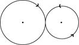
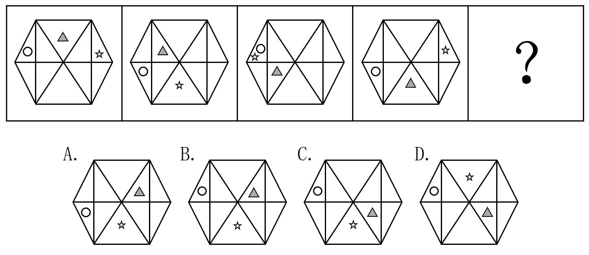
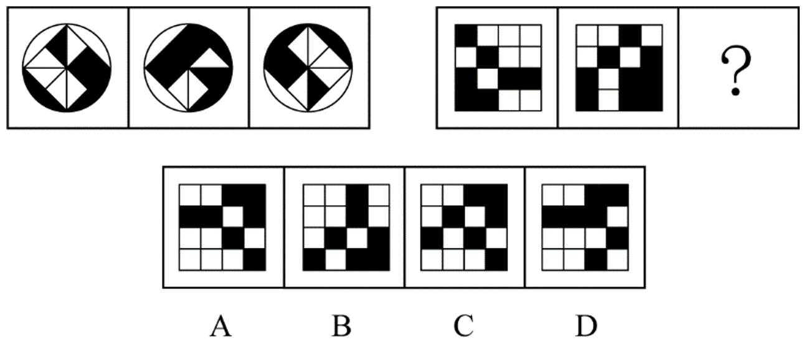
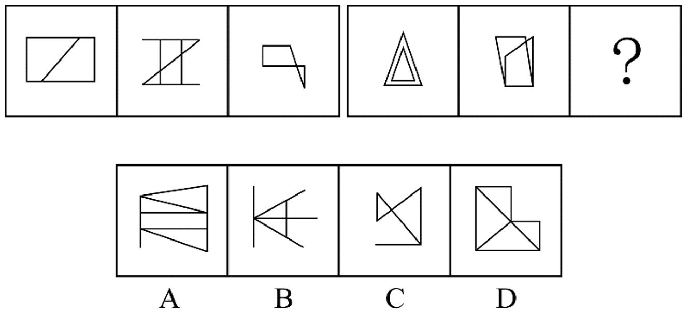
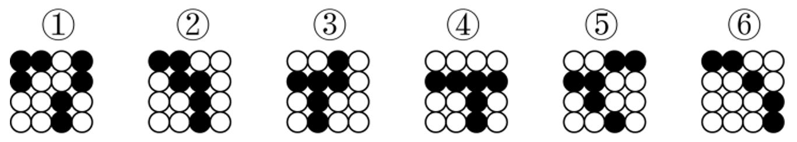
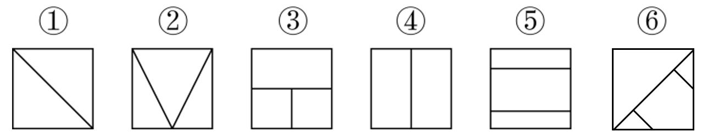

# 2020 年浙江行测（B卷） · 题目

保留原题号。来源页码按 PDF 实际页数计，从 1 开始。答案及解析另见 answers.md。

## 第 1 题 · 数量关系

`ZJ2020-B卷-001`

3，5，2，2，-3，（ ），-12
A、-5 B、-7 C、-9 D、-11

来源：[2020年0726浙江公务员考试《行测》真题（B卷）.pdf](https://github.com/dumarstoft-ship-it/xingce/blob/407016b55b49581efa3771bb59a2dee8761d982f/2020%E5%B9%B40726%E6%B5%99%E6%B1%9F%E5%85%AC%E5%8A%A1%E5%91%98%E8%80%83%E8%AF%95%E3%80%8A%E8%A1%8C%E6%B5%8B%E3%80%8B%E7%9C%9F%E9%A2%98%EF%BC%88B%E5%8D%B7%EF%BC%89.pdf)，PDF 第 1 页。

## 第 2 题 · 数量关系

`ZJ2020-B卷-002`

48，24，16，12，（ ），8
A、9 B、9.6 C、10 D、10.8

来源：[2020年0726浙江公务员考试《行测》真题（B卷）.pdf](https://github.com/dumarstoft-ship-it/xingce/blob/407016b55b49581efa3771bb59a2dee8761d982f/2020%E5%B9%B40726%E6%B5%99%E6%B1%9F%E5%85%AC%E5%8A%A1%E5%91%98%E8%80%83%E8%AF%95%E3%80%8A%E8%A1%8C%E6%B5%8B%E3%80%8B%E7%9C%9F%E9%A2%98%EF%BC%88B%E5%8D%B7%EF%BC%89.pdf)，PDF 第 1 页。

## 第 3 题 · 数量关系

`ZJ2020-B卷-003`

36，12，30，36，51，（ ），94.5
A、61 B、69 C、77 D、85

来源：[2020年0726浙江公务员考试《行测》真题（B卷）.pdf](https://github.com/dumarstoft-ship-it/xingce/blob/407016b55b49581efa3771bb59a2dee8761d982f/2020%E5%B9%B40726%E6%B5%99%E6%B1%9F%E5%85%AC%E5%8A%A1%E5%91%98%E8%80%83%E8%AF%95%E3%80%8A%E8%A1%8C%E6%B5%8B%E3%80%8B%E7%9C%9F%E9%A2%98%EF%BC%88B%E5%8D%B7%EF%BC%89.pdf)，PDF 第 1 页。

## 第 4 题 · 数量关系

`ZJ2020-B卷-004`

1，4，27，256，（ ）
A、1024 B、1620 C、3125 D、3456

来源：[2020年0726浙江公务员考试《行测》真题（B卷）.pdf](https://github.com/dumarstoft-ship-it/xingce/blob/407016b55b49581efa3771bb59a2dee8761d982f/2020%E5%B9%B40726%E6%B5%99%E6%B1%9F%E5%85%AC%E5%8A%A1%E5%91%98%E8%80%83%E8%AF%95%E3%80%8A%E8%A1%8C%E6%B5%8B%E3%80%8B%E7%9C%9F%E9%A2%98%EF%BC%88B%E5%8D%B7%EF%BC%89.pdf)，PDF 第 1 页。

## 第 5 题 · 数量关系

`ZJ2020-B卷-005`

42，40，37，32，25，（ ），1
A、2 B、6 C、10 D、14

来源：[2020年0726浙江公务员考试《行测》真题（B卷）.pdf](https://github.com/dumarstoft-ship-it/xingce/blob/407016b55b49581efa3771bb59a2dee8761d982f/2020%E5%B9%B40726%E6%B5%99%E6%B1%9F%E5%85%AC%E5%8A%A1%E5%91%98%E8%80%83%E8%AF%95%E3%80%8A%E8%A1%8C%E6%B5%8B%E3%80%8B%E7%9C%9F%E9%A2%98%EF%BC%88B%E5%8D%B7%EF%BC%89.pdf)，PDF 第 1 页。

## 第 6 题 · 数量关系

`ZJ2020-B卷-006`

四个圆均被水平、竖直直径分成四格；按原图从左到右，各圆的数值位置为：

|圆|左上|右上|左下|右下|
|---|---|---|---|---|
|1|8|18|14|4|
|2|7|3|5|9|
|3|6|8|4|2|
|4|5|10|5|?|
A、0 B、1 C、2 D、3

来源：[2020年0726浙江公务员考试《行测》真题（B卷）.pdf](https://github.com/dumarstoft-ship-it/xingce/blob/407016b55b49581efa3771bb59a2dee8761d982f/2020%E5%B9%B40726%E6%B5%99%E6%B1%9F%E5%85%AC%E5%8A%A1%E5%91%98%E8%80%83%E8%AF%95%E3%80%8A%E8%A1%8C%E6%B5%8B%E3%80%8B%E7%9C%9F%E9%A2%98%EF%BC%88B%E5%8D%B7%EF%BC%89.pdf)，PDF 第 1 页。

## 第 7 题 · 数量关系

`ZJ2020-B卷-007`

四个圆均被水平、竖直直径分成四格；按原图从左到右，各圆的数值位置为：

|圆|左上|右上|左下|右下|
|---|---|---|---|---|
|1|12|4|6|8|
|2|10|2|5|4|
|3|4|4|8|2|
|4|1|3|5|?|
A、1/5 B、1/3 C、3/5 D、1

来源：[2020年0726浙江公务员考试《行测》真题（B卷）.pdf](https://github.com/dumarstoft-ship-it/xingce/blob/407016b55b49581efa3771bb59a2dee8761d982f/2020%E5%B9%B40726%E6%B5%99%E6%B1%9F%E5%85%AC%E5%8A%A1%E5%91%98%E8%80%83%E8%AF%95%E3%80%8A%E8%A1%8C%E6%B5%8B%E3%80%8B%E7%9C%9F%E9%A2%98%EF%BC%88B%E5%8D%B7%EF%BC%89.pdf)，PDF 第 1 页。

## 第 8 题 · 数量关系

`ZJ2020-B卷-008`

四个圆均被水平、竖直直径分成四格；按原图从左到右，各圆的数值位置为：

|圆|左上|右上|左下|右下|
|---|---|---|---|---|
|1|2|4|6|8|
|2|5|12|6|18|
|3|7|12|3|9|
|4|6|16|4|?|
A、2 B、4 C、6 D、8

来源：[2020年0726浙江公务员考试《行测》真题（B卷）.pdf](https://github.com/dumarstoft-ship-it/xingce/blob/407016b55b49581efa3771bb59a2dee8761d982f/2020%E5%B9%B40726%E6%B5%99%E6%B1%9F%E5%85%AC%E5%8A%A1%E5%91%98%E8%80%83%E8%AF%95%E3%80%8A%E8%A1%8C%E6%B5%8B%E3%80%8B%E7%9C%9F%E9%A2%98%EF%BC%88B%E5%8D%B7%EF%BC%89.pdf)，PDF 第 1 页。

## 第 9 题 · 数量关系

`ZJ2020-B卷-009`

四个圆均被水平、竖直直径分成四格；按原图从左到右，各圆的数值位置为：

|圆|左上|右上|左下|右下|
|---|---|---|---|---|
|1|3|5|14|7|
|2|2|4|8|4|
|3|6|9|9|3|
|4|10|?|15|5|
A、11 B、12 C、13 D、14

来源：[2020年0726浙江公务员考试《行测》真题（B卷）.pdf](https://github.com/dumarstoft-ship-it/xingce/blob/407016b55b49581efa3771bb59a2dee8761d982f/2020%E5%B9%B40726%E6%B5%99%E6%B1%9F%E5%85%AC%E5%8A%A1%E5%91%98%E8%80%83%E8%AF%95%E3%80%8A%E8%A1%8C%E6%B5%8B%E3%80%8B%E7%9C%9F%E9%A2%98%EF%BC%88B%E5%8D%B7%EF%BC%89.pdf)，PDF 第 1 页。

## 第 10 题 · 数量关系

`ZJ2020-B卷-010`

四个圆均被水平、竖直直径分成四格；按原图从左到右，各圆的数值位置为：

|圆|左上|右上|左下|右下|
|---|---|---|---|---|
|1|1|2|3|9|
|2|2|4|2|12|
|3|1|5|1|6|
|4|3|6|2|?|
A、15 B、18 C、21 D、24

来源：[2020年0726浙江公务员考试《行测》真题（B卷）.pdf](https://github.com/dumarstoft-ship-it/xingce/blob/407016b55b49581efa3771bb59a2dee8761d982f/2020%E5%B9%B40726%E6%B5%99%E6%B1%9F%E5%85%AC%E5%8A%A1%E5%91%98%E8%80%83%E8%AF%95%E3%80%8A%E8%A1%8C%E6%B5%8B%E3%80%8B%E7%9C%9F%E9%A2%98%EF%BC%88B%E5%8D%B7%EF%BC%89.pdf)，PDF 第 1 页。

## 第 11 题 · 数量关系

`ZJ2020-B卷-011`

某会务组租了20 多辆车将2220 参会者从酒店接到活动现场。大车每次能送50 人，小车每次能送36 人，所
有车辆送2 趟，且所有车辆均满员，正好送完，则大车比小车（ ）。
A、多5 辆 B、多2 辆 C、少2 辆 D、少5 辆

来源：[2020年0726浙江公务员考试《行测》真题（B卷）.pdf](https://github.com/dumarstoft-ship-it/xingce/blob/407016b55b49581efa3771bb59a2dee8761d982f/2020%E5%B9%B40726%E6%B5%99%E6%B1%9F%E5%85%AC%E5%8A%A1%E5%91%98%E8%80%83%E8%AF%95%E3%80%8A%E8%A1%8C%E6%B5%8B%E3%80%8B%E7%9C%9F%E9%A2%98%EF%BC%88B%E5%8D%B7%EF%BC%89.pdf)，PDF 第 1、2 页。

## 第 12 题 · 数量关系

`ZJ2020-B卷-012`

用边长为0.2m 的正三角形地砖铺满一块边长为1m 的正六边形地面，需要多少块地砖？
A、30 B、60 C、150 D、180

来源：[2020年0726浙江公务员考试《行测》真题（B卷）.pdf](https://github.com/dumarstoft-ship-it/xingce/blob/407016b55b49581efa3771bb59a2dee8761d982f/2020%E5%B9%B40726%E6%B5%99%E6%B1%9F%E5%85%AC%E5%8A%A1%E5%91%98%E8%80%83%E8%AF%95%E3%80%8A%E8%A1%8C%E6%B5%8B%E3%80%8B%E7%9C%9F%E9%A2%98%EF%BC%88B%E5%8D%B7%EF%BC%89.pdf)，PDF 第 2 页。

## 第 13 题 · 数量关系

`ZJ2020-B卷-013`

一套试卷有若干道题，每题答对得10 分，答错扣5 分，不答扣3 分。小郑答对、答错、不答的题目数量依
次成等差数列，最后总分为95 分，问这套试卷共有多少道题？
A、15 B、30 C、36 D、45

来源：[2020年0726浙江公务员考试《行测》真题（B卷）.pdf](https://github.com/dumarstoft-ship-it/xingce/blob/407016b55b49581efa3771bb59a2dee8761d982f/2020%E5%B9%B40726%E6%B5%99%E6%B1%9F%E5%85%AC%E5%8A%A1%E5%91%98%E8%80%83%E8%AF%95%E3%80%8A%E8%A1%8C%E6%B5%8B%E3%80%8B%E7%9C%9F%E9%A2%98%EF%BC%88B%E5%8D%B7%EF%BC%89.pdf)，PDF 第 2 页。

## 第 14 题 · 数量关系

`ZJ2020-B卷-014`

一辆汽车第一天和第二天的行驶时间之比为3：4，第二天与第三天行驶路程相同，第三天行驶5 小时，第
一天行驶400 千米，三天全程的平均速度为80 千米/小时。问第二天的平均速度是多少千米/小时？
A、70 B、75 C、80 D、85

来源：[2020年0726浙江公务员考试《行测》真题（B卷）.pdf](https://github.com/dumarstoft-ship-it/xingce/blob/407016b55b49581efa3771bb59a2dee8761d982f/2020%E5%B9%B40726%E6%B5%99%E6%B1%9F%E5%85%AC%E5%8A%A1%E5%91%98%E8%80%83%E8%AF%95%E3%80%8A%E8%A1%8C%E6%B5%8B%E3%80%8B%E7%9C%9F%E9%A2%98%EF%BC%88B%E5%8D%B7%EF%BC%89.pdf)，PDF 第 2 页。

## 第 15 题 · 数量关系

`ZJ2020-B卷-015`

超市销售某种圆珠笔，单盒装的售价10 元，5 盒装的售价40 元，10 盒装的售价70 元，20 盒装的售价120
元。现有两家企业来采购这种圆珠笔，甲企业的预算最多正好买92 盒，乙预算最多正好购买103 盒。问，两家
企业如果合买最多比分开买多采购多少盒？
A、3 B、5 C、8 D、10

来源：[2020年0726浙江公务员考试《行测》真题（B卷）.pdf](https://github.com/dumarstoft-ship-it/xingce/blob/407016b55b49581efa3771bb59a2dee8761d982f/2020%E5%B9%B40726%E6%B5%99%E6%B1%9F%E5%85%AC%E5%8A%A1%E5%91%98%E8%80%83%E8%AF%95%E3%80%8A%E8%A1%8C%E6%B5%8B%E3%80%8B%E7%9C%9F%E9%A2%98%EF%BC%88B%E5%8D%B7%EF%BC%89.pdf)，PDF 第 2 页。

## 第 16 题 · 数量关系

`ZJ2020-B卷-016`

从分别写着1-9 数字的9 张卡中选出4 张并排列为一个四位数，其结果能被75 整除的数字：
A、不到15 个 B、15-20 个 C、21-25 个 D、超过25 个

来源：[2020年0726浙江公务员考试《行测》真题（B卷）.pdf](https://github.com/dumarstoft-ship-it/xingce/blob/407016b55b49581efa3771bb59a2dee8761d982f/2020%E5%B9%B40726%E6%B5%99%E6%B1%9F%E5%85%AC%E5%8A%A1%E5%91%98%E8%80%83%E8%AF%95%E3%80%8A%E8%A1%8C%E6%B5%8B%E3%80%8B%E7%9C%9F%E9%A2%98%EF%BC%88B%E5%8D%B7%EF%BC%89.pdf)，PDF 第 2 页。

## 第 17 题 · 数量关系

`ZJ2020-B卷-017`

火车站售票窗口一开始有若干乘客排队购票，且之后每分钟增加排队购票的乘客人数相同。从开始办理购票
手续到没有乘客排队，若开放3 个窗口,需耗时90 分钟，若开放5 个窗口，则需耗时45 分钟。问如果开放6 个
窗口，需耗时多少分钟?
A、36 B、38 C、40 D、42

来源：[2020年0726浙江公务员考试《行测》真题（B卷）.pdf](https://github.com/dumarstoft-ship-it/xingce/blob/407016b55b49581efa3771bb59a2dee8761d982f/2020%E5%B9%B40726%E6%B5%99%E6%B1%9F%E5%85%AC%E5%8A%A1%E5%91%98%E8%80%83%E8%AF%95%E3%80%8A%E8%A1%8C%E6%B5%8B%E3%80%8B%E7%9C%9F%E9%A2%98%EF%BC%88B%E5%8D%B7%EF%BC%89.pdf)，PDF 第 2 页。

## 第 18 题 · 数量关系

`ZJ2020-B卷-018`

某公园雇佣一名小丑表演骑独轮车。独轮车车轮直径为50 厘米，小丑沿如图所示8 字形轨迹骑行。轨迹为
相切的两个圆，两个圆面积比是16: 9，小圆直径为15 米。问小丑沿8 字形轨迹骑行一圈，车轮转动了多少圈?

[代码描摹高清 PNG](../../../images/code_hd/591.png) · [SVG](../../../images/code_hd/591.svg)（原图为准）

A、50 B、60 C、70 D、90

来源：[2020年0726浙江公务员考试《行测》真题（B卷）.pdf](https://github.com/dumarstoft-ship-it/xingce/blob/407016b55b49581efa3771bb59a2dee8761d982f/2020%E5%B9%B40726%E6%B5%99%E6%B1%9F%E5%85%AC%E5%8A%A1%E5%91%98%E8%80%83%E8%AF%95%E3%80%8A%E8%A1%8C%E6%B5%8B%E3%80%8B%E7%9C%9F%E9%A2%98%EF%BC%88B%E5%8D%B7%EF%BC%89.pdf)，PDF 第 2 页。

## 第 19 题 · 数量关系

`ZJ2020-B卷-019`

有两排各6 个连续的空车位,包含甲车、乙车在内的6 辆车随机停入这12 个车位中，则以下哪种情况发生的
概率最低?
A、有一排正好停了2 辆车 B、甲车和乙车停在同一排的不相邻车位
C、甲车停在某一排的中间两个车位之一 D、甲车和乙车中至少有1 辆停在靠边的车位

来源：[2020年0726浙江公务员考试《行测》真题（B卷）.pdf](https://github.com/dumarstoft-ship-it/xingce/blob/407016b55b49581efa3771bb59a2dee8761d982f/2020%E5%B9%B40726%E6%B5%99%E6%B1%9F%E5%85%AC%E5%8A%A1%E5%91%98%E8%80%83%E8%AF%95%E3%80%8A%E8%A1%8C%E6%B5%8B%E3%80%8B%E7%9C%9F%E9%A2%98%EF%BC%88B%E5%8D%B7%EF%BC%89.pdf)，PDF 第 2 页。

## 第 20 题 · 数量关系

`ZJ2020-B卷-020`

企业对25 名应聘者进行面试。已知所有应聘者的能力都不相同，面试采取5 人一组的无领导小组讨论形式，
每次面试都能对小组内5 个人的能力进行排名。问至少要进行多少次面试才能保证选出能力最强的4 个人？
A、7 B、8 C、9 D、10

来源：[2020年0726浙江公务员考试《行测》真题（B卷）.pdf](https://github.com/dumarstoft-ship-it/xingce/blob/407016b55b49581efa3771bb59a2dee8761d982f/2020%E5%B9%B40726%E6%B5%99%E6%B1%9F%E5%85%AC%E5%8A%A1%E5%91%98%E8%80%83%E8%AF%95%E3%80%8A%E8%A1%8C%E6%B5%8B%E3%80%8B%E7%9C%9F%E9%A2%98%EF%BC%88B%E5%8D%B7%EF%BC%89.pdf)，PDF 第 2 页。

## 第 21 题 · 言语理解与表达

`ZJ2020-B卷-021`

抗战小说因为题材的特殊性，一般强调英雄人物的“神圣使命”，强调军人形象塑造，________百姓形象。
而在《怒吼的平原》中，作者将普通群众纳入群像之中，军与民的笔墨虽不是________，却同样饱含深情。
依次填入划横线部分最恰当的一项是：
A、忽视 厚此薄彼 B、削弱 等量齐观 C、忽略 伯仲之间 D、淡化 平分秋色

来源：[2020年0726浙江公务员考试《行测》真题（B卷）.pdf](https://github.com/dumarstoft-ship-it/xingce/blob/407016b55b49581efa3771bb59a2dee8761d982f/2020%E5%B9%B40726%E6%B5%99%E6%B1%9F%E5%85%AC%E5%8A%A1%E5%91%98%E8%80%83%E8%AF%95%E3%80%8A%E8%A1%8C%E6%B5%8B%E3%80%8B%E7%9C%9F%E9%A2%98%EF%BC%88B%E5%8D%B7%EF%BC%89.pdf)，PDF 第 2 页。

## 第 22 题 · 言语理解与表达

`ZJ2020-B卷-022`

传统村落需要保护，是________的吗？不是，反而需要充分的理由 ____ ，尤其是对各利益相关方而言。传统村
落保护的重大意义，凸显在中华民族整体的、长远的利益上，但现实中保护的责任或________却由具体的人来承
担。
依次填入划横线部分最恰当的一项是：
A、不言自明 代价 B、自然而然 义务 C、无庸赘述 使命 D、理直气壮 后果

来源：[2020年0726浙江公务员考试《行测》真题（B卷）.pdf](https://github.com/dumarstoft-ship-it/xingce/blob/407016b55b49581efa3771bb59a2dee8761d982f/2020%E5%B9%B40726%E6%B5%99%E6%B1%9F%E5%85%AC%E5%8A%A1%E5%91%98%E8%80%83%E8%AF%95%E3%80%8A%E8%A1%8C%E6%B5%8B%E3%80%8B%E7%9C%9F%E9%A2%98%EF%BC%88B%E5%8D%B7%EF%BC%89.pdf)，PDF 第 2 页。

## 第 23 题 · 言语理解与表达

`ZJ2020-B卷-023`

徽州的一景一物，较之粗犷的西北，是________的。那马头墙、小青瓦透出的人文气息，浓郁得似乎连游客
都成了诗的一部分。粉墙黛瓦，青山绿水，全然一派水墨丹青的________。
依次填入划横线部分最恰当的一项是：
A、大相径庭 韵味 B、截然不同 氛围 C、别具一格 风格 D、无可比拟 意境

来源：[2020年0726浙江公务员考试《行测》真题（B卷）.pdf](https://github.com/dumarstoft-ship-it/xingce/blob/407016b55b49581efa3771bb59a2dee8761d982f/2020%E5%B9%B40726%E6%B5%99%E6%B1%9F%E5%85%AC%E5%8A%A1%E5%91%98%E8%80%83%E8%AF%95%E3%80%8A%E8%A1%8C%E6%B5%8B%E3%80%8B%E7%9C%9F%E9%A2%98%EF%BC%88B%E5%8D%B7%EF%BC%89.pdf)，PDF 第 2、3 页。

## 第 24 题 · 言语理解与表达

`ZJ2020-B卷-024`

传统高性能材料越来越依赖各类稀缺资源，人们想在自然界中找寻具有超物理特性天然材料的尝试一直
________，必须另辟蹊径，探寻超越常规材料性能极限的新型材料。直到21 世纪初，美国研究人员在研制“隐
身衣”的实验中利用微波技术发现了超材料的________，才宣告了超材料的诞生。
依次填入划横线部分最恰当的一项是：
A、屡试不爽 乾端坤倪 B、收效甚微 蛛丝马迹
C、困难重重 奇思妙想 D、举步维艰 一鳞半爪

来源：[2020年0726浙江公务员考试《行测》真题（B卷）.pdf](https://github.com/dumarstoft-ship-it/xingce/blob/407016b55b49581efa3771bb59a2dee8761d982f/2020%E5%B9%B40726%E6%B5%99%E6%B1%9F%E5%85%AC%E5%8A%A1%E5%91%98%E8%80%83%E8%AF%95%E3%80%8A%E8%A1%8C%E6%B5%8B%E3%80%8B%E7%9C%9F%E9%A2%98%EF%BC%88B%E5%8D%B7%EF%BC%89.pdf)，PDF 第 3 页。

## 第 25 题 · 言语理解与表达

`ZJ2020-B卷-025`

芸芸众生中的一些人，放不下自己的身段，觉得到了某个年龄某个职位，就一定要有怎样的标配，略有不足，
就觉得________。这样的人________又乏味，当把自己套进一个标准里面，就难免变得坚硬无趣，________。其
实，聪明的活法，是可以把生活过得有弹性，能屈能伸，能进能退。
依次填入划横线部分最恰当的一项是：
A、无奈 固执 斤斤计较 B、屈就 刻板 作茧自缚
C、失落 平庸 形如槁木 D、不满 可悲 碌碌无为

来源：[2020年0726浙江公务员考试《行测》真题（B卷）.pdf](https://github.com/dumarstoft-ship-it/xingce/blob/407016b55b49581efa3771bb59a2dee8761d982f/2020%E5%B9%B40726%E6%B5%99%E6%B1%9F%E5%85%AC%E5%8A%A1%E5%91%98%E8%80%83%E8%AF%95%E3%80%8A%E8%A1%8C%E6%B5%8B%E3%80%8B%E7%9C%9F%E9%A2%98%EF%BC%88B%E5%8D%B7%EF%BC%89.pdf)，PDF 第 3 页。

## 第 26 题 · 言语理解与表达

`ZJ2020-B卷-026`

近年来，我国在信息技术上取得长足进步，但仍然没有完全解决核心技术“卡脖子”的问题。面对现实，我
们既不可夜郎自大，也不能________。路是自己走出来的，突破核心技术这个难题，说到底要靠我们自己奋发有
为，加速打造“中国芯”，以自主创新________技术格局。
依次填入划横线部分最恰当的一项是：
A、一蹶不振 主导 B、妄自菲薄 重塑 C、自怨自艾 刷新 D、安之若素 构建

来源：[2020年0726浙江公务员考试《行测》真题（B卷）.pdf](https://github.com/dumarstoft-ship-it/xingce/blob/407016b55b49581efa3771bb59a2dee8761d982f/2020%E5%B9%B40726%E6%B5%99%E6%B1%9F%E5%85%AC%E5%8A%A1%E5%91%98%E8%80%83%E8%AF%95%E3%80%8A%E8%A1%8C%E6%B5%8B%E3%80%8B%E7%9C%9F%E9%A2%98%EF%BC%88B%E5%8D%B7%EF%BC%89.pdf)，PDF 第 3 页。

## 第 27 题 · 言语理解与表达

`ZJ2020-B卷-027`

在媒体市场竞争中，________是整个市场正常有序运行的根本法则。新媒体凭借超越时空的非线性传播特性、
跨边界的国际传播影响力成为新时代的________。可以说，谁掌握了新媒体，谁就走在了市场的前面。
依次填入划横线部分最恰当的一项是：
A、与时俱进 骄子 B、推陈出新 潮流 C、优胜劣汰 宠儿 D、弱肉强食 利器

来源：[2020年0726浙江公务员考试《行测》真题（B卷）.pdf](https://github.com/dumarstoft-ship-it/xingce/blob/407016b55b49581efa3771bb59a2dee8761d982f/2020%E5%B9%B40726%E6%B5%99%E6%B1%9F%E5%85%AC%E5%8A%A1%E5%91%98%E8%80%83%E8%AF%95%E3%80%8A%E8%A1%8C%E6%B5%8B%E3%80%8B%E7%9C%9F%E9%A2%98%EF%BC%88B%E5%8D%B7%EF%BC%89.pdf)，PDF 第 3 页。

## 第 28 题 · 言语理解与表达

`ZJ2020-B卷-028`

在视频网站行业,每一个视频内容获得多少点击量________，行业也会根据视频内容带来的流量分配收益，
但在线音乐平台并不公开这些数据，这就导致大家很难按照音乐作品真正带来的价值来分配收益。数据________
才能令音乐行业得以变革，也会促进优秀音乐内容的生产。
依次填入划横线部分最恰当的一项是：
A、了如指掌 精准化 B、显而易见 可视化 C、不言而喻 公开化 D、一清二楚 透明化

来源：[2020年0726浙江公务员考试《行测》真题（B卷）.pdf](https://github.com/dumarstoft-ship-it/xingce/blob/407016b55b49581efa3771bb59a2dee8761d982f/2020%E5%B9%B40726%E6%B5%99%E6%B1%9F%E5%85%AC%E5%8A%A1%E5%91%98%E8%80%83%E8%AF%95%E3%80%8A%E8%A1%8C%E6%B5%8B%E3%80%8B%E7%9C%9F%E9%A2%98%EF%BC%88B%E5%8D%B7%EF%BC%89.pdf)，PDF 第 3 页。

## 第 29 题 · 言语理解与表达

`ZJ2020-B卷-029`

金融的本质特征之一是风险管理,金触机构控风险________。与此同时,民营企业也需要管理自己的风险,要
对自己负责。因为,通过市场化的方案解决企业融资难未来将越发成为应对问题的主流，风险________才是市场
化。这是一种挑战和约束，有利于在实体经济和金融体系之间，树立一个正向的“市场化预期”。
依次填入划横线部分最恰当的一项是：
A、理所当然 自担 B、势在必行 均摊 C、大势所趋 防控 D、情有可原 规避

来源：[2020年0726浙江公务员考试《行测》真题（B卷）.pdf](https://github.com/dumarstoft-ship-it/xingce/blob/407016b55b49581efa3771bb59a2dee8761d982f/2020%E5%B9%B40726%E6%B5%99%E6%B1%9F%E5%85%AC%E5%8A%A1%E5%91%98%E8%80%83%E8%AF%95%E3%80%8A%E8%A1%8C%E6%B5%8B%E3%80%8B%E7%9C%9F%E9%A2%98%EF%BC%88B%E5%8D%B7%EF%BC%89.pdf)，PDF 第 3 页。

## 第 30 题 · 言语理解与表达

`ZJ2020-B卷-030`

天下熙熙攘攘，为稀土而来，为稀土而往。各种黑科技产品________离不开的稀土一直都是“香饽饽”，各
国都为寻找掌握更多稀土资源而________。
依次填入划横线部分最恰当的一项是：
A、根本 挖空心思 B、完全 殚思竭虑 C、须臾 绞尽脑汁 D、片刻 尽心竭力

来源：[2020年0726浙江公务员考试《行测》真题（B卷）.pdf](https://github.com/dumarstoft-ship-it/xingce/blob/407016b55b49581efa3771bb59a2dee8761d982f/2020%E5%B9%B40726%E6%B5%99%E6%B1%9F%E5%85%AC%E5%8A%A1%E5%91%98%E8%80%83%E8%AF%95%E3%80%8A%E8%A1%8C%E6%B5%8B%E3%80%8B%E7%9C%9F%E9%A2%98%EF%BC%88B%E5%8D%B7%EF%BC%89.pdf)，PDF 第 3 页。

## 第 31 题 · 言语理解与表达

`ZJ2020-B卷-031`

媒介失忆是指值得记忆信息的 ____ ，而媒介失声则是对值得记忆信息的 ____ 。迅
速、真实、客观、准确地告知、报告和记载有意义的新闻事实和信息，本应是媒介记忆中的头等大事。媒介如果
在重大社会问题或重要新闻事件上发生障碍性、麻痹性失声，对有文献和历史价值的信息熟视无睹，其实就是媒
介的不记忆和不作为，是媒介 ____ 。
依次填入划横线部分最恰当的一项是：
A、错失 无视 失责 B、丢失 漠视 失职
C、消失 轻视 渎职 D、散失 忽视 塞责

来源：[2020年0726浙江公务员考试《行测》真题（B卷）.pdf](https://github.com/dumarstoft-ship-it/xingce/blob/407016b55b49581efa3771bb59a2dee8761d982f/2020%E5%B9%B40726%E6%B5%99%E6%B1%9F%E5%85%AC%E5%8A%A1%E5%91%98%E8%80%83%E8%AF%95%E3%80%8A%E8%A1%8C%E6%B5%8B%E3%80%8B%E7%9C%9F%E9%A2%98%EF%BC%88B%E5%8D%B7%EF%BC%89.pdf)，PDF 第 3 页。

## 第 32 题 · 言语理解与表达

`ZJ2020-B卷-032`

传统的银行信贷模式是依赖担保和抵押。互联网、大数据等技术的快速 ____ 催生了金融的变革
和创新。借助大数据的应用，以科技金融的方式 ____ 传统小微业务，可以提升金融服务的质量和效
率，做到真正意义上的普惠金融。
依次填入画横线部分最恰当的一项是：
A、崛起 打造 B、更新 推动 C、启动 重构 D、迭代 介入

来源：[2020年0726浙江公务员考试《行测》真题（B卷）.pdf](https://github.com/dumarstoft-ship-it/xingce/blob/407016b55b49581efa3771bb59a2dee8761d982f/2020%E5%B9%B40726%E6%B5%99%E6%B1%9F%E5%85%AC%E5%8A%A1%E5%91%98%E8%80%83%E8%AF%95%E3%80%8A%E8%A1%8C%E6%B5%8B%E3%80%8B%E7%9C%9F%E9%A2%98%EF%BC%88B%E5%8D%B7%EF%BC%89.pdf)，PDF 第 3、4 页。

## 第 33 题 · 言语理解与表达

`ZJ2020-B卷-033`

“国学”这个概念是从日本输入的。19 世纪末，刘师培、章太炎、梁启超等接受了日本的“国学”概念，
并将其引入中国。当时引进这样一个概念，是为了和西方学问相区别，是被逼出来的。古人从不称自己的学问为
“国学”，而直称其为儒学、道学、理学、心学、佛学、玄学、子学等。“国学”概念出现之后，作为一国固有
之学问，究竟包含哪些内容，实在是各说各话，无法统一。
根据这段文字，“国学”的哪一方面不能确定？
A、诞生背景 B、具体所指 C、传播过程 D、概念来源

来源：[2020年0726浙江公务员考试《行测》真题（B卷）.pdf](https://github.com/dumarstoft-ship-it/xingce/blob/407016b55b49581efa3771bb59a2dee8761d982f/2020%E5%B9%B40726%E6%B5%99%E6%B1%9F%E5%85%AC%E5%8A%A1%E5%91%98%E8%80%83%E8%AF%95%E3%80%8A%E8%A1%8C%E6%B5%8B%E3%80%8B%E7%9C%9F%E9%A2%98%EF%BC%88B%E5%8D%B7%EF%BC%89.pdf)，PDF 第 4 页。

## 第 34 题 · 言语理解与表达

`ZJ2020-B卷-034`

文艺复兴一般被视为一场源自14 世纪意大利而后蔓延到整个欧洲的思想与艺术运动，而殖民主义则往往同
15 世纪末以来欧洲开辟新航路、发现新大陆以至对亚非拉地区的政治奴役、经济剥削、军事占领等历史发展相
联系。过去，两者的研究相隔甚远，但最近有学者敏锐地把握到两者实有一种隐蔽的叠合关系。
这段文字接下来最可能讲述的是：
A、文艺复兴如何为殖民主义铺路 B、殖民主义相关内容的研究现状
C、殖民主义对亚非拉地区的深远影响 D、文艺复兴如何引发欧洲思想艺术运动

来源：[2020年0726浙江公务员考试《行测》真题（B卷）.pdf](https://github.com/dumarstoft-ship-it/xingce/blob/407016b55b49581efa3771bb59a2dee8761d982f/2020%E5%B9%B40726%E6%B5%99%E6%B1%9F%E5%85%AC%E5%8A%A1%E5%91%98%E8%80%83%E8%AF%95%E3%80%8A%E8%A1%8C%E6%B5%8B%E3%80%8B%E7%9C%9F%E9%A2%98%EF%BC%88B%E5%8D%B7%EF%BC%89.pdf)，PDF 第 4 页。

## 第 35 题 · 言语理解与表达

`ZJ2020-B卷-035`

军事战略空间融合化指的是战略空间不再仅限于军事或战时范畴，而是融合了一个国家治国理政的各个领域
和所有时期。在和平与发展成为时代主题的大背景下，战争和冲突只发生在世界局部地区。这就要求战略主体转
变对战略空间的价值判断，把战略空间的安全目标和发展目标有机融合。冷战结束后，许多军事空间开始向军民
融合空间的方向转变，形成一股潮流。历史上，各国十分重视边境线、公海、两极、太空等战略空间的军事控制
权，而现在越来越关注的则是如何实现共同安全和共同发展的融合。
这段文字意在说明：
A、战略空间的概念已扩展至国家治理各个层面 B、军民融合是军事战略空间融合化的主要方向
C、时代主题的变化改变了军事战略空间的内涵 D、安全和发展是当前国际军事战略研究的主题

来源：[2020年0726浙江公务员考试《行测》真题（B卷）.pdf](https://github.com/dumarstoft-ship-it/xingce/blob/407016b55b49581efa3771bb59a2dee8761d982f/2020%E5%B9%B40726%E6%B5%99%E6%B1%9F%E5%85%AC%E5%8A%A1%E5%91%98%E8%80%83%E8%AF%95%E3%80%8A%E8%A1%8C%E6%B5%8B%E3%80%8B%E7%9C%9F%E9%A2%98%EF%BC%88B%E5%8D%B7%EF%BC%89.pdf)，PDF 第 4 页。

## 第 36 题 · 言语理解与表达

`ZJ2020-B卷-036`

长期的城乡二元发展格局，导致城乡在科技、人才、资金及土地等要素配置方面严重不均衡，并且农村的优
质资源还在源源不断地向城市集中，难以避免地造成农村产业萎缩乃至空心化。通过建立健全城乡融合发展机制，
推动城乡要素自由平等交换，消除城市优质要素资源向农村流动的各种障得，才能真正形成乡村产业兴旺的基础
条件。事实上，我国农村三产融合发展好的地方往往也是城乡融合发展程度高的地方。
这段文字主要说明农村三产融合发展：
A、受制于城乡二元发展格局 B、需吸引城市优质要素资源的流入
C、与城乡融合的发展水平息息相关 D、应解决城乡间资源配置不均衡的问题

来源：[2020年0726浙江公务员考试《行测》真题（B卷）.pdf](https://github.com/dumarstoft-ship-it/xingce/blob/407016b55b49581efa3771bb59a2dee8761d982f/2020%E5%B9%B40726%E6%B5%99%E6%B1%9F%E5%85%AC%E5%8A%A1%E5%91%98%E8%80%83%E8%AF%95%E3%80%8A%E8%A1%8C%E6%B5%8B%E3%80%8B%E7%9C%9F%E9%A2%98%EF%BC%88B%E5%8D%B7%EF%BC%89.pdf)，PDF 第 4 页。

## 第 37 题 · 言语理解与表达

`ZJ2020-B卷-037`

从政策沿革来看，行业出现产能过剩时，治理政策通常先从拉动内需的角度去设计。实际上，
________________。许多基础设施比较薄弱的新兴市场经济国家对传统产业产能需求还非常大，外部市场正在帮
助解决内部需求不足的问题。
填入划横线部分最恰当的一项是:
A、外部需求也是化解产能过剩的突破口 B、化解产能过剩还要更多依靠市场机制
C、化解产能过剩必然是个长期的过程 D、一味依赖市场扩容也仅仅是缓兵之计

来源：[2020年0726浙江公务员考试《行测》真题（B卷）.pdf](https://github.com/dumarstoft-ship-it/xingce/blob/407016b55b49581efa3771bb59a2dee8761d982f/2020%E5%B9%B40726%E6%B5%99%E6%B1%9F%E5%85%AC%E5%8A%A1%E5%91%98%E8%80%83%E8%AF%95%E3%80%8A%E8%A1%8C%E6%B5%8B%E3%80%8B%E7%9C%9F%E9%A2%98%EF%BC%88B%E5%8D%B7%EF%BC%89.pdf)，PDF 第 4 页。

## 第 38 题 · 言语理解与表达

`ZJ2020-B卷-038`

人们喜欢从半封闭、安全的住宅中，往外眺望心目中理想的景色。如果能自由选择，他们选择的居家环境总
是两者兼顾，一方面是安全的避难所，另一方面则视野辽阔，以便向外发展和觅食。不同性别的人，选择可能稍
有差异，至少在西方风景画家中是如此：女性画家强调安全的居所，前景通常不大；男性画家则强调开阔的前景。
此外，女画家似乎比较喜欢把人物的位置安排在居所内或附近；反观男画家，常常把人物安排到一望无际的空间
中。
对这段文字理解错误的是:
A、人们的择居倾向是主要话题，性别比较是衍生话题
B、人们在选择住宅时首先考虑安全，也渴望亲近自然
C、可以看出作者更赞赏男画家对住宅开阔前景的喜好
D、可以推断作者认为的理想住宅的前景不可能是森林

来源：[2020年0726浙江公务员考试《行测》真题（B卷）.pdf](https://github.com/dumarstoft-ship-it/xingce/blob/407016b55b49581efa3771bb59a2dee8761d982f/2020%E5%B9%B40726%E6%B5%99%E6%B1%9F%E5%85%AC%E5%8A%A1%E5%91%98%E8%80%83%E8%AF%95%E3%80%8A%E8%A1%8C%E6%B5%8B%E3%80%8B%E7%9C%9F%E9%A2%98%EF%BC%88B%E5%8D%B7%EF%BC%89.pdf)，PDF 第 4 页。

## 第 39 题 · 言语理解与表达

`ZJ2020-B卷-039`

从古代开始，对修辞的研究，就一直包含着伦理的层面。所谓修辞，也就是使用语言来有效说服他人的技巧、
技艺或艺术。修辞这种公共活语的伦理价值包括好的动机、对他人的养意、话语内容的真实。离开或背弃了这样
的伦理价值，言论技巧就会成为一种不正当的修辞，一种为达目的可以无所不用的手段，一种不正当的诡辩或巧
言。
这段文字的中心话题是：
A、公共话语的修辞 B、修辞的伦理价值 C、伦理价值的内涵 D、反对诡辩或巧言

来源：[2020年0726浙江公务员考试《行测》真题（B卷）.pdf](https://github.com/dumarstoft-ship-it/xingce/blob/407016b55b49581efa3771bb59a2dee8761d982f/2020%E5%B9%B40726%E6%B5%99%E6%B1%9F%E5%85%AC%E5%8A%A1%E5%91%98%E8%80%83%E8%AF%95%E3%80%8A%E8%A1%8C%E6%B5%8B%E3%80%8B%E7%9C%9F%E9%A2%98%EF%BC%88B%E5%8D%B7%EF%BC%89.pdf)，PDF 第 5 页。

## 第 40 题 · 言语理解与表达

`ZJ2020-B卷-040`

把环卫工群体的人力资源利用起来，将之与规范共享单车停放的需求对接，是多赢之举：兼管单车虽然会加
重环卫工的劳动负担，但他们的收入也会增加；环卫工参与管理单车，有利于单车企业降低损耗和成本，将更多
资金用在企业发展上；对于城市管理来说，单车摆放有秩序，市容市貌也会更好。
这段文字意在说明：
A、兼管单车能够增加环卫工收入 B、城市管理应整合各方资源优势
C、环卫工兼管单车可以一举多赢 D、共享经济需多方参与才能共赢

来源：[2020年0726浙江公务员考试《行测》真题（B卷）.pdf](https://github.com/dumarstoft-ship-it/xingce/blob/407016b55b49581efa3771bb59a2dee8761d982f/2020%E5%B9%B40726%E6%B5%99%E6%B1%9F%E5%85%AC%E5%8A%A1%E5%91%98%E8%80%83%E8%AF%95%E3%80%8A%E8%A1%8C%E6%B5%8B%E3%80%8B%E7%9C%9F%E9%A2%98%EF%BC%88B%E5%8D%B7%EF%BC%89.pdf)，PDF 第 5 页。

## 第 41 题 · 言语理解与表达

`ZJ2020-B卷-041`

①于是，无数的天文爱好者冒着眼眸被灼伤的风险，持续追寻这颗行星的踪迹
②祝融星，这颗曾经被热捧的行星是物理学发展史最好的注脚，它的“出现”和“消失”都十分精彩
③《追捕祝融星》一书里，这场漫长博弈中的理论和实践的冲突被摆在读者的眼前。科学家内心的矛盾和挣扎也
纤毫毕现
④原来，祝融星根本不存在
⑤直到1915 年，爱因斯坦顶着巨大的压力提出广义相对论，才为这场持续数百年的追寻画上句号
⑥自从牛顿奠定经典力学理论以来，无数人将祝融星奉为圭臬，即使发现水星的轨道偏离理论预言，也只是相信
在更靠近太阳的地方，是它的存在干扰了水星轨道
将以上6 个句子重新排列，语序正确的是：
A、②④③⑥⑤① B、②⑥①⑤④③ C、⑥③④②①⑤ D、⑥⑤①④③②

来源：[2020年0726浙江公务员考试《行测》真题（B卷）.pdf](https://github.com/dumarstoft-ship-it/xingce/blob/407016b55b49581efa3771bb59a2dee8761d982f/2020%E5%B9%B40726%E6%B5%99%E6%B1%9F%E5%85%AC%E5%8A%A1%E5%91%98%E8%80%83%E8%AF%95%E3%80%8A%E8%A1%8C%E6%B5%8B%E3%80%8B%E7%9C%9F%E9%A2%98%EF%BC%88B%E5%8D%B7%EF%BC%89.pdf)，PDF 第 5 页。

## 第 42 题 · 言语理解与表达

`ZJ2020-B卷-042`

数字经济的发展与个人信息保护本不应是非此即彼的选择。然而，无论是传统产业的兴衰，还是近年来经济
新业态的更迭，许多教训在提醒我们，发展与规范极易顾此失彼。数据是数字经济的“粮食”，而数字经济则被
看作是中国经济实现弯道超车的良机。然而，数字经济与信息数据保护之间的冲突已日益凸显。个人信息保护基
本规范缺位，监管执行无力且迟缓，平台侵权频发，诸多难题倘若不能尽快破解，最终必然拖累数字经济本身。
这段文字意在强调：
A、中国发展数字经济须先建立规范有序的市场 B、数字经济时代依法依规保护个人信息迫在眉睫
C、数据收集与个人权益保护之间的矛盾难以调和 D、迅猛发展的数字经济不可避免地带来数据安全问题

来源：[2020年0726浙江公务员考试《行测》真题（B卷）.pdf](https://github.com/dumarstoft-ship-it/xingce/blob/407016b55b49581efa3771bb59a2dee8761d982f/2020%E5%B9%B40726%E6%B5%99%E6%B1%9F%E5%85%AC%E5%8A%A1%E5%91%98%E8%80%83%E8%AF%95%E3%80%8A%E8%A1%8C%E6%B5%8B%E3%80%8B%E7%9C%9F%E9%A2%98%EF%BC%88B%E5%8D%B7%EF%BC%89.pdf)，PDF 第 5 页。

## 第 43 题 · 言语理解与表达

`ZJ2020-B卷-043`

不可否认，数学在经济学、管理学研究中有广泛的应用，为推动学术研究和科学决策发挥了积极作用。但是，
学术研究应以问题为导向，而不是以技术为导向，数学方法只是工具和手段，不是目的。研究实践中，一些论文
只用文字或辅以简单的图表，学术水平依然很高；有的论文没有使用数学模型，明白晓畅，即使非专业人士都能
读懂。说到底，论文是用来表达思想和观点的，优秀的论文应兼具思想启迪性、理论创造性、通俗可读性。
根据这段文字，作者最可能想批评的是：
A、学术论文存在片面追求数理模型的倾向 B、经管研究类论文缺乏深度、创新和易读性
C、学术研究成果在一定程度上与现实需求脱节 D、学术评价中“唯论文”、重数量、功利化的现状

来源：[2020年0726浙江公务员考试《行测》真题（B卷）.pdf](https://github.com/dumarstoft-ship-it/xingce/blob/407016b55b49581efa3771bb59a2dee8761d982f/2020%E5%B9%B40726%E6%B5%99%E6%B1%9F%E5%85%AC%E5%8A%A1%E5%91%98%E8%80%83%E8%AF%95%E3%80%8A%E8%A1%8C%E6%B5%8B%E3%80%8B%E7%9C%9F%E9%A2%98%EF%BC%88B%E5%8D%B7%EF%BC%89.pdf)，PDF 第 5 页。

## 第 44 题 · 言语理解与表达

`ZJ2020-B卷-044`

荣格说：“一切文化将最终积淀为人格。”对家的依恋和向往，构成了中国人十百年来的文化人格，以至于
亲情眷顾成为中国人深入骨髓的文化胎记，过年回家成为春节最重要的节日仅式。年复一年，亿万个家庭的团圆
故事总会在春节集中上演，“人类最大规模的周期性迁徙”成为春节这股文化潮汐持久不衰的生动见证。
关于划线的段首句的作用，解释错误的是：
A、为观点提供有力的论据 B、增强现象描述的说服力
C、可以让表达更简洁凝练 D、是对段旨的提炼和概括

来源：[2020年0726浙江公务员考试《行测》真题（B卷）.pdf](https://github.com/dumarstoft-ship-it/xingce/blob/407016b55b49581efa3771bb59a2dee8761d982f/2020%E5%B9%B40726%E6%B5%99%E6%B1%9F%E5%85%AC%E5%8A%A1%E5%91%98%E8%80%83%E8%AF%95%E3%80%8A%E8%A1%8C%E6%B5%8B%E3%80%8B%E7%9C%9F%E9%A2%98%EF%BC%88B%E5%8D%B7%EF%BC%89.pdf)，PDF 第 5 页。

## 第 45 题 · 言语理解与表达

`ZJ2020-B卷-045`

家长们担心孩子过度依赖手机会损害视力、看到不良信息。但值得注意的是，除了这些浅表层次的影响外，
最重要的在于移动学习提高了学生的信息搜索能力，却也因答案的易得性而忽略了学生分析能力、创造能力的训
练，这些才是学习最重要、最核心的部分。
这段文字意在强调：
A、家长们为孩子过度依赖手机感到焦虑 B、过度依赖手机会对学生身体健康不利
C、移动学习提高了学生的信息搜索能力 D、移动学习对训练分析和创造能力不利

来源：[2020年0726浙江公务员考试《行测》真题（B卷）.pdf](https://github.com/dumarstoft-ship-it/xingce/blob/407016b55b49581efa3771bb59a2dee8761d982f/2020%E5%B9%B40726%E6%B5%99%E6%B1%9F%E5%85%AC%E5%8A%A1%E5%91%98%E8%80%83%E8%AF%95%E3%80%8A%E8%A1%8C%E6%B5%8B%E3%80%8B%E7%9C%9F%E9%A2%98%EF%BC%88B%E5%8D%B7%EF%BC%89.pdf)，PDF 第 5、6 页。

## 第 46 题 · 判断推理

`ZJ2020-B卷-046`

从所给的四个选项中，选择最合适的一个填入问号处，使之呈现一定的规律性：

来源：[2020年0726浙江公务员考试《行测》真题（B卷）.pdf](https://github.com/dumarstoft-ship-it/xingce/blob/407016b55b49581efa3771bb59a2dee8761d982f/2020%E5%B9%B40726%E6%B5%99%E6%B1%9F%E5%85%AC%E5%8A%A1%E5%91%98%E8%80%83%E8%AF%95%E3%80%8A%E8%A1%8C%E6%B5%8B%E3%80%8B%E7%9C%9F%E9%A2%98%EF%BC%88B%E5%8D%B7%EF%BC%89.pdf)，PDF 第 6 页。

## 第 47 题 · 判断推理

`ZJ2020-B卷-047`

从所给的四个选项中，选择最合适的一个填入问号处，使之呈现一定的规律性：

来源：[2020年0726浙江公务员考试《行测》真题（B卷）.pdf](https://github.com/dumarstoft-ship-it/xingce/blob/407016b55b49581efa3771bb59a2dee8761d982f/2020%E5%B9%B40726%E6%B5%99%E6%B1%9F%E5%85%AC%E5%8A%A1%E5%91%98%E8%80%83%E8%AF%95%E3%80%8A%E8%A1%8C%E6%B5%8B%E3%80%8B%E7%9C%9F%E9%A2%98%EF%BC%88B%E5%8D%B7%EF%BC%89.pdf)，PDF 第 6 页。

## 第 48 题 · 判断推理

`ZJ2020-B卷-048`

从所给的四个选项中，选择最合适的一个填入问号处，使之呈现一定的规律性：

来源：[2020年0726浙江公务员考试《行测》真题（B卷）.pdf](https://github.com/dumarstoft-ship-it/xingce/blob/407016b55b49581efa3771bb59a2dee8761d982f/2020%E5%B9%B40726%E6%B5%99%E6%B1%9F%E5%85%AC%E5%8A%A1%E5%91%98%E8%80%83%E8%AF%95%E3%80%8A%E8%A1%8C%E6%B5%8B%E3%80%8B%E7%9C%9F%E9%A2%98%EF%BC%88B%E5%8D%B7%EF%BC%89.pdf)，PDF 第 6 页。

## 第 49 题 · 判断推理

`ZJ2020-B卷-049`

把下面的六个图形分为两类，使每一个图形都有各自的共同特征或规律。分类正确的一项是：

A、①②③，④⑤⑥ B、①②⑥，③④⑤ C、①②④，③⑤⑥ D、①④⑥，②③⑤

来源：[2020年0726浙江公务员考试《行测》真题（B卷）.pdf](https://github.com/dumarstoft-ship-it/xingce/blob/407016b55b49581efa3771bb59a2dee8761d982f/2020%E5%B9%B40726%E6%B5%99%E6%B1%9F%E5%85%AC%E5%8A%A1%E5%91%98%E8%80%83%E8%AF%95%E3%80%8A%E8%A1%8C%E6%B5%8B%E3%80%8B%E7%9C%9F%E9%A2%98%EF%BC%88B%E5%8D%B7%EF%BC%89.pdf)，PDF 第 6 页。

## 第 50 题 · 判断推理

`ZJ2020-B卷-050`

把下面的六个图形分为两类，使每一个图形都有各自的共同特征或规律。分类正确的一项是：

A、①②③，④⑤⑥ B、①②⑤，③④⑥ C、①②④，③⑤⑥ D、①④⑤，②③⑥

来源：[2020年0726浙江公务员考试《行测》真题（B卷）.pdf](https://github.com/dumarstoft-ship-it/xingce/blob/407016b55b49581efa3771bb59a2dee8761d982f/2020%E5%B9%B40726%E6%B5%99%E6%B1%9F%E5%85%AC%E5%8A%A1%E5%91%98%E8%80%83%E8%AF%95%E3%80%8A%E8%A1%8C%E6%B5%8B%E3%80%8B%E7%9C%9F%E9%A2%98%EF%BC%88B%E5%8D%B7%EF%BC%89.pdf)，PDF 第 6 页。

## 第 51 题 · 判断推理

`ZJ2020-B卷-051`

体象障碍是指一个人强迫性地认为自己身体的某些部分有严重的缺陷，并采取特殊的方式来掩盖或“修复”。
而这些被感受到的缺陷，通常是想象出来的；即便缺陷确实存在，它的严重性也是被夸大的。
根据上述定义，下列符合体象障碍表现的是：
A、爱美的小王在拍完证件照后让摄影师为其修图
B、爱干净的小李每天早上花一小时在卫生间洗漱
C、外表不突出的小高经常宅在家中，不喜欢参加社交活动
D、身高170 厘米的张女士认为自己身材矮小，每次出门必穿高跟鞋

来源：[2020年0726浙江公务员考试《行测》真题（B卷）.pdf](https://github.com/dumarstoft-ship-it/xingce/blob/407016b55b49581efa3771bb59a2dee8761d982f/2020%E5%B9%B40726%E6%B5%99%E6%B1%9F%E5%85%AC%E5%8A%A1%E5%91%98%E8%80%83%E8%AF%95%E3%80%8A%E8%A1%8C%E6%B5%8B%E3%80%8B%E7%9C%9F%E9%A2%98%EF%BC%88B%E5%8D%B7%EF%BC%89.pdf)，PDF 第 6、7 页。

## 第 52 题 · 判断推理

`ZJ2020-B卷-052`

信息影响法则指的是人们往往会对极为熟悉的、形象生动的、特点鲜明的信息产生积极的心理反应，不仅表
现得非常敏感，而且容易印象深刻。
根据上述定义，下列没有反映信息影响法则的是：
A、小郑在电视中看到某洗发水广告，他觉得葫芦形产品包装很可爱，于是去超市买了这款洗发水
B、小林最近加班多，觉得颈部不适，同事推荐给他一款配乐颈椎按摩仪，他试用了一下，觉得效果不错
C、许多小朋友爱看某款动画片，当商场里出现该动画片里相关人物的玩偶时，小朋友们都会特别兴奋
D、小李在阅读一本推理小说时，发现作者的写法和自己之前看过的小说完全不同，因此他产生了更大的兴趣

来源：[2020年0726浙江公务员考试《行测》真题（B卷）.pdf](https://github.com/dumarstoft-ship-it/xingce/blob/407016b55b49581efa3771bb59a2dee8761d982f/2020%E5%B9%B40726%E6%B5%99%E6%B1%9F%E5%85%AC%E5%8A%A1%E5%91%98%E8%80%83%E8%AF%95%E3%80%8A%E8%A1%8C%E6%B5%8B%E3%80%8B%E7%9C%9F%E9%A2%98%EF%BC%88B%E5%8D%B7%EF%BC%89.pdf)，PDF 第 7 页。

## 第 53 题 · 判断推理

`ZJ2020-B卷-053`

市场补缺者战略是指行业中相对弱小的企业，在竞争中为避免与实力强大的企业正面冲突，选择未被满足的
细分市场，向细分市场提供专门的产品或服务，以谋求生存与发展的战略。
根据上述定义，下列属于市场补缺者战略的是：
A、某小型培训机构通过降低学费、免费接送等方法吸引生源
B、某网商将市场上深受喜爱的卡通形象印制在水杯、优盘上出售，销量很好
C、某新成立的化妆品公司专门开发生产市场上较为稀缺的适合老年人使用的护肤品
D、某小型服装生产企业将今年市场上的流行元素融入设计中，生产出物美价廉的女装

来源：[2020年0726浙江公务员考试《行测》真题（B卷）.pdf](https://github.com/dumarstoft-ship-it/xingce/blob/407016b55b49581efa3771bb59a2dee8761d982f/2020%E5%B9%B40726%E6%B5%99%E6%B1%9F%E5%85%AC%E5%8A%A1%E5%91%98%E8%80%83%E8%AF%95%E3%80%8A%E8%A1%8C%E6%B5%8B%E3%80%8B%E7%9C%9F%E9%A2%98%EF%BC%88B%E5%8D%B7%EF%BC%89.pdf)，PDF 第 7 页。

## 第 54 题 · 判断推理

`ZJ2020-B卷-054`

单务合同是指一方只享有权利而不尽义务，另一方只尽义务而不享有权利的合同，该合同中，当事人的权利
义务不存在对应关系。
根据上述定义，下列属于单务合同的是：
A、甲因资金周转困难，与乙签订合同，约定将个人名下的一辆越野车抵押给乙，乙一次性出借5 万元给甲
B、甲与乙签订合同，合同约定甲一次性支付乙10 万元，乙为甲提供市场调研与营销策略服务，期限为2 年
C、甲与乙准备结婚，甲的父母将名下的一处房产赠予甲，并签订合同，约定该房产仅赠予甲，非夫妻共有财产
D、甲被公司派至海外工作1 年，甲将个人电脑、家庭影院等贵重设备委托乙保管，并签订合同，支付乙1000 元
保管费

来源：[2020年0726浙江公务员考试《行测》真题（B卷）.pdf](https://github.com/dumarstoft-ship-it/xingce/blob/407016b55b49581efa3771bb59a2dee8761d982f/2020%E5%B9%B40726%E6%B5%99%E6%B1%9F%E5%85%AC%E5%8A%A1%E5%91%98%E8%80%83%E8%AF%95%E3%80%8A%E8%A1%8C%E6%B5%8B%E3%80%8B%E7%9C%9F%E9%A2%98%EF%BC%88B%E5%8D%B7%EF%BC%89.pdf)，PDF 第 7 页。

## 第 55 题 · 判断推理

`ZJ2020-B卷-055`

联边是一种为了表达的需要，在特定的语言环境中，连用三个以上的联边字（即偏旁部首相同的字）的修辞
方式。运用联边的修辞手法，通过形旁表义，往往具有一定的形象性，看到形旁，人们会对其所表意义产生形象
上的联想。
根据上述定义，以下哪项不属于联边？
A、腾欢今日新天地，澎湃潮流沸江海 B、但见云暗江心，波涛滚滚，杳无踪影
C、他一个人叽哩咕噜地说些不满意的话 D、烟锁池塘柳，桃燃锦江堤，炮镇海城楼

来源：[2020年0726浙江公务员考试《行测》真题（B卷）.pdf](https://github.com/dumarstoft-ship-it/xingce/blob/407016b55b49581efa3771bb59a2dee8761d982f/2020%E5%B9%B40726%E6%B5%99%E6%B1%9F%E5%85%AC%E5%8A%A1%E5%91%98%E8%80%83%E8%AF%95%E3%80%8A%E8%A1%8C%E6%B5%8B%E3%80%8B%E7%9C%9F%E9%A2%98%EF%BC%88B%E5%8D%B7%EF%BC%89.pdf)，PDF 第 7 页。

## 第 56 题 · 判断推理

`ZJ2020-B卷-056`

射箭∶靶心
A、购买∶卖家 B、审判∶法庭 C、投标∶项目 D、出发∶起点

来源：[2020年0726浙江公务员考试《行测》真题（B卷）.pdf](https://github.com/dumarstoft-ship-it/xingce/blob/407016b55b49581efa3771bb59a2dee8761d982f/2020%E5%B9%B40726%E6%B5%99%E6%B1%9F%E5%85%AC%E5%8A%A1%E5%91%98%E8%80%83%E8%AF%95%E3%80%8A%E8%A1%8C%E6%B5%8B%E3%80%8B%E7%9C%9F%E9%A2%98%EF%BC%88B%E5%8D%B7%EF%BC%89.pdf)，PDF 第 7 页。

## 第 57 题 · 判断推理

`ZJ2020-B卷-057`

萧条∶欣欣向荣
A、激进∶墨守成规 B、全面∶以偏概全 C、默契∶心照不宣 D、统一∶众叛亲离

来源：[2020年0726浙江公务员考试《行测》真题（B卷）.pdf](https://github.com/dumarstoft-ship-it/xingce/blob/407016b55b49581efa3771bb59a2dee8761d982f/2020%E5%B9%B40726%E6%B5%99%E6%B1%9F%E5%85%AC%E5%8A%A1%E5%91%98%E8%80%83%E8%AF%95%E3%80%8A%E8%A1%8C%E6%B5%8B%E3%80%8B%E7%9C%9F%E9%A2%98%EF%BC%88B%E5%8D%B7%EF%BC%89.pdf)，PDF 第 7 页。

## 第 58 题 · 判断推理

`ZJ2020-B卷-058`

支援∶雪中送炭
A、了解∶洞若观火 B、打击∶祸起萧墙 C、打扮∶天生丽质 D、配合∶锦上添花

来源：[2020年0726浙江公务员考试《行测》真题（B卷）.pdf](https://github.com/dumarstoft-ship-it/xingce/blob/407016b55b49581efa3771bb59a2dee8761d982f/2020%E5%B9%B40726%E6%B5%99%E6%B1%9F%E5%85%AC%E5%8A%A1%E5%91%98%E8%80%83%E8%AF%95%E3%80%8A%E8%A1%8C%E6%B5%8B%E3%80%8B%E7%9C%9F%E9%A2%98%EF%BC%88B%E5%8D%B7%EF%BC%89.pdf)，PDF 第 7 页。

## 第 59 题 · 判断推理

`ZJ2020-B卷-059`

无知∶教育
A、落后∶与时俱进 B、保守∶解放思想 C、经济∶反腐倡廉 D、温饱∶改革开放

来源：[2020年0726浙江公务员考试《行测》真题（B卷）.pdf](https://github.com/dumarstoft-ship-it/xingce/blob/407016b55b49581efa3771bb59a2dee8761d982f/2020%E5%B9%B40726%E6%B5%99%E6%B1%9F%E5%85%AC%E5%8A%A1%E5%91%98%E8%80%83%E8%AF%95%E3%80%8A%E8%A1%8C%E6%B5%8B%E3%80%8B%E7%9C%9F%E9%A2%98%EF%BC%88B%E5%8D%B7%EF%BC%89.pdf)，PDF 第 7 页。

## 第 60 题 · 判断推理

`ZJ2020-B卷-060`

保温杯∶玻璃杯
A、望远镜∶显微镜 B、自行车∶三轮车 C、睡裙∶真丝裙 D、白炽灯∶LED 灯

来源：[2020年0726浙江公务员考试《行测》真题（B卷）.pdf](https://github.com/dumarstoft-ship-it/xingce/blob/407016b55b49581efa3771bb59a2dee8761d982f/2020%E5%B9%B40726%E6%B5%99%E6%B1%9F%E5%85%AC%E5%8A%A1%E5%91%98%E8%80%83%E8%AF%95%E3%80%8A%E8%A1%8C%E6%B5%8B%E3%80%8B%E7%9C%9F%E9%A2%98%EF%BC%88B%E5%8D%B7%EF%BC%89.pdf)，PDF 第 7 页。

## 第 61 题 · 判断推理

`ZJ2020-B卷-061`

一项对准父亲饮食状况对后代影响的追踪研究发现，作为准父亲的男性，如果在有下一代之前，因饮食过量
出现了肥胖症，那么他的孩子更容易出现肥胖症，而这一几率与母亲的体重关系不大；而当准父亲饮食匮乏并经
历了饥饿的威胁时，那么他的孩子更容易出现心血管疾病。因此，该研究认为：准父亲的饮食状况会影响后代的
健康。
以上哪项如果为真，最能支持上述结论？
A、有不少体重严重超标的孩子，其父亲并没有出现体重超标的情况
B、父亲的营养状况塑造其传递的生殖细胞的信息，这影响孩子的生理机能
C、如果孩子的父亲患有心血管疾病，那么这个孩子成年后得该病的几率会大大增加
D、准父亲如果年龄过大或者有抽烟等不良生活习惯，其孩子出现新生儿缺陷的概率就会增高

来源：[2020年0726浙江公务员考试《行测》真题（B卷）.pdf](https://github.com/dumarstoft-ship-it/xingce/blob/407016b55b49581efa3771bb59a2dee8761d982f/2020%E5%B9%B40726%E6%B5%99%E6%B1%9F%E5%85%AC%E5%8A%A1%E5%91%98%E8%80%83%E8%AF%95%E3%80%8A%E8%A1%8C%E6%B5%8B%E3%80%8B%E7%9C%9F%E9%A2%98%EF%BC%88B%E5%8D%B7%EF%BC%89.pdf)，PDF 第 7、8 页。

## 第 62 题 · 判断推理

`ZJ2020-B卷-062`

对于设在花园小区内的社区养老机构，多数人认为老人们不仅可以在一起下棋聊天，愉悦身心，还能发挥余
热，帮助其他居民。但老王提出反对意见，认为社区养老机构带来噪音污染，影响居民正常生活。
以下哪项如果为真，最能反驳老王的意见？
A、花园小区处于闹市区，噪音污染一直较重
B、部分居民对社区养老机构因为不了解而存在误会
C、老人们开展娱乐活动时的噪音低于日常生活的噪音
D、未办社区养老机构前，噪音污染也是小区居民反映的主要问题

来源：[2020年0726浙江公务员考试《行测》真题（B卷）.pdf](https://github.com/dumarstoft-ship-it/xingce/blob/407016b55b49581efa3771bb59a2dee8761d982f/2020%E5%B9%B40726%E6%B5%99%E6%B1%9F%E5%85%AC%E5%8A%A1%E5%91%98%E8%80%83%E8%AF%95%E3%80%8A%E8%A1%8C%E6%B5%8B%E3%80%8B%E7%9C%9F%E9%A2%98%EF%BC%88B%E5%8D%B7%EF%BC%89.pdf)，PDF 第 8 页。

## 第 63 题 · 判断推理

`ZJ2020-B卷-063`

某国一位经济学家指出：“除非该国采取大刀阔斧的举措来根治经济的顽疾，否则经济不可能稳健增长。没
有经济稳健增长，公共债务就会不断攀升。”
由此可以推出：
A、如果公共债务不断攀升，则该国没有采取大刀阔斧的举措来根治经济的顽疾
B、只有该国不采取大刀阔斧的举措来根治经济的顽疾，公共债务才会不断攀升
C、如果该国采取大刀阔斧的举措来根治经济的顽疾，则公共债务就不会不断攀升
D、如果公共债务没有不断攀升，说明该国采取了大刀阔斧的举措来根治经济的顽疾

来源：[2020年0726浙江公务员考试《行测》真题（B卷）.pdf](https://github.com/dumarstoft-ship-it/xingce/blob/407016b55b49581efa3771bb59a2dee8761d982f/2020%E5%B9%B40726%E6%B5%99%E6%B1%9F%E5%85%AC%E5%8A%A1%E5%91%98%E8%80%83%E8%AF%95%E3%80%8A%E8%A1%8C%E6%B5%8B%E3%80%8B%E7%9C%9F%E9%A2%98%EF%BC%88B%E5%8D%B7%EF%BC%89.pdf)，PDF 第 8 页。

## 第 64 题 · 判断推理

`ZJ2020-B卷-064`

研究人员招募了697 名想要戒烟的吸烟者，把他们分为两组。第一组“快速戒烟”，即在戒烟当天停止吸烟；
第二组“逐步戒烟”，设定一个停止吸烟的日期，在一个月内逐渐减少吸烟数量。一个月后，“快速戒烟”组戒
烟成功的比率为49%，而“逐步戒烟”组则为39%。因此，研究人员认为“快速戒烟”成功率比“逐步戒烟”高。
以下哪项如果为真，最能支持上述结论？
A、相对于逐步戒烟,快速戒烟对心脏的损害更小
B、戒烟半年后，快速戒烟组仍想吸烟的欲望比逐步戒烟组低
C、快速戒烟组在戒烟过程中承受的精神压力比逐步戒烟组小
D、快速戒烟组5~15 年后发生中风的危险会降到不吸烟者的程度

来源：[2020年0726浙江公务员考试《行测》真题（B卷）.pdf](https://github.com/dumarstoft-ship-it/xingce/blob/407016b55b49581efa3771bb59a2dee8761d982f/2020%E5%B9%B40726%E6%B5%99%E6%B1%9F%E5%85%AC%E5%8A%A1%E5%91%98%E8%80%83%E8%AF%95%E3%80%8A%E8%A1%8C%E6%B5%8B%E3%80%8B%E7%9C%9F%E9%A2%98%EF%BC%88B%E5%8D%B7%EF%BC%89.pdf)，PDF 第 8 页。

## 第 65 题 · 判断推理

`ZJ2020-B卷-065`

研究发现，人们在社交媒体上花费的时间越长，越容易感到孤独。研究人员招募了1787 名19 岁至32 岁的
成年人，让他们完成一份问卷。调查发现，在社交媒体上每天花费时间超过120 分钟的人感受到的孤独，大约是
那些每天费时少于30 分钟的人的两倍。研究人员解释说，这可能是因为人们在社交媒体上花的时间越多，现实
世界中与人交流的时间就越少，因此越容易感到孤独。
以下哪项如果为真，最能削弱上述研究结论？
A、越容易感到孤独的人越喜欢用社交媒体
B、越喜欢用社交媒体的人，对生活的满意度越低
C、人们越来越喜欢通过社交媒体来了解其他人的生活
D、人们喜欢在社交媒体上发布积极经历，容易使接收此类信息的人心态失衡

来源：[2020年0726浙江公务员考试《行测》真题（B卷）.pdf](https://github.com/dumarstoft-ship-it/xingce/blob/407016b55b49581efa3771bb59a2dee8761d982f/2020%E5%B9%B40726%E6%B5%99%E6%B1%9F%E5%85%AC%E5%8A%A1%E5%91%98%E8%80%83%E8%AF%95%E3%80%8A%E8%A1%8C%E6%B5%8B%E3%80%8B%E7%9C%9F%E9%A2%98%EF%BC%88B%E5%8D%B7%EF%BC%89.pdf)，PDF 第 8 页。

## 第 66 题 · 判断推理

`ZJ2020-B卷-066`

一般消毒用的酒精浓度为70%～75%，此浓度的酒精渗透性最好，杀毒效果也最好，浓度更高的话，反而达
不到消毒作用。因此，酒精浓度越高，消毒效果不一定越好。
以下哪项如果为真，最能支持上述结论？
A、即使浓度低于60%，酒精也可以杀灭一部分病毒和细菌
B、酒精通过渗透进入病原体并破坏其完整性，以达到杀毒效果
C、高浓度的酒精会刺激皮肤，吸收表皮大量的水分，造成皮肤脱水
D、浓度为95% 的酒精可在病毒表面形成一层防止酒精渗透的保护壳

来源：[2020年0726浙江公务员考试《行测》真题（B卷）.pdf](https://github.com/dumarstoft-ship-it/xingce/blob/407016b55b49581efa3771bb59a2dee8761d982f/2020%E5%B9%B40726%E6%B5%99%E6%B1%9F%E5%85%AC%E5%8A%A1%E5%91%98%E8%80%83%E8%AF%95%E3%80%8A%E8%A1%8C%E6%B5%8B%E3%80%8B%E7%9C%9F%E9%A2%98%EF%BC%88B%E5%8D%B7%EF%BC%89.pdf)，PDF 第 8 页。

## 第 67 题 · 判断推理

`ZJ2020-B卷-067`

国外某大学的团队研究了102 种不同的毒蛇，调查了这些蛇的毒液、食物以及栖息地状况，发现生活在树上
或水中这样三维环境中的蛇，毒性低于二维环境中（即地面）的蛇。研究人员推测，这是因为生活在三维环境中
的蛇能遇到更多东西，所以遇到猎物的频率也更高，不需要毒性很强的毒液来确保每次捕猎都能成功。
以下哪项如果为真，最能质疑研究人员的推测？
A、不同的毒蛇分泌的毒液，毒性差别很大
B、三维环境中的动物比二维环境中的更为灵活，更难捕捉
C、同一种毒蛇在不同季节分泌的毒液，毒性成分并不完全相同
D、树上或水中遇到的猎物比地面上的小很多，蛇需要捕食更多才能果腹

来源：[2020年0726浙江公务员考试《行测》真题（B卷）.pdf](https://github.com/dumarstoft-ship-it/xingce/blob/407016b55b49581efa3771bb59a2dee8761d982f/2020%E5%B9%B40726%E6%B5%99%E6%B1%9F%E5%85%AC%E5%8A%A1%E5%91%98%E8%80%83%E8%AF%95%E3%80%8A%E8%A1%8C%E6%B5%8B%E3%80%8B%E7%9C%9F%E9%A2%98%EF%BC%88B%E5%8D%B7%EF%BC%89.pdf)，PDF 第 8、9 页。

## 第 68 题 · 判断推理

`ZJ2020-B卷-068`

荷兰研究人员培育出了一种人造牛肉。从牛的肌肉组织中分离出干细胞，放入营养液中，促进细胞生长和繁
衍，进而合成“牛肉”。有媒体据此认为，这种人造牛肉将会在未来取代真正的牛肉，人类可以停止对肉牛乃至
其他牲畜的养殖。
以下哪项如果为真，最能质疑该媒体的观点？
A、目前人造牛肉的制造成本极高，无法大规模生产
B、很多人在品尝人造牛肉后认为其口感比真牛肉差
C、推广人造牛肉有助于人类应对未来的肉类紧缺问题
D、制备人造牛肉的干细胞需要从健康的圈养牛身上获取

来源：[2020年0726浙江公务员考试《行测》真题（B卷）.pdf](https://github.com/dumarstoft-ship-it/xingce/blob/407016b55b49581efa3771bb59a2dee8761d982f/2020%E5%B9%B40726%E6%B5%99%E6%B1%9F%E5%85%AC%E5%8A%A1%E5%91%98%E8%80%83%E8%AF%95%E3%80%8A%E8%A1%8C%E6%B5%8B%E3%80%8B%E7%9C%9F%E9%A2%98%EF%BC%88B%E5%8D%B7%EF%BC%89.pdf)，PDF 第 9 页。

## 第 69 题 · 判断推理

`ZJ2020-B卷-069`

很多人认为大飞机比小飞机更安全，更愿意选择乘坐大飞机，因为大飞机飞得很平稳，而小飞机常常会有颠
簸。
以下哪项如果为真，最能支持上述论证？
A、飞机颠簸的原因是气流的扰动，气流扰动不会影响飞机安全
B、某航空公司统计显示，小飞机的准点率低于大飞机的准点率
C、飞机在对流层飞行时颠簸最剧烈，小飞机主要在对流层飞行
D、飞机的安全性主要取决于设备的可靠性，与飞机的大小无关

来源：[2020年0726浙江公务员考试《行测》真题（B卷）.pdf](https://github.com/dumarstoft-ship-it/xingce/blob/407016b55b49581efa3771bb59a2dee8761d982f/2020%E5%B9%B40726%E6%B5%99%E6%B1%9F%E5%85%AC%E5%8A%A1%E5%91%98%E8%80%83%E8%AF%95%E3%80%8A%E8%A1%8C%E6%B5%8B%E3%80%8B%E7%9C%9F%E9%A2%98%EF%BC%88B%E5%8D%B7%EF%BC%89.pdf)，PDF 第 9 页。

## 第 70 题 · 判断推理

`ZJ2020-B卷-070`

为登上月球，有科学家开始进行“月球导航”的验证，他们表示目前地球轨道上的GPS 卫星发射的信号，在
月球上可以接收使用，定位精度能达到200 米至300 米。有研究人员认为，月球导航很快即可实现。
以下哪项如果为真，最能质疑上述结论？
A、目前的探月活动中，各国主要采用的是基于地面的测控进行导航定位
B、月球航天器可通过在一段时间内收到几颗卫星在某个弧段发来的数据，最终计算出自己的轨道
C、月球导航最直接有效的途径是各国合力在近月空间建设具备定位、授时功能的时空基准，打造一套“月球导
航卫星系统”
D、月球航天器要具备远距离信号接收能力，就需要大天线，而从航天器研制、发射角度来说，天线越小越好，
这对矛盾暂时无法破解

来源：[2020年0726浙江公务员考试《行测》真题（B卷）.pdf](https://github.com/dumarstoft-ship-it/xingce/blob/407016b55b49581efa3771bb59a2dee8761d982f/2020%E5%B9%B40726%E6%B5%99%E6%B1%9F%E5%85%AC%E5%8A%A1%E5%91%98%E8%80%83%E8%AF%95%E3%80%8A%E8%A1%8C%E6%B5%8B%E3%80%8B%E7%9C%9F%E9%A2%98%EF%BC%88B%E5%8D%B7%EF%BC%89.pdf)，PDF 第 9 页。
