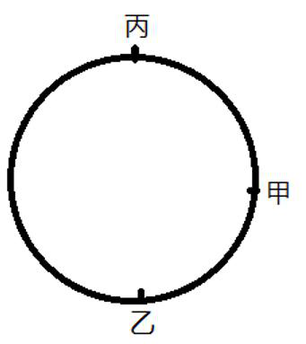
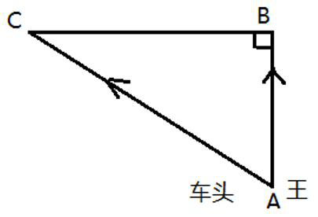
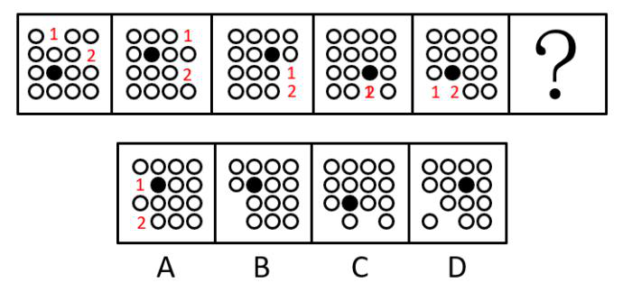
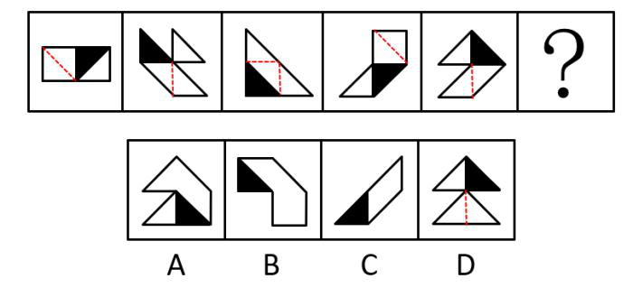
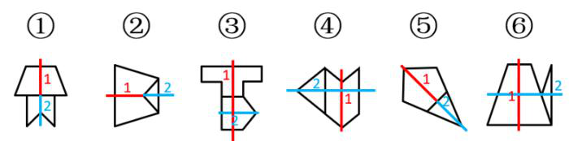
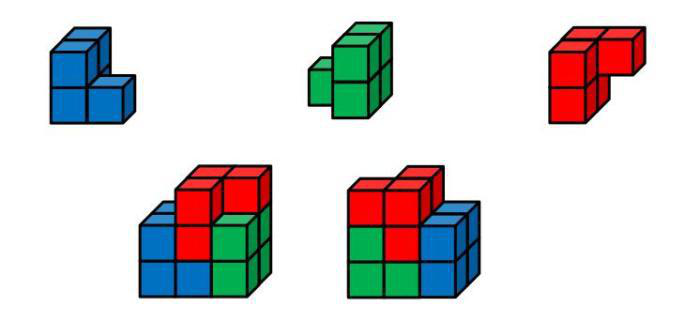

# 2021 年浙江行测（A类） · 答案与解析

以下为来源原文的结构化转写；缺失及冲突答案不补写。

## 第 21 题 · 言语理解与表达

参考答案：**B**

正确答案是： B
解析
第一空，根据横线前“此后的篆刻，不再局限于······而是······”可知，横线处所填词语应表达
篆刻艺术突破了原有功能的局限，在实用的基础上能够实现表达情趣志向的功能，B 项“超越”指超出，越过，
符合文意，保留。A 项“淡化”指使（问题、情感等）逐渐冷淡下来，变得不被重视或无关紧要，文段并未体现
出印章的实用功能不被重视之意，文段强调的是在实用功能基础上多了一项表达志向的功能，故与文意不符，排
除；C 项“摆脱”指脱离（牵制、束缚、困难等不利的情况），D 项“偏离”指因出现偏差而离开确定的轨道、
方向等，二者一般用于消极的语境当中，而文段并未体现出消极的感情色彩，故与文段感情色彩不符，均排除。
第二空，代入验证，B 项“独特”指独有的，特别的，用在此处表达印章以特有的方式表达审美追求之意，符合
文意，当选。
故正确答案为B。
【文段出处】人民日报《中国的印章与篆刻艺术：方寸之地 气象万千》

来源：[2021年浙江省公务员录用考试《行测》题（A类）参考答案及解析.pdf](https://github.com/dumarstoft-ship-it/xingce/blob/407016b55b49581efa3771bb59a2dee8761d982f/2021%E5%B9%B4%E6%B5%99%E6%B1%9F%E7%9C%81%E5%85%AC%E5%8A%A1%E5%91%98%E5%BD%95%E7%94%A8%E8%80%83%E8%AF%95%E3%80%8A%E8%A1%8C%E6%B5%8B%E3%80%8B%E9%A2%98%EF%BC%88A%E7%B1%BB%EF%BC%89%E5%8F%82%E8%80%83%E7%AD%94%E6%A1%88%E5%8F%8A%E8%A7%A3%E6%9E%90.pdf)，PDF 第 6、7 页。

## 第 22 题 · 言语理解与表达

参考答案：**C**

正确答案是： C
解析
本题可从第二空入手。根据文段开篇可知，竹常被文人高士用作表达高尚品格的象征物，而“寓意兴寄愈益丰厚”
更体现出墨竹所代表的思想情感不断丰富厚重，由此可知墨竹这一题材在中国画史之中应是备受关注和喜爱的，
语义程度较重。A 项“历久弥新”指经历长久的时间而更加鲜活，更加有活力，更显价值，可与“愈益丰厚”相
对应，保留；C 项“经久不衰”形容某事或某人经历很长时间仍旧保持旺盛状态，语境相符，保留。B 项“独树
一帜”比喻独闯一条路子，自成一家，多强调“独创性”，文段未体现这层意思，排除；D 项“引人注目”指吸
引人们注意，语义过轻，无法表达墨竹这一题材在中国画史中的重要地位，排除。
第一空，横线处体现墨竹与“书、画、道”三者的关系。C 项“综合体”原指由多个功能、属性不同的个体而组
成的整体，此处可引申理解为，“墨竹”是“书、画、道”三者均有涉及，可综合三者，符合语境信息，当选。
A 项“粘合剂”指使两个物体互相黏合的物质，用于此处表示将“书、画、道”三者合在一起，与文意不符，排
除。
故正确答案为C。
常识补充：“兴寄”指寄托在作品中的思想感情。
【文段出处】《千年经典，墨竹一派》

来源：[2021年浙江省公务员录用考试《行测》题（A类）参考答案及解析.pdf](https://github.com/dumarstoft-ship-it/xingce/blob/407016b55b49581efa3771bb59a2dee8761d982f/2021%E5%B9%B4%E6%B5%99%E6%B1%9F%E7%9C%81%E5%85%AC%E5%8A%A1%E5%91%98%E5%BD%95%E7%94%A8%E8%80%83%E8%AF%95%E3%80%8A%E8%A1%8C%E6%B5%8B%E3%80%8B%E9%A2%98%EF%BC%88A%E7%B1%BB%EF%BC%89%E5%8F%82%E8%80%83%E7%AD%94%E6%A1%88%E5%8F%8A%E8%A7%A3%E6%9E%90.pdf)，PDF 第 7 页。

## 第 23 题 · 言语理解与表达

参考答案：**A**

正确答案是： A
解析
第一空，横线处搭配“生涩文字”，A 项“佶屈聱牙”形容文词艰涩生僻、拗口难懂，搭配得当，保留。B 项“言
之无物”指文章或言论空空洞洞，没有实际内容，C 项“言过其实”指言语浮夸，超过实际才能，D 项“咬文嚼
字”形容过分地斟酌字句，均无法体现出文字的“生涩”，与“生涩文字”搭配不当，排除。
第二空，代入验证，“夸夸其谈的说教辞令”搭配恰当，且“没有夸夸其谈”对应后文“朴实无华却字字珠玑”，
A 项当选。
故正确答案为A。
【文段出处】《<良训传家>：如春风化雨一般启迪心智》

来源：[2021年浙江省公务员录用考试《行测》题（A类）参考答案及解析.pdf](https://github.com/dumarstoft-ship-it/xingce/blob/407016b55b49581efa3771bb59a2dee8761d982f/2021%E5%B9%B4%E6%B5%99%E6%B1%9F%E7%9C%81%E5%85%AC%E5%8A%A1%E5%91%98%E5%BD%95%E7%94%A8%E8%80%83%E8%AF%95%E3%80%8A%E8%A1%8C%E6%B5%8B%E3%80%8B%E9%A2%98%EF%BC%88A%E7%B1%BB%EF%BC%89%E5%8F%82%E8%80%83%E7%AD%94%E6%A1%88%E5%8F%8A%E8%A7%A3%E6%9E%90.pdf)，PDF 第 7 页。

## 第 24 题 · 言语理解与表达

参考答案：**C**

正确答案是： C
解析
第一空，搭配理念。C 项“深入人心”意思是指理论、学说、政策等为人们深切了解和信服，与“理念”搭配得
当，符合文意，保留。A 项“众所周知”指大家普遍知道的，“理念”表意为看法、思想，无法知晓是否得知，
搭配不当，排除；B 项“根深蒂固”比喻基础深厚，不容易动摇，一般适用于较消极的语境，与文段语境不符，
排除；D 项“牢不可破”指坚固、紧密不能摧毁或拆开，与“理念”搭配不当，排除。
第二空，代入验证，横线处表明中国内在要求的“理念”与“国家乃至全球的可持续发展目标”是一致的。C 项
“同向而行”指向同一个方向前进，可体现其目标的一致性，符合文意，当选。
故正确答案为C。
【文段出处】《新华国际时评：要适应中国对“洋垃圾”说不》

来源：[2021年浙江省公务员录用考试《行测》题（A类）参考答案及解析.pdf](https://github.com/dumarstoft-ship-it/xingce/blob/407016b55b49581efa3771bb59a2dee8761d982f/2021%E5%B9%B4%E6%B5%99%E6%B1%9F%E7%9C%81%E5%85%AC%E5%8A%A1%E5%91%98%E5%BD%95%E7%94%A8%E8%80%83%E8%AF%95%E3%80%8A%E8%A1%8C%E6%B5%8B%E3%80%8B%E9%A2%98%EF%BC%88A%E7%B1%BB%EF%BC%89%E5%8F%82%E8%80%83%E7%AD%94%E6%A1%88%E5%8F%8A%E8%A7%A3%E6%9E%90.pdf)，PDF 第 7 页。

## 第 25 题 · 言语理解与表达

参考答案：**B**

正确答案是： B
解析
第一空，由前文“不同性质的书放在一起读，能起到对比和转换视角的作用”可知，横线处论述的是不同情况下
读不同性质书的作用，A 项“张弛有度”指松紧有度，收放自如，D 项“劳逸结合”意思是工作和休息相结合，
两项均强调能有效合理地安排工作，收放自如，文段主要论述读不同性质书的作用，而不是工作的安排，排除；
C 项“一举两得”意思是做一件事得到两方面的好处，文段中没有体现两个方面的好处，排除。B 项“相得益彰”
是指两个人或两件事物互相配合，双方的能力和作用更能显示出来，能体现出读不同性质书可起到对比和转换视
角的作用，保留。
第二空，代入验证，由“并非······而是······”可知，横线处填入的成语与“有益的精神调节”
意思相反，即说明科学家闲暇时吟诗作赋是不好的，B 项“附庸风雅”指缺乏文化修养的人为了装点门面而结交
文人，可以用来说明闲暇时吟诗作赋是不好的，当选。
故正确答案为B。
【文段出处】人民网《干部谈读书：对比读书提高思维穿透力》

来源：[2021年浙江省公务员录用考试《行测》题（A类）参考答案及解析.pdf](https://github.com/dumarstoft-ship-it/xingce/blob/407016b55b49581efa3771bb59a2dee8761d982f/2021%E5%B9%B4%E6%B5%99%E6%B1%9F%E7%9C%81%E5%85%AC%E5%8A%A1%E5%91%98%E5%BD%95%E7%94%A8%E8%80%83%E8%AF%95%E3%80%8A%E8%A1%8C%E6%B5%8B%E3%80%8B%E9%A2%98%EF%BC%88A%E7%B1%BB%EF%BC%89%E5%8F%82%E8%80%83%E7%AD%94%E6%A1%88%E5%8F%8A%E8%A7%A3%E6%9E%90.pdf)，PDF 第 7、8 页。

## 第 26 题 · 言语理解与表达

参考答案：**A**

正确答案是： A
解析
第一空，根据“网络空间”“现实世界”及“已经成为未成年人成长中密不可分的一部分”可知，“网络空间”
是未成年人日常生活的一部分，由此横线需表达“网络空间”从“现实世界”延伸出来的意思。A 项“延展”指
延伸，扩展，可表达“网络世界”是“现实世界”的延伸，符合文意，保留。B 项“虚化”指模糊，不实际存在，
“网络世界”里的东西是虚拟的，而“网络世界”是真实存在，不符合文意，排除；C 项“放大”指由小变大，
文段并未体现“网络世界”是“现实世界”的放大，排除；D 项“深入”有由浅入深的意思，但文段并未体现“网
络空间”和“现实世界”谁深谁浅，排除。
第二空，代入验证，A 项“隔离”指断绝接触，断绝往来。填入此处表示把未成年人和互联网强制分开，是不可
取也很难实现的，符合文意，当选。
故正确答案为A。
【文段出处】《加强未成年人网络素养教育》

来源：[2021年浙江省公务员录用考试《行测》题（A类）参考答案及解析.pdf](https://github.com/dumarstoft-ship-it/xingce/blob/407016b55b49581efa3771bb59a2dee8761d982f/2021%E5%B9%B4%E6%B5%99%E6%B1%9F%E7%9C%81%E5%85%AC%E5%8A%A1%E5%91%98%E5%BD%95%E7%94%A8%E8%80%83%E8%AF%95%E3%80%8A%E8%A1%8C%E6%B5%8B%E3%80%8B%E9%A2%98%EF%BC%88A%E7%B1%BB%EF%BC%89%E5%8F%82%E8%80%83%E7%AD%94%E6%A1%88%E5%8F%8A%E8%A7%A3%E6%9E%90.pdf)，PDF 第 8 页。

## 第 27 题 · 言语理解与表达

参考答案：**A**

正确答案是： A
解析
第一空，根据“水雷虽老”和横线处的双引号可知，横线处所填词语为形象化表达，且由后文“构成相当威胁”
可知，横线处的词语应体现水雷威力巨大，可对军舰造成严重打击。对比选项，A 项“噩梦”、B 项“天敌”、D
项“克星”均可体现出水雷对于军舰的严重打击，与文意相符，保留；C 项“仇家”是指仇人，并未体现水雷对
军舰的威胁，与文意不符，排除。
第二空，由“所以”可知，前文是对横线处的解释，由“构成相当成胁”“水雷研发难度低，制造成本也不高”
以及“可以大批量地制造、储备，战时可以大面积布设”可知水雷的性价比较高，可广泛使用，故横线处的词语
应体现出水雷的常见和常用之意。对比选项，A 项“必备”是指必须具备，可体现其常见及常用，与文意相符，
当选；B 项“王牌”是指扑克牌游戏中最强的牌，比喻最有力的人物、手段、事物等，文段并未提及水雷是海军
武器库中军事威力最强的武器，与文意不符，排除；D 项“主力”意思是主要力量，文段并未提及海军武器库中
的主次之分，与文意不符，排除。
故正确答案为A。
【文段出处】光明网《GBU-62B 型水雷如何做到“增程迅击”》

来源：[2021年浙江省公务员录用考试《行测》题（A类）参考答案及解析.pdf](https://github.com/dumarstoft-ship-it/xingce/blob/407016b55b49581efa3771bb59a2dee8761d982f/2021%E5%B9%B4%E6%B5%99%E6%B1%9F%E7%9C%81%E5%85%AC%E5%8A%A1%E5%91%98%E5%BD%95%E7%94%A8%E8%80%83%E8%AF%95%E3%80%8A%E8%A1%8C%E6%B5%8B%E3%80%8B%E9%A2%98%EF%BC%88A%E7%B1%BB%EF%BC%89%E5%8F%82%E8%80%83%E7%AD%94%E6%A1%88%E5%8F%8A%E8%A7%A3%E6%9E%90.pdf)，PDF 第 8 页。

## 第 28 题 · 言语理解与表达

参考答案：**B**

正确答案是： B
解析
本题可从第二空入手，由“论文成为了学术评价的唯一依据”以及“计算论文篇数、比拼刊物级别”可知，学术
评价演变成不好的指标，感情色彩偏消极。A 项“蜕变”指（人或事物）发生质变，中性词，与文段感情色彩不
符，排除；C 项“演绎”是一种纯粹形式的推理方法，要求前提与结论间具有必然性之可推关系，文段并未体现
出这一必然推理关系，并且感情色彩与文段不符，排除；D 项“沦落”指被驱逐流落，陷入不良的境地，文段并
未体现“学术评价”陷入困境，而是强调“学术评价”变成另外相对消极的指标，排除。B 项“异化”指相似或
相同的事物逐渐变得不相似或不相同，与文意相符，保留。
第一空，代入验证，由“论文依然是学术成果主流呈现方式”可知，横线处所填词语应表达占据重要地位之意。
B 项“硬通货”原是指国际信用较好、币值稳定、汇价呈坚挺状态的货币，用在此处是一种形象化表达，强调“论
文”依然是主流，符合文意，当选。
故正确答案为B。
【文段出处】《构建多元评价体系，破除“唯论文”》

来源：[2021年浙江省公务员录用考试《行测》题（A类）参考答案及解析.pdf](https://github.com/dumarstoft-ship-it/xingce/blob/407016b55b49581efa3771bb59a2dee8761d982f/2021%E5%B9%B4%E6%B5%99%E6%B1%9F%E7%9C%81%E5%85%AC%E5%8A%A1%E5%91%98%E5%BD%95%E7%94%A8%E8%80%83%E8%AF%95%E3%80%8A%E8%A1%8C%E6%B5%8B%E3%80%8B%E9%A2%98%EF%BC%88A%E7%B1%BB%EF%BC%89%E5%8F%82%E8%80%83%E7%AD%94%E6%A1%88%E5%8F%8A%E8%A7%A3%E6%9E%90.pdf)，PDF 第 8 页。

## 第 29 题 · 言语理解与表达

参考答案：**D**

正确答案是： D
解析
第一空，根据横线后“就出现了······之类的末世电影”，“末世”二字体现出对未来世界很悲观，说明
横线处应体现出对未来世界的看法。C 项“世界观”、D 项“未来观”均符合文意，保留；A 项“历史观”意为
人们对社会历史的根本观点、总的看法，B 项“审美观”意为审美主体对美的总的看法，均未能体现对未来世界
的看法，排除。
第二空，根据横线前“但现在这种题材的电影早已沦为套路”，“套路”二字体现出现在的科幻电影模仿早年的
科幻电影，所以横线处应体现出模仿、效仿之意。D 项“东施效颦”比喻盲目模仿，效果很坏，符合文意，当选；
C 项“狗尾续貂”比喻拿不好的东西接在好东西的后面，显得好坏不相称（多指写文章），与“模仿”无关，排
除。
故正确答案为D。
【文段出处】《被改变的，可能不仅是中国科幻电影》

来源：[2021年浙江省公务员录用考试《行测》题（A类）参考答案及解析.pdf](https://github.com/dumarstoft-ship-it/xingce/blob/407016b55b49581efa3771bb59a2dee8761d982f/2021%E5%B9%B4%E6%B5%99%E6%B1%9F%E7%9C%81%E5%85%AC%E5%8A%A1%E5%91%98%E5%BD%95%E7%94%A8%E8%80%83%E8%AF%95%E3%80%8A%E8%A1%8C%E6%B5%8B%E3%80%8B%E9%A2%98%EF%BC%88A%E7%B1%BB%EF%BC%89%E5%8F%82%E8%80%83%E7%AD%94%E6%A1%88%E5%8F%8A%E8%A7%A3%E6%9E%90.pdf)，PDF 第 8、9 页。

## 第 30 题 · 言语理解与表达

参考答案：**C**

正确答案是： C
解析
第一空，根据文意，横线处语意与后文“捡到篮里都是菜”形成对应，含义相同，“捡到篮里都是菜”意思是不
加选择、不分好坏全都要，C 项“泥沙俱下”指好坏性质不同的人或事物混杂在一起，D 项“鱼龙混杂”指好人
和坏人混在一起，均符合文意，保留；A 项“囫囵吞枣”指读书等不加分析地笼统接受，强调读书学习，与文意
不符，排除；B 项“化繁为简”指越是复杂的事情越是可以用简单的方法去化解，往往会得到意想不到的效果，
与文意不符，排除。
第二空，与“产业规律”搭配，C 项“尊重规律”为常见搭配，当选；D 项“遵守”指依照规定行动而不违背，
如“遵守时间”“遵守规则”，“规律”并非是人为掌控的，搭配不当，排除。
故正确答案为C。
【文段出处】澎湃新闻《「社论」搞芯片也要尊重产业规律》

来源：[2021年浙江省公务员录用考试《行测》题（A类）参考答案及解析.pdf](https://github.com/dumarstoft-ship-it/xingce/blob/407016b55b49581efa3771bb59a2dee8761d982f/2021%E5%B9%B4%E6%B5%99%E6%B1%9F%E7%9C%81%E5%85%AC%E5%8A%A1%E5%91%98%E5%BD%95%E7%94%A8%E8%80%83%E8%AF%95%E3%80%8A%E8%A1%8C%E6%B5%8B%E3%80%8B%E9%A2%98%EF%BC%88A%E7%B1%BB%EF%BC%89%E5%8F%82%E8%80%83%E7%AD%94%E6%A1%88%E5%8F%8A%E8%A7%A3%E6%9E%90.pdf)，PDF 第 9 页。

## 第 31 题 · 言语理解与表达

参考答案：**D**

正确答案是： D
解析
第一空，横线处搭配“网络‘喷子’”，且对应前文“网络并非法外之地”体现出网络喷子在法律面前无处可躲
之意。D 项“无处遁形”指没有地方可以隐藏形迹、身影，赤裸裸地展现在人们面前，与文意相符，保留。A 项
“原形毕露”强调本来面目完全暴露，与文意不符，排除；B 项“谈虎色变”泛指一提到自己害怕的事物连脸色
都变了，C 项“惴惴不安”形容因害怕或担心而不安，文段未体现出网络“喷子”担忧害怕的心理，均与文意不
符，排除。
第二空，代入验证，搭配“网络空间”，D 项“清朗”指清净明朗，搭配恰当，当选。
故正确答案为D。
【文段出处】《侮辱诽谤江歌及其母亲者被判刑：网络“喷子”当自省》

来源：[2021年浙江省公务员录用考试《行测》题（A类）参考答案及解析.pdf](https://github.com/dumarstoft-ship-it/xingce/blob/407016b55b49581efa3771bb59a2dee8761d982f/2021%E5%B9%B4%E6%B5%99%E6%B1%9F%E7%9C%81%E5%85%AC%E5%8A%A1%E5%91%98%E5%BD%95%E7%94%A8%E8%80%83%E8%AF%95%E3%80%8A%E8%A1%8C%E6%B5%8B%E3%80%8B%E9%A2%98%EF%BC%88A%E7%B1%BB%EF%BC%89%E5%8F%82%E8%80%83%E7%AD%94%E6%A1%88%E5%8F%8A%E8%A7%A3%E6%9E%90.pdf)，PDF 第 9 页。

## 第 32 题 · 言语理解与表达

参考答案：**A**

正确答案是： A
解析
第一空，对应“跨界解读”且根据“和”可知，横线处与“丰富性”并列，要体现出跨界解读给经典出版带来的
多元化效果，A 项“维度”意为人们观察、思考与表述某事物的思维角度，D 项“角度”意为看问题的出发点，
放入此处均可形容跨界解读给经典带来的多元化效果，符合文意，保留。B 项“力度”意为力量的大小程度或者
功力的深度，侧重力量大小，与文意不符，排除；C 项“深度”意为深浅程度或触及本质的程度，与文意不符，
排除。
第二空，从“文史爱好者”到“文艺爱好者”可知，横线处要体现跨界解读的读者群范围扩大，A 项“扩展”意
为向外伸展，扩大，符合文意，当选。D 项“推广”指扩大事物使用的范围或起作用的范围，而文段并不是扩大
读者群的使用范围，与文意不符，排除。
故正确答案为A。
【文段出处】《经典解读类图书为什么适逢盛世》

来源：[2021年浙江省公务员录用考试《行测》题（A类）参考答案及解析.pdf](https://github.com/dumarstoft-ship-it/xingce/blob/407016b55b49581efa3771bb59a2dee8761d982f/2021%E5%B9%B4%E6%B5%99%E6%B1%9F%E7%9C%81%E5%85%AC%E5%8A%A1%E5%91%98%E5%BD%95%E7%94%A8%E8%80%83%E8%AF%95%E3%80%8A%E8%A1%8C%E6%B5%8B%E3%80%8B%E9%A2%98%EF%BC%88A%E7%B1%BB%EF%BC%89%E5%8F%82%E8%80%83%E7%AD%94%E6%A1%88%E5%8F%8A%E8%A7%A3%E6%9E%90.pdf)，PDF 第 9 页。

## 第 33 题 · 言语理解与表达

参考答案：**A**

正确答案是： A
解析
第一空，根据横线前“小说家、编剧、段子手、营销号，以及每一个发帖的网友，都在以自己的方式讲述着关于
时代的故事”可知，与记者共同讲故事的主体有很多，且根据横线后“好记者不会迷失航向”，可以得知，横线
处要表达的语义对应前半部分多个讲故事的主体，要表示出虽然讲述关于时代故事的主体有很多，但好记者不会
在这些主体的竞争中迷失方向，A 项“百舸争流”指上百条船，争着在水上疾驰，对应多个讲故事的主体，且对
应“航向”的形象化表述，C 项“千帆竞发”指事物蓬勃发展，均符合文意，保留。B 项“风雨同舟”指共同患
难，文段中没有困难出现，与文意不符，排除；D 项“逆水行舟”指不努力就要后退，文段中并无对应，排除。
第二空，搭配“职业尊严”且根据横线前后“不会······会······”的相反关系，可以得知，横线
处的语义为好的记者会对职业尊严有着更清醒明确的感受，A 项“体悟”指在实践中找感觉、感悟，在行动中感
受、探索，对应前文在与其他讲故事主体的竞争中获得感悟，符合文意，当选。C 项“剖析”指的是分析、辨析，
与文段对应不当，排除。
故正确答案为A。
【文段出处】《【记者节献词】每个时代都需要讲故事的人》

来源：[2021年浙江省公务员录用考试《行测》题（A类）参考答案及解析.pdf](https://github.com/dumarstoft-ship-it/xingce/blob/407016b55b49581efa3771bb59a2dee8761d982f/2021%E5%B9%B4%E6%B5%99%E6%B1%9F%E7%9C%81%E5%85%AC%E5%8A%A1%E5%91%98%E5%BD%95%E7%94%A8%E8%80%83%E8%AF%95%E3%80%8A%E8%A1%8C%E6%B5%8B%E3%80%8B%E9%A2%98%EF%BC%88A%E7%B1%BB%EF%BC%89%E5%8F%82%E8%80%83%E7%AD%94%E6%A1%88%E5%8F%8A%E8%A7%A3%E6%9E%90.pdf)，PDF 第 9、10 页。

## 第 34 题 · 言语理解与表达

参考答案：**D**

正确答案是： D
解析
横线在文段中间，需考虑与前后文的衔接。整个文段都是围绕“反垄断”进行介绍，横线前介绍“垄断”及“反
垄断”没有明确标准，“反垄断”限制过大，可能会造成不良影响。横线后通过“标志性案例”可知，企业目前
的情况也受到了反垄断的影响。横线处应体现前文无明确标准及后文对企业的影响，对应D 项。
A 项，“平台经济领域竞争呈现出的新特点” 整个文段均未体现，排除；
B 项，“因此”表总结，论述互联网产业未来发展方向，与前文所述内容无关，无法衔接后文，排除；
C 项，“处理好政府与市场的关系，简政放权、优化服务”，后文并未体现，衔接不当，排除。
故正确答案为D。
【文段出处】《互联网行业不是反垄断法外之地》

来源：[2021年浙江省公务员录用考试《行测》题（A类）参考答案及解析.pdf](https://github.com/dumarstoft-ship-it/xingce/blob/407016b55b49581efa3771bb59a2dee8761d982f/2021%E5%B9%B4%E6%B5%99%E6%B1%9F%E7%9C%81%E5%85%AC%E5%8A%A1%E5%91%98%E5%BD%95%E7%94%A8%E8%80%83%E8%AF%95%E3%80%8A%E8%A1%8C%E6%B5%8B%E3%80%8B%E9%A2%98%EF%BC%88A%E7%B1%BB%EF%BC%89%E5%8F%82%E8%80%83%E7%AD%94%E6%A1%88%E5%8F%8A%E8%A7%A3%E6%9E%90.pdf)，PDF 第 10 页。

## 第 35 题 · 言语理解与表达

参考答案：**A**

正确答案是： A
解析
横线在文段中间，需考虑与前后文的衔接。横线前介绍药品购销实施“两票制”会带来积极的影响，通过纳入医
保目录保证药品销量，让吃回扣变得困难。横线后论述药企想要争取更大销量就可能会继续引发吃回扣现象，故
结合上下文，横线处要表达的是吃回扣的情况会大范围的被遏制但还会有个别情况发生，A 项当选。
B 项，仅能总结前文内容，说明吃回扣现象被遏制，无法衔接后文的仍然有吃回扣现象会发生，与后文衔接不当，
排除；
C 项，“给许多药企带来了新利好”与后文所述内容无关，无法衔接，排除；
D 项，“无良医院和药企还是能钻制度的空子”整个文段均未体现，排除。
故正确答案为A。
【文段出处】《以“招采信用评价”封堵药品回扣漏洞》

来源：[2021年浙江省公务员录用考试《行测》题（A类）参考答案及解析.pdf](https://github.com/dumarstoft-ship-it/xingce/blob/407016b55b49581efa3771bb59a2dee8761d982f/2021%E5%B9%B4%E6%B5%99%E6%B1%9F%E7%9C%81%E5%85%AC%E5%8A%A1%E5%91%98%E5%BD%95%E7%94%A8%E8%80%83%E8%AF%95%E3%80%8A%E8%A1%8C%E6%B5%8B%E3%80%8B%E9%A2%98%EF%BC%88A%E7%B1%BB%EF%BC%89%E5%8F%82%E8%80%83%E7%AD%94%E6%A1%88%E5%8F%8A%E8%A7%A3%E6%9E%90.pdf)，PDF 第 10 页。

## 第 36 题 · 言语理解与表达

参考答案：**C**

正确答案是： C
解析
横线在文段中间，需考虑与前后文的衔接。前文介绍两栖动物出现了种群下降速度快、物种灭绝范围广的现象。
接着出现转折关联词“但”引导横线内容。横线后通过“因为”引导原因，介绍很多两栖动物都是突然消失的，
且主流假说都无法解释它们的下降事件，又通过“因此”总结两栖动物的下降是一种“神秘的下降”，故横线处
要表达的是并未发现能说明两栖动物种群快速下降的原因，C 项当选。
A 项，“非野生的两栖动物”范围缩小，文段讨论的核心话题是“两栖动物”，排除；
B 项，“气候、环境等自然因素”偏离文段核心话题，文段讨论的是“两栖动物的下降”，排除；
D 项，“并未引起科学家的重视”文段未提及，无中生有，排除。
故正确答案为C。
【文段出处】《壶菌病出没 “听取蛙声一片”或成绝唱》

来源：[2021年浙江省公务员录用考试《行测》题（A类）参考答案及解析.pdf](https://github.com/dumarstoft-ship-it/xingce/blob/407016b55b49581efa3771bb59a2dee8761d982f/2021%E5%B9%B4%E6%B5%99%E6%B1%9F%E7%9C%81%E5%85%AC%E5%8A%A1%E5%91%98%E5%BD%95%E7%94%A8%E8%80%83%E8%AF%95%E3%80%8A%E8%A1%8C%E6%B5%8B%E3%80%8B%E9%A2%98%EF%BC%88A%E7%B1%BB%EF%BC%89%E5%8F%82%E8%80%83%E7%AD%94%E6%A1%88%E5%8F%8A%E8%A7%A3%E6%9E%90.pdf)，PDF 第 10 页。

## 第 37 题 · 言语理解与表达

参考答案：**C**

正确答案是： C
解析
横线在文段中间，需考虑与前后文的衔接。文段开篇介绍21 世纪初新出现和重现的传染病的传播规模是前所未
有的，横线后指出要从根本上减少病毒国际传播的可能性的办法，即全世界的卫生组织、机构要一起开展工作，
并要汇集世界各地的专家来一起应对疾病的暴发。可知横线处所填语句需体现疾病的严重性是单一国家解决不了
的，所以才需要各国医疗机构和专家共同面对，对应C 项“没有一个国家能够独自防范疾病及其它公共卫生威胁”。
A 项，“烈性传染病发展为全球大流行的风险正在显著增强”仅表示传染病的风险正在增强，并未体现单一国家
解决不了这一问题，与后文衔接不当，排除；
B 项，“预防措施”与后文所述内容无关，后文并未具体介绍预防措施，无法衔接，排除；
D 项，“传染病数据库”整个文段均未体现，无中生有，排除。
故正确答案为C。
【文段出处】《面对未来流行病，我们应该如何构建一个完美的防疫体系？》

来源：[2021年浙江省公务员录用考试《行测》题（A类）参考答案及解析.pdf](https://github.com/dumarstoft-ship-it/xingce/blob/407016b55b49581efa3771bb59a2dee8761d982f/2021%E5%B9%B4%E6%B5%99%E6%B1%9F%E7%9C%81%E5%85%AC%E5%8A%A1%E5%91%98%E5%BD%95%E7%94%A8%E8%80%83%E8%AF%95%E3%80%8A%E8%A1%8C%E6%B5%8B%E3%80%8B%E9%A2%98%EF%BC%88A%E7%B1%BB%EF%BC%89%E5%8F%82%E8%80%83%E7%AD%94%E6%A1%88%E5%8F%8A%E8%A7%A3%E6%9E%90.pdf)，PDF 第 10、11 页。

## 第 38 题 · 言语理解与表达

参考答案：**B**

正确答案是： B
解析
首先对比选项，判断首句，②句指出“数据”作为生产要素的优势，可与各行业融合发展，④句通过引导词“目
前”提出背景，引出“大数据”这一话题，⑤句指出如何利用“数据”是关心的重点，⑥句围绕“数据”的法律
法规进行介绍，对比选项可知，应首先提出背景，引出“大数据”这一话题，再围绕数据进行具体介绍，所以④
句适合作首句，锁定B 项。
验证B 项，④句提出背景，指出大数据可支撑业务应用，②句进一步介绍数据的优势，即可与各行业融合发展并
举例说明，①句通过转折词“但”指出现实生活中数据存在“孤岛现象”的问题，⑥③两句围绕数据的法律法规
进行介绍，指出数据共享面临法律法规的考验，⑤句最后指出如何让数据对外开放，成为数据“可用”关心的重
点，符合逻辑，衔接得当，当选。
故正确答案为B。
【文段出处】《知识联邦，打造数据“可用不可见”的护城河，共筑AI 3.0 的基石》

来源：[2021年浙江省公务员录用考试《行测》题（A类）参考答案及解析.pdf](https://github.com/dumarstoft-ship-it/xingce/blob/407016b55b49581efa3771bb59a2dee8761d982f/2021%E5%B9%B4%E6%B5%99%E6%B1%9F%E7%9C%81%E5%85%AC%E5%8A%A1%E5%91%98%E5%BD%95%E7%94%A8%E8%80%83%E8%AF%95%E3%80%8A%E8%A1%8C%E6%B5%8B%E3%80%8B%E9%A2%98%EF%BC%88A%E7%B1%BB%EF%BC%89%E5%8F%82%E8%80%83%E7%AD%94%E6%A1%88%E5%8F%8A%E8%A7%A3%E6%9E%90.pdf)，PDF 第 11 页。

## 第 39 题 · 言语理解与表达

参考答案：**B**

正确答案是： B
解析
首先对比选项，判断首句。首句有①④两句。①句指出最富有创造性的著作少而精，④句强调读书贵于精，没有
明显的首句标志，不好判断。进一步观察文段发现，③句以“例如”开头，指出王国维的《人间词话》字数少，
③句前有①④⑥三句，①句的“少而精”可以呼应③句的“只不过四万字”，而④⑥两句均未涉及字数少，所以
③句是对①句的举例说明，排除A、D 两项。再看⑥句以指代词“这”开头，阐述这是每一个名家读书的共同心
得，B、C 两项中⑥句之前有②④两句。②句强调无论是学术著作还是小说的字数都很多，④句强调读书贵于精，
分析可知，⑥句的“这”指代的是④句的“读书贵于精”，④⑥两句捆绑，排除C 项。
故正确答案为B。
【文段出处】《读书的最高境界是读“通”》

来源：[2021年浙江省公务员录用考试《行测》题（A类）参考答案及解析.pdf](https://github.com/dumarstoft-ship-it/xingce/blob/407016b55b49581efa3771bb59a2dee8761d982f/2021%E5%B9%B4%E6%B5%99%E6%B1%9F%E7%9C%81%E5%85%AC%E5%8A%A1%E5%91%98%E5%BD%95%E7%94%A8%E8%80%83%E8%AF%95%E3%80%8A%E8%A1%8C%E6%B5%8B%E3%80%8B%E9%A2%98%EF%BC%88A%E7%B1%BB%EF%BC%89%E5%8F%82%E8%80%83%E7%AD%94%E6%A1%88%E5%8F%8A%E8%A7%A3%E6%9E%90.pdf)，PDF 第 11 页。

## 第 40 题 · 言语理解与表达

参考答案：**D**

正确答案是： D
解析
文段首先指出企业和家庭的决策不仅受可见成本的影响，也受隐形成本的制约，接着指出隐形成本的大小和变动
趋势是可以被推测的，尾句指出降低隐形成本是政策制定者实现降低经济活动成本、减轻企业和家庭负担很重要
的一环。由此可知，文段为分总结构，主要围绕“隐形成本”展开论述，强调政策制定者不能忽视隐形成本，对
应D 项。
A、C 两项，均未包含文段的核心话题，文段论述的是“隐形成本”，而非“成本”，排除；
B 项，“暗成本”偷换概念，与文段的核心话题“隐形成本”不一致，排除。
故正确答案为D。
【文段出处】《不可忽视的“隐形成本”》

来源：[2021年浙江省公务员录用考试《行测》题（A类）参考答案及解析.pdf](https://github.com/dumarstoft-ship-it/xingce/blob/407016b55b49581efa3771bb59a2dee8761d982f/2021%E5%B9%B4%E6%B5%99%E6%B1%9F%E7%9C%81%E5%85%AC%E5%8A%A1%E5%91%98%E5%BD%95%E7%94%A8%E8%80%83%E8%AF%95%E3%80%8A%E8%A1%8C%E6%B5%8B%E3%80%8B%E9%A2%98%EF%BC%88A%E7%B1%BB%EF%BC%89%E5%8F%82%E8%80%83%E7%AD%94%E6%A1%88%E5%8F%8A%E8%A7%A3%E6%9E%90.pdf)，PDF 第 11 页。

## 第 41 题 · 言语理解与表达

参考答案：**A**

正确答案是： A
解析
文段开篇交代背景，指出目前在世界范围内能够被称为“全球系统”的四大定位系统，并说明完善的卫星导航系
统可以展示国家综合实力。接下来通过“首次”强调中国的北斗系统在技术上取得的突破，即“首次实现了混合
的异构星座部署”，并对此展开详细的解释说明。尾句通过“既能······同时······”概括北斗系
统对全球和中国本土的定位功能，并通过两个程度词“更”强调其对于本土能够提供更强大的服务，故文段为分
-总结构，旨在强调北斗系统与其他定位系统相比，其技术上的优势在于不仅可以覆盖全球，而且可以为本土提
供更强大的服务，A 项“‘牛’在哪里”可以体现北斗系统的功能之强大，可以概括文段中心，当选。
B 项，该项缺少核心话题“北斗”，主题词错误，排除；
C 项，GPS 仅为全球系统中的一种，非文段重点，排除；
D 项，“引领未来变革”无中生有，文段未体现对未来变革的作用，排除。
故正确答案为A。
【文段出处】《打破美国GPS 一家独大，中国北斗卫星“牛”在哪里》

来源：[2021年浙江省公务员录用考试《行测》题（A类）参考答案及解析.pdf](https://github.com/dumarstoft-ship-it/xingce/blob/407016b55b49581efa3771bb59a2dee8761d982f/2021%E5%B9%B4%E6%B5%99%E6%B1%9F%E7%9C%81%E5%85%AC%E5%8A%A1%E5%91%98%E5%BD%95%E7%94%A8%E8%80%83%E8%AF%95%E3%80%8A%E8%A1%8C%E6%B5%8B%E3%80%8B%E9%A2%98%EF%BC%88A%E7%B1%BB%EF%BC%89%E5%8F%82%E8%80%83%E7%AD%94%E6%A1%88%E5%8F%8A%E8%A7%A3%E6%9E%90.pdf)，PDF 第 11 页。

## 第 42 题 · 言语理解与表达

参考答案：**D**

正确答案是： D
解析
文段开篇指出部分电视从业者对于综艺节目的看法，即“综艺节目就应该娱乐大众”而非“传播价值理念”，紧
接着通过“其实”进行转折，指出“形式创新”并不等于“缺乏内涵”，更不是“低俗审美”，最后通过“要”
“必须”“······才能······”提出对策，故文段为分-总结构，旨在强调综艺节目要兼具艺术表
达与价值导向，D 项为文段中心的同义替换，当选。
A 项，“不宜过分迎合受众的需求”表述不明确，未体现应如何创新，排除；
B 项，“艺术创新”并非文段重点，未强调价值导向的重要性，排除；
C 项，对应转折前的内容，非重点，排除。
故正确答案为D。
【文段出处】《综艺节目有意思也有意义了》

来源：[2021年浙江省公务员录用考试《行测》题（A类）参考答案及解析.pdf](https://github.com/dumarstoft-ship-it/xingce/blob/407016b55b49581efa3771bb59a2dee8761d982f/2021%E5%B9%B4%E6%B5%99%E6%B1%9F%E7%9C%81%E5%85%AC%E5%8A%A1%E5%91%98%E5%BD%95%E7%94%A8%E8%80%83%E8%AF%95%E3%80%8A%E8%A1%8C%E6%B5%8B%E3%80%8B%E9%A2%98%EF%BC%88A%E7%B1%BB%EF%BC%89%E5%8F%82%E8%80%83%E7%AD%94%E6%A1%88%E5%8F%8A%E8%A7%A3%E6%9E%90.pdf)，PDF 第 12 页。

## 第 43 题 · 言语理解与表达

参考答案：**B**

正确答案是： B
解析
文段开篇通过“一般认为”介绍他人观点，即多个肿瘤相关基因的突变累积导致正常细胞变成了肿瘤细胞，单一
的基因突变并不足以引起肿瘤。最后通过转折词“但”引出文段重点，强调包含相关基因突变的细胞若逃脱了
DNA 损伤修复及复制纠错就会变成肿瘤细胞，即正常细胞在一定条件下是会转化为肿瘤细胞的，故文段的重点对
应B 项。
A 项，“受多种因素的制约”对应转折前内容，非重点，排除；
C 项，“跟基因突变的数量直接相关”对应转折之前他人的观点，非重点，排除；
D 项，缺少主题词“肿瘤细胞”，排除。
故正确答案为B。
【文段出处】《心脏为何很少得癌》

来源：[2021年浙江省公务员录用考试《行测》题（A类）参考答案及解析.pdf](https://github.com/dumarstoft-ship-it/xingce/blob/407016b55b49581efa3771bb59a2dee8761d982f/2021%E5%B9%B4%E6%B5%99%E6%B1%9F%E7%9C%81%E5%85%AC%E5%8A%A1%E5%91%98%E5%BD%95%E7%94%A8%E8%80%83%E8%AF%95%E3%80%8A%E8%A1%8C%E6%B5%8B%E3%80%8B%E9%A2%98%EF%BC%88A%E7%B1%BB%EF%BC%89%E5%8F%82%E8%80%83%E7%AD%94%E6%A1%88%E5%8F%8A%E8%A7%A3%E6%9E%90.pdf)，PDF 第 12 页。

## 第 44 题 · 言语理解与表达

参考答案：**B**

正确答案是： B
解析
文段开篇指出改革开放以来，中国家庭结构的变化让养孩子、做家务等劳动需要到市场去寻求帮助。随后通过“同
时”表并列，指出随着人们生活水平提高，人们对高水平家政服务的需求逐渐常态化，并通过“尤其是”强调新
经营模式的涌现为家政服务业发展带来重大契机。故文段为并列结构，“家庭结构的变化”、“新经营模式”均
是社会变迁带来的变化，文段旨在强调社会的不断变迁促进了家政服务业的发展，对应B 项。
A 项，“互联网”仅对应“同时”之后内容，表述片面，排除；
C 项，“难以满足”为问题表述，文段并非强调问题，非重点，排除；
D 项，“中国家庭结构的变化”仅对应“同时”之前内容，表述片面，排除。
故正确答案为B。
【文段出处】《人民日报人民时评：让家政业成为爱心工程》人民网

来源：[2021年浙江省公务员录用考试《行测》题（A类）参考答案及解析.pdf](https://github.com/dumarstoft-ship-it/xingce/blob/407016b55b49581efa3771bb59a2dee8761d982f/2021%E5%B9%B4%E6%B5%99%E6%B1%9F%E7%9C%81%E5%85%AC%E5%8A%A1%E5%91%98%E5%BD%95%E7%94%A8%E8%80%83%E8%AF%95%E3%80%8A%E8%A1%8C%E6%B5%8B%E3%80%8B%E9%A2%98%EF%BC%88A%E7%B1%BB%EF%BC%89%E5%8F%82%E8%80%83%E7%AD%94%E6%A1%88%E5%8F%8A%E8%A7%A3%E6%9E%90.pdf)，PDF 第 12 页。

## 第 45 题 · 言语理解与表达

参考答案：**D**

正确答案是： D
解析
文段首先提出在快速老龄化的我国如何养老的话题，并指出传统的养老方式是家庭养老。接着文段通过转折词“不
过”指出家庭养老功能不断弱化的问题，尾句通过“必须”提出对策，即提高社会养老能力才能适应加速到来的
老龄化社会的要求。故文段的重点在尾句，即“老龄化趋势要求提升社会养老能力”，对应D 项。
A 项，文段没有提及“养老革命”，无中生有，排除；
B 项，“家庭养老功能逐渐退居次要地位”表述不明确，文段明确强调的是要提高社会养老能力，排除；
C 项，“社会难题”为问题表述，非重点，排除。
故正确答案为D。
【文段出处】《老龄化加速，我们准备好了吗？》

来源：[2021年浙江省公务员录用考试《行测》题（A类）参考答案及解析.pdf](https://github.com/dumarstoft-ship-it/xingce/blob/407016b55b49581efa3771bb59a2dee8761d982f/2021%E5%B9%B4%E6%B5%99%E6%B1%9F%E7%9C%81%E5%85%AC%E5%8A%A1%E5%91%98%E5%BD%95%E7%94%A8%E8%80%83%E8%AF%95%E3%80%8A%E8%A1%8C%E6%B5%8B%E3%80%8B%E9%A2%98%EF%BC%88A%E7%B1%BB%EF%BC%89%E5%8F%82%E8%80%83%E7%AD%94%E6%A1%88%E5%8F%8A%E8%A7%A3%E6%9E%90.pdf)，PDF 第 12 页。

## 第 46 题 · 言语理解与表达

参考答案：**C**

正确答案是： C
解析
词句理解题，“束缚”出现在文段尾句，并由“这种”引导，故应从前文找指代对象。文段首句指出以玩家年龄
为依据匹配适合的网游，并且接下来指出了这样做的好处。紧接着文段引出了游戏企业需要对适龄提示规定的使
用要求及场景加以标识，尾句出现“这种‘束缚’”，故“束缚”指代的对象是对适龄提示规定的使用要求及场
景加以标识，对应C 项。
A 项“下架不适宜未成年人的网络游戏”、B 项“控制游戏在线时段和时长”、D 项“相关部门对游戏产品采取
更加严格的审核措施”，文段均未提及，无中生有，排除。
故正确答案为C。
【文段出处】《网游适龄提示，织牢织密保护之网》

来源：[2021年浙江省公务员录用考试《行测》题（A类）参考答案及解析.pdf](https://github.com/dumarstoft-ship-it/xingce/blob/407016b55b49581efa3771bb59a2dee8761d982f/2021%E5%B9%B4%E6%B5%99%E6%B1%9F%E7%9C%81%E5%85%AC%E5%8A%A1%E5%91%98%E5%BD%95%E7%94%A8%E8%80%83%E8%AF%95%E3%80%8A%E8%A1%8C%E6%B5%8B%E3%80%8B%E9%A2%98%EF%BC%88A%E7%B1%BB%EF%BC%89%E5%8F%82%E8%80%83%E7%AD%94%E6%A1%88%E5%8F%8A%E8%A7%A3%E6%9E%90.pdf)，PDF 第 12、13 页。

## 第 47 题 · 言语理解与表达

参考答案：**C**

正确答案是： C
解析
文段首句引出话题，论述了“法治道路”的重要性，并指出世界上没有放之四海而皆准的法治模式，紧接着运用
反面论证，强调脱离本国实际照抄照搬别国的法治模式会带来一系列不良影响，最后尾句通过“必须”提出对策，
强调任何一个国家的法治建设都必须探索适合自己的法治道路。故文段论述的重点是必须探索适合自己的法治道
路，对应C 项。
A 项，指出了法治道路的意义，非重点，文段重点强调的是对策，排除；
B 项，“法治实践”并非文段论述的核心话题，且“本国的法治实践”侧重强调已经做了的，而文段尾句的“探
索”侧重强调未知的，与文意不符，排除；
D 项，表述不明确，未明确指出文段的重点即应探索适合自身的法治道路，排除。
故正确答案为C。
【文段出处】《深刻认识习近平法治思想的重大意义》

来源：[2021年浙江省公务员录用考试《行测》题（A类）参考答案及解析.pdf](https://github.com/dumarstoft-ship-it/xingce/blob/407016b55b49581efa3771bb59a2dee8761d982f/2021%E5%B9%B4%E6%B5%99%E6%B1%9F%E7%9C%81%E5%85%AC%E5%8A%A1%E5%91%98%E5%BD%95%E7%94%A8%E8%80%83%E8%AF%95%E3%80%8A%E8%A1%8C%E6%B5%8B%E3%80%8B%E9%A2%98%EF%BC%88A%E7%B1%BB%EF%BC%89%E5%8F%82%E8%80%83%E7%AD%94%E6%A1%88%E5%8F%8A%E8%A7%A3%E6%9E%90.pdf)，PDF 第 13 页。

## 第 48 题 · 言语理解与表达

参考答案：**D**

正确答案是： D
解析
文段先介绍了在大数据浪潮中互联网社会和现实社会关系日益密切，融为一体，紧接着指出在此背景下政府管理
不能再局限于“线下管理”，必须全面掌握互联网社会与现实社会的联系，实现二者的充分联动、协调共治，故
文段论述的重点是在大数据浪潮中，政府管理领域应由线下拓展到线上线下，对应D 项。
A 项，“治理手段”文段并未提及，无中生有，排除；
B 项，“管理的效率”文段并未提及，无中生有，排除；
C 项，文段强调的是政府管理领域的拓展，并未体现政府管理重心的调整，且尾句指出二者应“充分联动、协调
共治”，并无主次之分，故表述与文意不符，排除。
故正确答案为D。
【文段出处】《大数据价值的核心——舆情预测》

来源：[2021年浙江省公务员录用考试《行测》题（A类）参考答案及解析.pdf](https://github.com/dumarstoft-ship-it/xingce/blob/407016b55b49581efa3771bb59a2dee8761d982f/2021%E5%B9%B4%E6%B5%99%E6%B1%9F%E7%9C%81%E5%85%AC%E5%8A%A1%E5%91%98%E5%BD%95%E7%94%A8%E8%80%83%E8%AF%95%E3%80%8A%E8%A1%8C%E6%B5%8B%E3%80%8B%E9%A2%98%EF%BC%88A%E7%B1%BB%EF%BC%89%E5%8F%82%E8%80%83%E7%AD%94%E6%A1%88%E5%8F%8A%E8%A7%A3%E6%9E%90.pdf)，PDF 第 13 页。

## 第 49 题 · 言语理解与表达

参考答案：**D**

正确答案是： D
解析
A 项，“性别因素”文段未涉及，无中生有，排除；
B 项，根据“COL17A1 表达水平较高的干细胞会······并将附近COL17A1 表达水平较低的细胞排挤出去”
可知，COL17A1 表达水平较高的细胞更具优势，与文意相悖，排除；
C 项，根据“COL17A1 的表达会······也会因为应激（如氧化或紫外线辐射）而下降”可知，文段只是介
绍了紫外线辐射可以使COL17A1 表达水平下降，但并未提到防晒可以提高COL17A1 的表达水平，无中生有，排除；
D 项，根据“所有干细胞中的COL17A1 表达水平都下降，皮肤随之老化”可知，COL17A1 的表达水平越低，皮肤
组织的老化程度越高，即二者呈负相关，表述正确，当选。
故正确答案为D。
【文段出处】《“干细胞间竞争”帮你维持皮肤“年轻态”》

来源：[2021年浙江省公务员录用考试《行测》题（A类）参考答案及解析.pdf](https://github.com/dumarstoft-ship-it/xingce/blob/407016b55b49581efa3771bb59a2dee8761d982f/2021%E5%B9%B4%E6%B5%99%E6%B1%9F%E7%9C%81%E5%85%AC%E5%8A%A1%E5%91%98%E5%BD%95%E7%94%A8%E8%80%83%E8%AF%95%E3%80%8A%E8%A1%8C%E6%B5%8B%E3%80%8B%E9%A2%98%EF%BC%88A%E7%B1%BB%EF%BC%89%E5%8F%82%E8%80%83%E7%AD%94%E6%A1%88%E5%8F%8A%E8%A7%A3%E6%9E%90.pdf)，PDF 第 13 页。

## 第 50 题 · 言语理解与表达

参考答案：**B**

正确答案是： B
解析
A 项，根据“瑞典的维京人朝着波罗的海国家向东航行”仅可得出波罗的海位于瑞典的东侧，“东北侧”无中生
有，排除；
B 项，根据“研究还发现有证据证实维京人曾在斯堪的纳维亚以外的国家移动：······挪威的维京人迁移
至爱尔兰、冰岛和格陵兰”可知，冰岛属于斯堪的纳维亚以外的国家，表述正确，当选；
C 项，“维京时代”开始的时间，文段未提及，无中生有，排除；
D 项，根据“他们的基因分析中还包含了与现代瑞典人群及现代丹麦人群具有亲缘关系的血统样本”可知，这些
古人类样本中可能出现古代瑞典人群和古代丹麦人群通婚后的个体，进一步证明“维京时代”出现了人员流动，
并不能说明现代瑞典人与现代丹麦人基因来源相同，表述错误，排除。
故正确答案为B。
【文段出处】《古人类基因组分析表明：维京人群基因“足迹”遍及欧洲》

来源：[2021年浙江省公务员录用考试《行测》题（A类）参考答案及解析.pdf](https://github.com/dumarstoft-ship-it/xingce/blob/407016b55b49581efa3771bb59a2dee8761d982f/2021%E5%B9%B4%E6%B5%99%E6%B1%9F%E7%9C%81%E5%85%AC%E5%8A%A1%E5%91%98%E5%BD%95%E7%94%A8%E8%80%83%E8%AF%95%E3%80%8A%E8%A1%8C%E6%B5%8B%E3%80%8B%E9%A2%98%EF%BC%88A%E7%B1%BB%EF%BC%89%E5%8F%82%E8%80%83%E7%AD%94%E6%A1%88%E5%8F%8A%E8%A7%A3%E6%9E%90.pdf)，PDF 第 13、14 页。

## 第 51 题 · 数量关系

参考答案：**A**

正确答案是： A
解析
观察数列，发现数列变化平缓且无明显规律，优先考虑做差，做差无规律，考虑做和。前项+后项依次得到：2，
3，5，7，（ ），（ ），新数列为质数数列，后两项应为11，13，故所求项为：11−4=7。向后
验证，最后两项和为：7+6=13，符合规律。
故正确答案为A。

来源：[2021年浙江省公务员录用考试《行测》题（A类）参考答案及解析.pdf](https://github.com/dumarstoft-ship-it/xingce/blob/407016b55b49581efa3771bb59a2dee8761d982f/2021%E5%B9%B4%E6%B5%99%E6%B1%9F%E7%9C%81%E5%85%AC%E5%8A%A1%E5%91%98%E5%BD%95%E7%94%A8%E8%80%83%E8%AF%95%E3%80%8A%E8%A1%8C%E6%B5%8B%E3%80%8B%E9%A2%98%EF%BC%88A%E7%B1%BB%EF%BC%89%E5%8F%82%E8%80%83%E7%AD%94%E6%A1%88%E5%8F%8A%E8%A7%A3%E6%9E%90.pdf)，PDF 第 14 页。

## 第 52 题 · 数量关系

参考答案：**D**

正确答案是： D
解析
方法一：观察数列，发现数列项数较多，考虑多重数列。优先交叉看，奇数项数列：1，4，7，（ ），是
公差为3 的等差数列，故所求项=7+3=10；偶数项数列：2，4，6，8，是公差为2 的等差数列。
方法二：观察数列，发现数列项数较多且为偶数项，原数列两两分组：（1，2）、（4，4）、（7，6）、（？，
8），组内后项−前项可得：1，0，-1，（ ），是公差为-1 的等差数列，下一项为-2，故所求项=8−(−2)=10。
故正确答案为D。

来源：[2021年浙江省公务员录用考试《行测》题（A类）参考答案及解析.pdf](https://github.com/dumarstoft-ship-it/xingce/blob/407016b55b49581efa3771bb59a2dee8761d982f/2021%E5%B9%B4%E6%B5%99%E6%B1%9F%E7%9C%81%E5%85%AC%E5%8A%A1%E5%91%98%E5%BD%95%E7%94%A8%E8%80%83%E8%AF%95%E3%80%8A%E8%A1%8C%E6%B5%8B%E3%80%8B%E9%A2%98%EF%BC%88A%E7%B1%BB%EF%BC%89%E5%8F%82%E8%80%83%E7%AD%94%E6%A1%88%E5%8F%8A%E8%A7%A3%E6%9E%90.pdf)，PDF 第 14 页。

## 第 53 题 · 数量关系

参考答案：**B**

正确答案是： B
解析
观察数列，无明显特征，变化趋势平缓，考虑多级数列，优先做差。前项−后项得到新数列为：10，8，4，（ ），
（ ），新数列前项减后项可得：2，4，（ ），（ ），若猜测该数列是公差为2 的等差
数列，则有：2，4，（ 6 ），（ 8 ），即首次做差后所得新数列后两项分别为：4−6=(−2)，−2−8=(−10)，
故所求项=58−(−2)=(60)，向后验证，(60)−70=(−10)，规律成立。
故正确答案为B。

来源：[2021年浙江省公务员录用考试《行测》题（A类）参考答案及解析.pdf](https://github.com/dumarstoft-ship-it/xingce/blob/407016b55b49581efa3771bb59a2dee8761d982f/2021%E5%B9%B4%E6%B5%99%E6%B1%9F%E7%9C%81%E5%85%AC%E5%8A%A1%E5%91%98%E5%BD%95%E7%94%A8%E8%80%83%E8%AF%95%E3%80%8A%E8%A1%8C%E6%B5%8B%E3%80%8B%E9%A2%98%EF%BC%88A%E7%B1%BB%EF%BC%89%E5%8F%82%E8%80%83%E7%AD%94%E6%A1%88%E5%8F%8A%E8%A7%A3%E6%9E%90.pdf)，PDF 第 14 页。

## 第 54 题 · 数量关系

参考答案：**A**

正确答案是： A
解析
观察数列无明显特征，做差后无规律，考虑递推数列，圈三数，找规律。观察发现36−24/2=24，推测该数列规
律为：第一项−第二项/2=第三项，做验证：24−24/2=12，24−12/2=18，符合规律，则所求项=12−18/2=3，
向后验证，18−3/2=16.5，符合规律。
故正确答案为A。

来源：[2021年浙江省公务员录用考试《行测》题（A类）参考答案及解析.pdf](https://github.com/dumarstoft-ship-it/xingce/blob/407016b55b49581efa3771bb59a2dee8761d982f/2021%E5%B9%B4%E6%B5%99%E6%B1%9F%E7%9C%81%E5%85%AC%E5%8A%A1%E5%91%98%E5%BD%95%E7%94%A8%E8%80%83%E8%AF%95%E3%80%8A%E8%A1%8C%E6%B5%8B%E3%80%8B%E9%A2%98%EF%BC%88A%E7%B1%BB%EF%BC%89%E5%8F%82%E8%80%83%E7%AD%94%E6%A1%88%E5%8F%8A%E8%A7%A3%E6%9E%90.pdf)，PDF 第 14 页。

## 第 55 题 · 数量关系

参考答案：**C**

正确答案是： C
解析
观察数列，无明显特征，优先考虑多级数列。后项减前项得到新数列为：4，12，26，（ ），（ ）；
无明显规律，考虑再次做差得到数列：8，14，（ ），（ ），若猜测该数列是公差为6 的等差
数列，则有8，14，（ 20 ），（ 26 ），故首次做差后所得新数列后两项为：26+20=46，46+26=72，
此时所求项为43+46=89。向后验证：89+72=161，验证成功，即所猜规律成立。
故正确答案为C。

来源：[2021年浙江省公务员录用考试《行测》题（A类）参考答案及解析.pdf](https://github.com/dumarstoft-ship-it/xingce/blob/407016b55b49581efa3771bb59a2dee8761d982f/2021%E5%B9%B4%E6%B5%99%E6%B1%9F%E7%9C%81%E5%85%AC%E5%8A%A1%E5%91%98%E5%BD%95%E7%94%A8%E8%80%83%E8%AF%95%E3%80%8A%E8%A1%8C%E6%B5%8B%E3%80%8B%E9%A2%98%EF%BC%88A%E7%B1%BB%EF%BC%89%E5%8F%82%E8%80%83%E7%AD%94%E6%A1%88%E5%8F%8A%E8%A7%A3%E6%9E%90.pdf)，PDF 第 14 页。

## 第 56 题 · 数量关系

参考答案：**D**

正确答案是： D
解析
方法一：设A 地区有x名志愿者，则B 地区有（x−4）名，C 地区有45×(1/5)=9名，D 地区有y名，根据题意
x+(x−4)+9+y=45，则2x+y=40，该不定方程中y必为偶数。
根据问题所求，在等式中若使x取值尽可能小，则y取值尽可能大，且要满足y≤x−4、y≤9。在y≤9中，最大的
偶数为8，故当y=8时，解得x=16，此时B 地区为16−4=12名，符合“D 地区人数不超过任何其他地区”的
要求。
方法二：根据题意可知，A+B+C+D=45名，A−4=B，C=45×(1/5)=9名，D 不超过任何其他地区人数（即
人数最少）；故考虑代入排除，问至少，从小到大依次代入：
代入A 项：A=12，故B=8，D=45−12−8−9=16>A、B、C，排除；
代入B 项：A=13，故B=9，D=45−13−9−9=14>A、B、C，排除；
代入C 项：A=15，故B=11，D=45−15−11−9=10>C，排除；
由于A、B、C 三项均不满足条件，因此正确答案只有D 项。
验证D 项：A=16，故B=12，D=45−16−12−9=8<A、B、C，符合题意，当选。
故正确答案为D。

来源：[2021年浙江省公务员录用考试《行测》题（A类）参考答案及解析.pdf](https://github.com/dumarstoft-ship-it/xingce/blob/407016b55b49581efa3771bb59a2dee8761d982f/2021%E5%B9%B4%E6%B5%99%E6%B1%9F%E7%9C%81%E5%85%AC%E5%8A%A1%E5%91%98%E5%BD%95%E7%94%A8%E8%80%83%E8%AF%95%E3%80%8A%E8%A1%8C%E6%B5%8B%E3%80%8B%E9%A2%98%EF%BC%88A%E7%B1%BB%EF%BC%89%E5%8F%82%E8%80%83%E7%AD%94%E6%A1%88%E5%8F%8A%E8%A7%A3%E6%9E%90.pdf)，PDF 第 14、15 页。

## 第 57 题 · 数量关系

参考答案：**A**

正确答案是： A
解析
设小号果篮有x个，大号果篮有y个，根据题意可知：小号果篮总重量=0.5x+0.3x+0.7x=1.5x千克，大号果篮
总重量=0.7y+1.3y+y=3y千克，则可列式：1.5x+3y>300①，0.3x+1.3y=(1/3)×(1.5x+3y)②。通过②式解
得y=(2/3)x，代入①式可得x>600/7≈85.7，因x、y均为整数，则x≥86，由于题干提问为“至少销售”，则x取值
应尽量小。代入验证：若x=86，则y=(2/3)×86为非整数，排除；若x=87，则y=(2/3)×87=58为整数，满足，故
当日至少销售了0.5×87+0.7×58=84.1千克火龙果。
故正确答案为A。

来源：[2021年浙江省公务员录用考试《行测》题（A类）参考答案及解析.pdf](https://github.com/dumarstoft-ship-it/xingce/blob/407016b55b49581efa3771bb59a2dee8761d982f/2021%E5%B9%B4%E6%B5%99%E6%B1%9F%E7%9C%81%E5%85%AC%E5%8A%A1%E5%91%98%E5%BD%95%E7%94%A8%E8%80%83%E8%AF%95%E3%80%8A%E8%A1%8C%E6%B5%8B%E3%80%8B%E9%A2%98%EF%BC%88A%E7%B1%BB%EF%BC%89%E5%8F%82%E8%80%83%E7%AD%94%E6%A1%88%E5%8F%8A%E8%A7%A3%E6%9E%90.pdf)，PDF 第 15 页。

## 第 58 题 · 数量关系

参考答案：**A**

正确答案是： A
解析
奇数为1、3、5、7、9，共五个，总情况为先从5 个奇数中选择2 个不同奇数，有C(5,2)种，再从中选择1 个奇数为
重复出现两次的，有C(2,1)种。考虑后3 位数字的顺序：在后3 位中选2 位为重复数字，有C(3,2)种，则总情况数为
C(5,2)×C(2,1)×C(3,2)=10×2×3=60种。要求尝试不超过两次就输入正确密码，则分类讨论如下：第一次尝试正确的
概率为1/60；第一次错误第二次正确的概率为(59/60)×(1/59)=1/60，则尝试不超过两次就输入正确密码的概率为
1/60+1/60=1/30。
故正确答案为A。

来源：[2021年浙江省公务员录用考试《行测》题（A类）参考答案及解析.pdf](https://github.com/dumarstoft-ship-it/xingce/blob/407016b55b49581efa3771bb59a2dee8761d982f/2021%E5%B9%B4%E6%B5%99%E6%B1%9F%E7%9C%81%E5%85%AC%E5%8A%A1%E5%91%98%E5%BD%95%E7%94%A8%E8%80%83%E8%AF%95%E3%80%8A%E8%A1%8C%E6%B5%8B%E3%80%8B%E9%A2%98%EF%BC%88A%E7%B1%BB%EF%BC%89%E5%8F%82%E8%80%83%E7%AD%94%E6%A1%88%E5%8F%8A%E8%A7%A3%E6%9E%90.pdf)，PDF 第 15 页。

## 第 59 题 · 数量关系

参考答案：**B**

正确答案是： B
解析
由题意得：从B 地运往C 地运费最低，从B 地运往D 地运费最高。
方案一：将B 地的6 台呼吸设备全部运往C 地时，总运费最低，运费为：6×300+(9−6)×400+7×600=7200
元；
方案二：B 地向C 地运送5 台呼吸设备，向D 地运送1 台呼吸设备时，B 地产生的运费增加700−300=400元，
此时A 地需向C 地运送4 台呼吸设备，向D 地运送6 台呼吸设备，产生的运费减少600−400=200元，总运费增
加200 元，为7200+200=7400元；
以此类推，
方案三：B 地向C 地运送4 台呼吸设备，向D 地运送2 台呼吸设备时，总运费为7600 元；
方案四：B 地向C 地运送3 台呼吸设备，向D 地运送3 台呼吸设备时，总运费为7800 元；
则总运费不超过7800 元的调运方案有4 种。
故正确答案为B。

来源：[2021年浙江省公务员录用考试《行测》题（A类）参考答案及解析.pdf](https://github.com/dumarstoft-ship-it/xingce/blob/407016b55b49581efa3771bb59a2dee8761d982f/2021%E5%B9%B4%E6%B5%99%E6%B1%9F%E7%9C%81%E5%85%AC%E5%8A%A1%E5%91%98%E5%BD%95%E7%94%A8%E8%80%83%E8%AF%95%E3%80%8A%E8%A1%8C%E6%B5%8B%E3%80%8B%E9%A2%98%EF%BC%88A%E7%B1%BB%EF%BC%89%E5%8F%82%E8%80%83%E7%AD%94%E6%A1%88%E5%8F%8A%E8%A7%A3%E6%9E%90.pdf)，PDF 第 15、16 页。

## 第 60 题 · 数量关系

参考答案：**C**

正确答案是： C
解析
方法一：方程法。设本次选拔的规定时间为x秒，选手总人数为4y人，则获得参赛资格的有y人，未获得参赛资
格的有3y人，由题意可列方程：[(x−6)×y+(x+10)×3y]/(4y)=140，解得x=134。
方法二：线段法。本题涉及平均数的混合，结合题意可画出如下线段：
合格平均分：x−6；合格人数：y。
总平均分：140。
不合格平均分：x+10；不合格人数：3y。
原图从左到右依次为合格平均分、总平均分、不合格平均分。
根据线段法“距离与量成反比”，可得距离之比[140−(x−6)]/[(x+10)−140]=3y/y=3/1，解得x=134。
故正确答案为C。

来源：[2021年浙江省公务员录用考试《行测》题（A类）参考答案及解析.pdf](https://github.com/dumarstoft-ship-it/xingce/blob/407016b55b49581efa3771bb59a2dee8761d982f/2021%E5%B9%B4%E6%B5%99%E6%B1%9F%E7%9C%81%E5%85%AC%E5%8A%A1%E5%91%98%E5%BD%95%E7%94%A8%E8%80%83%E8%AF%95%E3%80%8A%E8%A1%8C%E6%B5%8B%E3%80%8B%E9%A2%98%EF%BC%88A%E7%B1%BB%EF%BC%89%E5%8F%82%E8%80%83%E7%AD%94%E6%A1%88%E5%8F%8A%E8%A7%A3%E6%9E%90.pdf)，PDF 第 16 页。

## 第 61 题 · 数量关系

参考答案：**C**

正确答案是： C
解析
根据题意可得，第四场得72 分，则第三场得分为=72/0.9=80分，根据“前两场场均得分为第三场得分的3/4”可得，
前两场场均得分为80×(3/4)=60分，故前两场总得分=60×2=120分，则甲队所有比赛平均每场得分
=(120+80+72)/4=68分。
故正确答案为C。

来源：[2021年浙江省公务员录用考试《行测》题（A类）参考答案及解析.pdf](https://github.com/dumarstoft-ship-it/xingce/blob/407016b55b49581efa3771bb59a2dee8761d982f/2021%E5%B9%B4%E6%B5%99%E6%B1%9F%E7%9C%81%E5%85%AC%E5%8A%A1%E5%91%98%E5%BD%95%E7%94%A8%E8%80%83%E8%AF%95%E3%80%8A%E8%A1%8C%E6%B5%8B%E3%80%8B%E9%A2%98%EF%BC%88A%E7%B1%BB%EF%BC%89%E5%8F%82%E8%80%83%E7%AD%94%E6%A1%88%E5%8F%8A%E8%A7%A3%E6%9E%90.pdf)，PDF 第 16 页。

## 第 62 题 · 数量关系

参考答案：**D**

正确答案是： D
解析
线段示意：A—B—C依次在同一直线上；AB为县道，赋值长度3；BC为高速，赋值长度4。
题干中只给出时间，没有具体的速度和路程，可以用赋值法。如图所示，根据题意可赋值AB 间路程为3，BC 间
路程为4；设从A 地开往C 地时，AB 间速度为V，则BC 间速度为2V，用时2 小时30 分，即150 分钟，代入公式：
时间=路程/速度=3/V+4/(2V)=150min，解得V=1/30。
从C 地开往A 地，BC 间速度不变，为2V，AB 间速度为(1−1/3)V=(2/3)V，则返程用时
=4/(2V)+3/[(2/3)V]=2/V+4.5/V=195min，即3 小时15 分。
故正确答案为D。

来源：[2021年浙江省公务员录用考试《行测》题（A类）参考答案及解析.pdf](https://github.com/dumarstoft-ship-it/xingce/blob/407016b55b49581efa3771bb59a2dee8761d982f/2021%E5%B9%B4%E6%B5%99%E6%B1%9F%E7%9C%81%E5%85%AC%E5%8A%A1%E5%91%98%E5%BD%95%E7%94%A8%E8%80%83%E8%AF%95%E3%80%8A%E8%A1%8C%E6%B5%8B%E3%80%8B%E9%A2%98%EF%BC%88A%E7%B1%BB%EF%BC%89%E5%8F%82%E8%80%83%E7%AD%94%E6%A1%88%E5%8F%8A%E8%A7%A3%E6%9E%90.pdf)，PDF 第 16 页。

## 第 63 题 · 数量关系

参考答案：**D**

正确答案是： D
解析
根据题意“每个工人的生产效率都相同”，可知甲乙车间的工人数比等于效率比。设乙车间原有工人数为2a，则
甲车间原有工人数为2a×1.5=3a。由“从甲车间调派30 名工人到乙车间之后，甲车间的生产效率是乙车间的
1.2 倍。”可得，(3a−30)/(2a+30)=1.2，解得a=110，则乙车间原有工人数为2×110=220名，甲车间原有工人数
=3×110=330名。甲车间调派30 名工人到乙车间后，甲车间现有工人数为330−30=300名，乙车间现有工人
数为220+30=250名。要想两个车间的生产效率相同，则两个车间工人数应相同为(330+220)/2=275名，那么需
要从甲车间再调300−275=25名工人到乙车间。
故正确答案为D。

来源：[2021年浙江省公务员录用考试《行测》题（A类）参考答案及解析.pdf](https://github.com/dumarstoft-ship-it/xingce/blob/407016b55b49581efa3771bb59a2dee8761d982f/2021%E5%B9%B4%E6%B5%99%E6%B1%9F%E7%9C%81%E5%85%AC%E5%8A%A1%E5%91%98%E5%BD%95%E7%94%A8%E8%80%83%E8%AF%95%E3%80%8A%E8%A1%8C%E6%B5%8B%E3%80%8B%E9%A2%98%EF%BC%88A%E7%B1%BB%EF%BC%89%E5%8F%82%E8%80%83%E7%AD%94%E6%A1%88%E5%8F%8A%E8%A7%A3%E6%9E%90.pdf)，PDF 第 16、17 页。

## 第 64 题 · 数量关系

参考答案：**A**

正确答案是： A
解析
设花生油每桶进价为100a元，则玉米油每桶进价为100a×(1−20%)=80a元。根据题意可得表格：
|商品|进价（元）|利润（元）|售价（元）|
|---|---|---|---|
|花生油|100a|100a×24%=24a|100a+24a=124a|
|玉米油|80a|80a×30%=24a|80a+24a=104a|
根据“花生油比玉米油每桶售价高10 元”可得，124a−104a=10，解得a=0.5，则玉米油每桶比花生油进价低
100a−80a=20a=20×0.5=10元。
故正确答案为A。

来源：[2021年浙江省公务员录用考试《行测》题（A类）参考答案及解析.pdf](https://github.com/dumarstoft-ship-it/xingce/blob/407016b55b49581efa3771bb59a2dee8761d982f/2021%E5%B9%B4%E6%B5%99%E6%B1%9F%E7%9C%81%E5%85%AC%E5%8A%A1%E5%91%98%E5%BD%95%E7%94%A8%E8%80%83%E8%AF%95%E3%80%8A%E8%A1%8C%E6%B5%8B%E3%80%8B%E9%A2%98%EF%BC%88A%E7%B1%BB%EF%BC%89%E5%8F%82%E8%80%83%E7%AD%94%E6%A1%88%E5%8F%8A%E8%A7%A3%E6%9E%90.pdf)，PDF 第 17 页。

## 第 65 题 · 数量关系

参考答案：**B**

正确答案是： B
解析
假设每台收割机原来每天可收割1 吨水稻，则x应为180×1=180。更换了y台新款收割机后，生产效率变为
1×(1+40%)=1.4，余下的(180−y)台收割机升级后的效率变为1×(1+20%)=1.2。根据题目要求“升级后的
收割机每天水稻收割总量不低于(2/3)x吨，新款收割机每天水稻收割总量不低于(3/5)x吨”可列式
联立：1.2(180−y)≥(2/3)×180；1.4y≥(3/5)×180，化简整理得108/1.4≤y≤80，即近似为77.1≤y≤80，且y为整数，故y可取78、79、80
这三个值，3 种不同的可能性。
故正确答案为B。

来源：[2021年浙江省公务员录用考试《行测》题（A类）参考答案及解析.pdf](https://github.com/dumarstoft-ship-it/xingce/blob/407016b55b49581efa3771bb59a2dee8761d982f/2021%E5%B9%B4%E6%B5%99%E6%B1%9F%E7%9C%81%E5%85%AC%E5%8A%A1%E5%91%98%E5%BD%95%E7%94%A8%E8%80%83%E8%AF%95%E3%80%8A%E8%A1%8C%E6%B5%8B%E3%80%8B%E9%A2%98%EF%BC%88A%E7%B1%BB%EF%BC%89%E5%8F%82%E8%80%83%E7%AD%94%E6%A1%88%E5%8F%8A%E8%A7%A3%E6%9E%90.pdf)，PDF 第 17 页。

## 第 66 题 · 数量关系

参考答案：**C**

正确答案是： C
解析
每组信号中的数字可重复，且前两个数字必须为奇数，则只能是1 或3，故有2×2=4种可能；后两个数字则可
以是四个数字中的任意数，故有4×4=16种可能。因此这组信号共有4×16=64种情况。为保证x值最小，则其
它信号应尽可能多，因此假设每种信号传输次数都为x，即64x=250，解得x≈3.9，最少3.9 次，则向上取整为
4 次。
故正确答案为C。

来源：[2021年浙江省公务员录用考试《行测》题（A类）参考答案及解析.pdf](https://github.com/dumarstoft-ship-it/xingce/blob/407016b55b49581efa3771bb59a2dee8761d982f/2021%E5%B9%B4%E6%B5%99%E6%B1%9F%E7%9C%81%E5%85%AC%E5%8A%A1%E5%91%98%E5%BD%95%E7%94%A8%E8%80%83%E8%AF%95%E3%80%8A%E8%A1%8C%E6%B5%8B%E3%80%8B%E9%A2%98%EF%BC%88A%E7%B1%BB%EF%BC%89%E5%8F%82%E8%80%83%E7%AD%94%E6%A1%88%E5%8F%8A%E8%A7%A3%E6%9E%90.pdf)，PDF 第 17 页。

## 第 67 题 · 数量关系

参考答案：**A**

正确答案是： A
解析
每人撰写一部分，共8 个部分，若想让发送次数尽可能少，则应由其中一人汇总，此时需要其余7 人将自己的部
分发送给汇总人，共计7 次。汇总人汇总后再发给其余7 人，此时还需要7 次，共计7+7=14次。
故正确答案为A。

来源：[2021年浙江省公务员录用考试《行测》题（A类）参考答案及解析.pdf](https://github.com/dumarstoft-ship-it/xingce/blob/407016b55b49581efa3771bb59a2dee8761d982f/2021%E5%B9%B4%E6%B5%99%E6%B1%9F%E7%9C%81%E5%85%AC%E5%8A%A1%E5%91%98%E5%BD%95%E7%94%A8%E8%80%83%E8%AF%95%E3%80%8A%E8%A1%8C%E6%B5%8B%E3%80%8B%E9%A2%98%EF%BC%88A%E7%B1%BB%EF%BC%89%E5%8F%82%E8%80%83%E7%AD%94%E6%A1%88%E5%8F%8A%E8%A7%A3%E6%9E%90.pdf)，PDF 第 17 页。

## 第 68 题 · 数量关系

参考答案：**C**

正确答案是： C
解析
根据题干可知，每年增量都为1.5 亿元，则营业额是公差为1.5 亿的等差数列。“十二五”期间（2011-2015），
第一年是2011 年，即为等差数列的首项，设2011 年的营业额为x。根据等差数列通项公式：a_n=a₁+(n−1)d，
则“十三五”期间（2016-2020），2020 年的营业额=x+(10−1)×1.5=x+13.5；“十四五”期间（2021-2025），
2021 年的营业额=x+(11−1)×1.5=x+15，2025 年的营业额=x+(15−1)×1.5=x+21。
根据等差数列求和公式：S_n=n(a₁+a_n)/2；可得，“十二五”至“十三五”期间的营业额总和为[10×(x+x+13.5)]/2；
“十四五”期间的营业额总和为[5×(x+15+x+21)]/2，由题干可知，
[5×(x+15+x+21)]/2=[10×(x+x+13.5)/2]×80%，解得x=12。
则该企业在“十二五”至“十四五”期间的营业额总和为[15×(x+x+21)]/2=337.5亿元。
故正确答案为C。

来源：[2021年浙江省公务员录用考试《行测》题（A类）参考答案及解析.pdf](https://github.com/dumarstoft-ship-it/xingce/blob/407016b55b49581efa3771bb59a2dee8761d982f/2021%E5%B9%B4%E6%B5%99%E6%B1%9F%E7%9C%81%E5%85%AC%E5%8A%A1%E5%91%98%E5%BD%95%E7%94%A8%E8%80%83%E8%AF%95%E3%80%8A%E8%A1%8C%E6%B5%8B%E3%80%8B%E9%A2%98%EF%BC%88A%E7%B1%BB%EF%BC%89%E5%8F%82%E8%80%83%E7%AD%94%E6%A1%88%E5%8F%8A%E8%A7%A3%E6%9E%90.pdf)，PDF 第 17、18 页。

## 第 69 题 · 数量关系

参考答案：**C**

正确答案是： C
解析
方法一：给情况求概率，考虑公式：概率=满足情况数/总情况数。总情况为连续的3 年中五块试验田随机种植五种作物，
有A(5,5)×A(5,5)×A(5,5)种情况。满足情况为A 试验田至少2 年种植同一种作物，情况数相对较多，正难则反，考虑反面
情况：A 试验田连续3 年种植的作物各不相同，有A(5,3)×A(4,4)×A(4,4)×A(4,4)种情况。则题目所求概率
=1−反面情况概率=1−[A(3,3)×A(4,4)×A(4,4)×A(4,4)]/[A(5,5)×A(5,5)×A(5,5)]=1−(5×4×3)/(5×5×5)=1−12/25=13/25=52%。
方法二：正面情况较复杂，讨论反面情况，即A 试验田连续3 年种植的作物各不相同的概率。A 试验田第一年可
以种植任意一种作物，概率为1；第二年可以种植剩余四种作物中的任意一种作物，概率为4/5；第三年可以种植
剩余三种作物中的任意一种作物，概率为3/5。则题目所求概率
=1−反面情况概率=1−1×(4/5)×(3/5)=1−12/25=13/25=52%。
故正确答案为C。

来源：[2021年浙江省公务员录用考试《行测》题（A类）参考答案及解析.pdf](https://github.com/dumarstoft-ship-it/xingce/blob/407016b55b49581efa3771bb59a2dee8761d982f/2021%E5%B9%B4%E6%B5%99%E6%B1%9F%E7%9C%81%E5%85%AC%E5%8A%A1%E5%91%98%E5%BD%95%E7%94%A8%E8%80%83%E8%AF%95%E3%80%8A%E8%A1%8C%E6%B5%8B%E3%80%8B%E9%A2%98%EF%BC%88A%E7%B1%BB%EF%BC%89%E5%8F%82%E8%80%83%E7%AD%94%E6%A1%88%E5%8F%8A%E8%A7%A3%E6%9E%90.pdf)，PDF 第 18 页。

## 第 70 题 · 数量关系

参考答案：**B**

正确答案是： B
解析
赋值该农产品在采用新的种植技术前的平均每亩产量为4，每千克售价为5，假设该农产品原来每亩的生产成本
为x，则根据题意并结合公式：利润=售价−成本，可得下表：
|阶段|平均每亩产量|每千克售价|每亩售价|每亩生产成本|每亩利润|
|---|---|---|---|---|---|
|采用新技术前|4|5|4×5=20|x|20−x|
|采用新技术后|4×(1+25%)=5|5×(1+20%)=6|5×6=30|(1+35%)×x=1.35x|30−1.35x|
则可知(20−x)×(1+100%)=30−1.35x，解得x=200/13。采用新种植技术后，每亩利润=30−1.35x=120/13，每
亩利润占每亩销售收入的比例=(120/13)/30=4/13≈30.77%，在25%~35%的范围内。
故正确答案为B。

来源：[2021年浙江省公务员录用考试《行测》题（A类）参考答案及解析.pdf](https://github.com/dumarstoft-ship-it/xingce/blob/407016b55b49581efa3771bb59a2dee8761d982f/2021%E5%B9%B4%E6%B5%99%E6%B1%9F%E7%9C%81%E5%85%AC%E5%8A%A1%E5%91%98%E5%BD%95%E7%94%A8%E8%80%83%E8%AF%95%E3%80%8A%E8%A1%8C%E6%B5%8B%E3%80%8B%E9%A2%98%EF%BC%88A%E7%B1%BB%EF%BC%89%E5%8F%82%E8%80%83%E7%AD%94%E6%A1%88%E5%8F%8A%E8%A7%A3%E6%9E%90.pdf)，PDF 第 18 页。

## 第 71 题 · 数量关系

参考答案：**B**

正确答案是： B
解析

根据题意可知，甲乙丙三人在环形跑道上的位置如图所示。设甲丙之间的距离为a，甲乙之间的距离为b。则根据
题意可得
b=3×(V_甲−V_乙)······①；
a+b=(3+1.5)×(V_丙−V_乙)=4.5×(V_丙−V_乙)······②；
a=(3+1.5+3.5)×(V_丙−V_甲)=8×(V_丙−V_甲)······③；
因丙第二次追乙时，两人起点相同，根据环形追及公式S_差=(V₁−V₂)×T可得，360=(V_丙−V_乙)×(3.5+5.5)，
解得V_丙−V_乙=40米/分，代入②式可得a+b=4.5×40=180米；①×8+③×3可得
8b+3a=24V_丙−24V_乙=24×40=960米，又因为a+b=180米，因此可得b=84米。
故正确答案为B。

来源：[2021年浙江省公务员录用考试《行测》题（A类）参考答案及解析.pdf](https://github.com/dumarstoft-ship-it/xingce/blob/407016b55b49581efa3771bb59a2dee8761d982f/2021%E5%B9%B4%E6%B5%99%E6%B1%9F%E7%9C%81%E5%85%AC%E5%8A%A1%E5%91%98%E5%BD%95%E7%94%A8%E8%80%83%E8%AF%95%E3%80%8A%E8%A1%8C%E6%B5%8B%E3%80%8B%E9%A2%98%EF%BC%88A%E7%B1%BB%EF%BC%89%E5%8F%82%E8%80%83%E7%AD%94%E6%A1%88%E5%8F%8A%E8%A7%A3%E6%9E%90.pdf)，PDF 第 18、19 页。

## 第 72 题 · 数量关系

参考答案：**C**

正确答案是： C
解析

根据题意，火车车头始终在小王正西方，则运动开始后，小王和车头始终在同一水平线上，如上图所示。假设开
始时小王和火车车头都在A 点，此时二者距离为0 千米，1 分钟后小王到达B 点，车头到达C 点，此时火车车头
与小王的距离BC 即为増加的距离，因为AB=80×(1/60)=4/3千米，AC=160×(1/60)=8/3千米，根据勾股定理
AB²+BC²=AC²，则BC=4√3/3千米，故此时火车车头与小王的距离増加4√3/3千米。
故正确答案为C。

来源：[2021年浙江省公务员录用考试《行测》题（A类）参考答案及解析.pdf](https://github.com/dumarstoft-ship-it/xingce/blob/407016b55b49581efa3771bb59a2dee8761d982f/2021%E5%B9%B4%E6%B5%99%E6%B1%9F%E7%9C%81%E5%85%AC%E5%8A%A1%E5%91%98%E5%BD%95%E7%94%A8%E8%80%83%E8%AF%95%E3%80%8A%E8%A1%8C%E6%B5%8B%E3%80%8B%E9%A2%98%EF%BC%88A%E7%B1%BB%EF%BC%89%E5%8F%82%E8%80%83%E7%AD%94%E6%A1%88%E5%8F%8A%E8%A7%A3%E6%9E%90.pdf)，PDF 第 19 页。

## 第 73 题 · 数量关系

参考答案：**D**

正确答案是： D
解析
设这块长方形土地的长为x米，则宽为(260/2−x)=(130−x)米。根据面积为3600 平方米，可列式：
x×(130−x)=3600，解得x₁=90，x₂=40，即长为90 米，宽为40 米。则在长方形内，边长为10 米的小正方
形每行有90/10=9个，每列有40/10=4个，一共有4×9=36个。根据题干要求，分步选取：
①先选第1 块，一共有C(36,1)种选取方式；
②再选第2 块，与第1 块既不同行也不同列的有3×8=24个小正方形，则有C(24,1)种选取方式；
③最后选第3 块，与第1、2 块既不同行也不同列的有2×7=14个小正方形，则有C(14,1)种选取方式；
根据题意可知，选取过程中不考虑顺序，因此有A(3,3)次重复，故一共有[C(36,1)×C(24,1)×C(14,1)]/A(3,3)=(36×24×14)/6=2016种不
同的选取方式，超过800 种。
故正确答案为D。

来源：[2021年浙江省公务员录用考试《行测》题（A类）参考答案及解析.pdf](https://github.com/dumarstoft-ship-it/xingce/blob/407016b55b49581efa3771bb59a2dee8761d982f/2021%E5%B9%B4%E6%B5%99%E6%B1%9F%E7%9C%81%E5%85%AC%E5%8A%A1%E5%91%98%E5%BD%95%E7%94%A8%E8%80%83%E8%AF%95%E3%80%8A%E8%A1%8C%E6%B5%8B%E3%80%8B%E9%A2%98%EF%BC%88A%E7%B1%BB%EF%BC%89%E5%8F%82%E8%80%83%E7%AD%94%E6%A1%88%E5%8F%8A%E8%A7%A3%E6%9E%90.pdf)，PDF 第 19 页。

## 第 74 题 · 数量关系

参考答案：**B**

正确答案是： B
解析
由题意可知：成绩比小张好的+成绩比小李差的=x，成绩比小张差的+成绩比小李好的=1.5x。因为成绩比小
张好的+成绩比小张差的+小张+成绩比小李好的+成绩比小李差的+小李=2×考生总人数，即
x+1.5x+1+1=2n，解得n=1.25x+1。
故正确答案为B。

来源：[2021年浙江省公务员录用考试《行测》题（A类）参考答案及解析.pdf](https://github.com/dumarstoft-ship-it/xingce/blob/407016b55b49581efa3771bb59a2dee8761d982f/2021%E5%B9%B4%E6%B5%99%E6%B1%9F%E7%9C%81%E5%85%AC%E5%8A%A1%E5%91%98%E5%BD%95%E7%94%A8%E8%80%83%E8%AF%95%E3%80%8A%E8%A1%8C%E6%B5%8B%E3%80%8B%E9%A2%98%EF%BC%88A%E7%B1%BB%EF%BC%89%E5%8F%82%E8%80%83%E7%AD%94%E6%A1%88%E5%8F%8A%E8%A7%A3%E6%9E%90.pdf)，PDF 第 19、20 页。

## 第 75 题 · 数量关系

参考答案：**B**

正确答案是： B
解析
根据题意，橡皮盒数不到50 盒，要想顾客人数尽可能多，则每人购买的数量应该尽可能少。
①若每人购买一盒，则购买的数量组合有C(3,1)=3种，即3 种情况；
②若每人购买两盒，则购买的数量组合有C(3,2)+C(3,1)=6种，因为任意2 名顾客购买的橡皮数量不相同，5+5=10
与购买一盒10 块的数量重复，剔除，满足要求的共5 种情况；
③若每人购买三盒，则购买的数量组合有C(3,1)+C(3,1)×C(2,1)+C(3,3)=10种，因为5+5+5与10+5相同，5+5+3与
10+3相同，5+5+10与10+10相同，剔除掉3 种情况，满足要求的有10−3=7种情况。
此时共购买橡皮盒数为3×1+5×2+7×3=34盒，因为购买数量小于50 盒，即最多可以购买49 盒，因此最多
还可以购买49−34=15盒，若每人购买4 盒，人数=15÷4=3.75人，即最多3 人。
因此最多有3+5+7+3=18名顾客购买了这款橡皮。
故正确答案为B。

来源：[2021年浙江省公务员录用考试《行测》题（A类）参考答案及解析.pdf](https://github.com/dumarstoft-ship-it/xingce/blob/407016b55b49581efa3771bb59a2dee8761d982f/2021%E5%B9%B4%E6%B5%99%E6%B1%9F%E7%9C%81%E5%85%AC%E5%8A%A1%E5%91%98%E5%BD%95%E7%94%A8%E8%80%83%E8%AF%95%E3%80%8A%E8%A1%8C%E6%B5%8B%E3%80%8B%E9%A2%98%EF%BC%88A%E7%B1%BB%EF%BC%89%E5%8F%82%E8%80%83%E7%AD%94%E6%A1%88%E5%8F%8A%E8%A7%A3%E6%9E%90.pdf)，PDF 第 20 页。

## 第 76 题 · 判断推理

参考答案：**B**

正确答案是： B
解析
图形元素组成不同，且无属性规律，考虑数量规律。观察发现，图形被分割，封闭面明显，考虑数面，题干图形
和选项都是3 个面，无法排除，考虑面的细化。发现题干的两幅图都是由2 个三角形的面和1 个四边形的面组成，
观察选项，只有B 项是由3 个三角形的面组成，没有四边形的面，不能和题干形成规律性，故只有B 项不符合规
律。
本题为选非题，故正确答案为B。

来源：[2021年浙江省公务员录用考试《行测》题（A类）参考答案及解析.pdf](https://github.com/dumarstoft-ship-it/xingce/blob/407016b55b49581efa3771bb59a2dee8761d982f/2021%E5%B9%B4%E6%B5%99%E6%B1%9F%E7%9C%81%E5%85%AC%E5%8A%A1%E5%91%98%E5%BD%95%E7%94%A8%E8%80%83%E8%AF%95%E3%80%8A%E8%A1%8C%E6%B5%8B%E3%80%8B%E9%A2%98%EF%BC%88A%E7%B1%BB%EF%BC%89%E5%8F%82%E8%80%83%E7%AD%94%E6%A1%88%E5%8F%8A%E8%A7%A3%E6%9E%90.pdf)，PDF 第 20 页。

## 第 77 题 · 判断推理

参考答案：**A**

正确答案是： A
解析
图形元素组成相同，优先考虑位置规律。观察发现，图中小黑球沿16 宫格的内圈每次顺时针移动一格，空白1
沿外圈每次顺时针移动两格，空白2 沿外圈每次顺时针移动一格，因此？处图形的小黑球、空白1 和空白2 的位
置如下图所示，对应A 项。

故正确答案为A。

来源：[2021年浙江省公务员录用考试《行测》题（A类）参考答案及解析.pdf](https://github.com/dumarstoft-ship-it/xingce/blob/407016b55b49581efa3771bb59a2dee8761d982f/2021%E5%B9%B4%E6%B5%99%E6%B1%9F%E7%9C%81%E5%85%AC%E5%8A%A1%E5%91%98%E5%BD%95%E7%94%A8%E8%80%83%E8%AF%95%E3%80%8A%E8%A1%8C%E6%B5%8B%E3%80%8B%E9%A2%98%EF%BC%88A%E7%B1%BB%EF%BC%89%E5%8F%82%E8%80%83%E7%AD%94%E6%A1%88%E5%8F%8A%E8%A7%A3%E6%9E%90.pdf)，PDF 第 20 页。

## 第 78 题 · 判断推理

参考答案：**D**

正确答案是： D
解析
图形元素组成不同，考虑数量规律。每个图形中均存在一个黑色三角形和白色区域，并且题干所有图形中白色区
域面积均为黑色区域面积的3 倍，如下图所示，只有D 项符合。

故正确答案为D。

来源：[2021年浙江省公务员录用考试《行测》题（A类）参考答案及解析.pdf](https://github.com/dumarstoft-ship-it/xingce/blob/407016b55b49581efa3771bb59a2dee8761d982f/2021%E5%B9%B4%E6%B5%99%E6%B1%9F%E7%9C%81%E5%85%AC%E5%8A%A1%E5%91%98%E5%BD%95%E7%94%A8%E8%80%83%E8%AF%95%E3%80%8A%E8%A1%8C%E6%B5%8B%E3%80%8B%E9%A2%98%EF%BC%88A%E7%B1%BB%EF%BC%89%E5%8F%82%E8%80%83%E7%AD%94%E6%A1%88%E5%8F%8A%E8%A7%A3%E6%9E%90.pdf)，PDF 第 20、21 页。

## 第 79 题 · 判断推理

参考答案：**D**

正确答案是： D
解析
元素组成不同，优先考虑属性规律。观察发现，题干图形均为轴对称图形，且每幅图的对称轴依次呈顺时针旋转
45°的规律，排除A、C 两项。继续观察，题干每幅图形的对称轴均有穿过原图形的交点，排除B 项，只有D 项符
合。
故正确答案为D。

来源：[2021年浙江省公务员录用考试《行测》题（A类）参考答案及解析.pdf](https://github.com/dumarstoft-ship-it/xingce/blob/407016b55b49581efa3771bb59a2dee8761d982f/2021%E5%B9%B4%E6%B5%99%E6%B1%9F%E7%9C%81%E5%85%AC%E5%8A%A1%E5%91%98%E5%BD%95%E7%94%A8%E8%80%83%E8%AF%95%E3%80%8A%E8%A1%8C%E6%B5%8B%E3%80%8B%E9%A2%98%EF%BC%88A%E7%B1%BB%EF%BC%89%E5%8F%82%E8%80%83%E7%AD%94%E6%A1%88%E5%8F%8A%E8%A7%A3%E6%9E%90.pdf)，PDF 第 21 页。

## 第 80 题 · 判断推理

参考答案：**C**

正确答案是： C
解析
元素组成相似，优先考虑样式规律。九宫格优先横行看，第一行中，图2 黑块叠加到图1 可以得到图3；第二行
验证满足此规律；第三行运用此规律，只有C 项符合。
故正确答案为C。

来源：[2021年浙江省公务员录用考试《行测》题（A类）参考答案及解析.pdf](https://github.com/dumarstoft-ship-it/xingce/blob/407016b55b49581efa3771bb59a2dee8761d982f/2021%E5%B9%B4%E6%B5%99%E6%B1%9F%E7%9C%81%E5%85%AC%E5%8A%A1%E5%91%98%E5%BD%95%E7%94%A8%E8%80%83%E8%AF%95%E3%80%8A%E8%A1%8C%E6%B5%8B%E3%80%8B%E9%A2%98%EF%BC%88A%E7%B1%BB%EF%BC%89%E5%8F%82%E8%80%83%E7%AD%94%E6%A1%88%E5%8F%8A%E8%A7%A3%E6%9E%90.pdf)，PDF 第 21 页。

## 第 81 题 · 判断推理

参考答案：**C**

正确答案是： C
解析
本题为分组分类题目，元素组成不同，优先考虑属性规律。观察发现，题干图形均由黑色部分和白色部分组成，
图①②⑥中白色部分均为轴对称图形，图③④⑤中白色部分均为中心对称图形，故图①②⑥为一组，图③④⑤为
一组。
故正确答案为C。

来源：[2021年浙江省公务员录用考试《行测》题（A类）参考答案及解析.pdf](https://github.com/dumarstoft-ship-it/xingce/blob/407016b55b49581efa3771bb59a2dee8761d982f/2021%E5%B9%B4%E6%B5%99%E6%B1%9F%E7%9C%81%E5%85%AC%E5%8A%A1%E5%91%98%E5%BD%95%E7%94%A8%E8%80%83%E8%AF%95%E3%80%8A%E8%A1%8C%E6%B5%8B%E3%80%8B%E9%A2%98%EF%BC%88A%E7%B1%BB%EF%BC%89%E5%8F%82%E8%80%83%E7%AD%94%E6%A1%88%E5%8F%8A%E8%A7%A3%E6%9E%90.pdf)，PDF 第 21 页。

## 第 82 题 · 判断推理

参考答案：**B**

正确答案是： B
解析
元素组成不同，且无明显属性规律，考虑数量规律。观察发现，题干图形“窟窿”较多，且分割区域明显，考虑
数面，但数面无法选出正确答案，考虑面的细化。继续观察发现，图①③⑥中最小的面均为四边形，图②④⑤中
最大的面均为四边形，故图①③⑥为一组，图②④⑤为一组。
故正确答案为B。

来源：[2021年浙江省公务员录用考试《行测》题（A类）参考答案及解析.pdf](https://github.com/dumarstoft-ship-it/xingce/blob/407016b55b49581efa3771bb59a2dee8761d982f/2021%E5%B9%B4%E6%B5%99%E6%B1%9F%E7%9C%81%E5%85%AC%E5%8A%A1%E5%91%98%E5%BD%95%E7%94%A8%E8%80%83%E8%AF%95%E3%80%8A%E8%A1%8C%E6%B5%8B%E3%80%8B%E9%A2%98%EF%BC%88A%E7%B1%BB%EF%BC%89%E5%8F%82%E8%80%83%E7%AD%94%E6%A1%88%E5%8F%8A%E8%A7%A3%E6%9E%90.pdf)，PDF 第 21 页。

## 第 83 题 · 判断推理

参考答案：**B**

正确答案是： B
解析
元素组成不同，优先考虑属性规律。观察发现，题干图形均由两个轴对称图形组成，如下图所示，将所有图形的
对称轴画出来后发现，图①②⑤中两个图形的对称轴方向相同，图③④⑥中两个图形的对称轴方向垂直，故图①
②⑤为一组，图③④⑥为一组。

故正确答案为B。

来源：[2021年浙江省公务员录用考试《行测》题（A类）参考答案及解析.pdf](https://github.com/dumarstoft-ship-it/xingce/blob/407016b55b49581efa3771bb59a2dee8761d982f/2021%E5%B9%B4%E6%B5%99%E6%B1%9F%E7%9C%81%E5%85%AC%E5%8A%A1%E5%91%98%E5%BD%95%E7%94%A8%E8%80%83%E8%AF%95%E3%80%8A%E8%A1%8C%E6%B5%8B%E3%80%8B%E9%A2%98%EF%BC%88A%E7%B1%BB%EF%BC%89%E5%8F%82%E8%80%83%E7%AD%94%E6%A1%88%E5%8F%8A%E8%A7%A3%E6%9E%90.pdf)，PDF 第 21 页。

## 第 84 题 · 判断推理

参考答案：**B**

正确答案是： B
解析
本题考查立体拼合。四个选项中，A 项的立体图形可以组成题干立体图形，如下图所示：

四个选项中，B 项的立体图形可以组成题干立体图形，如下图所示：

注：本题有误，AB 项均能拼成。

来源：[2021年浙江省公务员录用考试《行测》题（A类）参考答案及解析.pdf](https://github.com/dumarstoft-ship-it/xingce/blob/407016b55b49581efa3771bb59a2dee8761d982f/2021%E5%B9%B4%E6%B5%99%E6%B1%9F%E7%9C%81%E5%85%AC%E5%8A%A1%E5%91%98%E5%BD%95%E7%94%A8%E8%80%83%E8%AF%95%E3%80%8A%E8%A1%8C%E6%B5%8B%E3%80%8B%E9%A2%98%EF%BC%88A%E7%B1%BB%EF%BC%89%E5%8F%82%E8%80%83%E7%AD%94%E6%A1%88%E5%8F%8A%E8%A7%A3%E6%9E%90.pdf)，PDF 第 21、22 页。

## 第 85 题 · 判断推理

参考答案：**D**

正确答案是： D
解析
本题考查立体拼合。根据题干可知组成的是一个8×3的长方体，图①有3 层，11 个小方块，且最下面一层不缺
方块，图②有3 个小方块，可知要找一个有2 层，10 个小方块的图形，B 项有13 个小方块，C 项有3 层，排除B、
C 两项。从下向上逐层分析题干图形，第一层放了8 个小方块，在第二层中把图②插进图①里，如下图所示，则
第二层还差3 个小方块，且3 个小方块呈“L”形，排除A 项。

故正确答案为D。

来源：[2021年浙江省公务员录用考试《行测》题（A类）参考答案及解析.pdf](https://github.com/dumarstoft-ship-it/xingce/blob/407016b55b49581efa3771bb59a2dee8761d982f/2021%E5%B9%B4%E6%B5%99%E6%B1%9F%E7%9C%81%E5%85%AC%E5%8A%A1%E5%91%98%E5%BD%95%E7%94%A8%E8%80%83%E8%AF%95%E3%80%8A%E8%A1%8C%E6%B5%8B%E3%80%8B%E9%A2%98%EF%BC%88A%E7%B1%BB%EF%BC%89%E5%8F%82%E8%80%83%E7%AD%94%E6%A1%88%E5%8F%8A%E8%A7%A3%E6%9E%90.pdf)，PDF 第 22 页。

## 第 86 题 · 判断推理

参考答案：**B**

正确答案是： B
解析
第一步：找出定义关键词。
经验假说：“根据观察或实验的种种结果及已有的科学原理”；
理论假说：“通过直觉、想象、抽象等思维过程”。
第二步：逐一分析选项。
A 项：伽利略根据多次斜面实验的结果及已有的与重力相关的科学原理，提出了惯性概念，符合“根据观察或实
验的种种结果及已有的科学原理”，符合经验假说，不符合理论假说，排除；
B 项：哥德巴赫考察数字规律提出猜想，是一种抽象的思维过程，符合“通过直觉、想象、抽象等思维过程”，
符合理论假说，当选；
C 项：贝塞尔根据观察到的天狼星的运动及已有的与伴星相关的科学原理，提出了天狼星有伴星的猜测，符合“根
据观察或实验的种种结果及已有的科学原理”，符合经验假说，不符合理论假说，排除；
D 项：哥白尼根据在不同的时间和地点观察到的行星运行情况，结合已有的天体相关科学原理提出日心说，符合
“根据观察或实验的种种结果及已有的科学原理”，符合经验假说，不符合理论假说，排除。
故正确答案为B。

来源：[2021年浙江省公务员录用考试《行测》题（A类）参考答案及解析.pdf](https://github.com/dumarstoft-ship-it/xingce/blob/407016b55b49581efa3771bb59a2dee8761d982f/2021%E5%B9%B4%E6%B5%99%E6%B1%9F%E7%9C%81%E5%85%AC%E5%8A%A1%E5%91%98%E5%BD%95%E7%94%A8%E8%80%83%E8%AF%95%E3%80%8A%E8%A1%8C%E6%B5%8B%E3%80%8B%E9%A2%98%EF%BC%88A%E7%B1%BB%EF%BC%89%E5%8F%82%E8%80%83%E7%AD%94%E6%A1%88%E5%8F%8A%E8%A7%A3%E6%9E%90.pdf)，PDF 第 22、23 页。

## 第 87 题 · 判断推理

参考答案：**B**

正确答案是： B
解析
第一步：找出定义关键词。
“把两个短语或者句子表达的内容合并为一个短语或句子”、“把相同的成份放在一起”、“使短语或句子的前
后两部分有一种分别相承的关系”。
第二步：逐一分析选项。
A 项：“尧、汤水旱”。意思是尧君在位时遭遇洪水，汤君在位时遭遇大旱。句中尧水和汤旱是两方面的内容，
符合“把两个短语或者句子表达的内容合并为一个短语或句子”，符合定义，排除；
B 项：“行宫见月伤心色，夜雨闻铃肠断声。”意思是行宫里看见月亮仿佛是伤心的颜色，夜雨中听到铃响如闻
断肠声，每个句子表达的是各自的内容，不符合“把两个短语或者句子表达的内容合并为一个短语或句子”、“把
相同的成份放在一起”、“使短语或句子的前后两部分有一种分别相承的关系”，不符合定义，当选；
C 项：“继之以规矩准绳，以为方圆平直。”意思是用圆规、曲尺来制作方的、圆的，用水准、绳墨来制作平的、
直的东西。句中规矩、准绳属于相同成分，方圆、平直属于相同成分，且两句为顺承关系，符合“把相同的成份
放在一起”、“使短语或句子的前后两部分有一种分别相承的关系”，符合定义，排除；
D 项：“父之遗书，母之杯圈，感其手口之泽，不忍读用。”意思是父亲留下的书籍，母亲用过的杯圈，觉得上
面有汗水和唾水，就不忍再阅读使用。句中的手口之泽为遗书上的汗水和杯圈上的唾水，是两方面的内容，符合
“把两个短语或者句子表达的内容合并为一个短语或句子”，符合定义，排除。
本题为选非题，故正确答案为B。

来源：[2021年浙江省公务员录用考试《行测》题（A类）参考答案及解析.pdf](https://github.com/dumarstoft-ship-it/xingce/blob/407016b55b49581efa3771bb59a2dee8761d982f/2021%E5%B9%B4%E6%B5%99%E6%B1%9F%E7%9C%81%E5%85%AC%E5%8A%A1%E5%91%98%E5%BD%95%E7%94%A8%E8%80%83%E8%AF%95%E3%80%8A%E8%A1%8C%E6%B5%8B%E3%80%8B%E9%A2%98%EF%BC%88A%E7%B1%BB%EF%BC%89%E5%8F%82%E8%80%83%E7%AD%94%E6%A1%88%E5%8F%8A%E8%A7%A3%E6%9E%90.pdf)，PDF 第 23 页。

## 第 88 题 · 判断推理

参考答案：**D**

正确答案是： D
解析
第一步：找出定义关键词。
“在沟通过程中”、“当讯息接收方察觉对方话语中的指责时”、“做出的自我保护性的回应”、“例如否认、
辩解、攻击等”。
第二步：逐一分析选项。
A 项：“你比我做事还不认真”属于在受到指责时攻击对方，符合关键词“做出的自我保护性的回应”、“例如
否认、辩解、攻击等”，符合定义，排除；
B 项：“你知道我做事一向很认真”属于否认了对方的指责，符合关键词“做出的自我保护性的回应”、“例如
否认、辩解、攻击等”，符合定义，排除；
C 项：“最近身体不好，没办法全力以赴”属于在受到指责时为自己辩解，符合关键词“做出的自我保护性的回
应”、“例如否认、辩解、攻击等”，符合定义，排除；
D 项：“很抱歉，由于我不认真，给你带来了麻烦”属于接受了指责，没有自我保护性的回应，不符合关键词“做
出的自我保护性的回应”、“例如否认、辩解、攻击等”，不符合定义，当选。
本题为选非题，故正确答案为D。

来源：[2021年浙江省公务员录用考试《行测》题（A类）参考答案及解析.pdf](https://github.com/dumarstoft-ship-it/xingce/blob/407016b55b49581efa3771bb59a2dee8761d982f/2021%E5%B9%B4%E6%B5%99%E6%B1%9F%E7%9C%81%E5%85%AC%E5%8A%A1%E5%91%98%E5%BD%95%E7%94%A8%E8%80%83%E8%AF%95%E3%80%8A%E8%A1%8C%E6%B5%8B%E3%80%8B%E9%A2%98%EF%BC%88A%E7%B1%BB%EF%BC%89%E5%8F%82%E8%80%83%E7%AD%94%E6%A1%88%E5%8F%8A%E8%A7%A3%E6%9E%90.pdf)，PDF 第 23 页。

## 第 89 题 · 判断推理

参考答案：**B**

正确答案是： B
解析
第一步：找出定义关键词。
当事人适格：“就特定的诉讼”、“有资格以自己的名义成为原告或被告”、“成年人或法人”、“受本案例判
决拘束的当事人”；
当事人非适格：“有缺陷的诉讼当事人”、“当事人因与特定诉讼标的没有事实上或法律上的关系”、“不是该
诉讼标的的权利或法律关系主体”、“没有诉讼担当人的资格（比如失去财产管理与处分权等）”、“对该诉讼
根本没有诉讼实施权”。
第二步：逐一分析选项。
A 项：甲13 岁被乙打伤并起诉乙，甲是未成年人，且在此案件中甲也不是法人，不符合“成年人或法人”，不
符合“当事人适格”定义，排除；
B 项：甲和乙离婚后，甲不支付孩子丙的抚养费，于是乙起诉甲，符合“就特定的诉讼”、“有资格以自己的名
义成为原告或被告”、“成年人或法人”、“受本案例判决拘束的当事人”，符合“当事人适格”定义，当选；
C 项：甲公司在公共工程的施工过程中因施工不当造成乙受伤，但乙要求的是国家赔偿，而不是甲公司赔偿，所
以甲公司不符合“有资格以自己的名义成为原告或被告”、“受本案例判决拘束的当事人”，不符合“当事人适
格”定义，排除；
D 项：甲公司向乙公司借款100 万，后甲公司破产，乙将甲列为被告，甲公司破产后已经不具备法人资格，不符
合“成年人或法人”，不符合“当事人适格”定义，排除。
故正确答案为B。

来源：[2021年浙江省公务员录用考试《行测》题（A类）参考答案及解析.pdf](https://github.com/dumarstoft-ship-it/xingce/blob/407016b55b49581efa3771bb59a2dee8761d982f/2021%E5%B9%B4%E6%B5%99%E6%B1%9F%E7%9C%81%E5%85%AC%E5%8A%A1%E5%91%98%E5%BD%95%E7%94%A8%E8%80%83%E8%AF%95%E3%80%8A%E8%A1%8C%E6%B5%8B%E3%80%8B%E9%A2%98%EF%BC%88A%E7%B1%BB%EF%BC%89%E5%8F%82%E8%80%83%E7%AD%94%E6%A1%88%E5%8F%8A%E8%A7%A3%E6%9E%90.pdf)，PDF 第 23、24 页。

## 第 90 题 · 判断推理

参考答案：**D**

正确答案是： D
解析
第一步：找出定义关键词。
“企业以产品或服务为载体”、“利用人们的感受器（眼、耳、鼻、口、指等）对光线、色彩、声音、气味等基
本刺激的直接反应”、“为消费者创造出一种心理舒适与精神满足”、“达到营销目的的营销方式”。
第二步：逐一分析选项。
A 项：面包店将面包拿给过路群众免费试吃，面包符合“企业以产品或服务为载体”、试吃符合“利用人们的感
受器（眼、耳、鼻、口、指等）对光线、色彩、声音、气味等基本刺激的直接反应”，不少人觉得好吃进店购买，
符合“达到营销目的的营销方式”，符合定义，排除；
B 项：某影院新开的爆米花店，爆米花飘香四溢，爆米花符合“企业以产品或服务为载体”、飘香四溢符合“利
用人们的感受器（眼、耳、鼻、口、指等）对光线、色彩、声音、气味等基本刺激的直接反应”，即使是刚用过
餐的顾客也觉得十分诱人，会购买一大桶带进放映厅，符合“达到营销目的的营销方式”，符合定义，排除；
C 项：咖啡店通常光线较暗，并播放曲调舒缓的音乐，会给顾客带来一种独立的空间感和自在感，让更多顾客喜
欢这里，符合“企业以产品或服务为载体”、“利用人们的感受器（眼、耳、鼻、口、指等）对光线、色彩、声
音、气味等基本刺激的直接反应”、“为消费者创造出一种心理舒适与精神满足”，符合定义，排除；
D 项：人们倾向于填补图形中缺少的部分，许多公司正是利用这一点来鼓励人们参与活动，不符合“企业以产品
或服务为载体”、“利用人们的感受器（眼、耳、鼻、口、指等）对光线、色彩、声音、气味等基本刺激的直接
反应”、“为消费者创造出一种心理舒适与精神满足”，不符合定义，当选。
本题为选非题，故正确答案为D。

来源：[2021年浙江省公务员录用考试《行测》题（A类）参考答案及解析.pdf](https://github.com/dumarstoft-ship-it/xingce/blob/407016b55b49581efa3771bb59a2dee8761d982f/2021%E5%B9%B4%E6%B5%99%E6%B1%9F%E7%9C%81%E5%85%AC%E5%8A%A1%E5%91%98%E5%BD%95%E7%94%A8%E8%80%83%E8%AF%95%E3%80%8A%E8%A1%8C%E6%B5%8B%E3%80%8B%E9%A2%98%EF%BC%88A%E7%B1%BB%EF%BC%89%E5%8F%82%E8%80%83%E7%AD%94%E6%A1%88%E5%8F%8A%E8%A7%A3%E6%9E%90.pdf)，PDF 第 24 页。

## 第 91 题 · 判断推理

参考答案：**C**

正确答案是： C
解析
第一步：找出定义关键词。
“后来皈依的教众比生于信教家庭的教众（老信徒）更加虔诚或诸如此类的社会现象”。
第二步：逐一分析选项。
A 项：英国的餐桌礼仪来自于法国，但后来英国人对餐桌礼仪的讲究程度却远胜于法国人，符合“后来皈依的教
众比生于信教家庭的教众（老信徒）更加虔诚或诸如此类的社会现象”，符合定义，排除；
B 项：韩国人小金通过多年申请终于获得美国绿卡，他认为自己比任何人都更像美国人，符合“后来皈依的教众
比生于信教家庭的教众（老信徒）更加虔诚或诸如此类的社会现象”，符合定义，排除；
C 项：老张以前只在超市买东西，第一次接触网购，一口气在网上买了几万元的商品，没有体现出老张与本来就
喜欢网购的人对网购喜爱程度的对比，不符合“后来皈依的教众比生于信教家庭的教众（老信徒）更加虔诚或诸
如此类的社会现象”，不符合定义，当选；
D 项：罗恩原籍德国，加入中国国籍后，致力于研究史书典籍，比很多中国人更热爱中国历史，符合“后来皈依
的教众比生于信教家庭的教众（老信徒）更加虔诚或诸如此类的社会现象”，符合定义，排除。
本题为选非题，故正确答案为C。

来源：[2021年浙江省公务员录用考试《行测》题（A类）参考答案及解析.pdf](https://github.com/dumarstoft-ship-it/xingce/blob/407016b55b49581efa3771bb59a2dee8761d982f/2021%E5%B9%B4%E6%B5%99%E6%B1%9F%E7%9C%81%E5%85%AC%E5%8A%A1%E5%91%98%E5%BD%95%E7%94%A8%E8%80%83%E8%AF%95%E3%80%8A%E8%A1%8C%E6%B5%8B%E3%80%8B%E9%A2%98%EF%BC%88A%E7%B1%BB%EF%BC%89%E5%8F%82%E8%80%83%E7%AD%94%E6%A1%88%E5%8F%8A%E8%A7%A3%E6%9E%90.pdf)，PDF 第 24、25 页。

## 第 92 题 · 判断推理

参考答案：**A**

正确答案是： A
解析
第一步：找出定义关键词。
“高估或夸大自己的信念、判断及行为的普遍性”、“坚信自己信念、判断正确性”。
第二步：逐一分析选项。
A 项：他以为别人都是善良的，只是个人的观点，不符合“高估或夸大自己的信念、判断及行为的普遍性”、“坚
信自己信念、判断正确性”，不符合定义，当选；
B 项：我觉得这个青椒很好吃才特意给你点的，无意间夸大自己意见的普遍性，把自己的判断也赋予他人身上，
符合“高估或夸大自己的信念、判断及行为的普遍性”、“坚信自己信念、判断正确性”，符合定义，排除；
C 项：因为自己是他的粉丝就认为同学肯定也很喜欢他，无意间夸大自己意见的普遍性，把自己的判断也赋予他
人身上，符合“高估或夸大自己的信念、判断及行为的普遍性”、“坚信自己信念、判断正确性”，符合定义，
排除；
D 项：因为自己支持这个做法就认为反对者都是错误的，无意间夸大自己意见的普遍性，把自己的判断也赋予他
人身上，符合“高估或夸大自己的信念、判断及行为的普遍性”、“坚信自己信念、判断正确性”，符合定义，
排除。
本题为选非题，故正确答案为A。

来源：[2021年浙江省公务员录用考试《行测》题（A类）参考答案及解析.pdf](https://github.com/dumarstoft-ship-it/xingce/blob/407016b55b49581efa3771bb59a2dee8761d982f/2021%E5%B9%B4%E6%B5%99%E6%B1%9F%E7%9C%81%E5%85%AC%E5%8A%A1%E5%91%98%E5%BD%95%E7%94%A8%E8%80%83%E8%AF%95%E3%80%8A%E8%A1%8C%E6%B5%8B%E3%80%8B%E9%A2%98%EF%BC%88A%E7%B1%BB%EF%BC%89%E5%8F%82%E8%80%83%E7%AD%94%E6%A1%88%E5%8F%8A%E8%A7%A3%E6%9E%90.pdf)，PDF 第 25 页。

## 第 93 题 · 判断推理

参考答案：**A**

正确答案是： A
解析
第一步：找出定义关键词。
“当事人互负债务，没有先后履行顺序的，应当同时履行”、“一方在对方履行之前有权拒绝其履行的请求”、
“一方在对方履行债务不符合约定时，有权拒绝其相应的履行请求”。
第二步：逐一分析选项。
A 项：甲从乙处购买汽车，发生了买卖行为，适用同时履行抗辩制度，约定买卖后买方负债体现为欠卖方钱，卖
方负债体现为欠买方货品，符合“当事人互负债务，没有先后履行顺序的，应当同时履行”，在甲没有支付价款
前，乙不交付汽车，符合“一方在对方履行债务不符合约定时，有权拒绝其相应的履行请求”，符合定义，当选；
B 项：甲、乙约定各自出资100 万成立丙公司，资金是需要给公司的，没有互负债务，不符合“当事人互负债务，
没有先后履行顺序的，应当同时履行”，不符合定义，排除；
C 项：甲向乙借用了相机，随后乙向甲借用了手机，甲未归还相机，乙不归还手机，甲借还相机和乙借还手机之
间不是基于同一件事、同时发生的债务，因此也不需要同时履约，不符合“当事人互负债务，没有先后履行顺序
的，应当同时履行”，不符合定义，排除；
D 项：甲免费赠送乙一幅名画，因乙未支付运费，甲就不予交付给乙，没有互负债务，不符合“当事人互负债务，
没有先后履行顺序的，应当同时履行”，不符合定义，排除。
故正确答案为A。
此题A、C 两项的疑问点主要存在于对于“债务”的理解，结合相关专业法律知识，从专业层面A 项确为同时履
行抗辩权的范畴，如下可参考：
同时履行抗辩制度主要适用于双务合同，如买卖、互易、租赁、承揽、有偿委托、保险、雇佣、劳动等合同。（原图框选“买卖”。）
同时履行抗辩权的根据在于双务合同功能上的牵连性，因而它适用于双务合同，而不适用于单务合同和不真正的双务合同。可主张同时履行抗辩的，系基于同一双务合同而生的对待给付。如果双方当事人的债务不是基于同一双务合同而发生，即使在事实上有密切关系，也不得主张同时履行抗辩权。因此，成立同时履行抗辩权，必须有双方当事人基于同一双务合同互负债务这一要件。（原图红框标注“同一双务合同”。）

来源：[2021年浙江省公务员录用考试《行测》题（A类）参考答案及解析.pdf](https://github.com/dumarstoft-ship-it/xingce/blob/407016b55b49581efa3771bb59a2dee8761d982f/2021%E5%B9%B4%E6%B5%99%E6%B1%9F%E7%9C%81%E5%85%AC%E5%8A%A1%E5%91%98%E5%BD%95%E7%94%A8%E8%80%83%E8%AF%95%E3%80%8A%E8%A1%8C%E6%B5%8B%E3%80%8B%E9%A2%98%EF%BC%88A%E7%B1%BB%EF%BC%89%E5%8F%82%E8%80%83%E7%AD%94%E6%A1%88%E5%8F%8A%E8%A7%A3%E6%9E%90.pdf)，PDF 第 25、26 页。

## 第 94 题 · 判断推理

参考答案：**B**

正确答案是： B
解析
第一步：找出定义关键词。
“依权利人一方的意思而使法律关系发生、内容变更或消灭的权利”。
第二步：逐一分析选项。
A 项：甲追回六岁儿子给网络主播的打赏，不满8 周岁的未成年人为无民事行为能力人，由其法定代理人代理实
施民事法律行为，甲作为法定代理人行使追回打赏的权利，符合“依权利人一方的意思而使法律关系发生、内容
变更或消灭的权利”，符合定义，排除；
B 项：甲按照合同约定从乙处采购一批手机，属于甲正常履行合同义务，不符合“依权利人一方的意思而使法律
关系发生、内容变更或消灭的权利”，不符合定义，当选；
C 项：乙违约，甲按照合同约定要求解除合同，符合权利人依权使法律关系内容变更或消灭，符合“依权利人一
方的意思而使法律关系发生、内容变更或消灭的权利”，符合定义，排除；
D 项：乙婚前未告知有重大疾病，甲请求撤销婚姻，符合权利人依权使法律关系消灭，符合“依权利人一方的意
思而使法律关系发生、内容变更或消灭的权利”，符合定义，排除。
本题为选非题，故正确答案为B。

来源：[2021年浙江省公务员录用考试《行测》题（A类）参考答案及解析.pdf](https://github.com/dumarstoft-ship-it/xingce/blob/407016b55b49581efa3771bb59a2dee8761d982f/2021%E5%B9%B4%E6%B5%99%E6%B1%9F%E7%9C%81%E5%85%AC%E5%8A%A1%E5%91%98%E5%BD%95%E7%94%A8%E8%80%83%E8%AF%95%E3%80%8A%E8%A1%8C%E6%B5%8B%E3%80%8B%E9%A2%98%EF%BC%88A%E7%B1%BB%EF%BC%89%E5%8F%82%E8%80%83%E7%AD%94%E6%A1%88%E5%8F%8A%E8%A7%A3%E6%9E%90.pdf)，PDF 第 26 页。

## 第 95 题 · 判断推理

参考答案：**D**

正确答案是： D
解析
第一步：找出定义关键词。
“行政机关为了实现行政管理或者公共服务目标”、“与公民、法人或者其他组织协商订立”、“具有行政法上
权利义务内容的协议”。
第二步：逐一分析选项。
A 项：某县自然资源管理局与某矿业公司，符合“行政机关为了实现行政管理或者公共服务目标”、“与公民、
法人或者其他组织协商订立”；签订矿业权出让协议，符合“具有行政法上权利义务内容的协议”，符合定义，
排除；
B 项：某区人民政府与王某，符合“行政机关为了实现行政管理或者公共服务目标”、“与公民、法人或者其他
组织协商订立”；签订政府保障性住房租赁协议，符合“具有行政法上权利义务内容的协议”，符合定义，排除；
C 项：县房屋征收部门与被征人某教育局，符合“行政机关为了实现行政管理或者公共服务目标”、“与公民、
法人或者其他组织协商订立”；签订国有土地上房屋征收补偿协议，符合“具有行政法上权利义务内容的协议”，
符合定义，排除；
D 项：关于联合整治超限超载专项行动合作协议，不符合“具有行政法上权利义务内容的协议”，不符合定义，
当选。
本题为选非题，故正确答案为D。

来源：[2021年浙江省公务员录用考试《行测》题（A类）参考答案及解析.pdf](https://github.com/dumarstoft-ship-it/xingce/blob/407016b55b49581efa3771bb59a2dee8761d982f/2021%E5%B9%B4%E6%B5%99%E6%B1%9F%E7%9C%81%E5%85%AC%E5%8A%A1%E5%91%98%E5%BD%95%E7%94%A8%E8%80%83%E8%AF%95%E3%80%8A%E8%A1%8C%E6%B5%8B%E3%80%8B%E9%A2%98%EF%BC%88A%E7%B1%BB%EF%BC%89%E5%8F%82%E8%80%83%E7%AD%94%E6%A1%88%E5%8F%8A%E8%A7%A3%E6%9E%90.pdf)，PDF 第 26 页。

## 第 96 题 · 判断推理

参考答案：**B**

正确答案是： B
解析
第一步：判断题干词语间逻辑关系。
先礼后兵是指先以讲礼貌的方式与对方交涉，行不通时再使用强硬的手段。在词语中，先与后、礼与兵分别为反
义关系。
第二步：判断选项词语间逻辑关系。
A 项：居安思危指虽然处在平安的环境里，也想到有出现危险的可能。在词语中，安与危为反义关系，但居与思
并非反义关系，与题干逻辑关系不一致，排除；
B 项：头重脚轻指头脑发胀，脚下无力。在词语中，头与脚、重与轻分别为反义关系，与题干逻辑关系一致，当
选；
C 项：鞍前马后指马前马后，追随左右。在词语中，前与后为反义关系，但鞍与马并非反义关系，与题干逻辑关
系不一致，排除；
D 项：生离死别指分离好像和死者永别一样。在词语中，生与死为反义关系，但离与别为近义关系，与题干逻辑
关系不一致，排除。
故正确答案为B。

来源：[2021年浙江省公务员录用考试《行测》题（A类）参考答案及解析.pdf](https://github.com/dumarstoft-ship-it/xingce/blob/407016b55b49581efa3771bb59a2dee8761d982f/2021%E5%B9%B4%E6%B5%99%E6%B1%9F%E7%9C%81%E5%85%AC%E5%8A%A1%E5%91%98%E5%BD%95%E7%94%A8%E8%80%83%E8%AF%95%E3%80%8A%E8%A1%8C%E6%B5%8B%E3%80%8B%E9%A2%98%EF%BC%88A%E7%B1%BB%EF%BC%89%E5%8F%82%E8%80%83%E7%AD%94%E6%A1%88%E5%8F%8A%E8%A7%A3%E6%9E%90.pdf)，PDF 第 26、27 页。

## 第 97 题 · 判断推理

参考答案：**C**

正确答案是： C
解析
第一步：判断题干词语间逻辑关系。
兴趣可以比喻成胃口，胃口与兴趣构成比喻象征义。
第二步：判断选项词语间逻辑关系。
A 项：心属于身体器官，而心腹是象征亲信的人，心腹与器官并无明显逻辑关系，与题干逻辑关系不一致，排除；
B 项：黑马可以指在比赛中一鸣惊人的获胜者，二者为对应关系，与题干逻辑关系不一致，排除；
C 项：学生可以比喻成桃李，桃李与学生构成比喻象征义，与题干逻辑关系一致，当选；
D 项：亲人可以比喻成骨肉，亲人与骨肉构成比喻象征义，但两词顺序与题干相反，与题干逻辑关系不一致，排
除。
故正确答案为C。

来源：[2021年浙江省公务员录用考试《行测》题（A类）参考答案及解析.pdf](https://github.com/dumarstoft-ship-it/xingce/blob/407016b55b49581efa3771bb59a2dee8761d982f/2021%E5%B9%B4%E6%B5%99%E6%B1%9F%E7%9C%81%E5%85%AC%E5%8A%A1%E5%91%98%E5%BD%95%E7%94%A8%E8%80%83%E8%AF%95%E3%80%8A%E8%A1%8C%E6%B5%8B%E3%80%8B%E9%A2%98%EF%BC%88A%E7%B1%BB%EF%BC%89%E5%8F%82%E8%80%83%E7%AD%94%E6%A1%88%E5%8F%8A%E8%A7%A3%E6%9E%90.pdf)，PDF 第 27 页。

## 第 98 题 · 判断推理

参考答案：**C**

正确答案是： C
解析
第一步：判断题干词语间逻辑关系。
没有睡意会导致失眠。
第二步：判断选项词语间逻辑关系。
A 项：饥饿会导致食欲增加，与题干逻辑关系不一致，排除；
B 项：没有营养会导致干枯，与题干逻辑关系不一致，排除；
C 项：没有氧气会导致窒息，与题干逻辑关系一致，当选；
D 项：悲伤过度可能会导致麻木，与题干逻辑关系不一致，排除。
故正确答案为C。

来源：[2021年浙江省公务员录用考试《行测》题（A类）参考答案及解析.pdf](https://github.com/dumarstoft-ship-it/xingce/blob/407016b55b49581efa3771bb59a2dee8761d982f/2021%E5%B9%B4%E6%B5%99%E6%B1%9F%E7%9C%81%E5%85%AC%E5%8A%A1%E5%91%98%E5%BD%95%E7%94%A8%E8%80%83%E8%AF%95%E3%80%8A%E8%A1%8C%E6%B5%8B%E3%80%8B%E9%A2%98%EF%BC%88A%E7%B1%BB%EF%BC%89%E5%8F%82%E8%80%83%E7%AD%94%E6%A1%88%E5%8F%8A%E8%A7%A3%E6%9E%90.pdf)，PDF 第 27 页。

## 第 99 题 · 判断推理

参考答案：**D**

正确答案是： D
解析
第一步，判断题干词语间逻辑关系。
“大米”是“大米粥”的组成部分，二者之间为包容关系中的组成关系。
第二步，判断选项词语间逻辑关系。
A 项：“蜘蛛网”是“蜘蛛”吐丝所编成的网状物，与题干逻辑关系不一致，排除；
B 项：“玻璃水”的作用是清洗“玻璃”，与题干逻辑关系不一致，排除；
C 项：“马尾辫”因看起来像“马尾”而得名，与题干逻辑关系不一致，排除；
D 项：“图书”是“图书馆”的组成部分，二者之间为包容关系中的组成关系，与题干逻辑关系一致，当选。
故正确答案为D。
注：本题题干也可以看成“原材料与成品”的对应关系，但如果这么理解，是没有答案的，说明本题出题人没有
细究对应关系与组成关系的区别，在这种情况下，可以择优选择组成关系。

来源：[2021年浙江省公务员录用考试《行测》题（A类）参考答案及解析.pdf](https://github.com/dumarstoft-ship-it/xingce/blob/407016b55b49581efa3771bb59a2dee8761d982f/2021%E5%B9%B4%E6%B5%99%E6%B1%9F%E7%9C%81%E5%85%AC%E5%8A%A1%E5%91%98%E5%BD%95%E7%94%A8%E8%80%83%E8%AF%95%E3%80%8A%E8%A1%8C%E6%B5%8B%E3%80%8B%E9%A2%98%EF%BC%88A%E7%B1%BB%EF%BC%89%E5%8F%82%E8%80%83%E7%AD%94%E6%A1%88%E5%8F%8A%E8%A7%A3%E6%9E%90.pdf)，PDF 第 27 页。

## 第 100 题 · 判断推理

参考答案：**A**

正确答案是： A
解析
第一步，判断题干词语间逻辑关系。
“亏损率”和“收益率”为经济学中的两个概念，二者为并列关系，且“亏损率”越高，“收益率”越低。
第二步，判断选项词语间逻辑关系。
A 项：“就业率”和“失业率”为统计学中的两个概念，二者为并列关系，且“就业率”越高，“失业率”越低，
与题干逻辑关系一致，当选；
B 项：“死亡率”和“出生率”为并列关系，但二者无相互影响，与题干逻辑关系不一致，排除；
C 项：“升学率”和“辍学率”为并列关系，但二者无相互影响，与题干逻辑关系不一致，排除；
D 项：“月利率”和“年利率”是不同的利率计算方式，年利率=12×月利率，月利率越高，年利率越高，与题
干逻辑关系不一致，排除。
故正确答案为A。

来源：[2021年浙江省公务员录用考试《行测》题（A类）参考答案及解析.pdf](https://github.com/dumarstoft-ship-it/xingce/blob/407016b55b49581efa3771bb59a2dee8761d982f/2021%E5%B9%B4%E6%B5%99%E6%B1%9F%E7%9C%81%E5%85%AC%E5%8A%A1%E5%91%98%E5%BD%95%E7%94%A8%E8%80%83%E8%AF%95%E3%80%8A%E8%A1%8C%E6%B5%8B%E3%80%8B%E9%A2%98%EF%BC%88A%E7%B1%BB%EF%BC%89%E5%8F%82%E8%80%83%E7%AD%94%E6%A1%88%E5%8F%8A%E8%A7%A3%E6%9E%90.pdf)，PDF 第 27、28 页。

## 第 101 题 · 判断推理

参考答案：**C**

正确答案是： C
解析
第一步：判断题干词语间逻辑关系。
电影和话剧是两种不同的艺术形式，二者为并列关系，演员是在电影和话剧中进行表演的人。
第二步：判断选项词语间逻辑关系。
A 项：公路一般指市区以外的可以通过各种车辆的宽阔平坦的道路，与人行道为并列关系，但机动车不能在人行
道上行驶，与题干逻辑关系不一致，排除；
B 项：空调是一种电器，二者为种属关系，与题干逻辑关系不一致，排除；
C 项：数学课和体育课是两种不同的课程，二者为并列关系，教师是在数学课和体育课中进行授课的人，与题干
逻辑关系一致，当选；
D 项：运算和存储是计算机的两个功能，存储是硬盘的功能，与题干逻辑关系不一致，排除。
故正确答案为C。

来源：[2021年浙江省公务员录用考试《行测》题（A类）参考答案及解析.pdf](https://github.com/dumarstoft-ship-it/xingce/blob/407016b55b49581efa3771bb59a2dee8761d982f/2021%E5%B9%B4%E6%B5%99%E6%B1%9F%E7%9C%81%E5%85%AC%E5%8A%A1%E5%91%98%E5%BD%95%E7%94%A8%E8%80%83%E8%AF%95%E3%80%8A%E8%A1%8C%E6%B5%8B%E3%80%8B%E9%A2%98%EF%BC%88A%E7%B1%BB%EF%BC%89%E5%8F%82%E8%80%83%E7%AD%94%E6%A1%88%E5%8F%8A%E8%A7%A3%E6%9E%90.pdf)，PDF 第 28 页。

## 第 102 题 · 判断推理

参考答案：**C**

正确答案是： C
解析
第一步：判断题干词语间逻辑关系。
道教和基督教是两种不同的宗教，二者为并列关系，基督新教是基督教的三大流派之一，二者为种属关系。
第二步：判断选项词语间逻辑关系。
A 项：软件由程序和文档构成，二者是组成关系，与题干逻辑关系不一致，排除；
B 项：怀表和手表佩戴形式不同，二者为并列关系，电子表是内部装配有电子元件的表，有的电子表是怀表，有
的电子表不是怀表，有的电子表是手表，有的电子表不是手表，电子表与怀表、手表均为交叉关系，与题干逻辑
关系不一致，排除；
C 项：淡水湖和咸水湖是并列关系，死海是咸水湖，二者为种属关系，与题干逻辑关系一致，当选；
D 项：含羞草、玫瑰花、茉莉花是三种不同的植物，三者为并列关系，与题干逻辑关系不一致，排除。
故正确答案为C。

来源：[2021年浙江省公务员录用考试《行测》题（A类）参考答案及解析.pdf](https://github.com/dumarstoft-ship-it/xingce/blob/407016b55b49581efa3771bb59a2dee8761d982f/2021%E5%B9%B4%E6%B5%99%E6%B1%9F%E7%9C%81%E5%85%AC%E5%8A%A1%E5%91%98%E5%BD%95%E7%94%A8%E8%80%83%E8%AF%95%E3%80%8A%E8%A1%8C%E6%B5%8B%E3%80%8B%E9%A2%98%EF%BC%88A%E7%B1%BB%EF%BC%89%E5%8F%82%E8%80%83%E7%AD%94%E6%A1%88%E5%8F%8A%E8%A7%A3%E6%9E%90.pdf)，PDF 第 28 页。

## 第 103 题 · 判断推理

参考答案：**A**

正确答案是： A
解析
第一步：判断题干词语间逻辑关系。
罪犯是指因犯罪而服刑役的人，被告人在法庭由法官进行审判，被判定有罪后成为罪犯，被告人是审判对象，法
庭是审判场所，罪犯是审判产生的结果，三者之间为对应关系。
第二步：判断选项词语间逻辑关系。
A 项：江水在水电站通过一系列操作后产生交流电，江水是操作的对象，水电站是进行操作的场所，交流电是操
作之后的产物，与题干逻辑关系一致，保留；
B 项：投资者与消费者是市场的两个不同主体，二者为并列关系，与题干逻辑关系不一致，排除；
C 项：高中生努力学习，通过高考考上大学后成为大学生，但学习并不是场所，与题干逻辑关系不一致，排除；
D 项：种子在试验田经过培育后长成农作物，种子是试验对象，试验田是试验场所，农作物是试验结果，与题干
逻辑关系一致，保留。
比较A、D 两项，题干中法庭是被告人成为罪犯的必然场所，A 项中水电站是江水产生交流电的必然场所，而D
项中试验田并不是种子长成农作物的必然场所，A 项比D 项与题干逻辑关系更一致，当选。
故正确答案为A。

来源：[2021年浙江省公务员录用考试《行测》题（A类）参考答案及解析.pdf](https://github.com/dumarstoft-ship-it/xingce/blob/407016b55b49581efa3771bb59a2dee8761d982f/2021%E5%B9%B4%E6%B5%99%E6%B1%9F%E7%9C%81%E5%85%AC%E5%8A%A1%E5%91%98%E5%BD%95%E7%94%A8%E8%80%83%E8%AF%95%E3%80%8A%E8%A1%8C%E6%B5%8B%E3%80%8B%E9%A2%98%EF%BC%88A%E7%B1%BB%EF%BC%89%E5%8F%82%E8%80%83%E7%AD%94%E6%A1%88%E5%8F%8A%E8%A7%A3%E6%9E%90.pdf)，PDF 第 28、29 页。

## 第 104 题 · 判断推理

参考答案：**D**

正确答案是： D
解析
逐一代入选项。
A 项：潮汐是一种自然现象，指海水在月亮等天体作用下所产生的周期性运动，因此潮汐是由月亮引起的，二者
为因果关系，剪刀是理发师理发时使用的工具，二者为工具对应关系，前后逻辑关系不一致，排除；
B 项：月亮和太阳是并列关系，有的学徒是理发师，有的学徒不是理发师，有的理发师是学徒，有的理发师不是
学徒，二者为交叉关系，前后逻辑关系不一致，排除；
C 项：月光是从月亮照射到地球的光线，但光线来源于太阳，二者为对应关系，有的造型师是理发师，有的造型
师不是理发师，有的理发师是造型师，有的理发师不是造型师，二者为交叉关系，前后逻辑关系不一致，排除；
D 项：月亮是一个天体，理发师是一种职业，均为种属关系，前后逻辑关系一致，当选。
故正确答案为D。

来源：[2021年浙江省公务员录用考试《行测》题（A类）参考答案及解析.pdf](https://github.com/dumarstoft-ship-it/xingce/blob/407016b55b49581efa3771bb59a2dee8761d982f/2021%E5%B9%B4%E6%B5%99%E6%B1%9F%E7%9C%81%E5%85%AC%E5%8A%A1%E5%91%98%E5%BD%95%E7%94%A8%E8%80%83%E8%AF%95%E3%80%8A%E8%A1%8C%E6%B5%8B%E3%80%8B%E9%A2%98%EF%BC%88A%E7%B1%BB%EF%BC%89%E5%8F%82%E8%80%83%E7%AD%94%E6%A1%88%E5%8F%8A%E8%A7%A3%E6%9E%90.pdf)，PDF 第 29 页。

## 第 105 题 · 判断推理

参考答案：**B**

正确答案是： B
解析
逐一代入选项。
A 项：滚轮是行李箱的组成部分，二者为组成关系，勺子是烹饪工具，二者为对应关系，前后逻辑关系不一致，
排除；
B 项：行李箱是用于旅行的工具之一，砂锅是用于烹饪的工具之一，二者均为工具对应关系，前后逻辑关系一致，
当选；
C 项：行李箱有不同的品牌，二者为对应关系，厨师烹饪，二者为主谓关系，前后逻辑关系不一致，排除；
D 项：保险箱与行李箱是用途不同的两种箱子，二者为并列关系，红烧是一种烹饪方式，二者为种属关系，前后
逻辑关系不一致，排除。
故正确答案为B。

来源：[2021年浙江省公务员录用考试《行测》题（A类）参考答案及解析.pdf](https://github.com/dumarstoft-ship-it/xingce/blob/407016b55b49581efa3771bb59a2dee8761d982f/2021%E5%B9%B4%E6%B5%99%E6%B1%9F%E7%9C%81%E5%85%AC%E5%8A%A1%E5%91%98%E5%BD%95%E7%94%A8%E8%80%83%E8%AF%95%E3%80%8A%E8%A1%8C%E6%B5%8B%E3%80%8B%E9%A2%98%EF%BC%88A%E7%B1%BB%EF%BC%89%E5%8F%82%E8%80%83%E7%AD%94%E6%A1%88%E5%8F%8A%E8%A7%A3%E6%9E%90.pdf)，PDF 第 29 页。

## 第 106 题 · 判断推理

参考答案：**B**

正确答案是： B
解析
第一步：分析题干条件。
（1）小张、小赵书不同，专题数不同
（2）1 人选择了1 个专题，2 人选择了2 个专题
（3）小李：第三卷，3 个专题
（4）每本书都有人挑选，小王、小赵：第一卷
第二步：根据题干条件进行推理。
先从条件（3）入手进行推理，由条件（3）可知小李是3 个专题，则剩余的小张、小王、小赵应与条件（2）匹
配，又根据条件（1）小张、小赵专题数不同可知，小张、小赵中1 人选择1 个专题，1 人选择2 个专题，则另
外一个选择2 个专题的人为小王。因此，小王选择了2 个专题。
故正确答案为B。

来源：[2021年浙江省公务员录用考试《行测》题（A类）参考答案及解析.pdf](https://github.com/dumarstoft-ship-it/xingce/blob/407016b55b49581efa3771bb59a2dee8761d982f/2021%E5%B9%B4%E6%B5%99%E6%B1%9F%E7%9C%81%E5%85%AC%E5%8A%A1%E5%91%98%E5%BD%95%E7%94%A8%E8%80%83%E8%AF%95%E3%80%8A%E8%A1%8C%E6%B5%8B%E3%80%8B%E9%A2%98%EF%BC%88A%E7%B1%BB%EF%BC%89%E5%8F%82%E8%80%83%E7%AD%94%E6%A1%88%E5%8F%8A%E8%A7%A3%E6%9E%90.pdf)，PDF 第 29 页。

## 第 107 题 · 判断推理

参考答案：**D**

正确答案是： D
解析
第一步：找出论点和论据。
论点：2020 年的冬天将成为我国60 年来最冷的一个冬天。
论据：2020 年的冬天似乎比往年更早到来。还没进入11 月份，我国部分地区就出现了第一场降雪和气温降至零
度以下的情况。
本题的论点说的是2020 年冬天将是我国60 年以来最冷的冬天，论据说的是第一场降雪和气温降至零下的时间，
论点论据话题不一致，可以优先考虑拆桥。
第二步：逐一分析选项。
A 项：选项指出其他一些地区气温并未出现较往年明显下降的迹象，因此，不能得出2020 年是不是我国最冷的
冬天，可以削弱，保留；
B 项：选项指出一些地区往年几乎没有出现过11 月前出现大雪天气的情况，只能说明2020 年的天气反常，但是
不能得出2020 年的冬天是不是60 年以来最冷的冬天，无法削弱，排除；
C 项：选项指出近年来我国冬季平均气温呈上升趋势，无法得知2020 年的冬天是不是60 年以来最冷的冬天，无
法削弱，排除；
D 项：选项指出第一场降雪的时间与整个冬天的平均气温无明显相关，即不能由第一场降雪的时间得出整个冬天
的气温情况，切断了论点与论据的联系，可以削弱，保留。
对比A、D 两项，A 项说的是其他一些地区气温未明显下降，这些地区有多少，对整个中国的平均气温的影响有
多少，均不明确，即削弱力度比较弱，D 项是拆桥削弱，说明由当前的论据推不出论点，力度比较强，因此，排
除A 项，D 项当选。
故正确答案为D。

来源：[2021年浙江省公务员录用考试《行测》题（A类）参考答案及解析.pdf](https://github.com/dumarstoft-ship-it/xingce/blob/407016b55b49581efa3771bb59a2dee8761d982f/2021%E5%B9%B4%E6%B5%99%E6%B1%9F%E7%9C%81%E5%85%AC%E5%8A%A1%E5%91%98%E5%BD%95%E7%94%A8%E8%80%83%E8%AF%95%E3%80%8A%E8%A1%8C%E6%B5%8B%E3%80%8B%E9%A2%98%EF%BC%88A%E7%B1%BB%EF%BC%89%E5%8F%82%E8%80%83%E7%AD%94%E6%A1%88%E5%8F%8A%E8%A7%A3%E6%9E%90.pdf)，PDF 第 29、30 页。

## 第 108 题 · 判断推理

参考答案：**A**

正确答案是： A
解析
第一步：找出论点和论据。
论点：骨折高发导致了70 岁以上老人死亡率的上升。
论据：1990 年，W 市70 岁以上老人骨折发生率很高，同时，70 岁以上老人的死亡率也很高。
本题论点论据都在讨论骨折高发和70 岁以上老人死亡率之间的关系，论点论据话题一致，且论点中存在因果关
系，可优先考虑因果倒置和他因削弱。
第二步:逐一分析选项。
A 项：该项说的是1990 年W 市正在经历战乱，说明战乱也是70 岁以上老人死亡率高的原因，提出了另外一个导
致70 岁以上老人死亡率上升的关键因素，属于他因削弱，可以削弱，当选；
B 项：该项说的是W 市很多70 多岁以上的老人都是独居老人，而论点说的是骨折高发导致了70 岁以上老人死亡
率的上升，话题不一致，无法削弱，排除；
C 项：该项说的是此后十年，W 市70 岁以上老人的骨折率和死亡率一直很高，强调数据高，而论点强调的是骨折
高发导致了70 岁以上老人死亡率的上升，话题不一致，无法削弱，排除；
D 项：该项说的是W 市60 岁到65 岁老人骨折发生率是70 岁以上老人的2 倍，只说了两个年龄段之间骨折发生
率的关系，并没有涉及死亡率，而论点说的是骨折高发导致了70 岁以上老人死亡率的上升，话题不一致，无法
削弱，排除。
故正确答案为A。

来源：[2021年浙江省公务员录用考试《行测》题（A类）参考答案及解析.pdf](https://github.com/dumarstoft-ship-it/xingce/blob/407016b55b49581efa3771bb59a2dee8761d982f/2021%E5%B9%B4%E6%B5%99%E6%B1%9F%E7%9C%81%E5%85%AC%E5%8A%A1%E5%91%98%E5%BD%95%E7%94%A8%E8%80%83%E8%AF%95%E3%80%8A%E8%A1%8C%E6%B5%8B%E3%80%8B%E9%A2%98%EF%BC%88A%E7%B1%BB%EF%BC%89%E5%8F%82%E8%80%83%E7%AD%94%E6%A1%88%E5%8F%8A%E8%A7%A3%E6%9E%90.pdf)，PDF 第 30 页。

## 第 109 题 · 判断推理

参考答案：**D**

正确答案是： D
解析
第一步：找出论点和论据。
论点：公众对糖的危害性的警觉导致了白糖销售量的下降。
论据：近年来，公众对于糖有害健康的讨论越来越多。数据表明白糖的销售量明显下降。
本题论点论据都在讨论公众对糖的危害性的警觉和白糖销售量下降之间的关系，论点论据话题一致，且论点中存
在因果关系，可优先考虑因果倒置和他因削弱。
第二步：逐一分析选项。
A 项：该项说的是盐和醋的销售量近年来不断攀升，而论点话题的主体是白糖的销售量，主体不一致，无法削弱，
排除；
B 项：该项说的是现在人均白糖消费量是10 年前的80%，与论点讨论的白糖销售量下降的原因无关，无法削弱，
排除；
C 项：该项说的是减少白糖摄入后，一些嗜甜者出现了睡眠障碍，强调的是少吃糖后造成的后果，与论点讨论的
白糖销售量下降的原因无关，无法削弱，排除；
D 项：该项说的是近年来，白糖价格因为甘蔗种植面积大幅缩减而飙升，说明白糖价格飙升也是白糖销售量下降
的原因，提出了另外一个导致白糖销售量下降的关键因素，属于他因削弱，可以削弱，当选。
故正确答案为D。

来源：[2021年浙江省公务员录用考试《行测》题（A类）参考答案及解析.pdf](https://github.com/dumarstoft-ship-it/xingce/blob/407016b55b49581efa3771bb59a2dee8761d982f/2021%E5%B9%B4%E6%B5%99%E6%B1%9F%E7%9C%81%E5%85%AC%E5%8A%A1%E5%91%98%E5%BD%95%E7%94%A8%E8%80%83%E8%AF%95%E3%80%8A%E8%A1%8C%E6%B5%8B%E3%80%8B%E9%A2%98%EF%BC%88A%E7%B1%BB%EF%BC%89%E5%8F%82%E8%80%83%E7%AD%94%E6%A1%88%E5%8F%8A%E8%A7%A3%E6%9E%90.pdf)，PDF 第 30 页。

## 第 110 题 · 判断推理

参考答案：**D**

正确答案是： D
解析
第一步：找出论点和论据。
论点：转基因藻类的大量繁殖会产生毒素，而且会将水体中的氧气消耗殆尽，造成水中其他生物大量死亡，这会
导致生态平衡被严重破坏。
论据：无。
本题的论点讨论的是转基因藻类大量繁殖最终会导致生态平衡被严重破坏，且本题没有论据，只有论点，优先考
虑通过削弱论点的方式进行削弱。
第二步：逐一分析选项。
A 项：该项指出很多科学家表示转基因藻类非常安全，但是没有提及科学家的观点是否准确，属于不明确项，无
法削弱，排除；
B 项：该项讨论的是转基因藻类经过简单加工可以提供理想的燃料，与论点话题不一致，属于无关项，无法削弱，
排除；
C 项：该项讨论的是需要找到一种替代燃料来供给全球的能源，与论点话题不一致，属于无关项，无法削弱，排
除；
D 项：该项指出过去20 年，发生过多起实验室培植的转基因藻类外流事件，但没有给自然环境造成严重后果，
说明转基因藻类在自然环境中不会因为大量繁殖而破坏生态平衡，削弱论点，当选。
故正确答案为D。

来源：[2021年浙江省公务员录用考试《行测》题（A类）参考答案及解析.pdf](https://github.com/dumarstoft-ship-it/xingce/blob/407016b55b49581efa3771bb59a2dee8761d982f/2021%E5%B9%B4%E6%B5%99%E6%B1%9F%E7%9C%81%E5%85%AC%E5%8A%A1%E5%91%98%E5%BD%95%E7%94%A8%E8%80%83%E8%AF%95%E3%80%8A%E8%A1%8C%E6%B5%8B%E3%80%8B%E9%A2%98%EF%BC%88A%E7%B1%BB%EF%BC%89%E5%8F%82%E8%80%83%E7%AD%94%E6%A1%88%E5%8F%8A%E8%A7%A3%E6%9E%90.pdf)，PDF 第 31 页。
