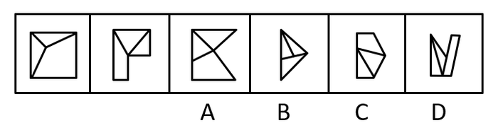
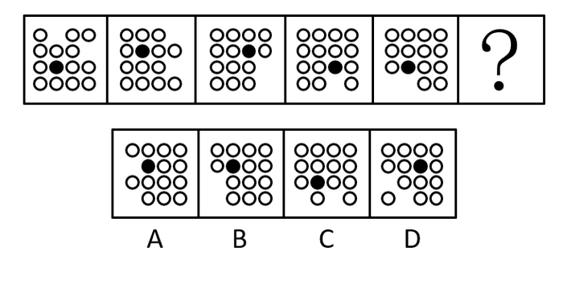
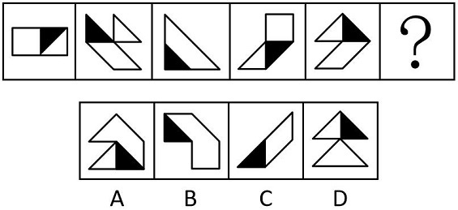
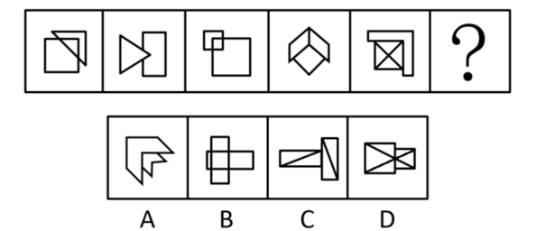
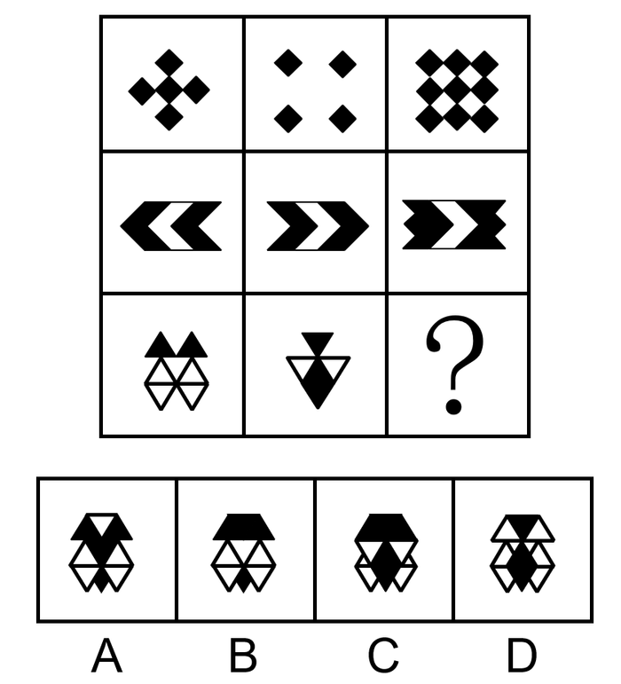
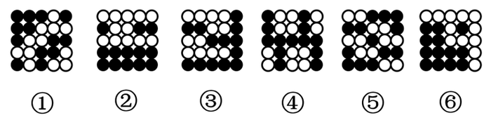
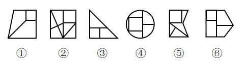
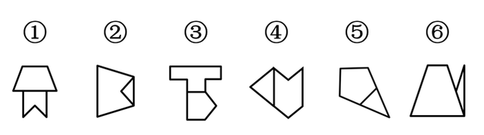
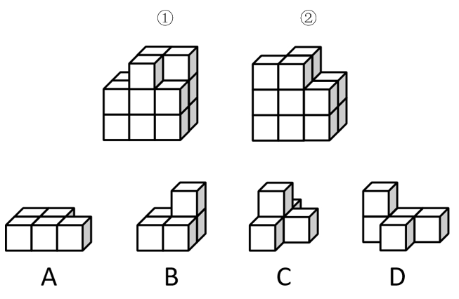
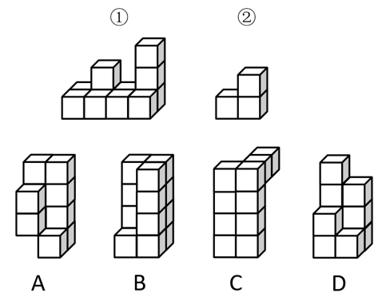

# 2021 年浙江行测（A类） · 题目

保留原题号。来源页码按 PDF 实际页数计，从 1 开始。答案及解析另见 answers.md。

## 第 21 题 · 言语理解与表达

`ZJ2021-A类-021`

随着米芾等一批杰出的文人艺术家参与印章设计制作，印章艺术进入全新境界。此后的篆刻，不再局限于镌刻
官职、姓名来昭示身份与权力，而是通过姓名、字号、斋馆名称、成语警句乃至诗词篇章等内容来表达情趣志
向。篆刻艺术使印章 ____ 实用的功能，成为表达审美追求的重要而 ____ 的方式。
依次填入画横线部分最恰当的一项是：
A.淡化 典型 B.超越 独特 C.摆脱 新颖 D.偏离 卓越

来源：[2021年浙江省公务员录用考试《行测》题（A类）（网友回忆版）.pdf](https://github.com/dumarstoft-ship-it/xingce/blob/407016b55b49581efa3771bb59a2dee8761d982f/2021%E5%B9%B4%E6%B5%99%E6%B1%9F%E7%9C%81%E5%85%AC%E5%8A%A1%E5%91%98%E5%BD%95%E7%94%A8%E8%80%83%E8%AF%95%E3%80%8A%E8%A1%8C%E6%B5%8B%E3%80%8B%E9%A2%98%EF%BC%88A%E7%B1%BB%EF%BC%89%EF%BC%88%E7%BD%91%E5%8F%8B%E5%9B%9E%E5%BF%86%E7%89%88%EF%BC%89.pdf)，PDF 第 4 页。

## 第 22 题 · 言语理解与表达

`ZJ2021-A类-022`

竹被文人高士用来表现脱俗的情趣、正直的气节、虚心的品质，墨竹成了书、画、道的 ____ ，成了人格、人
品的写照，寓意兴寄愈益丰厚，成为中国画史 ____ 的题材。
依次填入画横线部分最恰当的一项是：
A.粘合剂 历久弥新 B.代表作 独树一帜 C.综合体 经久不衰 D.标志物 引人注目

来源：[2021年浙江省公务员录用考试《行测》题（A类）（网友回忆版）.pdf](https://github.com/dumarstoft-ship-it/xingce/blob/407016b55b49581efa3771bb59a2dee8761d982f/2021%E5%B9%B4%E6%B5%99%E6%B1%9F%E7%9C%81%E5%85%AC%E5%8A%A1%E5%91%98%E5%BD%95%E7%94%A8%E8%80%83%E8%AF%95%E3%80%8A%E8%A1%8C%E6%B5%8B%E3%80%8B%E9%A2%98%EF%BC%88A%E7%B1%BB%EF%BC%89%EF%BC%88%E7%BD%91%E5%8F%8B%E5%9B%9E%E5%BF%86%E7%89%88%EF%BC%89.pdf)，PDF 第 4 页。

## 第 23 题 · 言语理解与表达

`ZJ2021-A类-023`

这本书没有 ____ 的生涩文字，也没有 ____ 的说教辞令。全书朴实无华却字字珠玑，将家训家教中的为人处
世道理细细道来，如春风化雨般启迪心智。
依次填入画横线部分最恰当的一项是：
A.佶屈聱牙 夸夸其谈 B.言之无物 空洞无物 C.言过其实 一板一眼 D.咬文嚼字 盛气凌人

来源：[2021年浙江省公务员录用考试《行测》题（A类）（网友回忆版）.pdf](https://github.com/dumarstoft-ship-it/xingce/blob/407016b55b49581efa3771bb59a2dee8761d982f/2021%E5%B9%B4%E6%B5%99%E6%B1%9F%E7%9C%81%E5%85%AC%E5%8A%A1%E5%91%98%E5%BD%95%E7%94%A8%E8%80%83%E8%AF%95%E3%80%8A%E8%A1%8C%E6%B5%8B%E3%80%8B%E9%A2%98%EF%BC%88A%E7%B1%BB%EF%BC%89%EF%BC%88%E7%BD%91%E5%8F%8B%E5%9B%9E%E5%BF%86%E7%89%88%EF%BC%89.pdf)，PDF 第 4 页。

## 第 24 题 · 言语理解与表达

`ZJ2021-A类-024`

从“蓝天保卫战”到“史上最严”的新环境保护法，再到对“洋垃圾”说“不”，“绿水青山就是金山银山”
的理念已 ____ 。对于中国而言，这是转变发展方式、破解资源环境瓶颈制约、提升国际竞争力的内在要求，
与国家乃至全球的可持续发展目标 ____ 。
依次填入画横线部分最恰当的一项是：
A.众所周知 不谋而合 B.根深蒂固 一脉相承 C.深入人心 同向而行 D.牢不可破 相辅相成

来源：[2021年浙江省公务员录用考试《行测》题（A类）（网友回忆版）.pdf](https://github.com/dumarstoft-ship-it/xingce/blob/407016b55b49581efa3771bb59a2dee8761d982f/2021%E5%B9%B4%E6%B5%99%E6%B1%9F%E7%9C%81%E5%85%AC%E5%8A%A1%E5%91%98%E5%BD%95%E7%94%A8%E8%80%83%E8%AF%95%E3%80%8A%E8%A1%8C%E6%B5%8B%E3%80%8B%E9%A2%98%EF%BC%88A%E7%B1%BB%EF%BC%89%EF%BC%88%E7%BD%91%E5%8F%8B%E5%9B%9E%E5%BF%86%E7%89%88%EF%BC%89.pdf)，PDF 第 4 页。

## 第 25 题 · 言语理解与表达

`ZJ2021-A类-025`

不同性质的书放在一起读，能起到对比和转换视角的作用。工作中读自己专业领域的书，休闲时看其他领域的
书， ____ 。许多老一辈科学家，闲暇时喜欢吟诗作赋，这并非 ____ ，而是有益的精神调节。
依次填入画横线部分最恰当的一项是：
A.张弛有度 自命不凡 B.相得益彰 附庸风雅 C.一举两得 三心二意 D.劳逸结合 不务正业

来源：[2021年浙江省公务员录用考试《行测》题（A类）（网友回忆版）.pdf](https://github.com/dumarstoft-ship-it/xingce/blob/407016b55b49581efa3771bb59a2dee8761d982f/2021%E5%B9%B4%E6%B5%99%E6%B1%9F%E7%9C%81%E5%85%AC%E5%8A%A1%E5%91%98%E5%BD%95%E7%94%A8%E8%80%83%E8%AF%95%E3%80%8A%E8%A1%8C%E6%B5%8B%E3%80%8B%E9%A2%98%EF%BC%88A%E7%B1%BB%EF%BC%89%EF%BC%88%E7%BD%91%E5%8F%8B%E5%9B%9E%E5%BF%86%E7%89%88%EF%BC%89.pdf)，PDF 第 4 页。

## 第 26 题 · 言语理解与表达

`ZJ2021-A类-026`

网络空间作为家庭、学校、社会等现实世界的 ____ ，已经成为未成年人成长中密不可分的一部分。将未成年人
与互联网强制 ____ 开来，既不可取也很难实现。
依次填入画横线部分最恰当的一项是：
A.延展 隔离 B.虚化 独立 C.放大 划分 D.深入 分割

来源：[2021年浙江省公务员录用考试《行测》题（A类）（网友回忆版）.pdf](https://github.com/dumarstoft-ship-it/xingce/blob/407016b55b49581efa3771bb59a2dee8761d982f/2021%E5%B9%B4%E6%B5%99%E6%B1%9F%E7%9C%81%E5%85%AC%E5%8A%A1%E5%91%98%E5%BD%95%E7%94%A8%E8%80%83%E8%AF%95%E3%80%8A%E8%A1%8C%E6%B5%8B%E3%80%8B%E9%A2%98%EF%BC%88A%E7%B1%BB%EF%BC%89%EF%BC%88%E7%BD%91%E5%8F%8B%E5%9B%9E%E5%BF%86%E7%89%88%EF%BC%89.pdf)，PDF 第 4 页。

## 第 27 题 · 言语理解与表达

`ZJ2021-A类-027`

水雷虽老，却依然是军舰的“ ____ ”。一方面，水雷威力巨大，即便是一些老式水雷也会对现代海军舰船构成
相当威胁；另一方面，水雷研发难度低，制造成本也不高，因此平时可以大批量地制造、储备，战时可以大面
积布设。所以，直到现在水雷依然是各国海军武器库的 ____ 。
依次填入画横线部分最恰当的一项是：
A.噩梦 必备 B.天敌 王牌 C.仇家 底牌 D.克星 主力

来源：[2021年浙江省公务员录用考试《行测》题（A类）（网友回忆版）.pdf](https://github.com/dumarstoft-ship-it/xingce/blob/407016b55b49581efa3771bb59a2dee8761d982f/2021%E5%B9%B4%E6%B5%99%E6%B1%9F%E7%9C%81%E5%85%AC%E5%8A%A1%E5%91%98%E5%BD%95%E7%94%A8%E8%80%83%E8%AF%95%E3%80%8A%E8%A1%8C%E6%B5%8B%E3%80%8B%E9%A2%98%EF%BC%88A%E7%B1%BB%EF%BC%89%EF%BC%88%E7%BD%91%E5%8F%8B%E5%9B%9E%E5%BF%86%E7%89%88%EF%BC%89.pdf)，PDF 第 4、5 页。

## 第 28 题 · 言语理解与表达

`ZJ2021-A类-028`

从全世界范围看，论文依然是学术成果主流呈现方式，仍是学术界的“ ____ ”。问题的关键在于一个“唯”
字，即论文成了学术评价的唯一依据，学术评价 ____ 成了计算论文篇数、比拼刊物级别。
依次填入画横线部分最恰当的一项是：
A.必修课 蜕变 B.硬通货 异化 C.敲门砖 演绎 D.磨刀石 沦落

来源：[2021年浙江省公务员录用考试《行测》题（A类）（网友回忆版）.pdf](https://github.com/dumarstoft-ship-it/xingce/blob/407016b55b49581efa3771bb59a2dee8761d982f/2021%E5%B9%B4%E6%B5%99%E6%B1%9F%E7%9C%81%E5%85%AC%E5%8A%A1%E5%91%98%E5%BD%95%E7%94%A8%E8%80%83%E8%AF%95%E3%80%8A%E8%A1%8C%E6%B5%8B%E3%80%8B%E9%A2%98%EF%BC%88A%E7%B1%BB%EF%BC%89%EF%BC%88%E7%BD%91%E5%8F%8B%E5%9B%9E%E5%BF%86%E7%89%88%EF%BC%89.pdf)，PDF 第 5 页。

## 第 29 题 · 言语理解与表达

`ZJ2021-A类-029`

自上世纪70年代开始，悲观的 ____ 在西方学界兴起，迅速形成影响，反映到科幻电影中，就出现了《人猿星
球》《后天》《终结者》之类的末世电影。当时，这些电影还有警世效果，能够催人反省，但现在这种题材的
电影早已沦为套路，大部分属于 ____ 之作。
依次填入画横线部分最恰当的一项是：
A.历史观 照本宣科 B.审美观 拾人牙慧 C.世界观 狗尾续貂 D.未来观 东施效颦

来源：[2021年浙江省公务员录用考试《行测》题（A类）（网友回忆版）.pdf](https://github.com/dumarstoft-ship-it/xingce/blob/407016b55b49581efa3771bb59a2dee8761d982f/2021%E5%B9%B4%E6%B5%99%E6%B1%9F%E7%9C%81%E5%85%AC%E5%8A%A1%E5%91%98%E5%BD%95%E7%94%A8%E8%80%83%E8%AF%95%E3%80%8A%E8%A1%8C%E6%B5%8B%E3%80%8B%E9%A2%98%EF%BC%88A%E7%B1%BB%EF%BC%89%EF%BC%88%E7%BD%91%E5%8F%8B%E5%9B%9E%E5%BF%86%E7%89%88%EF%BC%89.pdf)，PDF 第 5 页。

## 第 30 题 · 言语理解与表达

`ZJ2021-A类-030`

面对高端芯片“卡脖子”问题，有紧迫感是好事，但不能 ____ ，捡到篮里都是菜。 ____ 产业规律才能保证产
业健康有序发展。
依次填入画横线部分最恰当的一项是：
A.囫囵吞枣 遵循 B.化繁为简 敬畏 C.泥沙俱下 尊重 D.鱼龙混杂 遵守

来源：[2021年浙江省公务员录用考试《行测》题（A类）（网友回忆版）.pdf](https://github.com/dumarstoft-ship-it/xingce/blob/407016b55b49581efa3771bb59a2dee8761d982f/2021%E5%B9%B4%E6%B5%99%E6%B1%9F%E7%9C%81%E5%85%AC%E5%8A%A1%E5%91%98%E5%BD%95%E7%94%A8%E8%80%83%E8%AF%95%E3%80%8A%E8%A1%8C%E6%B5%8B%E3%80%8B%E9%A2%98%EF%BC%88A%E7%B1%BB%EF%BC%89%EF%BC%88%E7%BD%91%E5%8F%8B%E5%9B%9E%E5%BF%86%E7%89%88%EF%BC%89.pdf)，PDF 第 5 页。

## 第 31 题 · 言语理解与表达

`ZJ2021-A类-031`

网络并非法外之地，让肆意妄为的网络“喷子”们 ____ ，需要全社会共同努力。政府应重点关注网络生态问
题，建立健全网络综合治理体系，完善相关法律法规，细化网络监管条例。监管部门要将规范落实到位，对违
法行为重拳出击，还社会一片 ____ 的网络空间。
依次填入画横线部分最恰当的一项是：
A.原形毕露 整洁 B.谈虎色变 和谐 C.惴惴不安 宁静 D.无处遁形 清朗

来源：[2021年浙江省公务员录用考试《行测》题（A类）（网友回忆版）.pdf](https://github.com/dumarstoft-ship-it/xingce/blob/407016b55b49581efa3771bb59a2dee8761d982f/2021%E5%B9%B4%E6%B5%99%E6%B1%9F%E7%9C%81%E5%85%AC%E5%8A%A1%E5%91%98%E5%BD%95%E7%94%A8%E8%80%83%E8%AF%95%E3%80%8A%E8%A1%8C%E6%B5%8B%E3%80%8B%E9%A2%98%EF%BC%88A%E7%B1%BB%EF%BC%89%EF%BC%88%E7%BD%91%E5%8F%8B%E5%9B%9E%E5%BF%86%E7%89%88%EF%BC%89.pdf)，PDF 第 5 页。

## 第 32 题 · 言语理解与表达

`ZJ2021-A类-032`

近几年的经典解读出版中，除了文史类的专业学者，一些作家、诗人等跨界的知识精英也加入了进来。这些跨
界解读给经典出版增添了更多的 ____ 和丰富性，个人化的写作风格也将读者群从文史爱好者 ____ 到文艺爱好
者。
依次填入画横线部分最恰当的一项是：
A.维度 扩展 B.力度 延伸 C.深度 转移 D.角度 推广

来源：[2021年浙江省公务员录用考试《行测》题（A类）（网友回忆版）.pdf](https://github.com/dumarstoft-ship-it/xingce/blob/407016b55b49581efa3771bb59a2dee8761d982f/2021%E5%B9%B4%E6%B5%99%E6%B1%9F%E7%9C%81%E5%85%AC%E5%8A%A1%E5%91%98%E5%BD%95%E7%94%A8%E8%80%83%E8%AF%95%E3%80%8A%E8%A1%8C%E6%B5%8B%E3%80%8B%E9%A2%98%EF%BC%88A%E7%B1%BB%EF%BC%89%EF%BC%88%E7%BD%91%E5%8F%8B%E5%9B%9E%E5%BF%86%E7%89%88%EF%BC%89.pdf)，PDF 第 5 页。

## 第 33 题 · 言语理解与表达

`ZJ2021-A类-033`

记者不是唯一在讲故事的人。小说家、编剧、段子手、营销号，以及每一个发帖的网友，都在以自己的方式讲
述着关于时代的故事。 ____ 中，好记者不会迷失航向，而会对职业尊严有更深的 ____ 。
依次填入画横线部分最恰当的一项是：
A.百舸争流    体悟 B.风雨同舟    诠释 C.千帆竞发    剖析 D.逆水行舟    理解

来源：[2021年浙江省公务员录用考试《行测》题（A类）（网友回忆版）.pdf](https://github.com/dumarstoft-ship-it/xingce/blob/407016b55b49581efa3771bb59a2dee8761d982f/2021%E5%B9%B4%E6%B5%99%E6%B1%9F%E7%9C%81%E5%85%AC%E5%8A%A1%E5%91%98%E5%BD%95%E7%94%A8%E8%80%83%E8%AF%95%E3%80%8A%E8%A1%8C%E6%B5%8B%E3%80%8B%E9%A2%98%EF%BC%88A%E7%B1%BB%EF%BC%89%EF%BC%88%E7%BD%91%E5%8F%8B%E5%9B%9E%E5%BF%86%E7%89%88%EF%BC%89.pdf)，PDF 第 5 页。

## 第 34 题 · 言语理解与表达

`ZJ2021-A类-034`

如何定义垄断，尤其是如何界定互联网平台企业的垄断，存在不小的争议。垄断的危害人所皆知，可是也有人
担心，如果反垄断的限制过大，可能会影响平台企业发展，不利于产生规模效应，从而影响市场繁
荣。 ____ 。如今，市场监管总局公布的标志性案例，证明“反垄断”已经切实成为悬在企业头上的达摩
克利斯之剑，将会倒逼企业在做相关决策时，不得不三思而行。
填入画横线部分最恰当的一项是：
A.传统的反垄断法律规则已与平台经济领域竞争呈现出的新特点不相适应
B.因此，推进互联网产业在全国层面、区域层面高度集中化发展是大势所趋
C.所以要正确处理好政府与市场的关系，简政放权、优化服务，激发市场活力
D.因为这种模糊性和争议性，许多互联网企业一直抱着侥幸心理，不断试探边界

来源：[2021年浙江省公务员录用考试《行测》题（A类）（网友回忆版）.pdf](https://github.com/dumarstoft-ship-it/xingce/blob/407016b55b49581efa3771bb59a2dee8761d982f/2021%E5%B9%B4%E6%B5%99%E6%B1%9F%E7%9C%81%E5%85%AC%E5%8A%A1%E5%91%98%E5%BD%95%E7%94%A8%E8%80%83%E8%AF%95%E3%80%8A%E8%A1%8C%E6%B5%8B%E3%80%8B%E9%A2%98%EF%BC%88A%E7%B1%BB%EF%BC%89%EF%BC%88%E7%BD%91%E5%8F%8B%E5%9B%9E%E5%BF%86%E7%89%88%EF%BC%89.pdf)，PDF 第 5 页。

## 第 35 题 · 言语理解与表达

`ZJ2021-A类-035`

药品购销实施“两票制”，药品出厂一个价，进医院一个价，差价一目了然，可避免倒手和中间加价。药品集
中招采以纳入医保目录并确保销量为交换条件，换取药品大幅降价。既然销量有保障，药企就没必要通过给回
扣等方式来促销······一系列医改政策，已让吃回扣变得困难。 ____ 。纳入医保目录、确保基本
销量固然能满足大部分药企的胃口，但由于销量和利润相关，药企仍难免会争取更大销量。尤其当多家药企的
几种同类药品都进入医保目录、且都招采中标后，销量竞争仍然会很激烈，给回扣等促销手段可能会死灰复
燃。
填入画横线部分最恰当的一项是：
A.吃药品回扣的大漏洞虽已堵住，小漏洞仍会存在 B.可见，曾经猖獗的药品商业贿赂已得到明显遏制
C.不仅如此，医改政策还给许多药企带来了新利好 D.然而，一些无良医院和药企还是能钻制度的空子

来源：[2021年浙江省公务员录用考试《行测》题（A类）（网友回忆版）.pdf](https://github.com/dumarstoft-ship-it/xingce/blob/407016b55b49581efa3771bb59a2dee8761d982f/2021%E5%B9%B4%E6%B5%99%E6%B1%9F%E7%9C%81%E5%85%AC%E5%8A%A1%E5%91%98%E5%BD%95%E7%94%A8%E8%80%83%E8%AF%95%E3%80%8A%E8%A1%8C%E6%B5%8B%E3%80%8B%E9%A2%98%EF%BC%88A%E7%B1%BB%EF%BC%89%EF%BC%88%E7%BD%91%E5%8F%8B%E5%9B%9E%E5%BF%86%E7%89%88%EF%BC%89.pdf)，PDF 第 5、6 页。

## 第 36 题 · 言语理解与表达

`ZJ2021-A类-036`

上世纪70年代以来，两栖动物正经历着全球性的种群下降和物种灭绝，下降速度之快、受胁物种之广，居各陆
栖脊椎动物类群之首。但奇怪的是，很长时间以来， ____ 。因为很多两栖动物在远离人类干扰的偏远山
区或自然保护区内突然消失，一些解释野生动物濒危的主流假说，如栖息地丧失、人类捕杀、气候变化等，都
无法解释大量的两栖动物下降事件。因此，两栖动物的下降也曾一度被称作一场“神秘的下降”。
填入画横线部分最恰当的一项是：
A.非野生的两栖动物种群并未出现明显下降 B.气候、环境等自然因素并没有发生剧烈变化
C.科学家找不到导致两栖动物种群快速下降的原因 D.全球两栖动物种群下降现象并未引起科学家的重视

来源：[2021年浙江省公务员录用考试《行测》题（A类）（网友回忆版）.pdf](https://github.com/dumarstoft-ship-it/xingce/blob/407016b55b49581efa3771bb59a2dee8761d982f/2021%E5%B9%B4%E6%B5%99%E6%B1%9F%E7%9C%81%E5%85%AC%E5%8A%A1%E5%91%98%E5%BD%95%E7%94%A8%E8%80%83%E8%AF%95%E3%80%8A%E8%A1%8C%E6%B5%8B%E3%80%8B%E9%A2%98%EF%BC%88A%E7%B1%BB%EF%BC%89%EF%BC%88%E7%BD%91%E5%8F%8B%E5%9B%9E%E5%BF%86%E7%89%88%EF%BC%89.pdf)，PDF 第 6 页。

## 第 37 题 · 言语理解与表达

`ZJ2021-A类-037`

21世纪初，人口、经济和环境压力形成了独特的综合条件，使新出现和重现的传染病能以前所未有的规模传
播。最近几十年的经验显示， ____ 。而想要从根本上减少病毒国际传播可能性的最有效方法，就是世卫
组织与其他组织、机构一起开展工作，加强全球疫情警报和反应网络，汇集世界各地的专家来一起应对疾病暴
发。
填入画横线部分最恰当的一项是：
A.烈性传染病发展为全球大流行的风险正在显著增强
B.应对疾病防控挑战的最有效手段就是采取预防措施
C.没有一个国家能够独自防范疾病及其它公共卫生威胁
D.建立一个实现各国数据共享的传染病数据库迫在眉睫

来源：[2021年浙江省公务员录用考试《行测》题（A类）（网友回忆版）.pdf](https://github.com/dumarstoft-ship-it/xingce/blob/407016b55b49581efa3771bb59a2dee8761d982f/2021%E5%B9%B4%E6%B5%99%E6%B1%9F%E7%9C%81%E5%85%AC%E5%8A%A1%E5%91%98%E5%BD%95%E7%94%A8%E8%80%83%E8%AF%95%E3%80%8A%E8%A1%8C%E6%B5%8B%E3%80%8B%E9%A2%98%EF%BC%88A%E7%B1%BB%EF%BC%89%EF%BC%88%E7%BD%91%E5%8F%8B%E5%9B%9E%E5%BF%86%E7%89%88%EF%BC%89.pdf)，PDF 第 6 页。

## 第 38 题 · 言语理解与表达

`ZJ2021-A类-038`

①但是现实中数据是各机构或个人的核心资产，数据孤岛现象普遍存在
②数据作为生产要素覆盖面广且渗透性强，与各行业融合发展，如金融、保险、互联网、交通、物流、政务等
③数据直接共享面临更严峻的合法合规的考验
④目前的人工智能本质上是数据智能，也就是用大数据来训练计算模型支撑业务应用
⑤如何充分利用各方的数据，让数据对外开放，进行智能化服务，成为数据“可用”关心的重点
⑥近两年，我国陆续出台了数据安全管理的相关法律法规
将以上6个句子重新排列，语序正确的是：
A.②⑤④①③⑥ B.④②①⑥③⑤ C.⑤⑥①③②④ D.⑥⑤②④①③

来源：[2021年浙江省公务员录用考试《行测》题（A类）（网友回忆版）.pdf](https://github.com/dumarstoft-ship-it/xingce/blob/407016b55b49581efa3771bb59a2dee8761d982f/2021%E5%B9%B4%E6%B5%99%E6%B1%9F%E7%9C%81%E5%85%AC%E5%8A%A1%E5%91%98%E5%BD%95%E7%94%A8%E8%80%83%E8%AF%95%E3%80%8A%E8%A1%8C%E6%B5%8B%E3%80%8B%E9%A2%98%EF%BC%88A%E7%B1%BB%EF%BC%89%EF%BC%88%E7%BD%91%E5%8F%8B%E5%9B%9E%E5%BF%86%E7%89%88%EF%BC%89.pdf)，PDF 第 6 页。

## 第 39 题 · 言语理解与表达

`ZJ2021-A类-039`

①最富有创造性的著作往往是少而精的
②无论是学术著作还是小说，动辄数十万言，有的甚至百万字以上
③例如，王国维的《人间词话》，只不过四万字
④读书贵于精，包括精选、精读和精思
⑤可是，现在图书的体量越来越大，字数也越来越多
⑥这是每一个名家读书的共同心得
将以上6个句子重新排列，语序正确的是：
A.①⑤②④⑥③ B.④⑥⑤②①③ C.①③⑤④②⑥ D.④③⑤②①⑥

来源：[2021年浙江省公务员录用考试《行测》题（A类）（网友回忆版）.pdf](https://github.com/dumarstoft-ship-it/xingce/blob/407016b55b49581efa3771bb59a2dee8761d982f/2021%E5%B9%B4%E6%B5%99%E6%B1%9F%E7%9C%81%E5%85%AC%E5%8A%A1%E5%91%98%E5%BD%95%E7%94%A8%E8%80%83%E8%AF%95%E3%80%8A%E8%A1%8C%E6%B5%8B%E3%80%8B%E9%A2%98%EF%BC%88A%E7%B1%BB%EF%BC%89%EF%BC%88%E7%BD%91%E5%8F%8B%E5%9B%9E%E5%BF%86%E7%89%88%EF%BC%89.pdf)，PDF 第 6 页。

## 第 40 题 · 言语理解与表达

`ZJ2021-A类-040`

在社会发展和日常生活中，企业和家庭的决策不仅受到可见成本的影响，也受到各种不见于会计账本，但却实
实在在占用相关人力物力的隐形成本的制约。隐形成本就像暗物质一样，虽然本身很难观测，但可以通过它对
相关经济活动的影响推测其大小和变动趋势。从社会发展角度看，如果政策制定者希望全面降低经济活动成
本，减轻企业和家庭负担，除了在税费等可见成本方面给予优惠，降低隐形成本也是很重要的一环。
最适合做这段文字标题的是：
A.成本决定决策 B.掣肘发展的“暗成本”
C.决策的关键“降低成本” D.不可忽视的“隐形成本”

来源：[2021年浙江省公务员录用考试《行测》题（A类）（网友回忆版）.pdf](https://github.com/dumarstoft-ship-it/xingce/blob/407016b55b49581efa3771bb59a2dee8761d982f/2021%E5%B9%B4%E6%B5%99%E6%B1%9F%E7%9C%81%E5%85%AC%E5%8A%A1%E5%91%98%E5%BD%95%E7%94%A8%E8%80%83%E8%AF%95%E3%80%8A%E8%A1%8C%E6%B5%8B%E3%80%8B%E9%A2%98%EF%BC%88A%E7%B1%BB%EF%BC%89%EF%BC%88%E7%BD%91%E5%8F%8B%E5%9B%9E%E5%BF%86%E7%89%88%EF%BC%89.pdf)，PDF 第 6、7 页。

## 第 41 题 · 言语理解与表达

`ZJ2021-A类-041`

目前，在全世界范围内，能够被称为“全球系统”的，只有中国的北斗、美国的GPS、俄罗斯的GLONASS以及
欧盟的伽利略定位系统。可以说，完善的卫星导航系统是一个国家综合实力的展示。北斗系统在全球范围内首
次实现了混合的异构星座部署。美国的GPS和欧洲的伽利略定位系统都是由地球中高轨道卫星组成的，而北斗
是由静止轨道卫星、倾斜地球同步轨道卫星和中高轨道卫星混合的星座组成的。北斗系统既能实现全球覆盖，
同时由于部分卫星定点在中国国土上空，因此能够为本土提供更高精度、更好性能的服务。
最适合做这段文字标题的是：
A.北斗系统“牛”在哪里 B.全球卫星系统大盘点
C.北斗与GPS，谁能更胜一筹 D.北斗系统——引领未来变革

来源：[2021年浙江省公务员录用考试《行测》题（A类）（网友回忆版）.pdf](https://github.com/dumarstoft-ship-it/xingce/blob/407016b55b49581efa3771bb59a2dee8761d982f/2021%E5%B9%B4%E6%B5%99%E6%B1%9F%E7%9C%81%E5%85%AC%E5%8A%A1%E5%91%98%E5%BD%95%E7%94%A8%E8%80%83%E8%AF%95%E3%80%8A%E8%A1%8C%E6%B5%8B%E3%80%8B%E9%A2%98%EF%BC%88A%E7%B1%BB%EF%BC%89%EF%BC%88%E7%BD%91%E5%8F%8B%E5%9B%9E%E5%BF%86%E7%89%88%EF%BC%89.pdf)，PDF 第 7 页。

## 第 42 题 · 言语理解与表达

`ZJ2021-A类-042`

部分电视从业者认为综艺节目就应该娱乐大众，如果强调价值理念的传播，就容易出现内容枯燥、形式单一、
刻板说教、传播力和影响力不高等问题，很难被受众认可。其实，形式创新并不等于文化内涵的缺乏，更不是
审美趣味的低俗，综艺节目不仅要追求在艺术表达上令人眼前一亮，也必须蕴含一定的价值导向，承担一定的
社会责任，才能更大程度地融入现实社会和百姓生活，获得更多人的认可。
这段文字意在强调：
A.综艺节目从业者不宜过分迎合受众的需求 B.艺术创新是综艺节目获得大众认可的法宝
C.电视受众反感缺乏创意的价值理念传播方式 D.综艺节目应该兼顾娱乐效果与社会价值导向

来源：[2021年浙江省公务员录用考试《行测》题（A类）（网友回忆版）.pdf](https://github.com/dumarstoft-ship-it/xingce/blob/407016b55b49581efa3771bb59a2dee8761d982f/2021%E5%B9%B4%E6%B5%99%E6%B1%9F%E7%9C%81%E5%85%AC%E5%8A%A1%E5%91%98%E5%BD%95%E7%94%A8%E8%80%83%E8%AF%95%E3%80%8A%E8%A1%8C%E6%B5%8B%E3%80%8B%E9%A2%98%EF%BC%88A%E7%B1%BB%EF%BC%89%EF%BC%88%E7%BD%91%E5%8F%8B%E5%9B%9E%E5%BF%86%E7%89%88%EF%BC%89.pdf)，PDF 第 7 页。

## 第 43 题 · 言语理解与表达

`ZJ2021-A类-043`

一般认为，肿瘤的发生是多个肿瘤相关基因的突变共同作用的结果，即多个肿瘤相关基因的突变累积导致了细
胞分裂增殖不受控制，最后变成了肿瘤细胞；而单一的基因突变并不足以引起肿瘤，因为细胞中具有DNA损伤
修复及复制纠错等机制，通常能够有效地修复基因突变，阻止基因突变的细胞继续分裂。但如果包含相关基因
突变的细胞逃脱了DNA损伤修复及复制纠错而继续分裂增殖，它们就有更多的机会累积更多的突变，从而“叛
变”为肿瘤细胞。
这段文字意在强调：
A.肿瘤细胞的发展进程受多种因素的制约 B.正常细胞在某种条件下会转化为肿瘤细胞
C.肿瘤细胞的形成跟基因突变的数量直接相关 D.细胞的DNA损伤修复及复制纠错机制存在局限

来源：[2021年浙江省公务员录用考试《行测》题（A类）（网友回忆版）.pdf](https://github.com/dumarstoft-ship-it/xingce/blob/407016b55b49581efa3771bb59a2dee8761d982f/2021%E5%B9%B4%E6%B5%99%E6%B1%9F%E7%9C%81%E5%85%AC%E5%8A%A1%E5%91%98%E5%BD%95%E7%94%A8%E8%80%83%E8%AF%95%E3%80%8A%E8%A1%8C%E6%B5%8B%E3%80%8B%E9%A2%98%EF%BC%88A%E7%B1%BB%EF%BC%89%EF%BC%88%E7%BD%91%E5%8F%8B%E5%9B%9E%E5%BF%86%E7%89%88%EF%BC%89.pdf)，PDF 第 7 页。

## 第 44 题 · 言语理解与表达

`ZJ2021-A类-044`

改革开放以来，中国的家庭结构从几代同堂的大家庭，逐渐变成以三口之家为主的核心家庭。很多情况下，养
孩子、做家务等劳动，很难再通过家庭内部分工来解决，需要到市场上寻求帮助。同时，随着人们生活水平的
提高，以往“添双筷子添个碗”式的粗放式养娃行不通了，人们对高水平家政服务的需求逐渐常态化。尤其是
随着“互联网+”和连锁经营为代表的新经营模式不断涌现，购买家政服务只要在手机上动动手指就能完成，
更为家政服务业发展带来重大契机。
这段文字意在说明：
A.互联网助力家政服务业快速发展 B.社会变迁促使家政服务业发展壮大
C.传统家政服务难以满足日益增长的社会需求 D.中国家庭结构的变化影响家政服务业经营模式

来源：[2021年浙江省公务员录用考试《行测》题（A类）（网友回忆版）.pdf](https://github.com/dumarstoft-ship-it/xingce/blob/407016b55b49581efa3771bb59a2dee8761d982f/2021%E5%B9%B4%E6%B5%99%E6%B1%9F%E7%9C%81%E5%85%AC%E5%8A%A1%E5%91%98%E5%BD%95%E7%94%A8%E8%80%83%E8%AF%95%E3%80%8A%E8%A1%8C%E6%B5%8B%E3%80%8B%E9%A2%98%EF%BC%88A%E7%B1%BB%EF%BC%89%EF%BC%88%E7%BD%91%E5%8F%8B%E5%9B%9E%E5%BF%86%E7%89%88%EF%BC%89.pdf)，PDF 第 7 页。

## 第 45 题 · 言语理解与表达

`ZJ2021-A类-045`

我国已进入快速老龄化的发展阶段，如何养老是无可回避的大问题。“养儿防老”是我国传统养老方式的基本
特征。在儒家思想影响下，家庭养老观念根深蒂固。相当长的时期内，人们都是通过生养子女来解决养老问题
的。不过，未富先老、子女数量减少等各种因素正在冲击这一传统模式，致使家庭养老功能不断弱化。必须提
高社会养老能力，才能适应加速到来的老龄化社会的要求。
这段文字意在强调：
A.老龄化加速到来将引发养老革命 B.家庭养老功能逐渐退居次要地位
C.满足养老需求将是巨大的社会难题 D.老龄化趋势要求提升社会养老能力

来源：[2021年浙江省公务员录用考试《行测》题（A类）（网友回忆版）.pdf](https://github.com/dumarstoft-ship-it/xingce/blob/407016b55b49581efa3771bb59a2dee8761d982f/2021%E5%B9%B4%E6%B5%99%E6%B1%9F%E7%9C%81%E5%85%AC%E5%8A%A1%E5%91%98%E5%BD%95%E7%94%A8%E8%80%83%E8%AF%95%E3%80%8A%E8%A1%8C%E6%B5%8B%E3%80%8B%E9%A2%98%EF%BC%88A%E7%B1%BB%EF%BC%89%EF%BC%88%E7%BD%91%E5%8F%8B%E5%9B%9E%E5%BF%86%E7%89%88%EF%BC%89.pdf)，PDF 第 7、8 页。

## 第 46 题 · 言语理解与表达

`ZJ2021-A类-046`

以玩家年龄为依据分别匹配适合的网游，丰富了未成年人网络游戏保护的方式和手段。对于孩子来说，自己适
合玩什么网游“被安排得明明白白”，玩得更安全。对家长来说，可以更明晰地评估一款网游适不适合孩子，
管得更放心。“心情复杂”的，当属游戏企业。适龄提示规定的使用要求和场景，都与游戏企业直接相关。标
识必须足够醒目，让玩家看得着、看得懂，对游戏企业是硬性要求，对那些靠打擦边球等手段吸引玩家的网游
企业、网游产品，更是一种敲打。但这种“束缚”是必须的，因为保护未成年人是包括游戏企业在内的所有市
场主体都必须遵守的规范，也是必须承担的社会责任。
文中的“束缚”最可能指的是：
A.下架不适宜未成年人的网络游戏 B.控制游戏在线时段和时长，防止未成年人沉迷
C.对网络游戏按照适合年龄进行分级并加以标识 D.相关部门对游戏产品采取更加严格的审核措施

来源：[2021年浙江省公务员录用考试《行测》题（A类）（网友回忆版）.pdf](https://github.com/dumarstoft-ship-it/xingce/blob/407016b55b49581efa3771bb59a2dee8761d982f/2021%E5%B9%B4%E6%B5%99%E6%B1%9F%E7%9C%81%E5%85%AC%E5%8A%A1%E5%91%98%E5%BD%95%E7%94%A8%E8%80%83%E8%AF%95%E3%80%8A%E8%A1%8C%E6%B5%8B%E3%80%8B%E9%A2%98%EF%BC%88A%E7%B1%BB%EF%BC%89%EF%BC%88%E7%BD%91%E5%8F%8B%E5%9B%9E%E5%BF%86%E7%89%88%EF%BC%89.pdf)，PDF 第 8 页。

## 第 47 题 · 言语理解与表达

`ZJ2021-A类-047`

沿着什么样的法治道路前进，直接关系社会主义法治建设的成败。世界上没有放之四海而皆准的法治模式。如
果脱离本国实际照抄照搬别国的法治模式，就会对经济社会发展产生消极作用。实践中，有的国家就是因为简
单照抄照搬别国的法治模式，结果不但没有实现善治，反而增加了社会不稳定因素。法治是现代国家治理的基
本特征和根本保障，任何一个国家进行法治建设，都必须探索适合自己的法治道路。
这段文字意在说明：
A.法治道路直接决定法治建设成败 B.法治建设离不开本国的法治实践
C.应坚定探索适合自身的法治道路 D.没有放之四海而皆准的法治模式

来源：[2021年浙江省公务员录用考试《行测》题（A类）（网友回忆版）.pdf](https://github.com/dumarstoft-ship-it/xingce/blob/407016b55b49581efa3771bb59a2dee8761d982f/2021%E5%B9%B4%E6%B5%99%E6%B1%9F%E7%9C%81%E5%85%AC%E5%8A%A1%E5%91%98%E5%BD%95%E7%94%A8%E8%80%83%E8%AF%95%E3%80%8A%E8%A1%8C%E6%B5%8B%E3%80%8B%E9%A2%98%EF%BC%88A%E7%B1%BB%EF%BC%89%EF%BC%88%E7%BD%91%E5%8F%8B%E5%9B%9E%E5%BF%86%E7%89%88%EF%BC%89.pdf)，PDF 第 8 页。

## 第 48 题 · 言语理解与表达

`ZJ2021-A类-048`

在“一切皆可量化”的大数据浪潮中，网络逐渐成为现实世界的“镜像”。网络社会与现实社会日益融为一
体，政府管理不能再局限于线下管理，而必须全面掌握互联网对政府与公众行为的影响机制、调节规律及其与
现实社会的联系，实现网上网下充分联动、协调共治。
这段文字意在说明大数据：
A.强化了政府的治理手段 B.提升了政府管理的效率 C.调整了政府管理的重心 D.拓展了政府的治理领域

来源：[2021年浙江省公务员录用考试《行测》题（A类）（网友回忆版）.pdf](https://github.com/dumarstoft-ship-it/xingce/blob/407016b55b49581efa3771bb59a2dee8761d982f/2021%E5%B9%B4%E6%B5%99%E6%B1%9F%E7%9C%81%E5%85%AC%E5%8A%A1%E5%91%98%E5%BD%95%E7%94%A8%E8%80%83%E8%AF%95%E3%80%8A%E8%A1%8C%E6%B5%8B%E3%80%8B%E9%A2%98%EF%BC%88A%E7%B1%BB%EF%BC%89%EF%BC%88%E7%BD%91%E5%8F%8B%E5%9B%9E%E5%BF%86%E7%89%88%EF%BC%89.pdf)，PDF 第 8 页。

## 第 49 题 · 言语理解与表达

`ZJ2021-A类-049`

某大学团队研究了“干细胞间竞争”在小鼠尾部皮肤老化中的作用。结果表明，“干细胞间竞争”由胶原蛋白
COL17A1驱动。他们发现，COL17A1的表达在不同干细胞间存在差异，COL17A1表达水平较高的干细胞会牢固
地锚定于基底膜，且对称分裂，并将附近COL17A1表达水平较低的细胞排挤出去。这样的细胞间竞争有助于维
持皮肤的整体结构和完整性。研究同时显示，COL17A1的表达会随年龄增长而下降，也会因为应激（如氧化或
紫外线辐射）而下降。最终，所有干细胞中的COL17A1表达水平都下降，皮肤随之老化。
根据这段文字，下列说法正确的是：
A.年龄与性别因素都会影响COL17A1的表达水平
B.COL17A1表达水平较低的细胞在竞争中更具优势
C.完备的防晒措施能有效提高COL17A1的表达水平
D.COL17A1的表达水平与皮肤组织的老化程度负相关

来源：[2021年浙江省公务员录用考试《行测》题（A类）（网友回忆版）.pdf](https://github.com/dumarstoft-ship-it/xingce/blob/407016b55b49581efa3771bb59a2dee8761d982f/2021%E5%B9%B4%E6%B5%99%E6%B1%9F%E7%9C%81%E5%85%AC%E5%8A%A1%E5%91%98%E5%BD%95%E7%94%A8%E8%80%83%E8%AF%95%E3%80%8A%E8%A1%8C%E6%B5%8B%E3%80%8B%E9%A2%98%EF%BC%88A%E7%B1%BB%EF%BC%89%EF%BC%88%E7%BD%91%E5%8F%8B%E5%9B%9E%E5%BF%86%E7%89%88%EF%BC%89.pdf)，PDF 第 8 页。

## 第 50 题 · 言语理解与表达

`ZJ2021-A类-050`

哥本哈根大学对来自整个欧洲和格陵兰的442例古人类的基因组进行了测序，时间跨度从青铜时代（约公元前
2400年）一直到近代早期（约公元1600年）。研究发现，在“维京时代”，来自南部和东部的外源基因流入了
斯堪的纳维亚。研究还发现有证据证实维京人曾在斯堪的纳维亚以外的国家移动：丹麦的维京人向英格兰移
动；瑞典的维京人朝着波罗的海国家向东航行；挪威的维京人迁移至爱尔兰、冰岛和格陵兰。此外，他们的基
因分析中还包含了与现代瑞典人群及现代丹麦人群具有亲缘关系的血统样本。
根据这段文字，可以推出的是：
A.波罗的海位于瑞典的东北侧 B.冰岛不属于斯堪的纳维亚国家
C.维京时代开始于十五世纪之前 D.现代瑞典人与现代丹麦人基因同源

来源：[2021年浙江省公务员录用考试《行测》题（A类）（网友回忆版）.pdf](https://github.com/dumarstoft-ship-it/xingce/blob/407016b55b49581efa3771bb59a2dee8761d982f/2021%E5%B9%B4%E6%B5%99%E6%B1%9F%E7%9C%81%E5%85%AC%E5%8A%A1%E5%91%98%E5%BD%95%E7%94%A8%E8%80%83%E8%AF%95%E3%80%8A%E8%A1%8C%E6%B5%8B%E3%80%8B%E9%A2%98%EF%BC%88A%E7%B1%BB%EF%BC%89%EF%BC%88%E7%BD%91%E5%8F%8B%E5%9B%9E%E5%BF%86%E7%89%88%EF%BC%89.pdf)，PDF 第 8 页。

## 第 51 题 · 数量关系

`ZJ2021-A类-051`

1，1，2，3，4 ，（    ），6
A.7 B.8 C.9 D.10

来源：[2021年浙江省公务员录用考试《行测》题（A类）（网友回忆版）.pdf](https://github.com/dumarstoft-ship-it/xingce/blob/407016b55b49581efa3771bb59a2dee8761d982f/2021%E5%B9%B4%E6%B5%99%E6%B1%9F%E7%9C%81%E5%85%AC%E5%8A%A1%E5%91%98%E5%BD%95%E7%94%A8%E8%80%83%E8%AF%95%E3%80%8A%E8%A1%8C%E6%B5%8B%E3%80%8B%E9%A2%98%EF%BC%88A%E7%B1%BB%EF%BC%89%EF%BC%88%E7%BD%91%E5%8F%8B%E5%9B%9E%E5%BF%86%E7%89%88%EF%BC%89.pdf)，PDF 第 9 页。

## 第 52 题 · 数量关系

`ZJ2021-A类-052`

1，2，4，4，7，6，（    ），8
A.7 B.8 C.9 D.10

来源：[2021年浙江省公务员录用考试《行测》题（A类）（网友回忆版）.pdf](https://github.com/dumarstoft-ship-it/xingce/blob/407016b55b49581efa3771bb59a2dee8761d982f/2021%E5%B9%B4%E6%B5%99%E6%B1%9F%E7%9C%81%E5%85%AC%E5%8A%A1%E5%91%98%E5%BD%95%E7%94%A8%E8%80%83%E8%AF%95%E3%80%8A%E8%A1%8C%E6%B5%8B%E3%80%8B%E9%A2%98%EF%BC%88A%E7%B1%BB%EF%BC%89%EF%BC%88%E7%BD%91%E5%8F%8B%E5%9B%9E%E5%BF%86%E7%89%88%EF%BC%89.pdf)，PDF 第 9 页。

## 第 53 题 · 数量关系

`ZJ2021-A类-053`

80，70，62，58，（    ），70
A.59 B.60 C.61 D.63

来源：[2021年浙江省公务员录用考试《行测》题（A类）（网友回忆版）.pdf](https://github.com/dumarstoft-ship-it/xingce/blob/407016b55b49581efa3771bb59a2dee8761d982f/2021%E5%B9%B4%E6%B5%99%E6%B1%9F%E7%9C%81%E5%85%AC%E5%8A%A1%E5%91%98%E5%BD%95%E7%94%A8%E8%80%83%E8%AF%95%E3%80%8A%E8%A1%8C%E6%B5%8B%E3%80%8B%E9%A2%98%EF%BC%88A%E7%B1%BB%EF%BC%89%EF%BC%88%E7%BD%91%E5%8F%8B%E5%9B%9E%E5%BF%86%E7%89%88%EF%BC%89.pdf)，PDF 第 9 页。

## 第 54 题 · 数量关系

`ZJ2021-A类-054`

36，24，24，12，18，（    ），16.5
A.3 B.9 C.17 D.24

来源：[2021年浙江省公务员录用考试《行测》题（A类）（网友回忆版）.pdf](https://github.com/dumarstoft-ship-it/xingce/blob/407016b55b49581efa3771bb59a2dee8761d982f/2021%E5%B9%B4%E6%B5%99%E6%B1%9F%E7%9C%81%E5%85%AC%E5%8A%A1%E5%91%98%E5%BD%95%E7%94%A8%E8%80%83%E8%AF%95%E3%80%8A%E8%A1%8C%E6%B5%8B%E3%80%8B%E9%A2%98%EF%BC%88A%E7%B1%BB%EF%BC%89%EF%BC%88%E7%BD%91%E5%8F%8B%E5%9B%9E%E5%BF%86%E7%89%88%EF%BC%89.pdf)，PDF 第 9 页。

## 第 55 题 · 数量关系

`ZJ2021-A类-055`

1，5，17，43，（    ），161
A.69 B.79 C.89 D.99

来源：[2021年浙江省公务员录用考试《行测》题（A类）（网友回忆版）.pdf](https://github.com/dumarstoft-ship-it/xingce/blob/407016b55b49581efa3771bb59a2dee8761d982f/2021%E5%B9%B4%E6%B5%99%E6%B1%9F%E7%9C%81%E5%85%AC%E5%8A%A1%E5%91%98%E5%BD%95%E7%94%A8%E8%80%83%E8%AF%95%E3%80%8A%E8%A1%8C%E6%B5%8B%E3%80%8B%E9%A2%98%EF%BC%88A%E7%B1%BB%EF%BC%89%EF%BC%88%E7%BD%91%E5%8F%8B%E5%9B%9E%E5%BF%86%E7%89%88%EF%BC%89.pdf)，PDF 第 9 页。

## 第 56 题 · 数量关系

`ZJ2021-A类-056`

某机构计划派45名志愿者分别前往A、B、C、D四个地区参与扶贫活动，其中A地区的志愿者人数要比B地区多4
人，C地区人数为全部志愿者人数的1/5，D地区人数不超过任何其他地区，则A地区至少有多少名志愿者？
A.12 B.13 C.15 D.16

来源：[2021年浙江省公务员录用考试《行测》题（A类）（网友回忆版）.pdf](https://github.com/dumarstoft-ship-it/xingce/blob/407016b55b49581efa3771bb59a2dee8761d982f/2021%E5%B9%B4%E6%B5%99%E6%B1%9F%E7%9C%81%E5%85%AC%E5%8A%A1%E5%91%98%E5%BD%95%E7%94%A8%E8%80%83%E8%AF%95%E3%80%8A%E8%A1%8C%E6%B5%8B%E3%80%8B%E9%A2%98%EF%BC%88A%E7%B1%BB%EF%BC%89%EF%BC%88%E7%BD%91%E5%8F%8B%E5%9B%9E%E5%BF%86%E7%89%88%EF%BC%89.pdf)，PDF 第 9 页。

## 第 57 题 · 数量关系

`ZJ2021-A类-057`

商场有大、小两种果篮销售，每个小号果篮由500克火龙果、300克葡萄和700克橙子组成，每个大号果篮由700
克火龙果、1300克葡萄和1000克橙子组成。某日通过果篮方式销售水果超过300千克，其中1/3是葡萄。问当日至
少销售了多少千克火龙果？
A.不到85千克 B.85-87千克 C.87-89千克 D.超过89千克

来源：[2021年浙江省公务员录用考试《行测》题（A类）（网友回忆版）.pdf](https://github.com/dumarstoft-ship-it/xingce/blob/407016b55b49581efa3771bb59a2dee8761d982f/2021%E5%B9%B4%E6%B5%99%E6%B1%9F%E7%9C%81%E5%85%AC%E5%8A%A1%E5%91%98%E5%BD%95%E7%94%A8%E8%80%83%E8%AF%95%E3%80%8A%E8%A1%8C%E6%B5%8B%E3%80%8B%E9%A2%98%EF%BC%88A%E7%B1%BB%EF%BC%89%EF%BC%88%E7%BD%91%E5%8F%8B%E5%9B%9E%E5%BF%86%E7%89%88%EF%BC%89.pdf)，PDF 第 9 页。

## 第 58 题 · 数量关系

`ZJ2021-A类-058`

小李有一张银行卡，他忘记了密码的后3位，只记得这3个数全是奇数且有2个相同。问他尝试不超过两次就输
入正确密码的概率为多少？
A.1/30
B.1/50
C.2/59
D.2/57

来源：[2021年浙江省公务员录用考试《行测》题（A类）（网友回忆版）.pdf](https://github.com/dumarstoft-ship-it/xingce/blob/407016b55b49581efa3771bb59a2dee8761d982f/2021%E5%B9%B4%E6%B5%99%E6%B1%9F%E7%9C%81%E5%85%AC%E5%8A%A1%E5%91%98%E5%BD%95%E7%94%A8%E8%80%83%E8%AF%95%E3%80%8A%E8%A1%8C%E6%B5%8B%E3%80%8B%E9%A2%98%EF%BC%88A%E7%B1%BB%EF%BC%89%EF%BC%88%E7%BD%91%E5%8F%8B%E5%9B%9E%E5%BF%86%E7%89%88%EF%BC%89.pdf)，PDF 第 9 页。

## 第 59 题 · 数量关系

`ZJ2021-A类-059`

A、B两地医院分别有库存呼吸设备10台和6台，现需要支援C地医院9台、D地医院7台。已知从A地调运一台设
备到C地和D地的运费分别为400元和600元，从B地调运一台设备到C地和D地的运费分别为300元和700元。如果
总运费不能超过7800元，共有多少种调运方案？
A.3 B.4 C.5 D.6

来源：[2021年浙江省公务员录用考试《行测》题（A类）（网友回忆版）.pdf](https://github.com/dumarstoft-ship-it/xingce/blob/407016b55b49581efa3771bb59a2dee8761d982f/2021%E5%B9%B4%E6%B5%99%E6%B1%9F%E7%9C%81%E5%85%AC%E5%8A%A1%E5%91%98%E5%BD%95%E7%94%A8%E8%80%83%E8%AF%95%E3%80%8A%E8%A1%8C%E6%B5%8B%E3%80%8B%E9%A2%98%EF%BC%88A%E7%B1%BB%EF%BC%89%EF%BC%88%E7%BD%91%E5%8F%8B%E5%9B%9E%E5%BF%86%E7%89%88%EF%BC%89.pdf)，PDF 第 9 页。

## 第 60 题 · 数量关系

`ZJ2021-A类-060`

某俱乐部选拔优秀选手参加游泳比赛，选手在规定时间内游完全程，就能获得参赛资格。已知有四分之一的选
手获得了参赛资格，获得参赛资格选手的平均完成时间比规定时间快6秒，未获得参赛资格选手的平均完成时
间比规定时间慢10秒，所有选手的平均完成时间为140秒，则本次选拔的规定时间为多少秒？
A.116 B.125 C.134 D.139

来源：[2021年浙江省公务员录用考试《行测》题（A类）（网友回忆版）.pdf](https://github.com/dumarstoft-ship-it/xingce/blob/407016b55b49581efa3771bb59a2dee8761d982f/2021%E5%B9%B4%E6%B5%99%E6%B1%9F%E7%9C%81%E5%85%AC%E5%8A%A1%E5%91%98%E5%BD%95%E7%94%A8%E8%80%83%E8%AF%95%E3%80%8A%E8%A1%8C%E6%B5%8B%E3%80%8B%E9%A2%98%EF%BC%88A%E7%B1%BB%EF%BC%89%EF%BC%88%E7%BD%91%E5%8F%8B%E5%9B%9E%E5%BF%86%E7%89%88%EF%BC%89.pdf)，PDF 第 9 页。

## 第 61 题 · 数量关系

`ZJ2021-A类-061`

甲队参加四场篮球比赛，前两场场均得分为第三场得分的3/4，第四场得72分，是第三场得分的0.9倍。问甲队所
有比赛平均每场得多少分？
A.64 B.66 C.68 D.72

来源：[2021年浙江省公务员录用考试《行测》题（A类）（网友回忆版）.pdf](https://github.com/dumarstoft-ship-it/xingce/blob/407016b55b49581efa3771bb59a2dee8761d982f/2021%E5%B9%B4%E6%B5%99%E6%B1%9F%E7%9C%81%E5%85%AC%E5%8A%A1%E5%91%98%E5%BD%95%E7%94%A8%E8%80%83%E8%AF%95%E3%80%8A%E8%A1%8C%E6%B5%8B%E3%80%8B%E9%A2%98%EF%BC%88A%E7%B1%BB%EF%BC%89%EF%BC%88%E7%BD%91%E5%8F%8B%E5%9B%9E%E5%BF%86%E7%89%88%EF%BC%89.pdf)，PDF 第 9 页。

## 第 62 题 · 数量关系

`ZJ2021-A类-062`

AB两地间有县道连接，BC两地间有高速公路连接，且AB间路程是BC间路程的3/4。郭某从A地开车匀速前往B
地，到B地后以AB间2倍的速度开往C地，共用时2小时30分。由C地返回A地时高速公路行驶速度不变，县道行
驶速度比去程降低1/3，则返程用时为：
A.2小时45分 B.2小时50分 C.3小时10分 D.3小时15分

来源：[2021年浙江省公务员录用考试《行测》题（A类）（网友回忆版）.pdf](https://github.com/dumarstoft-ship-it/xingce/blob/407016b55b49581efa3771bb59a2dee8761d982f/2021%E5%B9%B4%E6%B5%99%E6%B1%9F%E7%9C%81%E5%85%AC%E5%8A%A1%E5%91%98%E5%BD%95%E7%94%A8%E8%80%83%E8%AF%95%E3%80%8A%E8%A1%8C%E6%B5%8B%E3%80%8B%E9%A2%98%EF%BC%88A%E7%B1%BB%EF%BC%89%EF%BC%88%E7%BD%91%E5%8F%8B%E5%9B%9E%E5%BF%86%E7%89%88%EF%BC%89.pdf)，PDF 第 10 页。

## 第 63 题 · 数量关系

`ZJ2021-A类-063`

某工厂有甲、乙两个生产车间，每个工人的生产效率都相同。甲车间的总生产效率是乙车间的1.5倍；从甲车间
调派30名工人到乙车间之后，甲车间的生产效率是乙车间的1.2倍。问需要从甲车间再调多少名工人到乙车间，
两个车间的生产效率才能相同？
A.20 B.22 C.24 D.25

来源：[2021年浙江省公务员录用考试《行测》题（A类）（网友回忆版）.pdf](https://github.com/dumarstoft-ship-it/xingce/blob/407016b55b49581efa3771bb59a2dee8761d982f/2021%E5%B9%B4%E6%B5%99%E6%B1%9F%E7%9C%81%E5%85%AC%E5%8A%A1%E5%91%98%E5%BD%95%E7%94%A8%E8%80%83%E8%AF%95%E3%80%8A%E8%A1%8C%E6%B5%8B%E3%80%8B%E9%A2%98%EF%BC%88A%E7%B1%BB%EF%BC%89%EF%BC%88%E7%BD%91%E5%8F%8B%E5%9B%9E%E5%BF%86%E7%89%88%EF%BC%89.pdf)，PDF 第 10 页。

## 第 64 题 · 数量关系

`ZJ2021-A类-064`

超市采购一批食用油，其中玉米油每桶进价比花生油低20%，若花生油利润定为进价的24%，玉米油利润定为
进价的30%，则花生油比玉米油每桶售价高10元。问玉米油每桶比花生油进价低多少元？
A.10 B.15 C.24 D.25

来源：[2021年浙江省公务员录用考试《行测》题（A类）（网友回忆版）.pdf](https://github.com/dumarstoft-ship-it/xingce/blob/407016b55b49581efa3771bb59a2dee8761d982f/2021%E5%B9%B4%E6%B5%99%E6%B1%9F%E7%9C%81%E5%85%AC%E5%8A%A1%E5%91%98%E5%BD%95%E7%94%A8%E8%80%83%E8%AF%95%E3%80%8A%E8%A1%8C%E6%B5%8B%E3%80%8B%E9%A2%98%EF%BC%88A%E7%B1%BB%EF%BC%89%EF%BC%88%E7%BD%91%E5%8F%8B%E5%9B%9E%E5%BF%86%E7%89%88%EF%BC%89.pdf)，PDF 第 10 页。

## 第 65 题 · 数量关系

`ZJ2021-A类-065`

某农场有180台收割机，每天可收割x吨水稻。现将y台收割机更换为新款收割机，生产效率比之前高40%；剩余
的收割机进行升级，生产效率可以提高20%。如要求升级后的收割机每天水稻收割总量不低于(2/3)x吨，新款收割
机每天水稻收割总量不低于(3/5)x吨。则y的取值有多少种不同的可能性？
A.2 B.3 C.4 D.5

来源：[2021年浙江省公务员录用考试《行测》题（A类）（网友回忆版）.pdf](https://github.com/dumarstoft-ship-it/xingce/blob/407016b55b49581efa3771bb59a2dee8761d982f/2021%E5%B9%B4%E6%B5%99%E6%B1%9F%E7%9C%81%E5%85%AC%E5%8A%A1%E5%91%98%E5%BD%95%E7%94%A8%E8%80%83%E8%AF%95%E3%80%8A%E8%A1%8C%E6%B5%8B%E3%80%8B%E9%A2%98%EF%BC%88A%E7%B1%BB%EF%BC%89%EF%BC%88%E7%BD%91%E5%8F%8B%E5%9B%9E%E5%BF%86%E7%89%88%EF%BC%89.pdf)，PDF 第 10 页。

## 第 66 题 · 数量关系

`ZJ2021-A类-066`

某通信信道可以传输的信号由1、2、3、4四个数字组成，每组信号包含4个数字（可重复），且前两个数字必
须为奇数。某次传输过程中共传输了250组信号，其中传输次数最多的信号传输了x次。问x的最小值为：
A.2 B.3 C.4 D.5

来源：[2021年浙江省公务员录用考试《行测》题（A类）（网友回忆版）.pdf](https://github.com/dumarstoft-ship-it/xingce/blob/407016b55b49581efa3771bb59a2dee8761d982f/2021%E5%B9%B4%E6%B5%99%E6%B1%9F%E7%9C%81%E5%85%AC%E5%8A%A1%E5%91%98%E5%BD%95%E7%94%A8%E8%80%83%E8%AF%95%E3%80%8A%E8%A1%8C%E6%B5%8B%E3%80%8B%E9%A2%98%EF%BC%88A%E7%B1%BB%EF%BC%89%EF%BC%88%E7%BD%91%E5%8F%8B%E5%9B%9E%E5%BF%86%E7%89%88%EF%BC%89.pdf)，PDF 第 10 页。

## 第 67 题 · 数量关系

`ZJ2021-A类-067`

某课题小组由8个人组成，他们各自负责撰写书稿的一部分，完成后通过电子邮件传递书稿。问要让每个人都
得到完整书稿，课题小组总共至少需要发送多少封邮件？（将同一封邮件同时抄送给n个人，视作发送n封邮
件）
A.14 B.16 C.36 D.72

来源：[2021年浙江省公务员录用考试《行测》题（A类）（网友回忆版）.pdf](https://github.com/dumarstoft-ship-it/xingce/blob/407016b55b49581efa3771bb59a2dee8761d982f/2021%E5%B9%B4%E6%B5%99%E6%B1%9F%E7%9C%81%E5%85%AC%E5%8A%A1%E5%91%98%E5%BD%95%E7%94%A8%E8%80%83%E8%AF%95%E3%80%8A%E8%A1%8C%E6%B5%8B%E3%80%8B%E9%A2%98%EF%BC%88A%E7%B1%BB%EF%BC%89%EF%BC%88%E7%BD%91%E5%8F%8B%E5%9B%9E%E5%BF%86%E7%89%88%EF%BC%89.pdf)，PDF 第 10 页。

## 第 68 题 · 数量关系

`ZJ2021-A类-068`

某企业在“十二五”期间第一年的营业额比上一年增长了1.5亿元，且往后每年的营业额增量都保持1.5亿元不
变。已知该企业在“十四五”期间的营业额将是“十二五”和“十三五”期间营业额之和的80%。问该企业在
“十二五”到“十四五”期间的总营业额在以下哪个范围内？
A.不到300亿元 B.300~330亿元 C.330~360亿元 D.超过360亿元

来源：[2021年浙江省公务员录用考试《行测》题（A类）（网友回忆版）.pdf](https://github.com/dumarstoft-ship-it/xingce/blob/407016b55b49581efa3771bb59a2dee8761d982f/2021%E5%B9%B4%E6%B5%99%E6%B1%9F%E7%9C%81%E5%85%AC%E5%8A%A1%E5%91%98%E5%BD%95%E7%94%A8%E8%80%83%E8%AF%95%E3%80%8A%E8%A1%8C%E6%B5%8B%E3%80%8B%E9%A2%98%EF%BC%88A%E7%B1%BB%EF%BC%89%EF%BC%88%E7%BD%91%E5%8F%8B%E5%9B%9E%E5%BF%86%E7%89%88%EF%BC%89.pdf)，PDF 第 10 页。

## 第 69 题 · 数量关系

`ZJ2021-A类-069`

研究人员在A、B、C、D、E五块试验田中种植甲、乙、丙、丁、戊五种作物，每块试验田只种一种作物，每年
都在所有的安排中随机挑选一种进行种植。问在连续的3年中，A试验田至少2年种植同一种作物的概率为：
A.36% B.48% C.52% D.64%

来源：[2021年浙江省公务员录用考试《行测》题（A类）（网友回忆版）.pdf](https://github.com/dumarstoft-ship-it/xingce/blob/407016b55b49581efa3771bb59a2dee8761d982f/2021%E5%B9%B4%E6%B5%99%E6%B1%9F%E7%9C%81%E5%85%AC%E5%8A%A1%E5%91%98%E5%BD%95%E7%94%A8%E8%80%83%E8%AF%95%E3%80%8A%E8%A1%8C%E6%B5%8B%E3%80%8B%E9%A2%98%EF%BC%88A%E7%B1%BB%EF%BC%89%EF%BC%88%E7%BD%91%E5%8F%8B%E5%9B%9E%E5%BF%86%E7%89%88%EF%BC%89.pdf)，PDF 第 10 页。

## 第 70 题 · 数量关系

`ZJ2021-A类-070`

由于采用了新的种植技术，某种农产品的产量和品质都得到了提升。在平均每亩增产25%的同时，每千克售价
也增加了20%。尽管每亩生产成本增加了35%，但每亩利润也增加了100%。问采用新种植技术后，每亩利润占
每亩销售收入的比例在以下哪个范围内？
A.不到25% B.25%~35%
C.35%~45% D.超过45%

来源：[2021年浙江省公务员录用考试《行测》题（A类）（网友回忆版）.pdf](https://github.com/dumarstoft-ship-it/xingce/blob/407016b55b49581efa3771bb59a2dee8761d982f/2021%E5%B9%B4%E6%B5%99%E6%B1%9F%E7%9C%81%E5%85%AC%E5%8A%A1%E5%91%98%E5%BD%95%E7%94%A8%E8%80%83%E8%AF%95%E3%80%8A%E8%A1%8C%E6%B5%8B%E3%80%8B%E9%A2%98%EF%BC%88A%E7%B1%BB%EF%BC%89%EF%BC%88%E7%BD%91%E5%8F%8B%E5%9B%9E%E5%BF%86%E7%89%88%EF%BC%89.pdf)，PDF 第 10 页。

## 第 71 题 · 数量关系

`ZJ2021-A类-071`

甲、乙、丙从长360米的圆形跑道上的不同点同时出发，沿顺时针方向匀速跑步。3分钟后甲追上乙，又过1分
30秒后丙也追上乙，又过3分30秒后丙追上甲，又过5分30秒后丙第二次追上乙。问出发时甲在乙身后多少米?
A.48 B.84 C.108 D.144

来源：[2021年浙江省公务员录用考试《行测》题（A类）（网友回忆版）.pdf](https://github.com/dumarstoft-ship-it/xingce/blob/407016b55b49581efa3771bb59a2dee8761d982f/2021%E5%B9%B4%E6%B5%99%E6%B1%9F%E7%9C%81%E5%85%AC%E5%8A%A1%E5%91%98%E5%BD%95%E7%94%A8%E8%80%83%E8%AF%95%E3%80%8A%E8%A1%8C%E6%B5%8B%E3%80%8B%E9%A2%98%EF%BC%88A%E7%B1%BB%EF%BC%89%EF%BC%88%E7%BD%91%E5%8F%8B%E5%9B%9E%E5%BF%86%E7%89%88%EF%BC%89.pdf)，PDF 第 10 页。

## 第 72 题 · 数量关系

`ZJ2021-A类-072`

小王开车以80千米/小时的速度向北行驶，发现一辆在直线轨道上匀速行驶的火车车头始终位于自己的正西方，
且逐渐变远。已知该火车的速度为160千米/小时，问小王行驶1分钟后，火车车头与自己的距离将增加多少千
米?
A.√2
B.√3
C.4√3/3
D.2(√3−1)

来源：[2021年浙江省公务员录用考试《行测》题（A类）（网友回忆版）.pdf](https://github.com/dumarstoft-ship-it/xingce/blob/407016b55b49581efa3771bb59a2dee8761d982f/2021%E5%B9%B4%E6%B5%99%E6%B1%9F%E7%9C%81%E5%85%AC%E5%8A%A1%E5%91%98%E5%BD%95%E7%94%A8%E8%80%83%E8%AF%95%E3%80%8A%E8%A1%8C%E6%B5%8B%E3%80%8B%E9%A2%98%EF%BC%88A%E7%B1%BB%EF%BC%89%EF%BC%88%E7%BD%91%E5%8F%8B%E5%9B%9E%E5%BF%86%E7%89%88%EF%BC%89.pdf)，PDF 第 11 页。

## 第 73 题 · 数量关系

`ZJ2021-A类-073`

一块长方形土地的周长为260米，面积为3600平方米。将该土地划分成边长10米的小正方形土地。现从中选取3
块，使得任意两块既不同行也不同列。问有多少种不同的选取方式？
A.不到200种 B.200—400种 C.400—800种 D.超过800种

来源：[2021年浙江省公务员录用考试《行测》题（A类）（网友回忆版）.pdf](https://github.com/dumarstoft-ship-it/xingce/blob/407016b55b49581efa3771bb59a2dee8761d982f/2021%E5%B9%B4%E6%B5%99%E6%B1%9F%E7%9C%81%E5%85%AC%E5%8A%A1%E5%91%98%E5%BD%95%E7%94%A8%E8%80%83%E8%AF%95%E3%80%8A%E8%A1%8C%E6%B5%8B%E3%80%8B%E9%A2%98%EF%BC%88A%E7%B1%BB%EF%BC%89%EF%BC%88%E7%BD%91%E5%8F%8B%E5%9B%9E%E5%BF%86%E7%89%88%EF%BC%89.pdf)，PDF 第 11 页。

## 第 74 题 · 数量关系

`ZJ2021-A类-074`

某次考试有n名考生参加，所有考生的成绩都不同。成绩比小张好的考生和成绩比小李差的考生人数之和为x，
成绩比小张差的考生和成绩比小李好的考生人数之和为1.5x。问n的值为：
A.1.25x－1 B.1.25x＋1
C.1.25x－2 D.1.25x＋2

来源：[2021年浙江省公务员录用考试《行测》题（A类）（网友回忆版）.pdf](https://github.com/dumarstoft-ship-it/xingce/blob/407016b55b49581efa3771bb59a2dee8761d982f/2021%E5%B9%B4%E6%B5%99%E6%B1%9F%E7%9C%81%E5%85%AC%E5%8A%A1%E5%91%98%E5%BD%95%E7%94%A8%E8%80%83%E8%AF%95%E3%80%8A%E8%A1%8C%E6%B5%8B%E3%80%8B%E9%A2%98%EF%BC%88A%E7%B1%BB%EF%BC%89%EF%BC%88%E7%BD%91%E5%8F%8B%E5%9B%9E%E5%BF%86%E7%89%88%EF%BC%89.pdf)，PDF 第 11 页。

## 第 75 题 · 数量关系

`ZJ2021-A类-075`

商店销售某款橡皮，有每盒3块、每盒5块和每盒10块三种不同的包装，且只能整盒出售而不能拆散。某日卖出
这款橡皮不到50盒，且当日任意2名顾客购买的橡皮块数都不相同。问当天最多有多少名顾客购买了这款橡
皮？
A.17 B.18 C.19 D.20

来源：[2021年浙江省公务员录用考试《行测》题（A类）（网友回忆版）.pdf](https://github.com/dumarstoft-ship-it/xingce/blob/407016b55b49581efa3771bb59a2dee8761d982f/2021%E5%B9%B4%E6%B5%99%E6%B1%9F%E7%9C%81%E5%85%AC%E5%8A%A1%E5%91%98%E5%BD%95%E7%94%A8%E8%80%83%E8%AF%95%E3%80%8A%E8%A1%8C%E6%B5%8B%E3%80%8B%E9%A2%98%EF%BC%88A%E7%B1%BB%EF%BC%89%EF%BC%88%E7%BD%91%E5%8F%8B%E5%9B%9E%E5%BF%86%E7%89%88%EF%BC%89.pdf)，PDF 第 11 页。

## 第 76 题 · 判断推理

`ZJ2021-A类-076`

从所给的四个选项中，去掉哪一个后，剩下的图形序列可以呈现一定的规律性？

A.A B.B C.C D.D

来源：[2021年浙江省公务员录用考试《行测》题（A类）（网友回忆版）.pdf](https://github.com/dumarstoft-ship-it/xingce/blob/407016b55b49581efa3771bb59a2dee8761d982f/2021%E5%B9%B4%E6%B5%99%E6%B1%9F%E7%9C%81%E5%85%AC%E5%8A%A1%E5%91%98%E5%BD%95%E7%94%A8%E8%80%83%E8%AF%95%E3%80%8A%E8%A1%8C%E6%B5%8B%E3%80%8B%E9%A2%98%EF%BC%88A%E7%B1%BB%EF%BC%89%EF%BC%88%E7%BD%91%E5%8F%8B%E5%9B%9E%E5%BF%86%E7%89%88%EF%BC%89.pdf)，PDF 第 11 页。

## 第 77 题 · 判断推理

`ZJ2021-A类-077`

从所给的四个选项中，选择最合适的一个填入问号处，使之呈现一定的规律性：

A.A B.B C.C D.D

来源：[2021年浙江省公务员录用考试《行测》题（A类）（网友回忆版）.pdf](https://github.com/dumarstoft-ship-it/xingce/blob/407016b55b49581efa3771bb59a2dee8761d982f/2021%E5%B9%B4%E6%B5%99%E6%B1%9F%E7%9C%81%E5%85%AC%E5%8A%A1%E5%91%98%E5%BD%95%E7%94%A8%E8%80%83%E8%AF%95%E3%80%8A%E8%A1%8C%E6%B5%8B%E3%80%8B%E9%A2%98%EF%BC%88A%E7%B1%BB%EF%BC%89%EF%BC%88%E7%BD%91%E5%8F%8B%E5%9B%9E%E5%BF%86%E7%89%88%EF%BC%89.pdf)，PDF 第 11、12 页。

## 第 78 题 · 判断推理

`ZJ2021-A类-078`

从所给的四个选项中，选择最合适的一个填入问号处，使之呈现一定的规律性：

A.A B.B C.C D.D

来源：[2021年浙江省公务员录用考试《行测》题（A类）（网友回忆版）.pdf](https://github.com/dumarstoft-ship-it/xingce/blob/407016b55b49581efa3771bb59a2dee8761d982f/2021%E5%B9%B4%E6%B5%99%E6%B1%9F%E7%9C%81%E5%85%AC%E5%8A%A1%E5%91%98%E5%BD%95%E7%94%A8%E8%80%83%E8%AF%95%E3%80%8A%E8%A1%8C%E6%B5%8B%E3%80%8B%E9%A2%98%EF%BC%88A%E7%B1%BB%EF%BC%89%EF%BC%88%E7%BD%91%E5%8F%8B%E5%9B%9E%E5%BF%86%E7%89%88%EF%BC%89.pdf)，PDF 第 12 页。

## 第 79 题 · 判断推理

`ZJ2021-A类-079`

从所给的四个选项中，选择最合适的一个填入问号处，使之呈现一定的规律性：

A.A B.B C.C D.D

来源：[2021年浙江省公务员录用考试《行测》题（A类）（网友回忆版）.pdf](https://github.com/dumarstoft-ship-it/xingce/blob/407016b55b49581efa3771bb59a2dee8761d982f/2021%E5%B9%B4%E6%B5%99%E6%B1%9F%E7%9C%81%E5%85%AC%E5%8A%A1%E5%91%98%E5%BD%95%E7%94%A8%E8%80%83%E8%AF%95%E3%80%8A%E8%A1%8C%E6%B5%8B%E3%80%8B%E9%A2%98%EF%BC%88A%E7%B1%BB%EF%BC%89%EF%BC%88%E7%BD%91%E5%8F%8B%E5%9B%9E%E5%BF%86%E7%89%88%EF%BC%89.pdf)，PDF 第 12 页。

## 第 80 题 · 判断推理

`ZJ2021-A类-080`

从所给的四个选项中，选择最合适的一个填入问号处，使之呈现一定的规律性：

A.A B.B C.C D.D

来源：[2021年浙江省公务员录用考试《行测》题（A类）（网友回忆版）.pdf](https://github.com/dumarstoft-ship-it/xingce/blob/407016b55b49581efa3771bb59a2dee8761d982f/2021%E5%B9%B4%E6%B5%99%E6%B1%9F%E7%9C%81%E5%85%AC%E5%8A%A1%E5%91%98%E5%BD%95%E7%94%A8%E8%80%83%E8%AF%95%E3%80%8A%E8%A1%8C%E6%B5%8B%E3%80%8B%E9%A2%98%EF%BC%88A%E7%B1%BB%EF%BC%89%EF%BC%88%E7%BD%91%E5%8F%8B%E5%9B%9E%E5%BF%86%E7%89%88%EF%BC%89.pdf)，PDF 第 12、13 页。

## 第 81 题 · 判断推理

`ZJ2021-A类-081`

把下面的六个图形分为两类，使每一类图形都有各自的共同特征或规律，分类正确的一项是：

A.①③④，②⑤⑥ B.①③⑤，②④⑥ C.①②⑥，③④⑤ D.①④⑥，②③⑤

来源：[2021年浙江省公务员录用考试《行测》题（A类）（网友回忆版）.pdf](https://github.com/dumarstoft-ship-it/xingce/blob/407016b55b49581efa3771bb59a2dee8761d982f/2021%E5%B9%B4%E6%B5%99%E6%B1%9F%E7%9C%81%E5%85%AC%E5%8A%A1%E5%91%98%E5%BD%95%E7%94%A8%E8%80%83%E8%AF%95%E3%80%8A%E8%A1%8C%E6%B5%8B%E3%80%8B%E9%A2%98%EF%BC%88A%E7%B1%BB%EF%BC%89%EF%BC%88%E7%BD%91%E5%8F%8B%E5%9B%9E%E5%BF%86%E7%89%88%EF%BC%89.pdf)，PDF 第 13 页。

## 第 82 题 · 判断推理

`ZJ2021-A类-082`

把下面的六个图形分为两类，使每一类图形都有各自的共同特征或规律，分类正确的一项是：

A.①③④，②⑤⑥ B.①③⑥，②④⑤ C.①②⑤，③④⑥ D.①④⑥，②③⑤

来源：[2021年浙江省公务员录用考试《行测》题（A类）（网友回忆版）.pdf](https://github.com/dumarstoft-ship-it/xingce/blob/407016b55b49581efa3771bb59a2dee8761d982f/2021%E5%B9%B4%E6%B5%99%E6%B1%9F%E7%9C%81%E5%85%AC%E5%8A%A1%E5%91%98%E5%BD%95%E7%94%A8%E8%80%83%E8%AF%95%E3%80%8A%E8%A1%8C%E6%B5%8B%E3%80%8B%E9%A2%98%EF%BC%88A%E7%B1%BB%EF%BC%89%EF%BC%88%E7%BD%91%E5%8F%8B%E5%9B%9E%E5%BF%86%E7%89%88%EF%BC%89.pdf)，PDF 第 13、14 页。

## 第 83 题 · 判断推理

`ZJ2021-A类-083`

把下面的六个图形分为两类，使每一类图形都有各自的共同特征或规律，分类正确的一项是：

A.①②③，④⑤⑥ B.①②⑤，③④⑥ C.①②④，③⑤⑥ D.①④⑥，②③⑤

来源：[2021年浙江省公务员录用考试《行测》题（A类）（网友回忆版）.pdf](https://github.com/dumarstoft-ship-it/xingce/blob/407016b55b49581efa3771bb59a2dee8761d982f/2021%E5%B9%B4%E6%B5%99%E6%B1%9F%E7%9C%81%E5%85%AC%E5%8A%A1%E5%91%98%E5%BD%95%E7%94%A8%E8%80%83%E8%AF%95%E3%80%8A%E8%A1%8C%E6%B5%8B%E3%80%8B%E9%A2%98%EF%BC%88A%E7%B1%BB%EF%BC%89%EF%BC%88%E7%BD%91%E5%8F%8B%E5%9B%9E%E5%BF%86%E7%89%88%EF%BC%89.pdf)，PDF 第 14 页。

## 第 84 题 · 判断推理

`ZJ2021-A类-084`

下面①和②分别是给定立体图形的正视图和后视图，此立体图形由三块完全相同的图形构成，则该图形是：

A.A B.B C.C D.D

来源：[2021年浙江省公务员录用考试《行测》题（A类）（网友回忆版）.pdf](https://github.com/dumarstoft-ship-it/xingce/blob/407016b55b49581efa3771bb59a2dee8761d982f/2021%E5%B9%B4%E6%B5%99%E6%B1%9F%E7%9C%81%E5%85%AC%E5%8A%A1%E5%91%98%E5%BD%95%E7%94%A8%E8%80%83%E8%AF%95%E3%80%8A%E8%A1%8C%E6%B5%8B%E3%80%8B%E9%A2%98%EF%BC%88A%E7%B1%BB%EF%BC%89%EF%BC%88%E7%BD%91%E5%8F%8B%E5%9B%9E%E5%BF%86%E7%89%88%EF%BC%89.pdf)，PDF 第 14 页。

## 第 85 题 · 判断推理

`ZJ2021-A类-085`

下列哪个选项可与①和②组成一个长方体？

A.A B.B C.C D.D

来源：[2021年浙江省公务员录用考试《行测》题（A类）（网友回忆版）.pdf](https://github.com/dumarstoft-ship-it/xingce/blob/407016b55b49581efa3771bb59a2dee8761d982f/2021%E5%B9%B4%E6%B5%99%E6%B1%9F%E7%9C%81%E5%85%AC%E5%8A%A1%E5%91%98%E5%BD%95%E7%94%A8%E8%80%83%E8%AF%95%E3%80%8A%E8%A1%8C%E6%B5%8B%E3%80%8B%E9%A2%98%EF%BC%88A%E7%B1%BB%EF%BC%89%EF%BC%88%E7%BD%91%E5%8F%8B%E5%9B%9E%E5%BF%86%E7%89%88%EF%BC%89.pdf)，PDF 第 14、15 页。

## 第 86 题 · 判断推理

`ZJ2021-A类-086`

经验假说是根据观察或实验的种种结果及已有的科学原理对事物现象及其规律所作出的推测性解释；而理论假
说则是通过直觉、想象、抽象等思维过程对事物现象及其规律所作出的推测性解释。
根据上述定义，下列属于理论假说的是：
A.伽利略通过多次斜面实验，提出了惯性概念
B.哥德巴赫通过对数字规律的考察，提出了哥德巴赫猜想
C.贝塞尔发现天狼星的运动具有周期性偏差，提出了天狼星有伴星的猜测
D.哥白尼在不同的时间和地点观察行星，发现每颗行星运行情况都不相同，提出了日心说

来源：[2021年浙江省公务员录用考试《行测》题（A类）（网友回忆版）.pdf](https://github.com/dumarstoft-ship-it/xingce/blob/407016b55b49581efa3771bb59a2dee8761d982f/2021%E5%B9%B4%E6%B5%99%E6%B1%9F%E7%9C%81%E5%85%AC%E5%8A%A1%E5%91%98%E5%BD%95%E7%94%A8%E8%80%83%E8%AF%95%E3%80%8A%E8%A1%8C%E6%B5%8B%E3%80%8B%E9%A2%98%EF%BC%88A%E7%B1%BB%EF%BC%89%EF%BC%88%E7%BD%91%E5%8F%8B%E5%9B%9E%E5%BF%86%E7%89%88%EF%BC%89.pdf)，PDF 第 15 页。

## 第 87 题 · 判断推理

`ZJ2021-A类-087`

并提是古代汉语中常见的一种修辞方法，为了使句子紧凑，文辞简练，把本来应该用两个短语或者句子表达的
内容，合并为一个短语或句子。合并时把相同的成份放在一起，使短语或句子的前后两部分有一种分别相承的
关系。
根据上述定义，下列没有使用并提修辞手法的是：
A.《论衡·明雩》：“尧、汤水旱。”
B.《长恨歌》：“行宫见月伤心色，夜雨闻铃肠断声。”
C.《孟子·离娄上》：“继之以规矩准绳，以为方圆平直。”
D.《颜氏家训·风操篇》：“父之遗书，母之杯圈，感其手口之泽，不忍读用。”

来源：[2021年浙江省公务员录用考试《行测》题（A类）（网友回忆版）.pdf](https://github.com/dumarstoft-ship-it/xingce/blob/407016b55b49581efa3771bb59a2dee8761d982f/2021%E5%B9%B4%E6%B5%99%E6%B1%9F%E7%9C%81%E5%85%AC%E5%8A%A1%E5%91%98%E5%BD%95%E7%94%A8%E8%80%83%E8%AF%95%E3%80%8A%E8%A1%8C%E6%B5%8B%E3%80%8B%E9%A2%98%EF%BC%88A%E7%B1%BB%EF%BC%89%EF%BC%88%E7%BD%91%E5%8F%8B%E5%9B%9E%E5%BF%86%E7%89%88%EF%BC%89.pdf)，PDF 第 15 页。

## 第 88 题 · 判断推理

`ZJ2021-A类-088`

防御性倾听是指在沟通过程中，当讯息接收方察觉对方话语中的指责时，所做出的自我保护性的回应，例如否
认、辩解、攻击等。
根据上述定义，当甲被乙指责做事不认真时，下列甲的回应中不属于防御性倾听的是：
A.“你比我做事还不认真” B.“你知道我做事一向很认真”
C.“最近身体不好，没办法全力以赴” D.“很抱歉，由于我不认真，给你带来了麻烦”

来源：[2021年浙江省公务员录用考试《行测》题（A类）（网友回忆版）.pdf](https://github.com/dumarstoft-ship-it/xingce/blob/407016b55b49581efa3771bb59a2dee8761d982f/2021%E5%B9%B4%E6%B5%99%E6%B1%9F%E7%9C%81%E5%85%AC%E5%8A%A1%E5%91%98%E5%BD%95%E7%94%A8%E8%80%83%E8%AF%95%E3%80%8A%E8%A1%8C%E6%B5%8B%E3%80%8B%E9%A2%98%EF%BC%88A%E7%B1%BB%EF%BC%89%EF%BC%88%E7%BD%91%E5%8F%8B%E5%9B%9E%E5%BF%86%E7%89%88%EF%BC%89.pdf)，PDF 第 15 页。

## 第 89 题 · 判断推理

`ZJ2021-A类-089`

当事人适格是指就特定的诉讼，有资格以自己的名义成为原告或被告的成年人或法人，因而成为受本案例判决
拘束的当事人，当事人非适格是指有缺陷的诉讼当事人，这种缺陷是指当事人因与特定诉讼标的没有事实上或
法律上的关系，既不是该诉讼标的的权利或法律关系主体，也没有诉讼担当人的资格（比如失去财产管理与处
分权等），对该诉讼根本没有诉讼实施权。
根据上述定义，下列选项中，“甲”为当事人适格的是：
A.甲13岁，在放学路上被该校高年级学生乙殴打致伤，甲起诉乙
B.甲与乙婚后育有一女丙，离婚后丙由乙抚养，甲一直未支付抚养费，于是乙起诉甲
C.甲公司进行一项公共工程，路人乙因甲公司施工不当而摔倒，造成右臂骨折，后乙起诉甲公司要求国家赔偿
D.甲公司向乙公司借款100万，后向丙公司购买300万汽车一辆，甲将100万借款作为支付丙的分期付款的头期
款，后甲公司破产，乙将甲列为被告

来源：[2021年浙江省公务员录用考试《行测》题（A类）（网友回忆版）.pdf](https://github.com/dumarstoft-ship-it/xingce/blob/407016b55b49581efa3771bb59a2dee8761d982f/2021%E5%B9%B4%E6%B5%99%E6%B1%9F%E7%9C%81%E5%85%AC%E5%8A%A1%E5%91%98%E5%BD%95%E7%94%A8%E8%80%83%E8%AF%95%E3%80%8A%E8%A1%8C%E6%B5%8B%E3%80%8B%E9%A2%98%EF%BC%88A%E7%B1%BB%EF%BC%89%EF%BC%88%E7%BD%91%E5%8F%8B%E5%9B%9E%E5%BF%86%E7%89%88%EF%BC%89.pdf)，PDF 第 15 页。

## 第 90 题 · 判断推理

`ZJ2021-A类-090`

感觉营销是指企业以产品或服务为载体，利用人们的感受器（眼、耳、鼻、口、指等）对光线、色彩、声音、
气味等基本刺激的直接反应为消费者创造出一种心理舒适与精神满足，从而达到营销目的的营销方式。
根据上述定义，下列不属于感觉营销的是：
A.某面包店将新出炉的面包拿给过路群众免费试吃，不少人觉得好吃进店购买
B.某影院开了一家爆米花店，爆米花飘香四溢，即使是刚用过餐的顾客也觉得十分诱人，会购买一大桶带进放
映厅
C.咖啡店通常光线较暗，并播放曲调舒缓的音乐，这样会给顾客带来一种独立的空间感和自在感，让更多顾客
喜欢这里
D.人们往往倾向于填补图形中缺少的部分，如被遮住的一部分文字或图形等，许多公司正是利用这一点来鼓励
人们参与活动，宣传自己的产品

来源：[2021年浙江省公务员录用考试《行测》题（A类）（网友回忆版）.pdf](https://github.com/dumarstoft-ship-it/xingce/blob/407016b55b49581efa3771bb59a2dee8761d982f/2021%E5%B9%B4%E6%B5%99%E6%B1%9F%E7%9C%81%E5%85%AC%E5%8A%A1%E5%91%98%E5%BD%95%E7%94%A8%E8%80%83%E8%AF%95%E3%80%8A%E8%A1%8C%E6%B5%8B%E3%80%8B%E9%A2%98%EF%BC%88A%E7%B1%BB%EF%BC%89%EF%BC%88%E7%BD%91%E5%8F%8B%E5%9B%9E%E5%BF%86%E7%89%88%EF%BC%89.pdf)，PDF 第 15 页。

## 第 91 题 · 判断推理

`ZJ2021-A类-091`

皈依者狂热是指后来皈依的教众比生于信教家庭的教众（老信徒）更加虔诚或诸如此类的社会现象。
根据上述定义，下列不属于皈依者狂热的是：
A.英国的餐桌礼仪来自于法国，但后来英国人对餐桌礼仪的讲究程度却远胜于法国人
B.通过多年申请，韩国人小金终于获得美国绿卡，他认为自己比任何人都更像美国人了
C.老张以前只在超市买东西，今天第一次接触网购，一口气在网上买了几万元的商品
D.罗恩原籍德国，加入中国国籍后，致力于研究史书典籍，比很多中国人更热爱中国历史

来源：[2021年浙江省公务员录用考试《行测》题（A类）（网友回忆版）.pdf](https://github.com/dumarstoft-ship-it/xingce/blob/407016b55b49581efa3771bb59a2dee8761d982f/2021%E5%B9%B4%E6%B5%99%E6%B1%9F%E7%9C%81%E5%85%AC%E5%8A%A1%E5%91%98%E5%BD%95%E7%94%A8%E8%80%83%E8%AF%95%E3%80%8A%E8%A1%8C%E6%B5%8B%E3%80%8B%E9%A2%98%EF%BC%88A%E7%B1%BB%EF%BC%89%EF%BC%88%E7%BD%91%E5%8F%8B%E5%9B%9E%E5%BF%86%E7%89%88%EF%BC%89.pdf)，PDF 第 16 页。

## 第 92 题 · 判断推理

`ZJ2021-A类-092`

虚假同感偏差又叫作虚假一致性偏差，是指人们常常高估或夸大自己的信念、判断及行为的普遍性，它是人们
坚信自己信念、判断正确性的一种方式。
根据上述定义，下列不属于虚假同感偏差的是：
A.他以为别人都是善良的 B.这个青椒很好吃，我特意给你点的
C.我是他的粉丝，我同学肯定也很喜欢他 D.我支持这个做法，反对的人脑子不正常

来源：[2021年浙江省公务员录用考试《行测》题（A类）（网友回忆版）.pdf](https://github.com/dumarstoft-ship-it/xingce/blob/407016b55b49581efa3771bb59a2dee8761d982f/2021%E5%B9%B4%E6%B5%99%E6%B1%9F%E7%9C%81%E5%85%AC%E5%8A%A1%E5%91%98%E5%BD%95%E7%94%A8%E8%80%83%E8%AF%95%E3%80%8A%E8%A1%8C%E6%B5%8B%E3%80%8B%E9%A2%98%EF%BC%88A%E7%B1%BB%EF%BC%89%EF%BC%88%E7%BD%91%E5%8F%8B%E5%9B%9E%E5%BF%86%E7%89%88%EF%BC%89.pdf)，PDF 第 16 页。

## 第 93 题 · 判断推理

`ZJ2021-A类-093`

同时履行抗辩权，是指当事人互负债务，没有先后履行顺序的，应当同时履行。一方在对方履行之前有权拒绝
其履行的请求。一方在对方履行债务不符合约定时，有权拒绝其相应的履行请求。
根据上述定义，下列属于行使同时履行抗辩权的是：
A.甲从乙处购买汽车一辆，在甲没有支付价款前，乙不交付汽车
B.甲、乙约定各自出资100万成立丙公司，甲没有出资前，乙也不予出资
C.甲向乙借用了相机，随后乙向甲借用了手机，甲未归还相机，乙不归还手机
D.甲、乙约定甲免费赠送乙一幅名画，在乙没有支付运费之前，甲不予交付给乙

来源：[2021年浙江省公务员录用考试《行测》题（A类）（网友回忆版）.pdf](https://github.com/dumarstoft-ship-it/xingce/blob/407016b55b49581efa3771bb59a2dee8761d982f/2021%E5%B9%B4%E6%B5%99%E6%B1%9F%E7%9C%81%E5%85%AC%E5%8A%A1%E5%91%98%E5%BD%95%E7%94%A8%E8%80%83%E8%AF%95%E3%80%8A%E8%A1%8C%E6%B5%8B%E3%80%8B%E9%A2%98%EF%BC%88A%E7%B1%BB%EF%BC%89%EF%BC%88%E7%BD%91%E5%8F%8B%E5%9B%9E%E5%BF%86%E7%89%88%EF%BC%89.pdf)，PDF 第 16 页。

## 第 94 题 · 判断推理

`ZJ2021-A类-094`

形成权是指依权利人一方的意思而使法律关系发生、内容变更或消灭的权利。
根据上述定义，下列不属于行使形成权的是：
A.甲追回六岁儿子给网络主播的打赏 B.甲按照合同约定从乙处采购一批手机
C.甲因乙违约，按照合同约定要求解除合同 D.甲因乙婚前未告知其有重大疾病而请求撤销婚姻

来源：[2021年浙江省公务员录用考试《行测》题（A类）（网友回忆版）.pdf](https://github.com/dumarstoft-ship-it/xingce/blob/407016b55b49581efa3771bb59a2dee8761d982f/2021%E5%B9%B4%E6%B5%99%E6%B1%9F%E7%9C%81%E5%85%AC%E5%8A%A1%E5%91%98%E5%BD%95%E7%94%A8%E8%80%83%E8%AF%95%E3%80%8A%E8%A1%8C%E6%B5%8B%E3%80%8B%E9%A2%98%EF%BC%88A%E7%B1%BB%EF%BC%89%EF%BC%88%E7%BD%91%E5%8F%8B%E5%9B%9E%E5%BF%86%E7%89%88%EF%BC%89.pdf)，PDF 第 16 页。

## 第 95 题 · 判断推理

`ZJ2021-A类-095`

行政机关为了实现行政管理或者公共服务目标，与公民、法人或者其他组织协商订立的具有行政法上权利义务
内容的协议，属于行政协议。
根据上述定义，下列不属于行政协议的是：
A.某县自然资源管理局与某矿业公司签订矿业权出让协议
B.某区人民政府与王某签订政府保障性住房租赁协议
C.县房屋征收部门与被征人某教育局签订国有土地上房屋征收补偿协议
D.某市公安机关和某市交通管理部门签订关于联合整治超限超载专项行动合作协议

来源：[2021年浙江省公务员录用考试《行测》题（A类）（网友回忆版）.pdf](https://github.com/dumarstoft-ship-it/xingce/blob/407016b55b49581efa3771bb59a2dee8761d982f/2021%E5%B9%B4%E6%B5%99%E6%B1%9F%E7%9C%81%E5%85%AC%E5%8A%A1%E5%91%98%E5%BD%95%E7%94%A8%E8%80%83%E8%AF%95%E3%80%8A%E8%A1%8C%E6%B5%8B%E3%80%8B%E9%A2%98%EF%BC%88A%E7%B1%BB%EF%BC%89%EF%BC%88%E7%BD%91%E5%8F%8B%E5%9B%9E%E5%BF%86%E7%89%88%EF%BC%89.pdf)，PDF 第 16 页。

## 第 96 题 · 判断推理

`ZJ2021-A类-096`

先礼：后兵
A.居安：思危 B.头重：脚轻 C.鞍前：马后 D.生离：死别

来源：[2021年浙江省公务员录用考试《行测》题（A类）（网友回忆版）.pdf](https://github.com/dumarstoft-ship-it/xingce/blob/407016b55b49581efa3771bb59a2dee8761d982f/2021%E5%B9%B4%E6%B5%99%E6%B1%9F%E7%9C%81%E5%85%AC%E5%8A%A1%E5%91%98%E5%BD%95%E7%94%A8%E8%80%83%E8%AF%95%E3%80%8A%E8%A1%8C%E6%B5%8B%E3%80%8B%E9%A2%98%EF%BC%88A%E7%B1%BB%EF%BC%89%EF%BC%88%E7%BD%91%E5%8F%8B%E5%9B%9E%E5%BF%86%E7%89%88%EF%BC%89.pdf)，PDF 第 16 页。

## 第 97 题 · 判断推理

`ZJ2021-A类-097`

胃口：兴趣
A.心腹：器官 B.黑马：比赛 C.桃李：学生 D.亲人：骨肉

来源：[2021年浙江省公务员录用考试《行测》题（A类）（网友回忆版）.pdf](https://github.com/dumarstoft-ship-it/xingce/blob/407016b55b49581efa3771bb59a2dee8761d982f/2021%E5%B9%B4%E6%B5%99%E6%B1%9F%E7%9C%81%E5%85%AC%E5%8A%A1%E5%91%98%E5%BD%95%E7%94%A8%E8%80%83%E8%AF%95%E3%80%8A%E8%A1%8C%E6%B5%8B%E3%80%8B%E9%A2%98%EF%BC%88A%E7%B1%BB%EF%BC%89%EF%BC%88%E7%BD%91%E5%8F%8B%E5%9B%9E%E5%BF%86%E7%89%88%EF%BC%89.pdf)，PDF 第 16 页。

## 第 98 题 · 判断推理

`ZJ2021-A类-098`

失眠：睡意
A.饥饿：食欲 B.营养：干枯 C.窒息：氧气 D.麻木：悲伤

来源：[2021年浙江省公务员录用考试《行测》题（A类）（网友回忆版）.pdf](https://github.com/dumarstoft-ship-it/xingce/blob/407016b55b49581efa3771bb59a2dee8761d982f/2021%E5%B9%B4%E6%B5%99%E6%B1%9F%E7%9C%81%E5%85%AC%E5%8A%A1%E5%91%98%E5%BD%95%E7%94%A8%E8%80%83%E8%AF%95%E3%80%8A%E8%A1%8C%E6%B5%8B%E3%80%8B%E9%A2%98%EF%BC%88A%E7%B1%BB%EF%BC%89%EF%BC%88%E7%BD%91%E5%8F%8B%E5%9B%9E%E5%BF%86%E7%89%88%EF%BC%89.pdf)，PDF 第 16 页。

## 第 99 题 · 判断推理

`ZJ2021-A类-099`

大米：大米粥
A.蜘蛛：蜘蛛网 B.玻璃：玻璃水 C.马尾：马尾辫 D.图书：图书馆

来源：[2021年浙江省公务员录用考试《行测》题（A类）（网友回忆版）.pdf](https://github.com/dumarstoft-ship-it/xingce/blob/407016b55b49581efa3771bb59a2dee8761d982f/2021%E5%B9%B4%E6%B5%99%E6%B1%9F%E7%9C%81%E5%85%AC%E5%8A%A1%E5%91%98%E5%BD%95%E7%94%A8%E8%80%83%E8%AF%95%E3%80%8A%E8%A1%8C%E6%B5%8B%E3%80%8B%E9%A2%98%EF%BC%88A%E7%B1%BB%EF%BC%89%EF%BC%88%E7%BD%91%E5%8F%8B%E5%9B%9E%E5%BF%86%E7%89%88%EF%BC%89.pdf)，PDF 第 16 页。

## 第 100 题 · 判断推理

`ZJ2021-A类-100`

亏损率：收益率
A.就业率：失业率 B.死亡率：出生率 C.升学率：辍学率 D.月利率：年利率

来源：[2021年浙江省公务员录用考试《行测》题（A类）（网友回忆版）.pdf](https://github.com/dumarstoft-ship-it/xingce/blob/407016b55b49581efa3771bb59a2dee8761d982f/2021%E5%B9%B4%E6%B5%99%E6%B1%9F%E7%9C%81%E5%85%AC%E5%8A%A1%E5%91%98%E5%BD%95%E7%94%A8%E8%80%83%E8%AF%95%E3%80%8A%E8%A1%8C%E6%B5%8B%E3%80%8B%E9%A2%98%EF%BC%88A%E7%B1%BB%EF%BC%89%EF%BC%88%E7%BD%91%E5%8F%8B%E5%9B%9E%E5%BF%86%E7%89%88%EF%BC%89.pdf)，PDF 第 16 页。

## 第 101 题 · 判断推理

`ZJ2021-A类-101`

电影：话剧：演员
A.公路：人行道：机动车 B.电器：空调：修理工 C.数学课：体育课：教师 D.运算：存储：硬盘

来源：[2021年浙江省公务员录用考试《行测》题（A类）（网友回忆版）.pdf](https://github.com/dumarstoft-ship-it/xingce/blob/407016b55b49581efa3771bb59a2dee8761d982f/2021%E5%B9%B4%E6%B5%99%E6%B1%9F%E7%9C%81%E5%85%AC%E5%8A%A1%E5%91%98%E5%BD%95%E7%94%A8%E8%80%83%E8%AF%95%E3%80%8A%E8%A1%8C%E6%B5%8B%E3%80%8B%E9%A2%98%EF%BC%88A%E7%B1%BB%EF%BC%89%EF%BC%88%E7%BD%91%E5%8F%8B%E5%9B%9E%E5%BF%86%E7%89%88%EF%BC%89.pdf)，PDF 第 17 页。

## 第 102 题 · 判断推理

`ZJ2021-A类-102`

道教：基督教：基督新教
A.软件：程序：游戏 B.怀表：手表：电子表
C.淡水湖：咸水湖：死海 D.含羞草：茉莉花：玫瑰花

来源：[2021年浙江省公务员录用考试《行测》题（A类）（网友回忆版）.pdf](https://github.com/dumarstoft-ship-it/xingce/blob/407016b55b49581efa3771bb59a2dee8761d982f/2021%E5%B9%B4%E6%B5%99%E6%B1%9F%E7%9C%81%E5%85%AC%E5%8A%A1%E5%91%98%E5%BD%95%E7%94%A8%E8%80%83%E8%AF%95%E3%80%8A%E8%A1%8C%E6%B5%8B%E3%80%8B%E9%A2%98%EF%BC%88A%E7%B1%BB%EF%BC%89%EF%BC%88%E7%BD%91%E5%8F%8B%E5%9B%9E%E5%BF%86%E7%89%88%EF%BC%89.pdf)，PDF 第 17 页。

## 第 103 题 · 判断推理

`ZJ2021-A类-103`

被告人：法庭：罪犯
A.江水：水电站：交流电 B.投资者：市场：消费者 C.高中生：学习：大学生 D.种子：试验田：农作物

来源：[2021年浙江省公务员录用考试《行测》题（A类）（网友回忆版）.pdf](https://github.com/dumarstoft-ship-it/xingce/blob/407016b55b49581efa3771bb59a2dee8761d982f/2021%E5%B9%B4%E6%B5%99%E6%B1%9F%E7%9C%81%E5%85%AC%E5%8A%A1%E5%91%98%E5%BD%95%E7%94%A8%E8%80%83%E8%AF%95%E3%80%8A%E8%A1%8C%E6%B5%8B%E3%80%8B%E9%A2%98%EF%BC%88A%E7%B1%BB%EF%BC%89%EF%BC%88%E7%BD%91%E5%8F%8B%E5%9B%9E%E5%BF%86%E7%89%88%EF%BC%89.pdf)，PDF 第 17 页。

## 第 104 题 · 判断推理

`ZJ2021-A类-104`

月亮 对于 （    ） 相当于 理发师 对于 （    ）
A.潮汐；剪刀 B.太阳；学徒 C.月光；造型师 D.天体；职业

来源：[2021年浙江省公务员录用考试《行测》题（A类）（网友回忆版）.pdf](https://github.com/dumarstoft-ship-it/xingce/blob/407016b55b49581efa3771bb59a2dee8761d982f/2021%E5%B9%B4%E6%B5%99%E6%B1%9F%E7%9C%81%E5%85%AC%E5%8A%A1%E5%91%98%E5%BD%95%E7%94%A8%E8%80%83%E8%AF%95%E3%80%8A%E8%A1%8C%E6%B5%8B%E3%80%8B%E9%A2%98%EF%BC%88A%E7%B1%BB%EF%BC%89%EF%BC%88%E7%BD%91%E5%8F%8B%E5%9B%9E%E5%BF%86%E7%89%88%EF%BC%89.pdf)，PDF 第 17 页。

## 第 105 题 · 判断推理

`ZJ2021-A类-105`

（    ） 对于 行李箱 相当于 烹饪 对于 （    ）
A.滚轮；勺子 B.旅行；砂锅 C.品牌；厨师 D.保险箱；红烧

来源：[2021年浙江省公务员录用考试《行测》题（A类）（网友回忆版）.pdf](https://github.com/dumarstoft-ship-it/xingce/blob/407016b55b49581efa3771bb59a2dee8761d982f/2021%E5%B9%B4%E6%B5%99%E6%B1%9F%E7%9C%81%E5%85%AC%E5%8A%A1%E5%91%98%E5%BD%95%E7%94%A8%E8%80%83%E8%AF%95%E3%80%8A%E8%A1%8C%E6%B5%8B%E3%80%8B%E9%A2%98%EF%BC%88A%E7%B1%BB%EF%BC%89%EF%BC%88%E7%BD%91%E5%8F%8B%E5%9B%9E%E5%BF%86%E7%89%88%EF%BC%89.pdf)，PDF 第 17 页。

## 第 106 题 · 判断推理

`ZJ2021-A类-106`

小张、小王、小李、小赵4人参加学习小组，每人从《习近平谈治国理政》第一卷、《习近平谈治国理政》第
二卷、《习近平谈治国理政》第三卷这三本书中挑选一本，再从这本书中选择出1-3个专题进行学习，并谈心
得体会。已知：
（1）小张和小赵挑选的书不同，选择学习的专题数也不同
（2）有1人选择了1个专题进行学习，有2人选择2个专题进行学习
（3）小李选择了《习近平谈治国理政》第三卷中的3个专题进行学习
（4）每本书都有人挑选，小王和小赵挑选了《习近平谈治国理政》第一卷
由此可以推出：
A.小张和小李挑选了同一本书 B.小王选择了2个专题进行学习
C.有人与小李选择了相同的书或专题数 D.小赵选择了第一卷的2个专题进行学习

来源：[2021年浙江省公务员录用考试《行测》题（A类）（网友回忆版）.pdf](https://github.com/dumarstoft-ship-it/xingce/blob/407016b55b49581efa3771bb59a2dee8761d982f/2021%E5%B9%B4%E6%B5%99%E6%B1%9F%E7%9C%81%E5%85%AC%E5%8A%A1%E5%91%98%E5%BD%95%E7%94%A8%E8%80%83%E8%AF%95%E3%80%8A%E8%A1%8C%E6%B5%8B%E3%80%8B%E9%A2%98%EF%BC%88A%E7%B1%BB%EF%BC%89%EF%BC%88%E7%BD%91%E5%8F%8B%E5%9B%9E%E5%BF%86%E7%89%88%EF%BC%89.pdf)，PDF 第 17 页。

## 第 107 题 · 判断推理

`ZJ2021-A类-107`

2020年的冬天似乎比往年更早到来。还没进入11月份，我国部分地区就出现了第一场降雪和气温降至零度以下
的情况。有专家据此表示，2020年的冬天将成为我国60年来最冷的一个冬天。
以下哪项如果为真，最能削弱上述论述？
A.我国其他一些地区的气温并未出现较往年明显下降的迹象
B.11月前出现大雪天气的地区往年几乎没有出现过类似现象
C.在全球变暖的情况下，近年来我国冬季平均气温呈上升趋势
D.据统计，第一场降雪的时间与整个冬天的平均气温无明显相关

来源：[2021年浙江省公务员录用考试《行测》题（A类）（网友回忆版）.pdf](https://github.com/dumarstoft-ship-it/xingce/blob/407016b55b49581efa3771bb59a2dee8761d982f/2021%E5%B9%B4%E6%B5%99%E6%B1%9F%E7%9C%81%E5%85%AC%E5%8A%A1%E5%91%98%E5%BD%95%E7%94%A8%E8%80%83%E8%AF%95%E3%80%8A%E8%A1%8C%E6%B5%8B%E3%80%8B%E9%A2%98%EF%BC%88A%E7%B1%BB%EF%BC%89%EF%BC%88%E7%BD%91%E5%8F%8B%E5%9B%9E%E5%BF%86%E7%89%88%EF%BC%89.pdf)，PDF 第 17 页。

## 第 108 题 · 判断推理

`ZJ2021-A类-108`

1990年，W市70岁以上老人骨折发生率很高，同时，70岁以上老人的死亡率也很高，因此可以得知，骨折高发
导致了70岁以上老人死亡率的上升。
以下哪项如果为真，最能削弱上述结论？
A.1990年，W市正在经历战乱
B.W市很多70多岁以上的老人都是独居老人
C.此后十年，W市70岁以上老人的骨折率和死亡率一直很高
D.W市60岁到65岁老人骨折发生率是70岁以上老人的2倍

来源：[2021年浙江省公务员录用考试《行测》题（A类）（网友回忆版）.pdf](https://github.com/dumarstoft-ship-it/xingce/blob/407016b55b49581efa3771bb59a2dee8761d982f/2021%E5%B9%B4%E6%B5%99%E6%B1%9F%E7%9C%81%E5%85%AC%E5%8A%A1%E5%91%98%E5%BD%95%E7%94%A8%E8%80%83%E8%AF%95%E3%80%8A%E8%A1%8C%E6%B5%8B%E3%80%8B%E9%A2%98%EF%BC%88A%E7%B1%BB%EF%BC%89%EF%BC%88%E7%BD%91%E5%8F%8B%E5%9B%9E%E5%BF%86%E7%89%88%EF%BC%89.pdf)，PDF 第 17 页。

## 第 109 题 · 判断推理

`ZJ2021-A类-109`

近年来，公众对于糖有害健康的讨论越来越多。数据表明白糖的销售量明显下降。这说明公众对糖的危害性的
警觉导致了白糖销售量的下降。
以下哪项如果为真，最能削弱上述结论？
A.盐和醋的销售量近年来不断攀升
B.现在人均白糖消费量是10年前的80%
C.减少白糖摄入后，一些嗜甜者出现了睡眠障碍
D.近年来，白糖价格因为甘蔗种植面积大幅缩减而飙升

来源：[2021年浙江省公务员录用考试《行测》题（A类）（网友回忆版）.pdf](https://github.com/dumarstoft-ship-it/xingce/blob/407016b55b49581efa3771bb59a2dee8761d982f/2021%E5%B9%B4%E6%B5%99%E6%B1%9F%E7%9C%81%E5%85%AC%E5%8A%A1%E5%91%98%E5%BD%95%E7%94%A8%E8%80%83%E8%AF%95%E3%80%8A%E8%A1%8C%E6%B5%8B%E3%80%8B%E9%A2%98%EF%BC%88A%E7%B1%BB%EF%BC%89%EF%BC%88%E7%BD%91%E5%8F%8B%E5%9B%9E%E5%BF%86%E7%89%88%EF%BC%89.pdf)，PDF 第 17、18 页。

## 第 110 题 · 判断推理

`ZJ2021-A类-110`

与其他能够有效替代化石燃料的能源作物相比，藻类的产油能力十分突出。为提高藻类燃料的出产率，有研究
人员致力于开发转基因藻类。但是，反对者认为转基因藻类的大量繁殖会产生毒素，而且会将水体中的氧气消
耗殆尽，造成水中其他生物大量死亡，这会导致生态平衡被严重破坏。
以下哪项如果为真，最能削弱反对者的担心？
A.很多科学家表示，转基因藻类非常安全
B.转基因藻类经过简单加工后就可以源源不断地提供理想的燃料
C.全球每年消耗大量石油和煤炭，如果再不找到一种替代燃料，全球能源很快会消耗殆尽
D.过去20年，已发生过数起实验室培植的转基因藻类外流事件，从未给自然环境造成严重后果

来源：[2021年浙江省公务员录用考试《行测》题（A类）（网友回忆版）.pdf](https://github.com/dumarstoft-ship-it/xingce/blob/407016b55b49581efa3771bb59a2dee8761d982f/2021%E5%B9%B4%E6%B5%99%E6%B1%9F%E7%9C%81%E5%85%AC%E5%8A%A1%E5%91%98%E5%BD%95%E7%94%A8%E8%80%83%E8%AF%95%E3%80%8A%E8%A1%8C%E6%B5%8B%E3%80%8B%E9%A2%98%EF%BC%88A%E7%B1%BB%EF%BC%89%EF%BC%88%E7%BD%91%E5%8F%8B%E5%9B%9E%E5%BF%86%E7%89%88%EF%BC%89.pdf)，PDF 第 18 页。
