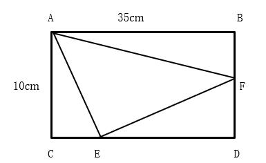
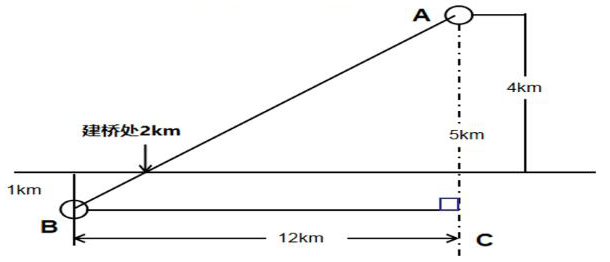
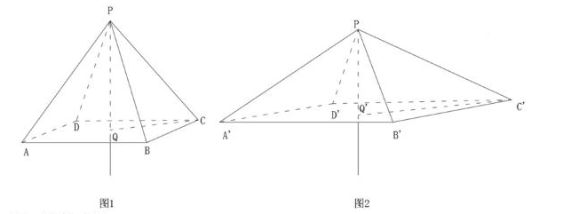
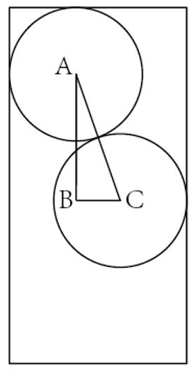
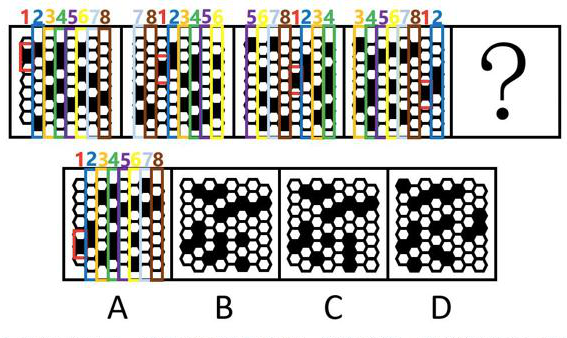
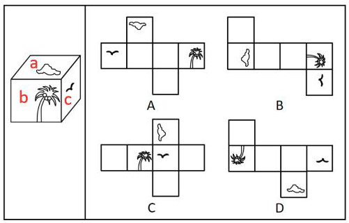
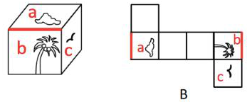
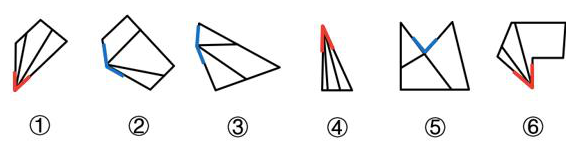
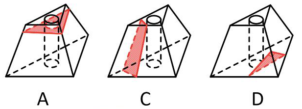

# 2022 年浙江行测（A类） · 答案与解析

以下为来源原文的结构化转写；缺失及冲突答案不补写。

## 第 21 题 · 言语理解与表达

参考答案：**D**

正确答案是：D
根据顿号可知，横线处所填成语与“从善如流”构成并列关系，表示听取正确的意见、接受善
意的规劝之意，D 项“闻过则喜”意为听到批评意见就喜悦，比喻乐于接受他人规劝，符合文
意，当选。
A 项“见贤思齐”意思是见到德才兼备的人就要向他（她）看齐，文段没有体现出要向德才兼
备的人看齐之意，排除；B 项“洗心革面”意为除去邪思杂念，改变旧日面目，比喻彻底悔悟，
改过自新，文段并无改过自新之意，排除；C 项“兼听则明”指多方听取意见才能辨明是非得
失，侧重意见，文段强调批评，与文意不符，排除。
故正确答案为D。
【文段出处】人民日报《人民日报:每一位同志都要修炼好挨批评的基本功》

来源：[2022年浙江省公务员录用考试（A）答案解析.pdf](https://github.com/dumarstoft-ship-it/xingce/blob/407016b55b49581efa3771bb59a2dee8761d982f/2022%E5%B9%B4%E6%B5%99%E6%B1%9F%E7%9C%81%E5%85%AC%E5%8A%A1%E5%91%98%E5%BD%95%E7%94%A8%E8%80%83%E8%AF%95%EF%BC%88A%EF%BC%89%E7%AD%94%E6%A1%88%E8%A7%A3%E6%9E%90.pdf)，PDF 第 9 页。

## 第 22 题 · 言语理解与表达

参考答案：**C**

正确答案是：C
第一空，根据前文可知，横线处应体现宋代的“琼林宴”是从唐代“闻喜宴”的基础上发展变化
而来，B 项“发展”指事物从小到大、从简单到复杂、从低级到高级的变化，C 项“演变”指逐
渐地发展变化，均符合文意，保留。A 项“转变”指由一种情况变成另一种情况，侧重“与之
前形成强烈反差”，与文意不符，排除；D 项“演化”指演变（多用于自然界的变化），如“生
物演化”，与文段语境不符，排除。
第二空，根据后文可知，“琼林宴”是皇帝亲自参与的“国宴”，故横线处需体现出级别更高，
C 项“规格”泛指规定的要求或条件，符合文意，保留。B 项“格局”指结构、格式和规模，与
文意不符，排除。
第三空，代入验证。横线处意在表达明清时期将宋代“琼林宴”的形式继承下来，C 项“传承”
指传递和继承，符合文意，当选。
故正确答案为C。
【文段出处】《古代学子们如何庆祝自己的毕业季？》

来源：[2022年浙江省公务员录用考试（A）答案解析.pdf](https://github.com/dumarstoft-ship-it/xingce/blob/407016b55b49581efa3771bb59a2dee8761d982f/2022%E5%B9%B4%E6%B5%99%E6%B1%9F%E7%9C%81%E5%85%AC%E5%8A%A1%E5%91%98%E5%BD%95%E7%94%A8%E8%80%83%E8%AF%95%EF%BC%88A%EF%BC%89%E7%AD%94%E6%A1%88%E8%A7%A3%E6%9E%90.pdf)，PDF 第 10 页。

## 第 23 题 · 言语理解与表达

参考答案：**B**

正确答案是：B
根据“中华传统节日的文化内涵蕴藏在人与自然、人与他人、人与自身的相处之道中”可知，
横线处应体现出对“和”的追求贯穿始终之意，B 项“统贯”指系统、条贯，可以体现“贯穿始终”
之意，当选。
A 项“分列”指按照一项准则分级或分类，与文意无关，排除；
C 项“包含”指里边含有，无法体现“贯穿始终”之意，排除；
D 项“纵横”指竖横交错或奔驰无阻，文段未体现“交错”之意，排除。
故正确答案为B。
【文段出处】书籍《中国文艺评论》2021 年第5 期——《中华传统节日的文化内涵：基于
人与自然、他者和自身关系视角的考察》

来源：[2022年浙江省公务员录用考试（A）答案解析.pdf](https://github.com/dumarstoft-ship-it/xingce/blob/407016b55b49581efa3771bb59a2dee8761d982f/2022%E5%B9%B4%E6%B5%99%E6%B1%9F%E7%9C%81%E5%85%AC%E5%8A%A1%E5%91%98%E5%BD%95%E7%94%A8%E8%80%83%E8%AF%95%EF%BC%88A%EF%BC%89%E7%AD%94%E6%A1%88%E8%A7%A3%E6%9E%90.pdf)，PDF 第 10 页。

## 第 24 题 · 言语理解与表达

参考答案：**B**

正确答案是：B
第一空，搭配“深度挖掘”，且根据“拥有2000 年冶陶史、1000 年官窑史、600 年御窑史及新
中国成立以来70 年陶瓷生产史的景德镇”可知，景德镇拥有悠久的历史，丰厚的人文资源，
A 项“潜力”指潜在的尚未发挥出来的力量，B 项“底蕴”指内涵，内在的储备，C 项“资源”指
物质资料等的来源，均符合文意，保留。D 项“涵养”意为修养，通常表达为“具有······涵
养”等，与“深度挖掘”搭配不当，排除。
第二空，根据“站在新的历史起点上，展望建设现代化国际瓷都的未来”以及“扩大陶瓷贸易
和文化交流，更好满足世界对中国陶瓷的新需要和对中华人文理想的新期待，进一步展示中
华古老陶瓷文化魅力”可知，整个文段重在论述，景德镇作为千年瓷都，在新的历史阶段，
应更多向国际社会展示陶瓷文化的魅力，横线处所填词语与前文的“展示”构成对应，表达景
德镇通过创新陶瓷产业，向世界展示中国人文城市的创新发展之意，B 项“阐释”意为阐述并
解释，符合文意，当选。A 项“促进”指推动发展和进步，C 项“刺激”指作用于事物使之产生
反应，均与文意不符，排除。
故正确答案为B。
【文段出处】《千年瓷话：景德镇的历史变迁》

来源：[2022年浙江省公务员录用考试（A）答案解析.pdf](https://github.com/dumarstoft-ship-it/xingce/blob/407016b55b49581efa3771bb59a2dee8761d982f/2022%E5%B9%B4%E6%B5%99%E6%B1%9F%E7%9C%81%E5%85%AC%E5%8A%A1%E5%91%98%E5%BD%95%E7%94%A8%E8%80%83%E8%AF%95%EF%BC%88A%EF%BC%89%E7%AD%94%E6%A1%88%E8%A7%A3%E6%9E%90.pdf)，PDF 第 10 页。

## 第 25 题 · 言语理解与表达

参考答案：**A**

正确答案是：A
· ·
本题可从第二空入手。“但”表转折，根据“积极扩大品牌影响力，不少‘网红’老字号还‘翻红’
海外市场，收获了一批‘海粉’”和“针对企业遇到的市场问题，政府部门应积极为企业纾困解
难，助力老字号走出国门”可知，横线所在句子表达老字号产品拓展海外市场之路遇到困难、
发展不顺利的含义。A 项“一帆风顺”比喻非常顺利，没有任何阻碍，B 项“无往不利”指所到
之处，没有不顺利的，与“并非”连用，均符合文意，保留。C 项“天从人愿”指上天顺从人的
意愿，事物的发展正合自己的心愿，文段重点强调老字号产品拓展海外市场的过程并不顺利，
而非是否顺从个人的意愿，与文意不符，排除；D 项“左右逢源”指做事得心应手，怎样进行
都很顺利，也形容办事圆滑，置于此处与“老字号产品”搭配不当，排除。
第一空，根据“积极扩大品牌影响力，不少‘网红’老字号还‘翻红’海外市场，收获了一批‘海粉’”
可知，老字号通过不断创新的方式扩大影响力，开拓海外市场。A 项“持续”指延续、继续、
连续不断，符合文意，当选。B 项“巧妙”指灵巧高明，超出一般（多指方法或技术），文段
重点强调老字号不断创新，并未体现出老字号在创新过程中运用了灵巧高明的方法，与文意
不符，排除。
故正确答案为A。
【文段出处】经济日报《让更多“老字号”驻足海外市场》

来源：[2022年浙江省公务员录用考试（A）答案解析.pdf](https://github.com/dumarstoft-ship-it/xingce/blob/407016b55b49581efa3771bb59a2dee8761d982f/2022%E5%B9%B4%E6%B5%99%E6%B1%9F%E7%9C%81%E5%85%AC%E5%8A%A1%E5%91%98%E5%BD%95%E7%94%A8%E8%80%83%E8%AF%95%EF%BC%88A%EF%BC%89%E7%AD%94%E6%A1%88%E8%A7%A3%E6%9E%90.pdf)，PDF 第 10、11 页。

## 第 26 题 · 言语理解与表达

参考答案：**B**

正确答案是：B
第一空，搭配“红色文化”，且根据“除了红色史迹，这里还诞生了许多红色文化名人”可知，
这片土地上的红色文化资源是十分丰富的，横线处所填词语应体现丰富之意。B 项“厚重”指
丰富，有分量，搭配得当，且符合文意，保留。A 项“沉重”指沉静庄重或心思重重的，心情
极度忧虑、不安或责任大，多搭配“心思、责任、性情”等，与“红色文化”搭配不当，且感情
色彩偏消极，与文段感情色彩不一致，排除；C 项“稳重”指安稳沉着，多用以形容人的性格、
行事风格等，与“红色文化”搭配不当，排除；D 项“庄重”指风度、仪表、举止或谈吐不随便，
沉着稳重，未能体现丰富之意，且与“红色文化”搭配不当，排除。
第二空，代入验证，B 项“进程”指事物发展变化或进行的过程，能体现革命、奋斗、拼搏精
神推动时代前进之意，且与“推动”“时代”均搭配恰当，保留。
第三空，代入验证，B 项“凝结”指凝聚、集结，与“精髓”搭配恰当，当选。
故正确答案为B。
【文段出处】人民网《安徽：奋进在红色热土上（红色地标巡礼·安徽篇）》

来源：[2022年浙江省公务员录用考试（A）答案解析.pdf](https://github.com/dumarstoft-ship-it/xingce/blob/407016b55b49581efa3771bb59a2dee8761d982f/2022%E5%B9%B4%E6%B5%99%E6%B1%9F%E7%9C%81%E5%85%AC%E5%8A%A1%E5%91%98%E5%BD%95%E7%94%A8%E8%80%83%E8%AF%95%EF%BC%88A%EF%BC%89%E7%AD%94%E6%A1%88%E8%A7%A3%E6%9E%90.pdf)，PDF 第 11 页。

## 第 27 题 · 言语理解与表达

参考答案：**C**

正确答案是：C
横线处所填成语搭配“改革和法治”，根据横线前顿号可知，横线处所填成语与“相互促进”构
成近义并列，表意相近。C 项“相得益彰”指两个人或两件事物互相配合，双方的能力和作用
更能显示出来，可以体现相互促进之意，当选。A 项“交相辉映”指各种光亮、色彩等互相映
照，多用于形容美好的景象，与“改革和法治”搭配不当，排除；B 项“相映成趣”指相互衬托
着，显得很有趣味，很有意思，D 项“相为表里”即互为表象及内里，内外互相配合，共为一
体，均无法体现促进之意，排除。
故正确答案为C。
【文段出处】人民日报《人民时评：让法治与改革相得益彰》

来源：[2022年浙江省公务员录用考试（A）答案解析.pdf](https://github.com/dumarstoft-ship-it/xingce/blob/407016b55b49581efa3771bb59a2dee8761d982f/2022%E5%B9%B4%E6%B5%99%E6%B1%9F%E7%9C%81%E5%85%AC%E5%8A%A1%E5%91%98%E5%BD%95%E7%94%A8%E8%80%83%E8%AF%95%EF%BC%88A%EF%BC%89%E7%AD%94%E6%A1%88%E8%A7%A3%E6%9E%90.pdf)，PDF 第 11 页。

## 第 28 题 · 言语理解与表达

参考答案：**A**

正确答案是：A
第一空，横线处所填词语搭配“全球价值”，且综合文意及选项分析可知，构建的知识体系同
时具有中国特色和全球价值，A 项“兼备”指同时具备，B 项“兼容”指同时容纳几个方面，C
项“兼有”指同时具有，D 项“兼顾”指几个方面同时照顾到，均符合文意，且搭配得当，保留。
第二空，根据“古今会通亦应伴以中西互镜······强调自明、自觉、自信”可知，通过
互镜可以反映出文化自觉和自信，A 项“意味”指含有某种意义，B 项“包含”指里边含有，D
项“表达”指表示（思想、感情），均符合文意，保留。C 项“象征”指用具体事物表现某些抽
象意义，根据文意可知，“互镜”并非是具体事物，排除。
第三空，横线处通过顿号与“狂妄”构成同义并列，“狂妄”指极端的自高自大，故横线处也
应体现自我、自大之意，且感情色彩消极，A 项“武断”含有妄以权势裁断曲直之意，感情色
彩偏消极，与“狂妄”构成同义并列对应，符合文意，当选。B 项“臆断”指凭臆测来断定，无
法构成同义并列，与文意不符，排除；D 项“决断”指拿主意，做决定，为中性词，感情色彩
不符，排除。
故正确答案为A。
【文段出处】胡百精《重返基源问题：中国传播思想史的知识建构》

来源：[2022年浙江省公务员录用考试（A）答案解析.pdf](https://github.com/dumarstoft-ship-it/xingce/blob/407016b55b49581efa3771bb59a2dee8761d982f/2022%E5%B9%B4%E6%B5%99%E6%B1%9F%E7%9C%81%E5%85%AC%E5%8A%A1%E5%91%98%E5%BD%95%E7%94%A8%E8%80%83%E8%AF%95%EF%BC%88A%EF%BC%89%E7%AD%94%E6%A1%88%E8%A7%A3%E6%9E%90.pdf)，PDF 第 11、12 页。

## 第 29 题 · 言语理解与表达

参考答案：**A**

正确答案是：A
第一空，搭配“梦想”，A 项“承载”指承受、负载，与“梦想”搭配恰当，保留。B 项“记载”指把
事情写下来，与“火箭”搭配不当，排除；C 项“负载”指机械设备以及生理组织等在单位时间
内所担负的工作量，也指机件及建筑构件承受的重量，是名词，而横线处需填入动词与“梦
想”搭配，故搭配不当，排除；D 项“担负”指承当起责任、工作、费用等，与“梦想”搭配不当，
排除。
第二空，代入验证，搭配“自信”和“底气”，A 项“夯实”指加固，填入文段表示中国航天给予
我们充足的自信和底气，搭配得当，且符合文意，当选。
故正确答案为A。
【文段出处】人民网《为浩瀚太空留下更多中国身影》

来源：[2022年浙江省公务员录用考试（A）答案解析.pdf](https://github.com/dumarstoft-ship-it/xingce/blob/407016b55b49581efa3771bb59a2dee8761d982f/2022%E5%B9%B4%E6%B5%99%E6%B1%9F%E7%9C%81%E5%85%AC%E5%8A%A1%E5%91%98%E5%BD%95%E7%94%A8%E8%80%83%E8%AF%95%EF%BC%88A%EF%BC%89%E7%AD%94%E6%A1%88%E8%A7%A3%E6%9E%90.pdf)，PDF 第 12 页。

## 第 30 题 · 言语理解与表达

参考答案：**B**

正确答案是：B
第一空，搭配“能源结构转型升级”，A 项“促使”指推动某物或某事使达到一定目的，B 项“推
动”指使事物前进或发展，均与“能源结构转型升级”搭配恰当，保留。C 项“鼓动”指以言语或
行为使他人有所行动，多用于贬义语境，与文段感情色彩不符，排除；D 项“提高”指使位置、
程度、水平等方面比原来高，与“能源结构转型升级”搭配不当，排除。
第二空，搭配“一步”，B 项“坚实”指牢固结实，符合文意，且与“一步”搭配恰当，当选。A
项“坚决”指意志坚定，毫不犹豫，多形容态度、主张等，与“一步”搭配不当，排除。
故正确答案为B。
【文段出处】光明网《“深海一号”，探寻超深海能源宝藏》

来源：[2022年浙江省公务员录用考试（A）答案解析.pdf](https://github.com/dumarstoft-ship-it/xingce/blob/407016b55b49581efa3771bb59a2dee8761d982f/2022%E5%B9%B4%E6%B5%99%E6%B1%9F%E7%9C%81%E5%85%AC%E5%8A%A1%E5%91%98%E5%BD%95%E7%94%A8%E8%80%83%E8%AF%95%EF%BC%88A%EF%BC%89%E7%AD%94%E6%A1%88%E8%A7%A3%E6%9E%90.pdf)，PDF 第 12 页。

## 第 31 题 · 言语理解与表达

参考答案：**B**

正确答案是：B
第一空，根据“牵涉供应端和消费端全链条”以及“不仅需要……也需要……”可知，低碳转型
是一个涉及方方面面的工程，故横线处应体现涉及范围广的含义，B 项“系统”指有条理的、
成体系的，D 项“浩大”指规模巨大，均符合文意，保留。A 项“核心”指中心，主要部分，C
项“特殊”指与别的事物不同，文段强调的是涉及范围广，均与文意不符，排除。
第二空，根据“夏天把空调温度调高一些，尽量购买节能型用品，积极参与义务植树活动，
每个人都为地球的‘凉热’出一份力”可知，低碳行动需要我们每个人都付出切实的行动，B 项
“脚踏实地”比喻做事踏实认真，符合文意，当选。D 项“厚积薄发”形容只有准备充分才能办
好事情，文段强调每个人切实去做而非事先准备，与文意不符，排除。
故正确答案为B。
【文段出处】光明网《科技创新助力碳中和》

来源：[2022年浙江省公务员录用考试（A）答案解析.pdf](https://github.com/dumarstoft-ship-it/xingce/blob/407016b55b49581efa3771bb59a2dee8761d982f/2022%E5%B9%B4%E6%B5%99%E6%B1%9F%E7%9C%81%E5%85%AC%E5%8A%A1%E5%91%98%E5%BD%95%E7%94%A8%E8%80%83%E8%AF%95%EF%BC%88A%EF%BC%89%E7%AD%94%E6%A1%88%E8%A7%A3%E6%9E%90.pdf)，PDF 第 12、13 页。

## 第 32 题 · 言语理解与表达

参考答案：**D**

正确答案是：D
本题可从第二空入手，横线前“它们”指代前文冰岛的冰川洞穴，且由后文“这使每个镜头都
成为唯一的瞬间”可知，冰川洞穴不会长久存在，C 项“融化”指（冰、雪等）变成水，D 项“消
融”指（冰、雪）融化，均符合文意，保留。A 项“消失”指（人或事物）逐渐减少以至没有，
不复存在，B 项“止息”指停止，均不能精准地对应“冰川洞穴”的特点，排除。
第一空，根据“会碰撞出一个神奇的景观”可知，横线处所填词语要与“碰撞”相呼应，强调水
流冰川相碰撞，D 项“相遇”指遇见，碰到，符合文意，当选。C 项“聚积”强调累积，经年累
月，一点一滴地累积，而非二者相碰撞，不符合文意，排除。
故正确答案为D。
【文段出处】中国国家地理《冰岛冰洞冰与水之歌》

来源：[2022年浙江省公务员录用考试（A）答案解析.pdf](https://github.com/dumarstoft-ship-it/xingce/blob/407016b55b49581efa3771bb59a2dee8761d982f/2022%E5%B9%B4%E6%B5%99%E6%B1%9F%E7%9C%81%E5%85%AC%E5%8A%A1%E5%91%98%E5%BD%95%E7%94%A8%E8%80%83%E8%AF%95%EF%BC%88A%EF%BC%89%E7%AD%94%E6%A1%88%E8%A7%A3%E6%9E%90.pdf)，PDF 第 13 页。

## 第 33 题 · 言语理解与表达

参考答案：**A**

正确答案是：A
第一空，根据文意可知，横线处所填词语意在表达“天宫”这一名字极具中国传统文化特点。
A 项“韵味”指情趣、趣味，B 项“意蕴”指内在的意义、含义，C 项“特色”指事物所表现的独
特的色彩、风格，均符合文意，保留。D 项“智慧”指聪明才智，文中并非表达这个命名体现
了聪明才智，与文意不符，排除。
第二空，根据“蕴含了希望航天员在太空工作生活得更为······的愿望”可知，横线处
所填词语意在表达希望航天员生活得较为满意。A 项“舒适”指舒服安适，B 项“舒服”指身心
感到轻松愉快，C 项“惬意”形容心情感到愉快畅快，愉悦、舒畅，均符合文意，保留。
第三空，搭配“情怀”和“精神”，且由文意可知，“天宫”这一名字体现着“浪漫情怀和不懈探索
的精神”。A 项“寄寓”指寄托，即把理想、希望、感情放在（某人身上或某种事物上），符
合文意，当选。B 项“涵盖”指包容，覆盖，无法准确表达出“天宫”这一名字与“情怀”“精神”
之间的关系，与文意不符，排除；C 项“象征”指用具体事物表现某些抽象意义，如“玫瑰花
象征着爱情”，不能将“名字”这一抽象概念作为主语进行搭配，排除。
故正确答案为A。
【文段出处】安化县人民政府网《天宫空间站——太空闪耀中国智慧》

来源：[2022年浙江省公务员录用考试（A）答案解析.pdf](https://github.com/dumarstoft-ship-it/xingce/blob/407016b55b49581efa3771bb59a2dee8761d982f/2022%E5%B9%B4%E6%B5%99%E6%B1%9F%E7%9C%81%E5%85%AC%E5%8A%A1%E5%91%98%E5%BD%95%E7%94%A8%E8%80%83%E8%AF%95%EF%BC%88A%EF%BC%89%E7%AD%94%E6%A1%88%E8%A7%A3%E6%9E%90.pdf)，PDF 第 13 页。

## 第 34 题 · 言语理解与表达

参考答案：**C**

正确答案是：C
第一空，根据文意可知，横线处所填词语可以起到“衡量民众对美好生活需要的满足状况”
的作用，B 项“标准”指衡量事物的准则，C 项“指标”指衡量目标的参数或预期中打算达到的
指数、规格、标准，D 项“准绳”比喻言论、行动等依据的原则和标准，三者均符合文意，保
留。A 项“标志”指表明特征的记号或事物，无法起到衡量的作用，排除。
第二空，搭配“获得感”，根据“个体的持续努力”“保障获得感的可持续性”可知，横线处所填
词语应体现获得感越来越多之意。B 项“增强”指在原有的基础上更进一步，C 项“提升”指提
高，二者均符合文意且搭配恰当，保留。D 项“巩固”指使牢固，强调原有基础的保持，不能
体现变多之意，排除。
第三空，搭配“负担”，C 项“减轻”指减少重量或程度，与“负担”搭配恰当，当选。B 项“释放”
指把所含的能量或物质放出来，常搭配“能量”“压力”“潜能”等，与“负担”搭配不当，排除。
故正确答案为C。
【文段出处】光明网《以青春之奋斗创造青年之获得》

来源：[2022年浙江省公务员录用考试（A）答案解析.pdf](https://github.com/dumarstoft-ship-it/xingce/blob/407016b55b49581efa3771bb59a2dee8761d982f/2022%E5%B9%B4%E6%B5%99%E6%B1%9F%E7%9C%81%E5%85%AC%E5%8A%A1%E5%91%98%E5%BD%95%E7%94%A8%E8%80%83%E8%AF%95%EF%BC%88A%EF%BC%89%E7%AD%94%E6%A1%88%E8%A7%A3%E6%9E%90.pdf)，PDF 第 13、14 页。

## 第 35 题 · 言语理解与表达

参考答案：**B**

正确答案是：B
文段首先指出实现技术要素是高标准市场体系建设的战略使命，接着介绍技术要素市场化对
高标准市场体系的作用及要求，并举例说明，然后通过“此外”引导并列，指出技术要素市场
化改革对高标准市场体系的要求，故文段的主题词是“技术要素”与“高标准市场体系”，强调
的重点是技术要素与高标准市场体系的关系，对应B 项。
A 项，“科技与经济社会发展的关系”对应尾句的一部分，表述片面，且无主题词“技术要素”
与“高标准市场体系”，排除；
C 项，文段并未提及“高标准市场体系与创新体系的关系”，无中生有，且无主题词“技术要
素”，排除；
D 项，对应“此外”前的内容，表述片面，且文段主题词是“高标准市场体系”而非“市场体系”，
主题词范围扩大，排除。
故正确答案为B。
【文段出处】《技术要素市场如何培育》

来源：[2022年浙江省公务员录用考试（A）答案解析.pdf](https://github.com/dumarstoft-ship-it/xingce/blob/407016b55b49581efa3771bb59a2dee8761d982f/2022%E5%B9%B4%E6%B5%99%E6%B1%9F%E7%9C%81%E5%85%AC%E5%8A%A1%E5%91%98%E5%BD%95%E7%94%A8%E8%80%83%E8%AF%95%EF%BC%88A%EF%BC%89%E7%AD%94%E6%A1%88%E8%A7%A3%E6%9E%90.pdf)，PDF 第 14 页。

## 第 36 题 · 言语理解与表达

参考答案：**C**

正确答案是：C
A 项，根据文段“一旦采集范围扩大，将人脸周围的图像、公民所处的环境、正在从事的行
为等信息进行采集，将侵犯公民不愿暴露的隐私”可知，说法正确，排除；
B 项，根据文段“不过后台能够看见的画面已不局限在人脸范围”“一旦采集范围扩大，将人
脸周围的图像······将侵犯公民不愿暴露的隐私”可知，采集人脸周围的图像属于扩
大采集范围，说法正确，排除；
C 项，根据文段“人脸识别只能采集公民主动提供人脸的图像信息”可知，人脸识别的信息获
取来源由公民主动提供，文段并未要求公民主动提供，偷换概念，当选；
D 项，根据文段“因此，肖像权是人脸识别过程中最有可能受到侵害的权利”可知，说法正确，
排除。
本题为选非题，故正确答案为C。
【文段出处】光明网《人脸识别只能识别人脸》

来源：[2022年浙江省公务员录用考试（A）答案解析.pdf](https://github.com/dumarstoft-ship-it/xingce/blob/407016b55b49581efa3771bb59a2dee8761d982f/2022%E5%B9%B4%E6%B5%99%E6%B1%9F%E7%9C%81%E5%85%AC%E5%8A%A1%E5%91%98%E5%BD%95%E7%94%A8%E8%80%83%E8%AF%95%EF%BC%88A%EF%BC%89%E7%AD%94%E6%A1%88%E8%A7%A3%E6%9E%90.pdf)，PDF 第 14 页。

## 第 37 题 · 言语理解与表达

参考答案：**C**

正确答案是：C
A 项，根据“长棘海星，这种像仙人球一般长满尖刺的生物”“成年长棘海星的身体直径可以
达到35 厘米，有记录的最大个体甚至能超过75 厘米”可知，“外形特征”文段有提及，排除；
B 项，根据“长棘海星以各类珊瑚，尤其是造礁珊瑚为食”可知，其“捕食对象”即为珊瑚，文
段有提及，排除；
C 项，“种群密度”文段并未提及，无中生有，当选；
D 项，根据“如同肆虐于草原和农田的蝗灾一样，在全球范围内长棘海星会出现不规律的种
群暴发，对珊瑚礁生态系统造成严重影响”可知，文段有提及“破坏作用”，排除。
本题为选非题，故正确答案为C。
【文段出处】中国国家地理杂志《长棘海星暴发充满谜团的自然现象》

来源：[2022年浙江省公务员录用考试（A）答案解析.pdf](https://github.com/dumarstoft-ship-it/xingce/blob/407016b55b49581efa3771bb59a2dee8761d982f/2022%E5%B9%B4%E6%B5%99%E6%B1%9F%E7%9C%81%E5%85%AC%E5%8A%A1%E5%91%98%E5%BD%95%E7%94%A8%E8%80%83%E8%AF%95%EF%BC%88A%EF%BC%89%E7%AD%94%E6%A1%88%E8%A7%A3%E6%9E%90.pdf)，PDF 第 14 页。

## 第 38 题 · 言语理解与表达

参考答案：**A**

正确答案是：A
本题为接语选择题，需通读全文，重点把握文段核心话题。文段开篇引出话题，即宏观调控
体系在不断创新、完善。随后提出数字技术对于经济治理的重要作用，并提出宏观经济与数
据均是动态的形式存在。尾句提出数字技术对于宏观调控的重要作用。根据话题一致原则，
文段接下来最可能围绕“数字技术”和“宏观调控”展开论述，介绍如何通过数字技术创新和完
善宏观调控，对应A 项。
B、C、D 三项，均未提及文段核心话题“数字技术”，与前文无法衔接，排除。
故正确答案为A。
【文段出处】《善用数字技术创新宏观调控》

来源：[2022年浙江省公务员录用考试（A）答案解析.pdf](https://github.com/dumarstoft-ship-it/xingce/blob/407016b55b49581efa3771bb59a2dee8761d982f/2022%E5%B9%B4%E6%B5%99%E6%B1%9F%E7%9C%81%E5%85%AC%E5%8A%A1%E5%91%98%E5%BD%95%E7%94%A8%E8%80%83%E8%AF%95%EF%BC%88A%EF%BC%89%E7%AD%94%E6%A1%88%E8%A7%A3%E6%9E%90.pdf)，PDF 第 14、15 页。

## 第 39 题 · 言语理解与表达

参考答案：**D**

正确答案是：D
文段开篇介绍目前发现最完整的恐龙胚胎是“英良贝贝”，然后介绍该胚胎呈现的奇怪姿势从
未在恐龙胚胎中发现，反而在现代鸟类胚胎中常见，接下来详细介绍该姿势相当于现代鸟类
胚胎孵化的“预折叠”阶段，最后通过“研究人员推断”及指代词“这种”进行总结，鸟类的预孵
化行为可能起源于兽脚类恐龙。故文段为分总结构，重点强调现代鸟类孵化行为和恐龙可能
存在关联，对应D 项。
A 项，对应文段“此姿势从未在恐龙胚胎中发现”，非文段重点，排除；
B 项，“许多特征”范围扩大，文段只介绍了胚胎孵化行为，排除；
C 项，“恐龙存在孵化抚育后代行为”文段并未提及，无中生有，排除。
故正确答案为D。
【文段出处】《睡姿像小鸟，萌化了！这是迄今为止科学记录最完整的恐龙胚胎》

来源：[2022年浙江省公务员录用考试（A）答案解析.pdf](https://github.com/dumarstoft-ship-it/xingce/blob/407016b55b49581efa3771bb59a2dee8761d982f/2022%E5%B9%B4%E6%B5%99%E6%B1%9F%E7%9C%81%E5%85%AC%E5%8A%A1%E5%91%98%E5%BD%95%E7%94%A8%E8%80%83%E8%AF%95%EF%BC%88A%EF%BC%89%E7%AD%94%E6%A1%88%E8%A7%A3%E6%9E%90.pdf)，PDF 第 15 页。

## 第 40 题 · 言语理解与表达

参考答案：**C**

正确答案是：C
A 项，“成就远远超出实用和观赏的目的”文段未提及，无中生有，排除；
B 项，文段指出“同期乾隆朝内务府制造的大量松花砚则几乎抛弃了这种仿古砚式，极尽所
能地去追求甚至创造潮流”，但并未体现出松花砚成为“主要潮流”，无中生有，排除；
C 项，根据“其仿造的主要是文化昌隆的汉、唐、宋泥质砚的标准款式”和“仿古绛州澄泥砚
则意在强调它在技术领域的无所不能”可知，表述正确，当选；
D 项，根据“乾隆朝宫作松花砚体现的是清宫在艺术审美领域的无往不胜，那么仿古绛州澄
泥砚则意在强调它在技术领域的无所不能”可知，“艺术创造的美感或技术”对应“宫作松花砚”、
“仿古绛州澄泥砚”，“乾隆朝宫作砚”范围扩大，排除。
故正确答案为C。
【文段出处】《清代古砚鉴藏与仿古砚成造——以乾隆款仿古绛州澄泥砚为中心》

来源：[2022年浙江省公务员录用考试（A）答案解析.pdf](https://github.com/dumarstoft-ship-it/xingce/blob/407016b55b49581efa3771bb59a2dee8761d982f/2022%E5%B9%B4%E6%B5%99%E6%B1%9F%E7%9C%81%E5%85%AC%E5%8A%A1%E5%91%98%E5%BD%95%E7%94%A8%E8%80%83%E8%AF%95%EF%BC%88A%EF%BC%89%E7%AD%94%E6%A1%88%E8%A7%A3%E6%9E%90.pdf)，PDF 第 15 页。

## 第 41 题 · 言语理解与表达

参考答案：**D**

正确答案是：D
A 项，根据“这个说法简单清晰地揭示了南极磷虾在南极生物圈承担的关键角色——这里几
乎所有的动物都直接或间接地依赖磷虾生存”可以推出，南极磷虾在南极生物圈发挥关键作
用，表述正确，排除；
B 项，根据“在南极生活的动物从食物链上划分只有三个可能：它是磷虾，它吃磷虾或它捕
食吃磷虾的动物”“这里几乎所有的动物都直接或间接地依赖磷虾生存”可以推出，大多南极
动物进化出以磷虾为中心的生存方式，表述正确，排除；
C 项，根据“而且它们生长繁殖、捕猎与迁移的时间和地点均与磷虾的生长状态相耦合”可以
推出，部分南极动物的繁殖期与磷虾的丰产期相一致，表述正确，排除；
D 项，文段未提及“企鹅数量下降”的原因，也未涉及“磷虾数量的减少”，故属于无中生有，
当选。
本题为选非题，故正确答案为D。
【文段出处】《从南极磷虾看生命的意义》

来源：[2022年浙江省公务员录用考试（A）答案解析.pdf](https://github.com/dumarstoft-ship-it/xingce/blob/407016b55b49581efa3771bb59a2dee8761d982f/2022%E5%B9%B4%E6%B5%99%E6%B1%9F%E7%9C%81%E5%85%AC%E5%8A%A1%E5%91%98%E5%BD%95%E7%94%A8%E8%80%83%E8%AF%95%EF%BC%88A%EF%BC%89%E7%AD%94%E6%A1%88%E8%A7%A3%E6%9E%90.pdf)，PDF 第 15 页。

## 第 42 题 · 言语理解与表达

参考答案：**D**

正确答案是：D ·
文段开篇指出制造与服务融合是智能制造的重要内容之一，并由此形成了生产性服务与制造
服务化。随后指出本文从工业互联网的多重视角，建立了制造与服务融合中虚拟逻辑与实体
活动交互的技术体系，提出了多要素驱动的制造与服务融合方法，尾句作进一步阐释，指出
基于工业互联网的制造与服务融合技术体系带来了诸多利好。故文段主要讨论的话题为“工
业互联网”与“制造与服务融合技术”，对应D 项。
A、B 两项，均缺少文段核心话题“工业互联网”，排除；
C 项，强调“工业互联网”在智能制造中的应用，缺少文段另一核心话题“制造与服务融合技
术”，排除。
故正确答案为D。
【文段出处】万方智搜《基于工业互联网的制造与服务融合技术》

来源：[2022年浙江省公务员录用考试（A）答案解析.pdf](https://github.com/dumarstoft-ship-it/xingce/blob/407016b55b49581efa3771bb59a2dee8761d982f/2022%E5%B9%B4%E6%B5%99%E6%B1%9F%E7%9C%81%E5%85%AC%E5%8A%A1%E5%91%98%E5%BD%95%E7%94%A8%E8%80%83%E8%AF%95%EF%BC%88A%EF%BC%89%E7%AD%94%E6%A1%88%E8%A7%A3%E6%9E%90.pdf)，PDF 第 16 页。

## 第 43 题 · 言语理解与表达

参考答案：**D**

正确答案是：D
文段开篇指出我国全年降水量和河川径流量大部分集中在汛期，且不同年份的变化显著，天
然来水过程与需水过程不匹配，接着又指出，随着城镇化水平不断提升，人口和经济要素向
城市集聚，这种人为的因素也导致了水资源保障问题日益突出。因此，文段为没有标志的并
列结构，前半部分指出水资源供需矛盾的自然因素，后半部分指出人为因素，对应D 项。
A、B 两项，均对应文段关于“水资源供需矛盾的自然因素”，表述片面，排除；
C 项，“北方地区水资源衰减态势”文段未提及，无中生有，排除。
故正确答案为D。
【文段出处】光明日报《院士专家把脉我国水资源“家底”——水，如何平衡发展之重》

来源：[2022年浙江省公务员录用考试（A）答案解析.pdf](https://github.com/dumarstoft-ship-it/xingce/blob/407016b55b49581efa3771bb59a2dee8761d982f/2022%E5%B9%B4%E6%B5%99%E6%B1%9F%E7%9C%81%E5%85%AC%E5%8A%A1%E5%91%98%E5%BD%95%E7%94%A8%E8%80%83%E8%AF%95%EF%BC%88A%EF%BC%89%E7%AD%94%E6%A1%88%E8%A7%A3%E6%9E%90.pdf)，PDF 第 16 页。

## 第 44 题 · 言语理解与表达

参考答案：**B**

正确答案是：B
文段开篇介绍传统的植物栽培方法存在不足，水和肥料都没有得到最佳使用，接着通过“为
此”指代前文进行总结，指出某大学科研人员开发出一种聚合物水凝胶，并指出该凝胶既有
助于避免土壤污染，又能减少用水量及改善植物对肥料的吸收。后文围绕聚合物水凝胶的作
用进行具体解释说明。故文段重在强调聚合物水凝胶具有避免土壤污染和减少用水量的作用，
对应B 项。
A 项，“根部肥料往往远离根部”对应前文传统的栽培方法的部分内容，文段重点强调新材料
聚合物水凝胶，排除；
C 项，文段并未论述“大量使用化学肥料”对于“土壤状况”的危害，无中生有，排除；
D 项，“土壤中可完全降解”对应“同时”之后解释说明的内容，非重点且表述片面，排除。
故正确答案为B。
【文段出处】《新凝胶可减少土地用水并避免污染》

来源：[2022年浙江省公务员录用考试（A）答案解析.pdf](https://github.com/dumarstoft-ship-it/xingce/blob/407016b55b49581efa3771bb59a2dee8761d982f/2022%E5%B9%B4%E6%B5%99%E6%B1%9F%E7%9C%81%E5%85%AC%E5%8A%A1%E5%91%98%E5%BD%95%E7%94%A8%E8%80%83%E8%AF%95%EF%BC%88A%EF%BC%89%E7%AD%94%E6%A1%88%E8%A7%A3%E6%9E%90.pdf)，PDF 第 16 页。

## 第 45 题 · 言语理解与表达

参考答案：**A**

正确答案是：A
A 项，根据文段首句“牙科医生治疗受损牙齿使用的修复物由人造材料制成，而固定修复物
所用的商业用胶……”以及“天然羟基磷灰石存在于牙齿、蛋壳等组织中，在其基础上制作的
新黏合剂可模拟牙质的特性和结构”可知，用来治疗牙齿受损的是修复物，为人造材料制成，
只有固定修复物的胶可以是天然物质合成，因此“类似牙齿的天然材料”应指的是起到黏合、
固定作用的新黏合剂，并不能起到“治疗”作用，偷换概念，当选；
B 项，根据文段中“天然羟基磷灰石存在于牙齿、蛋壳等组织……模拟牙质的特性和结构”可
知，表述正确，排除；
C 项，根据文段中“天然羟基磷灰石……制作的新黏合剂可模拟牙质的特性和结构”可知，新
型黏合剂与天然牙组织有类似的特性和结构，表述正确，排除；
D 项，根据文段中“为检验新黏合剂的效果……结果显示，新型黏合剂由于与天然牙组织高
度相似，可以更牢固地黏合人造修复材料”可知，新型黏合剂的黏合效果更好，表述正确，
排除。
本题为选非题，故正确答案为A。
【文段出处】光明网《蛋壳提取物可制备牙科黏合剂》

来源：[2022年浙江省公务员录用考试（A）答案解析.pdf](https://github.com/dumarstoft-ship-it/xingce/blob/407016b55b49581efa3771bb59a2dee8761d982f/2022%E5%B9%B4%E6%B5%99%E6%B1%9F%E7%9C%81%E5%85%AC%E5%8A%A1%E5%91%98%E5%BD%95%E7%94%A8%E8%80%83%E8%AF%95%EF%BC%88A%EF%BC%89%E7%AD%94%E6%A1%88%E8%A7%A3%E6%9E%90.pdf)，PDF 第 16、17 页。

## 第 46 题 · 言语理解与表达

参考答案：**C**

正确答案是：C
对比选项，确定首句。①句介绍目前人类可以利用一些技术手段进入元宇宙，凭借网络重新
定义自己，体验一种全新的生活，②句介绍对于多数人来说，首先要弄清楚什么是元宇宙，
③句介绍元宇宙是指超越现实的虚拟世界，三句话均围绕“元宇宙”进行论述，按照先后逻辑
顺序，应先提出问题，即何谓“元宇宙”；再具体回答什么是“元宇宙”以及如何进入元宇宙，
故②句应该在①句和③句的前面，对应C 项。
验证C 项，②句引出何谓“元宇宙”这一话题，③句介绍“元宇宙”的具体定义，⑤④两句指出
元宇宙给人们带来的体验，⑥句通过电影及动漫来说明想象中的元宇宙，①句介绍通过技术
手段人们可以实现进入元宇宙的梦想，逻辑通顺。
故正确答案为C。
【文段出处】中国社会科学报《元宇宙：游戏与人性自由前所未有之契合》

来源：[2022年浙江省公务员录用考试（A）答案解析.pdf](https://github.com/dumarstoft-ship-it/xingce/blob/407016b55b49581efa3771bb59a2dee8761d982f/2022%E5%B9%B4%E6%B5%99%E6%B1%9F%E7%9C%81%E5%85%AC%E5%8A%A1%E5%91%98%E5%BD%95%E7%94%A8%E8%80%83%E8%AF%95%EF%BC%88A%EF%BC%89%E7%AD%94%E6%A1%88%E8%A7%A3%E6%9E%90.pdf)，PDF 第 17 页。

## 第 47 题 · 言语理解与表达

参考答案：**C**

正确答案是：C
对比选项，首句均为⑥句。
进一步观察选项发现，应对比⑥句后面接②句还是⑤句，⑥句指出直接用火很难点燃固体蜡，
②句通过“因此”得出结论，介绍烛芯的重要性，故⑥②两句可形成因果关系，构成捆绑，保
留C、D 两项。⑤句介绍点燃烛芯后蜡烛的变化，根据逻辑顺序，应先引入“烛芯”这一话题，
再具体解释“点燃烛芯后的蜡烛变化”，故②句应在⑤句之前，排除A、B 两项。
对比C、D 两项，开头均为⑥②⑤三句，区别在于④句和①③两句的先后顺序，①句指出因
火焰的热量而变成气体，③句指出变成气体的蜡可以燃烧，④句介绍液体蜡的情况，根据蜡
烛燃烧时“固体-液体-气体”的变化规律可知，④句应在①③两句之前，排除D 项，对应C 项。
故正确答案为C。

来源：[2022年浙江省公务员录用考试（A）答案解析.pdf](https://github.com/dumarstoft-ship-it/xingce/blob/407016b55b49581efa3771bb59a2dee8761d982f/2022%E5%B9%B4%E6%B5%99%E6%B1%9F%E7%9C%81%E5%85%AC%E5%8A%A1%E5%91%98%E5%BD%95%E7%94%A8%E8%80%83%E8%AF%95%EF%BC%88A%EF%BC%89%E7%AD%94%E6%A1%88%E8%A7%A3%E6%9E%90.pdf)，PDF 第 17 页。

## 第 48 题 · 言语理解与表达

参考答案：**C**

正确答案是：C ·
横线在文段中间，需考虑与前后文的衔接。横线前介绍科学家之前根据生物的外表等来推测
进化历程，之后通过转折词“但是”强调发现了一些颠覆以往观点的例子。横线后指出海豚、
海豹和海牛外在特征相似却不是近亲，并介绍“海豚和长颈鹿是近亲，而海牛和大象是近亲”，
即强调外在特征不同却是近亲。故横线处应体现有些动物“外在特征相似却不是近亲”和“外
在特征不同却是近亲”，对应C 项。
A 项“‘容貌相似的亲戚’”、D 项“‘外表相似的亲戚’”，均与文意相悖，排除；
B 项，“不无相似”强调的是相似，与文意相悖，且“容貌相似”表述片面，“外表和骨骼”“生活
在水里，体型为流线型”不仅仅指“容貌”，排除。
故正确答案为C。
【文段出处】新浪《生物间意想不到的亲缘关系》

来源：[2022年浙江省公务员录用考试（A）答案解析.pdf](https://github.com/dumarstoft-ship-it/xingce/blob/407016b55b49581efa3771bb59a2dee8761d982f/2022%E5%B9%B4%E6%B5%99%E6%B1%9F%E7%9C%81%E5%85%AC%E5%8A%A1%E5%91%98%E5%BD%95%E7%94%A8%E8%80%83%E8%AF%95%EF%BC%88A%EF%BC%89%E7%AD%94%E6%A1%88%E8%A7%A3%E6%9E%90.pdf)，PDF 第 17 页。

## 第 49 题 · 言语理解与表达

参考答案：**C**

正确答案是：C
横线在文段中间，需考虑与前后文的衔接。横线前介绍国家文明的传承需要通过典籍、实物
和活态三条渠道，而活态传承相较前两种更缺少学者关注，接着通过转折词“事实上”指出非
物质文化遗产的内容、形式、工艺很复杂。横线后通过“也”指出传承人通过“活态传承”为中
华文明的延续作出贡献。横线前后均围绕“活态传承”展开论述，因此横线处应体现“活态传
承”这一核心话题，对应C 项。
A、B、D 三项均偏离文段核心话题“活态传承”，排除。
故正确答案为C。
【文段出处】《非遗传承人：中华文明的另类传承者》

来源：[2022年浙江省公务员录用考试（A）答案解析.pdf](https://github.com/dumarstoft-ship-it/xingce/blob/407016b55b49581efa3771bb59a2dee8761d982f/2022%E5%B9%B4%E6%B5%99%E6%B1%9F%E7%9C%81%E5%85%AC%E5%8A%A1%E5%91%98%E5%BD%95%E7%94%A8%E8%80%83%E8%AF%95%EF%BC%88A%EF%BC%89%E7%AD%94%E6%A1%88%E8%A7%A3%E6%9E%90.pdf)，PDF 第 17、18 页。

## 第 50 题 · 言语理解与表达

参考答案：**C**

正确答案是：C
文段开篇引出数独的话题，强调其比较受欢迎，后文通过介绍格子数量和横行纵列填法，对
于数独的填写方法和规则做出具体说明，尾句通过“仅有一种答案”，再次强调了数独的规则
特点，故文段整体都在围绕数独填写的基本方法和要求展开说明，对应C 项。
A 项，“填数乐趣”文段中并未提及，无中生有，排除；
B 项，“九宫方阵”仅对应文段“此时”之后的内容，表述片面，排除；
D 项，“解题思路”即为解开数独的方法，文段并没有提到解开数独的具体方法步骤，无中生
有，排除。
故正确答案为C。
【文段出处】科学世界《数独背后的数学魅力》

来源：[2022年浙江省公务员录用考试（A）答案解析.pdf](https://github.com/dumarstoft-ship-it/xingce/blob/407016b55b49581efa3771bb59a2dee8761d982f/2022%E5%B9%B4%E6%B5%99%E6%B1%9F%E7%9C%81%E5%85%AC%E5%8A%A1%E5%91%98%E5%BD%95%E7%94%A8%E8%80%83%E8%AF%95%EF%BC%88A%EF%BC%89%E7%AD%94%E6%A1%88%E8%A7%A3%E6%9E%90.pdf)，PDF 第 18 页。

## 第 51 题 · 数量关系

参考答案：**A**

正确答案是：A
数列相邻两项之间存在明显的倍数关系，优先考虑作商。后项除以前项可得：2，3，4，5，
（），是连续自然数列，下一项为6。故所求项=168×6=1008。
故正确答案为A。

来源：[2022年浙江省公务员录用考试（A）答案解析.pdf](https://github.com/dumarstoft-ship-it/xingce/blob/407016b55b49581efa3771bb59a2dee8761d982f/2022%E5%B9%B4%E6%B5%99%E6%B1%9F%E7%9C%81%E5%85%AC%E5%8A%A1%E5%91%98%E5%BD%95%E7%94%A8%E8%80%83%E8%AF%95%EF%BC%88A%EF%BC%89%E7%AD%94%E6%A1%88%E8%A7%A3%E6%9E%90.pdf)，PDF 第 18 页。

## 第 52 题 · 数量关系

参考答案：**B**

正确答案是：B
题干与选项均包含分数，优先考虑分数数列。将整数转化为分数后无规律，考虑相邻两项作积。前项乘后项可得：2，3，4，（），是连续自然数列，下一项为5。则所求项=5÷2=5/2。
故正确答案为B。

来源：[2022年浙江省公务员录用考试（A）答案解析.pdf](https://github.com/dumarstoft-ship-it/xingce/blob/407016b55b49581efa3771bb59a2dee8761d982f/2022%E5%B9%B4%E6%B5%99%E6%B1%9F%E7%9C%81%E5%85%AC%E5%8A%A1%E5%91%98%E5%BD%95%E7%94%A8%E8%80%83%E8%AF%95%EF%BC%88A%EF%BC%89%E7%AD%94%E6%A1%88%E8%A7%A3%E6%9E%90.pdf)，PDF 第 18 页。

## 第 53 题 · 数量关系

参考答案：**C**

正确答案是：C
数列无明显特征，作差作和均无规律，考虑递推。观察发现：-9+6×2=3，6+3×2=12，3+12
×2=27，即规律为：第一项+第二项×2=第三项。则所求项为12+27×2=66。
故正确答案为C。

来源：[2022年浙江省公务员录用考试（A）答案解析.pdf](https://github.com/dumarstoft-ship-it/xingce/blob/407016b55b49581efa3771bb59a2dee8761d982f/2022%E5%B9%B4%E6%B5%99%E6%B1%9F%E7%9C%81%E5%85%AC%E5%8A%A1%E5%91%98%E5%BD%95%E7%94%A8%E8%80%83%E8%AF%95%EF%BC%88A%EF%BC%89%E7%AD%94%E6%A1%88%E8%A7%A3%E6%9E%90.pdf)，PDF 第 18 页。

## 第 54 题 · 数量关系

参考答案：**A**

正确答案是：A
数列无明显特征，作差作和均无规律，考虑递推。观察发现：2+4-0=6，4+6-1=9，6+9-2=13，
9+13-3=19，规律为：第一项+第二项-修正项=第三项，修正项依次为0，1，2，3，是公差
为1 的等差数列，修正项下一项为4，则所求项为13+19-4=28。
故正确答案为A。

来源：[2022年浙江省公务员录用考试（A）答案解析.pdf](https://github.com/dumarstoft-ship-it/xingce/blob/407016b55b49581efa3771bb59a2dee8761d982f/2022%E5%B9%B4%E6%B5%99%E6%B1%9F%E7%9C%81%E5%85%AC%E5%8A%A1%E5%91%98%E5%BD%95%E7%94%A8%E8%80%83%E8%AF%95%EF%BC%88A%EF%BC%89%E7%AD%94%E6%A1%88%E8%A7%A3%E6%9E%90.pdf)，PDF 第 18 页。

## 第 55 题 · 数量关系

参考答案：**D**

正确答案是：D
数列无明显特征，优先考虑多级数列。后项减前项得到新数列：9，10，13，18，（），新
数列无明显规律，再次作差得到：1，3，5，（），是公差为2 的等差数列，下一项为5+2=7，
则新数列下一项为18+7=25。故所求项为71+25=96。
故正确答案为D。

来源：[2022年浙江省公务员录用考试（A）答案解析.pdf](https://github.com/dumarstoft-ship-it/xingce/blob/407016b55b49581efa3771bb59a2dee8761d982f/2022%E5%B9%B4%E6%B5%99%E6%B1%9F%E7%9C%81%E5%85%AC%E5%8A%A1%E5%91%98%E5%BD%95%E7%94%A8%E8%80%83%E8%AF%95%EF%BC%88A%EF%BC%89%E7%AD%94%E6%A1%88%E8%A7%A3%E6%9E%90.pdf)，PDF 第 18、19 页。

## 第 56 题 · 数量关系

参考答案：**A**

正确答案是：A
解析：方法一：根据题意，要求每个大项不少于1个，即分为三类情况讨论如下：
第一类：滑冰大项中选择1个分项，滑雪大项中选择5个分项，情况数为C(3,1)×C(6,5)=3×6=18种情况；
第二类：滑冰大项中选择2个分项，滑雪大项中选择4个分项，情况数为C(3,2)×C(6,4)=3×15=45种情况；
第三类：滑冰大项中选择3个分项，滑雪大项中选择3个分项，情况数为C(3,3)×C(6,3)=1×20=20种情况；
分类相加，即符合条件的总情况数为18+45+20=83种。
方法二：根据题意，要求每个大项不少于1个，正面情况数较多，故从反面考虑。反面为选择的6个项目均为滑雪分项（滑冰分项仅有3个，故不可能全为滑冰项目），则反面情况为从6个滑雪分项中选择6个项目，有C(6,6)=1种情况。总的情况数为从9个分项中选择6个项目，有C(9,6)=C(9,3)=(9×8×7)/(3×2×1)=84种情况，故所求情况数=总情况数−反面情况数=84−1=83种。
故正确答案为A。

来源：[2022年浙江省公务员录用考试（A）答案解析.pdf](https://github.com/dumarstoft-ship-it/xingce/blob/407016b55b49581efa3771bb59a2dee8761d982f/2022%E5%B9%B4%E6%B5%99%E6%B1%9F%E7%9C%81%E5%85%AC%E5%8A%A1%E5%91%98%E5%BD%95%E7%94%A8%E8%80%83%E8%AF%95%EF%BC%88A%EF%BC%89%E7%AD%94%E6%A1%88%E8%A7%A3%E6%9E%90.pdf)，PDF 第 19 页。

## 第 57 题 · 数量关系

参考答案：**C**

正确答案是：C
解析：4位专家分配到3个勘探点，要求每个勘探点至少安排一名专家，则有一个勘探点需要分配2位专家。从4位专家中选择两位，有C(4,2)=6种情况，将选择的两位专家当作一个整体，与另外两位专家分别分配到3个勘探点，共有A(3,3)=6种情况，则总情况数有6×6=36种。
甲、乙两名专家去了不同勘探点，从正向分析情况数较多，考虑反向计算，即甲、乙两名专家去了同一勘探点。将甲、乙两名专家当作一个整体，与另外两位专家分别分配到3个勘探点，共有A(3,3)=6种情况。即甲、乙两名专家去了同一勘探点共有6种情况。
则所求概率=1−不满足情况的概率=1−不满足的情况数/总情况数=1−6/36=5/6。
故正确答案为C。

来源：[2022年浙江省公务员录用考试（A）答案解析.pdf](https://github.com/dumarstoft-ship-it/xingce/blob/407016b55b49581efa3771bb59a2dee8761d982f/2022%E5%B9%B4%E6%B5%99%E6%B1%9F%E7%9C%81%E5%85%AC%E5%8A%A1%E5%91%98%E5%BD%95%E7%94%A8%E8%80%83%E8%AF%95%EF%BC%88A%EF%BC%89%E7%AD%94%E6%A1%88%E8%A7%A3%E6%9E%90.pdf)，PDF 第 19 页。

## 第 58 题 · 数量关系

参考答案：**B**

正确答案是：B
解析：根据题意可知，每次升空的无人机数量组成等差数列。又因为“组成一个近似等边三角形”，则第一次升空n架（a₁）为底边，最后一次升空的无人机在三角形的顶点上，数量为1架（a_n），且公差d=−1。根据等差数列求和公式：S_n=[(a₁+a_n)/2]×n，可得[(n+1)/2]×n=105，解得n=14。再根据等差数列通项公式：a_n=a₁+(n−1)d，则a₁₀=14+(10−1)×(−1)=5，故第10次升空的无人机数量是5架。
故正确答案为B。

来源：[2022年浙江省公务员录用考试（A）答案解析.pdf](https://github.com/dumarstoft-ship-it/xingce/blob/407016b55b49581efa3771bb59a2dee8761d982f/2022%E5%B9%B4%E6%B5%99%E6%B1%9F%E7%9C%81%E5%85%AC%E5%8A%A1%E5%91%98%E5%BD%95%E7%94%A8%E8%80%83%E8%AF%95%EF%BC%88A%EF%BC%89%E7%AD%94%E6%A1%88%E8%A7%A3%E6%9E%90.pdf)，PDF 第 19 页。

## 第 59 题 · 数量关系

参考答案：**D**

正确答案是：D
解析：根据题意三位数是回文数的情况，即百位数字和个位数字相同，且由于三位数百位数字不能为0，只能是1~9中的任意一个，十位数字可以是0~9中的任意一个，故总情况数有9×10=90种。回文数是奇数的情况，即个位数字可以是1、3、5、7、9中的一个，百位数字和个位数字相同，十位数字可以是0~9中的任意一个，故满足条件的情况有5×10=50种。则三位数中回文数是奇数的概率为满足条件的情况数/总情况数=50/90=5/9。
故正确答案为D。

来源：[2022年浙江省公务员录用考试（A）答案解析.pdf](https://github.com/dumarstoft-ship-it/xingce/blob/407016b55b49581efa3771bb59a2dee8761d982f/2022%E5%B9%B4%E6%B5%99%E6%B1%9F%E7%9C%81%E5%85%AC%E5%8A%A1%E5%91%98%E5%BD%95%E7%94%A8%E8%80%83%E8%AF%95%EF%BC%88A%EF%BC%89%E7%AD%94%E6%A1%88%E8%A7%A3%E6%9E%90.pdf)，PDF 第 19、20 页。

## 第 60 题 · 数量关系

参考答案：**B**

正确答案是：B
根据最初床护比为0.6：1，可求出最初200 名患者配备的护士人数为200×0.6=120 名；又收
治700 名患者后，患者总数变为200+700=900 名，按照下调后床护比为0.2：1 计算，共需
护士900×0.2=180 名，所以需增加护士人数=180-120=60 名。
故正确答案为B。

来源：[2022年浙江省公务员录用考试（A）答案解析.pdf](https://github.com/dumarstoft-ship-it/xingce/blob/407016b55b49581efa3771bb59a2dee8761d982f/2022%E5%B9%B4%E6%B5%99%E6%B1%9F%E7%9C%81%E5%85%AC%E5%8A%A1%E5%91%98%E5%BD%95%E7%94%A8%E8%80%83%E8%AF%95%EF%BC%88A%EF%BC%89%E7%AD%94%E6%A1%88%E8%A7%A3%E6%9E%90.pdf)，PDF 第 20 页。

## 第 61 题 · 数量关系

参考答案：**D**

正确答案是：D
解析：设“冰墩墩”纪念品售价共上涨x元，销售利润为y元。根据题意，可列方程：y=(44−40+x)×(300−10x)，即y=(4+x)×(300−10x)，令y=0，解得x₁=−4，x₂=30，当x=(−4+30)/2=13时，总利润最大，此时售价为44+13=57元。
故正确答案为D。

来源：[2022年浙江省公务员录用考试（A）答案解析.pdf](https://github.com/dumarstoft-ship-it/xingce/blob/407016b55b49581efa3771bb59a2dee8761d982f/2022%E5%B9%B4%E6%B5%99%E6%B1%9F%E7%9C%81%E5%85%AC%E5%8A%A1%E5%91%98%E5%BD%95%E7%94%A8%E8%80%83%E8%AF%95%EF%BC%88A%EF%BC%89%E7%AD%94%E6%A1%88%E8%A7%A3%E6%9E%90.pdf)，PDF 第 20 页。

## 第 62 题 · 数量关系

参考答案：**B**

正确答案是：B
解析：除了销售时间相同，销售鸡蛋和销售桃子没有其它关系，所以二者是相互独立的，因此可赋值传统销售模式下的鸡蛋和桃子的销售效率均为1，则直播带货期间，鸡蛋销售效率为2，桃子销售效率为3。根据题意可得，该批鸡蛋总量为20×1=20，该批桃子总量为25×1=25。设销售期间直播带货的天数为x，则非直播带货的鸡蛋销售时间为(20−2x)/1=20−2x，非直播带货的桃子销售时间为(25−3x)/1=25−3x。因为两种产品同时销售完成，其中的直播带货时间相同，那么非直播带货的时间也相同，即20−2x=25−3x，解得x=5。因此销售期间直播带货的天数为5。
故正确答案为B。

来源：[2022年浙江省公务员录用考试（A）答案解析.pdf](https://github.com/dumarstoft-ship-it/xingce/blob/407016b55b49581efa3771bb59a2dee8761d982f/2022%E5%B9%B4%E6%B5%99%E6%B1%9F%E7%9C%81%E5%85%AC%E5%8A%A1%E5%91%98%E5%BD%95%E7%94%A8%E8%80%83%E8%AF%95%EF%BC%88A%EF%BC%89%E7%AD%94%E6%A1%88%E8%A7%A3%E6%9E%90.pdf)，PDF 第 20 页。

## 第 63 题 · 数量关系

参考答案：**C**

正确答案是：C
解析：设重新分配后平均每组x人，则根据题意可知：

|阶段|第一小组|第二小组|第三小组|第四小组|总人数|
|---|---|---|---|---|---|
|现在|x|x|x|x|4x|
|原先|x−10|x+1|x/2|2x|4x−2|

由上表可得，原先四个小组总人数=x−10+x+1+x/2+2x=4x−2，解得x=14。可得原先四个小组人数分别为：第一小组=x−10=4人，第二小组=x+1=15人，第三小组=x/2=7人，第四小组=2x=28人。则原先人数最多的小组与人数最少的小组之间相差28−4=24人。
故正确答案为C。

来源：[2022年浙江省公务员录用考试（A）答案解析.pdf](https://github.com/dumarstoft-ship-it/xingce/blob/407016b55b49581efa3771bb59a2dee8761d982f/2022%E5%B9%B4%E6%B5%99%E6%B1%9F%E7%9C%81%E5%85%AC%E5%8A%A1%E5%91%98%E5%BD%95%E7%94%A8%E8%80%83%E8%AF%95%EF%BC%88A%EF%BC%89%E7%AD%94%E6%A1%88%E8%A7%A3%E6%9E%90.pdf)，PDF 第 20 页。

## 第 64 题 · 数量关系

参考答案：**A**

正确答案是：A
解析：根据题干“至少有一车与其它车不同排”，可分为以下两种情况：
①其中一排停3辆车，另一排停1辆车。
首先，从两排中选一排停放甲乙，有C(2,1)种情况；然后，从剩余2辆车中选1辆车与甲乙同排，有C(2,1)种情况；再把这3辆车停进这排的4个车位里，有A(4,3)种情况；最后，余下1辆车从另一排4个车位中选1个车位停放，有A(4,1)种情况；分步用乘法，共有C(2,1)×C(2,1)×A(4,3)×A(4,1)=2×2×24×4=384种情况。
②两排均停2辆车。
首先，从两排中选一排停放甲乙，有C(2,1)种情况；然后，把甲乙停进这排的4个车位里，有A(4,2)种情况；最后，把剩余的两辆车停进另一排的4个车位里，有A(4,2)种情况；分步用乘法，共有C(2,1)×A(4,2)×A(4,2)=2×12×12=288种情况。
因此，电脑可生成的派位方式共有384+288=672种情况。
方法二：本题也可以考虑逆向思维求解。总情况为甲、乙在任意一排中的2个车位泊车，其余2辆车在剩余的6个车位中随机泊车，有C(2,1)×A(4,2)×A(6,2)=2×12×30=720种情况。反面情况为4辆车都在同一排泊车，有C(2,1)×A(4,4)=2×24=48种情况。则题干所求=总情况数−反面情况数=720−48=672种，即电脑可生成672种派位方式。
故正确答案为A。

来源：[2022年浙江省公务员录用考试（A）答案解析.pdf](https://github.com/dumarstoft-ship-it/xingce/blob/407016b55b49581efa3771bb59a2dee8761d982f/2022%E5%B9%B4%E6%B5%99%E6%B1%9F%E7%9C%81%E5%85%AC%E5%8A%A1%E5%91%98%E5%BD%95%E7%94%A8%E8%80%83%E8%AF%95%EF%BC%88A%EF%BC%89%E7%AD%94%E6%A1%88%E8%A7%A3%E6%9E%90.pdf)，PDF 第 20、21 页。

## 第 65 题 · 数量关系

参考答案：**B**

正确答案是：B
解析：假设平均每人享用蛋糕1cm²，则蛋糕面积为350cm²，赋值蛋糕的长为35cm，宽为10cm。如下图所示：

根据“左下角那块蛋糕平均可供50人享用，右上角那块蛋糕平均可供70人”可知S△ACE=50cm²，S△ABF=70cm²，根据三角形面积公式：S△=(底×高)/2，可得：CE=(50×2)/10=10cm，BF=(70×2)/35=4cm，则ED=35−10=25cm，DF=10−4=6cm，则S△EFD=(25×6)/2=75cm²，故S△AEF=350−50−70−75=155cm²，平均可供155人享用，即中间最大块蛋糕平均可供155人享用。
故正确答案为B。

来源：[2022年浙江省公务员录用考试（A）答案解析.pdf](https://github.com/dumarstoft-ship-it/xingce/blob/407016b55b49581efa3771bb59a2dee8761d982f/2022%E5%B9%B4%E6%B5%99%E6%B1%9F%E7%9C%81%E5%85%AC%E5%8A%A1%E5%91%98%E5%BD%95%E7%94%A8%E8%80%83%E8%AF%95%EF%BC%88A%EF%BC%89%E7%AD%94%E6%A1%88%E8%A7%A3%E6%9E%90.pdf)，PDF 第 21 页。

## 第 66 题 · 数量关系

参考答案：**A**

正确答案是：A
解析：根据题意，某镇卫生院50多名医生被平均分配到13个基层诊所参与工作，医生总数为13的倍数，则医生总数只能为52人。由于男医生比女医生多4人，则男医生有52/2+2=28人，女医生有52/2−2=24人，分配到邻镇的男医生有28×25%=7人。要使这批人员中任意6人必有男医生，则女医生的人数应小于6人；又因有4个医疗点，且要保证必有一个医疗点的女医生多于1人，则女医生的人数应大于4人，故女医生的人数为5人。则该卫生院到邻镇支援工作的医生有7+5=12人。
故正确答案为A。
注：男医生人数为7人，女医生人数应小于6人，则医生总人数少于13人，只有A项满足。

来源：[2022年浙江省公务员录用考试（A）答案解析.pdf](https://github.com/dumarstoft-ship-it/xingce/blob/407016b55b49581efa3771bb59a2dee8761d982f/2022%E5%B9%B4%E6%B5%99%E6%B1%9F%E7%9C%81%E5%85%AC%E5%8A%A1%E5%91%98%E5%BD%95%E7%94%A8%E8%80%83%E8%AF%95%EF%BC%88A%EF%BC%89%E7%AD%94%E6%A1%88%E8%A7%A3%E6%9E%90.pdf)，PDF 第 21 页。

## 第 67 题 · 数量关系

参考答案：**B**

正确答案是：B
解析：根据题目要求桥长2km，最短距离=AB最短距离+桥长，如下图所示，将河流看成一条直线，两点之间线段最短，连接AB构成直角三角形ABC，AB=√(5²+12²)=13km。

从A镇前往B镇的最短距离=13+2=15km。
故正确答案为B。

来源：[2022年浙江省公务员录用考试（A）答案解析.pdf](https://github.com/dumarstoft-ship-it/xingce/blob/407016b55b49581efa3771bb59a2dee8761d982f/2022%E5%B9%B4%E6%B5%99%E6%B1%9F%E7%9C%81%E5%85%AC%E5%8A%A1%E5%91%98%E5%BD%95%E7%94%A8%E8%80%83%E8%AF%95%EF%BC%88A%EF%BC%89%E7%AD%94%E6%A1%88%E8%A7%A3%E6%9E%90.pdf)，PDF 第 22 页。

## 第 68 题 · 数量关系

参考答案：**D**

正确答案是：D
解析：连接CQ，如图1所示，因PQ与正四棱锥的底面垂直，故三角形CPQ为直角三角形，在直角三角形CPQ中，∠CPQ=30°，故CQ=(1/2)CP。同理，连接C′Q′，如图2，在直角三角形C′PQ′中，∠C′PQ′=60°，故C′Q′=(√3/2)C′P，根据S正方形ABCD=(√2CQ)²，S正方形A′B′C′D′=(√2C′Q′)²，且CP=C′P，可得S正方形A′B′C′D′/S正方形ABCD=(C′Q′)²/(CQ)²=[(√3/2)C′P]²/[(1/2)CP]²=3/1，故第二次伞撑开后形成的正方形A′B′C′D′是第一次撑开后正方形ABCD面积的3倍。

故正确答案为D。

来源：[2022年浙江省公务员录用考试（A）答案解析.pdf](https://github.com/dumarstoft-ship-it/xingce/blob/407016b55b49581efa3771bb59a2dee8761d982f/2022%E5%B9%B4%E6%B5%99%E6%B1%9F%E7%9C%81%E5%85%AC%E5%8A%A1%E5%91%98%E5%BD%95%E7%94%A8%E8%80%83%E8%AF%95%EF%BC%88A%EF%BC%89%E7%AD%94%E6%A1%88%E8%A7%A3%E6%9E%90.pdf)，PDF 第 22 页。

## 第 69 题 · 数量关系

参考答案：**C**

正确答案是：C
解析：木珠子是球形的，需要从长方体木料的内部进行切割，由于长方体的高为1.5厘米，则木珠子的最大直径为长方体的高1.5厘米，即半径最大。长方体的宽为2厘米，木珠子的直径为1.5厘米，制作过程中，要令数量最多，木珠子错落摆放即满足要求。摆放过程注意不要超出长方体木料的长度，用前两个珠子的摆放作为演示：

AC是两个木珠子球心的连线，长度即为木珠子的直径1.5厘米，AC为斜边做直角三角形ABC，AC即两个球心间的最短距离。BC的长度为长方体的宽−木珠子的半径−B点距长方体左边的边长，且AB垂直BC，可得出B点距长方体左边的边长即A点距长方体边长的距离0.75厘米，可求BC长=2−0.75−0.75=0.5厘米，在直角三角形ABC中，利用勾股定理可以求出AB长为√2厘米，即在AB所在直线上，相邻两个珠子间距（把珠子看成点）为√2厘米，且第一个和最后一个珠子的球心距长方体木料两端至少为0.75厘米。则制作的珠子数量=段数+1，段数=(20−0.75×2)/√2≈13.08，即分为13段，那么珠子数量最多=13+1=14个。
故正确答案为C。

来源：[2022年浙江省公务员录用考试（A）答案解析.pdf](https://github.com/dumarstoft-ship-it/xingce/blob/407016b55b49581efa3771bb59a2dee8761d982f/2022%E5%B9%B4%E6%B5%99%E6%B1%9F%E7%9C%81%E5%85%AC%E5%8A%A1%E5%91%98%E5%BD%95%E7%94%A8%E8%80%83%E8%AF%95%EF%BC%88A%EF%BC%89%E7%AD%94%E6%A1%88%E8%A7%A3%E6%9E%90.pdf)，PDF 第 22、23 页。

## 第 70 题 · 数量关系

参考答案：**C**

正确答案是：C
解析：设2020年时李某的工龄为x年，则李某的年龄为4x岁，张某的年龄为4x/(2/3)=6x岁，则2024年张某的年龄为(6x+4)岁。根据“到2024年时，张某的年龄正好是自己工龄的2倍”，则2024年张某的工龄为(6x+4)/2=(3x+2)岁，张某参加工作时的年龄为6x+4−(3x+2)=(3x+2)岁，根据“年龄差不变”可得，张某参加工作时，两人的年龄差为3x+2−10=3x−8，2020年，两人年龄差为6x−4x=2x，即3x−8=2x，解得x=8。即李某参加工作时的年龄为4x−x=3x=24岁。
故正确答案为C。

来源：[2022年浙江省公务员录用考试（A）答案解析.pdf](https://github.com/dumarstoft-ship-it/xingce/blob/407016b55b49581efa3771bb59a2dee8761d982f/2022%E5%B9%B4%E6%B5%99%E6%B1%9F%E7%9C%81%E5%85%AC%E5%8A%A1%E5%91%98%E5%BD%95%E7%94%A8%E8%80%83%E8%AF%95%EF%BC%88A%EF%BC%89%E7%AD%94%E6%A1%88%E8%A7%A3%E6%9E%90.pdf)，PDF 第 23 页。

## 第 71 题 · 判断推理

参考答案：**A**

正确答案是：A
解析：

元素组成相同，优先考虑位置规律。观察发现，若将每列的元素分别标号后，如上图所示，每列的元素整体依次向右平移2列，且向右平移后又整体依次向下平移1格，只有A项符合此规律。
故正确答案为A。

来源：[2022年浙江省公务员录用考试（A）答案解析.pdf](https://github.com/dumarstoft-ship-it/xingce/blob/407016b55b49581efa3771bb59a2dee8761d982f/2022%E5%B9%B4%E6%B5%99%E6%B1%9F%E7%9C%81%E5%85%AC%E5%8A%A1%E5%91%98%E5%BD%95%E7%94%A8%E8%80%83%E8%AF%95%EF%BC%88A%EF%BC%89%E7%AD%94%E6%A1%88%E8%A7%A3%E6%9E%90.pdf)，PDF 第 24 页。

## 第 72 题 · 判断推理

参考答案：**B**

正确答案是：B
元素组成相同，优先考虑位置规律。观察发现，第一组图形中，第一个图形上下翻转并保留
原图形后得到第二个图形，第一个图形保持不变放置在下方，然后对第一个图形分别进行上
下翻转后放置在上方、顺时针旋转90°后放置在左侧、逆时针旋转90°后放置在右侧得到
第三个图形。第二组图形应用此规律，对应B 项。
故正确答案为B。

来源：[2022年浙江省公务员录用考试（A）答案解析.pdf](https://github.com/dumarstoft-ship-it/xingce/blob/407016b55b49581efa3771bb59a2dee8761d982f/2022%E5%B9%B4%E6%B5%99%E6%B1%9F%E7%9C%81%E5%85%AC%E5%8A%A1%E5%91%98%E5%BD%95%E7%94%A8%E8%80%83%E8%AF%95%EF%BC%88A%EF%BC%89%E7%AD%94%E6%A1%88%E8%A7%A3%E6%9E%90.pdf)，PDF 第 24 页。

## 第 73 题 · 判断推理

参考答案：**B**

正确答案是：B
解析：

A项：选项由面a、面b和面c构成，选项与题干立体图形一致，排除；
B项：选项中面a、面b的公共边挨着面a中云朵的顶端，而题干立体图形中面a、面b的公共边挨着面a中云朵的底端，选项与题干立体图形不一致，当选；

C 项：选项由面a、面b 和面c 构成，选项与题干立体图形一致，排除；
D 项：选项由面a、面b 和面c 构成，选项与题干立体图形一致，排除。
本题为选非题，故正确答案为B。

来源：[2022年浙江省公务员录用考试（A）答案解析.pdf](https://github.com/dumarstoft-ship-it/xingce/blob/407016b55b49581efa3771bb59a2dee8761d982f/2022%E5%B9%B4%E6%B5%99%E6%B1%9F%E7%9C%81%E5%85%AC%E5%8A%A1%E5%91%98%E5%BD%95%E7%94%A8%E8%80%83%E8%AF%95%EF%BC%88A%EF%BC%89%E7%AD%94%E6%A1%88%E8%A7%A3%E6%9E%90.pdf)，PDF 第 24 页。

## 第 74 题 · 判断推理

参考答案：**C**

正确答案是：C
本题为分组分类题目。元素组成不同，且题干图形出现多个封闭面连在一起，考虑图形间关
系。观察发现，图①②⑤中封闭面之间通过公共边连接，图③④⑥中封闭面之间通过点连接。
即图①②⑤一组，图③④⑥一组。
故正确答案为C。

来源：[2022年浙江省公务员录用考试（A）答案解析.pdf](https://github.com/dumarstoft-ship-it/xingce/blob/407016b55b49581efa3771bb59a2dee8761d982f/2022%E5%B9%B4%E6%B5%99%E6%B1%9F%E7%9C%81%E5%85%AC%E5%8A%A1%E5%91%98%E5%BD%95%E7%94%A8%E8%80%83%E8%AF%95%EF%BC%88A%EF%BC%89%E7%AD%94%E6%A1%88%E8%A7%A3%E6%9E%90.pdf)，PDF 第 24、25 页。

## 第 75 题 · 判断推理

参考答案：**C**

正确答案是：C
本题为分组分类题目。元素组成不同，且属性规律无法分为两组，考虑数量规律。题干每幅
图形均为25 宫格内出现的一个由黑粗线条构成的多边形封闭区域。观察发现，图①④⑤中
多边形的面积相同，均占7.5 个格子，图②③⑥中多边形的面积相同，均占10.5 个格子。即
图①④⑤为一组，图②③⑥为一组。
故正确答案为C。

来源：[2022年浙江省公务员录用考试（A）答案解析.pdf](https://github.com/dumarstoft-ship-it/xingce/blob/407016b55b49581efa3771bb59a2dee8761d982f/2022%E5%B9%B4%E6%B5%99%E6%B1%9F%E7%9C%81%E5%85%AC%E5%8A%A1%E5%91%98%E5%BD%95%E7%94%A8%E8%80%83%E8%AF%95%EF%BC%88A%EF%BC%89%E7%AD%94%E6%A1%88%E8%A7%A3%E6%9E%90.pdf)，PDF 第 25 页。

## 第 76 题 · 判断推理

参考答案：**D**

正确答案是：D
元素组成不同，且无明显属性规律，考虑数量规律。观察发现，题干图形分割明显，考虑面
数量。图①⑤⑥均有6 个面，图②③④均有9 个面，即图①⑤⑥一组，图②③④一组。
故正确答案为D。

来源：[2022年浙江省公务员录用考试（A）答案解析.pdf](https://github.com/dumarstoft-ship-it/xingce/blob/407016b55b49581efa3771bb59a2dee8761d982f/2022%E5%B9%B4%E6%B5%99%E6%B1%9F%E7%9C%81%E5%85%AC%E5%8A%A1%E5%91%98%E5%BD%95%E7%94%A8%E8%80%83%E8%AF%95%EF%BC%88A%EF%BC%89%E7%AD%94%E6%A1%88%E8%A7%A3%E6%9E%90.pdf)，PDF 第 25 页。

## 第 77 题 · 判断推理

参考答案：**D**

正确答案是：D
元素组成不同，且无明显属性规律，考虑数量规律。观察发现，图一、图三和图四均为多端
点图形，图二为多圆相交图形，可以考虑笔画数。题干图形均为一笔画，而本题为选非题，
故？处应选择不是一笔画的图形。A、B、C 三项均为一笔画图形，D 项为两笔画图形。只
有D 项不符合规律。
本题为选非题，故正确答案为D

来源：[2022年浙江省公务员录用考试（A）答案解析.pdf](https://github.com/dumarstoft-ship-it/xingce/blob/407016b55b49581efa3771bb59a2dee8761d982f/2022%E5%B9%B4%E6%B5%99%E6%B1%9F%E7%9C%81%E5%85%AC%E5%8A%A1%E5%91%98%E5%BD%95%E7%94%A8%E8%80%83%E8%AF%95%EF%BC%88A%EF%BC%89%E7%AD%94%E6%A1%88%E8%A7%A3%E6%9E%90.pdf)，PDF 第 25 页。

## 第 78 题 · 判断推理

参考答案：**A**

正确答案是：A
元素组成基本相同，优先考虑位置规律，观察发现，图1、3、5 元素组成相同，图2、4 元
素组成相同，故考虑间隔看位置规律。图1 经过逆时针旋转90°可得到图3，图3 经过逆时
针旋转90°可得到图5；图2 经过逆时针旋转90°可得到图4，故？处应为图4 逆时针旋转
90°后得到，对应A 项。
故正确答案为A。

来源：[2022年浙江省公务员录用考试（A）答案解析.pdf](https://github.com/dumarstoft-ship-it/xingce/blob/407016b55b49581efa3771bb59a2dee8761d982f/2022%E5%B9%B4%E6%B5%99%E6%B1%9F%E7%9C%81%E5%85%AC%E5%8A%A1%E5%91%98%E5%BD%95%E7%94%A8%E8%80%83%E8%AF%95%EF%BC%88A%EF%BC%89%E7%AD%94%E6%A1%88%E8%A7%A3%E6%9E%90.pdf)，PDF 第 25 页。

## 第 79 题 · 判断推理

参考答案：**D**

正确答案是：D
解析：本题为分组分类题目。观察发现，题干每幅图形均由明显外框图形和内部两条线构成，考虑内部线条与外框图形的关系。图①④⑥中内部两条线是从外框图形的最小内角发出的，图②③⑤中内部两条线是从外框图形的最大内角发出的，即图①④⑥为一组，图②③⑤为一组，如下图所示。

故正确答案为D。

来源：[2022年浙江省公务员录用考试（A）答案解析.pdf](https://github.com/dumarstoft-ship-it/xingce/blob/407016b55b49581efa3771bb59a2dee8761d982f/2022%E5%B9%B4%E6%B5%99%E6%B1%9F%E7%9C%81%E5%85%AC%E5%8A%A1%E5%91%98%E5%BD%95%E7%94%A8%E8%80%83%E8%AF%95%EF%BC%88A%EF%BC%89%E7%AD%94%E6%A1%88%E8%A7%A3%E6%9E%90.pdf)，PDF 第 25 页。

## 第 80 题 · 判断推理

参考答案：**B**

正确答案是：B
解析：本题考查截面图，如下图所示，A、C、D三项均可截出，只有B项无法截出。

本题为选非题，故正确答案为B。

来源：[2022年浙江省公务员录用考试（A）答案解析.pdf](https://github.com/dumarstoft-ship-it/xingce/blob/407016b55b49581efa3771bb59a2dee8761d982f/2022%E5%B9%B4%E6%B5%99%E6%B1%9F%E7%9C%81%E5%85%AC%E5%8A%A1%E5%91%98%E5%BD%95%E7%94%A8%E8%80%83%E8%AF%95%EF%BC%88A%EF%BC%89%E7%AD%94%E6%A1%88%E8%A7%A3%E6%9E%90.pdf)，PDF 第 26 页。

## 第 81 题 · 判断推理

参考答案：**A**

正确答案是：A
第一步：找出定义关键词。
“欲望能量在最初对象上遇到阻碍”、“不断转移直到寻找到替代对象”。
第二步：逐一分析选项。
A 项：小李喜欢旅游，这是他的“欲望能量”，他经常利用假期旅游，说明小李的“欲望能量”
得到了满足，不符合“欲望能量在最初对象上遇到阻碍”，不符合定义，当选；
B 项：愉快的生活是小王的“欲望能量”，小王有不愉快的生活经历，说明其“欲望能量”没有
得到满足，符合“欲望能量在最初对象上遇到阻碍”；他利用不愉快的生活经历完成了一些作
品，说明小王将写作作为最初欲望的替代，符合“不断转移直到寻找到替代对象”，符合定义，
排除；
C 项：经营好小超市是小刘的“欲望能量”，小刘的小超市经营状况不佳，说明其“欲望能量”
没有得到满足，符合“欲望能量在最初对象上遇到阻碍”；他一直有天降横财的幻想，说明小
刘将幻想作为最初欲望的替代，符合“不断转移直到寻找到替代对象”，符合定义，排除；
D 项：做一个叱咤风云的英雄是小林的“欲望能量”，因此他特别喜欢上网打战争游戏，说明
其“欲望能量”在现实中没有得到满足，符合“欲望能量在最初对象上遇到阻碍”；同时将网络
游戏作为最初欲望的替代，符合“不断转移直到寻找到替代对象”，符合定义，排除。
本题为选非题，故正确答案为A。

来源：[2022年浙江省公务员录用考试（A）答案解析.pdf](https://github.com/dumarstoft-ship-it/xingce/blob/407016b55b49581efa3771bb59a2dee8761d982f/2022%E5%B9%B4%E6%B5%99%E6%B1%9F%E7%9C%81%E5%85%AC%E5%8A%A1%E5%91%98%E5%BD%95%E7%94%A8%E8%80%83%E8%AF%95%EF%BC%88A%EF%BC%89%E7%AD%94%E6%A1%88%E8%A7%A3%E6%9E%90.pdf)，PDF 第 26 页。

## 第 82 题 · 判断推理

参考答案：**C**

正确答案是：C
第一步：找出定义关键词。
“表面张力不同的两种液体”、“液体从表面张力小的一边向张力大的方向流动渗透”。
第二步：逐一分析选项。
A 项：若干种不同的酒按密度大小依次缓慢倒进杯子形成分层，并没有出现流动渗透，不符
合“液体从表面张力小的一边向张力大的方向流动渗透”，不符合定义，排除；
B 项：涂料和干燥后的涂膜颜色存在细微差异，在湿膜时颜色一般比较浅，在干燥后，颜色
会加深，说的是涂料干燥前和干燥后的颜色差异，只出现一种液体涂料，不符合“表面张力
不同的两种液体”，并且也体现不出液体之间的流动渗透，不符合“液体从表面张力小的一边
向张力大的方向流动渗透”，不符合定义，排除；
C 项：牛奶中加入几滴流体色素，没有搅拌的情况下色素相对集中，取少量洗洁精滴在色素
所在位置，色素迅速往牛奶边缘扩散，这是因为牛奶密度略高于色素，在牛奶中加入色素后，
色素可以短暂漂浮在牛奶表面，洗洁精是一种表面活性剂，加入洗洁精后，色素表面的张力
迅速下降，从而小于牛奶张力，便形成扩散效果，加入洗洁精后的牛奶与色素符合“表面张
力不同的两种液体”，色素在洗洁精的作用下改变张力，从而向牛奶边缘扩散，符合“液体从
表面张力小的一边向张力大的方向流动渗透”，符合定义，当选；
D 项：奶茶是牛奶和茶叶水的混合物，在介绍奶茶的制作原材料，没有体现两种液体互相流
动渗透，不符合“液体从表面张力小的一边向张力大的方向流动渗透”，不符合定义，排除。
故正确答案为C。

来源：[2022年浙江省公务员录用考试（A）答案解析.pdf](https://github.com/dumarstoft-ship-it/xingce/blob/407016b55b49581efa3771bb59a2dee8761d982f/2022%E5%B9%B4%E6%B5%99%E6%B1%9F%E7%9C%81%E5%85%AC%E5%8A%A1%E5%91%98%E5%BD%95%E7%94%A8%E8%80%83%E8%AF%95%EF%BC%88A%EF%BC%89%E7%AD%94%E6%A1%88%E8%A7%A3%E6%9E%90.pdf)，PDF 第 26、27 页。

## 第 83 题 · 判断推理

参考答案：**A**

正确答案是：A
第一步：找出定义关键词。
“采用多样化的监管手段和策略”、“监管主体的多元化”。
第二步：逐一分析选项。
A 项：某地主管部门直接对涉事企业进行了整顿，监管只有某地主管部门一个，没有体现出
监管手段的多样化，不符合“采用多样化的监管手段和策略”，不符合定义，当选；
B 项：瑞典立法要求建立内控体系，说明除政府外还有其他监管手段和策略，内控体系也体
现了“差别化的监管”，符合“采用多样化的监管手段和策略”，符合定义，排除；
C 项：英国成立企业、工会代表组成的大健康监管委员会，说明监管由不同主体共同完成，
体现了多样化的监管手段和策略，符合“采用多样化的监管手段和策略”，符合定义，排除；
D 项：聘请专业的第三方机构，说明除第三方机构外可能还有其他的监管主体，可能符合“监
管主体的多元化”，比A 更好，符合定义，排除。
本题为选非题，故正确答案为A。

来源：[2022年浙江省公务员录用考试（A）答案解析.pdf](https://github.com/dumarstoft-ship-it/xingce/blob/407016b55b49581efa3771bb59a2dee8761d982f/2022%E5%B9%B4%E6%B5%99%E6%B1%9F%E7%9C%81%E5%85%AC%E5%8A%A1%E5%91%98%E5%BD%95%E7%94%A8%E8%80%83%E8%AF%95%EF%BC%88A%EF%BC%89%E7%AD%94%E6%A1%88%E8%A7%A3%E6%9E%90.pdf)，PDF 第 27 页。

## 第 84 题 · 判断推理

参考答案：**C**

正确答案是：C
第一步：找出定义关键词。
“针对个人化搜索，提供筛选后结果”。
第二步：逐一分析选项。
A 项：赵先生上网看测评类的文章后，浏览器为其推送相关内容，符合“针对个人化搜索，
提供筛选后结果”，符合定义，排除；
B 项：李先生经常网购图书，平台针对性推送购书清单，符合“针对个人化搜索，提供筛选
后结果”，符合定义，排除；
C 项：刘先生经常去某网络贴吧发帖，建立微信群的过程，没有体现出“针对个人化搜索，
提供筛选后结果”，不符合定义，当选；
D 项：两位先生分别在各自手机上搜索某公司后，搜索结果的不同，符合“针对个人化搜索，
提供筛选后结果”，符合定义，排除。
本题为选非题，故正确答案为C。

来源：[2022年浙江省公务员录用考试（A）答案解析.pdf](https://github.com/dumarstoft-ship-it/xingce/blob/407016b55b49581efa3771bb59a2dee8761d982f/2022%E5%B9%B4%E6%B5%99%E6%B1%9F%E7%9C%81%E5%85%AC%E5%8A%A1%E5%91%98%E5%BD%95%E7%94%A8%E8%80%83%E8%AF%95%EF%BC%88A%EF%BC%89%E7%AD%94%E6%A1%88%E8%A7%A3%E6%9E%90.pdf)，PDF 第 27 页。

## 第 85 题 · 判断推理

参考答案：**B**

正确答案是：B
第一步：找出定义关键词。
合子前隔离：“由于活动区域、生活习性、体态差异等各种因素”、“导致无法进行基因交流”；
合子后隔离：“因为遗传信息的不匹配”、“即使双方的生殖细胞能够相遇结合，也无法完成
正常的繁衍”。
第二步：逐一分析选项。
A 项：两种兰花因“授粉昆虫不同”无法自然进行基因交流，但可以通过人工授粉进行繁殖，
不符合“即使双方的生殖细胞能够相遇结合，也无法完成正常的繁衍”，不符合“合子后隔离”
的定义，排除；
B 项：三倍体西瓜用二倍体西瓜授粉后，培育出了“无籽”西瓜，说明双方生殖细胞结合后不
能完成正常的繁衍，符合“因为遗传信息的不匹配”、“即使双方的生殖细胞能够相遇结合，
也无法完成正常的繁衍”，符合“合子后隔离”的定义，当选；
C 项：富尔顿蟋蟀和宾州蟋蟀因“鸣声不同”，不会进行交配，符合“由于活动区域、生活习
性、体态差异等各种因素”、“导致无法进行基因交流”，符合“合子前隔离”的定义，不符合“合
子后隔离”的定义，排除；
D 项：两种蝉因“发情期不同”，没有交配机会，符合“由于活动区域、生活习性、体态差异
等各种因素”、“导致无法进行基因交流”，符合“合子前隔离”的定义，不符合“合子后隔离”
的定义，排除。
故正确答案为B。

来源：[2022年浙江省公务员录用考试（A）答案解析.pdf](https://github.com/dumarstoft-ship-it/xingce/blob/407016b55b49581efa3771bb59a2dee8761d982f/2022%E5%B9%B4%E6%B5%99%E6%B1%9F%E7%9C%81%E5%85%AC%E5%8A%A1%E5%91%98%E5%BD%95%E7%94%A8%E8%80%83%E8%AF%95%EF%BC%88A%EF%BC%89%E7%AD%94%E6%A1%88%E8%A7%A3%E6%9E%90.pdf)，PDF 第 27、28 页。

## 第 86 题 · 判断推理

参考答案：**D**

正确答案是：D
第一步：找出定义关键词。
“AI（人工智能）读取大量图片”、“自主提取图片特征”。
第二步：逐一分析选项。
A 项：让学生观看人工智能的图片来体验深度学习，是让学生观看图片，不是让AI 读取图
片，不符合“AI（人工智能）读取大量图片”，不符合定义，排除；
B 项：问诊机器人可以识别B 超报告，但报告中不只含有图片，还含有文字性诊断结果可以
直接告知病患风险信息，而不需要AI 提取，不符合“AI（人工智能）读取大量图片”、“自主
提取图片特征”，不符合定义，排除；
C 项：提供无人驾驶汽车试乘服务，不是让AI 读取图片，不符合“AI（人工智能）读取大量
图片”、“自主提取图片特征”，不符合定义，排除；
D 项：安防巡检机器人通过识别工人的图像来判定工人是否佩戴安全帽，符合“AI（人工智
能）读取大量图片”、“自主提取图片特征”，符合定义，当选。
故正确答案为D。

来源：[2022年浙江省公务员录用考试（A）答案解析.pdf](https://github.com/dumarstoft-ship-it/xingce/blob/407016b55b49581efa3771bb59a2dee8761d982f/2022%E5%B9%B4%E6%B5%99%E6%B1%9F%E7%9C%81%E5%85%AC%E5%8A%A1%E5%91%98%E5%BD%95%E7%94%A8%E8%80%83%E8%AF%95%EF%BC%88A%EF%BC%89%E7%AD%94%E6%A1%88%E8%A7%A3%E6%9E%90.pdf)，PDF 第 28 页。

## 第 87 题 · 判断推理

参考答案：**D**

正确答案是：D
第一步：找出定义关键词。
“乡情作用于基层社会治理主体和治理体系”、“在基层社会的治理过程中发挥重要作用”、“由
情感和认同构筑的场域”、“影响社会治理体系和过程”。
第二步：逐一分析选项。
A 项：“以顺德是‘世界美食之都’而自豪”只表明顺德人对当地的情感和认同，但是没有体现
出对基层社会的治理，不符合“乡情作用于基层社会治理主体和治理体系”、“在基层社会的
治理过程中发挥作用”，不符合定义，排除；
B 项：“敢拼会赢的精神”只表明这是闽南人的一种精神，并不是对于某地域的乡情，所以不
存在由情感和认同构筑的场域，不符合“由情感和认同构筑的场域”，同时并没有体现出治理，
不符合“乡情作用于基层社会治理主体和治理体系”，不符合定义，排除；
C 项：“爱国爱乡的光荣传统”只是海外华侨华人的品格，并不是对于某地域的乡情，所以不
存在由情感和认同构筑的场域，不符合“由情感和认同构筑的场域”，同时并没有体现出治理，
不符合“乡情作用于基层社会治理主体和治理体系”，不符合定义，排除；
D 项：“乡贤成立妈祖慈善基金会”说明当地人认同本地区的文化，存在由情感和认同构筑的
场域，符合“由情感和认同构筑的场域”，而且“服务当地桑梓”是一种基层社会治理，符合“乡
情作用于基层社会治理主体和治理体系”、“影响社会治理体系和过程”，符合定义，当选。
故正确答案为D。

来源：[2022年浙江省公务员录用考试（A）答案解析.pdf](https://github.com/dumarstoft-ship-it/xingce/blob/407016b55b49581efa3771bb59a2dee8761d982f/2022%E5%B9%B4%E6%B5%99%E6%B1%9F%E7%9C%81%E5%85%AC%E5%8A%A1%E5%91%98%E5%BD%95%E7%94%A8%E8%80%83%E8%AF%95%EF%BC%88A%EF%BC%89%E7%AD%94%E6%A1%88%E8%A7%A3%E6%9E%90.pdf)，PDF 第 28、29 页。

## 第 88 题 · 判断推理

参考答案：**B**

正确答案是：B
第一步：找出定义关键词。
“保证文物安全”、“最小程度的介入”、“最大限度地维系文物的原本面貌”、“延续现状、降低
保护性破坏”。
第二步：逐一分析选项。
A 项：某博物馆在修复古籍时不拆开原线绳，只修补蛀洞严重的书页，符合“最小程度的介
入”，不修补强度未受蛀洞影响的书页，符合“最大限度地维系文物的原本面貌”，符合定义，
排除；
B 项：雕塑作品中的人物手臂缺失，根据资料将其复原如初，并没有保留现状，也没有体现
是不是最小程度的改变，不符合“最小程度的介入”、“最大限度地维系文物的原本面貌”，不
符合定义，当选；
C 项：某古城墙修缮时，保留其残损的现状，符合“最大限度地维系文物的原本面貌”，在靠
近边墙的一侧恢复了很窄的台阶，说明修复的地方很少，符合“最小程度的介入”，符合定义，
排除；
D 项：某古塔倾斜，专家们只纠偏一度，说明修复的很少，符合“最小程度的介入”，依旧保
留倾斜的状态，符合“最大限度地维系文物的原本面貌”，符合定义，排除。
本题为选非题，故正确答案为B。

来源：[2022年浙江省公务员录用考试（A）答案解析.pdf](https://github.com/dumarstoft-ship-it/xingce/blob/407016b55b49581efa3771bb59a2dee8761d982f/2022%E5%B9%B4%E6%B5%99%E6%B1%9F%E7%9C%81%E5%85%AC%E5%8A%A1%E5%91%98%E5%BD%95%E7%94%A8%E8%80%83%E8%AF%95%EF%BC%88A%EF%BC%89%E7%AD%94%E6%A1%88%E8%A7%A3%E6%9E%90.pdf)，PDF 第 29 页。

## 第 89 题 · 判断推理

参考答案：**B**

正确答案是：B
第一步：找出定义关键词。
“受其从属的或追求的群体参照力所影响”。
第二步：逐一分析选项。
A 项：小王平时喜欢便装，但参加面试时穿了西装，是因为面试时大多数人都选择正式的西
装，小王也受其影响，因而在面试时做出同样的选择，符合“受其从属的或追求的群体参照
力所影响”，符合定义，排除；
B 项：妈妈给孩子增减衣物是因为天气转凉，妈妈行为的变化是受天气变化的影响而不是群
体的影响，不符合“受其从属的或追求的群体参照力所影响”，不符合定义，当选；
C 项：小刘购买偶像同款商品是因为其他影迷都购买了，小刘的行为受影迷群体的影响，符
合“受其从属的或追求的群体参照力所影响”，符合定义，排除；
D 项：小张在意卫生状况是因为小张的父母都是医生，小张的行为受其父母的影响，符合“受
其从属的或追求的群体参照力所影响”，符合定义，排除。
本题为选非题，故正确答案为B。

来源：[2022年浙江省公务员录用考试（A）答案解析.pdf](https://github.com/dumarstoft-ship-it/xingce/blob/407016b55b49581efa3771bb59a2dee8761d982f/2022%E5%B9%B4%E6%B5%99%E6%B1%9F%E7%9C%81%E5%85%AC%E5%8A%A1%E5%91%98%E5%BD%95%E7%94%A8%E8%80%83%E8%AF%95%EF%BC%88A%EF%BC%89%E7%AD%94%E6%A1%88%E8%A7%A3%E6%9E%90.pdf)，PDF 第 29 页。

## 第 90 题 · 判断推理

参考答案：**B**

正确答案是：B
第一步：找出定义关键词。
欺诈行为：“采用虚构假象、隐瞒真相、心理引导等方式”、“对客观事实产生错误认识而作
出购买决定”；
评价行为：“主观的价值判断”、“随着评价主体的不同而发生变化”。
第二步：逐一分析选项。
A 项：张某购买鲤鱼的理由是念及李某谋生不易，且并不在意鲤鱼是否野生，不符合“对客
观事实产生错误认识而作出购买决定”，不符合“欺诈行为”的定义，排除；
B 项：对于王某的疑问，店家笑而不语，符合“采用虚构假象、隐瞒真相、心理引导等方式”，
王某遂以为真，以低价买得字帖，“遂以为真”说明字帖很大程度上是假的，符合“对客观事
实产生错误认识而作出购买决定”，符合“欺诈行为”的定义，当选；
C 项：服装店老板认为外套可以衬托赵某的身材气质，这只是推销过程中的主观认知，不符
合“采用虚构假象、隐瞒真相、心理引导等方式”，不符合“欺诈行为”的定义，排除；
D 项：黄某认出假酒，仍选择购买，说明没有对此酒产生错误认识，不符合“对客观事实产
生错误认识而作出购买决定”，不符合“欺诈行为”的定义，排除。
故正确答案为B。

来源：[2022年浙江省公务员录用考试（A）答案解析.pdf](https://github.com/dumarstoft-ship-it/xingce/blob/407016b55b49581efa3771bb59a2dee8761d982f/2022%E5%B9%B4%E6%B5%99%E6%B1%9F%E7%9C%81%E5%85%AC%E5%8A%A1%E5%91%98%E5%BD%95%E7%94%A8%E8%80%83%E8%AF%95%EF%BC%88A%EF%BC%89%E7%AD%94%E6%A1%88%E8%A7%A3%E6%9E%90.pdf)，PDF 第 29、30 页。

## 第 91 题 · 判断推理

参考答案：**A**

正确答案是：A
第一步：判断题干词语间逻辑关系。
考拉和树袋熊是同一种动物，二者为全同关系。
第二步：判断选项词语间逻辑关系。
A 项：墨鱼和乌贼是同一种动物，二者为全同关系，与题干逻辑关系一致，保留；
B 项：黄蜂属于胡蜂科，蜜蜂属于蜜蜂科，二者为并列关系，与题干逻辑关系不一致，排除；
C 项：蚱蜢和蝗虫的关系较有争议，部分资料显示二者为全同关系，与题干逻辑关系一致，
保留；
D 项：金龟子是鞘翅目金龟总科的通称，天牛是多食亚目天牛科昆虫的总称，二者为并列关
系，与题干逻辑关系不一致，排除。
对比A、C 两项，C 项中蚱蜢和蝗虫的关系较有争议，如下图所示，维基百科和百度百科都
表明二者是全同关系，但现代汉语词典表明二者并不是同一种动物，目前无法确定出题人对
二者的关系是如何判定的，相对来说，A 项中的墨鱼和乌贼是没有争议的全同关系，因此，
小粉笔更倾向于将正确答案给到A 项。

来源：[2022年浙江省公务员录用考试（A）答案解析.pdf](https://github.com/dumarstoft-ship-it/xingce/blob/407016b55b49581efa3771bb59a2dee8761d982f/2022%E5%B9%B4%E6%B5%99%E6%B1%9F%E7%9C%81%E5%85%AC%E5%8A%A1%E5%91%98%E5%BD%95%E7%94%A8%E8%80%83%E8%AF%95%EF%BC%88A%EF%BC%89%E7%AD%94%E6%A1%88%E8%A7%A3%E6%9E%90.pdf)，PDF 第 30 页。

## 第 92 题 · 判断推理

参考答案：**C**

正确答案是：C
第一步：判断题干词语间逻辑关系。
“岳父”的别称叫“泰山”，二者为全同关系。
第二步：判断选项词语间逻辑关系。
A 项：“少女”指未成年女孩，“娥眉”泛指貌美的女子，二者为交叉关系，与题干逻辑关系不
一致，排除；
B 项：“儿子”与“孙子”不是全同关系，与题干逻辑关系不一致，排除；
C 项：“女婿”的别称叫“东床”，二者为全同关系，与题干逻辑关系一致，当选；
D 项：“伯仲”指弟兄排行的次序，与“兄弟”不是全同关系，与题干逻辑关系不一致，排除。
故正确答案为C。

来源：[2022年浙江省公务员录用考试（A）答案解析.pdf](https://github.com/dumarstoft-ship-it/xingce/blob/407016b55b49581efa3771bb59a2dee8761d982f/2022%E5%B9%B4%E6%B5%99%E6%B1%9F%E7%9C%81%E5%85%AC%E5%8A%A1%E5%91%98%E5%BD%95%E7%94%A8%E8%80%83%E8%AF%95%EF%BC%88A%EF%BC%89%E7%AD%94%E6%A1%88%E8%A7%A3%E6%9E%90.pdf)，PDF 第 30 页。

## 第 93 题 · 判断推理

参考答案：**D**

正确答案是：D
第一步：判断题干词语间逻辑关系。
帛书是指中国古代写在绢帛上的文书；简牍是指中国古代书写在竹简或木片上的文书，二者
是两种不同的书，为并列关系。
第二步：判断选项词语间逻辑关系。
A 项：日晷和秒表是两种不同的计时器，二者为并列关系，与题干逻辑关系一致，保留；
B 项：熊猫是动物，银杏是植物，二者不是并列关系，与题干逻辑关系不一致，排除；
C 项：青铜是制作礼器的原材料之一，二者为原材料与成品的对应关系，与题干逻辑关系不
一致，排除；
D 项：牛车和轿子是两种不同的交通工具，二者为并列关系，与题干逻辑关系一致，保留。
对比A、D 两项，题干中的帛书和简牍都是古代出现的事物，A 项中的日晷是古代出现的事
物，但秒表是现代出现的事物，D 项中的牛车起源于商代，牛车和轿子都是古代出现的事物，
故D 项与题干的关系更近。
故正确答案为D。

来源：[2022年浙江省公务员录用考试（A）答案解析.pdf](https://github.com/dumarstoft-ship-it/xingce/blob/407016b55b49581efa3771bb59a2dee8761d982f/2022%E5%B9%B4%E6%B5%99%E6%B1%9F%E7%9C%81%E5%85%AC%E5%8A%A1%E5%91%98%E5%BD%95%E7%94%A8%E8%80%83%E8%AF%95%EF%BC%88A%EF%BC%89%E7%AD%94%E6%A1%88%E8%A7%A3%E6%9E%90.pdf)，PDF 第 30、31 页。

## 第 94 题 · 判断推理

参考答案：**A**

正确答案是：A
第一步：判断题干词语间逻辑关系。
在电影院放映影片，放映影片是动宾关系，电影院是放映影片的地点。
第二步：判断选项词语间逻辑关系。
A 项：在图书馆查阅资料，查阅资料是动宾关系，图书馆是查阅资料的地点，与题干逻辑关
系一致，当选；
B 项：地漏具有排水的功能，二者是功能对应关系，与题干逻辑关系不一致，排除；
C 项：不能说在传染病防疫疫苗，且传染病不是一个地点，与题干逻辑关系不一致，排除；
D 项：不能说在朋友圈聊天微信，且朋友圈不是一个地点，微信具有聊天的功能，二者是功
能对应关系，与题干逻辑关系不一致，排除。
故正确答案为A。

来源：[2022年浙江省公务员录用考试（A）答案解析.pdf](https://github.com/dumarstoft-ship-it/xingce/blob/407016b55b49581efa3771bb59a2dee8761d982f/2022%E5%B9%B4%E6%B5%99%E6%B1%9F%E7%9C%81%E5%85%AC%E5%8A%A1%E5%91%98%E5%BD%95%E7%94%A8%E8%80%83%E8%AF%95%EF%BC%88A%EF%BC%89%E7%AD%94%E6%A1%88%E8%A7%A3%E6%9E%90.pdf)，PDF 第 31 页。

## 第 95 题 · 判断推理

参考答案：**C**

正确答案是：C
第一步：判断题干词语间逻辑关系。
马匹、船只和车辆都有运输的功能，三者在功能上是并列关系。
第二步：判断选项词语间逻辑关系。
A 项：银两是以银锭为主要形式的一种秤量货币单位，金钱多指用金属铸成的钱，后泛指货
币财富，银两是金钱，二者是种属关系，与题干逻辑关系不一致，排除；
B 项：纸张是制作试卷的原材料，二者是原材料与成品的对应关系，与题干逻辑关系不一致，
排除；
C 项：水杯、油瓶和饭碗都有盛装物品的功能，三者在功能上是并列关系，与题干逻辑关系
一致，当选；
D 项：武将是古代的军事将领或部队军官，武将是官员，二者是种属关系，与题干逻辑关系
不一致，排除。
故正确答案为C。

来源：[2022年浙江省公务员录用考试（A）答案解析.pdf](https://github.com/dumarstoft-ship-it/xingce/blob/407016b55b49581efa3771bb59a2dee8761d982f/2022%E5%B9%B4%E6%B5%99%E6%B1%9F%E7%9C%81%E5%85%AC%E5%8A%A1%E5%91%98%E5%BD%95%E7%94%A8%E8%80%83%E8%AF%95%EF%BC%88A%EF%BC%89%E7%AD%94%E6%A1%88%E8%A7%A3%E6%9E%90.pdf)，PDF 第 31 页。

## 第 96 题 · 判断推理

参考答案：**A**

正确答案是：A
第一步：判断题干词语间逻辑关系。
姹紫嫣红形容各种颜色的花卉艳丽、好看，“姹紫”指美丽的颜色，“嫣红”指美好的颜色，二
者为并列关系。
第二步：判断选项词语间逻辑关系。
A 项：嘉言懿行指有教育意义的好言语和好行为，“嘉言”指有益的言论，“懿行”指高尚的行
为，二者为并列关系，保留；
B 项：风刀霜剑指寒风像刀子，霜像剑一样刺人的肌肤，形容气候寒冷，“风刀”指风如刀，
“霜剑”指霜似剑，二者为并列关系，保留；
C 项：小家碧玉指小户人家的年轻美貌的女子，“小家”指小户人家，“碧玉”指年轻美貌的女
子，二者不是并列关系，与题干逻辑关系不一致，排除；
D 项：疾首蹙额形容厌恶、痛恨的样子，“疾首”指头痛，“蹙额”指皱眉，二者为并列关系，
保留。
对比A、B、D 三项，题干中，“姹”修饰“紫”，“嫣”修饰“红”，“姹紫”和“嫣红”均为偏正结构；
A 项的“嘉言”和“懿行”均为偏正结构，B 项的“风刀”和“霜剑”不是偏正结构，D 项的“蹙额”
是动宾结构，所以A 项与题干的逻辑关系更加一致。
故正确答案为A。

来源：[2022年浙江省公务员录用考试（A）答案解析.pdf](https://github.com/dumarstoft-ship-it/xingce/blob/407016b55b49581efa3771bb59a2dee8761d982f/2022%E5%B9%B4%E6%B5%99%E6%B1%9F%E7%9C%81%E5%85%AC%E5%8A%A1%E5%91%98%E5%BD%95%E7%94%A8%E8%80%83%E8%AF%95%EF%BC%88A%EF%BC%89%E7%AD%94%E6%A1%88%E8%A7%A3%E6%9E%90.pdf)，PDF 第 31、32 页。

## 第 97 题 · 判断推理

参考答案：**D**

正确答案是：D
第一步：判断题干词语间逻辑关系。
先征稿，再评选，最后颁奖，三者为动作上的先后顺序的对应关系。
第二步：判断选项词语间逻辑关系。
A 项：先热身，再运动，两词顺序与题干相反，与题干逻辑关系不一致，排除；
B 项：节能和减排是并列关系，不分先后，且节能和减排都属于环保措施，与题干逻辑关系
不一致，排除；
C 项：先设计，再施工，监理是指对工程项目等进行监督管理，监理的主要内容是熟悉所监
理项目的合同条款、规范、设计图纸，有效开展现场监理工作，及时报告施工过程中出现的
问题等，所以施工和监理可以同时发生，没有一定的先后顺序，与题干逻辑关系不一致，排
除；
D 项：先麻醉，再切开，最后缝合，三者为动作上的先后顺序的对应关系，与题干逻辑关系
一致，当选。
故正确答案为D。

来源：[2022年浙江省公务员录用考试（A）答案解析.pdf](https://github.com/dumarstoft-ship-it/xingce/blob/407016b55b49581efa3771bb59a2dee8761d982f/2022%E5%B9%B4%E6%B5%99%E6%B1%9F%E7%9C%81%E5%85%AC%E5%8A%A1%E5%91%98%E5%BD%95%E7%94%A8%E8%80%83%E8%AF%95%EF%BC%88A%EF%BC%89%E7%AD%94%E6%A1%88%E8%A7%A3%E6%9E%90.pdf)，PDF 第 32 页。

## 第 98 题 · 判断推理

参考答案：**A**

正确答案是：A
第一步：判断题干词语间逻辑关系。
电脑是一种设备，二者是种属关系。
第二步：判断选项词语间逻辑关系。
A 项：传媒指传播媒介，特指报纸、广播、电视、网络等各种新闻工具，广播是一种传媒，
二者是种属关系，与题干逻辑关系一致，当选；
B 项：颜料是绘画所用的材料，二者不是种属关系，与题干逻辑关系不一致，排除；
C 项：文言和白话为汉语书面语的两种形式，二者是并列关系而非种属关系，与题干逻辑关
系不一致，排除；
D 项：煤炭是一种能源，二者是种属关系，但两词顺序与题干相反，与题干逻辑关系不一致，
排除。
故正确答案为A。

来源：[2022年浙江省公务员录用考试（A）答案解析.pdf](https://github.com/dumarstoft-ship-it/xingce/blob/407016b55b49581efa3771bb59a2dee8761d982f/2022%E5%B9%B4%E6%B5%99%E6%B1%9F%E7%9C%81%E5%85%AC%E5%8A%A1%E5%91%98%E5%BD%95%E7%94%A8%E8%80%83%E8%AF%95%EF%BC%88A%EF%BC%89%E7%AD%94%E6%A1%88%E8%A7%A3%E6%9E%90.pdf)，PDF 第 32 页。

## 第 99 题 · 判断推理

参考答案：**A**

正确答案是：A
第一步：判断题干词语间逻辑关系。
针线是制作服饰的工具，布料是制作服饰的原材料，三者为工具、原材料、成品的对应关系。
第二步：判断选项词语间逻辑关系。
A 项：剪刀是制作窗花的工具，彩纸是制作窗花的原材料，三者为工具、原材料、成品的对
应关系，与题干逻辑关系一致，当选；
B 项：刻刀是制作玺印的工具，玉石是制作玺印的原材料，三者为工具、成品、原材料的对
应关系，但三词顺序与题干不同，与题干逻辑关系不一致，排除；
C 项：玻璃和窗框是窗户的组成部分，与题干逻辑关系不一致，排除；
D 项：鸡精是一种调味品，不是制作鸡汤的工具，与题干逻辑关系不一致，排除。
故正确答案为A。

来源：[2022年浙江省公务员录用考试（A）答案解析.pdf](https://github.com/dumarstoft-ship-it/xingce/blob/407016b55b49581efa3771bb59a2dee8761d982f/2022%E5%B9%B4%E6%B5%99%E6%B1%9F%E7%9C%81%E5%85%AC%E5%8A%A1%E5%91%98%E5%BD%95%E7%94%A8%E8%80%83%E8%AF%95%EF%BC%88A%EF%BC%89%E7%AD%94%E6%A1%88%E8%A7%A3%E6%9E%90.pdf)，PDF 第 32、33 页。

## 第 100 题 · 判断推理

参考答案：**C**

正确答案是：C
逐一代入选项。
A 项：“晴空万里”形容天空晴朗，没有一点云彩，“天干物燥”意思是天气太干，物品也干燥，
极易起火，二者无明显逻辑关系；“才高八斗”比喻才学极高，“识文断字”意思是能识字读书，
指有一点文化知识，二者无明显逻辑关系，前后逻辑关系不一致，排除；
B 项：“晴空万里”形容天空晴朗，没有一点云彩，“雨后春笋”指春天下大雨后，发出来的竹
笋一下子就长出来很多，比喻新生事物迅速大量地涌现出来，二者无明显逻辑关系；“妙笔
生花”比喻写作能力大有进步，或形容文章写得很出色，“识文断字”意思是能识字读书，指
有一点文化知识，二者无明显逻辑关系，前后逻辑关系不一致，排除；
C 项：“晴空万里”形容天空晴朗，没有一点云彩，“阴云密布”形容浓厚的云层或空气中的大
量的烟尘遮蔽天日，二者为反义关系；“胸无点墨”意思是肚子里没有一点墨水，指没有文化，
“识文断字”意思是能识字读书，指有一点文化知识，二者为反义关系，前后逻辑关系一致，
当选；
D 项：“晴空万里”形容天空晴朗，没有一点云彩，“倾盆大雨”形容雨大势急，二者为反义关
系；“味同嚼蜡”意思是像吃蜡一样，没有一点儿味，形容语言或文章枯燥无味，“识文断字”
意思是能识字读书，指有一点文化知识，二者无明显逻辑关系，前后逻辑关系不一致，排除。
故正确答案为C。

来源：[2022年浙江省公务员录用考试（A）答案解析.pdf](https://github.com/dumarstoft-ship-it/xingce/blob/407016b55b49581efa3771bb59a2dee8761d982f/2022%E5%B9%B4%E6%B5%99%E6%B1%9F%E7%9C%81%E5%85%AC%E5%8A%A1%E5%91%98%E5%BD%95%E7%94%A8%E8%80%83%E8%AF%95%EF%BC%88A%EF%BC%89%E7%AD%94%E6%A1%88%E8%A7%A3%E6%9E%90.pdf)，PDF 第 33 页。

## 第 101 题 · 判断推理

参考答案：**D**

正确答案是：D
第一步：分析题干找关系。
①小赵：甲→乙；
②小钱：甲；
③小孙：甲且 − 乙；
④小李：− 甲→乙。
分析题干条件，①、③为矛盾关系，必有一真一假。
第二步：看其余。
根据题干推理可知，四人预测为两真两假，故②、④也必有一真一假。由“A→B”=“− A 或
B”可知，④“− 甲→乙”=“甲或乙”，此时，若②“甲”为真，则④“甲或乙”为真，与②、
④必有一真一假矛盾，故②“甲”为假，即甲没有进入决赛，此时④“甲或乙”为真，根据或
关系的否一推一，可知乙进入决赛。
故正确答案为D。

来源：[2022年浙江省公务员录用考试（A）答案解析.pdf](https://github.com/dumarstoft-ship-it/xingce/blob/407016b55b49581efa3771bb59a2dee8761d982f/2022%E5%B9%B4%E6%B5%99%E6%B1%9F%E7%9C%81%E5%85%AC%E5%8A%A1%E5%91%98%E5%BD%95%E7%94%A8%E8%80%83%E8%AF%95%EF%BC%88A%EF%BC%89%E7%AD%94%E6%A1%88%E8%A7%A3%E6%9E%90.pdf)，PDF 第 33 页。

## 第 102 题 · 判断推理

参考答案：**C**

正确答案是：C
第一步：找出论点和论据。
论点：体质的酸化是百病之源。
论据：无论是癌症，还是常见的高血压、糖尿病、痛风等，都是由于“酸性食物”吃多了导致
体质酸化引起的。
本题的论点和论据均在讨论“体质酸化”与“疾病”之间的关系，话题一致，削弱优先考虑削弱
论点，即体质的酸化不是百病之源。
第二步：逐一分析选项。
A 项：该项讨论的是“人体皮肤处于弱酸性状态”与“不容易滋生细菌”的关系，“人体皮肤处于
弱酸性状态”不能代表论点中“体质的酸化”，且“不容易滋生细菌”不代表不容易生病，话题不
一致，无法削弱，排除；
B 项：该项指出身体偏碱性就是健康的，未明确说明酸性体质是否健康，不明确项，排除；
C 项：该项指出人的体质不会是酸性的，说明酸性体质不存在，则酸性体质也不可能是百病
之源，削弱论点，当选；
D 项：该项指出健康人体存在酸性物质，但是存在酸性物质不代表健康人是“酸性体质”，话
题不一致，无法削弱，排除。
故正确答案为C。

来源：[2022年浙江省公务员录用考试（A）答案解析.pdf](https://github.com/dumarstoft-ship-it/xingce/blob/407016b55b49581efa3771bb59a2dee8761d982f/2022%E5%B9%B4%E6%B5%99%E6%B1%9F%E7%9C%81%E5%85%AC%E5%8A%A1%E5%91%98%E5%BD%95%E7%94%A8%E8%80%83%E8%AF%95%EF%BC%88A%EF%BC%89%E7%AD%94%E6%A1%88%E8%A7%A3%E6%9E%90.pdf)，PDF 第 33、34 页。

## 第 103 题 · 判断推理

参考答案：**B**

正确答案是：B
第一步：找出论点和论据。
论点：吃辣可以促进造血干细胞动员。
论据：伤害感受神经能够对造血干细胞动员进行调控，增强造血干细胞的黏附或迁移，降钙
素基因相关肽（CGRP）是伤害感受神经元主要分泌的神经递质分子。研究者发现，给予CGRP
可以显著增强造血干细胞动员。CGRP 可以直接影响造血干细胞，诱导细胞表面形成
CALCRL 和RAMP1 蛋白形成的二聚体受体，并促进造血干细胞进入血管。
本题论点说的是“吃辣”与“造血干细胞动员”之间的关系，论据说的是“伤害感受神经”与“造血
干细胞动员”之间的关系，话题不一致，且提问方式为“前提”，加强优先考虑搭桥，即建立“吃
辣”与“伤害感受神经”之间的联系。
第二步：逐一分析选项。
A 项：指出骨髓神经纤维中的伤害感受神经元占比高，不能说明“吃辣”与“造血干细胞动员”
之间的关系，话题不一致，无法加强，排除；
B 项：指出“辣味”会激活神经纤维中的伤害感受神经，这说明吃辣可以影响伤害感受神经，
进而影响造血干细胞动员，在“吃辣”与“伤害感受神经”之间建立了联系，搭桥项，可以加强，
当选；
C 项：指出辣的食物能够促进消化液的分泌、加速胃肠道蠕动，与造血干细胞无关，属于无
关项，无法加强，排除；
D 项：指出造血干细胞能够对损失的血细胞进行补充，未提及吃辣对其的影响，属于无关项，
无法加强，排除。
故正确答案为B。

来源：[2022年浙江省公务员录用考试（A）答案解析.pdf](https://github.com/dumarstoft-ship-it/xingce/blob/407016b55b49581efa3771bb59a2dee8761d982f/2022%E5%B9%B4%E6%B5%99%E6%B1%9F%E7%9C%81%E5%85%AC%E5%8A%A1%E5%91%98%E5%BD%95%E7%94%A8%E8%80%83%E8%AF%95%EF%BC%88A%EF%BC%89%E7%AD%94%E6%A1%88%E8%A7%A3%E6%9E%90.pdf)，PDF 第 34 页。

## 第 104 题 · 判断推理

参考答案：**D**

正确答案是：D
第一步：找出论点和论据。
论点：一些人颅骨底部出现的奇怪的“头骨突起”与他们长时间弯下脖子看智能手机时的奇怪
角度有关。
论据：研究发现颅骨底部出现骨质突起的情况在年轻人中比在老年人中更为普遍，尤其是在
18 岁至30 岁年龄组的男性当中。
本题论据在分析“年龄”与“头骨突起”的关系，论点在分析“长时间弯下脖子看智能手机时的奇
怪角度”和“头骨突起”的关系，论据和论点话题不一致，优先考虑拆桥，即不能通过“年龄”
推出“不良姿势看手机的时长”。
第二步：逐一分析选项。
A 项：指出塑形枕头受到“头骨突起”的年轻消费者欢迎，是在强调部分头骨突起人群的购物
偏好，但论点是在分析“头骨突起”产生的具体原因，话题不一致，无法削弱，排除；
B 项：指出研究样本选取很科学，结论具有普适性，进一步说明了结论成立的科学性，为加
强项，无法削弱，排除；
C 项：指出研究中对年轻人更容易出现头骨突起的分析过程存在瑕疵，即论据中的研究过程
是存在瑕疵的，可以削弱，保留；
D 项：指出该研究未统计过不同年龄段的受访者用不良姿势看智能手机的时长，那就不能通
过“年龄”推出“不良姿势看手机的时长”，可以削弱，保留；
比较C、D 两项，C 项只说分析过程存在瑕疵，但具体是什么瑕疵，是否会影响实验结论，
表述并不明确，故D 项更为明确。
故正确答案为D。

来源：[2022年浙江省公务员录用考试（A）答案解析.pdf](https://github.com/dumarstoft-ship-it/xingce/blob/407016b55b49581efa3771bb59a2dee8761d982f/2022%E5%B9%B4%E6%B5%99%E6%B1%9F%E7%9C%81%E5%85%AC%E5%8A%A1%E5%91%98%E5%BD%95%E7%94%A8%E8%80%83%E8%AF%95%EF%BC%88A%EF%BC%89%E7%AD%94%E6%A1%88%E8%A7%A3%E6%9E%90.pdf)，PDF 第 34、35 页。

## 第 105 题 · 判断推理

参考答案：**B**

正确答案是：B
日常结论题，根据题干信息逐一分析选项。
A 项：题干指出蚕是通过高浓度糖分激活须形外颚叶上的味觉神经来确认桑叶，没有提及蚕
只吃桑叶的原因，无中生有，无法推出，排除；
B 项：题干指出蚕口器下方的下颚须中的味觉神经能识别β-谷甾醇、绿原酸、异槲皮苷，
接着，蚕会用口器上的须形外颚叶来尝一下叶片叶汁中的糖分，可以推出蚕通过不同的器官
感受不同的味道来判断是否是桑叶，可以推出，当选；
C 项：题干指出蚕依靠下颚须中的“味觉神经”识别叶片表面的一些物质，用口器上的须形外
颚叶来“尝”糖分，因此蚕是依靠“味觉”来感知桑叶，而非依靠“碰触”，无法推出，排除；
D 项：题干中没有提及蚕的饲养，也没有提及改进蚕的人工饲料，无中生有，无法推出，排
除。
故正确答案为B。

来源：[2022年浙江省公务员录用考试（A）答案解析.pdf](https://github.com/dumarstoft-ship-it/xingce/blob/407016b55b49581efa3771bb59a2dee8761d982f/2022%E5%B9%B4%E6%B5%99%E6%B1%9F%E7%9C%81%E5%85%AC%E5%8A%A1%E5%91%98%E5%BD%95%E7%94%A8%E8%80%83%E8%AF%95%EF%BC%88A%EF%BC%89%E7%AD%94%E6%A1%88%E8%A7%A3%E6%9E%90.pdf)，PDF 第 35 页。

## 第 106 题 · 判断推理

参考答案：**B**

正确答案是：B
第一步：找出论点和论据。
论点：对抗全球变暖最根本的方法是，种植1 万亿棵或1.5 万亿棵树。
论据：1 万亿棵或1.5 万亿棵新树未来几十年里可以从大气中吸收近7500 亿吨导致温室效应
的二氧化碳，这几乎等同于人类在过去25 年排放的碳污染的总和。
论点讨论的是“对抗全球变暖最根本的方法是种1 万亿棵或1.5 万亿棵树”，论据讨论的是“通
过种1 万亿棵或1.5 万亿棵树吸收导致温室效应的二氧化碳”，论点论据都在讨论种树可以对
抗全球变暖，论点论据话题一致，削弱优先考虑削弱论点。
第二步：逐一分析选项。
A 项：该项说的是还有其他可行方法可以应对气候变化，题干论点讨论的是应对全球变暖最
根本的方法是种树，话题不一致，无法削弱，排除;
B 项：该项说的是导致全球变暖的根本原因是对燃烧石油、煤炭和天然气的依赖，说明要想
对抗全球变暖根本方法应该是减少对燃烧石油、煤炭和天然气的依赖，可以说明种树不能从
根本上解决全球变暖，削弱论点，当选；
C 项：该项说的是全球变暖尤其是热带地区变干燥导致当前树木植被已在大片消失，题干论
点讨论的是应对全球变暖最根本的方法是种树，话题不一致，无法削弱，排除；
D 项：该项说的是什么样的树木才能从空气中清除更多碳污染，题干论点讨论的是应对全球
变暖最根本的方法是种树，无法削弱，排除。
故正确答案为B。

来源：[2022年浙江省公务员录用考试（A）答案解析.pdf](https://github.com/dumarstoft-ship-it/xingce/blob/407016b55b49581efa3771bb59a2dee8761d982f/2022%E5%B9%B4%E6%B5%99%E6%B1%9F%E7%9C%81%E5%85%AC%E5%8A%A1%E5%91%98%E5%BD%95%E7%94%A8%E8%80%83%E8%AF%95%EF%BC%88A%EF%BC%89%E7%AD%94%E6%A1%88%E8%A7%A3%E6%9E%90.pdf)，PDF 第 35、36 页。

## 第 107 题 · 判断推理

参考答案：**C**

正确答案是：C
第一步：找出论点和论据。
论点：金星大气层中的磷化氢有可能是某种生物留下的印记。
论据：有磷化氢意味着没有充足的氧气存在，但有可能证明是存在厌氧生物的。
本题论点说的是“金星大气层中的磷化氢”与“某种生物”之间的关系，论据说的是“磷化氢”与
可能存在“厌氧生物”之间的关系，论点论据话题一致，削弱优先考虑削弱论点。
第二步：逐一分析选项。
A 项：该项说金星大气中含有大量二氧化碳以及浓硫酸云层，温室效应非常严重，而论点讨
论的是金星大气层中的磷化氢是否来自于某种生物，话题不一致，无法削弱，排除；
B 项：该项说的是存在比较符合金星上大气条件的“不需要呼吸”的动物，说明在金星上可能
在没有充足氧气的情况下存在生物，即厌氧生物，补充论据说明这些生物可能是磷化氢的来
源，为加强项，无法削弱，排除；
C 项：该项说的是金星上存在某些未知的光化学过程，这些光化学过程能够释放大量的磷化
氢，说明金星大气层中的磷化氢是来自于光化学过程，而不是来自于厌氧生物，削弱论点，
可以削弱，当选；
D 项：该项说的是任何行星上都不太可能存在太多磷，因此一颗行星产生大量磷化氢的可能
性很低，而题干论点讨论的是金星大气层中的磷化氢的来源问题，话题不一致，无法削弱，
排除。
故正确答案为C。

来源：[2022年浙江省公务员录用考试（A）答案解析.pdf](https://github.com/dumarstoft-ship-it/xingce/blob/407016b55b49581efa3771bb59a2dee8761d982f/2022%E5%B9%B4%E6%B5%99%E6%B1%9F%E7%9C%81%E5%85%AC%E5%8A%A1%E5%91%98%E5%BD%95%E7%94%A8%E8%80%83%E8%AF%95%EF%BC%88A%EF%BC%89%E7%AD%94%E6%A1%88%E8%A7%A3%E6%9E%90.pdf)，PDF 第 36 页。

## 第 108 题 · 判断推理

参考答案：**A**

正确答案是：A
第一步：找出论点和论据。
论点：可以使用DNA 甲基化作为一种全新的癌症检测筛查标志物，来有效识别结直肠癌、
肺癌、乳腺癌和肝癌等肿瘤。
论据：DNA 甲基化异常是癌症发生的一种警示性标志。
本题论点探讨“DNA 甲基化”和“筛查癌症的标志”之间的关系，论据说的是“DNA 甲基化”和“癌
症警示性标志”之间的关系，二者话题一致，优先考虑补充论据加强，可以举例子，也可以
解释原因。
第二步：逐一分析选项。
A 项：该项指出肿瘤抑制基因启动子区呈现DNA 高甲基化，而癌基因启动子区呈现DNA
低甲基化，解释了为什么DNA 甲基化可以作为癌症检测筛查的标志物，解释原因，可以加
强，当选；
B 项：该项讨论DNA 甲基化检测方法的研究难度以及局限性，但并未提及DNA 甲基化是
否可以作为癌症检测筛查的标志物，与论点讨论的话题不一致，无法加强，排除；
C 项：该项讨论DNA 甲基化检测方法有稳定性高、简单快捷等优势，但并未提及DNA 甲
基化是否可以作为癌症检测筛查的标志物，与论点讨论的话题不一致，无法加强，排除；
D 项：该项讨论基因启动子区异常甲基化在研究中受到越来越多的重视，但并未提及DNA
甲基化是否可以作为癌症检测筛查的标志物，与论点讨论的话题不一致，无法加强，排除。
故正确答案为A。

来源：[2022年浙江省公务员录用考试（A）答案解析.pdf](https://github.com/dumarstoft-ship-it/xingce/blob/407016b55b49581efa3771bb59a2dee8761d982f/2022%E5%B9%B4%E6%B5%99%E6%B1%9F%E7%9C%81%E5%85%AC%E5%8A%A1%E5%91%98%E5%BD%95%E7%94%A8%E8%80%83%E8%AF%95%EF%BC%88A%EF%BC%89%E7%AD%94%E6%A1%88%E8%A7%A3%E6%9E%90.pdf)，PDF 第 36、37 页。

## 第 109 题 · 判断推理

参考答案：**D**

正确答案是：D
第一步：找出论点和论据。
论点：绿地可以降低孤独感。
论据：对居住地附近有至少30%的土地是公园和绿地的成年人而言，他们感到孤独的几率比
居住地附近绿地面积不足10%的成年人要低26%。对于独居者而言，关联性甚至更大——在
绿地面积达到或超过30%的地区，他们感到孤独的可能性降低了一半。
论据给出“居住地附近的绿地面积”与“孤独感”关系的数据，论点说的是“绿地”与“孤独感”的
关系，论据和论点话题一致，加强优先考虑补充论据，可以举例子，也可以解释原因。
第二步：逐一分析选项。
A 项：该项说的是孤独感与罹患抑郁症风险的关系，而论点说的绿地与孤独感的关系，话题
不一致，无法加强，排除；
B 项：该项说的是城市造林对主观记忆减退及患阿尔茨海默症风险的影响，而论点说的是绿
地与孤独感的关系，话题不一致，无法加强，排除；
C 项：该项说的是定期接触自然有望缓解孤独感，但并不明确“接触自然”与“绿地”的关系，
不明确项，无法加强，排除；
D 项：该项说绿地面积大小影响社交互动频率，且与他人在绿地环境中交流有助于消除孤独
感，解释了为什么绿地可以降低孤独感，补充论据，可以加强，当选。
故正确答案为D。

来源：[2022年浙江省公务员录用考试（A）答案解析.pdf](https://github.com/dumarstoft-ship-it/xingce/blob/407016b55b49581efa3771bb59a2dee8761d982f/2022%E5%B9%B4%E6%B5%99%E6%B1%9F%E7%9C%81%E5%85%AC%E5%8A%A1%E5%91%98%E5%BD%95%E7%94%A8%E8%80%83%E8%AF%95%EF%BC%88A%EF%BC%89%E7%AD%94%E6%A1%88%E8%A7%A3%E6%9E%90.pdf)，PDF 第 37 页。

## 第 110 题 · 判断推理

参考答案：**B**

正确答案是：B
第一步：找出论点和论据。
论点：有些食物的确能让大脑更好地运作，可可就是其中之一。
论据：可可含有大量的茶碱和咖啡因，它们可以有效的减轻压力和缓解疼痛。
本题论点说的是“可可”让“大脑更好地运作”，论据说的是“可可”中的“茶碱和咖啡因”可以“减
轻压力和缓解疼痛”，“减轻压力和缓解疼痛”有助于“大脑更好地运作”，二者关系紧密，可以
认为话题一致，加强可以考虑补充论据，即解释原因或举例。
第二步：逐一分析选项。
A 项：指出可可中的咖啡因需要在“特定条件”下才能发挥减压作用，但无法确定食用可可时
是否满足特定条件，也就无法判断减压作用是否能实现，属于不明确项，无法加强，排除；
B 项：指出可可中含有的茶碱和咖啡因是通过刺激大脑分泌内啡肽来起到减轻压力和缓解疼
痛作用的，进而能让大脑更好地运作，解释原因，补充论据，当选；
C 项：指出用可可制作的黑巧克力对情绪有影响，但无法判断是好影响还是坏影响，能否让
大脑更好的运作，属于不明确项，无法加强，排除；
D 项：指出“运动”对于大脑的作用，而论点说的是“可可”对于大脑的作用，话题不一致，属
于无关项，无法加强，排除。
故正确答案为B。

来源：[2022年浙江省公务员录用考试（A）答案解析.pdf](https://github.com/dumarstoft-ship-it/xingce/blob/407016b55b49581efa3771bb59a2dee8761d982f/2022%E5%B9%B4%E6%B5%99%E6%B1%9F%E7%9C%81%E5%85%AC%E5%8A%A1%E5%91%98%E5%BD%95%E7%94%A8%E8%80%83%E8%AF%95%EF%BC%88A%EF%BC%89%E7%AD%94%E6%A1%88%E8%A7%A3%E6%9E%90.pdf)，PDF 第 37 页。
