# 2022 年浙江行测（A类） · 题目

保留原题号。来源页码按 PDF 实际页数计，从 1 开始。答案及解析另见 answers.md。

## 第 21 题 · 言语理解与表达

`ZJ2022-A类-021`

修炼挨批评这项基本功，要有虚心接受的气度。接受批评，就要拿出虚心以待、胸怀若谷的姿态，砥砺 ____
、从善如流的自觉。
填入划横线部分最恰当的一项是：
A.见贤思齐 B.洗心革面 C.兼听则明 D.闻过则喜

来源：[2022年浙江省公务员录用考试《行测》题（A类）（网友回忆版）.pdf](https://github.com/dumarstoft-ship-it/xingce/blob/407016b55b49581efa3771bb59a2dee8761d982f/2022%E5%B9%B4%E6%B5%99%E6%B1%9F%E7%9C%81%E5%85%AC%E5%8A%A1%E5%91%98%E5%BD%95%E7%94%A8%E8%80%83%E8%AF%95%E3%80%8A%E8%A1%8C%E6%B5%8B%E3%80%8B%E9%A2%98%EF%BC%88A%E7%B1%BB%EF%BC%89%EF%BC%88%E7%BD%91%E5%8F%8B%E5%9B%9E%E5%BF%86%E7%89%88%EF%BC%89.pdf)，PDF 第 5 页。

## 第 22 题 · 言语理解与表达

`ZJ2022-A类-022`

宋代的“琼林宴”，是专为新科进士们举办的宴会，它从唐代“闻喜宴” ____ 而来。与“闻喜宴”不同的是，
“琼林宴”的 ____ 更高，是皇帝亲自参与的“国宴”，因赐宴在著名的“琼林苑”而得名。明清时期，多将
“琼林宴”称为“恩荣宴”，其仪式内容基本不变，“琼林宴”的形式得以 ____ 下来。
依次填入划横线部分最恰当的一项是：
A.转变 标准 流行 B.发展 格局 延续 C.演变 规格 传承 D.演化 条件 稳定

来源：[2022年浙江省公务员录用考试《行测》题（A类）（网友回忆版）.pdf](https://github.com/dumarstoft-ship-it/xingce/blob/407016b55b49581efa3771bb59a2dee8761d982f/2022%E5%B9%B4%E6%B5%99%E6%B1%9F%E7%9C%81%E5%85%AC%E5%8A%A1%E5%91%98%E5%BD%95%E7%94%A8%E8%80%83%E8%AF%95%E3%80%8A%E8%A1%8C%E6%B5%8B%E3%80%8B%E9%A2%98%EF%BC%88A%E7%B1%BB%EF%BC%89%EF%BC%88%E7%BD%91%E5%8F%8B%E5%9B%9E%E5%BF%86%E7%89%88%EF%BC%89.pdf)，PDF 第 5 页。

## 第 23 题 · 言语理解与表达

`ZJ2022-A类-023`

中华传统节日的文化内涵蕴藏在人与自然、人与他人、人与自身的相处之道中，体现了中华民族的核心价值观
念，而 ____ 其中的则是对“和”的追求。
填入划横线部分最恰当的一项是：
A.分列 B.统贯 C.包含 D.纵横

来源：[2022年浙江省公务员录用考试《行测》题（A类）（网友回忆版）.pdf](https://github.com/dumarstoft-ship-it/xingce/blob/407016b55b49581efa3771bb59a2dee8761d982f/2022%E5%B9%B4%E6%B5%99%E6%B1%9F%E7%9C%81%E5%85%AC%E5%8A%A1%E5%91%98%E5%BD%95%E7%94%A8%E8%80%83%E8%AF%95%E3%80%8A%E8%A1%8C%E6%B5%8B%E3%80%8B%E9%A2%98%EF%BC%88A%E7%B1%BB%EF%BC%89%EF%BC%88%E7%BD%91%E5%8F%8B%E5%9B%9E%E5%BF%86%E7%89%88%EF%BC%89.pdf)，PDF 第 5 页。

## 第 24 题 · 言语理解与表达

`ZJ2022-A类-024`

站在新的历史起点上，展望建设现代化国际瓷都的未来，拥有2000年冶陶史、1000年官窑史、600年御窑史及
新中国成立以来70年陶瓷生产史的景德镇，必将继续传承陶瓷文化，深度挖掘千年瓷都人文 ____ ，创新陶瓷产
业，构建新时代陶瓷产品和话语体系，扩大陶瓷贸易和文化交流，更好满足世界对中国陶瓷的新需要和对中华
人文理想的新期待，进一步展示中华古老陶瓷文化魅力， ____ 当代中国人文城市的创新发展。
依次填入划横线部分最恰当的一项是：
A.潜力 促进 B.底蕴 阐释 C.资源 刺激 D.涵养 解读

来源：[2022年浙江省公务员录用考试《行测》题（A类）（网友回忆版）.pdf](https://github.com/dumarstoft-ship-it/xingce/blob/407016b55b49581efa3771bb59a2dee8761d982f/2022%E5%B9%B4%E6%B5%99%E6%B1%9F%E7%9C%81%E5%85%AC%E5%8A%A1%E5%91%98%E5%BD%95%E7%94%A8%E8%80%83%E8%AF%95%E3%80%8A%E8%A1%8C%E6%B5%8B%E3%80%8B%E9%A2%98%EF%BC%88A%E7%B1%BB%EF%BC%89%EF%BC%88%E7%BD%91%E5%8F%8B%E5%9B%9E%E5%BF%86%E7%89%88%EF%BC%89.pdf)，PDF 第 5 页。

## 第 25 题 · 言语理解与表达

`ZJ2022-A类-025`

老字号，既是一种特色商贸品牌，也是民族传统文化的瑰宝。近年来，许多老字号通过 ____ 创新，积极扩大品
牌影响力，不少“网红”老字号还“翻红”海外市场，收获了一批“海粉”。但老字号产品拓展海外市场之路
并非 ____ ，针对企业遇到的市场问题，政府部门应积极为企业纾困解难，助力老字号走出国门。
依次填入划横线部分最恰当的一项是：
A.持续 一帆风顺 B.巧妙 无往不利 C.推进 天从人愿 D.全力 左右逢源

来源：[2022年浙江省公务员录用考试《行测》题（A类）（网友回忆版）.pdf](https://github.com/dumarstoft-ship-it/xingce/blob/407016b55b49581efa3771bb59a2dee8761d982f/2022%E5%B9%B4%E6%B5%99%E6%B1%9F%E7%9C%81%E5%85%AC%E5%8A%A1%E5%91%98%E5%BD%95%E7%94%A8%E8%80%83%E8%AF%95%E3%80%8A%E8%A1%8C%E6%B5%8B%E3%80%8B%E9%A2%98%EF%BC%88A%E7%B1%BB%EF%BC%89%EF%BC%88%E7%BD%91%E5%8F%8B%E5%9B%9E%E5%BF%86%E7%89%88%EF%BC%89.pdf)，PDF 第 5 页。

## 第 26 题 · 言语理解与表达

`ZJ2022-A类-026`

在这片土地上，红色文化 ____ 而博大，除了红色史迹，这里还诞生了许多红色文化名人，陈独秀、陈延年、陈
乔年父子，“两弹元勋”邓稼先等，他们的革命、奋斗、拼搏精神不仅推动着时代 ____ ，也深深地影响着这片
土地上的人们。也正因此，这片土地上才会产出敢于“大包干”的小岗村人、孕育出“舍小家、为大家”的王
家坝精神。这些共同 ____ 成红色文化的精髓，成为不断奋进的精神动力。
依次填入划横线部分最恰当的一项是：
A.沉重 行程 凝集 B.厚重 进程 凝结 C.稳重 过程 凝聚 D.庄重 历程 凝固

来源：[2022年浙江省公务员录用考试《行测》题（A类）（网友回忆版）.pdf](https://github.com/dumarstoft-ship-it/xingce/blob/407016b55b49581efa3771bb59a2dee8761d982f/2022%E5%B9%B4%E6%B5%99%E6%B1%9F%E7%9C%81%E5%85%AC%E5%8A%A1%E5%91%98%E5%BD%95%E7%94%A8%E8%80%83%E8%AF%95%E3%80%8A%E8%A1%8C%E6%B5%8B%E3%80%8B%E9%A2%98%EF%BC%88A%E7%B1%BB%EF%BC%89%EF%BC%88%E7%BD%91%E5%8F%8B%E5%9B%9E%E5%BF%86%E7%89%88%EF%BC%89.pdf)，PDF 第 5 页。

## 第 27 题 · 言语理解与表达

`ZJ2022-A类-027`

改革和法治如鸟之两翼、车之两轮。党的十八大以来，全面深化改革的一个鲜明特点，就是把法治贯穿于改革
全过程，在法治下推进改革、在改革中完善法治，保证改革和法治相互促进、 ____ 。
填入划横线部分最恰当的一项是：
A.交相辉映 B.相映成趣 C.相得益彰 D.相为表里

来源：[2022年浙江省公务员录用考试《行测》题（A类）（网友回忆版）.pdf](https://github.com/dumarstoft-ship-it/xingce/blob/407016b55b49581efa3771bb59a2dee8761d982f/2022%E5%B9%B4%E6%B5%99%E6%B1%9F%E7%9C%81%E5%85%AC%E5%8A%A1%E5%91%98%E5%BD%95%E7%94%A8%E8%80%83%E8%AF%95%E3%80%8A%E8%A1%8C%E6%B5%8B%E3%80%8B%E9%A2%98%EF%BC%88A%E7%B1%BB%EF%BC%89%EF%BC%88%E7%BD%91%E5%8F%8B%E5%9B%9E%E5%BF%86%E7%89%88%EF%BC%89.pdf)，PDF 第 6 页。

## 第 28 题 · 言语理解与表达

`ZJ2022-A类-028`

古今会通亦应伴以中西互镜，构建有中国特色 ____ 全球价值的知识体系，强调自明、自觉、自信，以现实问题
为会通处。从自我审视看，互镜 ____ 着养成基于自明的文化自觉和自信。文化自觉并非 ____ 、狂妄的自尊，首
先要通过对话、互通获得自知之明。
依次填入划横线部分最恰当的一项是：
A.兼备 意味 武断 B.兼容 包含 臆断 C.兼有 象征 专横 D.兼顾 表达 决断

来源：[2022年浙江省公务员录用考试《行测》题（A类）（网友回忆版）.pdf](https://github.com/dumarstoft-ship-it/xingce/blob/407016b55b49581efa3771bb59a2dee8761d982f/2022%E5%B9%B4%E6%B5%99%E6%B1%9F%E7%9C%81%E5%85%AC%E5%8A%A1%E5%91%98%E5%BD%95%E7%94%A8%E8%80%83%E8%AF%95%E3%80%8A%E8%A1%8C%E6%B5%8B%E3%80%8B%E9%A2%98%EF%BC%88A%E7%B1%BB%EF%BC%89%EF%BC%88%E7%BD%91%E5%8F%8B%E5%9B%9E%E5%BF%86%E7%89%88%EF%BC%89.pdf)，PDF 第 6 页。

## 第 29 题 · 言语理解与表达

`ZJ2022-A类-029`

升腾的火箭， ____ 的是一个民族的飞天梦想，镌刻的是一个国家的前行脚步。从“嫦娥奔月”到“祝融驭
火”，从“天和筑穹”到“墨子传信”，从“北斗联网”到“天舟穿梭”······中国航天向浩瀚宇宙的
每一次进发，振奋的是越来越昂扬的精神和气概， ____ 的是越来越厚重的自信和底气。
依次填入划横线部分最恰当的一项是：
A.承载 夯实 B.记载 树立 C.负载 牢固 D.担负 增强

来源：[2022年浙江省公务员录用考试《行测》题（A类）（网友回忆版）.pdf](https://github.com/dumarstoft-ship-it/xingce/blob/407016b55b49581efa3771bb59a2dee8761d982f/2022%E5%B9%B4%E6%B5%99%E6%B1%9F%E7%9C%81%E5%85%AC%E5%8A%A1%E5%91%98%E5%BD%95%E7%94%A8%E8%80%83%E8%AF%95%E3%80%8A%E8%A1%8C%E6%B5%8B%E3%80%8B%E9%A2%98%EF%BC%88A%E7%B1%BB%EF%BC%89%EF%BC%88%E7%BD%91%E5%8F%8B%E5%9B%9E%E5%BF%86%E7%89%88%EF%BC%89.pdf)，PDF 第 6 页。

## 第 30 题 · 言语理解与表达

`ZJ2022-A类-030`

由我国自营勘探开发的首个1500米超深水大气田“深海一号”在海南岛东南陵水海域正式投产，标志着中国海
洋石油勘探开发能力全面进入“超深水时代”，对保障国家能源安全、 ____ 能源结构转型升级和提升我国深海
资源开发能力具有重要意义，建设海洋强国迈出了 ____ 的一步。
依次填入划横线部分最恰当的一项是：
A.促使 坚决 B.推动 坚实 C.鼓动 坚定 D.提高 坚韧

来源：[2022年浙江省公务员录用考试《行测》题（A类）（网友回忆版）.pdf](https://github.com/dumarstoft-ship-it/xingce/blob/407016b55b49581efa3771bb59a2dee8761d982f/2022%E5%B9%B4%E6%B5%99%E6%B1%9F%E7%9C%81%E5%85%AC%E5%8A%A1%E5%91%98%E5%BD%95%E7%94%A8%E8%80%83%E8%AF%95%E3%80%8A%E8%A1%8C%E6%B5%8B%E3%80%8B%E9%A2%98%EF%BC%88A%E7%B1%BB%EF%BC%89%EF%BC%88%E7%BD%91%E5%8F%8B%E5%9B%9E%E5%BF%86%E7%89%88%EF%BC%89.pdf)，PDF 第 6 页。

## 第 31 题 · 言语理解与表达

`ZJ2022-A类-031`

低碳转型是牵涉供应端和消费端全链条的 ____ 工程，不仅需要各行各业攻坚克难的决心，也需要我们每个
人 ____ 的行动。夏天把空调温度调高一些，尽量购买节能型用品，积极参与义务植树活动，每个人都为地球
的“凉热”出一份力。只有让低碳成为新风尚、新潮流，才能与技术革新形成合力。
依次填入划横线部分最恰当的一项是：
A.核心 事必躬亲 B.系统 脚踏实地 C.特殊 持之以恒 D.浩大 厚积薄发

来源：[2022年浙江省公务员录用考试《行测》题（A类）（网友回忆版）.pdf](https://github.com/dumarstoft-ship-it/xingce/blob/407016b55b49581efa3771bb59a2dee8761d982f/2022%E5%B9%B4%E6%B5%99%E6%B1%9F%E7%9C%81%E5%85%AC%E5%8A%A1%E5%91%98%E5%BD%95%E7%94%A8%E8%80%83%E8%AF%95%E3%80%8A%E8%A1%8C%E6%B5%8B%E3%80%8B%E9%A2%98%EF%BC%88A%E7%B1%BB%EF%BC%89%EF%BC%88%E7%BD%91%E5%8F%8B%E5%9B%9E%E5%BF%86%E7%89%88%EF%BC%89.pdf)，PDF 第 6 页。

## 第 32 题 · 言语理解与表达

`ZJ2022-A类-032`

水流与冰川的 ____ ，会碰撞出一个神奇的景观——冰川洞穴。冰岛的冰川洞穴更是一个独特存在，与世界其他
地方的冰川洞穴相比，它们晶莹透明，极尽美妙。然而，在冰岛温和的海洋性气候和独特的地热环境下，它们
几乎随时 ____ ，这使每个镜头都成为唯一的瞬间。
依次填入划横线部分最恰当的一项是：
A.接触 消失 B.会合 止息 C.聚积 融化 D.相遇 消融

来源：[2022年浙江省公务员录用考试《行测》题（A类）（网友回忆版）.pdf](https://github.com/dumarstoft-ship-it/xingce/blob/407016b55b49581efa3771bb59a2dee8761d982f/2022%E5%B9%B4%E6%B5%99%E6%B1%9F%E7%9C%81%E5%85%AC%E5%8A%A1%E5%91%98%E5%BD%95%E7%94%A8%E8%80%83%E8%AF%95%E3%80%8A%E8%A1%8C%E6%B5%8B%E3%80%8B%E9%A2%98%EF%BC%88A%E7%B1%BB%EF%BC%89%EF%BC%88%E7%BD%91%E5%8F%8B%E5%9B%9E%E5%BF%86%E7%89%88%EF%BC%89.pdf)，PDF 第 6 页。

## 第 33 题 · 言语理解与表达

`ZJ2022-A类-033`

中国空间站名为“天宫”，是一个长期在近地轨道运行的空间实验室。这个极具中国 ____ 的名字，不仅蕴含了
希望航天员在太空工作生活得更为 ____ 的愿望，更 ____ 着中国人遨游太空的浪漫情怀和不懈探索的精神。
依次填入划横线部分最恰当的一项是：
A.韵味 舒适 寄寓 B.意蕴 舒服 涵盖 C.特色 惬意 象征 D.智慧 适意 承载

来源：[2022年浙江省公务员录用考试《行测》题（A类）（网友回忆版）.pdf](https://github.com/dumarstoft-ship-it/xingce/blob/407016b55b49581efa3771bb59a2dee8761d982f/2022%E5%B9%B4%E6%B5%99%E6%B1%9F%E7%9C%81%E5%85%AC%E5%8A%A1%E5%91%98%E5%BD%95%E7%94%A8%E8%80%83%E8%AF%95%E3%80%8A%E8%A1%8C%E6%B5%8B%E3%80%8B%E9%A2%98%EF%BC%88A%E7%B1%BB%EF%BC%89%EF%BC%88%E7%BD%91%E5%8F%8B%E5%9B%9E%E5%BF%86%E7%89%88%EF%BC%89.pdf)，PDF 第 6 页。

## 第 34 题 · 言语理解与表达

`ZJ2022-A类-034`

衡量民众对美好生活需要的满足状况，获得感无疑是一个重要的社会心态 ____ 。而获得感的 ____ ，需要个体的
持续努力，也需要政府和社会的赋能。共同富裕、教育减负、生育友好等国家战略和政策，都是有效的赋能方
式，既可以直接 ____ 社会成员的负担，也有助于培养更加朝气蓬勃的社会生态，进而从体制机制上保障获得感
的可持续性。
依次填入划横线部分最恰当的一项是：
A.标志 获取 减少 B.标准 增强 释放 C.指标 提升 减轻 D.准绳 巩固 降低

来源：[2022年浙江省公务员录用考试《行测》题（A类）（网友回忆版）.pdf](https://github.com/dumarstoft-ship-it/xingce/blob/407016b55b49581efa3771bb59a2dee8761d982f/2022%E5%B9%B4%E6%B5%99%E6%B1%9F%E7%9C%81%E5%85%AC%E5%8A%A1%E5%91%98%E5%BD%95%E7%94%A8%E8%80%83%E8%AF%95%E3%80%8A%E8%A1%8C%E6%B5%8B%E3%80%8B%E9%A2%98%EF%BC%88A%E7%B1%BB%EF%BC%89%EF%BC%88%E7%BD%91%E5%8F%8B%E5%9B%9E%E5%BF%86%E7%89%88%EF%BC%89.pdf)，PDF 第 6 页。

## 第 35 题 · 言语理解与表达

`ZJ2022-A类-035`

实现技术要素高效配置是高标准市场体系建设的战略使命。技术要素市场化改革为建设高标准市场体系带来内
生动力。发展完善技术要素市场，对现有市场体系提出了更高要求，例如需要更加健全的产权保护制度，更加
公平的市场竞争环境，更为成熟的劳动力、资本要素市场以及更加包容的市场监管。此外，由于市场管理与创
新管理的部门分割，技术要素市场化改革必然要求高标准市场体系建设要着力解决深层次的体制机制障碍、更
加有效地统筹市场体系与创新体系的关系、协调科技与经济社会发展的关系。
这段文字的中心观点在于说明：
A.科技与经济社会发展的关系 B.技术要素与高标准市场体系的关系
C.高标准市场体系与创新体系的关系 D.技术要素对市场体系提出了更高要求

来源：[2022年浙江省公务员录用考试《行测》题（A类）（网友回忆版）.pdf](https://github.com/dumarstoft-ship-it/xingce/blob/407016b55b49581efa3771bb59a2dee8761d982f/2022%E5%B9%B4%E6%B5%99%E6%B1%9F%E7%9C%81%E5%85%AC%E5%8A%A1%E5%91%98%E5%BD%95%E7%94%A8%E8%80%83%E8%AF%95%E3%80%8A%E8%A1%8C%E6%B5%8B%E3%80%8B%E9%A2%98%EF%BC%88A%E7%B1%BB%EF%BC%89%EF%BC%88%E7%BD%91%E5%8F%8B%E5%9B%9E%E5%BF%86%E7%89%88%EF%BC%89.pdf)，PDF 第 7 页。

## 第 36 题 · 言语理解与表达

`ZJ2022-A类-036`

人脸识别的相关应用需要公民肖像做支撑，因此，肖像权是人脸识别过程中最有可能受到侵害的权利。在人们
看来，人脸识别当然是识别人脸。但实际上，人脸识别图像上显示的是人脸，不过后台能够看见的画面已不局
限在人脸范围，这样的人脸识别采集图像，的确有“说话不算数”之嫌。进一步说来，如此人脸识别的App在
法律上也涉嫌越权或者侵权。人脸识别只能采集公民主动提供人脸的图像信息，一旦采集范围扩大，将人脸周
围的图像、公民所处的环境、正在从事的行为等信息进行采集，将侵犯公民不愿暴露的隐私。
下列选项与文段意思不符的是：
A.扩大人脸识别采集范围有可能侵害公民隐私权 B.摄像头采集人脸周围的图像扩大了采集的范围
C.公民应主动提供人脸的图像信息并享有知情权 D.公民肖像权在人脸识别过程中最有可能受侵害

来源：[2022年浙江省公务员录用考试《行测》题（A类）（网友回忆版）.pdf](https://github.com/dumarstoft-ship-it/xingce/blob/407016b55b49581efa3771bb59a2dee8761d982f/2022%E5%B9%B4%E6%B5%99%E6%B1%9F%E7%9C%81%E5%85%AC%E5%8A%A1%E5%91%98%E5%BD%95%E7%94%A8%E8%80%83%E8%AF%95%E3%80%8A%E8%A1%8C%E6%B5%8B%E3%80%8B%E9%A2%98%EF%BC%88A%E7%B1%BB%EF%BC%89%EF%BC%88%E7%BD%91%E5%8F%8B%E5%9B%9E%E5%BF%86%E7%89%88%EF%BC%89.pdf)，PDF 第 7 页。

## 第 37 题 · 言语理解与表达

`ZJ2022-A类-037`

长棘海星，这种像仙人球一般长满尖刺的生物，是珊瑚礁生态系统的主要捕食者。成年长棘海星的身体直径可
以达到35厘米，有记录的最大个体甚至能超过75厘米。长棘海星以各类珊瑚，尤其是造礁珊瑚为食，被啃食的
珊瑚只会留下白森森的外骨骼。如同肆虐于草原和农田的蝗灾一样，在全球范围内长棘海星会出现不规律的种
群暴发，对珊瑚礁生态系统造成严重影响。
这段文字没有提及长棘海星的：
A.外形特征 B.捕食对象 C.种群密度 D.破坏作用

来源：[2022年浙江省公务员录用考试《行测》题（A类）（网友回忆版）.pdf](https://github.com/dumarstoft-ship-it/xingce/blob/407016b55b49581efa3771bb59a2dee8761d982f/2022%E5%B9%B4%E6%B5%99%E6%B1%9F%E7%9C%81%E5%85%AC%E5%8A%A1%E5%91%98%E5%BD%95%E7%94%A8%E8%80%83%E8%AF%95%E3%80%8A%E8%A1%8C%E6%B5%8B%E3%80%8B%E9%A2%98%EF%BC%88A%E7%B1%BB%EF%BC%89%EF%BC%88%E7%BD%91%E5%8F%8B%E5%9B%9E%E5%BF%86%E7%89%88%EF%BC%89.pdf)，PDF 第 7 页。

## 第 38 题 · 言语理解与表达

`ZJ2022-A类-038`

我国宏观调控体系伴随社会主义市场经济体制改革的全面深化不断创新、完善。随着大数据、云计算、人工智
能、区块链等加速创新，数字技术日益融入经济社会发展各领域全过程。数字技术不仅是数字经济发展的支
撑，而且是辅助经济治理的基础。宏观经济是一个不可中断的连续进程，作为关键生产要素的数据也是动态
的、系统化的，以不间断的“流”的形式存在。发挥数字技术在宏观经济治理中的作用，是创新和完善调控的
重要任务，是提高调控前瞻性、针对性、有效性的重要条件。
这段文字是一篇文章的引言，接下去作者最可能讲述的是：
A.如何运用数字技术创新完善宏观调控 B.如何完善宏观经济治理推动社会发展
C.如何深度挖掘宏观经济数据资源 D.如何让数字文明助力新发展格局

来源：[2022年浙江省公务员录用考试《行测》题（A类）（网友回忆版）.pdf](https://github.com/dumarstoft-ship-it/xingce/blob/407016b55b49581efa3771bb59a2dee8761d982f/2022%E5%B9%B4%E6%B5%99%E6%B1%9F%E7%9C%81%E5%85%AC%E5%8A%A1%E5%91%98%E5%BD%95%E7%94%A8%E8%80%83%E8%AF%95%E3%80%8A%E8%A1%8C%E6%B5%8B%E3%80%8B%E9%A2%98%EF%BC%88A%E7%B1%BB%EF%BC%89%EF%BC%88%E7%BD%91%E5%8F%8B%E5%9B%9E%E5%BF%86%E7%89%88%EF%BC%89.pdf)，PDF 第 7 页。

## 第 39 题 · 言语理解与表达

`ZJ2022-A类-039`

恐龙胚胎化石“英良贝贝”，是迄今为止发现的最完整的恐龙胚胎。该胚胎被认为属于一种非鸟类兽脚类恐龙
——窃蛋龙。胚胎以一种奇怪的姿势蜷缩在蛋壳内。此姿势从未在恐龙胚胎中发现，反倒是现代鸟类胚胎的常
见姿势。现代鸟类的胚胎会在孵化后期经历预折叠、折叠、后折叠3个阶段，而“英良贝贝”的姿势相当于处
在“预折叠”阶段。研究人员推断，这种先前被认为是鸟类特有的预孵化行为，可能起源于几千万年甚至上亿
年前的兽脚类恐龙。
这段文字意在强调：
A.“英良贝贝”的胚胎姿势在已知的恐龙胚胎中是独一无二的
B.现代鸟类的许多特征最初是从兽脚类恐龙祖先身上演化来的
C.孵蛋姿势同现代鸟类相似，证明恐龙存在孵化抚育后代行为
D.姿势奇特的胚胎为恐龙与现代鸟类之间的联结提供了新线索

来源：[2022年浙江省公务员录用考试《行测》题（A类）（网友回忆版）.pdf](https://github.com/dumarstoft-ship-it/xingce/blob/407016b55b49581efa3771bb59a2dee8761d982f/2022%E5%B9%B4%E6%B5%99%E6%B1%9F%E7%9C%81%E5%85%AC%E5%8A%A1%E5%91%98%E5%BD%95%E7%94%A8%E8%80%83%E8%AF%95%E3%80%8A%E8%A1%8C%E6%B5%8B%E3%80%8B%E9%A2%98%EF%BC%88A%E7%B1%BB%EF%BC%89%EF%BC%88%E7%BD%91%E5%8F%8B%E5%9B%9E%E5%BF%86%E7%89%88%EF%BC%89.pdf)，PDF 第 7 页。

## 第 40 题 · 言语理解与表达

`ZJ2022-A类-040`

乾隆款绛州澄泥砚的设计非常单一，没有任何一方向新式的琢砚风格靠拢，其仿造的主要是文化昌隆的汉、
唐、宋泥质砚的标准款式。而同期乾隆朝内务府制造的大量松花砚则几乎抛弃了这种仿古砚式，极尽所能地去
追求甚至创造潮流——高浮雕与浅浮雕配合营造表面，器座堆叠，砚盒设计精巧。如果说，乾隆朝宫作松花砚
体现的是清宫在艺术审美领域的无往不胜，那么仿古绛州澄泥砚则意在强调它在技术领域的无所不能。
下列说法正确的是：
A.乾隆朝制造仿古砚的成就远远超出实用和观赏的目的
B.松花砚代表的新式琢砚风格是乾隆朝造砚的主要潮流
C.乾隆朝的澄泥砚旨在展示当时还原古砚制作的高超技艺
D.乾隆朝宫作砚以追求艺术创造的美感或技术极致而著称

来源：[2022年浙江省公务员录用考试《行测》题（A类）（网友回忆版）.pdf](https://github.com/dumarstoft-ship-it/xingce/blob/407016b55b49581efa3771bb59a2dee8761d982f/2022%E5%B9%B4%E6%B5%99%E6%B1%9F%E7%9C%81%E5%85%AC%E5%8A%A1%E5%91%98%E5%BD%95%E7%94%A8%E8%80%83%E8%AF%95%E3%80%8A%E8%A1%8C%E6%B5%8B%E3%80%8B%E9%A2%98%EF%BC%88A%E7%B1%BB%EF%BC%89%EF%BC%88%E7%BD%91%E5%8F%8B%E5%9B%9E%E5%BF%86%E7%89%88%EF%BC%89.pdf)，PDF 第 8 页。

## 第 41 题 · 言语理解与表达

`ZJ2022-A类-041`

南极动物的食物链极有特色，有人这样形容：在南极生活的动物从食物链上划分只有三个可能：它是磷虾，它
吃磷虾或它捕食吃磷虾的动物。这个说法简单清晰地揭示了南极磷虾在南极生物圈承担的关键角色——这里几
乎所有的动物都直接或间接地依赖磷虾生存。有些动物的食谱只有磷虾，没有其他替代品，而且它们生长繁
殖、捕猎与迁移的时间和地点均与磷虾的生长状态相耦合。
由上述材料无法推出：
A.南极磷虾是南极生物链中至关重要的一个环节 B.大多南极动物进化出以磷虾为中心的生存方式
C.部分南极动物的繁殖期与磷虾的丰产期相一致 D.企鹅数量的下降主要由于磷虾数量的减少所致

来源：[2022年浙江省公务员录用考试《行测》题（A类）（网友回忆版）.pdf](https://github.com/dumarstoft-ship-it/xingce/blob/407016b55b49581efa3771bb59a2dee8761d982f/2022%E5%B9%B4%E6%B5%99%E6%B1%9F%E7%9C%81%E5%85%AC%E5%8A%A1%E5%91%98%E5%BD%95%E7%94%A8%E8%80%83%E8%AF%95%E3%80%8A%E8%A1%8C%E6%B5%8B%E3%80%8B%E9%A2%98%EF%BC%88A%E7%B1%BB%EF%BC%89%EF%BC%88%E7%BD%91%E5%8F%8B%E5%9B%9E%E5%BF%86%E7%89%88%EF%BC%89.pdf)，PDF 第 8 页。

## 第 42 题 · 言语理解与表达

`ZJ2022-A类-042`

制造与服务融合是智能制造的重要内容之一，服务要素渗透到制造各个环节中形成了生产性服务与制造服务
化。本文从工业互联网的商业视角、使用视角、功能视角、实现视角建立了制造与服务融合中虚拟逻辑与实体
活动交互的技术体系，有针对性地提出了生态位驱动、供应链驱动、大数据驱动、物联网驱动的制造与服务融
合方法。本文构建的制造与服务融合技术体系，深化了工业互联网在制造业与服务业中的应用，为数字经济中
制造服务产业的技术创新奠定了基础。
如果这是一篇论文的摘要，那么这篇论文的标题最有可能是：
A.数字经济中制造与服务融合的协同机制 B.四轮驱动下的制造与服务融合技术体系
C.工业互联网在智能制造中的体系化应用 D.基于工业互联网的制造与服务融合技术

来源：[2022年浙江省公务员录用考试《行测》题（A类）（网友回忆版）.pdf](https://github.com/dumarstoft-ship-it/xingce/blob/407016b55b49581efa3771bb59a2dee8761d982f/2022%E5%B9%B4%E6%B5%99%E6%B1%9F%E7%9C%81%E5%85%AC%E5%8A%A1%E5%91%98%E5%BD%95%E7%94%A8%E8%80%83%E8%AF%95%E3%80%8A%E8%A1%8C%E6%B5%8B%E3%80%8B%E9%A2%98%EF%BC%88A%E7%B1%BB%EF%BC%89%EF%BC%88%E7%BD%91%E5%8F%8B%E5%9B%9E%E5%BF%86%E7%89%88%EF%BC%89.pdf)，PDF 第 8 页。

## 第 43 题 · 言语理解与表达

`ZJ2022-A类-043`

我国全年降水量、河川径流量60％～80％集中在汛期；同时，降水和径流的年际变化显著，最大和最小年降水
量南方地区相差2～4倍，北方地区相差3～6倍，径流量最大和最小年份相差10～15倍。天然来水过程与需水过
程不匹配，很多地区出现旱涝急转，水资源开发利用难度加大。随着城镇化水平不断提升，人口和经济要素进
一步向城市集聚。20世纪80年代初，全国人口城镇化率仅30%，2020年已达63.8%。城市群尤其中心城市水资源
保障问题将日益突出。
这段文字意在说明：
A.我国降水和河川径流年际变化较大
B.我国大部分地区水资源年内分配不均
C.我国北方地区水资源衰减态势可能会进一步持续
D.我国水资源分布失衡、供需矛盾突出，与自然和人为因素有关

来源：[2022年浙江省公务员录用考试《行测》题（A类）（网友回忆版）.pdf](https://github.com/dumarstoft-ship-it/xingce/blob/407016b55b49581efa3771bb59a2dee8761d982f/2022%E5%B9%B4%E6%B5%99%E6%B1%9F%E7%9C%81%E5%85%AC%E5%8A%A1%E5%91%98%E5%BD%95%E7%94%A8%E8%80%83%E8%AF%95%E3%80%8A%E8%A1%8C%E6%B5%8B%E3%80%8B%E9%A2%98%EF%BC%88A%E7%B1%BB%EF%BC%89%EF%BC%88%E7%BD%91%E5%8F%8B%E5%9B%9E%E5%BF%86%E7%89%88%EF%BC%89.pdf)，PDF 第 8 页。

## 第 44 题 · 言语理解与表达

`ZJ2022-A类-044`

目前，水和肥料都没有在农业中得到最佳使用，传统的植物栽培方法，使大部分水和化学物质，穿过土壤“溜
过”根部，与地下水混合。为此，全球农业科技工作者都在寻找可以解决问题的新材料。某大学科研人员开发
出一种聚合物水凝胶，该凝胶可作为土壤的“智能”添加剂，有助于避免土壤污染，显著减少用水量并改善植
物对肥料的吸收。该研究员说，新研发的水凝胶能够在下雨或灌溉时储存大量水分，然后随着土壤变干缓慢释
放。同时，这种水凝胶完全可以生物降解，也就是说，经过一段时间后，它们会“溶解”在土壤中，毫无踪
迹。
这段文字意在说明：
A.根部肥料往往远离根部未发挥其肥料作用 B.聚合物水凝胶可减少土地用水并避免污染
C.大量使用化学肥料使土壤状况被破坏 D.新研发的水凝胶在土壤中可完全降解

来源：[2022年浙江省公务员录用考试《行测》题（A类）（网友回忆版）.pdf](https://github.com/dumarstoft-ship-it/xingce/blob/407016b55b49581efa3771bb59a2dee8761d982f/2022%E5%B9%B4%E6%B5%99%E6%B1%9F%E7%9C%81%E5%85%AC%E5%8A%A1%E5%91%98%E5%BD%95%E7%94%A8%E8%80%83%E8%AF%95%E3%80%8A%E8%A1%8C%E6%B5%8B%E3%80%8B%E9%A2%98%EF%BC%88A%E7%B1%BB%EF%BC%89%EF%BC%88%E7%BD%91%E5%8F%8B%E5%9B%9E%E5%BF%86%E7%89%88%EF%BC%89.pdf)，PDF 第 8、9 页。

## 第 45 题 · 言语理解与表达

`ZJ2022-A类-045`

目前，牙科医生治疗受损牙齿使用的修复物由人造材料制成，而固定修复物所用的商业用胶，在性能和化学组
成方面与天然牙组织——牙质有很大不同。因此，修复物与真牙结合得不太好，有时甚至会脱落。天然羟基磷
灰石存在于牙齿、蛋壳等组织中，在其基础上制作的新黏合剂可模拟牙质的特性和结构。为检验新黏合剂的效
果，科研人员将修复物放在真牙上，部分修复物用新黏合剂固定，另一部分以商业牙科用胶固定。结果显示，
新型黏合剂由于与天然牙组织高度相似，可以更牢固地黏合人造修复材料。
下列说法与上述语段意思不符的是：
A.类似牙齿的天然材料可治疗牙齿受损部分
B.蛋壳中提取的羟基磷灰石可制成牙科黏合剂
C.新型黏合剂与天然牙组织的特性和结构相似
D.商业牙科用胶在固定牙科修复物时的黏性比不上新型黏合剂

来源：[2022年浙江省公务员录用考试《行测》题（A类）（网友回忆版）.pdf](https://github.com/dumarstoft-ship-it/xingce/blob/407016b55b49581efa3771bb59a2dee8761d982f/2022%E5%B9%B4%E6%B5%99%E6%B1%9F%E7%9C%81%E5%85%AC%E5%8A%A1%E5%91%98%E5%BD%95%E7%94%A8%E8%80%83%E8%AF%95%E3%80%8A%E8%A1%8C%E6%B5%8B%E3%80%8B%E9%A2%98%EF%BC%88A%E7%B1%BB%EF%BC%89%EF%BC%88%E7%BD%91%E5%8F%8B%E5%9B%9E%E5%BF%86%E7%89%88%EF%BC%89.pdf)，PDF 第 9 页。

## 第 46 题 · 言语理解与表达

`ZJ2022-A类-046`

①现在，“元宇宙”将不再是一种想象，人们正在利用增强现实（AR）、虚拟现实（VR）和互联网
（Internet）的技术手段，使现实中的人类在数字化技术的加持下进入元宇宙，凭借网络重新定义自己，体验一
种全新的生活
②对多数人来说，何谓元宇宙，这是必须首先弄清楚的问题
③Metaverse（元宇宙）即是Meta（超越）+Verse（宇宙），指超越现实的虚拟世界
④这个世界能够通过高度真实感的还原技术，为用户带来沉浸式的体验
⑤人们在这个虚拟世界中会有一个全新的身份，能够构建新的社交体系，能够按照这个身份不间断地“生活下
去”
⑥电影《头号玩家》里的“绿洲”、动漫《刀剑神域》中的沉浸虚拟世界，就是想象中的元宇宙
将以上6个句子重新排列，语序正确的是：
A.①②③④⑤⑥ B.③⑤⑥②①④ C.②③⑤④⑥① D.①⑤②⑥③④

来源：[2022年浙江省公务员录用考试《行测》题（A类）（网友回忆版）.pdf](https://github.com/dumarstoft-ship-it/xingce/blob/407016b55b49581efa3771bb59a2dee8761d982f/2022%E5%B9%B4%E6%B5%99%E6%B1%9F%E7%9C%81%E5%85%AC%E5%8A%A1%E5%91%98%E5%BD%95%E7%94%A8%E8%80%83%E8%AF%95%E3%80%8A%E8%A1%8C%E6%B5%8B%E3%80%8B%E9%A2%98%EF%BC%88A%E7%B1%BB%EF%BC%89%EF%BC%88%E7%BD%91%E5%8F%8B%E5%9B%9E%E5%BF%86%E7%89%88%EF%BC%89.pdf)，PDF 第 9 页。

## 第 47 题 · 言语理解与表达

`ZJ2022-A类-047`

①因火焰的热量而变成气体
②因此，烛芯就显得尤为重要
③变成气体的蜡则可以在火焰中燃烧
④液体的蜡会堆积在里面，并在烛芯中向上移动
⑤点燃烛芯后，蜡烛的上部会因受热而熔化成碗状
⑥蜡烛一般是由石蜡制成，但直接用火很难点燃固体蜡
将以上6个句子重新排列，语序正确的是：
A.⑥⑤②④①③ B.⑥⑤④①③② C.⑥②⑤④①③ D.⑥②⑤①③④

来源：[2022年浙江省公务员录用考试《行测》题（A类）（网友回忆版）.pdf](https://github.com/dumarstoft-ship-it/xingce/blob/407016b55b49581efa3771bb59a2dee8761d982f/2022%E5%B9%B4%E6%B5%99%E6%B1%9F%E7%9C%81%E5%85%AC%E5%8A%A1%E5%91%98%E5%BD%95%E7%94%A8%E8%80%83%E8%AF%95%E3%80%8A%E8%A1%8C%E6%B5%8B%E3%80%8B%E9%A2%98%EF%BC%88A%E7%B1%BB%EF%BC%89%EF%BC%88%E7%BD%91%E5%8F%8B%E5%9B%9E%E5%BF%86%E7%89%88%EF%BC%89.pdf)，PDF 第 9 页。

## 第 48 题 · 言语理解与表达

`ZJ2022-A类-048`

所有生物都拥有共同的祖先，后来经过漫长的岁月才进化成了各种各样的生物，这是进化论告诉我们的答案。
过去，科学家根据生物的外表和骨骼等来推测各种生物的进化历程。但是，近年来随着DNA分析等技术的进
步，发现了一些颠覆以往观点、拥有意外亲缘关系的例子。生物世界里存在许多 ____ 。海豚、海豹和海
牛虽然具有非常相似的特征，比如它们都主要生活在水里，体型为流线型等，但实际上这3种动物彼此都不是
近亲。海豚和长颈鹿是近亲，而海牛和大象是近亲。
填入划横线处最恰当的句子是：
A.“容貌相似的亲戚”和“毫无相似之处的外人” B.“容貌相似的外人”和“不无相似之处的亲戚”
C.“外表相似的外人”和“毫无相似之处的亲戚” D.“外表相似的亲戚”和“不无相似之处的外人”

来源：[2022年浙江省公务员录用考试《行测》题（A类）（网友回忆版）.pdf](https://github.com/dumarstoft-ship-it/xingce/blob/407016b55b49581efa3771bb59a2dee8761d982f/2022%E5%B9%B4%E6%B5%99%E6%B1%9F%E7%9C%81%E5%85%AC%E5%8A%A1%E5%91%98%E5%BD%95%E7%94%A8%E8%80%83%E8%AF%95%E3%80%8A%E8%A1%8C%E6%B5%8B%E3%80%8B%E9%A2%98%EF%BC%88A%E7%B1%BB%EF%BC%89%EF%BC%88%E7%BD%91%E5%8F%8B%E5%9B%9E%E5%BF%86%E7%89%88%EF%BC%89.pdf)，PDF 第 9 页。

## 第 49 题 · 言语理解与表达

`ZJ2022-A类-049`

一国文明通常要通过典籍、实物和活态三条渠道完成传承。在传统社会中学者关注最多的是前二者，而很少会
注意到活态传承。事实上，当一个国家最重要的文明——非物质文化遗产，因其内容、形式、工艺过于复杂，
____ 。传承人也凭借着他们的“活态传承”，为中华文明的延续作出了属于自己的贡献。
填入划横线部分最恰当的句子是：
A.要想通过典籍将非物质文化遗产代代传承，几乎是不可能的
B.通过古人的器物、遗址，同样能认识祖先创造的辉煌的人类文明
C.用典籍与实物无法传承时，民间常用口耳相传等方式进行“活态传承”
D.典籍传承有明显短板，中国典籍大多记载官方历史或文人创作，民间文化鲜有提及

来源：[2022年浙江省公务员录用考试《行测》题（A类）（网友回忆版）.pdf](https://github.com/dumarstoft-ship-it/xingce/blob/407016b55b49581efa3771bb59a2dee8761d982f/2022%E5%B9%B4%E6%B5%99%E6%B1%9F%E7%9C%81%E5%85%AC%E5%8A%A1%E5%91%98%E5%BD%95%E7%94%A8%E8%80%83%E8%AF%95%E3%80%8A%E8%A1%8C%E6%B5%8B%E3%80%8B%E9%A2%98%EF%BC%88A%E7%B1%BB%EF%BC%89%EF%BC%88%E7%BD%91%E5%8F%8B%E5%9B%9E%E5%BF%86%E7%89%88%EF%BC%89.pdf)，PDF 第 9、10 页。

## 第 50 题 · 言语理解与表达

`ZJ2022-A类-050`

作为深受各年龄层喜爱的一种智力游戏，数独在全世界范围内拥有众多爱好者。它根据规则在空格里填满数
字，一般不需要太多的数学知识，只需要在9×9的81个格子中，每个格子里填入1～9数字中的一个即可。此
时，必须使得每一个横行、纵列以及被区分好的3×3大小的“宫”里，都完整包含有1～9这9个数字，且每个
数字仅能出现一次。在81个格子里，会预先填上大约20～30个数字（初始数字），以这些数字为线索，遵循上
面的规则，用数字把空格全部填满即可。数独问题有且仅有一种答案。
这段文字主要介绍的是：
A.数独的填数乐趣 B.数独的九宫方阵 C.数独的基本规则 D.数独的解题思路

来源：[2022年浙江省公务员录用考试《行测》题（A类）（网友回忆版）.pdf](https://github.com/dumarstoft-ship-it/xingce/blob/407016b55b49581efa3771bb59a2dee8761d982f/2022%E5%B9%B4%E6%B5%99%E6%B1%9F%E7%9C%81%E5%85%AC%E5%8A%A1%E5%91%98%E5%BD%95%E7%94%A8%E8%80%83%E8%AF%95%E3%80%8A%E8%A1%8C%E6%B5%8B%E3%80%8B%E9%A2%98%EF%BC%88A%E7%B1%BB%EF%BC%89%EF%BC%88%E7%BD%91%E5%8F%8B%E5%9B%9E%E5%BF%86%E7%89%88%EF%BC%89.pdf)，PDF 第 10 页。

## 第 51 题 · 数量关系

`ZJ2022-A类-051`

1.4，2.8，8.4，33.6，168，（    ）
A.1008 B.504 C.336 D.21

来源：[2022年浙江省公务员录用考试《行测》题（A类）（网友回忆版）.pdf](https://github.com/dumarstoft-ship-it/xingce/blob/407016b55b49581efa3771bb59a2dee8761d982f/2022%E5%B9%B4%E6%B5%99%E6%B1%9F%E7%9C%81%E5%85%AC%E5%8A%A1%E5%91%98%E5%BD%95%E7%94%A8%E8%80%83%E8%AF%95%E3%80%8A%E8%A1%8C%E6%B5%8B%E3%80%8B%E9%A2%98%EF%BC%88A%E7%B1%BB%EF%BC%89%EF%BC%88%E7%BD%91%E5%8F%8B%E5%9B%9E%E5%BF%86%E7%89%88%EF%BC%89.pdf)，PDF 第 10 页。

## 第 52 题 · 数量关系

`ZJ2022-A类-052`

4/3，3/2，2，2，（ ）
A.2
B.5/2
C.3
D.8/3

来源：[2022年浙江省公务员录用考试《行测》题（A类）（网友回忆版）.pdf](https://github.com/dumarstoft-ship-it/xingce/blob/407016b55b49581efa3771bb59a2dee8761d982f/2022%E5%B9%B4%E6%B5%99%E6%B1%9F%E7%9C%81%E5%85%AC%E5%8A%A1%E5%91%98%E5%BD%95%E7%94%A8%E8%80%83%E8%AF%95%E3%80%8A%E8%A1%8C%E6%B5%8B%E3%80%8B%E9%A2%98%EF%BC%88A%E7%B1%BB%EF%BC%89%EF%BC%88%E7%BD%91%E5%8F%8B%E5%9B%9E%E5%BF%86%E7%89%88%EF%BC%89.pdf)，PDF 第 10 页。

## 第 53 题 · 数量关系

`ZJ2022-A类-053`

-9，6，3，12，27，（    ）
A.64 B.65 C.66 D.67

来源：[2022年浙江省公务员录用考试《行测》题（A类）（网友回忆版）.pdf](https://github.com/dumarstoft-ship-it/xingce/blob/407016b55b49581efa3771bb59a2dee8761d982f/2022%E5%B9%B4%E6%B5%99%E6%B1%9F%E7%9C%81%E5%85%AC%E5%8A%A1%E5%91%98%E5%BD%95%E7%94%A8%E8%80%83%E8%AF%95%E3%80%8A%E8%A1%8C%E6%B5%8B%E3%80%8B%E9%A2%98%EF%BC%88A%E7%B1%BB%EF%BC%89%EF%BC%88%E7%BD%91%E5%8F%8B%E5%9B%9E%E5%BF%86%E7%89%88%EF%BC%89.pdf)，PDF 第 10 页。

## 第 54 题 · 数量关系

`ZJ2022-A类-054`

2，4，6，9，13，19，（    ）
A.28 B.29 C.30 D.31

来源：[2022年浙江省公务员录用考试《行测》题（A类）（网友回忆版）.pdf](https://github.com/dumarstoft-ship-it/xingce/blob/407016b55b49581efa3771bb59a2dee8761d982f/2022%E5%B9%B4%E6%B5%99%E6%B1%9F%E7%9C%81%E5%85%AC%E5%8A%A1%E5%91%98%E5%BD%95%E7%94%A8%E8%80%83%E8%AF%95%E3%80%8A%E8%A1%8C%E6%B5%8B%E3%80%8B%E9%A2%98%EF%BC%88A%E7%B1%BB%EF%BC%89%EF%BC%88%E7%BD%91%E5%8F%8B%E5%9B%9E%E5%BF%86%E7%89%88%EF%BC%89.pdf)，PDF 第 10 页。

## 第 55 题 · 数量关系

`ZJ2022-A类-055`

21，30，40，53，71，（    ）
A.112 B.113 C.95 D.96

来源：[2022年浙江省公务员录用考试《行测》题（A类）（网友回忆版）.pdf](https://github.com/dumarstoft-ship-it/xingce/blob/407016b55b49581efa3771bb59a2dee8761d982f/2022%E5%B9%B4%E6%B5%99%E6%B1%9F%E7%9C%81%E5%85%AC%E5%8A%A1%E5%91%98%E5%BD%95%E7%94%A8%E8%80%83%E8%AF%95%E3%80%8A%E8%A1%8C%E6%B5%8B%E3%80%8B%E9%A2%98%EF%BC%88A%E7%B1%BB%EF%BC%89%EF%BC%88%E7%BD%91%E5%8F%8B%E5%9B%9E%E5%BF%86%E7%89%88%EF%BC%89.pdf)，PDF 第 10 页。

## 第 56 题 · 数量关系

`ZJ2022-A类-056`

滑雪和滑冰是冬奥会的两大项赛事，其中高山滑雪、自由式滑雪、单板滑雪、跳台滑雪、越野滑雪和北欧两项
是滑雪大项中的6个分项，短道速滑、速度滑冰和花样滑冰是滑冰大项中的3个分项。小林打算去现场观看比
赛，共选择6个项目，并且每个大项不少于1个，若所有项目比赛时间均不交叉，则不同的观赛方式有：
A.83种 B.84种 C.92种 D.102种

来源：[2022年浙江省公务员录用考试《行测》题（A类）（网友回忆版）.pdf](https://github.com/dumarstoft-ship-it/xingce/blob/407016b55b49581efa3771bb59a2dee8761d982f/2022%E5%B9%B4%E6%B5%99%E6%B1%9F%E7%9C%81%E5%85%AC%E5%8A%A1%E5%91%98%E5%BD%95%E7%94%A8%E8%80%83%E8%AF%95%E3%80%8A%E8%A1%8C%E6%B5%8B%E3%80%8B%E9%A2%98%EF%BC%88A%E7%B1%BB%EF%BC%89%EF%BC%88%E7%BD%91%E5%8F%8B%E5%9B%9E%E5%BF%86%E7%89%88%EF%BC%89.pdf)，PDF 第 10 页。

## 第 57 题 · 数量关系

`ZJ2022-A类-057`

为了加强环境治理和生态修复，某市派出4位专家（甲、乙、丙、丁）前往某山区3个勘探点进行环境检测，要
求每个勘探点至少安排一名专家。那么甲、乙两名专家去了不同勘探点的概率是：
A.3/4
B.1/6
C.5/6
D.1/4

来源：[2022年浙江省公务员录用考试《行测》题（A类）（网友回忆版）.pdf](https://github.com/dumarstoft-ship-it/xingce/blob/407016b55b49581efa3771bb59a2dee8761d982f/2022%E5%B9%B4%E6%B5%99%E6%B1%9F%E7%9C%81%E5%85%AC%E5%8A%A1%E5%91%98%E5%BD%95%E7%94%A8%E8%80%83%E8%AF%95%E3%80%8A%E8%A1%8C%E6%B5%8B%E3%80%8B%E9%A2%98%EF%BC%88A%E7%B1%BB%EF%BC%89%EF%BC%88%E7%BD%91%E5%8F%8B%E5%9B%9E%E5%BF%86%E7%89%88%EF%BC%89.pdf)，PDF 第 10、11 页。

## 第 58 题 · 数量关系

`ZJ2022-A类-058`

某市举行庆典活动，将依次升空105架无人机，升空方式如下：每架无人机间距均相等，第一次升空n架，第二
次升空n-1架，以此类推，最终在夜空中组成一个近似等边三角形背景的灯光秀，那么第10次升空的无人机数
量是：
A.3架 B.5架 C.8架 D.10架

来源：[2022年浙江省公务员录用考试《行测》题（A类）（网友回忆版）.pdf](https://github.com/dumarstoft-ship-it/xingce/blob/407016b55b49581efa3771bb59a2dee8761d982f/2022%E5%B9%B4%E6%B5%99%E6%B1%9F%E7%9C%81%E5%85%AC%E5%8A%A1%E5%91%98%E5%BD%95%E7%94%A8%E8%80%83%E8%AF%95%E3%80%8A%E8%A1%8C%E6%B5%8B%E3%80%8B%E9%A2%98%EF%BC%88A%E7%B1%BB%EF%BC%89%EF%BC%88%E7%BD%91%E5%8F%8B%E5%9B%9E%E5%BF%86%E7%89%88%EF%BC%89.pdf)，PDF 第 11 页。

## 第 59 题 · 数量关系

`ZJ2022-A类-059`

清朝乾隆皇帝曾出上联“客上天然居，居然天上客”，纪昀以“人过大佛寺，寺佛大过人”对出下联，这副对
联既可以顺读也可以逆读，被称作回文联。数学中也有类似回文数，如212、37473等，则三位数中回文数是奇
数的概率为：
A.2/9
B.1/3
C.4/9
D.5/9

来源：[2022年浙江省公务员录用考试《行测》题（A类）（网友回忆版）.pdf](https://github.com/dumarstoft-ship-it/xingce/blob/407016b55b49581efa3771bb59a2dee8761d982f/2022%E5%B9%B4%E6%B5%99%E6%B1%9F%E7%9C%81%E5%85%AC%E5%8A%A1%E5%91%98%E5%BD%95%E7%94%A8%E8%80%83%E8%AF%95%E3%80%8A%E8%A1%8C%E6%B5%8B%E3%80%8B%E9%A2%98%EF%BC%88A%E7%B1%BB%EF%BC%89%EF%BC%88%E7%BD%91%E5%8F%8B%E5%9B%9E%E5%BF%86%E7%89%88%EF%BC%89.pdf)，PDF 第 11 页。

## 第 60 题 · 数量关系

`ZJ2022-A类-060`

某方舱医院配有1000张床位，现已接收新冠确诊患者200名，并按床护比（护士数与床位数的比值）0.6：1配齐
了护士人员。因疫情发展迅速，该医院又收治了700名患者，此时床护比下调为0.2：1，那么还需增加护士：
A.80名 B.60名 C.40名 D.20名

来源：[2022年浙江省公务员录用考试《行测》题（A类）（网友回忆版）.pdf](https://github.com/dumarstoft-ship-it/xingce/blob/407016b55b49581efa3771bb59a2dee8761d982f/2022%E5%B9%B4%E6%B5%99%E6%B1%9F%E7%9C%81%E5%85%AC%E5%8A%A1%E5%91%98%E5%BD%95%E7%94%A8%E8%80%83%E8%AF%95%E3%80%8A%E8%A1%8C%E6%B5%8B%E3%80%8B%E9%A2%98%EF%BC%88A%E7%B1%BB%EF%BC%89%EF%BC%88%E7%BD%91%E5%8F%8B%E5%9B%9E%E5%BF%86%E7%89%88%EF%BC%89.pdf)，PDF 第 11 页。

## 第 61 题 · 数量关系

`ZJ2022-A类-061`

北京冬奥会期间，冬奥会吉祥物“冰墩墩”纪念品十分畅销。销售期间某商家发现，进价为每个40元的“冰墩
墩”，当售价定为44元时，每天可售出300个，售价每上涨1元，每天销量减少10个。现商家决定提价销售，若
要使销售利润达到最大，则售价应为：
A.51元 B.52元 C.54元 D.57元

来源：[2022年浙江省公务员录用考试《行测》题（A类）（网友回忆版）.pdf](https://github.com/dumarstoft-ship-it/xingce/blob/407016b55b49581efa3771bb59a2dee8761d982f/2022%E5%B9%B4%E6%B5%99%E6%B1%9F%E7%9C%81%E5%85%AC%E5%8A%A1%E5%91%98%E5%BD%95%E7%94%A8%E8%80%83%E8%AF%95%E3%80%8A%E8%A1%8C%E6%B5%8B%E3%80%8B%E9%A2%98%EF%BC%88A%E7%B1%BB%EF%BC%89%EF%BC%88%E7%BD%91%E5%8F%8B%E5%9B%9E%E5%BF%86%E7%89%88%EF%BC%89.pdf)，PDF 第 11 页。

## 第 62 题 · 数量关系

`ZJ2022-A类-062`

某地采用传统销售模式，销售一批鸡蛋需要20天，销售一批桃子需要25天。为推动销售，当地开启县领导直播
带货模式，直播带货期间，鸡蛋的销售效率提高为原来的2倍，桃子销售效率为原来的3倍；其余销售时间依然
按照传统模式进行，结果两种产品同时销售完成。那么销售期间直播带货的天数为：
A.3 B.5 C.8 D.10

来源：[2022年浙江省公务员录用考试《行测》题（A类）（网友回忆版）.pdf](https://github.com/dumarstoft-ship-it/xingce/blob/407016b55b49581efa3771bb59a2dee8761d982f/2022%E5%B9%B4%E6%B5%99%E6%B1%9F%E7%9C%81%E5%85%AC%E5%8A%A1%E5%91%98%E5%BD%95%E7%94%A8%E8%80%83%E8%AF%95%E3%80%8A%E8%A1%8C%E6%B5%8B%E3%80%8B%E9%A2%98%EF%BC%88A%E7%B1%BB%EF%BC%89%EF%BC%88%E7%BD%91%E5%8F%8B%E5%9B%9E%E5%BF%86%E7%89%88%EF%BC%89.pdf)，PDF 第 11 页。

## 第 63 题 · 数量关系

`ZJ2022-A类-063`

某单位四个党史宣讲小组各有若干组员，现增加2人并重新分配，使得四个小组人数相等。此时与原先相比，
第一小组人数增加10人，第二小组人数减少1人，第三小组人数增加一倍，第四小组人数减半。则原先人数最
多的小组与人数最少的小组之间相差：
A.15人 B.21人 C.24人 D.32人

来源：[2022年浙江省公务员录用考试《行测》题（A类）（网友回忆版）.pdf](https://github.com/dumarstoft-ship-it/xingce/blob/407016b55b49581efa3771bb59a2dee8761d982f/2022%E5%B9%B4%E6%B5%99%E6%B1%9F%E7%9C%81%E5%85%AC%E5%8A%A1%E5%91%98%E5%BD%95%E7%94%A8%E8%80%83%E8%AF%95%E3%80%8A%E8%A1%8C%E6%B5%8B%E3%80%8B%E9%A2%98%EF%BC%88A%E7%B1%BB%EF%BC%89%EF%BC%88%E7%BD%91%E5%8F%8B%E5%9B%9E%E5%BF%86%E7%89%88%EF%BC%89.pdf)，PDF 第 11 页。

## 第 64 题 · 数量关系

`ZJ2022-A类-064`

某智能停车场泊车的泊车位置由电脑随机派位生成。现有两排车位，每排4个，有4辆不同的车需要泊车。泊车
要求至少有一车与其它车不同排，且甲乙两车在同一排。则电脑可生成几种派位方式？
A.672 B.480 C.384 D.288

来源：[2022年浙江省公务员录用考试《行测》题（A类）（网友回忆版）.pdf](https://github.com/dumarstoft-ship-it/xingce/blob/407016b55b49581efa3771bb59a2dee8761d982f/2022%E5%B9%B4%E6%B5%99%E6%B1%9F%E7%9C%81%E5%85%AC%E5%8A%A1%E5%91%98%E5%BD%95%E7%94%A8%E8%80%83%E8%AF%95%E3%80%8A%E8%A1%8C%E6%B5%8B%E3%80%8B%E9%A2%98%EF%BC%88A%E7%B1%BB%EF%BC%89%EF%BC%88%E7%BD%91%E5%8F%8B%E5%9B%9E%E5%BF%86%E7%89%88%EF%BC%89.pdf)，PDF 第 11 页。

## 第 65 题 · 数量关系

`ZJ2022-A类-065`

某商场为庆祝开业三周年，制作了一个长方形大蛋糕，并切成四块，如图所示。假设这个蛋糕可供350人享
用，左下角那块蛋糕平均可供50人享用，右上角那块蛋糕平均可供70人，则中间最大块蛋糕平均可供多少人享
用？

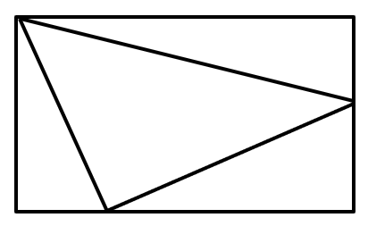

A.150 B.155 C.175 D.180

来源：[2022年浙江省公务员录用考试《行测》题（A类）（网友回忆版）.pdf](https://github.com/dumarstoft-ship-it/xingce/blob/407016b55b49581efa3771bb59a2dee8761d982f/2022%E5%B9%B4%E6%B5%99%E6%B1%9F%E7%9C%81%E5%85%AC%E5%8A%A1%E5%91%98%E5%BD%95%E7%94%A8%E8%80%83%E8%AF%95%E3%80%8A%E8%A1%8C%E6%B5%8B%E3%80%8B%E9%A2%98%EF%BC%88A%E7%B1%BB%EF%BC%89%EF%BC%88%E7%BD%91%E5%8F%8B%E5%9B%9E%E5%BF%86%E7%89%88%EF%BC%89.pdf)，PDF 第 11、12 页。

## 第 66 题 · 数量关系

`ZJ2022-A类-066`

某镇卫生院50多名医生被平均分配到13个基层诊所参与工作，其中男医生比女医生多4人。工作结束后，25％
的男医生和一部分女医生继续到邻镇4个医疗点支援工作，这批人员中任意6人必有男医生，且保证必有一个医
疗点的女医生多于1人。那么该卫生院到邻镇支援工作的医生共有：
A.12人 B.14人 C.16人 D.18人

来源：[2022年浙江省公务员录用考试《行测》题（A类）（网友回忆版）.pdf](https://github.com/dumarstoft-ship-it/xingce/blob/407016b55b49581efa3771bb59a2dee8761d982f/2022%E5%B9%B4%E6%B5%99%E6%B1%9F%E7%9C%81%E5%85%AC%E5%8A%A1%E5%91%98%E5%BD%95%E7%94%A8%E8%80%83%E8%AF%95%E3%80%8A%E8%A1%8C%E6%B5%8B%E3%80%8B%E9%A2%98%EF%BC%88A%E7%B1%BB%EF%BC%89%EF%BC%88%E7%BD%91%E5%8F%8B%E5%9B%9E%E5%BF%86%E7%89%88%EF%BC%89.pdf)，PDF 第 12 页。

## 第 67 题 · 数量关系

`ZJ2022-A类-067`

A、B两个乡镇分布于山谷两侧，山谷间有一条宽为2km的河道（如下图所示）。当地政府决定在两个乡镇间修
建一条跨河公路促进旅游发展。由于架桥费用高昂，所以要求跨河公路中的桥梁路段长度最短。那么根据图中
数据，从A镇前往B镇的最短距离为：

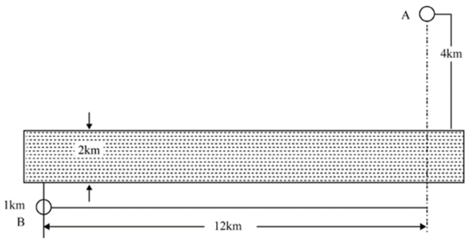

A.17km B.15km C.19km D.20km

来源：[2022年浙江省公务员录用考试《行测》题（A类）（网友回忆版）.pdf](https://github.com/dumarstoft-ship-it/xingce/blob/407016b55b49581efa3771bb59a2dee8761d982f/2022%E5%B9%B4%E6%B5%99%E6%B1%9F%E7%9C%81%E5%85%AC%E5%8A%A1%E5%91%98%E5%BD%95%E7%94%A8%E8%80%83%E8%AF%95%E3%80%8A%E8%A1%8C%E6%B5%8B%E3%80%8B%E9%A2%98%EF%BC%88A%E7%B1%BB%EF%BC%89%EF%BC%88%E7%BD%91%E5%8F%8B%E5%9B%9E%E5%BF%86%E7%89%88%EF%BC%89.pdf)，PDF 第 12 页。

## 第 68 题 · 数量关系

`ZJ2022-A类-068`

商家门口摆放了一把正四棱锥形（底面为正方形，侧面为四个全等的等腰三角形）的遮阳伞，第一次伞撑开到
图1所示的位置，伞柄与伞骨成角∠CPQ为30°，继续撑开到如图2所示的位置，伞柄与伞骨成角∠C′PQ′变为60°
，那么第二次伞撑开后形成的正方形A'B'C'D'是第一次撑开后正方形ABCD面积的：

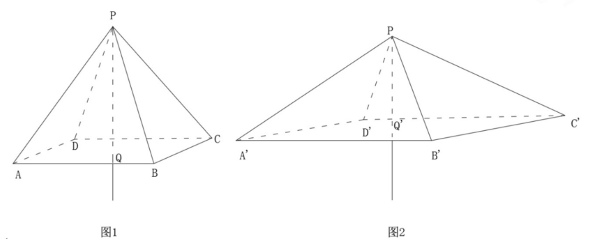

A.3√2倍
B.√3倍
C.2倍
D.3倍

来源：[2022年浙江省公务员录用考试《行测》题（A类）（网友回忆版）.pdf](https://github.com/dumarstoft-ship-it/xingce/blob/407016b55b49581efa3771bb59a2dee8761d982f/2022%E5%B9%B4%E6%B5%99%E6%B1%9F%E7%9C%81%E5%85%AC%E5%8A%A1%E5%91%98%E5%BD%95%E7%94%A8%E8%80%83%E8%AF%95%E3%80%8A%E8%A1%8C%E6%B5%8B%E3%80%8B%E9%A2%98%EF%BC%88A%E7%B1%BB%EF%BC%89%EF%BC%88%E7%BD%91%E5%8F%8B%E5%9B%9E%E5%BF%86%E7%89%88%EF%BC%89.pdf)，PDF 第 12、13 页。

## 第 69 题 · 数量关系

`ZJ2022-A类-069`

用一个长为20厘米、宽为2厘米、高为1.5厘米的长方体木料，制作一串半径最大的木珠子，不考虑制作过程中
的损耗，则这串珠子的数量最多为：
A.10个 B.13个 C.14个 D.20个

来源：[2022年浙江省公务员录用考试《行测》题（A类）（网友回忆版）.pdf](https://github.com/dumarstoft-ship-it/xingce/blob/407016b55b49581efa3771bb59a2dee8761d982f/2022%E5%B9%B4%E6%B5%99%E6%B1%9F%E7%9C%81%E5%85%AC%E5%8A%A1%E5%91%98%E5%BD%95%E7%94%A8%E8%80%83%E8%AF%95%E3%80%8A%E8%A1%8C%E6%B5%8B%E3%80%8B%E9%A2%98%EF%BC%88A%E7%B1%BB%EF%BC%89%EF%BC%88%E7%BD%91%E5%8F%8B%E5%9B%9E%E5%BF%86%E7%89%88%EF%BC%89.pdf)，PDF 第 13 页。

## 第 70 题 · 数量关系

`ZJ2022-A类-070`

2020年时，李某的年龄是自己工龄的4倍，且正好是张某年龄的2/3。到2024年时，张某的年龄正好是自己工龄的
2倍。已知张某参加工作时李某10岁，那么李某参加工作时的年龄是多少？
A.18岁 B.21岁 C.24岁 D.27岁

来源：[2022年浙江省公务员录用考试《行测》题（A类）（网友回忆版）.pdf](https://github.com/dumarstoft-ship-it/xingce/blob/407016b55b49581efa3771bb59a2dee8761d982f/2022%E5%B9%B4%E6%B5%99%E6%B1%9F%E7%9C%81%E5%85%AC%E5%8A%A1%E5%91%98%E5%BD%95%E7%94%A8%E8%80%83%E8%AF%95%E3%80%8A%E8%A1%8C%E6%B5%8B%E3%80%8B%E9%A2%98%EF%BC%88A%E7%B1%BB%EF%BC%89%EF%BC%88%E7%BD%91%E5%8F%8B%E5%9B%9E%E5%BF%86%E7%89%88%EF%BC%89.pdf)，PDF 第 13 页。

## 第 71 题 · 判断推理

`ZJ2022-A类-071`

从所给的四个选项中，选择最合适的一个填入问号处，使之呈现一定的规律性：

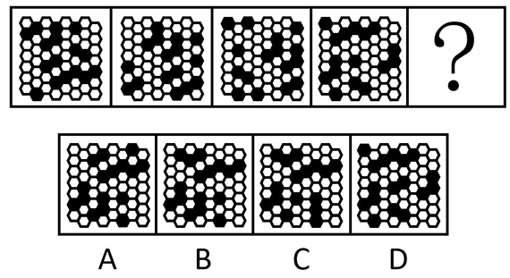

A.A B.B C.C D.D

来源：[2022年浙江省公务员录用考试《行测》题（A类）（网友回忆版）.pdf](https://github.com/dumarstoft-ship-it/xingce/blob/407016b55b49581efa3771bb59a2dee8761d982f/2022%E5%B9%B4%E6%B5%99%E6%B1%9F%E7%9C%81%E5%85%AC%E5%8A%A1%E5%91%98%E5%BD%95%E7%94%A8%E8%80%83%E8%AF%95%E3%80%8A%E8%A1%8C%E6%B5%8B%E3%80%8B%E9%A2%98%EF%BC%88A%E7%B1%BB%EF%BC%89%EF%BC%88%E7%BD%91%E5%8F%8B%E5%9B%9E%E5%BF%86%E7%89%88%EF%BC%89.pdf)，PDF 第 13 页。

## 第 72 题 · 判断推理

`ZJ2022-A类-072`

从所给的四个选项中，选择最合适的一个填入问号处，使之呈现一定的规律性：

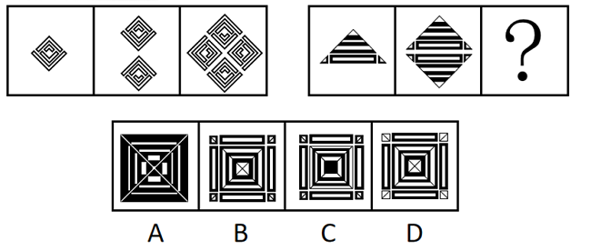

A.A B.B C.C D.D

来源：[2022年浙江省公务员录用考试《行测》题（A类）（网友回忆版）.pdf](https://github.com/dumarstoft-ship-it/xingce/blob/407016b55b49581efa3771bb59a2dee8761d982f/2022%E5%B9%B4%E6%B5%99%E6%B1%9F%E7%9C%81%E5%85%AC%E5%8A%A1%E5%91%98%E5%BD%95%E7%94%A8%E8%80%83%E8%AF%95%E3%80%8A%E8%A1%8C%E6%B5%8B%E3%80%8B%E9%A2%98%EF%BC%88A%E7%B1%BB%EF%BC%89%EF%BC%88%E7%BD%91%E5%8F%8B%E5%9B%9E%E5%BF%86%E7%89%88%EF%BC%89.pdf)，PDF 第 13 页。

## 第 73 题 · 判断推理

`ZJ2022-A类-073`

下图右框内纸盒的外表面中，不能折叠成左框内所示的纸盒的是：

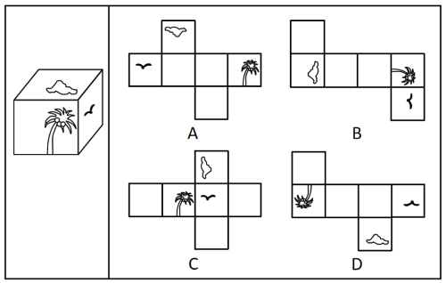

A.A B.B C.C D.D

来源：[2022年浙江省公务员录用考试《行测》题（A类）（网友回忆版）.pdf](https://github.com/dumarstoft-ship-it/xingce/blob/407016b55b49581efa3771bb59a2dee8761d982f/2022%E5%B9%B4%E6%B5%99%E6%B1%9F%E7%9C%81%E5%85%AC%E5%8A%A1%E5%91%98%E5%BD%95%E7%94%A8%E8%80%83%E8%AF%95%E3%80%8A%E8%A1%8C%E6%B5%8B%E3%80%8B%E9%A2%98%EF%BC%88A%E7%B1%BB%EF%BC%89%EF%BC%88%E7%BD%91%E5%8F%8B%E5%9B%9E%E5%BF%86%E7%89%88%EF%BC%89.pdf)，PDF 第 13、14 页。

## 第 74 题 · 判断推理

`ZJ2022-A类-074`

把下面的六个图形分为两类，使每一类图形都有各自的共同特征或规律，分类正确的一项是：

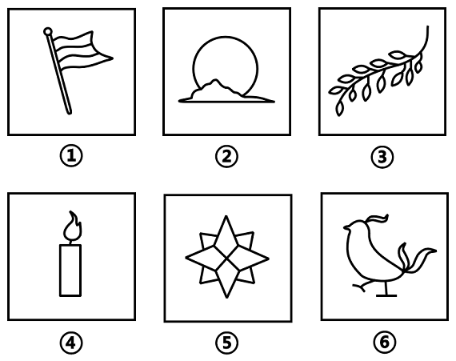

A.①②③，④⑤⑥ B.①③⑤，②④⑥ C.①②⑤，③④⑥ D.①④⑤，②③⑥

来源：[2022年浙江省公务员录用考试《行测》题（A类）（网友回忆版）.pdf](https://github.com/dumarstoft-ship-it/xingce/blob/407016b55b49581efa3771bb59a2dee8761d982f/2022%E5%B9%B4%E6%B5%99%E6%B1%9F%E7%9C%81%E5%85%AC%E5%8A%A1%E5%91%98%E5%BD%95%E7%94%A8%E8%80%83%E8%AF%95%E3%80%8A%E8%A1%8C%E6%B5%8B%E3%80%8B%E9%A2%98%EF%BC%88A%E7%B1%BB%EF%BC%89%EF%BC%88%E7%BD%91%E5%8F%8B%E5%9B%9E%E5%BF%86%E7%89%88%EF%BC%89.pdf)，PDF 第 14 页。

## 第 75 题 · 判断推理

`ZJ2022-A类-075`

把下面的六个图形分为两类，使每一类图形都有各自的共同特征或规律，分类正确的一项是：

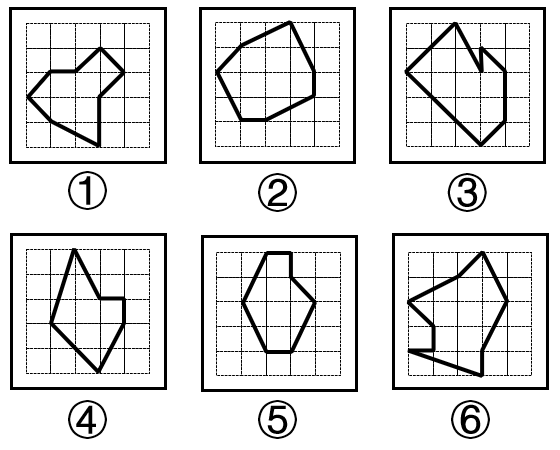

A.①②③，④⑤⑥ B.①③⑤，②④⑥ C.①④⑤，②③⑥ D.①⑤⑥，②③④

来源：[2022年浙江省公务员录用考试《行测》题（A类）（网友回忆版）.pdf](https://github.com/dumarstoft-ship-it/xingce/blob/407016b55b49581efa3771bb59a2dee8761d982f/2022%E5%B9%B4%E6%B5%99%E6%B1%9F%E7%9C%81%E5%85%AC%E5%8A%A1%E5%91%98%E5%BD%95%E7%94%A8%E8%80%83%E8%AF%95%E3%80%8A%E8%A1%8C%E6%B5%8B%E3%80%8B%E9%A2%98%EF%BC%88A%E7%B1%BB%EF%BC%89%EF%BC%88%E7%BD%91%E5%8F%8B%E5%9B%9E%E5%BF%86%E7%89%88%EF%BC%89.pdf)，PDF 第 14、15 页。

## 第 76 题 · 判断推理

`ZJ2022-A类-076`

把下面的六个图形分为两类，使每一类图形都有各自的共同特征或规律，分类正确的一项是：

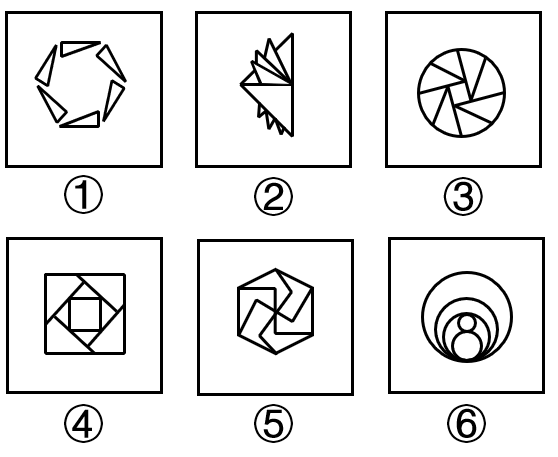

A.①②③，④⑤⑥ B.①③⑤，②④⑥ C.①④⑤，②③⑥ D.①⑤⑥，②③④

来源：[2022年浙江省公务员录用考试《行测》题（A类）（网友回忆版）.pdf](https://github.com/dumarstoft-ship-it/xingce/blob/407016b55b49581efa3771bb59a2dee8761d982f/2022%E5%B9%B4%E6%B5%99%E6%B1%9F%E7%9C%81%E5%85%AC%E5%8A%A1%E5%91%98%E5%BD%95%E7%94%A8%E8%80%83%E8%AF%95%E3%80%8A%E8%A1%8C%E6%B5%8B%E3%80%8B%E9%A2%98%EF%BC%88A%E7%B1%BB%EF%BC%89%EF%BC%88%E7%BD%91%E5%8F%8B%E5%9B%9E%E5%BF%86%E7%89%88%EF%BC%89.pdf)，PDF 第 15 页。

## 第 77 题 · 判断推理

`ZJ2022-A类-077`

所给的四个选项中，哪一项填入问号处，不能使之呈现一定的规律性：

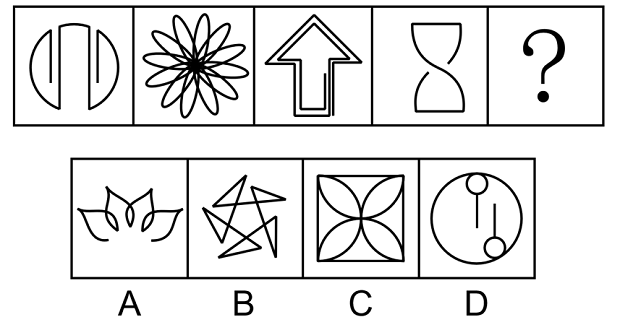

A.A B.B C.C D.D

来源：[2022年浙江省公务员录用考试《行测》题（A类）（网友回忆版）.pdf](https://github.com/dumarstoft-ship-it/xingce/blob/407016b55b49581efa3771bb59a2dee8761d982f/2022%E5%B9%B4%E6%B5%99%E6%B1%9F%E7%9C%81%E5%85%AC%E5%8A%A1%E5%91%98%E5%BD%95%E7%94%A8%E8%80%83%E8%AF%95%E3%80%8A%E8%A1%8C%E6%B5%8B%E3%80%8B%E9%A2%98%EF%BC%88A%E7%B1%BB%EF%BC%89%EF%BC%88%E7%BD%91%E5%8F%8B%E5%9B%9E%E5%BF%86%E7%89%88%EF%BC%89.pdf)，PDF 第 15、16 页。

## 第 78 题 · 判断推理

`ZJ2022-A类-078`

从所给的四个选项中，选择最合适的一个填入问号处，使之呈现一定的规律性：

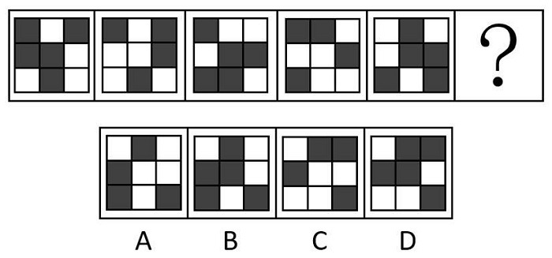

A.A B.B C.C D.D

来源：[2022年浙江省公务员录用考试《行测》题（A类）（网友回忆版）.pdf](https://github.com/dumarstoft-ship-it/xingce/blob/407016b55b49581efa3771bb59a2dee8761d982f/2022%E5%B9%B4%E6%B5%99%E6%B1%9F%E7%9C%81%E5%85%AC%E5%8A%A1%E5%91%98%E5%BD%95%E7%94%A8%E8%80%83%E8%AF%95%E3%80%8A%E8%A1%8C%E6%B5%8B%E3%80%8B%E9%A2%98%EF%BC%88A%E7%B1%BB%EF%BC%89%EF%BC%88%E7%BD%91%E5%8F%8B%E5%9B%9E%E5%BF%86%E7%89%88%EF%BC%89.pdf)，PDF 第 16 页。

## 第 79 题 · 判断推理

`ZJ2022-A类-079`

把下面的六个图形分为两类，使每一类的图形都有各自的共同特征或规律，分类正确的一项是：

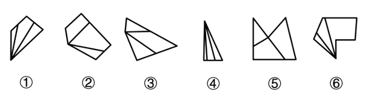

A.①③⑤，②④⑥ B.①④⑤，②③⑥ C.①③⑥，②④⑤ D.①④⑥，②③⑤

来源：[2022年浙江省公务员录用考试《行测》题（A类）（网友回忆版）.pdf](https://github.com/dumarstoft-ship-it/xingce/blob/407016b55b49581efa3771bb59a2dee8761d982f/2022%E5%B9%B4%E6%B5%99%E6%B1%9F%E7%9C%81%E5%85%AC%E5%8A%A1%E5%91%98%E5%BD%95%E7%94%A8%E8%80%83%E8%AF%95%E3%80%8A%E8%A1%8C%E6%B5%8B%E3%80%8B%E9%A2%98%EF%BC%88A%E7%B1%BB%EF%BC%89%EF%BC%88%E7%BD%91%E5%8F%8B%E5%9B%9E%E5%BF%86%E7%89%88%EF%BC%89.pdf)，PDF 第 16 页。

## 第 80 题 · 判断推理

`ZJ2022-A类-080`

下面的三棱台如图所示，从中挖掉一个圆柱体，然后从任一面剖开，哪一项不可能是该三棱台的截面？

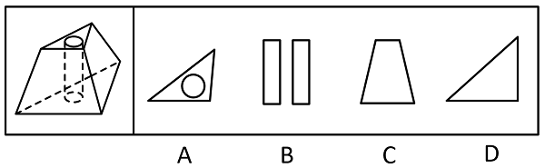

A.A B.B C.C D.D

来源：[2022年浙江省公务员录用考试《行测》题（A类）（网友回忆版）.pdf](https://github.com/dumarstoft-ship-it/xingce/blob/407016b55b49581efa3771bb59a2dee8761d982f/2022%E5%B9%B4%E6%B5%99%E6%B1%9F%E7%9C%81%E5%85%AC%E5%8A%A1%E5%91%98%E5%BD%95%E7%94%A8%E8%80%83%E8%AF%95%E3%80%8A%E8%A1%8C%E6%B5%8B%E3%80%8B%E9%A2%98%EF%BC%88A%E7%B1%BB%EF%BC%89%EF%BC%88%E7%BD%91%E5%8F%8B%E5%9B%9E%E5%BF%86%E7%89%88%EF%BC%89.pdf)，PDF 第 16、17 页。

## 第 81 题 · 判断推理

`ZJ2022-A类-081`

替代性满足指当欲望能量在最初对象上遇到阻碍时，就会向其他对象转移；如果再次遇阻，就再次转移，直到
寻找到一个替代对象以消除紧张、满足欲望为止。
根据上述定义，下列选项不属于替代性满足的是：
A.小李很喜欢旅游，因此经常利用自己的假期到全国各地旅游
B.小王将自己不愉快的生活经历倾注于笔下，完成了一些作品
C.小刘的小超市经营状况不佳，所以他一直有着天降横财的幻想
D.小林梦想成为一个叱咤风云的英雄，他特别喜欢上网打战争游戏

来源：[2022年浙江省公务员录用考试《行测》题（A类）（网友回忆版）.pdf](https://github.com/dumarstoft-ship-it/xingce/blob/407016b55b49581efa3771bb59a2dee8761d982f/2022%E5%B9%B4%E6%B5%99%E6%B1%9F%E7%9C%81%E5%85%AC%E5%8A%A1%E5%91%98%E5%BD%95%E7%94%A8%E8%80%83%E8%AF%95%E3%80%8A%E8%A1%8C%E6%B5%8B%E3%80%8B%E9%A2%98%EF%BC%88A%E7%B1%BB%EF%BC%89%EF%BC%88%E7%BD%91%E5%8F%8B%E5%9B%9E%E5%BF%86%E7%89%88%EF%BC%89.pdf)，PDF 第 17 页。

## 第 82 题 · 判断推理

`ZJ2022-A类-082`

马兰戈尼效应，指的是表面张力不同的两种液体存在表面张力梯度，表面张力大的对其周围表面张力小的液体
的拉力强，使液体从表面张力小的一边向张力大的方向流动渗透。
根据上述定义，下列属于马兰戈尼效应的是：
A.若干种不同的酒按密度大小依次缓慢倒进杯子，会形成分层，通过加冰块，可以加大或减小密度，分层更明
显
B.涂料配色过程中，涂料和干燥后的涂膜颜色存在细微差异，在湿膜时颜色一般比较浅，在干燥后，颜色会加
深
C.牛奶中加入几滴流体色素，没有搅拌的情况下色素相对集中，取少量洗洁精滴在色素所在位置，色素迅速往
牛奶边缘扩散
D.奶茶就是牛奶和茶叶水的充分混合，不同的奶粉和不同茶叶水搭配，产生不同风味的奶茶，而且奶粉和茶水
的配比也影响奶茶口感

来源：[2022年浙江省公务员录用考试《行测》题（A类）（网友回忆版）.pdf](https://github.com/dumarstoft-ship-it/xingce/blob/407016b55b49581efa3771bb59a2dee8761d982f/2022%E5%B9%B4%E6%B5%99%E6%B1%9F%E7%9C%81%E5%85%AC%E5%8A%A1%E5%91%98%E5%BD%95%E7%94%A8%E8%80%83%E8%AF%95%E3%80%8A%E8%A1%8C%E6%B5%8B%E3%80%8B%E9%A2%98%EF%BC%88A%E7%B1%BB%EF%BC%89%EF%BC%88%E7%BD%91%E5%8F%8B%E5%9B%9E%E5%BF%86%E7%89%88%EF%BC%89.pdf)，PDF 第 17 页。

## 第 83 题 · 判断推理

`ZJ2022-A类-083`

回应性监管是指政府通过制度设计，采用多样化的监管手段和策略对市场主体和社会组织进行动态化、智能
化、差别化的监管。回应性监管强调监管主体的多元化，除政府以外，企业、社会组织，乃至被监管对象都是
监管主体；在监管策略上，采取差异化、阶梯化的监管方式，即政府首先鼓励自我监管，难以奏效时才采取更
为严厉的强化型自我监管直至命令控制型监管。
根据上述定义，下列选项没有体现回应性监管的是：
A.某地主管部门因食品安全问题突击整顿涉事企业
B.瑞典立法要求工作场所必须建立安全环保的内控体系
C.英国成立企业、工会代表组成的大健康监管委员会
D.聘请专业的第三方机构对企业安全生产状况进行评估

来源：[2022年浙江省公务员录用考试《行测》题（A类）（网友回忆版）.pdf](https://github.com/dumarstoft-ship-it/xingce/blob/407016b55b49581efa3771bb59a2dee8761d982f/2022%E5%B9%B4%E6%B5%99%E6%B1%9F%E7%9C%81%E5%85%AC%E5%8A%A1%E5%91%98%E5%BD%95%E7%94%A8%E8%80%83%E8%AF%95%E3%80%8A%E8%A1%8C%E6%B5%8B%E3%80%8B%E9%A2%98%EF%BC%88A%E7%B1%BB%EF%BC%89%EF%BC%88%E7%BD%91%E5%8F%8B%E5%9B%9E%E5%BF%86%E7%89%88%EF%BC%89.pdf)，PDF 第 17 页。

## 第 84 题 · 判断推理

`ZJ2022-A类-084`

过滤气泡是指以大数据与算法推荐为底层架构，根据用户的使用时间、地区以及浏览习惯生成用户画像，并通
过算法技术为其呈现独一无二的界面体验。网络上这种针对个人化搜索而提供筛选后结果的推荐算法，被称为
过滤气泡。
根据上述定义，下列不属于过滤气泡的是：
A.赵先生准备买车，上网看了很多汽车测评类的文章，买完车之后，浏览器上的内容几乎全是汽车类的资讯
B.李先生经常网购图书，平台特意为他推送购书清单，打造个性化书店，让他在第一时间能得到新书的信息
C.刘先生经常去某网络贴吧发帖，得到了很多人的关注，一些与他有相同爱好的人还建立了一个微信群进行交
流
D.王先生和张先生分别在各自手机上搜索某公司，王先生的搜索结果多为该公司的招聘信息，张先生的却多为
该公司的投资信息

来源：[2022年浙江省公务员录用考试《行测》题（A类）（网友回忆版）.pdf](https://github.com/dumarstoft-ship-it/xingce/blob/407016b55b49581efa3771bb59a2dee8761d982f/2022%E5%B9%B4%E6%B5%99%E6%B1%9F%E7%9C%81%E5%85%AC%E5%8A%A1%E5%91%98%E5%BD%95%E7%94%A8%E8%80%83%E8%AF%95%E3%80%8A%E8%A1%8C%E6%B5%8B%E3%80%8B%E9%A2%98%EF%BC%88A%E7%B1%BB%EF%BC%89%EF%BC%88%E7%BD%91%E5%8F%8B%E5%9B%9E%E5%BF%86%E7%89%88%EF%BC%89.pdf)，PDF 第 17 页。

## 第 85 题 · 判断推理

`ZJ2022-A类-085`

生殖隔离可以区分为合子前隔离和合子后隔离。合子前隔离是指由于活动区域、生活习性、体态差异等各种因
素导致无法进行基因交流，从而产生生殖隔离。相比来说，合子后隔离则是因为遗传信息的不匹配，即使双方
的生殖细胞能够相遇结合，也无法完成正常的繁衍。
根据上述定义，下列现象体现合子后隔离的是：
A.甲种兰花通过a昆虫授粉，乙种兰花通过b昆虫授粉，二者只能通过人工授粉进行繁殖
B.三倍体西瓜开花后，用二倍体西瓜的花朵进行授粉，培育无籽西瓜
C.富尔顿蟋蟀和宾州蟋蟀的鸣声不同，无法相互吸引，不会进行交配
D.13年蝉和17年蝉的发情期不同，没有交配机会

来源：[2022年浙江省公务员录用考试《行测》题（A类）（网友回忆版）.pdf](https://github.com/dumarstoft-ship-it/xingce/blob/407016b55b49581efa3771bb59a2dee8761d982f/2022%E5%B9%B4%E6%B5%99%E6%B1%9F%E7%9C%81%E5%85%AC%E5%8A%A1%E5%91%98%E5%BD%95%E7%94%A8%E8%80%83%E8%AF%95%E3%80%8A%E8%A1%8C%E6%B5%8B%E3%80%8B%E9%A2%98%EF%BC%88A%E7%B1%BB%EF%BC%89%EF%BC%88%E7%BD%91%E5%8F%8B%E5%9B%9E%E5%BF%86%E7%89%88%EF%BC%89.pdf)，PDF 第 17、18 页。

## 第 86 题 · 判断推理

`ZJ2022-A类-086`

深度学习是指在模仿人脑机制的神经网络中，对人工神经元的层进行了“多层处理”。深度学习不仅可以让AI
（人工智能）读取大量图片，还可以让AI自主提取图片特征。得益于深度学习技术的面世，只要有大量数据，
AI就能以极高的准确率进行学习，从而大幅度拓展了AI的应用范围。
根据上述定义，下列属于深度学习的是：
A.人工智能图片教学走进课堂让学生体验深度学习
B.问诊机器人可以迅速获取病患B超报告的风险信息
C.某设区市在数字峰会期间提供无人驾驶汽车试乘服务
D.安防巡检机器人通过图像识别技术判定工人是否佩戴安全帽

来源：[2022年浙江省公务员录用考试《行测》题（A类）（网友回忆版）.pdf](https://github.com/dumarstoft-ship-it/xingce/blob/407016b55b49581efa3771bb59a2dee8761d982f/2022%E5%B9%B4%E6%B5%99%E6%B1%9F%E7%9C%81%E5%85%AC%E5%8A%A1%E5%91%98%E5%BD%95%E7%94%A8%E8%80%83%E8%AF%95%E3%80%8A%E8%A1%8C%E6%B5%8B%E3%80%8B%E9%A2%98%EF%BC%88A%E7%B1%BB%EF%BC%89%EF%BC%88%E7%BD%91%E5%8F%8B%E5%9B%9E%E5%BF%86%E7%89%88%EF%BC%89.pdf)，PDF 第 18 页。

## 第 87 题 · 判断推理

`ZJ2022-A类-087`

乡情治理是指乡情作用于基层社会治理主体和治理体系，在基层社会的意见整合、利益协调、矛盾化解、服务
供给等治理过程中发挥重要作用的一种治理形态。“乡情”是一种基于地域以及附着在经济、社会、文化纽带
上的特殊情感，体现为认同感、归属感、荣誉感及在此基础上的回馈意愿和公共精神。乡情治理的核心是存在
一个由情感和认同构筑的场域，这个场域通过一些微观机制影响个体动机和群体行为，从而影响社会治理体系
和过程。
根据上述定义，下列属于乡情治理的是：
A.顺德人都以顺德是“世界美食之都”而自豪 B.敢拼会赢的精神一直激励着闽南人勇闯南洋
C.海外华侨华人一直有着爱国爱乡的光荣传统 D.北岸乡贤成立妈祖慈善基金会服务当地桑梓

来源：[2022年浙江省公务员录用考试《行测》题（A类）（网友回忆版）.pdf](https://github.com/dumarstoft-ship-it/xingce/blob/407016b55b49581efa3771bb59a2dee8761d982f/2022%E5%B9%B4%E6%B5%99%E6%B1%9F%E7%9C%81%E5%85%AC%E5%8A%A1%E5%91%98%E5%BD%95%E7%94%A8%E8%80%83%E8%AF%95%E3%80%8A%E8%A1%8C%E6%B5%8B%E3%80%8B%E9%A2%98%EF%BC%88A%E7%B1%BB%EF%BC%89%EF%BC%88%E7%BD%91%E5%8F%8B%E5%9B%9E%E5%BF%86%E7%89%88%EF%BC%89.pdf)，PDF 第 18 页。

## 第 88 题 · 判断推理

`ZJ2022-A类-088`

最小干预原则是指在保证文物安全的基本前提下，通过最小程度的介入来最大限度地维系文物的原本面貌，保
留文物的历史、文化价值，以实现延续现状、降低保护性破坏的目标。
根据上述定义，下列选项不属于最小干预原则的是：
A.某博物馆在修复古籍时不拆开原线绳，只修补蛀洞严重的书页，而不修补强度未受蛀洞影响的书页
B.某博物馆的一幅雕塑作品中的人物手臂缺失，专家们查阅了原始资料，根据资料将其复原如初
C.某古城墙修缮时，保留其残损的现状，在靠近边墙的一侧恢复了很窄的台阶供游人安全通过
D.某古塔倾斜，专家们在研究后最终决定只纠偏一度，它看上去依旧是倾斜的状态

来源：[2022年浙江省公务员录用考试《行测》题（A类）（网友回忆版）.pdf](https://github.com/dumarstoft-ship-it/xingce/blob/407016b55b49581efa3771bb59a2dee8761d982f/2022%E5%B9%B4%E6%B5%99%E6%B1%9F%E7%9C%81%E5%85%AC%E5%8A%A1%E5%91%98%E5%BD%95%E7%94%A8%E8%80%83%E8%AF%95%E3%80%8A%E8%A1%8C%E6%B5%8B%E3%80%8B%E9%A2%98%EF%BC%88A%E7%B1%BB%EF%BC%89%EF%BC%88%E7%BD%91%E5%8F%8B%E5%9B%9E%E5%BF%86%E7%89%88%EF%BC%89.pdf)，PDF 第 18 页。

## 第 89 题 · 判断推理

`ZJ2022-A类-089`

参照群体理论是关于人的社会心理态度和行为怎样受其从属的或追求的群体参照力所影响的社会心理学理论。
参照群体是指个体从心理上把自己列入、与之对照，并在评价、态度、行为上和在规范与价值观形成上接受其
影响的群体。
根据上述定义，下列选项不能用参照群体理论解释的是：
A.小王平时喜欢便装，但是参加面试时他决定穿着西装
B.夏秋之际，妈妈怕孩子受凉，很注意给孩子增减衣物
C.小刘看其他影迷都购买了偶像同款商品，自己也去买
D.小张父母都是医生，她比常人更在意身边的卫生状况

来源：[2022年浙江省公务员录用考试《行测》题（A类）（网友回忆版）.pdf](https://github.com/dumarstoft-ship-it/xingce/blob/407016b55b49581efa3771bb59a2dee8761d982f/2022%E5%B9%B4%E6%B5%99%E6%B1%9F%E7%9C%81%E5%85%AC%E5%8A%A1%E5%91%98%E5%BD%95%E7%94%A8%E8%80%83%E8%AF%95%E3%80%8A%E8%A1%8C%E6%B5%8B%E3%80%8B%E9%A2%98%EF%BC%88A%E7%B1%BB%EF%BC%89%EF%BC%88%E7%BD%91%E5%8F%8B%E5%9B%9E%E5%BF%86%E7%89%88%EF%BC%89.pdf)，PDF 第 18 页。

## 第 90 题 · 判断推理

`ZJ2022-A类-090`

欺诈行为是指经营者采用虚构假象、隐瞒真相、心理引导等方式，使消费者对客观事实产生错误认识，并因此
作出购买决定。评价行为则是一种主观的价值判断，会随着评价主体的不同而发生变化，这属于正常的商业宣
传。
根据上述定义，下列属于欺诈行为的是：
A.李某卖的鲤鱼都是饲养的，却告诉张某说是野生的，张某并不在意鲤鱼是否野生，但念及李某谋生不易，心
中不忍便买了一条
B.王某看到一幅字帖落款为“启功”，指着这两个字问“真迹否？”店家笑而不语，王某遂以为真，以低价买
得，欢喜回家
C.服装店老板极尽推销之能事，说某件外套能够衬托赵某的身材气质，赵某购买后感觉并不好看，认为自己被
骗了
D.店家拿出一瓶贴牌假酒当真酒卖，黄某认出这是假酒，但心想可以据此索赔，就买回去了

来源：[2022年浙江省公务员录用考试《行测》题（A类）（网友回忆版）.pdf](https://github.com/dumarstoft-ship-it/xingce/blob/407016b55b49581efa3771bb59a2dee8761d982f/2022%E5%B9%B4%E6%B5%99%E6%B1%9F%E7%9C%81%E5%85%AC%E5%8A%A1%E5%91%98%E5%BD%95%E7%94%A8%E8%80%83%E8%AF%95%E3%80%8A%E8%A1%8C%E6%B5%8B%E3%80%8B%E9%A2%98%EF%BC%88A%E7%B1%BB%EF%BC%89%EF%BC%88%E7%BD%91%E5%8F%8B%E5%9B%9E%E5%BF%86%E7%89%88%EF%BC%89.pdf)，PDF 第 18、19 页。

## 第 91 题 · 判断推理

`ZJ2022-A类-091`

考拉：树袋熊
A.墨鱼：乌贼 B.蜜蜂：黄蜂 C.蚱蜢：蝗虫 D.金龟子：天牛

来源：[2022年浙江省公务员录用考试《行测》题（A类）（网友回忆版）.pdf](https://github.com/dumarstoft-ship-it/xingce/blob/407016b55b49581efa3771bb59a2dee8761d982f/2022%E5%B9%B4%E6%B5%99%E6%B1%9F%E7%9C%81%E5%85%AC%E5%8A%A1%E5%91%98%E5%BD%95%E7%94%A8%E8%80%83%E8%AF%95%E3%80%8A%E8%A1%8C%E6%B5%8B%E3%80%8B%E9%A2%98%EF%BC%88A%E7%B1%BB%EF%BC%89%EF%BC%88%E7%BD%91%E5%8F%8B%E5%9B%9E%E5%BF%86%E7%89%88%EF%BC%89.pdf)，PDF 第 19 页。

## 第 92 题 · 判断推理

`ZJ2022-A类-092`

岳父：泰山
A.少女：娥眉 B.儿子：孙子 C.女婿：东床 D.兄弟：伯仲

来源：[2022年浙江省公务员录用考试《行测》题（A类）（网友回忆版）.pdf](https://github.com/dumarstoft-ship-it/xingce/blob/407016b55b49581efa3771bb59a2dee8761d982f/2022%E5%B9%B4%E6%B5%99%E6%B1%9F%E7%9C%81%E5%85%AC%E5%8A%A1%E5%91%98%E5%BD%95%E7%94%A8%E8%80%83%E8%AF%95%E3%80%8A%E8%A1%8C%E6%B5%8B%E3%80%8B%E9%A2%98%EF%BC%88A%E7%B1%BB%EF%BC%89%EF%BC%88%E7%BD%91%E5%8F%8B%E5%9B%9E%E5%BF%86%E7%89%88%EF%BC%89.pdf)，PDF 第 19 页。

## 第 93 题 · 判断推理

`ZJ2022-A类-093`

帛书：简牍
A.日晷：秒表 B.熊猫：银杏 C.青铜：礼器 D.牛车：轿子

来源：[2022年浙江省公务员录用考试《行测》题（A类）（网友回忆版）.pdf](https://github.com/dumarstoft-ship-it/xingce/blob/407016b55b49581efa3771bb59a2dee8761d982f/2022%E5%B9%B4%E6%B5%99%E6%B1%9F%E7%9C%81%E5%85%AC%E5%8A%A1%E5%91%98%E5%BD%95%E7%94%A8%E8%80%83%E8%AF%95%E3%80%8A%E8%A1%8C%E6%B5%8B%E3%80%8B%E9%A2%98%EF%BC%88A%E7%B1%BB%EF%BC%89%EF%BC%88%E7%BD%91%E5%8F%8B%E5%9B%9E%E5%BF%86%E7%89%88%EF%BC%89.pdf)，PDF 第 19 页。

## 第 94 题 · 判断推理

`ZJ2022-A类-094`

电影院：影片：放映
A.图书馆：资料：查阅 B.下水道：地漏：排水 C.传染病：疫苗：防疫 D.朋友圈：微信：聊天

来源：[2022年浙江省公务员录用考试《行测》题（A类）（网友回忆版）.pdf](https://github.com/dumarstoft-ship-it/xingce/blob/407016b55b49581efa3771bb59a2dee8761d982f/2022%E5%B9%B4%E6%B5%99%E6%B1%9F%E7%9C%81%E5%85%AC%E5%8A%A1%E5%91%98%E5%BD%95%E7%94%A8%E8%80%83%E8%AF%95%E3%80%8A%E8%A1%8C%E6%B5%8B%E3%80%8B%E9%A2%98%EF%BC%88A%E7%B1%BB%EF%BC%89%EF%BC%88%E7%BD%91%E5%8F%8B%E5%9B%9E%E5%BF%86%E7%89%88%EF%BC%89.pdf)，PDF 第 19 页。

## 第 95 题 · 判断推理

`ZJ2022-A类-095`

马匹：船只：车辆
A.银两：金钱：银币 B.纸张：试卷：画册 C.水杯：油瓶：饭碗 D.官员：武将：首领

来源：[2022年浙江省公务员录用考试《行测》题（A类）（网友回忆版）.pdf](https://github.com/dumarstoft-ship-it/xingce/blob/407016b55b49581efa3771bb59a2dee8761d982f/2022%E5%B9%B4%E6%B5%99%E6%B1%9F%E7%9C%81%E5%85%AC%E5%8A%A1%E5%91%98%E5%BD%95%E7%94%A8%E8%80%83%E8%AF%95%E3%80%8A%E8%A1%8C%E6%B5%8B%E3%80%8B%E9%A2%98%EF%BC%88A%E7%B1%BB%EF%BC%89%EF%BC%88%E7%BD%91%E5%8F%8B%E5%9B%9E%E5%BF%86%E7%89%88%EF%BC%89.pdf)，PDF 第 19 页。

## 第 96 题 · 判断推理

`ZJ2022-A类-096`

姹紫：嫣红
A.嘉言：懿行 B.风刀：霜剑 C.小家：碧玉 D.疾首：蹙额

来源：[2022年浙江省公务员录用考试《行测》题（A类）（网友回忆版）.pdf](https://github.com/dumarstoft-ship-it/xingce/blob/407016b55b49581efa3771bb59a2dee8761d982f/2022%E5%B9%B4%E6%B5%99%E6%B1%9F%E7%9C%81%E5%85%AC%E5%8A%A1%E5%91%98%E5%BD%95%E7%94%A8%E8%80%83%E8%AF%95%E3%80%8A%E8%A1%8C%E6%B5%8B%E3%80%8B%E9%A2%98%EF%BC%88A%E7%B1%BB%EF%BC%89%EF%BC%88%E7%BD%91%E5%8F%8B%E5%9B%9E%E5%BF%86%E7%89%88%EF%BC%89.pdf)，PDF 第 19 页。

## 第 97 题 · 判断推理

`ZJ2022-A类-097`

征稿：评选：颁奖
A.运动：热身：放松 B.节能：减排：环保 C.设计：施工：监理 D.麻醉：切开：缝合

来源：[2022年浙江省公务员录用考试《行测》题（A类）（网友回忆版）.pdf](https://github.com/dumarstoft-ship-it/xingce/blob/407016b55b49581efa3771bb59a2dee8761d982f/2022%E5%B9%B4%E6%B5%99%E6%B1%9F%E7%9C%81%E5%85%AC%E5%8A%A1%E5%91%98%E5%BD%95%E7%94%A8%E8%80%83%E8%AF%95%E3%80%8A%E8%A1%8C%E6%B5%8B%E3%80%8B%E9%A2%98%EF%BC%88A%E7%B1%BB%EF%BC%89%EF%BC%88%E7%BD%91%E5%8F%8B%E5%9B%9E%E5%BF%86%E7%89%88%EF%BC%89.pdf)，PDF 第 19 页。

## 第 98 题 · 判断推理

`ZJ2022-A类-098`

电脑：设备
A.广播：传媒 B.颜料：绘画 C.文言：白话 D.能源：煤炭

来源：[2022年浙江省公务员录用考试《行测》题（A类）（网友回忆版）.pdf](https://github.com/dumarstoft-ship-it/xingce/blob/407016b55b49581efa3771bb59a2dee8761d982f/2022%E5%B9%B4%E6%B5%99%E6%B1%9F%E7%9C%81%E5%85%AC%E5%8A%A1%E5%91%98%E5%BD%95%E7%94%A8%E8%80%83%E8%AF%95%E3%80%8A%E8%A1%8C%E6%B5%8B%E3%80%8B%E9%A2%98%EF%BC%88A%E7%B1%BB%EF%BC%89%EF%BC%88%E7%BD%91%E5%8F%8B%E5%9B%9E%E5%BF%86%E7%89%88%EF%BC%89.pdf)，PDF 第 19 页。

## 第 99 题 · 判断推理

`ZJ2022-A类-099`

针线：布料：服饰
A.剪刀：彩纸：窗花 B.刻刀：玺印：玉石 C.玻璃：窗户：窗框 D.鸡精：乌鸡：鸡汤

来源：[2022年浙江省公务员录用考试《行测》题（A类）（网友回忆版）.pdf](https://github.com/dumarstoft-ship-it/xingce/blob/407016b55b49581efa3771bb59a2dee8761d982f/2022%E5%B9%B4%E6%B5%99%E6%B1%9F%E7%9C%81%E5%85%AC%E5%8A%A1%E5%91%98%E5%BD%95%E7%94%A8%E8%80%83%E8%AF%95%E3%80%8A%E8%A1%8C%E6%B5%8B%E3%80%8B%E9%A2%98%EF%BC%88A%E7%B1%BB%EF%BC%89%EF%BC%88%E7%BD%91%E5%8F%8B%E5%9B%9E%E5%BF%86%E7%89%88%EF%BC%89.pdf)，PDF 第 19 页。

## 第 100 题 · 判断推理

`ZJ2022-A类-100`

晴空万里 对于 （    ） 相当于 （    ） 对于 识文断字
A.天干物燥；才高八斗 B.雨后春笋；妙笔生花 C.阴云密布；胸无点墨 D.倾盆大雨；味同嚼蜡

来源：[2022年浙江省公务员录用考试《行测》题（A类）（网友回忆版）.pdf](https://github.com/dumarstoft-ship-it/xingce/blob/407016b55b49581efa3771bb59a2dee8761d982f/2022%E5%B9%B4%E6%B5%99%E6%B1%9F%E7%9C%81%E5%85%AC%E5%8A%A1%E5%91%98%E5%BD%95%E7%94%A8%E8%80%83%E8%AF%95%E3%80%8A%E8%A1%8C%E6%B5%8B%E3%80%8B%E9%A2%98%EF%BC%88A%E7%B1%BB%EF%BC%89%EF%BC%88%E7%BD%91%E5%8F%8B%E5%9B%9E%E5%BF%86%E7%89%88%EF%BC%89.pdf)，PDF 第 19 页。

## 第 101 题 · 判断推理

`ZJ2022-A类-101`

欧洲杯比赛期间，小赵、小钱、小孙、小李预测甲、乙两支队伍能否进入决赛。他们的对话如下：
小赵：如果甲进入决赛，则乙也能进入决赛。
小钱：我看甲进入决赛没有问题。
小孙：在我看来，甲能够进入决赛，但乙进不了。
小李：我的看法是，如果甲不能进入决赛，则乙进决赛。
结果出来后，他们四人的预测有两个真、两个假，关于甲和乙是否进入决赛，以下推论正确的是：
A.甲和乙都进入决赛 B.甲和乙都没有进入决赛
C.甲进入决赛，乙没有进入决赛 D.甲没有进入决赛，乙进入决赛

来源：[2022年浙江省公务员录用考试《行测》题（A类）（网友回忆版）.pdf](https://github.com/dumarstoft-ship-it/xingce/blob/407016b55b49581efa3771bb59a2dee8761d982f/2022%E5%B9%B4%E6%B5%99%E6%B1%9F%E7%9C%81%E5%85%AC%E5%8A%A1%E5%91%98%E5%BD%95%E7%94%A8%E8%80%83%E8%AF%95%E3%80%8A%E8%A1%8C%E6%B5%8B%E3%80%8B%E9%A2%98%EF%BC%88A%E7%B1%BB%EF%BC%89%EF%BC%88%E7%BD%91%E5%8F%8B%E5%9B%9E%E5%BF%86%E7%89%88%EF%BC%89.pdf)，PDF 第 19 页。

## 第 102 题 · 判断推理

`ZJ2022-A类-102`

有观点认为，体质的酸化是百病之源。无论是癌症，还是常见的高血压、糖尿病、痛风等，都是由于“酸性食
物”吃多了导致体质酸化引起的。而鱼、肉、米饭、酒等人类的主副食品都是酸性的，尤其是我们的主食米
饭，更被渲染成“酸性食物”的典型代表。
以下各项如果为真，最能反驳上述观点的是：
A.人体的皮肤处于弱酸性状态时，比较不容易滋生细菌
B.人体的酸碱度以7.4为佳，即身体偏碱性就是健康的
C.人体有三个调节系统平衡酸碱，人的体质不会是酸性
D.健康人的尿液是呈酸性的，人体本身就存在酸性物质

来源：[2022年浙江省公务员录用考试《行测》题（A类）（网友回忆版）.pdf](https://github.com/dumarstoft-ship-it/xingce/blob/407016b55b49581efa3771bb59a2dee8761d982f/2022%E5%B9%B4%E6%B5%99%E6%B1%9F%E7%9C%81%E5%85%AC%E5%8A%A1%E5%91%98%E5%BD%95%E7%94%A8%E8%80%83%E8%AF%95%E3%80%8A%E8%A1%8C%E6%B5%8B%E3%80%8B%E9%A2%98%EF%BC%88A%E7%B1%BB%EF%BC%89%EF%BC%88%E7%BD%91%E5%8F%8B%E5%9B%9E%E5%BF%86%E7%89%88%EF%BC%89.pdf)，PDF 第 19、20 页。

## 第 103 题 · 判断推理

`ZJ2022-A类-103`

伤害感受神经能够对造血干细胞动员进行调控，增强造血干细胞的黏附或迁移，降钙素基因相关肽（CGRP）
是伤害感受神经元主要分泌的神经递质分子。研究者发现，给予CGRP可以显著增强造血干细胞动员。CGRP可
以直接影响造血干细胞，诱导细胞表面形成CALCRL和RAMP1蛋白形成的二聚体受体，并促进造血干细胞进入
血管。研究专家认为，吃辣可以促进造血干细胞动员。
如果上述结论为真，需要补充的前提是：
A.骨髓神经纤维中高达77%都是伤害感受神经元
B.辛辣食物导致的“辣味”是一种痛觉，会激活伤害感受神经
C.辣的食物能够促进消化液的分泌，增加消化酶的活性，加速胃肠道蠕动
D.造血干细胞会在神经的调控之下，从骨髓释放进入循环，对损失的血细胞进行补充

来源：[2022年浙江省公务员录用考试《行测》题（A类）（网友回忆版）.pdf](https://github.com/dumarstoft-ship-it/xingce/blob/407016b55b49581efa3771bb59a2dee8761d982f/2022%E5%B9%B4%E6%B5%99%E6%B1%9F%E7%9C%81%E5%85%AC%E5%8A%A1%E5%91%98%E5%BD%95%E7%94%A8%E8%80%83%E8%AF%95%E3%80%8A%E8%A1%8C%E6%B5%8B%E3%80%8B%E9%A2%98%EF%BC%88A%E7%B1%BB%EF%BC%89%EF%BC%88%E7%BD%91%E5%8F%8B%E5%9B%9E%E5%BF%86%E7%89%88%EF%BC%89.pdf)，PDF 第 20 页。

## 第 104 题 · 判断推理

`ZJ2022-A类-104`

研究人员对人的“头骨突起”进行了一项研究。在这项研究中，调查对象包括1200名年龄在18岁至86岁的普通
人群，研究发现，颅骨底部出现骨质突起的情况在年轻人中比在老年人中更为普遍，尤其是在18岁至30岁年龄
组的男性当中，研究者认为，一些人颅骨底部出现的奇怪的“头骨突起”与他们长时间弯下脖子看智能手机时
的奇怪角度有关。
以下各项如果为真，最能质疑上述结论的是：
A.网上销售的塑形枕头深受“头骨突起”的年轻消费者欢迎
B.该研究样本人群是随机抽取，它的结论适用于普通人群
C.研究人员对年轻人更容易出现头骨突起的分析过程存在瑕疵
D.研究者并未对调查对象每日弯下脖子看智能手机的时间进行记录

来源：[2022年浙江省公务员录用考试《行测》题（A类）（网友回忆版）.pdf](https://github.com/dumarstoft-ship-it/xingce/blob/407016b55b49581efa3771bb59a2dee8761d982f/2022%E5%B9%B4%E6%B5%99%E6%B1%9F%E7%9C%81%E5%85%AC%E5%8A%A1%E5%91%98%E5%BD%95%E7%94%A8%E8%80%83%E8%AF%95%E3%80%8A%E8%A1%8C%E6%B5%8B%E3%80%8B%E9%A2%98%EF%BC%88A%E7%B1%BB%EF%BC%89%EF%BC%88%E7%BD%91%E5%8F%8B%E5%9B%9E%E5%BF%86%E7%89%88%EF%BC%89.pdf)，PDF 第 20 页。

## 第 105 题 · 判断推理

`ZJ2022-A类-105`

研究者发现，蚕挑选桑叶要经过类似于计算机安全系统的验证。蚕口器下方的下颚须在触碰叶片时会先轻轻咬
一口，下颚须中的味觉神经能以极高的灵敏度识别叶片表面的β-谷甾醇、绿原酸、异槲皮苷这三种物质；接
着，它会用口器上的须形外颚叶来尝一下叶片叶汁中的糖分，须形外颚叶上的味觉神经比较迟钝，只有高浓度
的糖才能激活；在确认是桑叶后它才开始大肆咀嚼。
由此可以推出：
A.桑叶会分泌适合蚕生长的糖分和物质，故而它几乎只吃桑叶
B.通过不同的器官感受不同的味道，这就是蚕判断桑叶的秘诀
C.蚕在演化过程中，它的口器具备了通过触碰感知桑叶的能力
D.这项研究有助于改进蚕的人工饲料，可在没有桑树的环境下养蚕

来源：[2022年浙江省公务员录用考试《行测》题（A类）（网友回忆版）.pdf](https://github.com/dumarstoft-ship-it/xingce/blob/407016b55b49581efa3771bb59a2dee8761d982f/2022%E5%B9%B4%E6%B5%99%E6%B1%9F%E7%9C%81%E5%85%AC%E5%8A%A1%E5%91%98%E5%BD%95%E7%94%A8%E8%80%83%E8%AF%95%E3%80%8A%E8%A1%8C%E6%B5%8B%E3%80%8B%E9%A2%98%EF%BC%88A%E7%B1%BB%EF%BC%89%EF%BC%88%E7%BD%91%E5%8F%8B%E5%9B%9E%E5%BF%86%E7%89%88%EF%BC%89.pdf)，PDF 第 20 页。

## 第 106 题 · 判断推理

`ZJ2022-A类-106`

近日，有科学家撰文指出，即使保持现有的城市和农田面积，地球上至少还有种植1万亿棵或1.5万亿棵树的空
间，面积可达900万平方公里，大致相当于美国的国土面积。而这些新树未来几十年里可以从大气中吸收近
7500亿吨导致温室效应的二氧化碳，这几乎等同于人类在过去25年排放的碳污染的总和。因此，该科学家认
为，对抗全球变暖最根本的方法是，种植1万亿棵或1.5万亿棵树。
以下各项如果为真，最能质疑这位科学家观点的是：
A.还有其他可行方法可以应对气候变化，例如让人们从吃肉转向吃素
B.对燃烧石油、煤炭和天然气的依赖，才是导致全球变暖的根本原因
C.随着全球变暖尤其是热带地区变干燥，当前树木植被已在大片消失
D.只有年轻的树木才能从空气中清除更多碳污染，热带地区最具潜力

来源：[2022年浙江省公务员录用考试《行测》题（A类）（网友回忆版）.pdf](https://github.com/dumarstoft-ship-it/xingce/blob/407016b55b49581efa3771bb59a2dee8761d982f/2022%E5%B9%B4%E6%B5%99%E6%B1%9F%E7%9C%81%E5%85%AC%E5%8A%A1%E5%91%98%E5%BD%95%E7%94%A8%E8%80%83%E8%AF%95%E3%80%8A%E8%A1%8C%E6%B5%8B%E3%80%8B%E9%A2%98%EF%BC%88A%E7%B1%BB%EF%BC%89%EF%BC%88%E7%BD%91%E5%8F%8B%E5%9B%9E%E5%BF%86%E7%89%88%EF%BC%89.pdf)，PDF 第 20 页。

## 第 107 题 · 判断推理

`ZJ2022-A类-107`

科学家在金星大气层中探测到了磷化氢的踪迹，浓度极高，是地球大气层中磷化氢浓度的1000倍至100万倍。
在地球上，磷化氢仅见于工业生产领域或由厌氧微生物所产生。对于金星上磷化氢的来源，研究团队进行了大
量分析，推断是否来自光照、闪电、火山或者从金星表面向上吹至大气层中的矿物质等，但根据已有知识的计
算结果均不支持这些来源。研究人员因此表示有磷化氢意味着没有充足的氧气存在，但有可能证明是存在厌氧
生物的，故而金星大气层中的磷化氢有可能是某种生物留下的印记。
以下哪项如果为真，最能削弱上述研究人员的观点？
A.金星大气中含有大量二氧化碳以及浓硫酸云层，温室效应非常严重
B.科学家们发现了“不需要呼吸”的动物，比较符合金星的大气条件
C.金星上存在某些未知的光化学过程，这些光化学过程能够释放大量的磷化氢
D.磷化氢需要很多能量来制作，且任何行星上都不太可能存在太多磷，因此一颗行星产生大量磷化氢的可能性
很低

来源：[2022年浙江省公务员录用考试《行测》题（A类）（网友回忆版）.pdf](https://github.com/dumarstoft-ship-it/xingce/blob/407016b55b49581efa3771bb59a2dee8761d982f/2022%E5%B9%B4%E6%B5%99%E6%B1%9F%E7%9C%81%E5%85%AC%E5%8A%A1%E5%91%98%E5%BD%95%E7%94%A8%E8%80%83%E8%AF%95%E3%80%8A%E8%A1%8C%E6%B5%8B%E3%80%8B%E9%A2%98%EF%BC%88A%E7%B1%BB%EF%BC%89%EF%BC%88%E7%BD%91%E5%8F%8B%E5%9B%9E%E5%BF%86%E7%89%88%EF%BC%89.pdf)，PDF 第 21 页。

## 第 108 题 · 判断推理

`ZJ2022-A类-108`

DNA甲基化严密控制着基因的表达，在肿瘤发生发展过程中发挥着重要作用。DNA出错且甲基化缺失是导致癌
症的一个重要成因。几乎所有的人类肿瘤中都存在肿瘤相关基因的异常甲基化。因此，DNA甲基化异常是癌症
发生的一种警示性标志。研究者据此认为，可以使用DNA甲基化作为一种全新的癌症检测筛查标志物，来有效
识别结直肠癌、肺癌、乳腺癌和肝癌等肿瘤。
以下各项如果为真，最能支持上述研究者观点的是：
A.肿瘤抑制基因启动子区往往发生DNA高甲基化，而癌基因启动子区则呈现出低甲基化
B.DNA甲基化检测方法不断涌现，既说明该研究难度大，也说明这些方法都有其局限性
C.DNA甲基化检测方法具有生物学的稳定性，且样本需求量少，检查过程更加简单快捷
D.基因启动子区异常甲基化在多种人类疾病发生发展机制的研究中受到越来越多的重视

来源：[2022年浙江省公务员录用考试《行测》题（A类）（网友回忆版）.pdf](https://github.com/dumarstoft-ship-it/xingce/blob/407016b55b49581efa3771bb59a2dee8761d982f/2022%E5%B9%B4%E6%B5%99%E6%B1%9F%E7%9C%81%E5%85%AC%E5%8A%A1%E5%91%98%E5%BD%95%E7%94%A8%E8%80%83%E8%AF%95%E3%80%8A%E8%A1%8C%E6%B5%8B%E3%80%8B%E9%A2%98%EF%BC%88A%E7%B1%BB%EF%BC%89%EF%BC%88%E7%BD%91%E5%8F%8B%E5%9B%9E%E5%BF%86%E7%89%88%EF%BC%89.pdf)，PDF 第 21 页。

## 第 109 题 · 判断推理

`ZJ2022-A类-109`

研究发现，对居住地附近有至少30%的土地是公园和绿地的成年人而言，他们感到孤独的几率比居住地附近绿
地面积不足10%的成年人要低26%。对于独居者而言，关联性甚至更大——在绿地面积达到或超过30%的地
区，他们感到孤独的可能性降低了一半。
以下哪项如果为真，最能支持上述观点?
A.越来越多的证据表明，孤独感与罹患抑郁症的风险增加有关
B.城市重新造林可能有助于降低主观记忆减退甚至患阿尔茨海默症的风险
C.以前没有定期接触自然的人以安全、积极和可持续的方式定期与自然接触，就有希望缓解孤独感
D.绿地面积大小与社交互动频率正相关，经常与他人在绿地环境中交流有助于改善情绪和消除孤独感

来源：[2022年浙江省公务员录用考试《行测》题（A类）（网友回忆版）.pdf](https://github.com/dumarstoft-ship-it/xingce/blob/407016b55b49581efa3771bb59a2dee8761d982f/2022%E5%B9%B4%E6%B5%99%E6%B1%9F%E7%9C%81%E5%85%AC%E5%8A%A1%E5%91%98%E5%BD%95%E7%94%A8%E8%80%83%E8%AF%95%E3%80%8A%E8%A1%8C%E6%B5%8B%E3%80%8B%E9%A2%98%EF%BC%88A%E7%B1%BB%EF%BC%89%EF%BC%88%E7%BD%91%E5%8F%8B%E5%9B%9E%E5%BF%86%E7%89%88%EF%BC%89.pdf)，PDF 第 21 页。

## 第 110 题 · 判断推理

`ZJ2022-A类-110`

有些人的心情比较容易受到外界影响，比如飞行员担心遇到雷暴，虽然没有什么奇招，但有些食物的确能让大
脑更好地运作，可可就是其中之一。这是因为可可含有大量的茶碱和咖啡因，它们可以有效的减轻压力和缓解
疼痛。
以下哪项如果为真，最能支持上述观点？
A.虽然可可富含咖啡因，但咖啡因只有在特定条件下才能发挥其减压作用
B.据研究显示，可可中含有的茶碱和咖啡因可以刺激大脑分泌内啡肽，而内啡肽对减轻压力和缓解疼痛非常有
效
C.每天摄入主要原料为可可的黑巧克力对情绪会有一定影响
D.每天至少30分钟的运动，有助于大脑产生缓解压力和焦虑所需的激素

来源：[2022年浙江省公务员录用考试《行测》题（A类）（网友回忆版）.pdf](https://github.com/dumarstoft-ship-it/xingce/blob/407016b55b49581efa3771bb59a2dee8761d982f/2022%E5%B9%B4%E6%B5%99%E6%B1%9F%E7%9C%81%E5%85%AC%E5%8A%A1%E5%91%98%E5%BD%95%E7%94%A8%E8%80%83%E8%AF%95%E3%80%8A%E8%A1%8C%E6%B5%8B%E3%80%8B%E9%A2%98%EF%BC%88A%E7%B1%BB%EF%BC%89%EF%BC%88%E7%BD%91%E5%8F%8B%E5%9B%9E%E5%BF%86%E7%89%88%EF%BC%89.pdf)，PDF 第 21 页。
