# 2023 年浙江行测（A类） · 答案与解析

以下为来源原文的结构化转写；缺失及冲突答案不补写。

## 第 21 题 · 言语理解与表达

参考答案：**D**

本题可从第二空入手，根据“因此”可知，横线处应与“随着一座城市的发展需要而产生相应的变化”
对应，体现随着事物的发展而变化之意。D 项“与时俱进”指随着时代的发展而不断发展、前进，与文意相
符，保留。A 项“兼收并蓄”指把内容不同、性质不同的东西都吸收进来，B 项“求同存异”指找出共同点，
保留不同点，C 项“革故鼎新”指去掉旧的，建立新的，均无法体现随着事物的发展而变化之意，排除。
第一空，代入验证，根据“随着一座城市的发展需要而产生相应的变化”，结合横线前的否定词可知，
横线处应体现不随事物发展而变化之意。D 项“一成不变”指一经形成，不再改变，与文意相符，当选。
故正确答案为D。
【文段出处】《基于扎根理论的澳门城市形象定位研究》

来源：[2023年浙江省公务员录用考试《行测》真题（A类）（解析）.pdf](https://github.com/dumarstoft-ship-it/xingce/blob/407016b55b49581efa3771bb59a2dee8761d982f/2023%E5%B9%B4%E6%B5%99%E6%B1%9F%E7%9C%81%E5%85%AC%E5%8A%A1%E5%91%98%E5%BD%95%E7%94%A8%E8%80%83%E8%AF%95%E3%80%8A%E8%A1%8C%E6%B5%8B%E3%80%8B%E7%9C%9F%E9%A2%98%EF%BC%88A%E7%B1%BB%EF%BC%89%EF%BC%88%E8%A7%A3%E6%9E%90%EF%BC%89.pdf)，PDF 第 7 页。

## 第 22 题 · 言语理解与表达

参考答案：**A**

第一空，搭配“作品”，且根据前文“这部在散文、小说、自传间自由······”可知，横线处
应表达这部作品具备散文、小说、自传三种文体的风格特点。A 项“切换”指影视片等从某一镜头或画面迅
速转换到另一镜头或画面，也泛指转换，符合文意，保留。B 项“穿插”指小说或戏曲中，插入一些次要情
节，以衬托主题，C 项“变幻”指不规则的改变，常用于“风云变幻”“变幻莫测”等，D 项“出入”指出
去和进来，均无法体现出这部作品具有三种文体的风格，与文意不符，排除。
第二空，代入验证，对应横线前后语境，根据作者结合自身经历，将众多的人、景、物相融合，既有
观察与描摹，也贯穿着对自身、对人性的思考可知，作者在写作时运用了一些创造性的手法，倾注了一些
心思，A 项“匠心独运”指在文学、艺术等方面独创性地运用巧妙的心思，符合文意，当选。
故正确答案为A。
【文段出处】《海明威读过的“最优秀的关于非洲的书”，出自这位传奇女性之手》

来源：[2023年浙江省公务员录用考试《行测》真题（A类）（解析）.pdf](https://github.com/dumarstoft-ship-it/xingce/blob/407016b55b49581efa3771bb59a2dee8761d982f/2023%E5%B9%B4%E6%B5%99%E6%B1%9F%E7%9C%81%E5%85%AC%E5%8A%A1%E5%91%98%E5%BD%95%E7%94%A8%E8%80%83%E8%AF%95%E3%80%8A%E8%A1%8C%E6%B5%8B%E3%80%8B%E7%9C%9F%E9%A2%98%EF%BC%88A%E7%B1%BB%EF%BC%89%EF%BC%88%E8%A7%A3%E6%9E%90%EF%BC%89.pdf)，PDF 第 7、8 页。

## 第 23 题 · 言语理解与表达

参考答案：**B**

第一空，根据后文“反气候移植”以及“这种贪图表面光鲜”可知，横线处需体现一种外表美丽、新
鲜特别的做法，B 项“标新立异”指提出新奇的见解、主张，表示与一般不同，也指故意提出新奇的见解，
表示自己与众不同，符合文意，保留。A 项“生搬硬套”指不顾实际情况，机械地运用别人的经验，照抄别
人的办法，文段中没有出现其他森林城市创建的经验用以借鉴，而是要进行不符合当地的新的气候移植，
与文意不符，排除；C 项“好大喜功”指不管条件是否许可，一心想做大事立大功，文段侧重强调不考虑当
地环境气候进行反气候移植，并非“立大功”，排除；D 项“贪大求全”指过分地贪图规模大而全面，文段
并未体现“求全”的意思，排除。
第二空，代入验证，搭配“生态效益”，且与后文“忽视经济效益和社会效益”构成并列，B 项“罔顾”
指不顾及、没有顾及，符合文意，当选。
故正确答案为B。
【文段出处】经济日报《防止森林城市建设走样》

来源：[2023年浙江省公务员录用考试《行测》真题（A类）（解析）.pdf](https://github.com/dumarstoft-ship-it/xingce/blob/407016b55b49581efa3771bb59a2dee8761d982f/2023%E5%B9%B4%E6%B5%99%E6%B1%9F%E7%9C%81%E5%85%AC%E5%8A%A1%E5%91%98%E5%BD%95%E7%94%A8%E8%80%83%E8%AF%95%E3%80%8A%E8%A1%8C%E6%B5%8B%E3%80%8B%E7%9C%9F%E9%A2%98%EF%BC%88A%E7%B1%BB%EF%BC%89%EF%BC%88%E8%A7%A3%E6%9E%90%EF%BC%89.pdf)，PDF 第 8 页。

## 第 24 题 · 言语理解与表达

参考答案：**C**

第一空，由逗号引导同义并列，横线处应与“流于表面”表意接近。“流于表面”指停留在表面上，
只在表面上做文章，而没有实际的内容。C 项“浅尝辄止”指稍稍尝试一下就停止，比喻做事不肯下功夫深
入钻研，能够体现停留在表面上之意，保留。A 项“舍本逐末”指舍弃事物的根本的、主要的部分，而去追
求细枝末节，文段并未体现本末之分，排除；B 项“走马观花”指粗略地观察事物，侧重体现观察得不仔细，
而文段要表达对于讲授的内容研究和理解过于肤浅，排除；D 项“缘木求鱼”比喻方向、办法不对，一定达
不到目的，不能体现停留在表面上之意，排除。
第二空，代入验证，根据“看似在说理，实则缺乏理论深度与厚度”可知，横线处应表达缺乏深度、
厚度的理论难以让人接受、相信之意。C 项“信服”指相信并佩服，与文意相符，当选。
故正确答案为C。
【文段出处】南方网《新时代思政课讲道理重在“深”“透”“活”》

来源：[2023年浙江省公务员录用考试《行测》真题（A类）（解析）.pdf](https://github.com/dumarstoft-ship-it/xingce/blob/407016b55b49581efa3771bb59a2dee8761d982f/2023%E5%B9%B4%E6%B5%99%E6%B1%9F%E7%9C%81%E5%85%AC%E5%8A%A1%E5%91%98%E5%BD%95%E7%94%A8%E8%80%83%E8%AF%95%E3%80%8A%E8%A1%8C%E6%B5%8B%E3%80%8B%E7%9C%9F%E9%A2%98%EF%BC%88A%E7%B1%BB%EF%BC%89%EF%BC%88%E8%A7%A3%E6%9E%90%EF%BC%89.pdf)，PDF 第 8 页。

## 第 25 题 · 言语理解与表达

参考答案：**D**

本题可从第二空入手，横线处形容“刻意追求形式美”可能会对内容产生的消极影响，即过分注重形
式美而忽略了内容，故横线处表达文学作品缺乏实质性内容之意，A 项“苍白”形容没有旺盛的生命力，D
项“空洞”指空虚而无内涵，缺乏实际内容，均符合文意，保留。B 项“单一”指只有一种类型的，无法体
现出对内容不看重导致的结果，排除；C 项“呆板”意思是死板、不灵活，侧重不够灵活，而非缺乏实质内
容，与文意不符，排除。
第一空，“刻意追求文学形式美”是一种文学创作的倾向、习惯，D 项“风尚”指流行的风气和习惯，
语义恰当，且刻意追求文学形式美形成一种风尚之后，衔接后文对文学产生的重大影响更为准确，当选。A
项“导向”指引导的方向，文段并无引导之意，与文意不符，排除。
故正确答案为D。
【文段出处】《“五四”时期散文的发展及其特点》

来源：[2023年浙江省公务员录用考试《行测》真题（A类）（解析）.pdf](https://github.com/dumarstoft-ship-it/xingce/blob/407016b55b49581efa3771bb59a2dee8761d982f/2023%E5%B9%B4%E6%B5%99%E6%B1%9F%E7%9C%81%E5%85%AC%E5%8A%A1%E5%91%98%E5%BD%95%E7%94%A8%E8%80%83%E8%AF%95%E3%80%8A%E8%A1%8C%E6%B5%8B%E3%80%8B%E7%9C%9F%E9%A2%98%EF%BC%88A%E7%B1%BB%EF%BC%89%EF%BC%88%E8%A7%A3%E6%9E%90%EF%BC%89.pdf)，PDF 第 8 页。

## 第 26 题 · 言语理解与表达

参考答案：**B**

第一空，搭配“国产电影”，横线处要体现高质量特效的运用给国产电影带来的视觉作用。B 项“呈现”
指显现、展示出，C 项“冲击”指冲撞、碰击，均可体现给国产电影带来的视觉作用，符合文意，保留。A
项“体验”指在实践中认识事物、亲身经历，D 项“享受”指享有受用，在物质上或精神上得到满足，均常
与“人”搭配，与“国产电影”搭配不当，排除。
第二空，搭配“叙事能力”，且根据后文“使电影的艺术表达更为生动和丰富”可知，横线处要体现
“动作捕捉技术和人工智能深度学习技术的应用”对“电影的叙事能力”的促进作用。B 项“提升”指提高，
“提升能力”为惯用搭配，符合文意，当选。C 项“拓展”指开拓、扩展，与“叙事能力”搭配不当，排除。
故正确答案为B。
【文段出处】《技术为电影艺术拓展新空间（科技赋能艺术）》

来源：[2023年浙江省公务员录用考试《行测》真题（A类）（解析）.pdf](https://github.com/dumarstoft-ship-it/xingce/blob/407016b55b49581efa3771bb59a2dee8761d982f/2023%E5%B9%B4%E6%B5%99%E6%B1%9F%E7%9C%81%E5%85%AC%E5%8A%A1%E5%91%98%E5%BD%95%E7%94%A8%E8%80%83%E8%AF%95%E3%80%8A%E8%A1%8C%E6%B5%8B%E3%80%8B%E7%9C%9F%E9%A2%98%EF%BC%88A%E7%B1%BB%EF%BC%89%EF%BC%88%E8%A7%A3%E6%9E%90%EF%BC%89.pdf)，PDF 第 9 页。

## 第 27 题 · 言语理解与表达

参考答案：**A**

第一空，根据“中华民族数千年来”可知，横线处所填成语应体现坚持了很长时间之意。A 项“矢志不
渝”指立志不会改变，表示永远不变心，C 项“亘古不变”指从古到今，没有变化，D 项“孜孜不倦”指工
作或学习勤奋刻苦不知疲倦，形容勤勉不懈怠的一种状态，均符合文意，保留。B 项“志在必得”指立志要
得到或完成某种愿望，未能体现坚持了很长时间之意，排除。
第二空，由“也”和前后句的相同句式可知，横线处所填词语与“承载”构成并列，应体现背负、寄
托之意。A 项“寄寓”指依附，寄托，符合文意，当选。C 项“映射”指反射反映，不能体现背负、寄托之
意，排除；D 项“彰显”指鲜明地显示，侧重于“将······显示出来”，不能体现背负、寄托之意，
且横线前搭配“中国航天”，而“彰显”的主语多为成果、事迹等，横线后搭配“骄傲与情怀”，“骄傲”
是一种内在的情绪状态，无需鲜明地显示出来，“彰显”与前后搭配均不恰当，排除。
故正确答案为A。
【文段出处】《中国航天，新任务新征程》

来源：[2023年浙江省公务员录用考试《行测》真题（A类）（解析）.pdf](https://github.com/dumarstoft-ship-it/xingce/blob/407016b55b49581efa3771bb59a2dee8761d982f/2023%E5%B9%B4%E6%B5%99%E6%B1%9F%E7%9C%81%E5%85%AC%E5%8A%A1%E5%91%98%E5%BD%95%E7%94%A8%E8%80%83%E8%AF%95%E3%80%8A%E8%A1%8C%E6%B5%8B%E3%80%8B%E7%9C%9F%E9%A2%98%EF%BC%88A%E7%B1%BB%EF%BC%89%EF%BC%88%E8%A7%A3%E6%9E%90%EF%BC%89.pdf)，PDF 第 9 页。

## 第 28 题 · 言语理解与表达

参考答案：**A**

第一空，根据后文“平台坐拥先进的后台系统、人力技术优势，自能对平台内经营者侵犯知识产权行
为”可知，横线处应体现平台要承担起责任之意。A 项“责无旁贷”指自己应尽的责任，不能推卸给旁人，
B 项“当仁不让”原指以仁为任，无所谦让，后指遇到应该做的事就积极主动去做，不推让，均符合文意，
保留。C 项“烂熟于心”形容对某件事情或者事物的发展情况在心里记得很清楚，没有体现出应当承担起责
任之意，排除；D 项“难辞其咎”指难以推脱其过失，文段并非要找到有过失的主体，排除。
第二空，根据前文内容可知，横线处应体现平台对经营者侵犯知识产权行为掌握得很清楚之意，A 项“洞
若观火”形容观察事物非常清楚，好像看火一样，符合文意，当选。B 项“义不容辞”指道义上不允许推辞，
无法体现出掌握得清楚之意，排除。
故正确答案为A。
【文段出处】《人民财评：莫让“同款”成山寨货的遮羞布》

来源：[2023年浙江省公务员录用考试《行测》真题（A类）（解析）.pdf](https://github.com/dumarstoft-ship-it/xingce/blob/407016b55b49581efa3771bb59a2dee8761d982f/2023%E5%B9%B4%E6%B5%99%E6%B1%9F%E7%9C%81%E5%85%AC%E5%8A%A1%E5%91%98%E5%BD%95%E7%94%A8%E8%80%83%E8%AF%95%E3%80%8A%E8%A1%8C%E6%B5%8B%E3%80%8B%E7%9C%9F%E9%A2%98%EF%BC%88A%E7%B1%BB%EF%BC%89%EF%BC%88%E8%A7%A3%E6%9E%90%EF%BC%89.pdf)，PDF 第 9 页。

## 第 29 题 · 言语理解与表达

参考答案：**C**

本题可从第三空入手，根据前文“让政策自上而下落实落地，让行业自下而上加强规范，定能形成高
效的治理体系”可知，横线处应体现出政策落实为直播行业健康发展发挥了很大作用，C 项“保驾护航”指
保护某事物让其能正常发展，常用来搭配“政府”“政策”，符合文意，保留。A 项“雪中送炭”比喻在别
人急需的时候给以帮助，B 项“披荆斩棘”比喻扫除前进中的困难和障碍，文段并未论述直播行业遭遇困难
或需要帮助，均与文意不符，排除；D 项“添砖加瓦”原来指建房屋时不断地添砖块加瓦片，后比喻做一些
工作，尽一点力量，强调微小力量对整体的作用，文段体现的是政策的作用，且根据“定能形成高效的治
理体系”可知，文段并非强调微小力量，与文意不符，排除。
第一空，代入验证，C 项“深耕”原指将土地深层的土壤翻上来，浅层的土壤覆下去，现多用来形容对
内容的深入打磨，置于文段表达主播对内容的“精耕细作”，符合文意，保留。
第二空，代入验证，C 项“蝶变”指向更好或更完美的方面极大蜕变，对应文段“新起点”，符合文意，
当选。
故正确答案为C。
【文段出处】《人民艺起评：疏堵结合 让网络主播更好逐梦前行》

来源：[2023年浙江省公务员录用考试《行测》真题（A类）（解析）.pdf](https://github.com/dumarstoft-ship-it/xingce/blob/407016b55b49581efa3771bb59a2dee8761d982f/2023%E5%B9%B4%E6%B5%99%E6%B1%9F%E7%9C%81%E5%85%AC%E5%8A%A1%E5%91%98%E5%BD%95%E7%94%A8%E8%80%83%E8%AF%95%E3%80%8A%E8%A1%8C%E6%B5%8B%E3%80%8B%E7%9C%9F%E9%A2%98%EF%BC%88A%E7%B1%BB%EF%BC%89%EF%BC%88%E8%A7%A3%E6%9E%90%EF%BC%89.pdf)，PDF 第 9、10 页。

## 第 30 题 · 言语理解与表达

参考答案：**D**

第一空，根据“中华文化······但也不乏糟粕，不是所有的内容都可以复活于当代、贡献于世
界”“有的可以古为今用，有的则应······”可知，横线处强调传统文化中有珍宝，也有糟粕，不
能完全按照原样去保留传统文化的一切方面。D 项“原封不动”比喻保持原来的样子，一点不加变动，符合
文意，保留。A 项“循规蹈矩”原指遵守规矩，现多指拘泥于旧的准则，不敢稍做变通，侧重强调遵守规则、
准则，B 项“如法炮制”指依照成法炮制药剂，泛指照现成的方法办事，文段并无按照规则准则或现成方法
保留传统文化的意思，与文段语境无关，排除；C 项“固步自封”比喻安于现状，不求进步，与否定词连用
则侧重强调要创新、要进步，而文段强调的是传统文化中好的方面要古为今用，糟粕的方面要舍弃，而非
强调要创新、要进步，不符合文意，排除。
第二空，代入验证。“有的内容可以超越时空，有的内容则已尘封；有的可以古为今用，有的则应······”
构成一一对应，“古为今用”对应“超越时空”，故横线处对应“已尘封”，强调对于传统文化中的糟粕，
要尘封起来。D 项“束之高阁”指扔在一边，不去用它或管它，符合文意，当选。
故正确答案为D。
【文段出处】光明日报《以更有活力的文明成就贡献世界》

来源：[2023年浙江省公务员录用考试《行测》真题（A类）（解析）.pdf](https://github.com/dumarstoft-ship-it/xingce/blob/407016b55b49581efa3771bb59a2dee8761d982f/2023%E5%B9%B4%E6%B5%99%E6%B1%9F%E7%9C%81%E5%85%AC%E5%8A%A1%E5%91%98%E5%BD%95%E7%94%A8%E8%80%83%E8%AF%95%E3%80%8A%E8%A1%8C%E6%B5%8B%E3%80%8B%E7%9C%9F%E9%A2%98%EF%BC%88A%E7%B1%BB%EF%BC%89%EF%BC%88%E8%A7%A3%E6%9E%90%EF%BC%89.pdf)，PDF 第 10 页。

## 第 31 题 · 言语理解与表达

参考答案：**A**

第一空，根据“一场······一次······”可知，横线处与“对抗”构成并列关系，应体
现阅读中读者与作者对抗的状态。A 项“唇枪舌剑”形容争辩激烈，言辞锋利，D 项“剑拔弩张”形容形势
紧张，一触即发，均与文意相符，保留。B 项“雄辩高谈”形容一个人能言善辩，无法体现文段中双方“对
抗”之意，排除；C 项“舌战群儒”指同很多人辩论，并驳倒对方，文段中表达的是阅读中“读者与作者”
之间的对抗，并无“同很多人辩论”之意，排除。
第二空，根据“、”可知，横线处与“扣人心弦”意思相近，且根据“折服”可知，横线处应体现论
述很精彩之意。A 项“字字珠玑”意为文章中遣词用字非常优美，与文意相符，保留。D 项“巧舌如簧”意
为舌头灵巧得就像乐器里的簧片一样，形容能说会道，善于狡辩，感情色彩偏消极，与文段感情色彩不符，
排除。
第三空，代入验证，根据“而又被一声电话铃声或其他干扰拽回现实”可知，横线处应体被他人的思
维所深深吸引之意。A 项“沉醉”比喻为美好的事物所陶醉，与文意相符，当选。
故正确答案为A。
【文段出处】《静默》约翰·毕谷纳特

来源：[2023年浙江省公务员录用考试《行测》真题（A类）（解析）.pdf](https://github.com/dumarstoft-ship-it/xingce/blob/407016b55b49581efa3771bb59a2dee8761d982f/2023%E5%B9%B4%E6%B5%99%E6%B1%9F%E7%9C%81%E5%85%AC%E5%8A%A1%E5%91%98%E5%BD%95%E7%94%A8%E8%80%83%E8%AF%95%E3%80%8A%E8%A1%8C%E6%B5%8B%E3%80%8B%E7%9C%9F%E9%A2%98%EF%BC%88A%E7%B1%BB%EF%BC%89%EF%BC%88%E8%A7%A3%E6%9E%90%EF%BC%89.pdf)，PDF 第 10 页。

## 第 32 题 · 言语理解与表达

参考答案：**B**

对比选项，确定首句，③句论述目前童书出版存在的问题，④句论述我国少儿出版的队伍不断壮大，
⑤句论述童书从专业出版变为大众出版这一变化，⑥句论述目前全国参与少儿出版的出版社的具体数据，
按照逻辑顺序，应先论述少儿出版的队伍不断壮大，再具体列数据说明，故④句应在⑥句之前，排除D 项。
继续寻找线索，对比尾句，①句论述建议聘请各领域专家共同把关，为儿童读物筑牢安全防线，②句指出
“有必要设立严格门槛”，按照逻辑顺序，①句是对②句的解释说明，故②句不适合作为文段尾句，排除C
项。⑤句论述童书从专业出版变为大众出版的这一变化，不及①句的对策适合作为尾句，排除A 项，B 项当
选。
故正确答案为B。
【文段出处】北青网《筑牢童书安全防线》

来源：[2023年浙江省公务员录用考试《行测》真题（A类）（解析）.pdf](https://github.com/dumarstoft-ship-it/xingce/blob/407016b55b49581efa3771bb59a2dee8761d982f/2023%E5%B9%B4%E6%B5%99%E6%B1%9F%E7%9C%81%E5%85%AC%E5%8A%A1%E5%91%98%E5%BD%95%E7%94%A8%E8%80%83%E8%AF%95%E3%80%8A%E8%A1%8C%E6%B5%8B%E3%80%8B%E7%9C%9F%E9%A2%98%EF%BC%88A%E7%B1%BB%EF%BC%89%EF%BC%88%E8%A7%A3%E6%9E%90%EF%BC%89.pdf)，PDF 第 10 页。

## 第 33 题 · 言语理解与表达

参考答案：**D**

对比选项，判断首句。①句引出“城镇化”的话题，论述了城镇化的本质；②句详细论述了跨省进城
与省内进城的增长人数；④句论述了随着人口省内流动日益频繁，县域的城镇化是大势所趋；⑥句通过“近
年来”引出背景，论述了人口流动呈现“跨省区人口流动趋缓、近域化流动趋势加强”的新趋势。对比②
句和⑥句，⑥句为当前背景，②句为对于背景的详细的数据论证，因此⑥句应在②句之前，排除A、B 两项。
再对比④句和⑥句，⑥句指出省内人口流动加强的新趋势，④句指出“随着人口省内流动日益频繁”，按
照日常逻辑顺序，应该先说明新趋势是什么，再说新趋势的变化，因此⑥句应在④句之前，排除C 项，D 项
当选。
故正确答案为D。
【文段出处】《人民财评：发挥县域为载体的城镇化发展优势》

来源：[2023年浙江省公务员录用考试《行测》真题（A类）（解析）.pdf](https://github.com/dumarstoft-ship-it/xingce/blob/407016b55b49581efa3771bb59a2dee8761d982f/2023%E5%B9%B4%E6%B5%99%E6%B1%9F%E7%9C%81%E5%85%AC%E5%8A%A1%E5%91%98%E5%BD%95%E7%94%A8%E8%80%83%E8%AF%95%E3%80%8A%E8%A1%8C%E6%B5%8B%E3%80%8B%E7%9C%9F%E9%A2%98%EF%BC%88A%E7%B1%BB%EF%BC%89%EF%BC%88%E8%A7%A3%E6%9E%90%EF%BC%89.pdf)，PDF 第 10、11 页。

## 第 34 题 · 言语理解与表达

参考答案：**A**

对比选项，确定首句。②句引出“教师有偿兼职补课”这一话题，适合作为首句，保留A、B 两项。④
句出现指代词“这一难题”，指代不清，不适合作为首句，排除C、D 两项。
继续观察发现，A、B 两项的尾句不同。①句提出对策，即建立能够保障教师待遇及权利、明晰教师职
责的教师管理新体系，⑥句通过反面论证的形式，进一步论证①句提出的对策，按照日常逻辑顺序，①句
应在⑥句之前，故⑥句相较于①句更适合作为尾句，排除B 项，A 项当选。
故正确答案为A。
【文段出处】《光明时评：以专业化师德师风建设回应社会期待》

来源：[2023年浙江省公务员录用考试《行测》真题（A类）（解析）.pdf](https://github.com/dumarstoft-ship-it/xingce/blob/407016b55b49581efa3771bb59a2dee8761d982f/2023%E5%B9%B4%E6%B5%99%E6%B1%9F%E7%9C%81%E5%85%AC%E5%8A%A1%E5%91%98%E5%BD%95%E7%94%A8%E8%80%83%E8%AF%95%E3%80%8A%E8%A1%8C%E6%B5%8B%E3%80%8B%E7%9C%9F%E9%A2%98%EF%BC%88A%E7%B1%BB%EF%BC%89%EF%BC%88%E8%A7%A3%E6%9E%90%EF%BC%89.pdf)，PDF 第 11 页。

## 第 35 题 · 言语理解与表达

参考答案：**B**

文段开篇指出在社会文化变革中，要创新就必须要有新的思维，要突破原有的观念体系和知识框架，
要对已经在社会蔓延的“常识”进行反思和批判，也就是要不局限于原有的“常识”。接着对已经在社会
中蔓延的“常识”进行了解释，并通过转折词“但”指出这种“常识”是有问题的，即限制和捆绑了人们
的创造力，尾句指出我们需要不断地做各种尝试，故文段围绕“创新”和“常识”的话题，重点强调的是
我们要如何进行创新，也就是要打破“常识”的限制，去做多种尝试，对应B 项。
A 项，文段重点强调的是如何进行创新，为对策，而该项为问题表述，非重点，排除；
C 项，文段尾句还提到了“反思、修正”，该项表述片面，且“大胆尝试”表述不明确，排除；
D 项，“‘常识’的负面影响”并非文段重点，且表述不明确，排除。
故正确答案为B。
【文段出处】《艺术的先锋力量和创新实践》

来源：[2023年浙江省公务员录用考试《行测》真题（A类）（解析）.pdf](https://github.com/dumarstoft-ship-it/xingce/blob/407016b55b49581efa3771bb59a2dee8761d982f/2023%E5%B9%B4%E6%B5%99%E6%B1%9F%E7%9C%81%E5%85%AC%E5%8A%A1%E5%91%98%E5%BD%95%E7%94%A8%E8%80%83%E8%AF%95%E3%80%8A%E8%A1%8C%E6%B5%8B%E3%80%8B%E7%9C%9F%E9%A2%98%EF%BC%88A%E7%B1%BB%EF%BC%89%EF%BC%88%E8%A7%A3%E6%9E%90%EF%BC%89.pdf)，PDF 第 11 页。

## 第 36 题 · 言语理解与表达

参考答案：**B**

文段开篇介绍军事指挥员的军事思维发展水平对谋优制胜能力的重要性，接下来通过对策标志词强调，
良好的军事思维能力的形成需要其搞透战争制胜机理、具备不同的思维方式。随后通过反面论证对这一对
策展开分析，即体现没有搞懂正确的制胜机理、固守传统思维不变通的指挥员无法打赢信息化战争，也无
法引领参训官兵确立符合未来作战需要的思维。故文段为总分结构，强调指挥员良好的军事思维能力的形
成，需要其搞透战争制胜机理、具备不同的思维方式，即文段重点强调了提升指挥员的军事思维发展水平
的途径，对应B 项。
A 项，“信息化战争”对应解释说明的内容，非重点，且“提出的新要求”文段并未提及，无中生有，
排除；
C 项，缺少主题词“军事思维发展水平”，偏离文段核心话题，排除；
D 项，“战争制胜机理”表述片面，文段还强调需要具备不同的思维方式，排除。
故正确答案为B。
【文段出处】《锻造军事思维力》

来源：[2023年浙江省公务员录用考试《行测》真题（A类）（解析）.pdf](https://github.com/dumarstoft-ship-it/xingce/blob/407016b55b49581efa3771bb59a2dee8761d982f/2023%E5%B9%B4%E6%B5%99%E6%B1%9F%E7%9C%81%E5%85%AC%E5%8A%A1%E5%91%98%E5%BD%95%E7%94%A8%E8%80%83%E8%AF%95%E3%80%8A%E8%A1%8C%E6%B5%8B%E3%80%8B%E7%9C%9F%E9%A2%98%EF%BC%88A%E7%B1%BB%EF%BC%89%EF%BC%88%E8%A7%A3%E6%9E%90%EF%BC%89.pdf)，PDF 第 11 页。

## 第 37 题 · 言语理解与表达

参考答案：**B**

A 项，根据“该贴片······帮助伤口愈合”可知，表述正确，排除；
B 项，根据“研究人员表示，通过控制发射光的数量”可知，文段论述的是人为控制发射光的数量，故
“自动调节发射光的数量”表述错误，当选；
C 项，根据“还可扩大贴片的应用范围，治疗皮肤癌、阿尔茨海默症和抑郁症等病症”可知，表述正确，
排除；
D 项，根据“光的照射可对人体组织修复产生积极影响。据此，使用激光或发光二极管来提高人体组织
修复能力，能够减少疼痛和炎症”可知，表述正确，排除。
本题为选非题，故正确答案为B。
【文段出处】中国军网《科技云|科技连着你我他》

来源：[2023年浙江省公务员录用考试《行测》真题（A类）（解析）.pdf](https://github.com/dumarstoft-ship-it/xingce/blob/407016b55b49581efa3771bb59a2dee8761d982f/2023%E5%B9%B4%E6%B5%99%E6%B1%9F%E7%9C%81%E5%85%AC%E5%8A%A1%E5%91%98%E5%BD%95%E7%94%A8%E8%80%83%E8%AF%95%E3%80%8A%E8%A1%8C%E6%B5%8B%E3%80%8B%E7%9C%9F%E9%A2%98%EF%BC%88A%E7%B1%BB%EF%BC%89%EF%BC%88%E8%A7%A3%E6%9E%90%EF%BC%89.pdf)，PDF 第 11、12 页。

## 第 38 题 · 言语理解与表达

参考答案：**B**

横线出现在文段开头，需结合后文内容进行分析。后文从两方面进行了具体论述，一方面指出了广告
效果归因变得复杂，即精确测量单一平台的广告效果成为了现实问题，另一方面论述了目前互联网广告常
用的方法均无法精准追踪用户的转化，两方面内容均强调目前的方法无法精准测量广告效果，故横线处总
领后文，也应该体现出目前的广告测量方法面临挑战，对应B 项。
A 项，“跨界的特性”仅对应“一方面”的内容，表述片面，排除；
C 项，“从投放到获得收益”文段并未提及，衔接不当，排除；
D 项，“算法应用的局限性”文段并未提及，衔接不当，排除。
故正确答案为B。
【文段出处】《增效度量：一种在线实验的广告效果测量新方法》

来源：[2023年浙江省公务员录用考试《行测》真题（A类）（解析）.pdf](https://github.com/dumarstoft-ship-it/xingce/blob/407016b55b49581efa3771bb59a2dee8761d982f/2023%E5%B9%B4%E6%B5%99%E6%B1%9F%E7%9C%81%E5%85%AC%E5%8A%A1%E5%91%98%E5%BD%95%E7%94%A8%E8%80%83%E8%AF%95%E3%80%8A%E8%A1%8C%E6%B5%8B%E3%80%8B%E7%9C%9F%E9%A2%98%EF%BC%88A%E7%B1%BB%EF%BC%89%EF%BC%88%E8%A7%A3%E6%9E%90%EF%BC%89.pdf)，PDF 第 12 页。

## 第 39 题 · 言语理解与表达

参考答案：**C**

文段开篇指出原本在正月里不会开花的“牡丹”和“玉兰”在《岁朝图》里均有出现，且具有一定的
寓意，接着指出古人是利用“唐花”的技术来改变花朵盛开时令的，“唐花”的技术类似于今天的温室技
术，尾句通过指代词“这样的技术”指代前文得出结论，强调温室技术在古代早已出现并得到应用，对应C
项。
A 项，对应文段开篇引出话题部分，非重点，排除；
B 项，文段并未论述“唐花”的含义，无中生有，且文段论述了这一技术在古代的具体应用，并非单纯
介绍这一术语的由来，排除；
D 项，文段仅提到温室技术在古代可以满足皇帝冬天吃蔬菜的需求，并未说明温室技术来源于此，无中
生有，排除。
故正确答案为C。
【文段出处】光明网《岁朝清供之插花》

来源：[2023年浙江省公务员录用考试《行测》真题（A类）（解析）.pdf](https://github.com/dumarstoft-ship-it/xingce/blob/407016b55b49581efa3771bb59a2dee8761d982f/2023%E5%B9%B4%E6%B5%99%E6%B1%9F%E7%9C%81%E5%85%AC%E5%8A%A1%E5%91%98%E5%BD%95%E7%94%A8%E8%80%83%E8%AF%95%E3%80%8A%E8%A1%8C%E6%B5%8B%E3%80%8B%E7%9C%9F%E9%A2%98%EF%BC%88A%E7%B1%BB%EF%BC%89%EF%BC%88%E8%A7%A3%E6%9E%90%EF%BC%89.pdf)，PDF 第 12 页。

## 第 40 题 · 言语理解与表达

参考答案：**B**

文段开篇阐述一项实验结论，指出人们在情绪激动的拥抱中身体容易向左倾斜，而在未投入情感的拥
抱中身体容易向右倾斜。接下来论述科学家的一系列解释，即拥抱时身体左倾是因受到强烈情绪的影响。
故文段主要围绕“拥抱”这一核心话题展开论述，强调迸发激烈情绪时拥抱身体会向左倾斜，对应B 项。
A 项，文段只是客观阐述了拥抱方式与情绪之间的相互关系，“不能‘走过场’”无中生有，排除；
C、D 两项，均偏离文段核心话题“拥抱”，排除。
故正确答案为B。
【文段出处】《拥抱，向左倾才是真情》

来源：[2023年浙江省公务员录用考试《行测》真题（A类）（解析）.pdf](https://github.com/dumarstoft-ship-it/xingce/blob/407016b55b49581efa3771bb59a2dee8761d982f/2023%E5%B9%B4%E6%B5%99%E6%B1%9F%E7%9C%81%E5%85%AC%E5%8A%A1%E5%91%98%E5%BD%95%E7%94%A8%E8%80%83%E8%AF%95%E3%80%8A%E8%A1%8C%E6%B5%8B%E3%80%8B%E7%9C%9F%E9%A2%98%EF%BC%88A%E7%B1%BB%EF%BC%89%EF%BC%88%E8%A7%A3%E6%9E%90%EF%BC%89.pdf)，PDF 第 12 页。

## 第 41 题 · 言语理解与表达

参考答案：**C**

文段开篇通过“与此同时”并列阐述两方面的问题，即军事培训难度大以及人才培养周期长，随后指
出仅依靠军队系统培养人才存在弊端，尾句“因此”总结前文，并提出对策，指出舰船类人才培养要将目
光投向社会，发挥地方平台的作用，拓宽培养渠道。故文段为分总结构，重点强调舰船类人才培养不要局
限在军队系统，要将目光投向社会，发挥地方平台作用，拓宽培养渠道，即寻找新的方式，对应C 项。
A、D 两项，“提高培训质量”“加大培训力度”文段均未提及，无中生有，排除；
B 项，“缩短培养周期”对应“一般要3~5 年的培养期”，非重点且表述片面，排除。
故正确答案为C。
【文段出处】《浅析军民融合式工程装备人才培养》

来源：[2023年浙江省公务员录用考试《行测》真题（A类）（解析）.pdf](https://github.com/dumarstoft-ship-it/xingce/blob/407016b55b49581efa3771bb59a2dee8761d982f/2023%E5%B9%B4%E6%B5%99%E6%B1%9F%E7%9C%81%E5%85%AC%E5%8A%A1%E5%91%98%E5%BD%95%E7%94%A8%E8%80%83%E8%AF%95%E3%80%8A%E8%A1%8C%E6%B5%8B%E3%80%8B%E7%9C%9F%E9%A2%98%EF%BC%88A%E7%B1%BB%EF%BC%89%EF%BC%88%E8%A7%A3%E6%9E%90%EF%BC%89.pdf)，PDF 第 12、13 页。

## 第 42 题 · 言语理解与表达

参考答案：**C**

A 项，根据“肝脏、肠道上皮、皮肤等组织器官再生能力强、细胞分裂增殖旺盛，导致肿瘤相关基因突
变累积在细胞基因组中的概率大幅增加，因而更加容易出现肿瘤”可知，是“相关基因突变”导致出现“肿
瘤细胞”，因果倒置，排除；
B 项，根据“尽管有研究显示成年人的心肌细胞有极低程度的更新”可知，表述过于绝对，排除；
C 项，根据“肝脏、肠道上皮、皮肤等组织器官再生能力强、细胞分裂增殖旺盛，导致肿瘤相关基因突
变累积在细胞基因组中的概率大幅增加，因而更加容易出现肿瘤”可知，表述正确，当选；
D 项，根据“比如成年斑马鱼的心室被切除20%后，其心脏组织在2 个月内可完全再生”可知，文段仅
介绍心室20%被切除的情况，“心室被切除”表述错误，排除。
故正确答案为C。
【文段出处】《心脏为何很少得癌》

来源：[2023年浙江省公务员录用考试《行测》真题（A类）（解析）.pdf](https://github.com/dumarstoft-ship-it/xingce/blob/407016b55b49581efa3771bb59a2dee8761d982f/2023%E5%B9%B4%E6%B5%99%E6%B1%9F%E7%9C%81%E5%85%AC%E5%8A%A1%E5%91%98%E5%BD%95%E7%94%A8%E8%80%83%E8%AF%95%E3%80%8A%E8%A1%8C%E6%B5%8B%E3%80%8B%E7%9C%9F%E9%A2%98%EF%BC%88A%E7%B1%BB%EF%BC%89%EF%BC%88%E8%A7%A3%E6%9E%90%EF%BC%89.pdf)，PDF 第 13 页。

## 第 43 题 · 言语理解与表达

参考答案：**D**

本题为接语选择题，通读全文，重点关注文段最后论述的核心话题。文段开篇指出紫薇花为名花，随
后指出紫薇树的特点，接下来用南宋陈景沂的例子说明紫薇花为“花之圣”，应受文人墨客的青睐，歌咏
紫薇的佳作很多，文段最后通过“却”转折引出重点，即古人在“绘事”方面的作品很少，结合文意可知，
“绘事”即画紫薇花，故接下来论述的核心话题应继续围绕“画紫薇花的作品很少”展开，D 项“古代画家
为何很少画紫薇花”符合文意，当选。
A 项，“美丽名称的由来”与文段最后讨论的核心话题不一致，排除；
B 项，“花之圣”为前文例子的内容，与文段最后讨论的核心话题不一致，排除；
C 项，“歌咏紫薇花的名篇”为文段最后转折前的内容，与文段最后讨论的核心话题不一致，排除。
故正确答案为D。
【文段出处】羊城晚报《浅谈历代画家为何都很少画紫薇花？》

来源：[2023年浙江省公务员录用考试《行测》真题（A类）（解析）.pdf](https://github.com/dumarstoft-ship-it/xingce/blob/407016b55b49581efa3771bb59a2dee8761d982f/2023%E5%B9%B4%E6%B5%99%E6%B1%9F%E7%9C%81%E5%85%AC%E5%8A%A1%E5%91%98%E5%BD%95%E7%94%A8%E8%80%83%E8%AF%95%E3%80%8A%E8%A1%8C%E6%B5%8B%E3%80%8B%E7%9C%9F%E9%A2%98%EF%BC%88A%E7%B1%BB%EF%BC%89%EF%BC%88%E8%A7%A3%E6%9E%90%EF%BC%89.pdf)，PDF 第 13 页。

## 第 44 题 · 言语理解与表达

参考答案：**A**

文段开篇引出“无人机物流”这个话题，并指出无人机送快递的诸多优势，接下来通过转折词“但”
强调无人机送快递不会那么快实现，之后通过并列关联词“此外”分别从拿证企业角度和安全角度对前文
观点进行原因解释，故文段主要强调无人机送快递不会那么快实现，对应A 项。
B 项，“重视发展无人机物流的动机”对应首句，为转折之前的内容，非重点，排除；
C 项，“安全问题”对应“此外”之后的内容，属于解释说明，非重点且表述片面，排除；
D 项，“在现代物流领域的地位”文段并未提及，无中生有，排除。
故正确答案为A。
【文段出处】法制日报《无人机快递，要以安全为先》

来源：[2023年浙江省公务员录用考试《行测》真题（A类）（解析）.pdf](https://github.com/dumarstoft-ship-it/xingce/blob/407016b55b49581efa3771bb59a2dee8761d982f/2023%E5%B9%B4%E6%B5%99%E6%B1%9F%E7%9C%81%E5%85%AC%E5%8A%A1%E5%91%98%E5%BD%95%E7%94%A8%E8%80%83%E8%AF%95%E3%80%8A%E8%A1%8C%E6%B5%8B%E3%80%8B%E7%9C%9F%E9%A2%98%EF%BC%88A%E7%B1%BB%EF%BC%89%EF%BC%88%E8%A7%A3%E6%9E%90%EF%BC%89.pdf)，PDF 第 13 页。

## 第 45 题 · 言语理解与表达

参考答案：**A**

横线在文段开头，需概括后文的核心话题。文段首先介绍自新中国成立以来，很少有中国画家通过借
用西方画法创作山水画获得成功，随后对李可染和赖少其这两位创作较为成功的画家的经验进行举例，并
通过“所以”进行总结，说明将中国传统画法与西方画法结合后会创作出优秀的山水画。故文段重在强调
新中国成立以后，中国传统画法与西方画法的结合是我国画家所要面临的问题，对应A 项。
B 项，重在强调中国画的文化内涵，缺少文段主题词“中西融合”，排除；
C 项，文段重点论述“中西融合”，即将中国传统功底融合西方画法，而“中国画家借鉴外来艺术时需
有良好的传统功底”强调的是良好的功底是借鉴外来艺术的必要条件，逻辑表述错误，排除；
D 项，重在强调“中西融合”后取得成功的中国画家很少，而文段重在通过成功画家的经验指出将中国
传统画法与西方画法结合会取得成功，偏离了文段中心，排除。
故正确答案为A。
【文段出处】人民网《美在河山 大气磅礴（逐梦70 年）》

来源：[2023年浙江省公务员录用考试《行测》真题（A类）（解析）.pdf](https://github.com/dumarstoft-ship-it/xingce/blob/407016b55b49581efa3771bb59a2dee8761d982f/2023%E5%B9%B4%E6%B5%99%E6%B1%9F%E7%9C%81%E5%85%AC%E5%8A%A1%E5%91%98%E5%BD%95%E7%94%A8%E8%80%83%E8%AF%95%E3%80%8A%E8%A1%8C%E6%B5%8B%E3%80%8B%E7%9C%9F%E9%A2%98%EF%BC%88A%E7%B1%BB%EF%BC%89%EF%BC%88%E8%A7%A3%E6%9E%90%EF%BC%89.pdf)，PDF 第 13、14 页。

## 第 46 题 · 言语理解与表达

参考答案：**D**

文段开篇指出Cas9 核酸酶已广泛应用于水稻基因组编辑，接着指出Cas9 在基因组编辑时需要识别PAM
序列，随后指出PAM 识别序列极大限制Cas9 在基因组范围内的打靶序列选择，并强调在进行单碱基编辑替
换时，如果没有PAM 识别序列将无法进行靶碱基的编辑替换，故文段重在强调PAM 识别序列对Cas9 基因组
编辑时产生的影响，对应D 项。
A 项，未提及文段的主题词“Cas9”，偏离文段核心话题，排除；
B、C 两项，均未提及文段另一主题词“PAM 识别序列”，偏离文段核心话题，排除。
故正确答案为D。
【文段出处】《水稻基因组编辑工具盒再添新成员》

来源：[2023年浙江省公务员录用考试《行测》真题（A类）（解析）.pdf](https://github.com/dumarstoft-ship-it/xingce/blob/407016b55b49581efa3771bb59a2dee8761d982f/2023%E5%B9%B4%E6%B5%99%E6%B1%9F%E7%9C%81%E5%85%AC%E5%8A%A1%E5%91%98%E5%BD%95%E7%94%A8%E8%80%83%E8%AF%95%E3%80%8A%E8%A1%8C%E6%B5%8B%E3%80%8B%E7%9C%9F%E9%A2%98%EF%BC%88A%E7%B1%BB%EF%BC%89%EF%BC%88%E8%A7%A3%E6%9E%90%EF%BC%89.pdf)，PDF 第 14 页。

## 第 47 题 · 言语理解与表达

参考答案：**A**

文章开篇介绍了市场机制资源配置与国际资源配置的有效方式，随后引出贸易保护主义的话题，介绍
了贸易保护主义的手段及目的。接着用转折词“但实际上”重点强调实行贸易保护主义会让一些产业难以
持续发展，尾句通过“还”继续介绍实行贸易保护主义会带来的后果。故文段重在强调实行贸易保护主义
带来的消极影响，对应A 项。
B 项“得以实现的基本手段”、D 项“资源有效配置的最佳方式”均对应转折之前的内容，非重点，排
除；
C 项，“主要区别”文段未提及，无中生有，且“与”强调自由贸易和贸易保护主义之间为并列关系，
但文段核心话题应为“贸易保护主义”，与文意不符，排除。
故正确答案为A。
【文段出处】人民日报《贸易保护主义贻害世界》

来源：[2023年浙江省公务员录用考试《行测》真题（A类）（解析）.pdf](https://github.com/dumarstoft-ship-it/xingce/blob/407016b55b49581efa3771bb59a2dee8761d982f/2023%E5%B9%B4%E6%B5%99%E6%B1%9F%E7%9C%81%E5%85%AC%E5%8A%A1%E5%91%98%E5%BD%95%E7%94%A8%E8%80%83%E8%AF%95%E3%80%8A%E8%A1%8C%E6%B5%8B%E3%80%8B%E7%9C%9F%E9%A2%98%EF%BC%88A%E7%B1%BB%EF%BC%89%EF%BC%88%E8%A7%A3%E6%9E%90%EF%BC%89.pdf)，PDF 第 14 页。

## 第 48 题 · 言语理解与表达

参考答案：**B**

文章开篇引出话题，说明谷类是人体所需碳水化合物的主要来源，接着具体讲述了碳水化合物转化为
热量的过程，并指出其中需要胰岛素的参与；尾句通过反面论证引出重点，即长期不吃或少吃米饭，会导
致胰岛素分泌减少、工作节奏被打乱，进而可能会给糖尿病可乘之机。故文章重点论述了长期不吃或少吃
米饭（谷物）可能会得糖尿病，对应B 项。
A 项，“碳水化合物是人体所必需的”对应文中首句引出话题的内容，非重点，排除；
C 项，“有效治疗糖尿病”文中并未提及，且改善饮食结构充其量只能“预防”糖尿病，排除；
D 项，“胰岛素分泌紊乱”非重点，其根本原因还是因为“谷物”摄取不足，排除。
故正确答案为B。
【文段出处】《不吃米饭更容易得糖尿病》

来源：[2023年浙江省公务员录用考试《行测》真题（A类）（解析）.pdf](https://github.com/dumarstoft-ship-it/xingce/blob/407016b55b49581efa3771bb59a2dee8761d982f/2023%E5%B9%B4%E6%B5%99%E6%B1%9F%E7%9C%81%E5%85%AC%E5%8A%A1%E5%91%98%E5%BD%95%E7%94%A8%E8%80%83%E8%AF%95%E3%80%8A%E8%A1%8C%E6%B5%8B%E3%80%8B%E7%9C%9F%E9%A2%98%EF%BC%88A%E7%B1%BB%EF%BC%89%EF%BC%88%E8%A7%A3%E6%9E%90%EF%BC%89.pdf)，PDF 第 14 页。

## 第 49 题 · 言语理解与表达

参考答案：**C**

A 项，根据“两个人从假三层爬上屋顶······西面后方，皋兰路尼古拉斯东正教堂”可知，尼古
拉斯东正教堂坐落于“屋顶”所在房屋的西面后方，而选项并未以“屋顶”所在的房屋为参照物，“西面
后方”范围扩大，排除；
B 项，根据“皋兰路尼古拉斯东正教堂，三十年代俄侨建立，据说是纪念苏维埃处决的沙皇······太
阳底下，比较养眼”可知，“据说”意为根据别人说，无法确定尼古拉斯东正教堂在太阳底下比较养眼为
事实，排除；
C 项，根据“皋兰路尼古拉斯东正教堂，三十年代俄侨建立”可知，表述正确，当选；
D 项，根据“皋兰路尼古拉斯东正教堂，三十年代俄侨建立，据说是纪念苏维埃处决的沙皇，尼古拉二
世”可知，“据说”意为根据别人说，无法确定尼古拉斯东正教堂的建立是为纪念尼古拉二世为事实，排
除。
故正确答案为C。
【文段出处】小说《繁花》

来源：[2023年浙江省公务员录用考试《行测》真题（A类）（解析）.pdf](https://github.com/dumarstoft-ship-it/xingce/blob/407016b55b49581efa3771bb59a2dee8761d982f/2023%E5%B9%B4%E6%B5%99%E6%B1%9F%E7%9C%81%E5%85%AC%E5%8A%A1%E5%91%98%E5%BD%95%E7%94%A8%E8%80%83%E8%AF%95%E3%80%8A%E8%A1%8C%E6%B5%8B%E3%80%8B%E7%9C%9F%E9%A2%98%EF%BC%88A%E7%B1%BB%EF%BC%89%EF%BC%88%E8%A7%A3%E6%9E%90%EF%BC%89.pdf)，PDF 第 14、15 页。

## 第 50 题 · 言语理解与表达

参考答案：**C**

A 项，根据“重视机器带来的挑战，意味着我们需要作出改变，刻不容缓”可知，“及时应对人工智能
带来的挑战”表述正确，排除；
B 项，根据“相信创造力是人类特有的价值，即使机器超越人类，我们仍拥有地球上最具创造力的脑袋”
可知，“人类的创造力不会被人工智能完全取代”表述正确，排除；
C 项，根据“我们应把人类的工作定位在与机器互补，而非与之相抗衡上”可知，“与人工智能相抗衡”
与文意相悖，且“人类的知识是抗衡的基础”无中生有，当选；
D 项，根据“我们应把人类的工作定位在与机器互补，而非与之相抗衡上”可知，“在不同领域实现互
补”表述正确，排除。
本题为选非题，故正确答案为C。
【文段出处】观点《人类最后的价值》

来源：[2023年浙江省公务员录用考试《行测》真题（A类）（解析）.pdf](https://github.com/dumarstoft-ship-it/xingce/blob/407016b55b49581efa3771bb59a2dee8761d982f/2023%E5%B9%B4%E6%B5%99%E6%B1%9F%E7%9C%81%E5%85%AC%E5%8A%A1%E5%91%98%E5%BD%95%E7%94%A8%E8%80%83%E8%AF%95%E3%80%8A%E8%A1%8C%E6%B5%8B%E3%80%8B%E7%9C%9F%E9%A2%98%EF%BC%88A%E7%B1%BB%EF%BC%89%EF%BC%88%E8%A7%A3%E6%9E%90%EF%BC%89.pdf)，PDF 第 15 页。

## 第 51 题 · 数量关系

参考答案：**C**

观察数列，发现数列变化平缓且无明显规律，优先考虑作差。后项-前项得到新数列：1，1，2，6，24，
（ ），新数列相邻两项之间倍数关系明显，后项÷前项得到数列：1，2，3，4，（ ），
下一项应为5，则新数列下一项为24×5=120，故所求项为41+120=161。
故正确答案为C。

来源：[2023年浙江省公务员录用考试《行测》真题（A类）（解析）.pdf](https://github.com/dumarstoft-ship-it/xingce/blob/407016b55b49581efa3771bb59a2dee8761d982f/2023%E5%B9%B4%E6%B5%99%E6%B1%9F%E7%9C%81%E5%85%AC%E5%8A%A1%E5%91%98%E5%BD%95%E7%94%A8%E8%80%83%E8%AF%95%E3%80%8A%E8%A1%8C%E6%B5%8B%E3%80%8B%E7%9C%9F%E9%A2%98%EF%BC%88A%E7%B1%BB%EF%BC%89%EF%BC%88%E8%A7%A3%E6%9E%90%EF%BC%89.pdf)，PDF 第 15 页。

## 第 52 题 · 数量关系

参考答案：**B**

观察数列，发现数列变化平缓且无明显规律，优先考虑作差，作差无规律，考虑作和。前项+后项得到
新数列：3，5，7，11，（ ），为质数数列，下一项应为13，故所求项为13-4=9。
故正确答案为B。

来源：[2023年浙江省公务员录用考试《行测》真题（A类）（解析）.pdf](https://github.com/dumarstoft-ship-it/xingce/blob/407016b55b49581efa3771bb59a2dee8761d982f/2023%E5%B9%B4%E6%B5%99%E6%B1%9F%E7%9C%81%E5%85%AC%E5%8A%A1%E5%91%98%E5%BD%95%E7%94%A8%E8%80%83%E8%AF%95%E3%80%8A%E8%A1%8C%E6%B5%8B%E3%80%8B%E7%9C%9F%E9%A2%98%EF%BC%88A%E7%B1%BB%EF%BC%89%EF%BC%88%E8%A7%A3%E6%9E%90%EF%BC%89.pdf)，PDF 第 15 页。

## 第 53 题 · 数量关系

参考答案：**A**

数列无明显特征，且起伏明显，考虑递推数列。圈三数，找规律，计算发现：47-22×3=-19，即第一
项-第二项×3=第三项，经验证，163-47×3=22，22-（-19）×3=79，均满足此规律，则所求项为-19-79×
3=-256。
故正确答案为A。

来源：[2023年浙江省公务员录用考试《行测》真题（A类）（解析）.pdf](https://github.com/dumarstoft-ship-it/xingce/blob/407016b55b49581efa3771bb59a2dee8761d982f/2023%E5%B9%B4%E6%B5%99%E6%B1%9F%E7%9C%81%E5%85%AC%E5%8A%A1%E5%91%98%E5%BD%95%E7%94%A8%E8%80%83%E8%AF%95%E3%80%8A%E8%A1%8C%E6%B5%8B%E3%80%8B%E7%9C%9F%E9%A2%98%EF%BC%88A%E7%B1%BB%EF%BC%89%EF%BC%88%E8%A7%A3%E6%9E%90%EF%BC%89.pdf)，PDF 第 15 页。

## 第 54 题 · 数量关系

参考答案：**D**

数列部分为分数且选项均为分数，考虑分数数列。对数列进行反约分可得：4/2，6/3，8/4，9/5，10/6，（ ），
分子部分为：4，6，8，9，10，（ ），是连续合数数列，则下一项应为12；分母部分为：2，3，4，
5，6，（ ），是公差为1 的等差数列，则下一项应为7，故所求项为12/7。
故正确答案为D。

来源：[2023年浙江省公务员录用考试《行测》真题（A类）（解析）.pdf](https://github.com/dumarstoft-ship-it/xingce/blob/407016b55b49581efa3771bb59a2dee8761d982f/2023%E5%B9%B4%E6%B5%99%E6%B1%9F%E7%9C%81%E5%85%AC%E5%8A%A1%E5%91%98%E5%BD%95%E7%94%A8%E8%80%83%E8%AF%95%E3%80%8A%E8%A1%8C%E6%B5%8B%E3%80%8B%E7%9C%9F%E9%A2%98%EF%BC%88A%E7%B1%BB%EF%BC%89%EF%BC%88%E8%A7%A3%E6%9E%90%EF%BC%89.pdf)，PDF 第 15 页。

## 第 55 题 · 数量关系

参考答案：**D**

观察数列，发现项数较多，考虑多重数列。优先交叉看，奇数项数列：-2，0，26，124，（ ），
观察发现各项+1 后均是立方数，分别为：−2+1=(−1)³，0+1=1³，26+1=3³，124+1=5³，（ ），
底数为奇数数列，则下一项应为7³=343，故所求项为：343-1=342；偶数项数列：1，5，17，37，各项-1
后均是平方数，分别为：1−1=0²，5−1=2²，17−1=4²，37−1=6²，底数为偶数数列。
故正确答案为D。

来源：[2023年浙江省公务员录用考试《行测》真题（A类）（解析）.pdf](https://github.com/dumarstoft-ship-it/xingce/blob/407016b55b49581efa3771bb59a2dee8761d982f/2023%E5%B9%B4%E6%B5%99%E6%B1%9F%E7%9C%81%E5%85%AC%E5%8A%A1%E5%91%98%E5%BD%95%E7%94%A8%E8%80%83%E8%AF%95%E3%80%8A%E8%A1%8C%E6%B5%8B%E3%80%8B%E7%9C%9F%E9%A2%98%EF%BC%88A%E7%B1%BB%EF%BC%89%EF%BC%88%E8%A7%A3%E6%9E%90%EF%BC%89.pdf)，PDF 第 15 页。

## 第 56 题 · 数量关系

参考答案：**A**

根据问法“最少······才能保证······”，可判定本题为最不利构造型最值问题。20 个
不同的数字，每个数字对应一种礼品，即共有20 种礼品。要求至少有3 人领取的礼品相同，则最不利的情
况为先让每种礼品都被2 人领取，需要20×2=40 人。在此基础上再增加1 人，就可以保证至少有3 人领取
的礼品相同，故最少有40+1=41 人参加抽奖活动。
故正确答案为A。

来源：[2023年浙江省公务员录用考试《行测》真题（A类）（解析）.pdf](https://github.com/dumarstoft-ship-it/xingce/blob/407016b55b49581efa3771bb59a2dee8761d982f/2023%E5%B9%B4%E6%B5%99%E6%B1%9F%E7%9C%81%E5%85%AC%E5%8A%A1%E5%91%98%E5%BD%95%E7%94%A8%E8%80%83%E8%AF%95%E3%80%8A%E8%A1%8C%E6%B5%8B%E3%80%8B%E7%9C%9F%E9%A2%98%EF%BC%88A%E7%B1%BB%EF%BC%89%EF%BC%88%E8%A7%A3%E6%9E%90%EF%BC%89.pdf)，PDF 第 15、16 页。

## 第 57 题 · 数量关系

参考答案：**D**

方法一：假设这叠文件有n 组，则总共有10n 份文件，其中通知文件有10n×60%=6n 份。要想文件总
数最多，则n 应尽量大，因此6n 也应尽量大，即通知文件应尽量多。故除去有18 份通知的2 组外，让其
余每组都有5 份通知，可得6n=18+5×（n-2），解得n=8，则这叠文件最多可能有10n=80 份。
方法二：根据题意可知，要想文件总数尽量多，则通知文件应尽量多，因此有2 组文件中有18 份通知，
其余x 组文件中都应包含5 份通知，此时前两组文件中通知的占比为18/20=90%，其余x 组文件中通知的占
比为5x/(10x)=50%，混合之后通知的占比为60%。根据线段法口诀“距离与量成反比”可得，(60%−50%)/(90%−60%)=2组/x组，
解得x=6，则共有2+6=8 组文件。故这叠文件最多可能有10×8=80 份。
故正确答案为D。

来源：[2023年浙江省公务员录用考试《行测》真题（A类）（解析）.pdf](https://github.com/dumarstoft-ship-it/xingce/blob/407016b55b49581efa3771bb59a2dee8761d982f/2023%E5%B9%B4%E6%B5%99%E6%B1%9F%E7%9C%81%E5%85%AC%E5%8A%A1%E5%91%98%E5%BD%95%E7%94%A8%E8%80%83%E8%AF%95%E3%80%8A%E8%A1%8C%E6%B5%8B%E3%80%8B%E7%9C%9F%E9%A2%98%EF%BC%88A%E7%B1%BB%EF%BC%89%EF%BC%88%E8%A7%A3%E6%9E%90%EF%BC%89.pdf)，PDF 第 16 页。

## 第 58 题 · 数量关系

参考答案：**C**

赋值该商品上月进价为10 元。根据题意，则上月售价为10×1.4=14 元，单件利润为14-10=4 元，已
知上月销量为m 件，则上月总利润为4m 元。分析本月销售情况，进价下降为10×（1-20%）=8 元，售价不
变，则本月单件利润为14-8=6 元，因为本月总利润为上月的1.8 倍，即4m×1.8=7.2m 元，故本月销量=总
利润÷单件利润=7.2m÷6=1.2m 件。
故正确答案为C。

来源：[2023年浙江省公务员录用考试《行测》真题（A类）（解析）.pdf](https://github.com/dumarstoft-ship-it/xingce/blob/407016b55b49581efa3771bb59a2dee8761d982f/2023%E5%B9%B4%E6%B5%99%E6%B1%9F%E7%9C%81%E5%85%AC%E5%8A%A1%E5%91%98%E5%BD%95%E7%94%A8%E8%80%83%E8%AF%95%E3%80%8A%E8%A1%8C%E6%B5%8B%E3%80%8B%E7%9C%9F%E9%A2%98%EF%BC%88A%E7%B1%BB%EF%BC%89%EF%BC%88%E8%A7%A3%E6%9E%90%EF%BC%89.pdf)，PDF 第 16 页。

## 第 59 题 · 数量关系

参考答案：**C**

方法一：设水速为1，则船速为5，小张逆水行船的速度为5-1=4，小刘顺水行船的速度为5+1=6，相
遇时小张一共行驶了16-1=15 个1.31 千米，行驶时间t=(15×1.31)/4。相遇时小刘的路程为
6×[(15×1.31)/4]=22.5×1.31，即小刘一共走了22.5 个1.31 千米，故两个码头之间的总路程为（15+22.5）
×1.31=37.5×1.31 千米。根据出发时采集一次后每1.31 千米采样一次，则每人全程需采样37+1=38 次，
故两人全程一共采集了38×2=76 份水样。
方法二：根据题干条件，小张的逆水速度V_逆=V_船−V_水=4V_水，小刘的顺水速度
V_顺=V_船+V_水=6V_水；根据行驶时间相同，则V_逆/V_顺=S_逆/S_顺=4V_水/(6V_水)=2/3，可知全程
S=[S_选×(3+2)]/2=[1.31×(16−1)×5]/2=(采集水样次数−1)×1.31=1.31×37.5千米。解得采集水样次数
=38.5 次，即每人采集水样次数为38 次，第39 次采样还未进行。故两人全程一共采集了38×2=76 份水样。
故正确答案为C。

来源：[2023年浙江省公务员录用考试《行测》真题（A类）（解析）.pdf](https://github.com/dumarstoft-ship-it/xingce/blob/407016b55b49581efa3771bb59a2dee8761d982f/2023%E5%B9%B4%E6%B5%99%E6%B1%9F%E7%9C%81%E5%85%AC%E5%8A%A1%E5%91%98%E5%BD%95%E7%94%A8%E8%80%83%E8%AF%95%E3%80%8A%E8%A1%8C%E6%B5%8B%E3%80%8B%E7%9C%9F%E9%A2%98%EF%BC%88A%E7%B1%BB%EF%BC%89%EF%BC%88%E8%A7%A3%E6%9E%90%EF%BC%89.pdf)，PDF 第 16 页。

## 第 60 题 · 数量关系

参考答案：**B**

根据题意，7 个车位随机停3 辆车，总情况数为A(7,3)=7×6×5=210种。满足条件的情况为任意两辆
车之间至少间隔一个车位，即车辆之间不能相邻，可用插空法。剩下的7-3=4 个车位共形成5 个空，停放3
辆车，情况数为A(5,3)=5×4×3=60种。因此所求概率=满足条件的情况数/总情况数=60/210=2/7。
故正确答案为B。

来源：[2023年浙江省公务员录用考试《行测》真题（A类）（解析）.pdf](https://github.com/dumarstoft-ship-it/xingce/blob/407016b55b49581efa3771bb59a2dee8761d982f/2023%E5%B9%B4%E6%B5%99%E6%B1%9F%E7%9C%81%E5%85%AC%E5%8A%A1%E5%91%98%E5%BD%95%E7%94%A8%E8%80%83%E8%AF%95%E3%80%8A%E8%A1%8C%E6%B5%8B%E3%80%8B%E7%9C%9F%E9%A2%98%EF%BC%88A%E7%B1%BB%EF%BC%89%EF%BC%88%E8%A7%A3%E6%9E%90%EF%BC%89.pdf)，PDF 第 16 页。

## 第 61 题 · 数量关系

参考答案：**D**

根据题意，5 门课安排在先后4 个学期开课，每个学期至少1 门，则有且只有1 个学期开2 门课。根据
乙、丙这2 门课进行分析，可分情况讨论如下：
（1）乙和丙在同一学期：此时乙、丙都在第二或第三学期，有C(2,1)种情况；余下3 个学期分别安排甲、
丁、戊，因为丁必须在戊和甲之后的学期开课，则丁在第四学期，此时甲、戊有A(2,2)种情况，共有C(2,1)×A(2,2)=4
种情况。
（2）乙和丙在不同学期：此时乙、丙分别在第二或第三学期，有A(2,2)种情况；丁必须在戊和甲之后的学
期开课，且甲不与其他任何一门课安排在同一学期，则甲在第一学期，丁在第四学期，此时戊可以在第二
或第三学期，有C(2,1)种情况，共有A(2,2)×C(2,1)=4种情况。
综上所述，这5 门课有4+4=8 种不同的安排方式。
故正确答案为D。

来源：[2023年浙江省公务员录用考试《行测》真题（A类）（解析）.pdf](https://github.com/dumarstoft-ship-it/xingce/blob/407016b55b49581efa3771bb59a2dee8761d982f/2023%E5%B9%B4%E6%B5%99%E6%B1%9F%E7%9C%81%E5%85%AC%E5%8A%A1%E5%91%98%E5%BD%95%E7%94%A8%E8%80%83%E8%AF%95%E3%80%8A%E8%A1%8C%E6%B5%8B%E3%80%8B%E7%9C%9F%E9%A2%98%EF%BC%88A%E7%B1%BB%EF%BC%89%EF%BC%88%E8%A7%A3%E6%9E%90%EF%BC%89.pdf)，PDF 第 16、17 页。

## 第 62 题 · 数量关系

参考答案：**A**

如图所示，过大圆的圆心O 作平行于矩形长的AB，过小圆的圆心Q 作平行于矩形宽的CD，AB 与CD 相
交于G 点，△OQG为直角三角形。大圆的半径为6/2=3米，小圆的半径为2/2=1米。由题干圆与矩形围栏的
相切关系可知，CQ=1 米，GB=1 米，GD=3 米，AO=3 米，CD=6 米，OQ=3+1=4 米，QG=CD-CQ-GD=6-1-3=2 米。
在直角三角形OQG 中，OG=√(OQ²−QG²)=√(4²−2²)=2√3米。则矩形围栏的长
=AB=AO+OG+GB=3+2√3+1=(4+2√3)米，矩形围栏的面积=CD×AB=6×(4+2√3)=12(2+√3)平方
米。

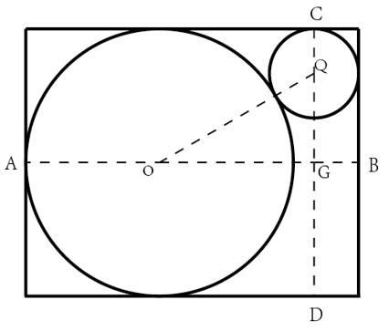

故正确答案为A。

来源：[2023年浙江省公务员录用考试《行测》真题（A类）（解析）.pdf](https://github.com/dumarstoft-ship-it/xingce/blob/407016b55b49581efa3771bb59a2dee8761d982f/2023%E5%B9%B4%E6%B5%99%E6%B1%9F%E7%9C%81%E5%85%AC%E5%8A%A1%E5%91%98%E5%BD%95%E7%94%A8%E8%80%83%E8%AF%95%E3%80%8A%E8%A1%8C%E6%B5%8B%E3%80%8B%E7%9C%9F%E9%A2%98%EF%BC%88A%E7%B1%BB%EF%BC%89%EF%BC%88%E8%A7%A3%E6%9E%90%EF%BC%89.pdf)，PDF 第 17 页。

## 第 63 题 · 数量关系

参考答案：**D**

设班级总共有x 名学生，则两个科目均不及格的学生数为12%x，英语及格的学生数为(2/3)x，数学及格的
学生数为(2/3)x+10。根据两集合容斥原理公式：A+B−A∩B=总数−都不，可得：
(2/3)x+(2/3)x+10−A∩B=x−12%x，即A∩B=(34/75)x+10，故x 一定为75 的倍数，且根据题干可知，x
是70 多，所以x 一定是75。则两科均及格的学生有A∩B=34+10=44人。
故正确答案为D。

来源：[2023年浙江省公务员录用考试《行测》真题（A类）（解析）.pdf](https://github.com/dumarstoft-ship-it/xingce/blob/407016b55b49581efa3771bb59a2dee8761d982f/2023%E5%B9%B4%E6%B5%99%E6%B1%9F%E7%9C%81%E5%85%AC%E5%8A%A1%E5%91%98%E5%BD%95%E7%94%A8%E8%80%83%E8%AF%95%E3%80%8A%E8%A1%8C%E6%B5%8B%E3%80%8B%E7%9C%9F%E9%A2%98%EF%BC%88A%E7%B1%BB%EF%BC%89%EF%BC%88%E8%A7%A3%E6%9E%90%EF%BC%89.pdf)，PDF 第 17、18 页。

## 第 64 题 · 数量关系

参考答案：**C**

设丙农机收割用时为t_丙小时，则甲农机收割用时为(t_丙+4)小时，乙农机收割用时为(t_丙−2)小时。
因为三台农机收割同一片稻田，根据工作总量相同可列方程：5(t_丙+4)=9(t_丙−2)，解得t_丙=19/2。则稻
田总量=5×(19/2+4)=135/2亩。故丙的收割速度=(135/2)÷(19/2)=135/19≈7.1亩/小时，在C 项范围内。
故正确答案为C。

来源：[2023年浙江省公务员录用考试《行测》真题（A类）（解析）.pdf](https://github.com/dumarstoft-ship-it/xingce/blob/407016b55b49581efa3771bb59a2dee8761d982f/2023%E5%B9%B4%E6%B5%99%E6%B1%9F%E7%9C%81%E5%85%AC%E5%8A%A1%E5%91%98%E5%BD%95%E7%94%A8%E8%80%83%E8%AF%95%E3%80%8A%E8%A1%8C%E6%B5%8B%E3%80%8B%E7%9C%9F%E9%A2%98%EF%BC%88A%E7%B1%BB%EF%BC%89%EF%BC%88%E8%A7%A3%E6%9E%90%EF%BC%89.pdf)，PDF 第 18 页。

## 第 65 题 · 数量关系

参考答案：**C**

设在某年时，5 名员工的年龄从大到小分别为a、b、c、d、e，由题意可知a+b=1.25（d+e）······①，
a+b+d+e=125-4×2······②；联立①②解得a+b=65，d+e=52。因年龄各不相同且b<a，可知 ，
即b 最大为32，则年龄排名第三的员工最大为b-1=31，此时a=33，e=33-10=23，d=52-23=29，大小顺序符
合题意，故4 年后年龄排名第三的员工最大为31+4=35 岁。
故正确答案为C。

来源：[2023年浙江省公务员录用考试《行测》真题（A类）（解析）.pdf](https://github.com/dumarstoft-ship-it/xingce/blob/407016b55b49581efa3771bb59a2dee8761d982f/2023%E5%B9%B4%E6%B5%99%E6%B1%9F%E7%9C%81%E5%85%AC%E5%8A%A1%E5%91%98%E5%BD%95%E7%94%A8%E8%80%83%E8%AF%95%E3%80%8A%E8%A1%8C%E6%B5%8B%E3%80%8B%E7%9C%9F%E9%A2%98%EF%BC%88A%E7%B1%BB%EF%BC%89%EF%BC%88%E8%A7%A3%E6%9E%90%EF%BC%89.pdf)，PDF 第 18 页。

## 第 66 题 · 数量关系

参考答案：**B**

由题意可知，秒针长度为4 厘米，秒针转动一圈即1 分钟，其顶点移动路程为2πr=2π×4=8π厘米，
现秒针顶点累计移动了40π厘米，即经过时间t=40π÷8π=5分钟。分针每60 分钟转一圈，5 分钟转1/12圈，
半径为3 厘米，其扫过的面积为(1/12)×π×3²=0.75π平方厘米。
故正确答案为B。

来源：[2023年浙江省公务员录用考试《行测》真题（A类）（解析）.pdf](https://github.com/dumarstoft-ship-it/xingce/blob/407016b55b49581efa3771bb59a2dee8761d982f/2023%E5%B9%B4%E6%B5%99%E6%B1%9F%E7%9C%81%E5%85%AC%E5%8A%A1%E5%91%98%E5%BD%95%E7%94%A8%E8%80%83%E8%AF%95%E3%80%8A%E8%A1%8C%E6%B5%8B%E3%80%8B%E7%9C%9F%E9%A2%98%EF%BC%88A%E7%B1%BB%EF%BC%89%EF%BC%88%E8%A7%A3%E6%9E%90%EF%BC%89.pdf)，PDF 第 18 页。

## 第 67 题 · 数量关系

参考答案：**B**

如图所示，乙车与甲车在C 地相遇后，乙车沿CD 段行驶，甲车继续沿AC 方向，即沿CB 段行驶，甲车
到达B 地时与乙车之间的距离，即为BD 的距离。

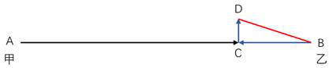

根据“甲车的速度是乙车的3 倍”及“时间一定，路程与速度成正比”，可知甲、乙两车相遇时，甲
车所走的路程是乙车的3 倍，全程为320 千米，即AC=[320/(1+3)]×3=240千米，BC=320-240=80 千米。同理，
BC=3CD，即CD=80/3千米，根据勾股定理可得：
BD=√(BC²+CD²)=√[80²+(80/3)²]=√(6400+6400/9)<√(6400+800)=√7200<√8100=90千米，在B
项范围内。
故正确答案为B。

来源：[2023年浙江省公务员录用考试《行测》真题（A类）（解析）.pdf](https://github.com/dumarstoft-ship-it/xingce/blob/407016b55b49581efa3771bb59a2dee8761d982f/2023%E5%B9%B4%E6%B5%99%E6%B1%9F%E7%9C%81%E5%85%AC%E5%8A%A1%E5%91%98%E5%BD%95%E7%94%A8%E8%80%83%E8%AF%95%E3%80%8A%E8%A1%8C%E6%B5%8B%E3%80%8B%E7%9C%9F%E9%A2%98%EF%BC%88A%E7%B1%BB%EF%BC%89%EF%BC%88%E8%A7%A3%E6%9E%90%EF%BC%89.pdf)，PDF 第 18 页。

## 第 68 题 · 数量关系

参考答案：**A**

赋值该互联网企业初始总股份价值为10，甲股份价值为1，设第一次投资的金额为a，第二次投资的金
额为10a。设第一次投资之前，该企业总股份价值变为初始的n 倍，则有n/(10n+a)=8%……①，整理可得
5n=2a……②；设第二次投资之前，该企业总股份价值变为第一次投资之前的m 倍，则有
nm/(10nm+am+10a)=5%……③，将②式代入③式，解得m=10/3。所求第一次投资前公司的估算价值是第
二次投资前的百分之几，即求10n/(10nm+am)=4a/[4a×(10/3)+a×(10/3)]=6/25=24%。
故正确答案为A。

来源：[2023年浙江省公务员录用考试《行测》真题（A类）（解析）.pdf](https://github.com/dumarstoft-ship-it/xingce/blob/407016b55b49581efa3771bb59a2dee8761d982f/2023%E5%B9%B4%E6%B5%99%E6%B1%9F%E7%9C%81%E5%85%AC%E5%8A%A1%E5%91%98%E5%BD%95%E7%94%A8%E8%80%83%E8%AF%95%E3%80%8A%E8%A1%8C%E6%B5%8B%E3%80%8B%E7%9C%9F%E9%A2%98%EF%BC%88A%E7%B1%BB%EF%BC%89%EF%BC%88%E8%A7%A3%E6%9E%90%EF%BC%89.pdf)，PDF 第 18、19 页。

## 第 69 题 · 数量关系

参考答案：**D**

由题意可知，这些砝码质量一共30×2+8×5=100 克。1 克到100 克之间共有100 个整数克质量，可拆
成（1，99）、（2，98）、（3，97）、（4，96）······（48，52）、（49，51）、（50，50），
可知1 克、3 克不能称量出来，因此99 克、97 克也不能称量出来，其他每一对质量都可以由2 克和5 克称
量出来。从2 克到100 克之间共有99 个整数克质量，不能称量出来的有3 克、97 克、99 克共3 个。
故正确答案为D。
备注：本题在得出3 克、97 克、99 克三个质量不能称量出来时，根据选项最大数据为3 便可锁定答案
为D 项，无需再去验证其他质量能否称量出来。

来源：[2023年浙江省公务员录用考试《行测》真题（A类）（解析）.pdf](https://github.com/dumarstoft-ship-it/xingce/blob/407016b55b49581efa3771bb59a2dee8761d982f/2023%E5%B9%B4%E6%B5%99%E6%B1%9F%E7%9C%81%E5%85%AC%E5%8A%A1%E5%91%98%E5%BD%95%E7%94%A8%E8%80%83%E8%AF%95%E3%80%8A%E8%A1%8C%E6%B5%8B%E3%80%8B%E7%9C%9F%E9%A2%98%EF%BC%88A%E7%B1%BB%EF%BC%89%EF%BC%88%E8%A7%A3%E6%9E%90%EF%BC%89.pdf)，PDF 第 19 页。

## 第 70 题 · 数量关系

参考答案：**C**

根据题意，12 个人重新排1 列纵队，要求新号码与原来不完全相同且每个人的新号码与原始号码相差
≤1，则每个人要么为原号码，要么只能与相邻的人交换号码。故讨论除与原纵队号码一致的情况外，不同
人数交换情况，因12 人情况较复杂，从1 人至多人情况枚举如下：
|初始编号情况（按人数）|新纵队交换情况枚举|新纵队交换情况数|总情况数（包含初始编号情况）|
|---|---|---|---|
|1|×|0|1|
|12|21|1|2|
|123|132或213|2|3|
|1234|2134、2143、1324或1243|4|5|
|12345|12435、12354、13245、13254、21345、21435或21354|7|8|
|…|…|…|…|
由上表可知，纵队每增加1 人，总情况数构成一个简单的递推和数列，即1、2、3、5、8、13、21、34、
55、89、144、233，故12 人的纵队加上初始编号情况共有233 种。已知重新编队后不能与原纵队的顺序完
全一致，则符合题意的情况有233-1=232 种。
故正确答案为C。

来源：[2023年浙江省公务员录用考试《行测》真题（A类）（解析）.pdf](https://github.com/dumarstoft-ship-it/xingce/blob/407016b55b49581efa3771bb59a2dee8761d982f/2023%E5%B9%B4%E6%B5%99%E6%B1%9F%E7%9C%81%E5%85%AC%E5%8A%A1%E5%91%98%E5%BD%95%E7%94%A8%E8%80%83%E8%AF%95%E3%80%8A%E8%A1%8C%E6%B5%8B%E3%80%8B%E7%9C%9F%E9%A2%98%EF%BC%88A%E7%B1%BB%EF%BC%89%EF%BC%88%E8%A7%A3%E6%9E%90%EF%BC%89.pdf)，PDF 第 19 页。

## 第 71 题 · 判断推理

参考答案：**A**

观察发现，题干图形均出现黑块与白块，但数量、位置等均无规律，将两幅图相邻比较发现，黑块的
位置存在规律，即题干图形的每个拐角处均为黑块，故“？”处图形的每个拐角处应均为黑块，B、C、D 三
项均有拐角处不是黑块（如下图所示），只有A 项满足规律。

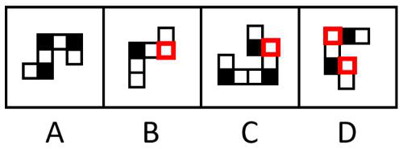

故正确答案为A。

来源：[2023年浙江省公务员录用考试《行测》真题（A类）（解析）.pdf](https://github.com/dumarstoft-ship-it/xingce/blob/407016b55b49581efa3771bb59a2dee8761d982f/2023%E5%B9%B4%E6%B5%99%E6%B1%9F%E7%9C%81%E5%85%AC%E5%8A%A1%E5%91%98%E5%BD%95%E7%94%A8%E8%80%83%E8%AF%95%E3%80%8A%E8%A1%8C%E6%B5%8B%E3%80%8B%E7%9C%9F%E9%A2%98%EF%BC%88A%E7%B1%BB%EF%BC%89%EF%BC%88%E8%A7%A3%E6%9E%90%EF%BC%89.pdf)，PDF 第 19、20 页。

## 第 72 题 · 判断推理

参考答案：**B**

图形元素组成不同，且无明显属性规律，考虑数量规律。观察发现，题干每幅图都是由直线构成，存
在直线相交且出现明显的直角，优先考虑数直角数。图形大多分为内、外两部分，考虑分开数直角数。外
框图形直角数依次为0、1、2、3、4、“？”，所以“？”处应该选择一个外框直角数为5 的图形，只有B
项符合。
故正确答案为B。

来源：[2023年浙江省公务员录用考试《行测》真题（A类）（解析）.pdf](https://github.com/dumarstoft-ship-it/xingce/blob/407016b55b49581efa3771bb59a2dee8761d982f/2023%E5%B9%B4%E6%B5%99%E6%B1%9F%E7%9C%81%E5%85%AC%E5%8A%A1%E5%91%98%E5%BD%95%E7%94%A8%E8%80%83%E8%AF%95%E3%80%8A%E8%A1%8C%E6%B5%8B%E3%80%8B%E7%9C%9F%E9%A2%98%EF%BC%88A%E7%B1%BB%EF%BC%89%EF%BC%88%E8%A7%A3%E6%9E%90%EF%BC%89.pdf)，PDF 第 20 页。

## 第 73 题 · 判断推理

参考答案：**A**

元素组成相同，优先考虑位置规律。题干图形均出现了二十五宫格，考虑内外分开看平移。观察发现，
内圈的黑块每次逆时针平移1 格，外圈的黑块每次顺时针平移2 格，只有A 项符合。

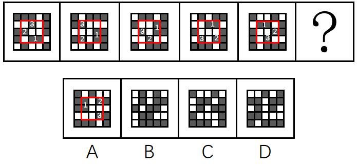

故正确答案为A。

来源：[2023年浙江省公务员录用考试《行测》真题（A类）（解析）.pdf](https://github.com/dumarstoft-ship-it/xingce/blob/407016b55b49581efa3771bb59a2dee8761d982f/2023%E5%B9%B4%E6%B5%99%E6%B1%9F%E7%9C%81%E5%85%AC%E5%8A%A1%E5%91%98%E5%BD%95%E7%94%A8%E8%80%83%E8%AF%95%E3%80%8A%E8%A1%8C%E6%B5%8B%E3%80%8B%E7%9C%9F%E9%A2%98%EF%BC%88A%E7%B1%BB%EF%BC%89%EF%BC%88%E8%A7%A3%E6%9E%90%EF%BC%89.pdf)，PDF 第 20 页。

## 第 74 题 · 判断推理

参考答案：**C**

元素组成相似，优先考虑样式规律。观察发现，题干图形均存在黑块、白块以及空白区域，且黑块数
量不成规律，优先考虑黑白运算。第一组图形的运算规律为：黑+黑=空，空+空=空，黑+白＝黑，白+白＝
空，空+黑=黑，白+空=白，空+白=白，黑+空=黑，第二组图形运用此规律，只有C 项符合。
故正确答案为C。

来源：[2023年浙江省公务员录用考试《行测》真题（A类）（解析）.pdf](https://github.com/dumarstoft-ship-it/xingce/blob/407016b55b49581efa3771bb59a2dee8761d982f/2023%E5%B9%B4%E6%B5%99%E6%B1%9F%E7%9C%81%E5%85%AC%E5%8A%A1%E5%91%98%E5%BD%95%E7%94%A8%E8%80%83%E8%AF%95%E3%80%8A%E8%A1%8C%E6%B5%8B%E3%80%8B%E7%9C%9F%E9%A2%98%EF%BC%88A%E7%B1%BB%EF%BC%89%EF%BC%88%E8%A7%A3%E6%9E%90%EF%BC%89.pdf)，PDF 第 20 页。

## 第 75 题 · 判断推理

参考答案：**C**

元素组成不同，优先考虑属性规律。观察发现，题干图形出现等腰元素，优先考虑对称性。第一组图
中，每个图形均只有一条纵向的对称轴，第二组图中，前两幅图形也均只有一条纵向的对称轴，所以？处
应填入只有一条纵向对称轴的图形，排除B、D 两项。继续观察发现，题干图形出现明显的空白面，考虑面
数量。第一组图中，图形的面数量依次为2、3、4，第二组图中，图形的面数量依次为2、3、？，故？处
应选择一个面数量为4 的图形，只有C 项符合。
故正确答案为C。

来源：[2023年浙江省公务员录用考试《行测》真题（A类）（解析）.pdf](https://github.com/dumarstoft-ship-it/xingce/blob/407016b55b49581efa3771bb59a2dee8761d982f/2023%E5%B9%B4%E6%B5%99%E6%B1%9F%E7%9C%81%E5%85%AC%E5%8A%A1%E5%91%98%E5%BD%95%E7%94%A8%E8%80%83%E8%AF%95%E3%80%8A%E8%A1%8C%E6%B5%8B%E3%80%8B%E7%9C%9F%E9%A2%98%EF%BC%88A%E7%B1%BB%EF%BC%89%EF%BC%88%E8%A7%A3%E6%9E%90%EF%BC%89.pdf)，PDF 第 20 页。

## 第 76 题 · 判断推理

参考答案：**D**

本题为分组分类题目。观察发现，题干每幅图形均由两幅形状相同但位置不同的元素组成，考虑位置
规律。图①④⑤中的一个元素图形旋转90°后可得到另一个元素图形的形状，图②③⑥中的一个元素图形旋
转180°后可得到另一个元素图形的形状，即图①④⑤为一组，图②③⑥为一组。
故正确答案为D。

来源：[2023年浙江省公务员录用考试《行测》真题（A类）（解析）.pdf](https://github.com/dumarstoft-ship-it/xingce/blob/407016b55b49581efa3771bb59a2dee8761d982f/2023%E5%B9%B4%E6%B5%99%E6%B1%9F%E7%9C%81%E5%85%AC%E5%8A%A1%E5%91%98%E5%BD%95%E7%94%A8%E8%80%83%E8%AF%95%E3%80%8A%E8%A1%8C%E6%B5%8B%E3%80%8B%E7%9C%9F%E9%A2%98%EF%BC%88A%E7%B1%BB%EF%BC%89%EF%BC%88%E8%A7%A3%E6%9E%90%EF%BC%89.pdf)，PDF 第 20、21 页。

## 第 77 题 · 判断推理

参考答案：**A**

本题为分组分类题目。观察发现，题干图形中明显出现相切，其中图①②⑤中直线均与1 个圆相切，
图③④⑥中直线均与2 个圆相切，故图①②⑤一组，图③④⑥一组。
故正确答案为A。

来源：[2023年浙江省公务员录用考试《行测》真题（A类）（解析）.pdf](https://github.com/dumarstoft-ship-it/xingce/blob/407016b55b49581efa3771bb59a2dee8761d982f/2023%E5%B9%B4%E6%B5%99%E6%B1%9F%E7%9C%81%E5%85%AC%E5%8A%A1%E5%91%98%E5%BD%95%E7%94%A8%E8%80%83%E8%AF%95%E3%80%8A%E8%A1%8C%E6%B5%8B%E3%80%8B%E7%9C%9F%E9%A2%98%EF%BC%88A%E7%B1%BB%EF%BC%89%EF%BC%88%E8%A7%A3%E6%9E%90%EF%BC%89.pdf)，PDF 第 21 页。

## 第 78 题 · 判断推理

参考答案：**B**

题干图形元素组成不同，优先考虑属性规律。观察发现，题干图形较为规整，考虑对称性。九宫格第
一列均为竖轴对称图形，第二列均为横轴对称图形，第三列前两个图形均为既横轴对称又竖轴对称的图形，
故“？”处应为既横轴对称又竖轴对称的图形，只有B 项满足。
故正确答案为B。

来源：[2023年浙江省公务员录用考试《行测》真题（A类）（解析）.pdf](https://github.com/dumarstoft-ship-it/xingce/blob/407016b55b49581efa3771bb59a2dee8761d982f/2023%E5%B9%B4%E6%B5%99%E6%B1%9F%E7%9C%81%E5%85%AC%E5%8A%A1%E5%91%98%E5%BD%95%E7%94%A8%E8%80%83%E8%AF%95%E3%80%8A%E8%A1%8C%E6%B5%8B%E3%80%8B%E7%9C%9F%E9%A2%98%EF%BC%88A%E7%B1%BB%EF%BC%89%EF%BC%88%E8%A7%A3%E6%9E%90%EF%BC%89.pdf)，PDF 第 21 页。

## 第 79 题 · 判断推理

参考答案：**C**

将原展开图标上序号如下图，逐一进行分析。

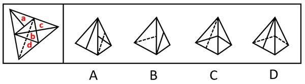

A 项：选项右侧为面b，左侧为面a 或面c，选项中左侧面上的实线与其和面b 的公共边中点不相交，
而展开图中面a 与面c 上的实线均和该面与面b 的公共边中点相交，选项与展开图不一致，排除；

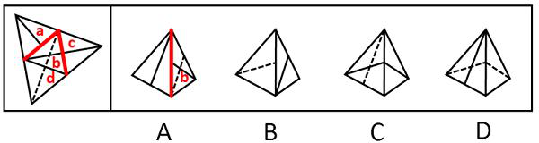

B 项：选项左侧为面d，右侧为面a 或面c，选项中面d 上的虚线与其和右侧面（面a 或面c）的公共
边中点相交，而展开图中面d 上虚线与其和面b 的公共边中点相交，选项与展开图不一致，排除；

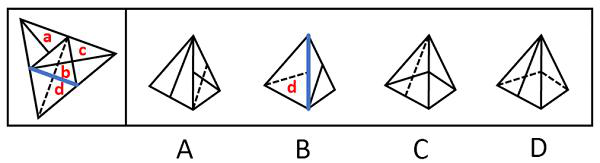

C 项：选项由面b 和面c 构成，与展开图一致，当选；
D 项：选项由面b 和面d 构成，以面b 中引出实线的顶点为起点，沿面b 顺时针画边（如下图所示），
展开图中边3 对应面d，而选项中边1 对应面d，选项与展开图不一致，排除。

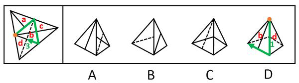

故正确答案为C。

来源：[2023年浙江省公务员录用考试《行测》真题（A类）（解析）.pdf](https://github.com/dumarstoft-ship-it/xingce/blob/407016b55b49581efa3771bb59a2dee8761d982f/2023%E5%B9%B4%E6%B5%99%E6%B1%9F%E7%9C%81%E5%85%AC%E5%8A%A1%E5%91%98%E5%BD%95%E7%94%A8%E8%80%83%E8%AF%95%E3%80%8A%E8%A1%8C%E6%B5%8B%E3%80%8B%E7%9C%9F%E9%A2%98%EF%BC%88A%E7%B1%BB%EF%BC%89%EF%BC%88%E8%A7%A3%E6%9E%90%EF%BC%89.pdf)，PDF 第 21、22 页。

## 第 80 题 · 判断推理

参考答案：**D**

本题考查截面图，逐一分析选项。
A 项：如下图所示，可以截出，排除；

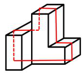

B 项：如下图所示，可以截出，排除；

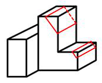

C 项：如下图所示，可以截出，排除；

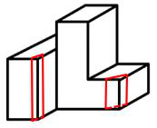

D 项：无法截出，当选。
本题为选非题，故正确答案为D。

来源：[2023年浙江省公务员录用考试《行测》真题（A类）（解析）.pdf](https://github.com/dumarstoft-ship-it/xingce/blob/407016b55b49581efa3771bb59a2dee8761d982f/2023%E5%B9%B4%E6%B5%99%E6%B1%9F%E7%9C%81%E5%85%AC%E5%8A%A1%E5%91%98%E5%BD%95%E7%94%A8%E8%80%83%E8%AF%95%E3%80%8A%E8%A1%8C%E6%B5%8B%E3%80%8B%E7%9C%9F%E9%A2%98%EF%BC%88A%E7%B1%BB%EF%BC%89%EF%BC%88%E8%A7%A3%E6%9E%90%EF%BC%89.pdf)，PDF 第 22 页。

## 第 81 题 · 判断推理

参考答案：**C**

第一步：找出定义关键词。
“通过发现和利用市场上的资源供给和需求不一致进行调配”、“导致的盈利机会获利”。
第二步：逐一分析选项。
A 项：曹国与鲁国之间贱买贵卖，说明商品在两个空间上存在“市场上的资源供给和需求不一致”，通
过这种商品的买卖，实现了对“供需不一致资源”的调配，从而创造“盈利机会”而获利，符合定义，排
除；
B 项：来年橄榄的大丰收会造成未来榨油机的供不应求，说明现在和未来两个时间上对于榨油机的供需
是不一致的，符合“市场上的资源供给和需求不一致”，通过现在买断榨油机，第二年高价出租，实现了
对“供需不一致资源”的调配，从而创造“盈利机会”而获利，符合定义，排除；
C 项：仅提到目前汽车市场普通居民消费不起，F 公司推出价廉物美的T 型车，只是推出新产品，并不
是对“供给和需求不一致进行调配”，不符合定义，当选；
D 项：农村出现大量富余劳动力，体现出在农业方面劳动力供过于求，而工业产品极度缺乏，体现出工
业方面劳动力供不应求，说明农业和工业两个领域产品市场和要素市场存在“供给和需求不一致”，通过
将富余的农村劳动力组织起来生产工业产品，符合实现了对“供需不一致资源”的调配，从而创造“盈利
机会”而获利，符合定义，排除。
本题为选非题，故正确答案为C。

来源：[2023年浙江省公务员录用考试《行测》真题（A类）（解析）.pdf](https://github.com/dumarstoft-ship-it/xingce/blob/407016b55b49581efa3771bb59a2dee8761d982f/2023%E5%B9%B4%E6%B5%99%E6%B1%9F%E7%9C%81%E5%85%AC%E5%8A%A1%E5%91%98%E5%BD%95%E7%94%A8%E8%80%83%E8%AF%95%E3%80%8A%E8%A1%8C%E6%B5%8B%E3%80%8B%E7%9C%9F%E9%A2%98%EF%BC%88A%E7%B1%BB%EF%BC%89%EF%BC%88%E8%A7%A3%E6%9E%90%EF%BC%89.pdf)，PDF 第 22、23 页。

## 第 82 题 · 判断推理

参考答案：**D**

第一步：找出定义关键词。
公用品：“使用过程中不排斥和影响他人使用”；
私用品：“使用过程中会排斥或影响他人使用”。
第二步：逐一分析选项。
A 项：一个人在使用会议室时会影响其他人的使用，不符合“使用过程中不排斥和影响他人使用”，不
符合“公用品”定义，排除；
B 项：一个人在停车场停车时会影响其他人的使用，不符合“使用过程中不排斥和影响他人使用”，不
符合“公用品”定义，排除；
C 项：一个人在使用小区草坪时会影响其他人的使用，不符合“使用过程中不排斥和影响他人使用”，
不符合“公用品”定义，排除；
D 项：有线电视的信号可同时供多人使用，一个人使用时不会影响到其他人的使用，符合“使用过程中
不排斥和影响他人使用”，符合“公用品”定义，当选。
故正确答案为D。

来源：[2023年浙江省公务员录用考试《行测》真题（A类）（解析）.pdf](https://github.com/dumarstoft-ship-it/xingce/blob/407016b55b49581efa3771bb59a2dee8761d982f/2023%E5%B9%B4%E6%B5%99%E6%B1%9F%E7%9C%81%E5%85%AC%E5%8A%A1%E5%91%98%E5%BD%95%E7%94%A8%E8%80%83%E8%AF%95%E3%80%8A%E8%A1%8C%E6%B5%8B%E3%80%8B%E7%9C%9F%E9%A2%98%EF%BC%88A%E7%B1%BB%EF%BC%89%EF%BC%88%E8%A7%A3%E6%9E%90%EF%BC%89.pdf)，PDF 第 23 页。

## 第 83 题 · 判断推理

参考答案：**C**

第一步，找出定义关键词。
“使用数据或以往的经验”、“优化计算机程序的性能”。
第二步，逐一分析选项。
A 项：某公司通过海量数据，不断升级人脸识别技术的版本，提高了准确率，符合“使用数据或以往的
经验”、“优化计算机程序的性能”，符合定义，排除；
B 项：科研小组让计算机选用不同难度的数据依次训练，提升了计算机算法的准确率，符合“使用数据
或以往的经验”、“优化计算机程序的性能”，符合定义，排除；
C 项：某高校利用算法识别核酸报告截图特定字符，缩短了统计汇总时间，并没有提升算法的性能，不
符合“优化计算机程序的性能”，不符合定义，当选；
D 项：某AI 算法通过模拟双方对抗情况获取训练数据，不断提升技巧，符合“使用数据或以往的经验”、
“优化计算机程序的性能”，符合定义，排除。
本题为选非题，故正确答案为C。

来源：[2023年浙江省公务员录用考试《行测》真题（A类）（解析）.pdf](https://github.com/dumarstoft-ship-it/xingce/blob/407016b55b49581efa3771bb59a2dee8761d982f/2023%E5%B9%B4%E6%B5%99%E6%B1%9F%E7%9C%81%E5%85%AC%E5%8A%A1%E5%91%98%E5%BD%95%E7%94%A8%E8%80%83%E8%AF%95%E3%80%8A%E8%A1%8C%E6%B5%8B%E3%80%8B%E7%9C%9F%E9%A2%98%EF%BC%88A%E7%B1%BB%EF%BC%89%EF%BC%88%E8%A7%A3%E6%9E%90%EF%BC%89.pdf)，PDF 第 23 页。

## 第 84 题 · 判断推理

参考答案：**B**

第一步，找出定义关键词。
“以网络平台为载体”、“在陌生人之间展开的”、“不以加强彼此关系为目的”。
第二步，逐一分析选项。
A 项：游戏对手是通过计算机程序自动匹配的，相互之间并不认识，符合“以网络平台为载体”、“在
陌生人之间展开的”、“不以加强彼此关系为目的”，符合定义，排除；
B 项：为刚刚添加的微信好友的朋友圈动态点赞，说明在成为微信好友前就有可能认识，不一定是陌生
人，并且添加微信好友的目的就是加强相互之间的联系，不符合“在陌生人之间展开的”、“不以加强彼
此关系为目的”，不符合定义，当选；
C 项：在网络直播平台对小视频评论进行再评论，符合“以网络平台为载体”、“在陌生人之间展开的”、
“不以加强彼此关系为目的”，符合定义，排除；
D 项：网络游戏过程中为提高游戏技术相互切磋，符合“以网络平台为载体”、“在陌生人之间展开的”、
“不以加强彼此关系为目的”，符合定义，排除。
本题为选非题，故正确答案为B。

来源：[2023年浙江省公务员录用考试《行测》真题（A类）（解析）.pdf](https://github.com/dumarstoft-ship-it/xingce/blob/407016b55b49581efa3771bb59a2dee8761d982f/2023%E5%B9%B4%E6%B5%99%E6%B1%9F%E7%9C%81%E5%85%AC%E5%8A%A1%E5%91%98%E5%BD%95%E7%94%A8%E8%80%83%E8%AF%95%E3%80%8A%E8%A1%8C%E6%B5%8B%E3%80%8B%E7%9C%9F%E9%A2%98%EF%BC%88A%E7%B1%BB%EF%BC%89%EF%BC%88%E8%A7%A3%E6%9E%90%EF%BC%89.pdf)，PDF 第 23 页。

## 第 85 题 · 判断推理

参考答案：**D**

第一步：找出定义关键词。
“艺术家在构思过程中”、“将自己的审美情感、审美认识与客观的事物相融合”、“以一定的艺术
表达方式呈现出来的内心视像”。
第二步：逐一分析选项。
A 项：“祥林嫂”是鲁迅作品《祝福》中的悲剧性人物，是旧中国农村劳动妇女的典型，符合“艺术家
在构思过程中”、“将自己的审美情感、审美认识与客观的事物相融合”、“以一定的艺术表达方式呈现
出来的内心视像”，符合定义，排除；
B 项：“南山”是陶渊明诗句中的艺术形象，该句诗表现了诗人悠然闲适的生活态度，诗人将自己的情
感和客观事物相融合，符合“艺术家在构思过程中”、“将自己的审美情感、审美认识与客观的事物相融
合”、“以一定的艺术表达方式呈现出来的内心视像”，符合定义，排除；
C 项：“三毛”是漫画作品《三毛流浪记》中一个身世凄凉、饥寒交迫、受尽欺辱、贫穷得只剩下三根
头发的中国儿童形象，符合“艺术家在构思过程中”、“将自己的审美情感、审美认识与客观的事物相融
合”、“以一定的艺术表达方式呈现出来的内心视像”，符合定义，排除；
D 项：“太阳出来了，该起床了”中的“太阳”是用在日常语句中，没有体现艺术家创作作品的构思过
程和艺术的表达方式，不符合“艺术家在构思过程中”、“将自己的审美情感、审美认识与客观的事物相
融合”、“以一定的艺术表达方式呈现出来的内心视像”，不符合定义，当选。
本题为选非题，故正确答案为D。

来源：[2023年浙江省公务员录用考试《行测》真题（A类）（解析）.pdf](https://github.com/dumarstoft-ship-it/xingce/blob/407016b55b49581efa3771bb59a2dee8761d982f/2023%E5%B9%B4%E6%B5%99%E6%B1%9F%E7%9C%81%E5%85%AC%E5%8A%A1%E5%91%98%E5%BD%95%E7%94%A8%E8%80%83%E8%AF%95%E3%80%8A%E8%A1%8C%E6%B5%8B%E3%80%8B%E7%9C%9F%E9%A2%98%EF%BC%88A%E7%B1%BB%EF%BC%89%EF%BC%88%E8%A7%A3%E6%9E%90%EF%BC%89.pdf)，PDF 第 24 页。

## 第 86 题 · 判断推理

参考答案：**D**

第一步：找出定义关键词。
“对人重复呈现一个激发情绪的刺激”、“该个体情绪化反应会逐渐消失”。
第二步：逐一分析选项。
A 项：小华成年后看到狗仍然会感到非常恐惧，说明小华被狗追咬的恐惧没有消失，不符合“该个体情
绪化反应会逐渐消失”，不符合定义，排除；
B 项：小孙生活中模仿游戏中人物的暴力行为，说明含有暴力元素的游戏对他的影响并没有逐渐消失，
不符合“该个体情绪化反应会逐渐消失”，不符合定义，排除；
C 项：小王走夜路时常会担心有意外发生，说明看犯罪题材的影片对他的影响并没有逐渐消失，不符合
“该个体情绪化反应会逐渐消失”，不符合定义，排除；
D 项：小明与女同学交谈时总会面红耳赤，老师要求他每天主动和邻座女同学进行学习讨论，符合“对
人重复呈现一个激发情绪的刺激”，符合定义，当选。
故正确答案为D。

来源：[2023年浙江省公务员录用考试《行测》真题（A类）（解析）.pdf](https://github.com/dumarstoft-ship-it/xingce/blob/407016b55b49581efa3771bb59a2dee8761d982f/2023%E5%B9%B4%E6%B5%99%E6%B1%9F%E7%9C%81%E5%85%AC%E5%8A%A1%E5%91%98%E5%BD%95%E7%94%A8%E8%80%83%E8%AF%95%E3%80%8A%E8%A1%8C%E6%B5%8B%E3%80%8B%E7%9C%9F%E9%A2%98%EF%BC%88A%E7%B1%BB%EF%BC%89%EF%BC%88%E8%A7%A3%E6%9E%90%EF%BC%89.pdf)，PDF 第 24 页。

## 第 87 题 · 判断推理

参考答案：**A**

第一步：找出定义关键词。
“个人体验到自己属于或应属于某一群体成员的意识”、“个体在进行自己的活动、认知和评价时，
会自觉地维护群体的利益”、“与群体内的其他成员在情感上发生共鸣”。
第二步：逐一分析选项。
A 项：中秋节小韦与要好的朋友分享月饼，没有体现小韦感觉自己是某一群体的成员，也没有体现小韦
自觉地维护群体的利益，不符合“个人体验到自己属于或应属于某一群体成员的意识”、“个体在进行自
己的活动、认知和评价时，会自觉地维护群体的利益”，不符合定义，当选；
B 项：王晓峰听到别人说他所在班级的坏话时很生气，体现了他感觉自己是班级这一群体的成员，符合
“个人体验到自己属于或应属于某一群体成员的意识”、“个体在进行自己的活动、认知和评价时，会自
觉地维护群体的利益”、“与群体内的其他成员在情感上发生共鸣”，符合定义，排除；
C 项：退役士兵小王常向他人说自己曾是某英雄连的，体现了他感觉自己是连队这一群体的成员，符合
“个人体验到自己属于或应属于某一群体成员的意识”、“个体在进行自己的活动、认知和评价时，会自
觉地维护群体的利益”、“与群体内的其他成员在情感上发生共鸣”，符合定义，排除；
D 项：小强外出时总自豪地在外衣上佩戴学校的校徽，体现了他感觉自己是学校这一群体的成员，符合
“个人体验到自己属于或应属于某一群体成员的意识”、“个体在进行自己的活动、认知和评价时，会自
觉地维护群体的利益”、“与群体内的其他成员在情感上发生共鸣”，符合定义，排除。
本题为选非题，故正确答案为A。

来源：[2023年浙江省公务员录用考试《行测》真题（A类）（解析）.pdf](https://github.com/dumarstoft-ship-it/xingce/blob/407016b55b49581efa3771bb59a2dee8761d982f/2023%E5%B9%B4%E6%B5%99%E6%B1%9F%E7%9C%81%E5%85%AC%E5%8A%A1%E5%91%98%E5%BD%95%E7%94%A8%E8%80%83%E8%AF%95%E3%80%8A%E8%A1%8C%E6%B5%8B%E3%80%8B%E7%9C%9F%E9%A2%98%EF%BC%88A%E7%B1%BB%EF%BC%89%EF%BC%88%E8%A7%A3%E6%9E%90%EF%BC%89.pdf)，PDF 第 24、25 页。

## 第 88 题 · 判断推理

参考答案：**C**

第一步：找出定义关键词。
“人们面对着两个或两个以上的目标”、“目标各自分别具有吸引和排斥两方面的作用”、“人们无
法简单地选择一个目标而回避或拒绝另一个目标时的矛盾心态”。
第二步：逐一分析选项。
A 项：张女士面临的只有“生二胎”一个目标，儿女双全和无力抚养分别是目标的吸引方面和排斥方面，
不符合“人们面对着两个或两个以上的目标”，不符合定义，排除；
B 项：周女士面临的只有“省外培训”一个目标，放心不下家中年幼的孩子是目标的排斥方面，不符合
“人们面对着两个或两个以上的目标”，不符合定义，排除；
C 项：王先生面临“闲置资金炒股”和“闲置资金储蓄”两个目标，收益高和风险大是“闲置资金炒股”
的吸引方面和排斥方面，风险低和收益低是“闲置资金储蓄”的吸引方面和排斥方面，王先生在两个目标
中感到纠结矛盾，符合“人们面对着两个或两个以上的目标”、“目标各自分别具有吸引和排斥两方面的
作用”、“人们无法简单地选择一个目标而回避或拒绝另一个目标时的矛盾心态”，符合定义，当选；
D 项：李同学面临“研究生录取”和“心仪公司入职”两个目标，但并没有体现他在两个目标中感到纠
结矛盾，不符合“人们无法简单地选择一个目标而回避或拒绝另一个目标时的矛盾心态”，不符合定义，
排除。
故正确答案为C。

来源：[2023年浙江省公务员录用考试《行测》真题（A类）（解析）.pdf](https://github.com/dumarstoft-ship-it/xingce/blob/407016b55b49581efa3771bb59a2dee8761d982f/2023%E5%B9%B4%E6%B5%99%E6%B1%9F%E7%9C%81%E5%85%AC%E5%8A%A1%E5%91%98%E5%BD%95%E7%94%A8%E8%80%83%E8%AF%95%E3%80%8A%E8%A1%8C%E6%B5%8B%E3%80%8B%E7%9C%9F%E9%A2%98%EF%BC%88A%E7%B1%BB%EF%BC%89%EF%BC%88%E8%A7%A3%E6%9E%90%EF%BC%89.pdf)，PDF 第 25 页。

## 第 89 题 · 判断推理

参考答案：**D**

第一步：找出定义关键词。
功能文化区：“按照人类社会的某项功能组织建立起来的”、“在空间结构上具有较固定的、确切的
边界”、“内部彼此之间因功能的互相联系而确定其分布区范围的文化区”；
形式文化区：“某些具有相互联系的文化现象”、“在空间分布上具有集中的核心区与模糊边界的文
化地域单元”。
第二步：逐一分析选项。
A 项：城市中的外籍人员聚居区，不符合“按照人类社会的某项功能组织建立起来的”、“内部彼此之
间因功能的互相联系而确定其分布区范围的文化区”，不符合“功能文化区”定义，排除；
B 项：城市中的行为艺术聚集区，不符合“按照人类社会的某项功能组织建立起来的”、“内部彼此之
间因功能的互相联系而确定其分布区范围的文化区”，不符合“功能文化区”定义，排除；
C 项：城市郊区的垃圾集中处理区，不是文化区，不符合“内部彼此之间因功能的互相联系而确定其分
布区范围的文化区”，不符合“功能文化区”定义，排除；
D 项：城市中的博物馆图书馆集中区，符合“按照人类社会的某项功能组织建立起来的”，博物馆和图
书馆在空间上具有明确的边界，且功能之间有联系，又属于文化区，符合“在空间结构上具有较固定的、
确切的边界”、“内部彼此之间因功能的互相联系而确定其分布区范围的文化区”，符合“功能文化区”
定义，当选。
故正确答案为D。

来源：[2023年浙江省公务员录用考试《行测》真题（A类）（解析）.pdf](https://github.com/dumarstoft-ship-it/xingce/blob/407016b55b49581efa3771bb59a2dee8761d982f/2023%E5%B9%B4%E6%B5%99%E6%B1%9F%E7%9C%81%E5%85%AC%E5%8A%A1%E5%91%98%E5%BD%95%E7%94%A8%E8%80%83%E8%AF%95%E3%80%8A%E8%A1%8C%E6%B5%8B%E3%80%8B%E7%9C%9F%E9%A2%98%EF%BC%88A%E7%B1%BB%EF%BC%89%EF%BC%88%E8%A7%A3%E6%9E%90%EF%BC%89.pdf)，PDF 第 25 页。

## 第 90 题 · 判断推理

参考答案：**D**

第一步：找出定义关键词。
“过分情感化和夸张的言行”、“吸引他人注意”。
第二步：逐一分析选项。
A 项：小邓喜欢穿奇装异服，属于夸张的行为，符合“过分情感化和夸张的言行”，希望吸引别人的注
意，符合“吸引他人注意”，符合定义，排除；
B 项：小王具有表演才能，讲话时手舞足蹈、表情丰富，属于夸张的行为，符合“过分情感化和夸张的
言行”，符合定义，排除；
C 项：小刘在人际交往受挫折时，表现出歇斯底里行为，属于过分情感化的行为，符合“过分情感化和
夸张的言行”，符合定义，排除；
D 项：小顾没有几个知心朋友，却说自己有很多知心朋友，这是在说谎，而不是夸张的言行，不符合“过
分情感化和夸张的言行”，不符合定义，当选。
本题为选非题，故正确答案为D。

来源：[2023年浙江省公务员录用考试《行测》真题（A类）（解析）.pdf](https://github.com/dumarstoft-ship-it/xingce/blob/407016b55b49581efa3771bb59a2dee8761d982f/2023%E5%B9%B4%E6%B5%99%E6%B1%9F%E7%9C%81%E5%85%AC%E5%8A%A1%E5%91%98%E5%BD%95%E7%94%A8%E8%80%83%E8%AF%95%E3%80%8A%E8%A1%8C%E6%B5%8B%E3%80%8B%E7%9C%9F%E9%A2%98%EF%BC%88A%E7%B1%BB%EF%BC%89%EF%BC%88%E8%A7%A3%E6%9E%90%EF%BC%89.pdf)，PDF 第 25、26 页。

## 第 91 题 · 判断推理

参考答案：**A**

第一步：判断题干词语间逻辑关系。
“声东击西”指为了迷惑敌人，表面上宣扬要攻打这一边，其实是攻打另一边，“声东”是为了“击
西”，二者为方式目的对应关系。
第二步：判断选项词语间逻辑关系。
A 项：“围魏救赵”指袭击敌人后方的据点以迫使进攻之敌撤退的战术，“围魏”是为了“救赵”，二
者为方式目的对应关系，与题干逻辑关系一致，当选；
B 项：“张冠李戴”指姓张的人的帽子戴到姓李的人头上，比喻认错了对象或弄错了事实，二者不是方
式目的对应关系，与题干逻辑关系不一致，排除；
C 项：“安居乐业”指安定地生活，愉快地工作，二者为并列关系，与题干逻辑关系不一致，排除；
D 项：“说东道西”指说东家，讲西家，形容信口议论，话语极多，二者为并列关系，与题干逻辑关系
不一致，排除。
故正确答案为A。

来源：[2023年浙江省公务员录用考试《行测》真题（A类）（解析）.pdf](https://github.com/dumarstoft-ship-it/xingce/blob/407016b55b49581efa3771bb59a2dee8761d982f/2023%E5%B9%B4%E6%B5%99%E6%B1%9F%E7%9C%81%E5%85%AC%E5%8A%A1%E5%91%98%E5%BD%95%E7%94%A8%E8%80%83%E8%AF%95%E3%80%8A%E8%A1%8C%E6%B5%8B%E3%80%8B%E7%9C%9F%E9%A2%98%EF%BC%88A%E7%B1%BB%EF%BC%89%EF%BC%88%E8%A7%A3%E6%9E%90%EF%BC%89.pdf)，PDF 第 26 页。

## 第 92 题 · 判断推理

参考答案：**A**

第一步：判断题干词语间逻辑关系。
“心宽体胖”指心情愉快，无所牵挂，因而人感到舒坦，因为“心宽”，所以“体胖”，二者为因果
对应关系。
第二步：判断选项词语间逻辑关系。
A 项：“唇亡齿寒”指嘴唇没有了，牙齿就会觉得冷，形容关系密切，利害相关，因为“唇亡”，所以
“齿寒”，二者为因果对应关系，与题干逻辑关系一致，当选；
B 项：“鼻青脸肿”指鼻子青了，脸也肿了，形容面部被碰伤或打伤的样子，也形容遭到严重打击或挫
折的狼狈相，二者不是因果对应关系，与题干逻辑关系不一致，排除；
C 项：“手忙脚乱”形容做事慌张而没有条理，也形容惊慌失措，二者不是因果对应关系，与题干逻辑
关系不一致，排除；
D 项：“半斤八两”比喻彼此一样，不相上下（多含贬义），二者不是因果对应关系，与题干逻辑关系
不一致，排除。
故正确答案为A。

来源：[2023年浙江省公务员录用考试《行测》真题（A类）（解析）.pdf](https://github.com/dumarstoft-ship-it/xingce/blob/407016b55b49581efa3771bb59a2dee8761d982f/2023%E5%B9%B4%E6%B5%99%E6%B1%9F%E7%9C%81%E5%85%AC%E5%8A%A1%E5%91%98%E5%BD%95%E7%94%A8%E8%80%83%E8%AF%95%E3%80%8A%E8%A1%8C%E6%B5%8B%E3%80%8B%E7%9C%9F%E9%A2%98%EF%BC%88A%E7%B1%BB%EF%BC%89%EF%BC%88%E8%A7%A3%E6%9E%90%EF%BC%89.pdf)，PDF 第 26 页。

## 第 93 题 · 判断推理

参考答案：**B**

第一步：判断题干词语间逻辑关系。
长白山即长白山脉主峰，是一座火山，二者为种属关系。
第二步：判断选项词语间逻辑关系。
A 项：皇陵是皇帝或皇室成员的陵墓，皇陵是古建筑，二者为种属关系，与题干逻辑关系一致，保留；
B 项：巢湖是淡水湖，二者为种属关系，与题干逻辑关系一致，保留；
C 项：丝绸是制作连衣裙的原材料，二者为原材料与成品的对应关系，与题干逻辑关系不一致，排除；
D 项：火箭军是我国解放军的一种，军人是火箭军的组成部分，二者为组成关系，与题干逻辑关系不一
致，排除。
比较A、B 两项，A 项中的皇陵不是特指，B 项中的巢湖是一个特指，而题干中的长白山也是一个特指，
因此B 项相比A 项与题干更一致。
故正确答案为B。

来源：[2023年浙江省公务员录用考试《行测》真题（A类）（解析）.pdf](https://github.com/dumarstoft-ship-it/xingce/blob/407016b55b49581efa3771bb59a2dee8761d982f/2023%E5%B9%B4%E6%B5%99%E6%B1%9F%E7%9C%81%E5%85%AC%E5%8A%A1%E5%91%98%E5%BD%95%E7%94%A8%E8%80%83%E8%AF%95%E3%80%8A%E8%A1%8C%E6%B5%8B%E3%80%8B%E7%9C%9F%E9%A2%98%EF%BC%88A%E7%B1%BB%EF%BC%89%EF%BC%88%E8%A7%A3%E6%9E%90%EF%BC%89.pdf)，PDF 第 26、27 页。

## 第 94 题 · 判断推理

参考答案：**C**

第一步：判断题干词语间逻辑关系。
上市公司指其公司股票可进入证券集中交易市场进行交易的公司。跨国企业指在两个或两个以上国家
从事国际化经营活动的企业。有的上市公司是跨国企业，有的上市公司不是跨国企业，有的跨国企业是上
市公司，有的跨国企业不是上市公司，二者为交叉关系。
第二步：判断选项词语间逻辑关系。
A 项：高等教育指在完成中等教育的基础上进行的专业教育和职业教育，学历层次包括专科、本科等，
因此，大专院校属于高等教育，二者为种属关系，与题干逻辑关系不一致，排除；
B 项：商业银行是金融机构，二者为种属关系，与题干逻辑关系不一致，排除；
C 项：快捷酒店是功能简化的经济型酒店的一种，连锁酒店是指连锁经营的酒店，有的快捷酒店是连锁
酒店，有的快捷酒店不是连锁酒店，有的连锁酒店是快捷酒店，有的连锁酒店不是快捷酒店，二者为交叉
关系，与题干逻辑关系一致，当选；
D 项：进口产品和出口产品为并列关系，与题干逻辑关系不一致，排除。
故正确答案为C。

来源：[2023年浙江省公务员录用考试《行测》真题（A类）（解析）.pdf](https://github.com/dumarstoft-ship-it/xingce/blob/407016b55b49581efa3771bb59a2dee8761d982f/2023%E5%B9%B4%E6%B5%99%E6%B1%9F%E7%9C%81%E5%85%AC%E5%8A%A1%E5%91%98%E5%BD%95%E7%94%A8%E8%80%83%E8%AF%95%E3%80%8A%E8%A1%8C%E6%B5%8B%E3%80%8B%E7%9C%9F%E9%A2%98%EF%BC%88A%E7%B1%BB%EF%BC%89%EF%BC%88%E8%A7%A3%E6%9E%90%EF%BC%89.pdf)，PDF 第 27 页。

## 第 95 题 · 判断推理

参考答案：**B**

第一步：判断题干词语间逻辑关系。
蚕茧是制作丝绸的原材料，丝绸是制作衣服的原材料，二者均为原材料的对应关系。
第二步：判断选项词语间逻辑关系。
A 项：矿山是产出矿石的地点，二者为地点的对应关系，矿石是制作螺丝的原材料，二者为原材料的对
应关系，与题干逻辑关系不一致，排除；
B 项：树木是制作纸张的原材料，纸张是制作书本的原材料，二者均为原材料的对应关系，与题干逻辑
关系一致，当选；
C 项：小麦是制作面条和馒头的原材料，第一词与后两词分别为原材料的对应关系，且面条和馒头为不
同的主食，二者为并列关系，与题干逻辑关系不一致，排除；
D 项：蚌受到沙粒侵入的刺激会分泌珍珠质将沙粒一层层包裹起来形成珍珠，二者不是原材料的对应关
系，与题干逻辑关系不一致，排除。
故正确答案为B。

来源：[2023年浙江省公务员录用考试《行测》真题（A类）（解析）.pdf](https://github.com/dumarstoft-ship-it/xingce/blob/407016b55b49581efa3771bb59a2dee8761d982f/2023%E5%B9%B4%E6%B5%99%E6%B1%9F%E7%9C%81%E5%85%AC%E5%8A%A1%E5%91%98%E5%BD%95%E7%94%A8%E8%80%83%E8%AF%95%E3%80%8A%E8%A1%8C%E6%B5%8B%E3%80%8B%E7%9C%9F%E9%A2%98%EF%BC%88A%E7%B1%BB%EF%BC%89%EF%BC%88%E8%A7%A3%E6%9E%90%EF%BC%89.pdf)，PDF 第 27 页。

## 第 96 题 · 判断推理

参考答案：**B**

第一步：判断题干词语间逻辑关系。
除了白天就只有夜晚，二者为并列关系中的矛盾关系，夏夜属于夜晚，二者为种属关系。
第二步：判断选项词语间逻辑关系。
A 项：红色和黑色是两种不同的颜色，除此之外还有其他颜色，二者为并列关系中的反对关系，漆黑属
于黑色，二者为种属关系，与题干逻辑关系不一致，排除；
B 项：除了中国就只有外国，二者为并列关系中的矛盾关系，欧洲国家属于外国，二者为种属关系，与
题干逻辑关系一致，当选；
C 项：高山和大海是两种不同的自然景观，除此之外还有其他自然景观，二者为并列关系中的反对关系，
南海属于大海，二者为种属关系，与题干逻辑关系不一致，排除；
D 项：草原和森林是两种不同的生态系统，除此之外还有其他生态系统，二者为并列关系中的反对关系，
原始森林属于森林，二者为种属关系，与题干逻辑关系不一致，排除。
故正确答案为B。

来源：[2023年浙江省公务员录用考试《行测》真题（A类）（解析）.pdf](https://github.com/dumarstoft-ship-it/xingce/blob/407016b55b49581efa3771bb59a2dee8761d982f/2023%E5%B9%B4%E6%B5%99%E6%B1%9F%E7%9C%81%E5%85%AC%E5%8A%A1%E5%91%98%E5%BD%95%E7%94%A8%E8%80%83%E8%AF%95%E3%80%8A%E8%A1%8C%E6%B5%8B%E3%80%8B%E7%9C%9F%E9%A2%98%EF%BC%88A%E7%B1%BB%EF%BC%89%EF%BC%88%E8%A7%A3%E6%9E%90%EF%BC%89.pdf)，PDF 第 27、28 页。

## 第 97 题 · 判断推理

参考答案：**D**

第一步：判断题干词语间逻辑关系。
“红包”一词中的“红”指的是红颜色；“红旗渠”得名主要是取“红旗精神”的象征意义，其中“红”
指的是红颜色；“红光满面”形容人的气色好，脸色红润，其中“红”指的是红颜色，故三个词中的相同
单字“红”的含义相同。
第二步：判断选项词语间逻辑关系。
A 项：“青草”一词中的“青”指的是绿颜色，“青少年”一词中的“青”指的是年轻，两个词中相同
单字“青”含义不同，与题干逻辑关系不一致，排除；
B 项：“黑夜”一词中的“黑”指的是黑颜色，“黑心肠”意思是阴险恶毒的心肠，其中“黑”指的是
阴险恶毒，两个词中相同单字“黑”含义不同，与题干逻辑关系不一致，排除；
C 项：“白雪”一词中的“白”指的是白颜色，“白话文”一词中的“白”指的是直白、通俗易懂，两
个词中相同单字“白”含义不同，与题干逻辑关系不一致，排除；
D 项：“黄豆”一词中的“黄”指的是黄颜色；“黄包车”是人力车，车身涂黄漆，其中“黄”指的是
黄颜色；“黄粱一梦”中的黄粱是黄粱米，即小米，其中“黄”指的是黄颜色，故三个词中的相同单字“黄”
的含义相同，与题干逻辑关系一致，当选。
故正确答案为D。

来源：[2023年浙江省公务员录用考试《行测》真题（A类）（解析）.pdf](https://github.com/dumarstoft-ship-it/xingce/blob/407016b55b49581efa3771bb59a2dee8761d982f/2023%E5%B9%B4%E6%B5%99%E6%B1%9F%E7%9C%81%E5%85%AC%E5%8A%A1%E5%91%98%E5%BD%95%E7%94%A8%E8%80%83%E8%AF%95%E3%80%8A%E8%A1%8C%E6%B5%8B%E3%80%8B%E7%9C%9F%E9%A2%98%EF%BC%88A%E7%B1%BB%EF%BC%89%EF%BC%88%E8%A7%A3%E6%9E%90%EF%BC%89.pdf)，PDF 第 28 页。

## 第 98 题 · 判断推理

参考答案：**A**

第一步：判断题干词语间逻辑关系。
首先“售卖假货”，其次“举报维权”，最后“上门调查”，三者为时间先后顺序的对应关系，且“售
卖假货”的主体为商家，“举报维权”的主体为消费者，“上门调查”的主体为工商局、质监局，三者主
体不一致。
第二步：判断选项词语间逻辑关系。
A 项：首先“点菜下单”，其次“烹饪菜肴”，最后“传送菜品”，三者为时间先后顺序的对应关系，
且“点菜下单”的主体为食客，“烹饪菜肴”的主体为厨师，“传送菜品”的主体为服务员，三者主体不
一致，与题干逻辑关系一致，当选；
B 项：首先“发表文章”，其次“印刷错误”，最后“勘误声明”， 三者为时间先后顺序的对应关系，
但顺序不一致，与题干逻辑关系不一致，排除；
C 项：首先“投递简历”，其次“考试通过”，最后“正式录取”，三者为时间先后顺序的对应关系，
但“投递简历”与“考试通过”的主体均为应聘者，与题干逻辑关系不一致，排除；
D 项：首先“赛前动员”，其次“拟定阵容”，最后“布置战术”，三者为时间先后顺序的对应关系，
但“赛前动员”“拟定阵容”“布置战术”的主体均为教练，三者主体一致，与题干逻辑关系不一致，排
除。
故正确答案为A。

来源：[2023年浙江省公务员录用考试《行测》真题（A类）（解析）.pdf](https://github.com/dumarstoft-ship-it/xingce/blob/407016b55b49581efa3771bb59a2dee8761d982f/2023%E5%B9%B4%E6%B5%99%E6%B1%9F%E7%9C%81%E5%85%AC%E5%8A%A1%E5%91%98%E5%BD%95%E7%94%A8%E8%80%83%E8%AF%95%E3%80%8A%E8%A1%8C%E6%B5%8B%E3%80%8B%E7%9C%9F%E9%A2%98%EF%BC%88A%E7%B1%BB%EF%BC%89%EF%BC%88%E8%A7%A3%E6%9E%90%EF%BC%89.pdf)，PDF 第 28 页。

## 第 99 题 · 判断推理

参考答案：**C**

A 项：在银行办理按揭手续，二者为地点对应关系；在商场进行促销活动，二者为地点对应关系，但逻
辑顺序相反，前后逻辑关系不一致，排除；
B 项：按揭指一种购房或购物的贷款方式，以所购房屋或物品为抵押向银行贷款，然后分期偿还，按揭
需要抵押，二者为必要条件对应关系；打折是一种促销方式，二者为种属关系，前后逻辑关系不一致，排
除；
C 项：按揭指一种购房或购物的贷款方式，以所购房屋或物品为抵押向银行贷款，然后分期偿还，按揭
是一种贷款方式，二者为种属关系；降价是一种促销方式，二者为种属关系，前后逻辑关系一致，当选；
D 项：按揭指一种购房或购物的贷款方式，以所购房屋或物品为抵押向银行贷款，然后分期偿还，按揭
是购房的一种方式，二者为方式目的对应关系；对商品进行促销，商品是进行促销的对象，前后逻辑关系
不一致，排除。
故正确答案为C。

来源：[2023年浙江省公务员录用考试《行测》真题（A类）（解析）.pdf](https://github.com/dumarstoft-ship-it/xingce/blob/407016b55b49581efa3771bb59a2dee8761d982f/2023%E5%B9%B4%E6%B5%99%E6%B1%9F%E7%9C%81%E5%85%AC%E5%8A%A1%E5%91%98%E5%BD%95%E7%94%A8%E8%80%83%E8%AF%95%E3%80%8A%E8%A1%8C%E6%B5%8B%E3%80%8B%E7%9C%9F%E9%A2%98%EF%BC%88A%E7%B1%BB%EF%BC%89%EF%BC%88%E8%A7%A3%E6%9E%90%EF%BC%89.pdf)，PDF 第 28、29 页。

## 第 100 题 · 判断推理

参考答案：**D**

A 项：演奏音乐，二者为动宾结构；揭露真相，二者为动宾结构，但词语先后顺序相反，前后逻辑关系
不一致，排除；
B 项：令人感动的音乐，感动可以用来修饰音乐，二者为偏正关系；令人激愤的真相，激愤可以用来修
饰真相，二者为偏正关系，但词语先后顺序相反，前后逻辑关系不一致，排除；
C 项：浪漫的音乐，浪漫可以用来修饰音乐，二者为偏正关系；在报纸上揭露真相，报纸是真相的载体，
前后逻辑关系不一致，排除；
D 项：旋律是音乐的一部分，二者为组成关系；新闻包含了真相，二者为组成关系，前后逻辑关系一致，
当选。
故正确答案为D。

来源：[2023年浙江省公务员录用考试《行测》真题（A类）（解析）.pdf](https://github.com/dumarstoft-ship-it/xingce/blob/407016b55b49581efa3771bb59a2dee8761d982f/2023%E5%B9%B4%E6%B5%99%E6%B1%9F%E7%9C%81%E5%85%AC%E5%8A%A1%E5%91%98%E5%BD%95%E7%94%A8%E8%80%83%E8%AF%95%E3%80%8A%E8%A1%8C%E6%B5%8B%E3%80%8B%E7%9C%9F%E9%A2%98%EF%BC%88A%E7%B1%BB%EF%BC%89%EF%BC%88%E8%A7%A3%E6%9E%90%EF%BC%89.pdf)，PDF 第 29 页。

## 第 101 题 · 判断推理

参考答案：**D**

第一步：分析题干条件。
①小花和小雅的气球不是圆形也不是蓝色；
②小军与小雅的气球颜色和形状都不一样；
③小雅的气球是黄色，小明的气球是蓝色；
④小军与小花的气球颜色一样，小飞的气球不是五角星形。
第二步：根据题干条件进行推理。
由于对象和信息较多，可以考虑从提到次数最多的“小雅”开始推理。根据条件①②和③可知，小雅
的气球是黄色心形，小花的气球是红色心形，小军的气球是红色圆形或蓝色圆形或蓝色五角星形，小明的
气球是蓝色五角星形或蓝色圆形。再根据条件④可知，小军与小花的气球颜色一样，那么小军的气球是红
色圆形，小飞的气球不是五角星形，那么小飞的气球是蓝色圆形，故小明的气球是蓝色五角星形。
故正确答案为D。

来源：[2023年浙江省公务员录用考试《行测》真题（A类）（解析）.pdf](https://github.com/dumarstoft-ship-it/xingce/blob/407016b55b49581efa3771bb59a2dee8761d982f/2023%E5%B9%B4%E6%B5%99%E6%B1%9F%E7%9C%81%E5%85%AC%E5%8A%A1%E5%91%98%E5%BD%95%E7%94%A8%E8%80%83%E8%AF%95%E3%80%8A%E8%A1%8C%E6%B5%8B%E3%80%8B%E7%9C%9F%E9%A2%98%EF%BC%88A%E7%B1%BB%EF%BC%89%EF%BC%88%E8%A7%A3%E6%9E%90%EF%BC%89.pdf)，PDF 第 29 页。

## 第 102 题 · 判断推理

参考答案：**C**

第一步：找出题干矛盾命题。
（1）小张学习魏碑→小李学习汉隶；
（2）−小张学习秦篆且 −小张学习魏碑；
（3）小张学习秦篆或小张学习魏碑。
分析题干条件，（2）与（3）为矛盾关系，必有一真一假。
第二步：根据题干条件进行推理。
根据题干条件可知，3 个条件中有2 个是错误的，故（1）一定错误，因此其矛盾命题“小张学习魏碑且 −
小李学习汉隶”一定为真，即小张学习魏碑，小李没有学习汉隶，对应C 项。
故正确答案为C。

来源：[2023年浙江省公务员录用考试《行测》真题（A类）（解析）.pdf](https://github.com/dumarstoft-ship-it/xingce/blob/407016b55b49581efa3771bb59a2dee8761d982f/2023%E5%B9%B4%E6%B5%99%E6%B1%9F%E7%9C%81%E5%85%AC%E5%8A%A1%E5%91%98%E5%BD%95%E7%94%A8%E8%80%83%E8%AF%95%E3%80%8A%E8%A1%8C%E6%B5%8B%E3%80%8B%E7%9C%9F%E9%A2%98%EF%BC%88A%E7%B1%BB%EF%BC%89%EF%BC%88%E8%A7%A3%E6%9E%90%EF%BC%89.pdf)，PDF 第 29 页。

## 第 103 题 · 判断推理

参考答案：**A**

第一步：分析题干条件。
（1）师范类（女）＞非师范类（男）。
第二步：根据题干条件进行推理。
本题提问方式类似于“补充以下哪项条件”，可以考虑代入法。
代入A 项：师范类（男+女）＜非师范类（男+女），即（2）师范类（男）+师范类（女）＜非师范类
（男）+非师范类（女），结合条件（1）可以得到：（3）师范类（男）＜非师范类（女），此时（1）+（3）
可以得到：女（师范类+非师范类）＞男（师范类+非师范类），可以得到“该地区中小学女教师比男教师
多”的结论，当选；
代入B 项：师范类（男+女）＞非师范类（男+女），即（2）师范类（男）+师范类（女）＞非师范类
（男）+非师范类（女），结合条件（1）无法得到“该地区中小学女教师比男教师多”的结论，排除；
代入C 项：师范类（女）＞非师范类（男），与条件（1）相同，无法得到“该地区中小学女教师比男
教师多”的结论，排除；
代入D 项：非师范类（女）＞非师范类（男），结合条件（1）无法得到“该地区中小学女教师比男教
师多”的结论，排除。
故正确答案为A。

来源：[2023年浙江省公务员录用考试《行测》真题（A类）（解析）.pdf](https://github.com/dumarstoft-ship-it/xingce/blob/407016b55b49581efa3771bb59a2dee8761d982f/2023%E5%B9%B4%E6%B5%99%E6%B1%9F%E7%9C%81%E5%85%AC%E5%8A%A1%E5%91%98%E5%BD%95%E7%94%A8%E8%80%83%E8%AF%95%E3%80%8A%E8%A1%8C%E6%B5%8B%E3%80%8B%E7%9C%9F%E9%A2%98%EF%BC%88A%E7%B1%BB%EF%BC%89%EF%BC%88%E8%A7%A3%E6%9E%90%EF%BC%89.pdf)，PDF 第 29、30 页。

## 第 104 题 · 判断推理

参考答案：**D**

第一步：找出论点和论据。
论点：创建全国卫生城市有助于提升该市的环境空气质量。
论据：一项研究通过比较某市在参与创建全国卫生城市前后的环境空气质量发现，该市在参与创建全
国卫生城市之后环境空气质量明显优于之前。
本题论点论据均在讨论创建全国卫生城市与该市环境空气质量提升之间的关系，论点论据话题一致，
加强优先考虑补充论据。
第二步：逐一分析选项。
A 项：该项讨论的是参与全国卫生城市创建能获得更多的财政补助，而论点讨论的是参加全国卫生城市
创建可以提升环境空气质量，话题不一致，无法加强，排除；
B 项：该项讨论的是其他城市常常学习该市创建全国卫生城市的经验，只能说明该市的环境空气质量优
于其他城市，而论点比较的是该市创建全国卫生城市前后的环境空气质量，是自己与自己进行比较，话题
不一致，无法加强，排除；
C 项：该项指出参与全国卫生城市创建之前，该市的环境空气质量较差，讨论的是参与之前的情况，而
论据已经说明该市在参与创建全国卫生城市之后环境空气质量“明显优于之前”，因此参与之前空气质量
的情况是好是坏并不影响，只要参与之后比之前好就能说明论点“创建全国卫生城市有助于提升该市的环
境空气质量”，为无关项，无法加强，排除；
D 项：该项指出未参与全国卫生城市创建的城市在同时期环境空气质量有所下降，补充了反面例子说明
参与了全国卫生城市创建的城市，环境空气质量应该有所提升，补充论据，可以加强，当选。
故正确答案为D。

来源：[2023年浙江省公务员录用考试《行测》真题（A类）（解析）.pdf](https://github.com/dumarstoft-ship-it/xingce/blob/407016b55b49581efa3771bb59a2dee8761d982f/2023%E5%B9%B4%E6%B5%99%E6%B1%9F%E7%9C%81%E5%85%AC%E5%8A%A1%E5%91%98%E5%BD%95%E7%94%A8%E8%80%83%E8%AF%95%E3%80%8A%E8%A1%8C%E6%B5%8B%E3%80%8B%E7%9C%9F%E9%A2%98%EF%BC%88A%E7%B1%BB%EF%BC%89%EF%BC%88%E8%A7%A3%E6%9E%90%EF%BC%89.pdf)，PDF 第 30 页。

## 第 105 题 · 判断推理

参考答案：**C**

第一步：找出论点和论据。
论点：“限高”势在必行。
论据：根据我国《民用建筑设计统一标准》，建筑高度大于100 米的即为超高层建筑。这些摩天大楼
虽然看起来“挺拔壮观”，但背后的隐患不容忽视。
本题的论点讨论的是“限高”势在必行，论据讨论的是摩天大楼背后的隐患不容忽视，可以合理推出
需要“限高”，可以看作论点论据话题一致，加强优先考虑补充论据。
第二步：逐一分析选项。
A 项：该项讨论的是超高层建筑工程造价和运维成本更高，施工难度更大，并没有提及它有什么隐患，
进而也无法证明这些摩天大楼是否需要“限高”，话题不一致，无法加强，排除；
B 项：该项讨论的是中国的超高层建筑的数量在全球保持第一，而论点讨论的是这些高层建筑背后的隐
患，话题不一致，无法加强，排除；
C 项：该项指出超高层建筑安全风险更大，并解释说明了这些超高层建筑确实具有安全隐患，应该“限
高”，补充论据，可以加强，当选；
D 项：该项指出限高有利于打造更多符合城市风貌的建筑，而论点讨论的是超高建筑因为有安全隐患所
以需要限高，话题不一致，无法加强，排除。
故正确答案为C。

来源：[2023年浙江省公务员录用考试《行测》真题（A类）（解析）.pdf](https://github.com/dumarstoft-ship-it/xingce/blob/407016b55b49581efa3771bb59a2dee8761d982f/2023%E5%B9%B4%E6%B5%99%E6%B1%9F%E7%9C%81%E5%85%AC%E5%8A%A1%E5%91%98%E5%BD%95%E7%94%A8%E8%80%83%E8%AF%95%E3%80%8A%E8%A1%8C%E6%B5%8B%E3%80%8B%E7%9C%9F%E9%A2%98%EF%BC%88A%E7%B1%BB%EF%BC%89%EF%BC%88%E8%A7%A3%E6%9E%90%EF%BC%89.pdf)，PDF 第 30、31 页。

## 第 106 题 · 判断推理

参考答案：**B**

第一步：找出论点和论据。
论点：戏剧艺术对现代科技手段会越来越倚重，演员不主动适应被各种科技元素构筑起来的表演空间，
就会被时代所淘汰。
论据：剧场科技、智能舞台、多媒体、声学、光学、电学技术的广泛运用，丰富了当代舞台的表现手
段和艺术面貌，并且为人们带来全新的审美体验。
本题论点讨论的是演员不主动适应被各种科技元素构筑起来的表演空间，就会被时代所淘汰，论据讨
论的是各种科技元素丰富了舞台，且为人们带来全新的审美体验。论点论据都在讨论加入科技元素的戏剧
艺术，论点和论据话题一致，削弱优先考虑削弱论点。
第二步：逐一分析选项。
A 项：该项讨论的是现代拍摄技术和传播手段有利于演出的传播，但是论点讨论的是如果演员不主动适
应被各种科技元素构筑起来的表演空间，是否会被时代所淘汰，话题不一致，无法削弱，排除；
B 项：该项讨论的是中国传统戏曲“一桌二椅”更有独特的艺术魅力，“独特”说明这种传统的形式不
同于其他形式，不会被现代科技手段所取代，即就算演员不主动适应被各种科技元素构筑起来的表演空间，
也不会被时代所淘汰，削弱论点，可以削弱，当选；
C 项：该项指出现代科技手段的广泛运用没有实质性改变戏剧的艺术面貌，也就是说无论加入现代科技
手段与否，戏剧的艺术面貌没有什么实质性的区别，没有提到演员是否需要主动适应被各种科技元素构筑
起来的表演空间，话题不一致，无法削弱，排除；
D 项：该项指出加入现代科技手段后，降低了艺术魅力，讨论的是艺术魅力的高低，但是论点讨论的是
如果演员不主动适应被各种科技元素构筑起来的表演空间，是否会被时代所淘汰，话题不一致，无法削弱，
排除。
故正确答案为B。

来源：[2023年浙江省公务员录用考试《行测》真题（A类）（解析）.pdf](https://github.com/dumarstoft-ship-it/xingce/blob/407016b55b49581efa3771bb59a2dee8761d982f/2023%E5%B9%B4%E6%B5%99%E6%B1%9F%E7%9C%81%E5%85%AC%E5%8A%A1%E5%91%98%E5%BD%95%E7%94%A8%E8%80%83%E8%AF%95%E3%80%8A%E8%A1%8C%E6%B5%8B%E3%80%8B%E7%9C%9F%E9%A2%98%EF%BC%88A%E7%B1%BB%EF%BC%89%EF%BC%88%E8%A7%A3%E6%9E%90%EF%BC%89.pdf)，PDF 第 31 页。

## 第 107 题 · 判断推理

参考答案：**D**

第一步：找出论点和论据。
论点：可自我维持的可穿戴电子产品向更实用、更方便、更大众化的方向迈出了重要一步。
论据：在10 小时的睡眠期间内，无需任何机械能量输入的情况下，该设备每平方厘米可产生300 毫焦
耳的能量；只需按一下手指，就能额外产生30 毫焦耳的能量。
论据讨论的是睡眠期间可通过手指让新设备产生能量，论点说的是新设备的出现意味着可自我维持的
可穿戴电子产品变得更实用、更方便、更大众化了，论据和论点的话题一致，加强优先考虑补充论据。
第二步：逐一分析选项。
A 项：该项说的是新设备产生的电能可以被储存并能释放到其他设备，但论点说的是新设备的出现意味
着可自我维持的可穿戴电子产品变得更实用、更方便、更大众化了，话题不一致，为无关项，无法加强，
排除；
B 项：该项说的是此前的设备需要大量出汗激活发电，而论点说的是新设备，主体不一致，无法加强，
排除；
C 项：该项说的是手指产生的汗量比其他部位高，但是没有提及手指产生的汗是否能转化成能量，进而
让这个设备更便携，为不明确项，无法加强，排除；
D 项：该项说的是睡眠中产生的能量可以给电子表提供足够的电量，举例说明了新设备的出现让可自我
维持的可穿戴电子产品变得更实用、更方便，补充论据，可以加强，当选。
故正确答案为D。

来源：[2023年浙江省公务员录用考试《行测》真题（A类）（解析）.pdf](https://github.com/dumarstoft-ship-it/xingce/blob/407016b55b49581efa3771bb59a2dee8761d982f/2023%E5%B9%B4%E6%B5%99%E6%B1%9F%E7%9C%81%E5%85%AC%E5%8A%A1%E5%91%98%E5%BD%95%E7%94%A8%E8%80%83%E8%AF%95%E3%80%8A%E8%A1%8C%E6%B5%8B%E3%80%8B%E7%9C%9F%E9%A2%98%EF%BC%88A%E7%B1%BB%EF%BC%89%EF%BC%88%E8%A7%A3%E6%9E%90%EF%BC%89.pdf)，PDF 第 31 页。

## 第 108 题 · 判断推理

参考答案：**B**

第一步：找出题干矛盾。
男性从海鲜中获得的蛋白质要比女性多50%。与之相对应，其中的女性的蛋白质来源主要依赖肉、蛋、
奶等动物产品和当地出产的豆类与坚果。
第二步：逐一分析选项。
A 项：只说了海鲜的蛋白质含量比动物产品、豆类和坚果高，但是没有提及为何男性与女性之间获得蛋
白质的主要食物来源不同，不能解释题干矛盾，排除；
B 项：说明当时罗马男性的主要食物为海鲜，解释了为何当时罗马男性与女性相比，从海鲜中获得的蛋
白质较高，可以解释题干矛盾，当选；
C 项：当时的罗马人饮食习惯与现在相似，但是没有提及为何当时罗马男性与女性获得蛋白质的主要食
物来源不同，不能解释题干矛盾，排除；
D 项：男性对海鲜中蛋白质的吸收能力较高，但是没有提及当时罗马男性的主要食物来源是否为海鲜，
不能解释题干矛盾，排除。
故正确答案为B。

来源：[2023年浙江省公务员录用考试《行测》真题（A类）（解析）.pdf](https://github.com/dumarstoft-ship-it/xingce/blob/407016b55b49581efa3771bb59a2dee8761d982f/2023%E5%B9%B4%E6%B5%99%E6%B1%9F%E7%9C%81%E5%85%AC%E5%8A%A1%E5%91%98%E5%BD%95%E7%94%A8%E8%80%83%E8%AF%95%E3%80%8A%E8%A1%8C%E6%B5%8B%E3%80%8B%E7%9C%9F%E9%A2%98%EF%BC%88A%E7%B1%BB%EF%BC%89%EF%BC%88%E8%A7%A3%E6%9E%90%EF%BC%89.pdf)，PDF 第 31、32 页。

## 第 109 题 · 判断推理

参考答案：**C**

第一步：找出论点和论据。
论点：早已适应极地寒冷的气候是恐龙崛起的主要原因。
论据：研究人员在潘吉亚大陆的北极地区准噶尔盆地晚三叠世至早侏罗世湖沼相泥岩中发现了保存精
美的恐龙脚印化石。
本题论据说的是研究人员在晚三叠世至早侏罗世的北极地区发现了恐龙脚印化石，说明在该时期确实
有恐龙生活在北极地区，而论点讨论的是恐龙崛起与寒冷气候之间的关系，二者话题不一致，加强优先考
虑搭桥，即建立“北极地区”和“寒冷气候”之间的联系。
第二步：逐一分析选项。
A 项：该项指出晚三叠世至早侏罗世早期确实有恐龙生活在极地地区，补充论据，可以加强，保留；
B 项：该项指出大灭绝事件后恐龙的体积及其分布地区的变化情况，而论点讨论的是恐龙崛起与寒冷气
候之间的关系，话题不一致，无法加强，排除；
C 项：该项指出即使在两极无冰川的温室地球时期，极地也存在季节性的结冰，说明该时期北极地区的
气候也会出现季节性的寒冷，建立了“北极地区”和“寒冷气候”之间的联系，为搭桥项，可以加强，保
留；
D 项：该项讨论的是在大灭绝中幸存下来的恐龙的具体分布位置，而论点讨论的是恐龙崛起与寒冷气候
之间的关系，这些幸存的恐龙当时所处的位置是否寒冷并不确定，为不明确项，无法加强，排除。
对比A、C 两项，A 项为补充论据，C 项为搭桥，搭桥的力度大于补充论据，C 项当选。
故正确答案为C。
https://baijiahao.baidu.com/s?id=1737217080173007095&wfr=spider&for=pc（涉及题干、A 项和C
项，A 项恐龙确实生活在北极地区是可以通过论据中的脚印直接推测出的，A 项并没有讨论恐龙是否已经适
应严寒，而C 项讨论了恐龙是否已适应严寒，与论点话题更为一致。）
科研人员推测，冬季靠岸湖水结冰时冻结了湖底较大颗粒的砂砾，春季湖冰融化，一部分冰携带冻结的砂砾漂浮至湖中央，至完全融化后将其释放而沉积于深湖泥中，从而形成冰筏沉积；还有一种可能是，冬季风将陆地上的砂砾吹至冰面，春季湖冰融化，砂砾落入深湖泥中。准噶尔盆地冰筏沉积的发现指示出：即使在两极无冰川的温室地球时期，极地也存在零摄氏度以下的季节性结冰。（原图蓝框标注为C项依据。）
巧合的是，研究团队同时在准噶尔盆地晚三叠世至早侏罗世湖沼相泥岩中发现了保存精美的恐龙脚印化石。这表明，晚三叠世至早侏罗世，恐龙生活于极地地区（原图红框标注为A项依据），并能适应极地季节性的严寒气候（原图蓝框标注为C项依据）。

来源：[2023年浙江省公务员录用考试《行测》真题（A类）（解析）.pdf](https://github.com/dumarstoft-ship-it/xingce/blob/407016b55b49581efa3771bb59a2dee8761d982f/2023%E5%B9%B4%E6%B5%99%E6%B1%9F%E7%9C%81%E5%85%AC%E5%8A%A1%E5%91%98%E5%BD%95%E7%94%A8%E8%80%83%E8%AF%95%E3%80%8A%E8%A1%8C%E6%B5%8B%E3%80%8B%E7%9C%9F%E9%A2%98%EF%BC%88A%E7%B1%BB%EF%BC%89%EF%BC%88%E8%A7%A3%E6%9E%90%EF%BC%89.pdf)，PDF 第 32、33 页。

## 第 110 题 · 判断推理

参考答案：**D**

第一步：找出论点和论据。
论点：工作记忆在多任务处理中扮演着重要的角色。
论据：工作记忆较差的人很难将注意力分给不同的信息片段，导致他们难以高效处理多重任务——尤
其是当他们遇到完全陌生的话题时。
论点和论据讨论的都是工作记忆与多任务处理之间的关系，二者话题一致，加强优先考虑补充论据。
第二步：逐一分析选项。
A 项：该项指出噪音等外界干扰会降低人们处理多任务的能力，讨论的是外界干扰与多任务处理之间的
关系，而论点讨论的是工作记忆对多任务处理是否有影响，二者讨论的话题不一致，为无关项，无法加强，
排除；
B 项：该项指出老年人或出现认知障碍的人的工作记忆会有所衰退，讨论的是哪些因素会影响工作记忆，
而论点讨论的是工作记忆对多任务处理是否有影响，二者讨论的话题不一致，为无关项，无法加强，排除；
C 项：该项指出通过练习和训练可以加强工作记忆，讨论的是哪些因素会影响工作记忆，而论点讨论的
是工作记忆对多任务处理是否有影响，二者讨论的话题不一致，为无关项，无法加强，排除；
D 项：该项指出工作记忆强的人面对繁多的网页内容也能成功找到结果，通过举例的方式证明了工作记
忆确实可以在多任务处理中发挥重要作用，补充论据，可以加强，当选。
故正确答案为D。

来源：[2023年浙江省公务员录用考试《行测》真题（A类）（解析）.pdf](https://github.com/dumarstoft-ship-it/xingce/blob/407016b55b49581efa3771bb59a2dee8761d982f/2023%E5%B9%B4%E6%B5%99%E6%B1%9F%E7%9C%81%E5%85%AC%E5%8A%A1%E5%91%98%E5%BD%95%E7%94%A8%E8%80%83%E8%AF%95%E3%80%8A%E8%A1%8C%E6%B5%8B%E3%80%8B%E7%9C%9F%E9%A2%98%EF%BC%88A%E7%B1%BB%EF%BC%89%EF%BC%88%E8%A7%A3%E6%9E%90%EF%BC%89.pdf)，PDF 第 33 页。
