# 2023 年浙江行测（A类） · 题目

保留原题号。来源页码按 PDF 实际页数计，从 1 开始。答案及解析另见 answers.md。

## 第 21 题 · 言语理解与表达

`ZJ2023-A类-021`

城市形象不是 ____ 的，它会随着一座城市的发展需要而产生相应的变化，因此，对于城市形象的研究也应当
____ 。
依次填入画横线部分最恰当的一项是：
A.千篇一律 兼收并蓄 B.墨守陈规 求同存异 C.因循守旧 革故鼎新 D.一成不变 与时俱进

来源：[2023年浙江省公务员录用考试《行测》题（A类）（网友回忆版）.pdf](https://github.com/dumarstoft-ship-it/xingce/blob/407016b55b49581efa3771bb59a2dee8761d982f/2023%E5%B9%B4%E6%B5%99%E6%B1%9F%E7%9C%81%E5%85%AC%E5%8A%A1%E5%91%98%E5%BD%95%E7%94%A8%E8%80%83%E8%AF%95%E3%80%8A%E8%A1%8C%E6%B5%8B%E3%80%8B%E9%A2%98%EF%BC%88A%E7%B1%BB%EF%BC%89%EF%BC%88%E7%BD%91%E5%8F%8B%E5%9B%9E%E5%BF%86%E7%89%88%EF%BC%89.pdf)，PDF 第 6 页。

## 第 22 题 · 言语理解与表达

`ZJ2023-A类-022`

《走出非洲》是二十世纪最伟大的英语文学作品之一。这部在散文、小说、自传间自由 ____ 的作品，以1914至
1931年间，作者在肯尼亚恩贡山麓经营咖啡农场的经历为背景， ____ 地将众多的人、景、物熔于一炉，既有
忠实而富文学性的观察与描摹，也始终贯穿着对自身、对人性的思考。
依次填入画横线部分最恰当的一项是：
A.切换 匠心独运 B.穿插 深入浅出 C.变幻 举重若轻 D.出入 不动声色

来源：[2023年浙江省公务员录用考试《行测》题（A类）（网友回忆版）.pdf](https://github.com/dumarstoft-ship-it/xingce/blob/407016b55b49581efa3771bb59a2dee8761d982f/2023%E5%B9%B4%E6%B5%99%E6%B1%9F%E7%9C%81%E5%85%AC%E5%8A%A1%E5%91%98%E5%BD%95%E7%94%A8%E8%80%83%E8%AF%95%E3%80%8A%E8%A1%8C%E6%B5%8B%E3%80%8B%E9%A2%98%EF%BC%88A%E7%B1%BB%EF%BC%89%EF%BC%88%E7%BD%91%E5%8F%8B%E5%9B%9E%E5%BF%86%E7%89%88%EF%BC%89.pdf)，PDF 第 6 页。

## 第 23 题 · 言语理解与表达

`ZJ2023-A类-023`

有的地方搞森林城市创建不计成本，选树种不考虑当地环境气候，一味 ____ ，大搞南方草原风光、中部沿海
风情的反气候移植。这种贪图表面光鲜、 ____ 生态效益、忽视经济效益和社会效益的做法，无疑背离了森林城
市创建的初心。
依次填入画横线部分最恰当的一项是：
A.生搬硬套 无视 B.标新立异 罔顾 C.好大喜功 弱化 D.贪大求全 漠视

来源：[2023年浙江省公务员录用考试《行测》题（A类）（网友回忆版）.pdf](https://github.com/dumarstoft-ship-it/xingce/blob/407016b55b49581efa3771bb59a2dee8761d982f/2023%E5%B9%B4%E6%B5%99%E6%B1%9F%E7%9C%81%E5%85%AC%E5%8A%A1%E5%91%98%E5%BD%95%E7%94%A8%E8%80%83%E8%AF%95%E3%80%8A%E8%A1%8C%E6%B5%8B%E3%80%8B%E9%A2%98%EF%BC%88A%E7%B1%BB%EF%BC%89%EF%BC%88%E7%BD%91%E5%8F%8B%E5%9B%9E%E5%BF%86%E7%89%88%EF%BC%89.pdf)，PDF 第 6 页。

## 第 24 题 · 言语理解与表达

`ZJ2023-A类-024`

有些教育者讲授思政课之所以效果不佳，一个重要的原因在于讲授的内容流于表面， ____ ，往往是从书本到
书本，从理论到理论，致使授课看似在说理，实则缺乏理论深度与厚度，难以让人真正 ____ 。
依次填入画横线部分最恰当的一项是：
A.舍本逐末 接受 B.走马观花 理解 C.浅尝辄止 信服 D.缘木求鱼 认可

来源：[2023年浙江省公务员录用考试《行测》题（A类）（网友回忆版）.pdf](https://github.com/dumarstoft-ship-it/xingce/blob/407016b55b49581efa3771bb59a2dee8761d982f/2023%E5%B9%B4%E6%B5%99%E6%B1%9F%E7%9C%81%E5%85%AC%E5%8A%A1%E5%91%98%E5%BD%95%E7%94%A8%E8%80%83%E8%AF%95%E3%80%8A%E8%A1%8C%E6%B5%8B%E3%80%8B%E9%A2%98%EF%BC%88A%E7%B1%BB%EF%BC%89%EF%BC%88%E7%BD%91%E5%8F%8B%E5%9B%9E%E5%BF%86%E7%89%88%EF%BC%89.pdf)，PDF 第 6 页。

## 第 25 题 · 言语理解与表达

`ZJ2023-A类-025`

骈文的特点是追求形式美：对偶、声律、用典、藻饰。魏晋时期，这种刻意追求文学形式美的 ____ ，一方面促
进了文学独立品格的建立，另一方面又造成了形式上的僵化和内容上的 ____ 。
依次填入画横线部分最恰当的一项是：
A.导向 苍白 B.手法 单一 C.潮流 呆板 D.风尚 空洞

来源：[2023年浙江省公务员录用考试《行测》题（A类）（网友回忆版）.pdf](https://github.com/dumarstoft-ship-it/xingce/blob/407016b55b49581efa3771bb59a2dee8761d982f/2023%E5%B9%B4%E6%B5%99%E6%B1%9F%E7%9C%81%E5%85%AC%E5%8A%A1%E5%91%98%E5%BD%95%E7%94%A8%E8%80%83%E8%AF%95%E3%80%8A%E8%A1%8C%E6%B5%8B%E3%80%8B%E9%A2%98%EF%BC%88A%E7%B1%BB%EF%BC%89%EF%BC%88%E7%BD%91%E5%8F%8B%E5%9B%9E%E5%BF%86%E7%89%88%EF%BC%89.pdf)，PDF 第 6 页。

## 第 26 题 · 言语理解与表达

`ZJ2023-A类-026`

电影技术的运用，逐渐由“炫目”向为视听表现和角色叙事服务转变。大量高质量特效的运用，使不少国产电
影的视觉 ____ 达到世界顶尖水平。而动作捕捉技术和人工智能深度学习技术的应用，直接 ____ 了电影的叙事能
力，使电影的艺术表达更为生动和丰富。
依次填入画横线部分最恰当的一项是：
A.体验 强化 B.呈现 提升 C.冲击 拓展 D.享受 升华

来源：[2023年浙江省公务员录用考试《行测》题（A类）（网友回忆版）.pdf](https://github.com/dumarstoft-ship-it/xingce/blob/407016b55b49581efa3771bb59a2dee8761d982f/2023%E5%B9%B4%E6%B5%99%E6%B1%9F%E7%9C%81%E5%85%AC%E5%8A%A1%E5%91%98%E5%BD%95%E7%94%A8%E8%80%83%E8%AF%95%E3%80%8A%E8%A1%8C%E6%B5%8B%E3%80%8B%E9%A2%98%EF%BC%88A%E7%B1%BB%EF%BC%89%EF%BC%88%E7%BD%91%E5%8F%8B%E5%9B%9E%E5%BF%86%E7%89%88%EF%BC%89.pdf)，PDF 第 6 页。

## 第 27 题 · 言语理解与表达

`ZJ2023-A类-027`

探索浩瀚宇宙，是中华民族数千年来 ____ 的追求。中国航天承载了一个大国的斑斓梦想，也 ____ 了新时代中
国人的骄傲与情怀。
依次填入画横线部分最恰当的一项是：
A.矢志不渝 寄寓 B.志在必得 铭刻 C.亘古不变 映射 D.孜孜不倦 彰显

来源：[2023年浙江省公务员录用考试《行测》题（A类）（网友回忆版）.pdf](https://github.com/dumarstoft-ship-it/xingce/blob/407016b55b49581efa3771bb59a2dee8761d982f/2023%E5%B9%B4%E6%B5%99%E6%B1%9F%E7%9C%81%E5%85%AC%E5%8A%A1%E5%91%98%E5%BD%95%E7%94%A8%E8%80%83%E8%AF%95%E3%80%8A%E8%A1%8C%E6%B5%8B%E3%80%8B%E9%A2%98%EF%BC%88A%E7%B1%BB%EF%BC%89%EF%BC%88%E7%BD%91%E5%8F%8B%E5%9B%9E%E5%BF%86%E7%89%88%EF%BC%89.pdf)，PDF 第 6 页。

## 第 28 题 · 言语理解与表达

`ZJ2023-A类-028`

不让“同款”为山寨货遮羞，平台 ____ 。大数据时代，任何人均能通过“同款”“仿品”等关键词，轻易找
到造假售假的商家，平台坐拥先进的后台系统、人力技术优势，自能对平台内经营者侵犯知识产权行为 ____
。
依次填入画横线部分最恰当的一项是：
A.责无旁贷 洞若观火 B.当仁不让 义不容辞 C.烂熟于心 如数家珍 D.难辞其咎 了如指掌

来源：[2023年浙江省公务员录用考试《行测》题（A类）（网友回忆版）.pdf](https://github.com/dumarstoft-ship-it/xingce/blob/407016b55b49581efa3771bb59a2dee8761d982f/2023%E5%B9%B4%E6%B5%99%E6%B1%9F%E7%9C%81%E5%85%AC%E5%8A%A1%E5%91%98%E5%BD%95%E7%94%A8%E8%80%83%E8%AF%95%E3%80%8A%E8%A1%8C%E6%B5%8B%E3%80%8B%E9%A2%98%EF%BC%88A%E7%B1%BB%EF%BC%89%EF%BC%88%E7%BD%91%E5%8F%8B%E5%9B%9E%E5%BF%86%E7%89%88%EF%BC%89.pdf)，PDF 第 7 页。

## 第 29 题 · 言语理解与表达

`ZJ2023-A类-029`

治理直播行业乱象不是为了束缚主播发展，而是鼓励其 ____ 内容；加强规范不是行业的终点，而是 ____ 发生的
新起点。贯彻《网络主播行为规范》相关要求，让政策自上而下落实落地，让行业自下而上加强规范，定能形
成高效的治理体系，为直播行业健康发展 ____ 。
依次填入画横线部分最恰当的一项是：
A.挖掘 变革 雪中送炭 B.丰富 复苏 披荆斩棘 C.深耕 蝶变 保驾护航 D.聚焦 转机 添砖加瓦

来源：[2023年浙江省公务员录用考试《行测》题（A类）（网友回忆版）.pdf](https://github.com/dumarstoft-ship-it/xingce/blob/407016b55b49581efa3771bb59a2dee8761d982f/2023%E5%B9%B4%E6%B5%99%E6%B1%9F%E7%9C%81%E5%85%AC%E5%8A%A1%E5%91%98%E5%BD%95%E7%94%A8%E8%80%83%E8%AF%95%E3%80%8A%E8%A1%8C%E6%B5%8B%E3%80%8B%E9%A2%98%EF%BC%88A%E7%B1%BB%EF%BC%89%EF%BC%88%E7%BD%91%E5%8F%8B%E5%9B%9E%E5%BF%86%E7%89%88%EF%BC%89.pdf)，PDF 第 7 页。

## 第 30 题 · 言语理解与表达

`ZJ2023-A类-030`

中华文化是一座浩瀚的思想库，里面有很多珍宝，但也不乏糟粕，不是所有的内容都可以复活于当代、贡献于
世界。时代的变迁决定了我们不可能 ____ 保留传统文化的一切方面。中华文明有的内容可以超越时空，有的
内容则已尘封；有的可以古为今用，有的则应 ____ 。
依次填入画横线部分最恰当的一项是：
A.循规蹈矩 去粗取精 B.如法炮制 弃若敝屣 C.固步自封 漠然置之 D.原封不动 束之高阁

来源：[2023年浙江省公务员录用考试《行测》题（A类）（网友回忆版）.pdf](https://github.com/dumarstoft-ship-it/xingce/blob/407016b55b49581efa3771bb59a2dee8761d982f/2023%E5%B9%B4%E6%B5%99%E6%B1%9F%E7%9C%81%E5%85%AC%E5%8A%A1%E5%91%98%E5%BD%95%E7%94%A8%E8%80%83%E8%AF%95%E3%80%8A%E8%A1%8C%E6%B5%8B%E3%80%8B%E9%A2%98%EF%BC%88A%E7%B1%BB%EF%BC%89%EF%BC%88%E7%BD%91%E5%8F%8B%E5%9B%9E%E5%BF%86%E7%89%88%EF%BC%89.pdf)，PDF 第 7 页。

## 第 31 题 · 言语理解与表达

`ZJ2023-A类-031`

并非所有的阅读都是一场对抗，一次 ____ 的对话。有谁未曾被一篇扣人心弦、 ____ 的论述所折服，未
曾 ____ 在他人的思维里，而又被一声电话铃声或其他干扰拽回现实？
依次填入画横线部分最恰当的一项是：
A.唇枪舌剑 字字珠玑 沉醉 B.雄辩高谈 丝丝入扣 迷醉
C.舌战群儒 笔底生花 沉浸 D.剑拔弩张 巧舌如簧 陶醉

来源：[2023年浙江省公务员录用考试《行测》题（A类）（网友回忆版）.pdf](https://github.com/dumarstoft-ship-it/xingce/blob/407016b55b49581efa3771bb59a2dee8761d982f/2023%E5%B9%B4%E6%B5%99%E6%B1%9F%E7%9C%81%E5%85%AC%E5%8A%A1%E5%91%98%E5%BD%95%E7%94%A8%E8%80%83%E8%AF%95%E3%80%8A%E8%A1%8C%E6%B5%8B%E3%80%8B%E9%A2%98%EF%BC%88A%E7%B1%BB%EF%BC%89%EF%BC%88%E7%BD%91%E5%8F%8B%E5%9B%9E%E5%BF%86%E7%89%88%EF%BC%89.pdf)，PDF 第 7 页。

## 第 32 题 · 言语理解与表达

`ZJ2023-A类-032`

①建议从事童书出版的机构聘请心理学、教育学、出版学等相关领域专家共同把关，为儿童读物筑牢安全防线
②童书出版有必要设立严格门槛
③童书出版需要认定资质、配备专业编辑，目前在这方面尚有欠缺
④我国现有专业少儿出版社30多家，随着市场需求增长，少儿出版的队伍不断壮大
⑤童书正在从原来的专业出版变为大众出版
⑥目前全国583家出版社，参与少儿出版的已经超过550家
将以上6个句子重新排序，语序正确的一项是：
A.③②①④⑥⑤ B.④⑥⑤②③① C.⑤④③⑥①② D.⑥②①④⑤③

来源：[2023年浙江省公务员录用考试《行测》题（A类）（网友回忆版）.pdf](https://github.com/dumarstoft-ship-it/xingce/blob/407016b55b49581efa3771bb59a2dee8761d982f/2023%E5%B9%B4%E6%B5%99%E6%B1%9F%E7%9C%81%E5%85%AC%E5%8A%A1%E5%91%98%E5%BD%95%E7%94%A8%E8%80%83%E8%AF%95%E3%80%8A%E8%A1%8C%E6%B5%8B%E3%80%8B%E9%A2%98%EF%BC%88A%E7%B1%BB%EF%BC%89%EF%BC%88%E7%BD%91%E5%8F%8B%E5%9B%9E%E5%BF%86%E7%89%88%EF%BC%89.pdf)，PDF 第 7 页。

## 第 33 题 · 言语理解与表达

`ZJ2023-A类-033`

①城镇化意味着对人口自由发展需求的满足，本质上要服务于人民
②据统计，2010年到2020年十年间，全国农村总流出人口中跨省进城人口增加2657万人，省内进城人口增长近
1.12亿人
③事实上，近年来“人口回流促进区域内城市发展，城市发展进一步吸引人口回流”的循环互动在各地不断上
演
④人口往哪里流动，城镇化的方向就应当往哪里延伸，随着人口省内流动日益频繁，作为城乡融合的重要载
体，县域的城镇化是大势所趋
⑤这表明，省内城市务工成为近年来人口流动的趋势
⑥近年来，人口流动呈现出“跨省区人口流动趋缓、近域化流动趋势加强”的新趋势
将以上6个句子重新排序，语序正确的一项是：
A.①②③④⑥⑤ B.②⑥⑤③①④ C.④③⑥①②⑤ D.⑥②⑤③①④

来源：[2023年浙江省公务员录用考试《行测》题（A类）（网友回忆版）.pdf](https://github.com/dumarstoft-ship-it/xingce/blob/407016b55b49581efa3771bb59a2dee8761d982f/2023%E5%B9%B4%E6%B5%99%E6%B1%9F%E7%9C%81%E5%85%AC%E5%8A%A1%E5%91%98%E5%BD%95%E7%94%A8%E8%80%83%E8%AF%95%E3%80%8A%E8%A1%8C%E6%B5%8B%E3%80%8B%E9%A2%98%EF%BC%88A%E7%B1%BB%EF%BC%89%EF%BC%88%E7%BD%91%E5%8F%8B%E5%9B%9E%E5%BF%86%E7%89%88%EF%BC%89.pdf)，PDF 第 7 页。

## 第 34 题 · 言语理解与表达

`ZJ2023-A类-034`

①根本还在于建立能够保障教师待遇及权利、明晰教师职责的教师管理新体系
②禁止教师有偿兼职补课是重要的“师德红线”
③然而在现实中，却一直难以切实落地，每年各地仍会出现教师有偿兼职补课的师德问题
④如何破解这一难题
⑤不少教育管理者和学校管理者强调“发现一起，严惩一起”，但治标不治本
⑥如果不依法保障教师待遇，却要求教师履行更高的职责，师德建设就会沦为空泛的说教
将以上6个句子重新排序，语序正确的一项是：
A.②③④⑤①⑥ B.②③⑤④⑥① C.④②③⑤①⑥ D.④②⑤③⑥①

来源：[2023年浙江省公务员录用考试《行测》题（A类）（网友回忆版）.pdf](https://github.com/dumarstoft-ship-it/xingce/blob/407016b55b49581efa3771bb59a2dee8761d982f/2023%E5%B9%B4%E6%B5%99%E6%B1%9F%E7%9C%81%E5%85%AC%E5%8A%A1%E5%91%98%E5%BD%95%E7%94%A8%E8%80%83%E8%AF%95%E3%80%8A%E8%A1%8C%E6%B5%8B%E3%80%8B%E9%A2%98%EF%BC%88A%E7%B1%BB%EF%BC%89%EF%BC%88%E7%BD%91%E5%8F%8B%E5%9B%9E%E5%BF%86%E7%89%88%EF%BC%89.pdf)，PDF 第 7、8 页。

## 第 35 题 · 言语理解与表达

`ZJ2023-A类-035`

在社会文化的变革中，如果要创新，就必须要有新的思维，必须突破原有的观念体系和知识框架，必须要对社
会已经蔓延的“常识”进行反思和批判。这里的“常识”，指既定的思想框架和方法路径。尽管这种思想框架
和方法路径可能是人类智慧和实践的一种积累，但是随着历史的发展，它很可能又变成了一种枷锁，限制和捆
绑着人们的创造力。我们的反思、修正、突破和创新，都需要不断地去做各种各样的尝试。
这段文字意在强调：
A.“常识”容易让人墨守成规 B.要创新就必须突破“常识”
C.突破和创新需要大胆尝试 D.要警惕“常识”的负面影响

来源：[2023年浙江省公务员录用考试《行测》题（A类）（网友回忆版）.pdf](https://github.com/dumarstoft-ship-it/xingce/blob/407016b55b49581efa3771bb59a2dee8761d982f/2023%E5%B9%B4%E6%B5%99%E6%B1%9F%E7%9C%81%E5%85%AC%E5%8A%A1%E5%91%98%E5%BD%95%E7%94%A8%E8%80%83%E8%AF%95%E3%80%8A%E8%A1%8C%E6%B5%8B%E3%80%8B%E9%A2%98%EF%BC%88A%E7%B1%BB%EF%BC%89%EF%BC%88%E7%BD%91%E5%8F%8B%E5%9B%9E%E5%BF%86%E7%89%88%EF%BC%89.pdf)，PDF 第 8 页。

## 第 36 题 · 言语理解与表达

`ZJ2023-A类-036`

军事指挥员在未来战场上的谋优制胜能力取决于其军事思维发展水平，而要形成良好的军事思维能力，必须把
战争制胜机理搞透。不同的战争形态，遵循不同的制胜机理，需要不同的思维方式。凡是罔顾军事实践发展、
囿于陈旧观念的军队，必然会在战争中受到惩罚。事实证明，按照机械化条件下作战方式培养出来的指挥员，
如果固守传统思维，是不能打赢信息化战争的。不清楚未来作战的制胜机理，就不能在实战化训练中及时增添
反映未来作战的新要素、新内容、新手段，导调就只能在“老一套”上转圈圈，就无法引领参训官兵确立符合
未来作战需要的思维。
这段文字意在强调：
A.信息化战争对参战人员提出的新要求 B.提升指挥员军事思维发展水平的途径
C.培养方式对提升军事指挥员素质的影响 D.研究战争制胜机理对军事指挥员的意义

来源：[2023年浙江省公务员录用考试《行测》题（A类）（网友回忆版）.pdf](https://github.com/dumarstoft-ship-it/xingce/blob/407016b55b49581efa3771bb59a2dee8761d982f/2023%E5%B9%B4%E6%B5%99%E6%B1%9F%E7%9C%81%E5%85%AC%E5%8A%A1%E5%91%98%E5%BD%95%E7%94%A8%E8%80%83%E8%AF%95%E3%80%8A%E8%A1%8C%E6%B5%8B%E3%80%8B%E9%A2%98%EF%BC%88A%E7%B1%BB%EF%BC%89%EF%BC%88%E7%BD%91%E5%8F%8B%E5%9B%9E%E5%BF%86%E7%89%88%EF%BC%89.pdf)，PDF 第 8 页。

## 第 37 题 · 言语理解与表达

`ZJ2023-A类-037`

研究发现，光的照射可对人体组织修复产生积极影响。据此，使用激光或发光二极管来提高人体组织修复能
力，能够减少疼痛和炎症。利用这一光生物调节技术，研究人员开发出一种巴掌大小、既薄又轻、能均匀发出
柔和治疗光的贴片。该贴片只需贴在伤口处，就能祛除伤痛，并通过不断刺激伤口愈合过程中起关键作用的真
皮细胞增殖和迁移，帮助伤口愈合。研究人员表示，通过控制发射光的数量，还可扩大贴片的应用范围，治疗
皮肤癌、阿尔茨海默症和抑郁症等病症。
关于文中的“贴片”，下列说法不正确的是：
A.能够促进伤口愈合 B.可自动调节发射光的数量
C.可用于治疗阿尔茨海默症 D.利用了光可促进人体组织修复的原理

来源：[2023年浙江省公务员录用考试《行测》题（A类）（网友回忆版）.pdf](https://github.com/dumarstoft-ship-it/xingce/blob/407016b55b49581efa3771bb59a2dee8761d982f/2023%E5%B9%B4%E6%B5%99%E6%B1%9F%E7%9C%81%E5%85%AC%E5%8A%A1%E5%91%98%E5%BD%95%E7%94%A8%E8%80%83%E8%AF%95%E3%80%8A%E8%A1%8C%E6%B5%8B%E3%80%8B%E9%A2%98%EF%BC%88A%E7%B1%BB%EF%BC%89%EF%BC%88%E7%BD%91%E5%8F%8B%E5%9B%9E%E5%BF%86%E7%89%88%EF%BC%89.pdf)，PDF 第 8 页。

## 第 38 题 · 言语理解与表达

`ZJ2023-A类-038`

在互联网社交化、移动化背景下，算法应用使广告的个性化、强互动和精准性特征变得非常突
出， ____ 。一方面，广告效果归因变得更加复杂。用户在多个社交平台中积极互动，消费者跨设备、跨
媒体、线上线下行为交叉的情况也越来越多，如何精确测量单一平台的广告效果成为现实问题。另一方面，目
前互联网广告常用的方法都无法追踪用户在其他渠道中的转化。以视频信息流广告为代表的一类广告存在着极
强的推荐、分享等性质，用户与之相关的消费行为可能是在其他渠道中完成的。
填入画横线部分最恰当的一项是：
A.广告效果转化呈现跨界的特性 B.传统的广告测量方法面临挑战
C.广告从投放到获得收益存在诸多环节 D.算法应用在广告效果归因上具有局限性

来源：[2023年浙江省公务员录用考试《行测》题（A类）（网友回忆版）.pdf](https://github.com/dumarstoft-ship-it/xingce/blob/407016b55b49581efa3771bb59a2dee8761d982f/2023%E5%B9%B4%E6%B5%99%E6%B1%9F%E7%9C%81%E5%85%AC%E5%8A%A1%E5%91%98%E5%BD%95%E7%94%A8%E8%80%83%E8%AF%95%E3%80%8A%E8%A1%8C%E6%B5%8B%E3%80%8B%E9%A2%98%EF%BC%88A%E7%B1%BB%EF%BC%89%EF%BC%88%E7%BD%91%E5%8F%8B%E5%9B%9E%E5%BF%86%E7%89%88%EF%BC%89.pdf)，PDF 第 8 页。

## 第 39 题 · 言语理解与表达

`ZJ2023-A类-039`

牡丹和玉兰都不会在正月里开花，但是《岁朝图》里却出现这两种花卉，并且都代表“玉堂富贵”的意思。古
人为了让这些花不按时令盛开，想到了一个办法，叫唐花，有时也写成火字旁的“煻”，煻就是烧火的意思，
类似我们今天的温室技术。冬天在温室里加温，催花早放。这样的技术其实在汉代就已经有了，不过在汉代的
时候更多是为了满足皇帝冬天吃蔬菜的需求。
这段文字意在说明：
A.《岁朝图》里牡丹和玉兰花的象征意义 B.“唐花”这一专门术语的由来以及含义
C.我国古代已经出现了实用的温室技术 D.温室技术源于皇帝冬天吃蔬菜的需求

来源：[2023年浙江省公务员录用考试《行测》题（A类）（网友回忆版）.pdf](https://github.com/dumarstoft-ship-it/xingce/blob/407016b55b49581efa3771bb59a2dee8761d982f/2023%E5%B9%B4%E6%B5%99%E6%B1%9F%E7%9C%81%E5%85%AC%E5%8A%A1%E5%91%98%E5%BD%95%E7%94%A8%E8%80%83%E8%AF%95%E3%80%8A%E8%A1%8C%E6%B5%8B%E3%80%8B%E9%A2%98%EF%BC%88A%E7%B1%BB%EF%BC%89%EF%BC%88%E7%BD%91%E5%8F%8B%E5%9B%9E%E5%BF%86%E7%89%88%EF%BC%89.pdf)，PDF 第 8、9 页。

## 第 40 题 · 言语理解与表达

`ZJ2023-A类-040`

科学家观察了超过2500次拥抱后发现，在分别、团聚等情绪激动的拥抱中，人们身体容易向左倾斜；在街头陌
生人间未投入情感的拥抱中，身体则更多地向右倾斜。科学家解释说，大脑右半球控制着左侧身体，并负责处
理正面和负面的激烈情绪，当人们拥抱对方时，大脑中情感和运动领域系统会相互影响，在迸发强烈情绪的瞬
间引起身体左倾。如果拥抱只是走个过场，那么很可能就会表现出身体右倾。
最适合做这段文字标题的是：
A.拥抱不能“走过场” B.拥抱向左倾才是真情 C.情感疏离“有迹可循” D.大脑控制下的身体表达

来源：[2023年浙江省公务员录用考试《行测》题（A类）（网友回忆版）.pdf](https://github.com/dumarstoft-ship-it/xingce/blob/407016b55b49581efa3771bb59a2dee8761d982f/2023%E5%B9%B4%E6%B5%99%E6%B1%9F%E7%9C%81%E5%85%AC%E5%8A%A1%E5%91%98%E5%BD%95%E7%94%A8%E8%80%83%E8%AF%95%E3%80%8A%E8%A1%8C%E6%B5%8B%E3%80%8B%E9%A2%98%EF%BC%88A%E7%B1%BB%EF%BC%89%EF%BC%88%E7%BD%91%E5%8F%8B%E5%9B%9E%E5%BF%86%E7%89%88%EF%BC%89.pdf)，PDF 第 9 页。

## 第 41 题 · 言语理解与表达

`ZJ2023-A类-041`

舰船类部队装备型号多，使得不同岗位的船员都有不同的学习训练需求，客观上加大了军事院校集中组织培训
的难度。与此同时，船用装备结构复杂、构件精密，操作维修的技术含量高，人才培养周期较长。以机电岗位
为例，从刚接触设备到能够单独操作设备、处理机械故障，一般要3~5年的培养期。如仅仅依靠军队系统培养
人才，既会造成资源浪费，也会影响发展质量。因此只有把舰船类人才培养的眼光投向社会，充分借助地方平
台载体，拓宽培养渠道，才能不断提升人才培养质量。
这段文字意在强调舰船类部队人才培养要：
A.提高培训质量 B.缩短培养周期 C.创新培养模式 D.加大培训力度

来源：[2023年浙江省公务员录用考试《行测》题（A类）（网友回忆版）.pdf](https://github.com/dumarstoft-ship-it/xingce/blob/407016b55b49581efa3771bb59a2dee8761d982f/2023%E5%B9%B4%E6%B5%99%E6%B1%9F%E7%9C%81%E5%85%AC%E5%8A%A1%E5%91%98%E5%BD%95%E7%94%A8%E8%80%83%E8%AF%95%E3%80%8A%E8%A1%8C%E6%B5%8B%E3%80%8B%E9%A2%98%EF%BC%88A%E7%B1%BB%EF%BC%89%EF%BC%88%E7%BD%91%E5%8F%8B%E5%9B%9E%E5%BF%86%E7%89%88%EF%BC%89.pdf)，PDF 第 9 页。

## 第 42 题 · 言语理解与表达

`ZJ2023-A类-042`

斑马鱼和蝾螈等少数脊椎动物具有肢体和内脏器官再生的能力，比如成年斑马鱼的心室被切除20%后，其心脏
组织在2个月内可完全再生。对于小鼠而言，在胚胎时期的第10~12天以及出生后的第4~14天左右，其心肌细胞
可以分裂增殖，而成年小鼠的心肌细胞几乎已经不能分裂增殖，心脏组织一般不再具有再生能力。人类亦是如
此，尽管有研究显示成年人的心肌细胞有极低程度的更新，然而，绝大部分心肌细胞已不再分裂增殖。而细胞
不分裂增殖，相关基因突变就不会累积在细胞的基因组中，心肌细胞就不会变成肿瘤细胞。相反，肝脏、肠道
上皮、皮肤等组织器官再生能力强、细胞分裂增殖旺盛，导致肿瘤相关基因突变累积在细胞基因组中的概率大
幅增加，因而更加容易出现肿瘤。
根据这段文字，下列说法正确的是：
A.肿瘤细胞会导致相关基因突变 B.成年人的心肌细胞不能分裂增殖
C.细胞分裂增殖旺盛的器官更易得肿瘤 D.成年斑马鱼的心室被切除后可完全再生

来源：[2023年浙江省公务员录用考试《行测》题（A类）（网友回忆版）.pdf](https://github.com/dumarstoft-ship-it/xingce/blob/407016b55b49581efa3771bb59a2dee8761d982f/2023%E5%B9%B4%E6%B5%99%E6%B1%9F%E7%9C%81%E5%85%AC%E5%8A%A1%E5%91%98%E5%BD%95%E7%94%A8%E8%80%83%E8%AF%95%E3%80%8A%E8%A1%8C%E6%B5%8B%E3%80%8B%E9%A2%98%EF%BC%88A%E7%B1%BB%EF%BC%89%EF%BC%88%E7%BD%91%E5%8F%8B%E5%9B%9E%E5%BF%86%E7%89%88%EF%BC%89.pdf)，PDF 第 9 页。

## 第 43 题 · 言语理解与表达

`ZJ2023-A类-043`

在我国的传统花卉中，紫薇花算得上是名花之一。紫薇树姿优美，花色艳丽，花期可长达数月，素有“百日
红”之美誉。南宋《全芳备祖》的作者陈景沂，甚至将紫薇花赞为“花之圣”。按常理来说，这种艳丽如霞的
奇葩，应深受历代文人墨客的青睐。但奇怪的是，古人虽留下许多歌咏紫薇的佳作，却在“绘事”方面甚少留
下墨迹。
这段文字接下来最可能说的是：
A.紫薇花这个美丽名称的由来 B.紫薇花为何被称为“花之圣”
C.历代诗人歌咏紫薇花的名篇 D.古代画家为何很少画紫薇花

来源：[2023年浙江省公务员录用考试《行测》题（A类）（网友回忆版）.pdf](https://github.com/dumarstoft-ship-it/xingce/blob/407016b55b49581efa3771bb59a2dee8761d982f/2023%E5%B9%B4%E6%B5%99%E6%B1%9F%E7%9C%81%E5%85%AC%E5%8A%A1%E5%91%98%E5%BD%95%E7%94%A8%E8%80%83%E8%AF%95%E3%80%8A%E8%A1%8C%E6%B5%8B%E3%80%8B%E9%A2%98%EF%BC%88A%E7%B1%BB%EF%BC%89%EF%BC%88%E7%BD%91%E5%8F%8B%E5%9B%9E%E5%BF%86%E7%89%88%EF%BC%89.pdf)，PDF 第 9 页。

## 第 44 题 · 言语理解与表达

`ZJ2023-A类-044`

在电商业、快递业高速发展的背景下，多家企业纷纷进军无人机物流领域，将其视为降低成本、提高效率之
举。无人机送快递看上去有很多优势，比如可到达传统物流难以到达的偏远地区，可让快递在交通拥堵的城市
快起来等。但从现实情况看，无人机送快递不会那么快实现。目前拿到“证”的企业，只能在批准的空域内试
点飞行，而且无人机不直接面对普通用户，只是将物品送到某个配送点。此外，限制无人机物流广泛应用的另
一个原因是安全问题，这既指无人机自身安全，也是指快件安全，更是指公众人身及财产安全。
这段文字主要介绍：
A.当前无人机配送难以普及的原因 B.企业重视发展无人机物流的动机
C.安全问题对无人机物流的重要意义 D.无人机配送在现代物流领域的地位

来源：[2023年浙江省公务员录用考试《行测》题（A类）（网友回忆版）.pdf](https://github.com/dumarstoft-ship-it/xingce/blob/407016b55b49581efa3771bb59a2dee8761d982f/2023%E5%B9%B4%E6%B5%99%E6%B1%9F%E7%9C%81%E5%85%AC%E5%8A%A1%E5%91%98%E5%BD%95%E7%94%A8%E8%80%83%E8%AF%95%E3%80%8A%E8%A1%8C%E6%B5%8B%E3%80%8B%E9%A2%98%EF%BC%88A%E7%B1%BB%EF%BC%89%EF%BC%88%E7%BD%91%E5%8F%8B%E5%9B%9E%E5%BF%86%E7%89%88%EF%BC%89.pdf)，PDF 第 9、10 页。

## 第 45 题 · 言语理解与表达

`ZJ2023-A类-045`

____ 。新中国成立以来，很多画家借用西方的一些画法创作山水画，大多不太成功，也很难得到国人的
认可。在这方面较为成功的是李可染和赖少其。他们都有深厚的传统文化功底，年轻时向传统大家学习，精研
书法，长期写生。在打牢传统的各种基础后，李可染将光引入艺术表现，尤善用积墨画逆光；赖少其学习西方
印象派等画法，借鉴西洋画的着色方式，和传统融合得很好。所以，他们笔下的祖国河山仍然体现出雄浑厚
重、大气磅礴的中国精神。
填入画横线部分最恰当的一项是：
A.中西融合是二十世纪中国画面对的世纪课题 B.中国画具有独特的文化特质和内在发展逻辑
C.中国画家借鉴外来艺术时需有良好的传统功底 D.借鉴西洋画艺术手法取得成功的中国画家很少

来源：[2023年浙江省公务员录用考试《行测》题（A类）（网友回忆版）.pdf](https://github.com/dumarstoft-ship-it/xingce/blob/407016b55b49581efa3771bb59a2dee8761d982f/2023%E5%B9%B4%E6%B5%99%E6%B1%9F%E7%9C%81%E5%85%AC%E5%8A%A1%E5%91%98%E5%BD%95%E7%94%A8%E8%80%83%E8%AF%95%E3%80%8A%E8%A1%8C%E6%B5%8B%E3%80%8B%E9%A2%98%EF%BC%88A%E7%B1%BB%EF%BC%89%EF%BC%88%E7%BD%91%E5%8F%8B%E5%9B%9E%E5%BF%86%E7%89%88%EF%BC%89.pdf)，PDF 第 10 页。

## 第 46 题 · 言语理解与表达

`ZJ2023-A类-046`

研究人员介绍，来源于化脓链球菌的Cas9核酸酶现已广泛应用于水稻基因组编辑，有效促进了水稻功能基因组
学研究和分子育种进程。Cas9在进行基因组编辑的过程中需要识别、结合一段位于编辑位点靶DNA序列末端的
保守NGG序列（该保守序列被称为PAM识别序列，N为碱基A/T/G/C中任意一种）。PAM识别序列的存在极大限
制了Cas9在基因组范围内的打靶序列选择，尤其在进行单碱基编辑替换时，由于待编辑靶碱基位置是固定的，
周边若无NGG序列的话，基本无法进行靶碱基的编辑替换。
这段文字意在说明：
A.PAM识别序列的特点和作用 B.Cas9基因编辑方法的特殊性
C.Cas9对水稻基因组编辑的重要性 D.PAM识别序列对Cas9基因组编辑时的影响

来源：[2023年浙江省公务员录用考试《行测》题（A类）（网友回忆版）.pdf](https://github.com/dumarstoft-ship-it/xingce/blob/407016b55b49581efa3771bb59a2dee8761d982f/2023%E5%B9%B4%E6%B5%99%E6%B1%9F%E7%9C%81%E5%85%AC%E5%8A%A1%E5%91%98%E5%BD%95%E7%94%A8%E8%80%83%E8%AF%95%E3%80%8A%E8%A1%8C%E6%B5%8B%E3%80%8B%E9%A2%98%EF%BC%88A%E7%B1%BB%EF%BC%89%EF%BC%88%E7%BD%91%E5%8F%8B%E5%9B%9E%E5%BF%86%E7%89%88%EF%BC%89.pdf)，PDF 第 10 页。

## 第 47 题 · 言语理解与表达

`ZJ2023-A类-047`

市场交易是市场机制有效配置资源的主要形式，而价格信号则是市场交易的指挥棒。国际资源配置最有效率的
方式无疑是自由贸易。贸易保护主义旨在通过提高关税、设置贸易壁垒、采用反倾销反补贴等手段提高进口商
品价格，阻止国外生产效率高且物美价廉的商品或服务进入本国市场。从表面上看，贸易保护主义保护了国内
产业与就业安全，但实际上保护的是低效率生产，会造成商品或服务价格信号失真，使资源配置到没有比较优
势的产业，而真正具有比较优势的产业却因得不到足够资源而难以持续发展。贸易保护主义还会对被保护产业
的上下游关联产业产生影响，引起系统性的价格信号失真与资源配置扭曲。
这段文字主要介绍：
A.实施贸易保护主义的消极影响 B.贸易保护主义得以实现的基本手段
C.自由贸易与贸易保护主义的主要区别 D.国际市场中资源有效配置的最佳方式

来源：[2023年浙江省公务员录用考试《行测》题（A类）（网友回忆版）.pdf](https://github.com/dumarstoft-ship-it/xingce/blob/407016b55b49581efa3771bb59a2dee8761d982f/2023%E5%B9%B4%E6%B5%99%E6%B1%9F%E7%9C%81%E5%85%AC%E5%8A%A1%E5%91%98%E5%BD%95%E7%94%A8%E8%80%83%E8%AF%95%E3%80%8A%E8%A1%8C%E6%B5%8B%E3%80%8B%E9%A2%98%EF%BC%88A%E7%B1%BB%EF%BC%89%EF%BC%88%E7%BD%91%E5%8F%8B%E5%9B%9E%E5%BF%86%E7%89%88%EF%BC%89.pdf)，PDF 第 10 页。

## 第 48 题 · 言语理解与表达

`ZJ2023-A类-048`

人体需要的碳水化合物主要靠谷类提供。碳水化合物进入体内后转化为糖分，再进一步转化为维持人体机能的
热量。糖分与热量之间的转化需要胰岛素的参与，胰岛素对葡萄糖有降解的作用。如果长期不吃或者少吃米
饭，转化的葡萄糖量减少，胰岛素分泌就会减少，胰岛素的工作节奏被打乱，久而久之会给糖尿病提供可乘之
机。
这段文字意在说明：
A.碳水化合物是人体所必需的 B.不吃谷类食物可能会得糖尿病
C.改善饮食结构可有效治疗糖尿病 D.糖尿病的病因是胰岛素分泌紊乱

来源：[2023年浙江省公务员录用考试《行测》题（A类）（网友回忆版）.pdf](https://github.com/dumarstoft-ship-it/xingce/blob/407016b55b49581efa3771bb59a2dee8761d982f/2023%E5%B9%B4%E6%B5%99%E6%B1%9F%E7%9C%81%E5%85%AC%E5%8A%A1%E5%91%98%E5%BD%95%E7%94%A8%E8%80%83%E8%AF%95%E3%80%8A%E8%A1%8C%E6%B5%8B%E3%80%8B%E9%A2%98%EF%BC%88A%E7%B1%BB%EF%BC%89%EF%BC%88%E7%BD%91%E5%8F%8B%E5%9B%9E%E5%BF%86%E7%89%88%EF%BC%89.pdf)，PDF 第 10 页。

## 第 49 题 · 言语理解与表达

`ZJ2023-A类-049`

阿宝十岁，邻居蓓蒂六岁。两个人从假三层爬上屋顶，瓦片温热，眼里是半个卢湾区，前面香山路，东面复兴
公园，东面偏北，看见祖父独幢洋房一角，西面后方，皋兰路尼古拉斯东正教堂，三十年代俄侨建立，据说是
纪念苏维埃处决的沙皇，尼古拉二世，打雷闪电阶段，阴森可惧，太阳底下，比较养眼。
根据这段文字，能够确定的历史事实是哪一项？
A.尼古拉斯东正教堂坐落在西面后方一角 B.尼古拉斯东正教堂在太阳底下比较养眼
C.尼古拉斯东正教堂三十年代由俄侨建立 D.尼古拉斯东正教堂是为纪念尼古拉二世

来源：[2023年浙江省公务员录用考试《行测》题（A类）（网友回忆版）.pdf](https://github.com/dumarstoft-ship-it/xingce/blob/407016b55b49581efa3771bb59a2dee8761d982f/2023%E5%B9%B4%E6%B5%99%E6%B1%9F%E7%9C%81%E5%85%AC%E5%8A%A1%E5%91%98%E5%BD%95%E7%94%A8%E8%80%83%E8%AF%95%E3%80%8A%E8%A1%8C%E6%B5%8B%E3%80%8B%E9%A2%98%EF%BC%88A%E7%B1%BB%EF%BC%89%EF%BC%88%E7%BD%91%E5%8F%8B%E5%9B%9E%E5%BF%86%E7%89%88%EF%BC%89.pdf)，PDF 第 10 页。

## 第 50 题 · 言语理解与表达

`ZJ2023-A类-050`

用不了几十年，人工智能就会超越多种人类自认独有的能力。对我们这一代人来说，这是个巨大的挑战，也许
我们需要“非理性”地应对。计算机占领了曾专属于人类的工作——那些需要知识、策略甚至创造力的工作。
在这种“劳动分工”之下，我们应把人类的工作定位在与机器互补，而非与之相抗衡上。重视机器带来的挑
战，意味着我们需要作出改变，刻不容缓。同时，相信创造力是人类特有的价值，即使机器超越人类，我们仍
拥有地球上最具创造力的脑袋，里面装着天马行空的想法和深沉复杂的情感。
下列哪一说法与作者的观点不相符？
A.人类应该及时应对人工智能带来的挑战 B.人类的创造力不会被人工智能完全取代
C.人类的知识是与人工智能相抗衡的基础 D.人类与人工智能可在不同领域实现互补

来源：[2023年浙江省公务员录用考试《行测》题（A类）（网友回忆版）.pdf](https://github.com/dumarstoft-ship-it/xingce/blob/407016b55b49581efa3771bb59a2dee8761d982f/2023%E5%B9%B4%E6%B5%99%E6%B1%9F%E7%9C%81%E5%85%AC%E5%8A%A1%E5%91%98%E5%BD%95%E7%94%A8%E8%80%83%E8%AF%95%E3%80%8A%E8%A1%8C%E6%B5%8B%E3%80%8B%E9%A2%98%EF%BC%88A%E7%B1%BB%EF%BC%89%EF%BC%88%E7%BD%91%E5%8F%8B%E5%9B%9E%E5%BF%86%E7%89%88%EF%BC%89.pdf)，PDF 第 11 页。

## 第 51 题 · 数量关系

`ZJ2023-A类-051`

7，8，9，11，17，41，（    ）
A.86 B.123 C.161 D.192

来源：[2023年浙江省公务员录用考试《行测》题（A类）（网友回忆版）.pdf](https://github.com/dumarstoft-ship-it/xingce/blob/407016b55b49581efa3771bb59a2dee8761d982f/2023%E5%B9%B4%E6%B5%99%E6%B1%9F%E7%9C%81%E5%85%AC%E5%8A%A1%E5%91%98%E5%BD%95%E7%94%A8%E8%80%83%E8%AF%95%E3%80%8A%E8%A1%8C%E6%B5%8B%E3%80%8B%E9%A2%98%EF%BC%88A%E7%B1%BB%EF%BC%89%EF%BC%88%E7%BD%91%E5%8F%8B%E5%9B%9E%E5%BF%86%E7%89%88%EF%BC%89.pdf)，PDF 第 11 页。

## 第 52 题 · 数量关系

`ZJ2023-A类-052`

-2，5，0，7，4，（    ）
A.8 B.9 C.12 D.17

来源：[2023年浙江省公务员录用考试《行测》题（A类）（网友回忆版）.pdf](https://github.com/dumarstoft-ship-it/xingce/blob/407016b55b49581efa3771bb59a2dee8761d982f/2023%E5%B9%B4%E6%B5%99%E6%B1%9F%E7%9C%81%E5%85%AC%E5%8A%A1%E5%91%98%E5%BD%95%E7%94%A8%E8%80%83%E8%AF%95%E3%80%8A%E8%A1%8C%E6%B5%8B%E3%80%8B%E9%A2%98%EF%BC%88A%E7%B1%BB%EF%BC%89%EF%BC%88%E7%BD%91%E5%8F%8B%E5%9B%9E%E5%BF%86%E7%89%88%EF%BC%89.pdf)，PDF 第 11 页。

## 第 53 题 · 数量关系

`ZJ2023-A类-053`

163，47，22，-19，79，（    ）
A.-256 B.-115 C.181 D.223

来源：[2023年浙江省公务员录用考试《行测》题（A类）（网友回忆版）.pdf](https://github.com/dumarstoft-ship-it/xingce/blob/407016b55b49581efa3771bb59a2dee8761d982f/2023%E5%B9%B4%E6%B5%99%E6%B1%9F%E7%9C%81%E5%85%AC%E5%8A%A1%E5%91%98%E5%BD%95%E7%94%A8%E8%80%83%E8%AF%95%E3%80%8A%E8%A1%8C%E6%B5%8B%E3%80%8B%E9%A2%98%EF%BC%88A%E7%B1%BB%EF%BC%89%EF%BC%88%E7%BD%91%E5%8F%8B%E5%9B%9E%E5%BF%86%E7%89%88%EF%BC%89.pdf)，PDF 第 11 页。

## 第 54 题 · 数量关系

`ZJ2023-A类-054`

2，2，2，9/5，5/3，（ ）
A.3/2
B.7/3
C.11/6
D.12/7

来源：[2023年浙江省公务员录用考试《行测》题（A类）（网友回忆版）.pdf](https://github.com/dumarstoft-ship-it/xingce/blob/407016b55b49581efa3771bb59a2dee8761d982f/2023%E5%B9%B4%E6%B5%99%E6%B1%9F%E7%9C%81%E5%85%AC%E5%8A%A1%E5%91%98%E5%BD%95%E7%94%A8%E8%80%83%E8%AF%95%E3%80%8A%E8%A1%8C%E6%B5%8B%E3%80%8B%E9%A2%98%EF%BC%88A%E7%B1%BB%EF%BC%89%EF%BC%88%E7%BD%91%E5%8F%8B%E5%9B%9E%E5%BF%86%E7%89%88%EF%BC%89.pdf)，PDF 第 11 页。

## 第 55 题 · 数量关系

`ZJ2023-A类-055`

-2，1，0，5，26，17，124，37，（    ）
A.196 B.216 C.278 D.342

来源：[2023年浙江省公务员录用考试《行测》题（A类）（网友回忆版）.pdf](https://github.com/dumarstoft-ship-it/xingce/blob/407016b55b49581efa3771bb59a2dee8761d982f/2023%E5%B9%B4%E6%B5%99%E6%B1%9F%E7%9C%81%E5%85%AC%E5%8A%A1%E5%91%98%E5%BD%95%E7%94%A8%E8%80%83%E8%AF%95%E3%80%8A%E8%A1%8C%E6%B5%8B%E3%80%8B%E9%A2%98%EF%BC%88A%E7%B1%BB%EF%BC%89%EF%BC%88%E7%BD%91%E5%8F%8B%E5%9B%9E%E5%BF%86%E7%89%88%EF%BC%89.pdf)，PDF 第 11 页。

## 第 56 题 · 数量关系

`ZJ2023-A类-056`

某部门举行年会抽奖活动。抽奖箱里有80个抽奖券，共20个不同的数字，每个数字均出现4次，且分别对应一
份礼品，不同的数字对应的礼品不同。每人当天限抽1次。那么最少多少人当天参加抽奖活动，才能保证至少
有3人领取的礼品相同?
A.41 B.42 C.61 D.62

来源：[2023年浙江省公务员录用考试《行测》题（A类）（网友回忆版）.pdf](https://github.com/dumarstoft-ship-it/xingce/blob/407016b55b49581efa3771bb59a2dee8761d982f/2023%E5%B9%B4%E6%B5%99%E6%B1%9F%E7%9C%81%E5%85%AC%E5%8A%A1%E5%91%98%E5%BD%95%E7%94%A8%E8%80%83%E8%AF%95%E3%80%8A%E8%A1%8C%E6%B5%8B%E3%80%8B%E9%A2%98%EF%BC%88A%E7%B1%BB%EF%BC%89%EF%BC%88%E7%BD%91%E5%8F%8B%E5%9B%9E%E5%BF%86%E7%89%88%EF%BC%89.pdf)，PDF 第 11 页。

## 第 57 题 · 数量关系

`ZJ2023-A类-057`

将一叠文件分为若干组，每组正好有10份文件。已知其中2组文件中有18份通知，其余每组文件中最多有5份通
知，且所有文件中通知占比正好为60%。那么这叠文件最多可能有多少份?
A.50 B.60 C.70 D.80

来源：[2023年浙江省公务员录用考试《行测》题（A类）（网友回忆版）.pdf](https://github.com/dumarstoft-ship-it/xingce/blob/407016b55b49581efa3771bb59a2dee8761d982f/2023%E5%B9%B4%E6%B5%99%E6%B1%9F%E7%9C%81%E5%85%AC%E5%8A%A1%E5%91%98%E5%BD%95%E7%94%A8%E8%80%83%E8%AF%95%E3%80%8A%E8%A1%8C%E6%B5%8B%E3%80%8B%E9%A2%98%EF%BC%88A%E7%B1%BB%EF%BC%89%EF%BC%88%E7%BD%91%E5%8F%8B%E5%9B%9E%E5%BF%86%E7%89%88%EF%BC%89.pdf)，PDF 第 11 页。

## 第 58 题 · 数量关系

`ZJ2023-A类-058`

某商品上月售价为进价的1.4倍，销售m件。本月该商品进价下降20%，售价不变，销售利润为上月的1.8倍。那
么本月的销量为多少件?
A.1.3m B.1.25m C.1.2m D.1.15m

来源：[2023年浙江省公务员录用考试《行测》题（A类）（网友回忆版）.pdf](https://github.com/dumarstoft-ship-it/xingce/blob/407016b55b49581efa3771bb59a2dee8761d982f/2023%E5%B9%B4%E6%B5%99%E6%B1%9F%E7%9C%81%E5%85%AC%E5%8A%A1%E5%91%98%E5%BD%95%E7%94%A8%E8%80%83%E8%AF%95%E3%80%8A%E8%A1%8C%E6%B5%8B%E3%80%8B%E9%A2%98%EF%BC%88A%E7%B1%BB%EF%BC%89%EF%BC%88%E7%BD%91%E5%8F%8B%E5%9B%9E%E5%BF%86%E7%89%88%EF%BC%89.pdf)，PDF 第 11 页。

## 第 59 题 · 数量关系

`ZJ2023-A类-059`

水文工作人员小张和小刘同时乘坐相同的船，分别从下游的A码头和上游的B码头出发前往对方所在码头，并沿
途采集水样。两人出发时各采集第一份水样，往后每行驶1.31千米采集一份水样。两船相遇时，小张正好采集
第16份水样。已知船在静水中的速度是水流速度的5倍，那么两人全程一共采集了多少份水样？
A.38 B.39 C.76 D.78

来源：[2023年浙江省公务员录用考试《行测》题（A类）（网友回忆版）.pdf](https://github.com/dumarstoft-ship-it/xingce/blob/407016b55b49581efa3771bb59a2dee8761d982f/2023%E5%B9%B4%E6%B5%99%E6%B1%9F%E7%9C%81%E5%85%AC%E5%8A%A1%E5%91%98%E5%BD%95%E7%94%A8%E8%80%83%E8%AF%95%E3%80%8A%E8%A1%8C%E6%B5%8B%E3%80%8B%E9%A2%98%EF%BC%88A%E7%B1%BB%EF%BC%89%EF%BC%88%E7%BD%91%E5%8F%8B%E5%9B%9E%E5%BF%86%E7%89%88%EF%BC%89.pdf)，PDF 第 11、12 页。

## 第 60 题 · 数量关系

`ZJ2023-A类-060`

某停车场有7个连成一排的空车位。现有3辆车随机停在这排车位中，则任意两辆车之间至少间隔一个车位的概
率为：
A.1/5
B.2/7
C.6/35
D.9/35

来源：[2023年浙江省公务员录用考试《行测》题（A类）（网友回忆版）.pdf](https://github.com/dumarstoft-ship-it/xingce/blob/407016b55b49581efa3771bb59a2dee8761d982f/2023%E5%B9%B4%E6%B5%99%E6%B1%9F%E7%9C%81%E5%85%AC%E5%8A%A1%E5%91%98%E5%BD%95%E7%94%A8%E8%80%83%E8%AF%95%E3%80%8A%E8%A1%8C%E6%B5%8B%E3%80%8B%E9%A2%98%EF%BC%88A%E7%B1%BB%EF%BC%89%EF%BC%88%E7%BD%91%E5%8F%8B%E5%9B%9E%E5%BF%86%E7%89%88%EF%BC%89.pdf)，PDF 第 12 页。

## 第 61 题 · 数量关系

`ZJ2023-A类-061`

甲、乙、丙、丁、戊5门课安排在先后4个学期开课，每个学期至少1门。已知甲不与其他任何一门课安排在同
一学期，乙和丙均不能在第一个学期或最后一个学期开课，丁必须在戊和甲之后的学期开课，那么这5门课有
多少种不同的安排方式？
A.5 B.6 C.7 D.8

来源：[2023年浙江省公务员录用考试《行测》题（A类）（网友回忆版）.pdf](https://github.com/dumarstoft-ship-it/xingce/blob/407016b55b49581efa3771bb59a2dee8761d982f/2023%E5%B9%B4%E6%B5%99%E6%B1%9F%E7%9C%81%E5%85%AC%E5%8A%A1%E5%91%98%E5%BD%95%E7%94%A8%E8%80%83%E8%AF%95%E3%80%8A%E8%A1%8C%E6%B5%8B%E3%80%8B%E9%A2%98%EF%BC%88A%E7%B1%BB%EF%BC%89%EF%BC%88%E7%BD%91%E5%8F%8B%E5%9B%9E%E5%BF%86%E7%89%88%EF%BC%89.pdf)，PDF 第 12 页。

## 第 62 题 · 数量关系

`ZJ2023-A类-062`

某地打算在绿地上建两个圆形花坛，如下图所示，大圆的直径为6米，小圆的直径为2米，修建期间暂时在外围
设置围栏。已知围栏呈矩形，大圆与围栏的三条边相切，小圆与围栏的两条边相切，且两圆相切，那么矩形围
栏的面积是多少平方米？

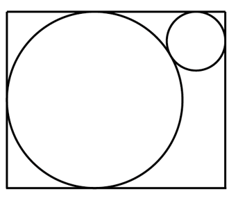

[代码描摹高清 PNG](../../../images/code_hd/224.png) · [SVG](../../../images/code_hd/224.svg)（原图为准）

A.12(2+√3)
B.12(1+2√3)
C.12√13
D.6(3+√13)

来源：[2023年浙江省公务员录用考试《行测》题（A类）（网友回忆版）.pdf](https://github.com/dumarstoft-ship-it/xingce/blob/407016b55b49581efa3771bb59a2dee8761d982f/2023%E5%B9%B4%E6%B5%99%E6%B1%9F%E7%9C%81%E5%85%AC%E5%8A%A1%E5%91%98%E5%BD%95%E7%94%A8%E8%80%83%E8%AF%95%E3%80%8A%E8%A1%8C%E6%B5%8B%E3%80%8B%E9%A2%98%EF%BC%88A%E7%B1%BB%EF%BC%89%EF%BC%88%E7%BD%91%E5%8F%8B%E5%9B%9E%E5%BF%86%E7%89%88%EF%BC%89.pdf)，PDF 第 12 页。

## 第 63 题 · 数量关系

`ZJ2023-A类-063`

某班级对70多名学生进行数学和英语科目摸底测验，有12%的学生两个科目均不及格。已知有2/3的学生英语及
格，数学及格的学生比英语多10人，那两科均及格的学生有多少人？
A.31 B.37 C.41 D.44

来源：[2023年浙江省公务员录用考试《行测》题（A类）（网友回忆版）.pdf](https://github.com/dumarstoft-ship-it/xingce/blob/407016b55b49581efa3771bb59a2dee8761d982f/2023%E5%B9%B4%E6%B5%99%E6%B1%9F%E7%9C%81%E5%85%AC%E5%8A%A1%E5%91%98%E5%BD%95%E7%94%A8%E8%80%83%E8%AF%95%E3%80%8A%E8%A1%8C%E6%B5%8B%E3%80%8B%E9%A2%98%EF%BC%88A%E7%B1%BB%EF%BC%89%EF%BC%88%E7%BD%91%E5%8F%8B%E5%9B%9E%E5%BF%86%E7%89%88%EF%BC%89.pdf)，PDF 第 12 页。

## 第 64 题 · 数量关系

`ZJ2023-A类-064`

收割一片稻田，可选择甲、乙、丙3台农机。用丙收割的用时比用甲短4小时，比用乙长2小时。已知甲、乙的
收割速度分别为5亩/小时和9亩/小时，那么丙的收割速度在以下哪个范围内？
A.小于6亩/小时 B.6~7亩/小时 C.7~8亩/小时 D.大于8亩/小时

来源：[2023年浙江省公务员录用考试《行测》题（A类）（网友回忆版）.pdf](https://github.com/dumarstoft-ship-it/xingce/blob/407016b55b49581efa3771bb59a2dee8761d982f/2023%E5%B9%B4%E6%B5%99%E6%B1%9F%E7%9C%81%E5%85%AC%E5%8A%A1%E5%91%98%E5%BD%95%E7%94%A8%E8%80%83%E8%AF%95%E3%80%8A%E8%A1%8C%E6%B5%8B%E3%80%8B%E9%A2%98%EF%BC%88A%E7%B1%BB%EF%BC%89%EF%BC%88%E7%BD%91%E5%8F%8B%E5%9B%9E%E5%BF%86%E7%89%88%EF%BC%89.pdf)，PDF 第 12 页。

## 第 65 题 · 数量关系

`ZJ2023-A类-065`

公司研发部门共5名员工，年龄各不相同，其中年龄最大的比最小的大10岁。某年，年龄最大的2人年龄之和是
最小的2人年龄之和的1.25倍；2年后，除年龄排名居中的1人外其余4人年龄之和为125岁。那么再过2年，年龄
排名第三的员工最大可能为多少岁？
A.33 B.34 C.35 D.36

来源：[2023年浙江省公务员录用考试《行测》题（A类）（网友回忆版）.pdf](https://github.com/dumarstoft-ship-it/xingce/blob/407016b55b49581efa3771bb59a2dee8761d982f/2023%E5%B9%B4%E6%B5%99%E6%B1%9F%E7%9C%81%E5%85%AC%E5%8A%A1%E5%91%98%E5%BD%95%E7%94%A8%E8%80%83%E8%AF%95%E3%80%8A%E8%A1%8C%E6%B5%8B%E3%80%8B%E9%A2%98%EF%BC%88A%E7%B1%BB%EF%BC%89%EF%BC%88%E7%BD%91%E5%8F%8B%E5%9B%9E%E5%BF%86%E7%89%88%EF%BC%89.pdf)，PDF 第 12、13 页。

## 第 66 题 · 数量关系

`ZJ2023-A类-066`

一只闹钟的秒针顶点距离表盘圆心4厘米，分针顶点距离表盘圆心3厘米。小王烧开一壶水的时间内，秒针顶点
累计移动了40π厘米。那么这一时间段内，分针顶点与表盘圆心的连线扫过的扇形面积为多少平方厘米？
A.0.5π
B.0.75π
C.π
D.1.5π

来源：[2023年浙江省公务员录用考试《行测》题（A类）（网友回忆版）.pdf](https://github.com/dumarstoft-ship-it/xingce/blob/407016b55b49581efa3771bb59a2dee8761d982f/2023%E5%B9%B4%E6%B5%99%E6%B1%9F%E7%9C%81%E5%85%AC%E5%8A%A1%E5%91%98%E5%BD%95%E7%94%A8%E8%80%83%E8%AF%95%E3%80%8A%E8%A1%8C%E6%B5%8B%E3%80%8B%E9%A2%98%EF%BC%88A%E7%B1%BB%EF%BC%89%EF%BC%88%E7%BD%91%E5%8F%8B%E5%9B%9E%E5%BF%86%E7%89%88%EF%BC%89.pdf)，PDF 第 13 页。

## 第 67 题 · 数量关系

`ZJ2023-A类-067`

A、B两地直线距离为320千米，甲车从A地、乙车从B地同时出发相向而行。已知甲车的速度是乙车的3倍，乙
车与甲车相遇后，立即右转弯90度并保持原速度继续行驶。那么甲车到达B地时，其与乙车之间的距离：
A.小于80千米 B.80~90千米 C.90~100千米 D.大于100千米

来源：[2023年浙江省公务员录用考试《行测》题（A类）（网友回忆版）.pdf](https://github.com/dumarstoft-ship-it/xingce/blob/407016b55b49581efa3771bb59a2dee8761d982f/2023%E5%B9%B4%E6%B5%99%E6%B1%9F%E7%9C%81%E5%85%AC%E5%8A%A1%E5%91%98%E5%BD%95%E7%94%A8%E8%80%83%E8%AF%95%E3%80%8A%E8%A1%8C%E6%B5%8B%E3%80%8B%E9%A2%98%EF%BC%88A%E7%B1%BB%EF%BC%89%EF%BC%88%E7%BD%91%E5%8F%8B%E5%9B%9E%E5%BF%86%E7%89%88%EF%BC%89.pdf)，PDF 第 13 页。

## 第 68 题 · 数量关系

`ZJ2023-A类-068`

甲以技术入股加入某互联网初创企业，占企业总股份的10%。随后企业先后两次引入外来投资，其中第二次投
资的金额是第一次的10倍。在两次投资完成之后，甲持有的股份占企业总股份的比例先后下降到8%和5%。那
么第一次投资前公司的估算价值是第二次投资前的百分之几?
A.24% B.28% C.32% D.36%

来源：[2023年浙江省公务员录用考试《行测》题（A类）（网友回忆版）.pdf](https://github.com/dumarstoft-ship-it/xingce/blob/407016b55b49581efa3771bb59a2dee8761d982f/2023%E5%B9%B4%E6%B5%99%E6%B1%9F%E7%9C%81%E5%85%AC%E5%8A%A1%E5%91%98%E5%BD%95%E7%94%A8%E8%80%83%E8%AF%95%E3%80%8A%E8%A1%8C%E6%B5%8B%E3%80%8B%E9%A2%98%EF%BC%88A%E7%B1%BB%EF%BC%89%EF%BC%88%E7%BD%91%E5%8F%8B%E5%9B%9E%E5%BF%86%E7%89%88%EF%BC%89.pdf)，PDF 第 13 页。

## 第 69 题 · 数量关系

`ZJ2023-A类-069`

有30个2克的砝码和8个5克的砝码，如果砝码只能放一边，那么从2克到100克间的整数克质量，有多少个不能
用这些砝码称量出来?
A.0 B.1 C.2 D.3

来源：[2023年浙江省公务员录用考试《行测》题（A类）（网友回忆版）.pdf](https://github.com/dumarstoft-ship-it/xingce/blob/407016b55b49581efa3771bb59a2dee8761d982f/2023%E5%B9%B4%E6%B5%99%E6%B1%9F%E7%9C%81%E5%85%AC%E5%8A%A1%E5%91%98%E5%BD%95%E7%94%A8%E8%80%83%E8%AF%95%E3%80%8A%E8%A1%8C%E6%B5%8B%E3%80%8B%E9%A2%98%EF%BC%88A%E7%B1%BB%EF%BC%89%EF%BC%88%E7%BD%91%E5%8F%8B%E5%9B%9E%E5%BF%86%E7%89%88%EF%BC%89.pdf)，PDF 第 13 页。

## 第 70 题 · 数量关系

`ZJ2023-A类-070`

12个人排成1列纵队，从前到后编为1~12号。现要将他们排成另一个与原来不同的纵队并从前到后重新编号，
要求每个人的新号码与原始号码相差不超过1。那么有多少种重新编队的方法?
A.155 B.227 C.232 D.239

来源：[2023年浙江省公务员录用考试《行测》题（A类）（网友回忆版）.pdf](https://github.com/dumarstoft-ship-it/xingce/blob/407016b55b49581efa3771bb59a2dee8761d982f/2023%E5%B9%B4%E6%B5%99%E6%B1%9F%E7%9C%81%E5%85%AC%E5%8A%A1%E5%91%98%E5%BD%95%E7%94%A8%E8%80%83%E8%AF%95%E3%80%8A%E8%A1%8C%E6%B5%8B%E3%80%8B%E9%A2%98%EF%BC%88A%E7%B1%BB%EF%BC%89%EF%BC%88%E7%BD%91%E5%8F%8B%E5%9B%9E%E5%BF%86%E7%89%88%EF%BC%89.pdf)，PDF 第 13 页。

## 第 71 题 · 判断推理

`ZJ2023-A类-071`

从所给的四个选项中选择最合适的一个填入问号处，使之呈现一定的规律性：

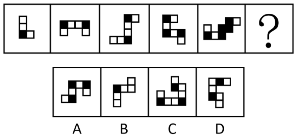

A.A B.B C.C D.D

来源：[2023年浙江省公务员录用考试《行测》题（A类）（网友回忆版）.pdf](https://github.com/dumarstoft-ship-it/xingce/blob/407016b55b49581efa3771bb59a2dee8761d982f/2023%E5%B9%B4%E6%B5%99%E6%B1%9F%E7%9C%81%E5%85%AC%E5%8A%A1%E5%91%98%E5%BD%95%E7%94%A8%E8%80%83%E8%AF%95%E3%80%8A%E8%A1%8C%E6%B5%8B%E3%80%8B%E9%A2%98%EF%BC%88A%E7%B1%BB%EF%BC%89%EF%BC%88%E7%BD%91%E5%8F%8B%E5%9B%9E%E5%BF%86%E7%89%88%EF%BC%89.pdf)，PDF 第 13 页。

## 第 72 题 · 判断推理

`ZJ2023-A类-072`

从所给的四个选项中选择最合适的一个填入问号处，使之呈现一定的规律性：

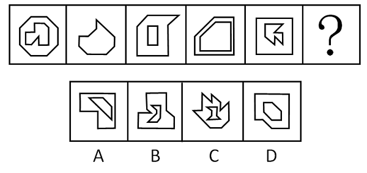

A.A B.B C.C D.D

来源：[2023年浙江省公务员录用考试《行测》题（A类）（网友回忆版）.pdf](https://github.com/dumarstoft-ship-it/xingce/blob/407016b55b49581efa3771bb59a2dee8761d982f/2023%E5%B9%B4%E6%B5%99%E6%B1%9F%E7%9C%81%E5%85%AC%E5%8A%A1%E5%91%98%E5%BD%95%E7%94%A8%E8%80%83%E8%AF%95%E3%80%8A%E8%A1%8C%E6%B5%8B%E3%80%8B%E9%A2%98%EF%BC%88A%E7%B1%BB%EF%BC%89%EF%BC%88%E7%BD%91%E5%8F%8B%E5%9B%9E%E5%BF%86%E7%89%88%EF%BC%89.pdf)，PDF 第 13、14 页。

## 第 73 题 · 判断推理

`ZJ2023-A类-073`

从所给的四个选项中选择最合适的一个填入问号处，使之呈现一定的规律性：

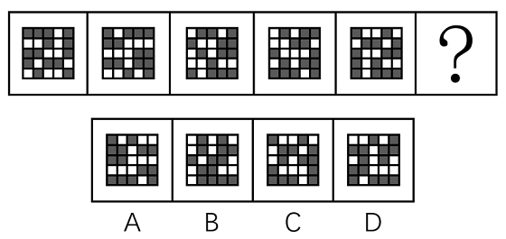

A.A B.B C.C D.D

来源：[2023年浙江省公务员录用考试《行测》题（A类）（网友回忆版）.pdf](https://github.com/dumarstoft-ship-it/xingce/blob/407016b55b49581efa3771bb59a2dee8761d982f/2023%E5%B9%B4%E6%B5%99%E6%B1%9F%E7%9C%81%E5%85%AC%E5%8A%A1%E5%91%98%E5%BD%95%E7%94%A8%E8%80%83%E8%AF%95%E3%80%8A%E8%A1%8C%E6%B5%8B%E3%80%8B%E9%A2%98%EF%BC%88A%E7%B1%BB%EF%BC%89%EF%BC%88%E7%BD%91%E5%8F%8B%E5%9B%9E%E5%BF%86%E7%89%88%EF%BC%89.pdf)，PDF 第 14 页。

## 第 74 题 · 判断推理

`ZJ2023-A类-074`

从所给的四个选项中选择最合适的一个填入问号处，使之呈现一定的规律性：

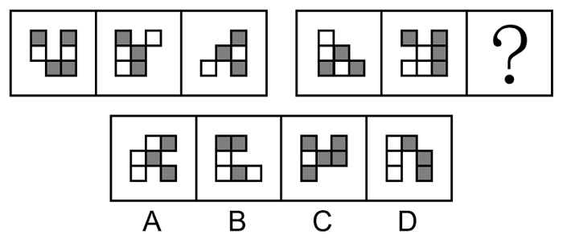

A.A B.B C.C D.D

来源：[2023年浙江省公务员录用考试《行测》题（A类）（网友回忆版）.pdf](https://github.com/dumarstoft-ship-it/xingce/blob/407016b55b49581efa3771bb59a2dee8761d982f/2023%E5%B9%B4%E6%B5%99%E6%B1%9F%E7%9C%81%E5%85%AC%E5%8A%A1%E5%91%98%E5%BD%95%E7%94%A8%E8%80%83%E8%AF%95%E3%80%8A%E8%A1%8C%E6%B5%8B%E3%80%8B%E9%A2%98%EF%BC%88A%E7%B1%BB%EF%BC%89%EF%BC%88%E7%BD%91%E5%8F%8B%E5%9B%9E%E5%BF%86%E7%89%88%EF%BC%89.pdf)，PDF 第 14 页。

## 第 75 题 · 判断推理

`ZJ2023-A类-075`

从所给的四个选项中选择最合适的一个填入问号处，使之呈现一定的规律性：

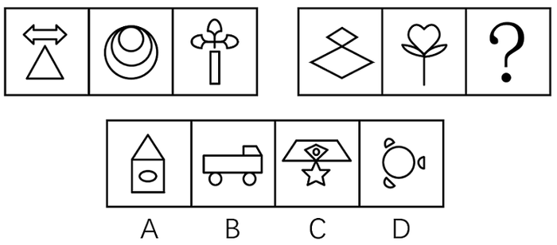

A.A B.B C.C D.D

来源：[2023年浙江省公务员录用考试《行测》题（A类）（网友回忆版）.pdf](https://github.com/dumarstoft-ship-it/xingce/blob/407016b55b49581efa3771bb59a2dee8761d982f/2023%E5%B9%B4%E6%B5%99%E6%B1%9F%E7%9C%81%E5%85%AC%E5%8A%A1%E5%91%98%E5%BD%95%E7%94%A8%E8%80%83%E8%AF%95%E3%80%8A%E8%A1%8C%E6%B5%8B%E3%80%8B%E9%A2%98%EF%BC%88A%E7%B1%BB%EF%BC%89%EF%BC%88%E7%BD%91%E5%8F%8B%E5%9B%9E%E5%BF%86%E7%89%88%EF%BC%89.pdf)，PDF 第 14、15 页。

## 第 76 题 · 判断推理

`ZJ2023-A类-076`

把下面的六个图形分为两类，使每一类图形都有各自的共同特征或规律，分类正确的一项是：

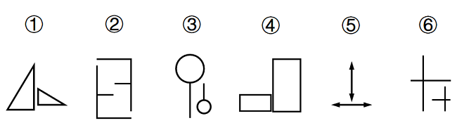

A.①③⑤，②④⑥ B.①③⑥，②④⑤ C.①②③，④⑤⑥ D.①④⑤，②③⑥

来源：[2023年浙江省公务员录用考试《行测》题（A类）（网友回忆版）.pdf](https://github.com/dumarstoft-ship-it/xingce/blob/407016b55b49581efa3771bb59a2dee8761d982f/2023%E5%B9%B4%E6%B5%99%E6%B1%9F%E7%9C%81%E5%85%AC%E5%8A%A1%E5%91%98%E5%BD%95%E7%94%A8%E8%80%83%E8%AF%95%E3%80%8A%E8%A1%8C%E6%B5%8B%E3%80%8B%E9%A2%98%EF%BC%88A%E7%B1%BB%EF%BC%89%EF%BC%88%E7%BD%91%E5%8F%8B%E5%9B%9E%E5%BF%86%E7%89%88%EF%BC%89.pdf)，PDF 第 15 页。

## 第 77 题 · 判断推理

`ZJ2023-A类-077`

把下面的六个图形分为两类，使每一类图形都有各自的共同特征或规律，分类正确的一项是：

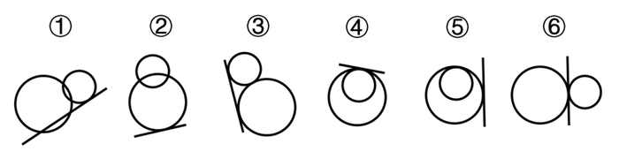

A.①②⑤，③④⑥ B.①③④，②⑤⑥ C.①④⑤，②③⑥ D.①⑤⑥，②③④

来源：[2023年浙江省公务员录用考试《行测》题（A类）（网友回忆版）.pdf](https://github.com/dumarstoft-ship-it/xingce/blob/407016b55b49581efa3771bb59a2dee8761d982f/2023%E5%B9%B4%E6%B5%99%E6%B1%9F%E7%9C%81%E5%85%AC%E5%8A%A1%E5%91%98%E5%BD%95%E7%94%A8%E8%80%83%E8%AF%95%E3%80%8A%E8%A1%8C%E6%B5%8B%E3%80%8B%E9%A2%98%EF%BC%88A%E7%B1%BB%EF%BC%89%EF%BC%88%E7%BD%91%E5%8F%8B%E5%9B%9E%E5%BF%86%E7%89%88%EF%BC%89.pdf)，PDF 第 15 页。

## 第 78 题 · 判断推理

`ZJ2023-A类-078`

从所给的四个选项中选择最合适的一个填入问号处，使之呈现一定的规律性：

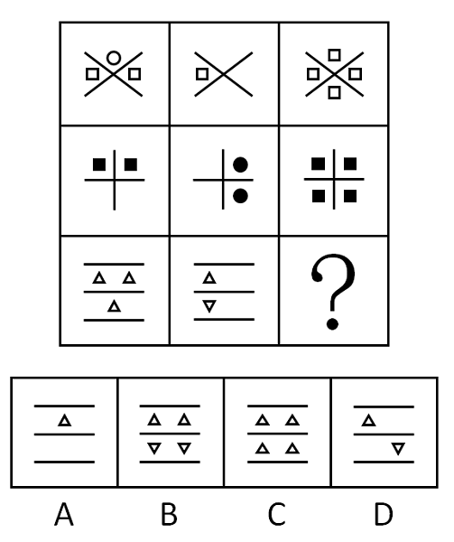

A.A B.B C.C D.D

来源：[2023年浙江省公务员录用考试《行测》题（A类）（网友回忆版）.pdf](https://github.com/dumarstoft-ship-it/xingce/blob/407016b55b49581efa3771bb59a2dee8761d982f/2023%E5%B9%B4%E6%B5%99%E6%B1%9F%E7%9C%81%E5%85%AC%E5%8A%A1%E5%91%98%E5%BD%95%E7%94%A8%E8%80%83%E8%AF%95%E3%80%8A%E8%A1%8C%E6%B5%8B%E3%80%8B%E9%A2%98%EF%BC%88A%E7%B1%BB%EF%BC%89%EF%BC%88%E7%BD%91%E5%8F%8B%E5%9B%9E%E5%BF%86%E7%89%88%EF%BC%89.pdf)，PDF 第 15、16 页。

## 第 79 题 · 判断推理

`ZJ2023-A类-079`

左图给定的是纸盒的外表面，右边哪项能由它折叠而成？

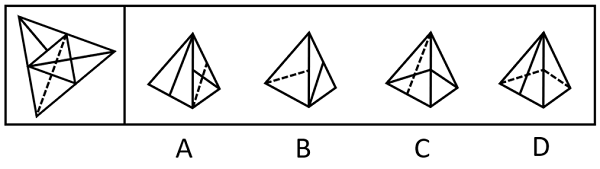

A.A B.B C.C D.D

来源：[2023年浙江省公务员录用考试《行测》题（A类）（网友回忆版）.pdf](https://github.com/dumarstoft-ship-it/xingce/blob/407016b55b49581efa3771bb59a2dee8761d982f/2023%E5%B9%B4%E6%B5%99%E6%B1%9F%E7%9C%81%E5%85%AC%E5%8A%A1%E5%91%98%E5%BD%95%E7%94%A8%E8%80%83%E8%AF%95%E3%80%8A%E8%A1%8C%E6%B5%8B%E3%80%8B%E9%A2%98%EF%BC%88A%E7%B1%BB%EF%BC%89%EF%BC%88%E7%BD%91%E5%8F%8B%E5%9B%9E%E5%BF%86%E7%89%88%EF%BC%89.pdf)，PDF 第 16 页。

## 第 80 题 · 判断推理

`ZJ2023-A类-080`

左图为给定的多面体，将其从任一面剖开，哪项不可能是该多面体的截面？

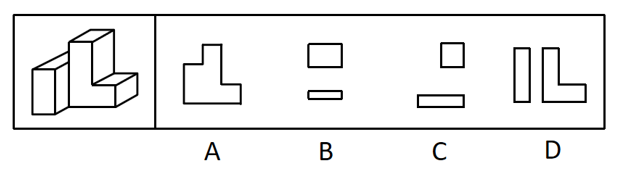

A.A B.B C.C D.D

来源：[2023年浙江省公务员录用考试《行测》题（A类）（网友回忆版）.pdf](https://github.com/dumarstoft-ship-it/xingce/blob/407016b55b49581efa3771bb59a2dee8761d982f/2023%E5%B9%B4%E6%B5%99%E6%B1%9F%E7%9C%81%E5%85%AC%E5%8A%A1%E5%91%98%E5%BD%95%E7%94%A8%E8%80%83%E8%AF%95%E3%80%8A%E8%A1%8C%E6%B5%8B%E3%80%8B%E9%A2%98%EF%BC%88A%E7%B1%BB%EF%BC%89%EF%BC%88%E7%BD%91%E5%8F%8B%E5%9B%9E%E5%BF%86%E7%89%88%EF%BC%89.pdf)，PDF 第 16 页。

## 第 81 题 · 判断推理

`ZJ2023-A类-081`

发现不均衡套利是指通过发现和利用市场上的资源供给和需求不一致进行调配导致的盈利机会获利。
根据上述定义，下列不属于发现不均衡套利的是：
A.孔子的门生子贡在曹国与鲁国之间通过贱买贵卖来获利
B.小王预见来年橄榄必然大获丰收，便买断了当地所有的榨油机，第二年高价出租获得巨额财富
C.F汽车公司针对当时汽车价格昂贵、普通居民消费不起的状况，推出了价廉物美的T型车，迅速进入普通家庭
D.20世纪80年代，中国农村出现大量富余劳动力，而工业产品又极为缺乏。因此将富余的农村劳动力组织起来
生产工业产品，可以获利

来源：[2023年浙江省公务员录用考试《行测》题（A类）（网友回忆版）.pdf](https://github.com/dumarstoft-ship-it/xingce/blob/407016b55b49581efa3771bb59a2dee8761d982f/2023%E5%B9%B4%E6%B5%99%E6%B1%9F%E7%9C%81%E5%85%AC%E5%8A%A1%E5%91%98%E5%BD%95%E7%94%A8%E8%80%83%E8%AF%95%E3%80%8A%E8%A1%8C%E6%B5%8B%E3%80%8B%E9%A2%98%EF%BC%88A%E7%B1%BB%EF%BC%89%EF%BC%88%E7%BD%91%E5%8F%8B%E5%9B%9E%E5%BF%86%E7%89%88%EF%BC%89.pdf)，PDF 第 16、17 页。

## 第 82 题 · 判断推理

`ZJ2023-A类-082`

经济学中的“公用品”并不是指大家都在使用的物品，同时“私用品”也不是一个人使用的物品。公用品指一
个人使用的过程中不排斥和影响他人使用的物品；而私用品指一个人在使用过程中会排斥或者影响其他人使用
的物品。
根据上述定义，下列属于公用品的是：
A.会议室 B.停车场 C.小区草坪 D.有线电视的信号

来源：[2023年浙江省公务员录用考试《行测》题（A类）（网友回忆版）.pdf](https://github.com/dumarstoft-ship-it/xingce/blob/407016b55b49581efa3771bb59a2dee8761d982f/2023%E5%B9%B4%E6%B5%99%E6%B1%9F%E7%9C%81%E5%85%AC%E5%8A%A1%E5%91%98%E5%BD%95%E7%94%A8%E8%80%83%E8%AF%95%E3%80%8A%E8%A1%8C%E6%B5%8B%E3%80%8B%E9%A2%98%EF%BC%88A%E7%B1%BB%EF%BC%89%EF%BC%88%E7%BD%91%E5%8F%8B%E5%9B%9E%E5%BF%86%E7%89%88%EF%BC%89.pdf)，PDF 第 17 页。

## 第 83 题 · 判断推理

`ZJ2023-A类-083`

机器学习专门研究计算机如何模拟人类的学习行为，以获取新的知识或技能，提高学习效率。通常使用数据或
以往的经验，以此优化计算机程序的性能。
根据上述定义，下列不属于机器学习的是：
A.某公司通过海量数据，不断升级门禁考勤等场景的人脸识别技术的版本，将准确率从85%提高至99%
B.科研小组分析人类学习行为，决定让计算机先选用简单的数据再选用复杂的数据依次训练，提升了计算机算
法的准确率
C.某高校统计学生核酸完成情况，利用算法识别核酸报告截图特定字符，自动生成结果，统计汇总时间由一小
时缩短至两分钟
D.某AI算法在数据量较少的情况下，通过模拟双方对抗情况获取训练数据，不断提升技巧，最终在网络游戏中
达到职业选手水平

来源：[2023年浙江省公务员录用考试《行测》题（A类）（网友回忆版）.pdf](https://github.com/dumarstoft-ship-it/xingce/blob/407016b55b49581efa3771bb59a2dee8761d982f/2023%E5%B9%B4%E6%B5%99%E6%B1%9F%E7%9C%81%E5%85%AC%E5%8A%A1%E5%91%98%E5%BD%95%E7%94%A8%E8%80%83%E8%AF%95%E3%80%8A%E8%A1%8C%E6%B5%8B%E3%80%8B%E9%A2%98%EF%BC%88A%E7%B1%BB%EF%BC%89%EF%BC%88%E7%BD%91%E5%8F%8B%E5%9B%9E%E5%BF%86%E7%89%88%EF%BC%89.pdf)，PDF 第 17 页。

## 第 84 题 · 判断推理

`ZJ2023-A类-084`

弱关系社交，指以网络平台为载体，在陌生人之间展开的、不以加强彼此关系为目的的人际交往活动。
根据上述定义，下列不属于弱关系社交的是：
A.参与中国象棋小程序自动匹配对手的游戏 B.为刚刚添加的微信好友的朋友圈动态点赞
C.在网络直播平台对小视频评论进行再评论 D.网络游戏过程中为提高游戏技术相互切磋

来源：[2023年浙江省公务员录用考试《行测》题（A类）（网友回忆版）.pdf](https://github.com/dumarstoft-ship-it/xingce/blob/407016b55b49581efa3771bb59a2dee8761d982f/2023%E5%B9%B4%E6%B5%99%E6%B1%9F%E7%9C%81%E5%85%AC%E5%8A%A1%E5%91%98%E5%BD%95%E7%94%A8%E8%80%83%E8%AF%95%E3%80%8A%E8%A1%8C%E6%B5%8B%E3%80%8B%E9%A2%98%EF%BC%88A%E7%B1%BB%EF%BC%89%EF%BC%88%E7%BD%91%E5%8F%8B%E5%9B%9E%E5%BF%86%E7%89%88%EF%BC%89.pdf)，PDF 第 17 页。

## 第 85 题 · 判断推理

`ZJ2023-A类-085`

审美意象是用来表达某种抽象的观念或者哲理的艺术形象，它是艺术家在构思过程中，将自己的审美情感、审
美认识与客观的事物相融合，并以一定的艺术表达方式呈现出来的内心视像。
根据上述定义，下列不属于审美意象的是：
A.鲁迅作品《祝福》中的人物“祥林嫂” B.“采菊东篱下，悠然见南山”中的“南山”
C.漫画作品《三毛流浪记》中的人物“三毛” D.日常语句“太阳出来了，该起床了”中的“太阳”

来源：[2023年浙江省公务员录用考试《行测》题（A类）（网友回忆版）.pdf](https://github.com/dumarstoft-ship-it/xingce/blob/407016b55b49581efa3771bb59a2dee8761d982f/2023%E5%B9%B4%E6%B5%99%E6%B1%9F%E7%9C%81%E5%85%AC%E5%8A%A1%E5%91%98%E5%BD%95%E7%94%A8%E8%80%83%E8%AF%95%E3%80%8A%E8%A1%8C%E6%B5%8B%E3%80%8B%E9%A2%98%EF%BC%88A%E7%B1%BB%EF%BC%89%EF%BC%88%E7%BD%91%E5%8F%8B%E5%9B%9E%E5%BF%86%E7%89%88%EF%BC%89.pdf)，PDF 第 17 页。

## 第 86 题 · 判断推理

`ZJ2023-A类-086`

脱敏作用是指对人重复呈现一个激发情绪的刺激，则该个体情绪化反应会逐渐消失。
根据上述定义，下列涉及脱敏作用的是：
A.小华幼年时曾被狗追咬过，成年后看到狗仍然会感到非常恐惧
B.小孙爱玩含有暴力元素的游戏，生活中偶尔会模仿游戏中人物的行为
C.小王近期经常观看犯罪题材的影片，认为外面的世界很危险，走夜路时常会担心有意外发生
D.老师发现小明与女同学交谈时总会面红耳赤，就要求他每天主动和邻座女同学进行学习讨论

来源：[2023年浙江省公务员录用考试《行测》题（A类）（网友回忆版）.pdf](https://github.com/dumarstoft-ship-it/xingce/blob/407016b55b49581efa3771bb59a2dee8761d982f/2023%E5%B9%B4%E6%B5%99%E6%B1%9F%E7%9C%81%E5%85%AC%E5%8A%A1%E5%91%98%E5%BD%95%E7%94%A8%E8%80%83%E8%AF%95%E3%80%8A%E8%A1%8C%E6%B5%8B%E3%80%8B%E9%A2%98%EF%BC%88A%E7%B1%BB%EF%BC%89%EF%BC%88%E7%BD%91%E5%8F%8B%E5%9B%9E%E5%BF%86%E7%89%88%EF%BC%89.pdf)，PDF 第 17 页。

## 第 87 题 · 判断推理

`ZJ2023-A类-087`

群体归属感是指个人体验到自己属于或应属于某一群体成员的意识，是个人隶属于或依赖于群体的需要，是一
种人类社会性的表现。有了这种意识，个体在进行自己的活动、认知和评价时，就会自觉地维护这个群体的利
益，并与群体内的其他成员在情感上发生共鸣。
根据上述定义，下列没有体现群体归属感的是：
A.中秋节时小韦与几个要好的朋友一起分享月饼 B.王晓峰听到别人说他所在班级的坏话时很生气
C.退役士兵小王常向他人说自己曾是某英雄连的 D.小强外出时总自豪地在外衣上佩戴学校的校徽

来源：[2023年浙江省公务员录用考试《行测》题（A类）（网友回忆版）.pdf](https://github.com/dumarstoft-ship-it/xingce/blob/407016b55b49581efa3771bb59a2dee8761d982f/2023%E5%B9%B4%E6%B5%99%E6%B1%9F%E7%9C%81%E5%85%AC%E5%8A%A1%E5%91%98%E5%BD%95%E7%94%A8%E8%80%83%E8%AF%95%E3%80%8A%E8%A1%8C%E6%B5%8B%E3%80%8B%E9%A2%98%EF%BC%88A%E7%B1%BB%EF%BC%89%EF%BC%88%E7%BD%91%E5%8F%8B%E5%9B%9E%E5%BF%86%E7%89%88%EF%BC%89.pdf)，PDF 第 17、18 页。

## 第 88 题 · 判断推理

`ZJ2023-A类-088`

多重趋避式冲突是指人们面对着两个或两个以上的目标，而目标又各自分别具有吸引和排斥两方面的作用，人
们无法简单地选择一个目标而回避或拒绝另一个目标时的矛盾心态。
根据上述定义，下列体现多重趋避式冲突的是：
A.张女士在二胎问题上犹豫不决，既想儿女双全，又怕无力抚养
B.周女士有一次难得的外省培训机会，可又放心不下家中年幼的孩子
C.王先生有一笔闲置资金，用于炒股担心风险大，用于储蓄又嫌收益低
D.李同学在收到研究生录取通知书的同时，又得到了心仪公司的入职邀请

来源：[2023年浙江省公务员录用考试《行测》题（A类）（网友回忆版）.pdf](https://github.com/dumarstoft-ship-it/xingce/blob/407016b55b49581efa3771bb59a2dee8761d982f/2023%E5%B9%B4%E6%B5%99%E6%B1%9F%E7%9C%81%E5%85%AC%E5%8A%A1%E5%91%98%E5%BD%95%E7%94%A8%E8%80%83%E8%AF%95%E3%80%8A%E8%A1%8C%E6%B5%8B%E3%80%8B%E9%A2%98%EF%BC%88A%E7%B1%BB%EF%BC%89%EF%BC%88%E7%BD%91%E5%8F%8B%E5%9B%9E%E5%BF%86%E7%89%88%EF%BC%89.pdf)，PDF 第 18 页。

## 第 89 题 · 判断推理

`ZJ2023-A类-089`

功能文化区是按照人类社会的某项功能组织建立起来的，在空间结构上具有较固定的、确切的边界，其内部彼
此之间因功能有一种互相联系从而确定其分布区范围的文化区。形式文化区是指不同性质的文化现象分布的范
围，是某些具有相互联系的文化现象在空间分布上具有集中的核心区与模糊边界的文化地域单元。
根据上述定义，下列属于功能文化区的是：
A.城市中的外籍人员聚居区 B.城市中的行为艺术聚集区
C.城市郊区的垃圾集中处理区 D.城市中的博物馆图书馆集中区

来源：[2023年浙江省公务员录用考试《行测》题（A类）（网友回忆版）.pdf](https://github.com/dumarstoft-ship-it/xingce/blob/407016b55b49581efa3771bb59a2dee8761d982f/2023%E5%B9%B4%E6%B5%99%E6%B1%9F%E7%9C%81%E5%85%AC%E5%8A%A1%E5%91%98%E5%BD%95%E7%94%A8%E8%80%83%E8%AF%95%E3%80%8A%E8%A1%8C%E6%B5%8B%E3%80%8B%E9%A2%98%EF%BC%88A%E7%B1%BB%EF%BC%89%EF%BC%88%E7%BD%91%E5%8F%8B%E5%9B%9E%E5%BF%86%E7%89%88%EF%BC%89.pdf)，PDF 第 18 页。

## 第 90 题 · 判断推理

`ZJ2023-A类-090`

表演型人格又称寻求注意型人格，是一种以过分情感化和夸张的言行吸引他人注意的人格。具有表演型人格的
人易感情用事，自我中心，情绪多变，以致难以与周围人保持正常的社会关系。
根据上述定义，下列与表演型人格无关的是：
A.小邓喜欢穿奇装异服，希望吸引别人的注意
B.小王具有表演才能，讲话时手舞足蹈、表情丰富
C.小刘在人际交往受挫折时，表现出歇斯底里行为
D.小顾没有几个知心朋友，但他经常说自己有很多知心朋友

来源：[2023年浙江省公务员录用考试《行测》题（A类）（网友回忆版）.pdf](https://github.com/dumarstoft-ship-it/xingce/blob/407016b55b49581efa3771bb59a2dee8761d982f/2023%E5%B9%B4%E6%B5%99%E6%B1%9F%E7%9C%81%E5%85%AC%E5%8A%A1%E5%91%98%E5%BD%95%E7%94%A8%E8%80%83%E8%AF%95%E3%80%8A%E8%A1%8C%E6%B5%8B%E3%80%8B%E9%A2%98%EF%BC%88A%E7%B1%BB%EF%BC%89%EF%BC%88%E7%BD%91%E5%8F%8B%E5%9B%9E%E5%BF%86%E7%89%88%EF%BC%89.pdf)，PDF 第 18 页。

## 第 91 题 · 判断推理

`ZJ2023-A类-091`

声东：击西
A.围魏：救赵 B.张冠：李戴 C.安居：乐业 D.说东：道西

来源：[2023年浙江省公务员录用考试《行测》题（A类）（网友回忆版）.pdf](https://github.com/dumarstoft-ship-it/xingce/blob/407016b55b49581efa3771bb59a2dee8761d982f/2023%E5%B9%B4%E6%B5%99%E6%B1%9F%E7%9C%81%E5%85%AC%E5%8A%A1%E5%91%98%E5%BD%95%E7%94%A8%E8%80%83%E8%AF%95%E3%80%8A%E8%A1%8C%E6%B5%8B%E3%80%8B%E9%A2%98%EF%BC%88A%E7%B1%BB%EF%BC%89%EF%BC%88%E7%BD%91%E5%8F%8B%E5%9B%9E%E5%BF%86%E7%89%88%EF%BC%89.pdf)，PDF 第 18 页。

## 第 92 题 · 判断推理

`ZJ2023-A类-092`

心宽：体胖
A.唇亡：齿寒 B.鼻青：脸肿 C.手忙：脚乱 D.半斤：八两

来源：[2023年浙江省公务员录用考试《行测》题（A类）（网友回忆版）.pdf](https://github.com/dumarstoft-ship-it/xingce/blob/407016b55b49581efa3771bb59a2dee8761d982f/2023%E5%B9%B4%E6%B5%99%E6%B1%9F%E7%9C%81%E5%85%AC%E5%8A%A1%E5%91%98%E5%BD%95%E7%94%A8%E8%80%83%E8%AF%95%E3%80%8A%E8%A1%8C%E6%B5%8B%E3%80%8B%E9%A2%98%EF%BC%88A%E7%B1%BB%EF%BC%89%EF%BC%88%E7%BD%91%E5%8F%8B%E5%9B%9E%E5%BF%86%E7%89%88%EF%BC%89.pdf)，PDF 第 18 页。

## 第 93 题 · 判断推理

`ZJ2023-A类-093`

长白山：火山
A.皇陵：古建筑 B.巢湖：淡水湖 C.连衣裙：丝绸 D.火箭军：军人

来源：[2023年浙江省公务员录用考试《行测》题（A类）（网友回忆版）.pdf](https://github.com/dumarstoft-ship-it/xingce/blob/407016b55b49581efa3771bb59a2dee8761d982f/2023%E5%B9%B4%E6%B5%99%E6%B1%9F%E7%9C%81%E5%85%AC%E5%8A%A1%E5%91%98%E5%BD%95%E7%94%A8%E8%80%83%E8%AF%95%E3%80%8A%E8%A1%8C%E6%B5%8B%E3%80%8B%E9%A2%98%EF%BC%88A%E7%B1%BB%EF%BC%89%EF%BC%88%E7%BD%91%E5%8F%8B%E5%9B%9E%E5%BF%86%E7%89%88%EF%BC%89.pdf)，PDF 第 18 页。

## 第 94 题 · 判断推理

`ZJ2023-A类-094`

上市公司：跨国企业
A.大专院校：高等教育 B.商业银行：金融机构 C.快捷酒店：连锁酒店 D.进口产品：出口产品

来源：[2023年浙江省公务员录用考试《行测》题（A类）（网友回忆版）.pdf](https://github.com/dumarstoft-ship-it/xingce/blob/407016b55b49581efa3771bb59a2dee8761d982f/2023%E5%B9%B4%E6%B5%99%E6%B1%9F%E7%9C%81%E5%85%AC%E5%8A%A1%E5%91%98%E5%BD%95%E7%94%A8%E8%80%83%E8%AF%95%E3%80%8A%E8%A1%8C%E6%B5%8B%E3%80%8B%E9%A2%98%EF%BC%88A%E7%B1%BB%EF%BC%89%EF%BC%88%E7%BD%91%E5%8F%8B%E5%9B%9E%E5%BF%86%E7%89%88%EF%BC%89.pdf)，PDF 第 18 页。

## 第 95 题 · 判断推理

`ZJ2023-A类-095`

蚕茧：丝绸：衣服
A.矿山：矿石：螺丝 B.树木：纸张：书本 C.小麦：面条：馒头 D.沙粒：珍珠：项链

来源：[2023年浙江省公务员录用考试《行测》题（A类）（网友回忆版）.pdf](https://github.com/dumarstoft-ship-it/xingce/blob/407016b55b49581efa3771bb59a2dee8761d982f/2023%E5%B9%B4%E6%B5%99%E6%B1%9F%E7%9C%81%E5%85%AC%E5%8A%A1%E5%91%98%E5%BD%95%E7%94%A8%E8%80%83%E8%AF%95%E3%80%8A%E8%A1%8C%E6%B5%8B%E3%80%8B%E9%A2%98%EF%BC%88A%E7%B1%BB%EF%BC%89%EF%BC%88%E7%BD%91%E5%8F%8B%E5%9B%9E%E5%BF%86%E7%89%88%EF%BC%89.pdf)，PDF 第 18 页。

## 第 96 题 · 判断推理

`ZJ2023-A类-096`

白天：夜晚：夏夜
A.红色：黑色：漆黑 B.中国：外国：欧洲国家 C.高山：大海：南海 D.草原：森林：原始森林

来源：[2023年浙江省公务员录用考试《行测》题（A类）（网友回忆版）.pdf](https://github.com/dumarstoft-ship-it/xingce/blob/407016b55b49581efa3771bb59a2dee8761d982f/2023%E5%B9%B4%E6%B5%99%E6%B1%9F%E7%9C%81%E5%85%AC%E5%8A%A1%E5%91%98%E5%BD%95%E7%94%A8%E8%80%83%E8%AF%95%E3%80%8A%E8%A1%8C%E6%B5%8B%E3%80%8B%E9%A2%98%EF%BC%88A%E7%B1%BB%EF%BC%89%EF%BC%88%E7%BD%91%E5%8F%8B%E5%9B%9E%E5%BF%86%E7%89%88%EF%BC%89.pdf)，PDF 第 18 页。

## 第 97 题 · 判断推理

`ZJ2023-A类-097`

红包：红旗渠：红光满面
A.青草：青少年：青红皂白 B.黑夜：黑心肠：黑灯瞎火
C.白雪：白话文：白费心思 D.黄豆：黄包车：黄粱一梦

来源：[2023年浙江省公务员录用考试《行测》题（A类）（网友回忆版）.pdf](https://github.com/dumarstoft-ship-it/xingce/blob/407016b55b49581efa3771bb59a2dee8761d982f/2023%E5%B9%B4%E6%B5%99%E6%B1%9F%E7%9C%81%E5%85%AC%E5%8A%A1%E5%91%98%E5%BD%95%E7%94%A8%E8%80%83%E8%AF%95%E3%80%8A%E8%A1%8C%E6%B5%8B%E3%80%8B%E9%A2%98%EF%BC%88A%E7%B1%BB%EF%BC%89%EF%BC%88%E7%BD%91%E5%8F%8B%E5%9B%9E%E5%BF%86%E7%89%88%EF%BC%89.pdf)，PDF 第 18 页。

## 第 98 题 · 判断推理

`ZJ2023-A类-098`

售卖假货：举报维权：上门调查
A.点菜下单：烹饪菜肴：传送菜品 B.发表文章：勘误声明：印刷错误
C.投递简历：考试通过：正式录取 D.赛前动员：拟定阵容：布置战术

来源：[2023年浙江省公务员录用考试《行测》题（A类）（网友回忆版）.pdf](https://github.com/dumarstoft-ship-it/xingce/blob/407016b55b49581efa3771bb59a2dee8761d982f/2023%E5%B9%B4%E6%B5%99%E6%B1%9F%E7%9C%81%E5%85%AC%E5%8A%A1%E5%91%98%E5%BD%95%E7%94%A8%E8%80%83%E8%AF%95%E3%80%8A%E8%A1%8C%E6%B5%8B%E3%80%8B%E9%A2%98%EF%BC%88A%E7%B1%BB%EF%BC%89%EF%BC%88%E7%BD%91%E5%8F%8B%E5%9B%9E%E5%BF%86%E7%89%88%EF%BC%89.pdf)，PDF 第 18、19 页。

## 第 99 题 · 判断推理

`ZJ2023-A类-099`

按揭 对于 （    ） 相当于 （    ） 对于 促销
A.银行 商场 B.抵押 打折 C.贷款 降价 D.购房 商品

来源：[2023年浙江省公务员录用考试《行测》题（A类）（网友回忆版）.pdf](https://github.com/dumarstoft-ship-it/xingce/blob/407016b55b49581efa3771bb59a2dee8761d982f/2023%E5%B9%B4%E6%B5%99%E6%B1%9F%E7%9C%81%E5%85%AC%E5%8A%A1%E5%91%98%E5%BD%95%E7%94%A8%E8%80%83%E8%AF%95%E3%80%8A%E8%A1%8C%E6%B5%8B%E3%80%8B%E9%A2%98%EF%BC%88A%E7%B1%BB%EF%BC%89%EF%BC%88%E7%BD%91%E5%8F%8B%E5%9B%9E%E5%BF%86%E7%89%88%EF%BC%89.pdf)，PDF 第 19 页。

## 第 100 题 · 判断推理

`ZJ2023-A类-100`

（    ） 对于 音乐 相当于 真相 对于 （    ）
A.演奏 揭露 B.感动 激愤 C.浪漫 报纸 D.旋律 新闻

来源：[2023年浙江省公务员录用考试《行测》题（A类）（网友回忆版）.pdf](https://github.com/dumarstoft-ship-it/xingce/blob/407016b55b49581efa3771bb59a2dee8761d982f/2023%E5%B9%B4%E6%B5%99%E6%B1%9F%E7%9C%81%E5%85%AC%E5%8A%A1%E5%91%98%E5%BD%95%E7%94%A8%E8%80%83%E8%AF%95%E3%80%8A%E8%A1%8C%E6%B5%8B%E3%80%8B%E9%A2%98%EF%BC%88A%E7%B1%BB%EF%BC%89%EF%BC%88%E7%BD%91%E5%8F%8B%E5%9B%9E%E5%BF%86%E7%89%88%EF%BC%89.pdf)，PDF 第 19 页。

## 第 101 题 · 判断推理

`ZJ2023-A类-101`

小明、小军、小花、小飞和小雅在学校的联欢会上表演节目，表演时他们每人手上各拿了一个不同的气球，气
球分别是红色圆形、蓝色五角星形、黄色心形、蓝色圆形、红色心形。
小明说：小花和小雅的气球都不是圆形的，也不是蓝色的。
小军说：我的气球与小雅的颜色和形状都不一样。
小飞说：小雅的气球是黄色的，小明的气球是蓝色的。
小花说：小军的气球与我的是一样的颜色，小飞的气球不是五角星形的。
根据以上信息，下列说法正确的是：
A.小军的气球是红色心形的 B.小花的气球是黄色心形的
C.小飞的气球是红色圆形的 D.小明的气球是蓝色五角星形的

来源：[2023年浙江省公务员录用考试《行测》题（A类）（网友回忆版）.pdf](https://github.com/dumarstoft-ship-it/xingce/blob/407016b55b49581efa3771bb59a2dee8761d982f/2023%E5%B9%B4%E6%B5%99%E6%B1%9F%E7%9C%81%E5%85%AC%E5%8A%A1%E5%91%98%E5%BD%95%E7%94%A8%E8%80%83%E8%AF%95%E3%80%8A%E8%A1%8C%E6%B5%8B%E3%80%8B%E9%A2%98%EF%BC%88A%E7%B1%BB%EF%BC%89%EF%BC%88%E7%BD%91%E5%8F%8B%E5%9B%9E%E5%BF%86%E7%89%88%EF%BC%89.pdf)，PDF 第 19 页。

## 第 102 题 · 判断推理

`ZJ2023-A类-102`

关于小张、小李书法学习的情况，有如下判断：（1）如果小张学习魏碑，那么小李学习汉隶；（2）小张既没
有学习秦篆，也没有学习魏碑；（3）小张或者学习秦篆，或者学习魏碑。结果发现，上述判断有两项是错误
的。
根据以上信息，可以得出以下哪项结论？
A.小张学习魏碑，小李学习汉隶 B.小张没有学习魏碑，小李学习汉隶
C.小张学习魏碑，小李没有学习汉隶 D.小张没有学习魏碑，小李没有学习汉隶

来源：[2023年浙江省公务员录用考试《行测》题（A类）（网友回忆版）.pdf](https://github.com/dumarstoft-ship-it/xingce/blob/407016b55b49581efa3771bb59a2dee8761d982f/2023%E5%B9%B4%E6%B5%99%E6%B1%9F%E7%9C%81%E5%85%AC%E5%8A%A1%E5%91%98%E5%BD%95%E7%94%A8%E8%80%83%E8%AF%95%E3%80%8A%E8%A1%8C%E6%B5%8B%E3%80%8B%E9%A2%98%EF%BC%88A%E7%B1%BB%EF%BC%89%EF%BC%88%E7%BD%91%E5%8F%8B%E5%9B%9E%E5%BF%86%E7%89%88%EF%BC%89.pdf)，PDF 第 19 页。

## 第 103 题 · 判断推理

`ZJ2023-A类-103`

某地区中小学教师中，毕业于师范类院校的女教师多于毕业于非师范类院校的男教师，        ，所以，该地区中
小学女教师比男教师多。
要使上述推理成立，最适合填入画横线位置的是：
A.毕业于师范类院校的教师少于毕业于非师范类院校的教师
B.毕业于师范类院校的教师多于毕业于非师范类院校的教师
C.毕业于师范类院校的女教师比毕业于非师范类院校的男教师多
D.毕业于非师范类院校的女教师比毕业于非师范类院校的男教师多

来源：[2023年浙江省公务员录用考试《行测》题（A类）（网友回忆版）.pdf](https://github.com/dumarstoft-ship-it/xingce/blob/407016b55b49581efa3771bb59a2dee8761d982f/2023%E5%B9%B4%E6%B5%99%E6%B1%9F%E7%9C%81%E5%85%AC%E5%8A%A1%E5%91%98%E5%BD%95%E7%94%A8%E8%80%83%E8%AF%95%E3%80%8A%E8%A1%8C%E6%B5%8B%E3%80%8B%E9%A2%98%EF%BC%88A%E7%B1%BB%EF%BC%89%EF%BC%88%E7%BD%91%E5%8F%8B%E5%9B%9E%E5%BF%86%E7%89%88%EF%BC%89.pdf)，PDF 第 19 页。

## 第 104 题 · 判断推理

`ZJ2023-A类-104`

一项研究通过比较某市在参与创建全国卫生城市前后的环境空气质量发现，该市在参与创建全国卫生城市之后
环境空气质量明显优于之前，因此该研究得出结论，创建全国卫生城市有助于提升该市的环境空气质量。
以下哪项如果为真，最能支持上述结论？
A.参与全国卫生城市创建能够获得更多的政府专项财政补助
B.众多城市考察团常常来该市学习创建全国卫生城市的经验
C.参与全国卫生城市创建之前，该市环境空气质量长期处于较差的状况
D.周边未参与全国卫生城市创建的城市在同时期环境空气质量有所下降

来源：[2023年浙江省公务员录用考试《行测》题（A类）（网友回忆版）.pdf](https://github.com/dumarstoft-ship-it/xingce/blob/407016b55b49581efa3771bb59a2dee8761d982f/2023%E5%B9%B4%E6%B5%99%E6%B1%9F%E7%9C%81%E5%85%AC%E5%8A%A1%E5%91%98%E5%BD%95%E7%94%A8%E8%80%83%E8%AF%95%E3%80%8A%E8%A1%8C%E6%B5%8B%E3%80%8B%E9%A2%98%EF%BC%88A%E7%B1%BB%EF%BC%89%EF%BC%88%E7%BD%91%E5%8F%8B%E5%9B%9E%E5%BF%86%E7%89%88%EF%BC%89.pdf)，PDF 第 19 页。

## 第 105 题 · 判断推理

`ZJ2023-A类-105`

一直以来，高楼大厦被视为城市的象征，甚至很多地方以建筑高度作为城市现代化的象征。越来越多的摩天大
楼拔地而起，竞相突破城市天际线的纪录。根据我国《民用建筑设计统一标准》，建筑高度大于100米的即为
超高层建筑。这些摩天大楼虽然看起来“挺拔壮观”，但背后的隐患不容忽视。因此，“限高”势在必行。
以下哪项如果为真，最能支持上述观点？
A.超高层建筑工程造价和运维成本更高，建造施工难度更大
B.中国150米、200米、300米以上建筑的数量均保持全球第一
C.超高层建筑安全风险更大，逃生疏散时间长，消防设施、抗震技术复杂，管理运维要求更高
D.城市建筑风貌是城市外在形象和内质精神的有机统一，限高有利于打造更多符合城市风貌的建筑

来源：[2023年浙江省公务员录用考试《行测》题（A类）（网友回忆版）.pdf](https://github.com/dumarstoft-ship-it/xingce/blob/407016b55b49581efa3771bb59a2dee8761d982f/2023%E5%B9%B4%E6%B5%99%E6%B1%9F%E7%9C%81%E5%85%AC%E5%8A%A1%E5%91%98%E5%BD%95%E7%94%A8%E8%80%83%E8%AF%95%E3%80%8A%E8%A1%8C%E6%B5%8B%E3%80%8B%E9%A2%98%EF%BC%88A%E7%B1%BB%EF%BC%89%EF%BC%88%E7%BD%91%E5%8F%8B%E5%9B%9E%E5%BF%86%E7%89%88%EF%BC%89.pdf)，PDF 第 19、20 页。

## 第 106 题 · 判断推理

`ZJ2023-A类-106`

在戏剧史上，从三棱景柱的出现到立体布景的使用，从煤气灯照明到电脑灯的布控，都曾使戏剧演出的总体面
貌产生巨大变化。剧场科技、智能舞台、多媒体、声学、光学、电学技术的广泛运用，丰富了当代舞台的表现
手段和艺术面貌，并且为人们带来全新的审美体验。有文化学者据此推断，戏剧艺术对现代科技手段会越来越
倚重，演员不主动适应被各种科技元素构筑起来的表演空间，就会被时代所淘汰。
以下哪项如果为真，最能削弱该学者的推断？
A.借助现代拍摄技术和传播手段，国家大剧院的演出可以实时传播到世界各地
B.中国传统戏曲“一桌二椅”的高度象征性和程式化表演方式，更有独特的艺术魅力
C.剧场科技、智能舞台等现代科技手段的广泛运用，没有实质性改变戏剧的艺术面貌
D.一些演员依赖现代科技手段替代有可能损伤身体的传统危险表演动作，降低了艺术魅力

来源：[2023年浙江省公务员录用考试《行测》题（A类）（网友回忆版）.pdf](https://github.com/dumarstoft-ship-it/xingce/blob/407016b55b49581efa3771bb59a2dee8761d982f/2023%E5%B9%B4%E6%B5%99%E6%B1%9F%E7%9C%81%E5%85%AC%E5%8A%A1%E5%91%98%E5%BD%95%E7%94%A8%E8%80%83%E8%AF%95%E3%80%8A%E8%A1%8C%E6%B5%8B%E3%80%8B%E9%A2%98%EF%BC%88A%E7%B1%BB%EF%BC%89%EF%BC%88%E7%BD%91%E5%8F%8B%E5%9B%9E%E5%BF%86%E7%89%88%EF%BC%89.pdf)，PDF 第 20 页。

## 第 107 题 · 判断推理

`ZJ2023-A类-107`

研究人员开发了一种可以从指尖上的汗水中获取能量的新设备。在10小时的睡眠期间内，无需任何机械能量输
入的情况下，该设备每平方厘米可产生300毫焦耳的能量；只需按一下手指，就能额外产生30毫焦耳的能量。
这意味着可自我维持的可穿戴电子产品向更实用、更方便、更大众化的方向迈出了重要一步。
以下哪项如果为真，最能支持上述论述？
A.新设备产生的电能可被储存在小电容器中，并在需要时释放到其他设备
B.此前基于汗水收集能量的设备需要佩戴者大量运动出足够的汗来激活发电
C.手指是身体24小时的“汗水工厂”，产生的汗量是其他部位的100到1000倍
D.一名受试者在10小时睡眠中收集了近400毫焦耳的能量，这足以为一块电子表提供24小时电力

来源：[2023年浙江省公务员录用考试《行测》题（A类）（网友回忆版）.pdf](https://github.com/dumarstoft-ship-it/xingce/blob/407016b55b49581efa3771bb59a2dee8761d982f/2023%E5%B9%B4%E6%B5%99%E6%B1%9F%E7%9C%81%E5%85%AC%E5%8A%A1%E5%91%98%E5%BD%95%E7%94%A8%E8%80%83%E8%AF%95%E3%80%8A%E8%A1%8C%E6%B5%8B%E3%80%8B%E9%A2%98%EF%BC%88A%E7%B1%BB%EF%BC%89%EF%BC%88%E7%BD%91%E5%8F%8B%E5%9B%9E%E5%BF%86%E7%89%88%EF%BC%89.pdf)，PDF 第 20 页。

## 第 108 题 · 判断推理

`ZJ2023-A类-108`

某考古小组对发生于两千多年前维苏威火山爆发的300多名成年罗马人遗体骨骼中的氨基酸的碳和氨进行同位
素分析后发现，其中的男性从海鲜中获得的蛋白质要比女性多50%。与之相对应，其中的女性的蛋白质来源主
要依赖肉、蛋、奶等动物产品和当地出产的豆类与坚果。
以下哪项如果为真，最能解释这一发现？
A.相比于动物产品、豆类和坚果，海鲜中的蛋白质含量更高
B.当时罗马男性更多从事渔业和海洋活动，摄入食物以海鲜为主
C.两千多年前的罗马人饮食习惯与现在的饮食习惯没有很大差异
D.男性对海鲜中蛋白质的吸收能力比对其他动物、豆类、坚果更高

来源：[2023年浙江省公务员录用考试《行测》题（A类）（网友回忆版）.pdf](https://github.com/dumarstoft-ship-it/xingce/blob/407016b55b49581efa3771bb59a2dee8761d982f/2023%E5%B9%B4%E6%B5%99%E6%B1%9F%E7%9C%81%E5%85%AC%E5%8A%A1%E5%91%98%E5%BD%95%E7%94%A8%E8%80%83%E8%AF%95%E3%80%8A%E8%A1%8C%E6%B5%8B%E3%80%8B%E9%A2%98%EF%BC%88A%E7%B1%BB%EF%BC%89%EF%BC%88%E7%BD%91%E5%8F%8B%E5%9B%9E%E5%BF%86%E7%89%88%EF%BC%89.pdf)，PDF 第 20 页。

## 第 109 题 · 判断推理

`ZJ2023-A类-109`

三叠纪末期中央大西洋超级火成岩省喷发造成的火山冬天导致大量陆地生物灭绝，恐龙却避过了这一灾难，并
于三叠纪末生物灭绝事件后迅速占据生态主位。恐龙为什么能在生物灭绝的天灾中得以生存，并于灾后蓬勃发
展？晚三叠世至早侏罗世早期是地球历史上典型的温室时期，地球两极不存在冰川，森林覆盖到达潘吉亚大陆
的南北两极。研究人员在潘吉亚大陆的北极地区准噶尔盆地晚三叠世至早侏罗世湖沼相泥岩中发现了保存精美
的恐龙脚印化石，据此认为早已适应极地寒冷的气候是恐龙崛起的主要原因。
下列哪项最可能是研究人员得出结论的条件？
A.晚三叠世至早侏罗世早期恐龙生活于极地地区
B.大灭绝事件后恐龙体积迅速增加，地理分布范围迅速扩张
C.即使两极无冰川的温室地球时期，极地也存在季节性的结冰
D.在大灭绝中幸存下来的大多是分布于中、高纬度地区的恐龙

来源：[2023年浙江省公务员录用考试《行测》题（A类）（网友回忆版）.pdf](https://github.com/dumarstoft-ship-it/xingce/blob/407016b55b49581efa3771bb59a2dee8761d982f/2023%E5%B9%B4%E6%B5%99%E6%B1%9F%E7%9C%81%E5%85%AC%E5%8A%A1%E5%91%98%E5%BD%95%E7%94%A8%E8%80%83%E8%AF%95%E3%80%8A%E8%A1%8C%E6%B5%8B%E3%80%8B%E9%A2%98%EF%BC%88A%E7%B1%BB%EF%BC%89%EF%BC%88%E7%BD%91%E5%8F%8B%E5%9B%9E%E5%BF%86%E7%89%88%EF%BC%89.pdf)，PDF 第 20 页。

## 第 110 题 · 判断推理

`ZJ2023-A类-110`

许多心理学家将工作记忆描述为“当你遇到其他信息或任务干扰时，继续记住一定信息的能力”。工作记忆是
大脑中负责储存和处理信息，进行决策跟计划的部分。它决定了短时记忆和长时记忆中能储存、处理多少信
息，还决定了这些信息的注意控制、质量和数量。工作记忆较差的人很难将注意力分给不同的信息片段，导致
他们难以高效处理多重任务——尤其是当他们遇到完全陌生的话题时。因此，工作记忆在多任务处理中扮演着
重要的角色。
以下哪项如果为真，最能支持上述结论？
A.噪音等外界干扰会降低人们处理多任务的能力
B.老年人或出现认知障碍的人的工作记忆会有所衰退
C.工作记忆并非一成不变，可以通过练习和训练得以加强
D.工作记忆强的人能轻松地在不同内容的网页间切换并成功找到所要的结果

来源：[2023年浙江省公务员录用考试《行测》题（A类）（网友回忆版）.pdf](https://github.com/dumarstoft-ship-it/xingce/blob/407016b55b49581efa3771bb59a2dee8761d982f/2023%E5%B9%B4%E6%B5%99%E6%B1%9F%E7%9C%81%E5%85%AC%E5%8A%A1%E5%91%98%E5%BD%95%E7%94%A8%E8%80%83%E8%AF%95%E3%80%8A%E8%A1%8C%E6%B5%8B%E3%80%8B%E9%A2%98%EF%BC%88A%E7%B1%BB%EF%BC%89%EF%BC%88%E7%BD%91%E5%8F%8B%E5%9B%9E%E5%BF%86%E7%89%88%EF%BC%89.pdf)，PDF 第 20、21 页。
