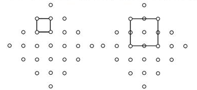
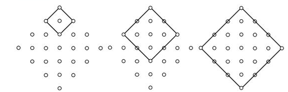
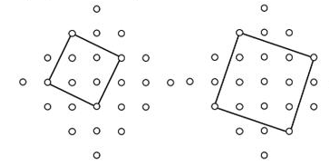
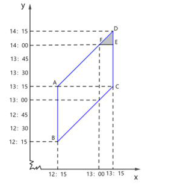
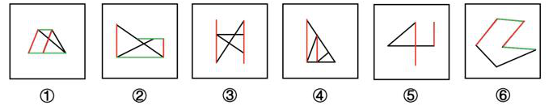
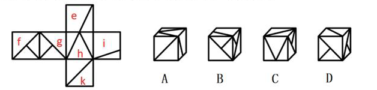
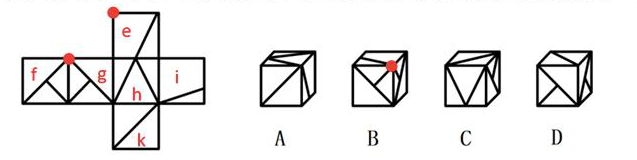
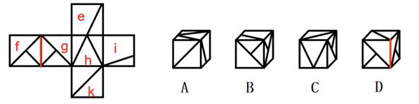
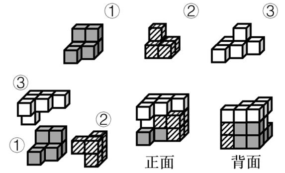

# 2024 年浙江行测（A类） · 答案与解析

以下为来源原文的结构化转写；缺失及冲突答案不补写。

## 第 21 题 · 言语理解与表达

参考答案：**C**

正确答案是：C
根据后文可知，下调网约车平台抽成比例虽会使平台单笔订单的抽成减少，但有助于给司机
减负，也会促进平台自身的良性发展，强化规模效应，故抽成减少是双赢之举。横线前出现
“不是”，故横线处所填成语与后文语义相反，需表达下调网约车平台抽成比例仅对一方有好
处，C 项“零和博弈”指参与博弈的各方，在严格竞争下，一方的收益必然意味着另一方的损
失，博弈各方的收益和损失相加总和永远为“零”，双方不存在合作的可能，符合文意，当选。
A 项“拔苗助长”比喻违反事物发展的客观规律，急于求成反而坏事，文段未体现“违反事物
的发展规律”，与文意不符，排除；
B 项“空头支票”指不能兑现，取不到钱的支票，比喻不准备实现的诺言，与文意不符，排除；
D 项“双赢游戏”指双方都能得益的游戏，与文意相悖，排除。
故正确答案为C。
【文段出处】澎湃新闻《【社论】下调抽成比例：多方共赢才能长远》

来源：[2024年浙江省公务员录用考试《行测》（A卷）参考答案及解析.pdf](https://github.com/dumarstoft-ship-it/xingce/blob/407016b55b49581efa3771bb59a2dee8761d982f/2024%E5%B9%B4%E6%B5%99%E6%B1%9F%E7%9C%81%E5%85%AC%E5%8A%A1%E5%91%98%E5%BD%95%E7%94%A8%E8%80%83%E8%AF%95%E3%80%8A%E8%A1%8C%E6%B5%8B%E3%80%8B%EF%BC%88A%E5%8D%B7%EF%BC%89%E5%8F%82%E8%80%83%E7%AD%94%E6%A1%88%E5%8F%8A%E8%A7%A3%E6%9E%90.pdf)，PDF 第 8、9 页。

## 第 22 题 · 言语理解与表达

参考答案：**B**

正确答案是：B
第一空，首句指出科学家用蟹壳制造锌电池，这一做法颠覆了平常人对电池制造的理解，也
难以想象，B 项“意想不到”指料想不到，没有料到，D 项“出人意表”指事物出乎人们意料之
外，均符合文意，保留。A 项“触手可及”指近在手边，一伸手就可以接触到，形容很容易，
C 项“随处可见”指到处可以看见，形容非常普通、常见，搭配的“蟹壳”显然并没有那么常见
易得，均搭配不当，排除。
第二空，横线前“其中”指“材料来源广泛”，由此可知后文应表示在广泛的材料来源中最多的
来源是什么，因此横线处应体现出“多”之意，B 项“丰富”指种类多、数量大，符合文意，当
选。D 项“合适”指适合实际情况或客观要求，与文意不符，排除。
故正确答案为B。
【文段出处】科技日报《科学家用蟹壳制成可生物降解电池，千次循环后能源效率仍为99.7%》

来源：[2024年浙江省公务员录用考试《行测》（A卷）参考答案及解析.pdf](https://github.com/dumarstoft-ship-it/xingce/blob/407016b55b49581efa3771bb59a2dee8761d982f/2024%E5%B9%B4%E6%B5%99%E6%B1%9F%E7%9C%81%E5%85%AC%E5%8A%A1%E5%91%98%E5%BD%95%E7%94%A8%E8%80%83%E8%AF%95%E3%80%8A%E8%A1%8C%E6%B5%8B%E3%80%8B%EF%BC%88A%E5%8D%B7%EF%BC%89%E5%8F%82%E8%80%83%E7%AD%94%E6%A1%88%E5%8F%8A%E8%A7%A3%E6%9E%90.pdf)，PDF 第 9 页。

## 第 23 题 · 言语理解与表达

参考答案：**A**

正确答案是：A
第一空，搭配“变局”，且根据文意可知，横线处应体现世界百年未有之大变局持续发展之意。
A 项“深化”指向更深处发展，D 项“演变”指发展变化，均与“变局”搭配恰当，且符合文意，
保留。B 项“加重”指增加重量或程度，常搭配“负担”“语气”等，与“变局”搭配不当，且文段
强调世界百年未有之大变局持续发展，而非程度增加，与文意不符，排除；C 项“更迭”指轮
流更替，常搭配“政权”“技术”“产品”等，与“变局”搭配不当，且“更迭”强调不同事物的轮流更
替，而文段强调世界局势自身变化大，与文意不符，排除。
第二空，搭配“新一轮科技变革”。A 项“方兴未艾”指事物刚刚兴起、发展，一时不会终止，
最常与“新事物”进行搭配，对应“新一轮”的科技变革最为准确，且“未艾”指一时不会终止，
与前文“持续”和后文“正全面融入人类社会各领域”对应准确，衔接得当，当选。D 项“风起云
涌”形容事物迅速发展，声势浩大，无法体现出“新”，与前后文的对应不及A 项准确，排除。
故正确答案为A。
【文段出处】《数字经济赋能新发展格局》

来源：[2024年浙江省公务员录用考试《行测》（A卷）参考答案及解析.pdf](https://github.com/dumarstoft-ship-it/xingce/blob/407016b55b49581efa3771bb59a2dee8761d982f/2024%E5%B9%B4%E6%B5%99%E6%B1%9F%E7%9C%81%E5%85%AC%E5%8A%A1%E5%91%98%E5%BD%95%E7%94%A8%E8%80%83%E8%AF%95%E3%80%8A%E8%A1%8C%E6%B5%8B%E3%80%8B%EF%BC%88A%E5%8D%B7%EF%BC%89%E5%8F%82%E8%80%83%E7%AD%94%E6%A1%88%E5%8F%8A%E8%A7%A3%E6%9E%90.pdf)，PDF 第 9 页。

## 第 24 题 · 言语理解与表达

参考答案：**D**

正确答案是：D
本题可从第二空入手，根据后文“快速的信息流动击穿一切时间和空间的边界”可知，信息应
是快速流动的，横线处所填成语应表达快速之意，D 项“稍纵即逝”形容时间或机会等很容易
过去，符合文意，保留。A 项“纷繁复杂”指头绪、表象多而且复杂，B 项“无迹可循”指没有
踪迹可以寻求，C 项“如出一辙”比喻言论或行动完全一样，均与文意不符，排除。
第一空，代入验证，D 项“共享”指共同享用，可与后文“因为同在一个时代或同处一个地方
而形成的群体意识也愈加淡薄”形成对应，当选。
故正确答案为D。
【文段出处】光明日报《广阔的虚拟世界，也不过是无边现实世界的一部分》

来源：[2024年浙江省公务员录用考试《行测》（A卷）参考答案及解析.pdf](https://github.com/dumarstoft-ship-it/xingce/blob/407016b55b49581efa3771bb59a2dee8761d982f/2024%E5%B9%B4%E6%B5%99%E6%B1%9F%E7%9C%81%E5%85%AC%E5%8A%A1%E5%91%98%E5%BD%95%E7%94%A8%E8%80%83%E8%AF%95%E3%80%8A%E8%A1%8C%E6%B5%8B%E3%80%8B%EF%BC%88A%E5%8D%B7%EF%BC%89%E5%8F%82%E8%80%83%E7%AD%94%E6%A1%88%E5%8F%8A%E8%A7%A3%E6%9E%90.pdf)，PDF 第 9 页。

## 第 25 题 · 言语理解与表达

参考答案：**B**

正确答案是：B
本题可从第二空入手，横线处同时搭配“家国情怀”“革命史诗”“英雄故事”，且根据“既有······也
有······”可知，横线处成语与“微观细致”语义相反，应体现气势宏大之意。B 项“大
气磅礴”形容气势雄伟浩大，与“家国情怀”“革命史诗”“英雄故事”均搭配恰当，且符合文意，
保留。A 项“可歌可泣”指悲壮的事迹使人非常感动，无法体现气势宏大之意，排除；C 项“波
澜壮阔”比喻声势雄壮或规模宏大，常搭配历史、征程等，D 项“彪炳史册”形容伟大的业绩
流传千秋万代，常搭配成就、奇迹等，均与“家国情怀”搭配不当，排除。
第一空，代入验证，横线处搭配“现实生活”，且根据“为人民画像，为时代放歌”可知，横线
处词语应体现观察、反映之意，B 项“观照”指仔细观察，审视，符合文意，当选。
故正确答案为B。
【文段出处】光明日报《抒写时代精神展现美好生活》

来源：[2024年浙江省公务员录用考试《行测》（A卷）参考答案及解析.pdf](https://github.com/dumarstoft-ship-it/xingce/blob/407016b55b49581efa3771bb59a2dee8761d982f/2024%E5%B9%B4%E6%B5%99%E6%B1%9F%E7%9C%81%E5%85%AC%E5%8A%A1%E5%91%98%E5%BD%95%E7%94%A8%E8%80%83%E8%AF%95%E3%80%8A%E8%A1%8C%E6%B5%8B%E3%80%8B%EF%BC%88A%E5%8D%B7%EF%BC%89%E5%8F%82%E8%80%83%E7%AD%94%E6%A1%88%E5%8F%8A%E8%A7%A3%E6%9E%90.pdf)，PDF 第 9、10 页。

## 第 26 题 · 言语理解与表达

参考答案：**A**

正确答案是：A
第一空，横线处成语与“以讹传讹”构成并列结构，“以讹传讹”指把本来就不正确的话又错误
地传出去，越传越错，故横线处成语应表达人们对于预制菜存有误解，持有消极、反感的态
度，A 项“杯弓蛇影”比喻因疑神疑鬼而引起恐惧，B 项“夸大其词”指把事情说得超过原有的
程度，D 项“谈虎色变”比喻一提及某事就非常害怕，均符合文意，保留。C 项“将信将疑”指
有点相信，又有点怀疑，文段并未涉及信任的话题，与文意无关，排除。
第二空，由“但是”可知，文段前后构成转折关系，语义相反。根据前文表述的对待预制菜这
一现象无需过度担心可知，后文应论述其需注意的问题，又根据“上班族点外卖点到预制菜，
和未成年学生长期吃食堂的预制菜”可知，上班族点到预制菜是个偶发事件，未成年长期吃
食堂预制菜是长期持续过程，两种不同情况下的健康影响程度是不同的，故横线处成语应体
现预制菜在不同情况下对健康的影响是不一样的，不能同等看待。A 项“同日而语”指把两件
事或两个人同等看待、相提并论，通常用于否定表述中，与前文“不能”连用，符合文意，当
选。B 项“置若罔闻”指放在一边，好像没有听见似的，指不去过问或不予关心，D 项“视而
不见”指不注意，不重视，睁着眼却没看见，均与文意不符，排除。
故正确答案为A。
【文段出处】澎湃社论《预制菜进校园不是一件小事》

来源：[2024年浙江省公务员录用考试《行测》（A卷）参考答案及解析.pdf](https://github.com/dumarstoft-ship-it/xingce/blob/407016b55b49581efa3771bb59a2dee8761d982f/2024%E5%B9%B4%E6%B5%99%E6%B1%9F%E7%9C%81%E5%85%AC%E5%8A%A1%E5%91%98%E5%BD%95%E7%94%A8%E8%80%83%E8%AF%95%E3%80%8A%E8%A1%8C%E6%B5%8B%E3%80%8B%EF%BC%88A%E5%8D%B7%EF%BC%89%E5%8F%82%E8%80%83%E7%AD%94%E6%A1%88%E5%8F%8A%E8%A7%A3%E6%9E%90.pdf)，PDF 第 10 页。

## 第 27 题 · 言语理解与表达

参考答案：**A**

正确答案是：A
第一空，搭配“纠纷和事故”，且根据“重灾区”可知，横线处应体现旅游服务产生的纠纷和维
权事故非常多的意思，A 项“屡见不鲜”指多次见到就不觉得新奇了，B 项“司空见惯”指某事
常见，不足为奇，D 项“铺天盖地”形容来势猛，声势大，到处都是，均符合文意，保留。C
项“罄竹难书”形容罪行多得写不尽，多搭配“罪行”，与“纠纷和事故”搭配不当，排除。
第二空，根据“捷径”可知，横线处应表示一种速成的方法或手段，且与“灰色生意”构成并列
关系，A 项“旁门左道”泛指不正派的东西，“门”与“道”对应“径”，符合文意，当选。B 项“投
机取巧”指用不正当的手段谋取私利，无法与“捷径”构成形象化对应，且无法与“灰色生意”
构成并列关系，排除；D 项“歪风邪气”指不良的作风和风气，与“捷径”语义无关，排除。
故正确答案为A。
【文段出处】澎湃新闻《[社论]真正对游客的旅游体验负责》

来源：[2024年浙江省公务员录用考试《行测》（A卷）参考答案及解析.pdf](https://github.com/dumarstoft-ship-it/xingce/blob/407016b55b49581efa3771bb59a2dee8761d982f/2024%E5%B9%B4%E6%B5%99%E6%B1%9F%E7%9C%81%E5%85%AC%E5%8A%A1%E5%91%98%E5%BD%95%E7%94%A8%E8%80%83%E8%AF%95%E3%80%8A%E8%A1%8C%E6%B5%8B%E3%80%8B%EF%BC%88A%E5%8D%B7%EF%BC%89%E5%8F%82%E8%80%83%E7%AD%94%E6%A1%88%E5%8F%8A%E8%A7%A3%E6%9E%90.pdf)，PDF 第 10 页。

## 第 28 题 · 言语理解与表达

参考答案：**D**

正确答案是：D
第一空，根据“看似······实则······”可知，横线处所填成语应与“简单”语义
相反，且与“内涵很深”构成近义并列，B 项“别有洞天”指另有一个境界，常用来形容风景奇
特或艺术创作引人入胜，能够体现出图画书有我们看不到的一面之意，D 项“包罗万象”形容
内容丰富，无所不有，与“简单”语义相反，均符合文意，保留。A 项“自成一体”指在某种学
术、艺术或技术上有独创的见解或独特的做法，形成自己的体系和风格，其相反应为“不独
特”而非“不简单”，与文意无关，排除；C 项“各有千秋”比喻在同一层次内各人有各人的长处，
各人有各人的特色，一般搭配多个主体，与“图画书”这一单一主体搭配不当，排除。
第二空，横线处所填成语搭配“当前市场上图画书品质”，且根据后文“一个重要原因就是有
些创作者脱离生活，且缺乏必要的相关素养”可知，横线处所填成语应体现出当前市场上图
画书品质有好有坏，D 项“参差不齐”形容很不整齐或水平不一，置于此处可体现出当前市场
上的图画书品质水平不一，符合文意，当选。B 项“滥竽充数”比喻没有真才实学的人混在内
行人之中，或以次充好，主语多搭配残次品，与“当前市场上图画书品质”这一有好有坏的大
集合搭配不当，排除。
故正确答案为D。
【文段出处】光明日报《把最好的阅读融入最珍贵的童年——中国原创图画书发展现状调研》

来源：[2024年浙江省公务员录用考试《行测》（A卷）参考答案及解析.pdf](https://github.com/dumarstoft-ship-it/xingce/blob/407016b55b49581efa3771bb59a2dee8761d982f/2024%E5%B9%B4%E6%B5%99%E6%B1%9F%E7%9C%81%E5%85%AC%E5%8A%A1%E5%91%98%E5%BD%95%E7%94%A8%E8%80%83%E8%AF%95%E3%80%8A%E8%A1%8C%E6%B5%8B%E3%80%8B%EF%BC%88A%E5%8D%B7%EF%BC%89%E5%8F%82%E8%80%83%E7%AD%94%E6%A1%88%E5%8F%8A%E8%A7%A3%E6%9E%90.pdf)，PDF 第 10、11 页。

## 第 29 题 · 言语理解与表达

参考答案：**B**

正确答案是：B
第一空，搭配“‘生活圈’”，A 项“融入”指融合，混入，混合，B 项“植入”指像植树那样把一物
安放到另一物中，插入，C 项“根植”指扎根，均与“‘生活圈’”搭配恰当，保留。D 项“参与”
指介入，参加，通常搭配工作、活动、项目等，与“‘生活圈’”搭配不当，排除。
第二空，搭配“时空限制”，A 项“突破”指集中兵力向一点进攻或反攻，打开缺口；超过，打
破，B 项“打破”指突破原有的限制、拘束，均与“时空限制”搭配恰当，保留。C 项“重塑”指
重新塑造，与“时空限制”搭配不当，排除。
第三空，搭配“购买”以及“商品”，且根据“农村电商······推动实现了农村消费的扩容
与升级”可知，横线处应体现出农村电商让农民可以更便捷地购买到好的商品之意，B 项“物
美价廉”指价钱便宜，货物又好，“购买物美价廉的商品”搭配恰当，当选。A 项“琳琅满目”
比喻充满了美好珍贵的事物，虽符合文意，但“购买琳琅满目的商品”搭配不当，排除A 项。
故正确答案为B。

来源：[2024年浙江省公务员录用考试《行测》（A卷）参考答案及解析.pdf](https://github.com/dumarstoft-ship-it/xingce/blob/407016b55b49581efa3771bb59a2dee8761d982f/2024%E5%B9%B4%E6%B5%99%E6%B1%9F%E7%9C%81%E5%85%AC%E5%8A%A1%E5%91%98%E5%BD%95%E7%94%A8%E8%80%83%E8%AF%95%E3%80%8A%E8%A1%8C%E6%B5%8B%E3%80%8B%EF%BC%88A%E5%8D%B7%EF%BC%89%E5%8F%82%E8%80%83%E7%AD%94%E6%A1%88%E5%8F%8A%E8%A7%A3%E6%9E%90.pdf)，PDF 第 11 页。

## 第 30 题 · 言语理解与表达

参考答案：**C**

正确答案是：C
第一空，根据文意可知，横线处所填成语应体现科技合作是构建更加开放、包容、普惠、平
衡、共赢的经济全球化的重要举措，C 项“应有之义” 指应该有的道德、行为或义理，D 项“必
由之路”指事物发展必须遵循的规律或必须经历的过程，均符合文意，保留。A 项“成功之道”
是指成功之后总结的经验，文段并未体现该事情已经成功之意，与文意不符，排除；B 项“必
然之果”指注定的结果，根据文段可知，“构建······经济全球化”是要实现的目标和
结果，而非“科技合作”，排除。
第二空，根据“打压”可知，横线处所填词语应体现对中国科技采取不正当的压制行为，C 项
“遏制”指阻止、控制，D 项“围猎”指四面合围而猎，均符合文意，保留。
第三空，根据文意可知，增进人类科技进步与共同福祉是我们要实现的目标和正确的前进方
向，而对中国科技采取打压的做法，损害了知识的产生和创新，故横线处所填成语要体现出
做法偏离了正确的方向，C 项“背道而驰”指朝着相反的方向走，比喻方向、目标完全相反，
一般指背离了正确的道路，符合文段语境，当选。D 项“南辕北辙”比喻行动和目的相反，文
段并未提及对中国科技打压的目的，且该成语通常用于单个主语，不符合文段语境，排除。
故正确答案为C。
【文段出处】《遏制打压只会催生中国科技创新动力》

来源：[2024年浙江省公务员录用考试《行测》（A卷）参考答案及解析.pdf](https://github.com/dumarstoft-ship-it/xingce/blob/407016b55b49581efa3771bb59a2dee8761d982f/2024%E5%B9%B4%E6%B5%99%E6%B1%9F%E7%9C%81%E5%85%AC%E5%8A%A1%E5%91%98%E5%BD%95%E7%94%A8%E8%80%83%E8%AF%95%E3%80%8A%E8%A1%8C%E6%B5%8B%E3%80%8B%EF%BC%88A%E5%8D%B7%EF%BC%89%E5%8F%82%E8%80%83%E7%AD%94%E6%A1%88%E5%8F%8A%E8%A7%A3%E6%9E%90.pdf)，PDF 第 11 页。

## 第 31 题 · 言语理解与表达

参考答案：**B**

正确答案是：B
第一空，根据“甚至”可知，横线处所填成语应比“忽视”程度更轻，A 项“轻描淡写”指说话写
文章把重要问题轻轻带过，不加重视，B 项“一带而过”指捎带着就顺过去了，均符合文意，
保留。C 项“弃如敝屣”比喻毫不可惜地抛弃掉，置于此处程度过重，排除；D 项“熟视无睹”
形容对事物漫不经心或不重视，与“忽视”程度无明显差异，排除。
第二空，根据后文可知，研究先秦儒学的引诗叙事可以感受到先秦儒学的原始生命、诗性智
慧、中国哲学特质，横线处所填成语应体现这些引诗叙事是有依据的、有依托的，并不是先
秦儒学诸子随意写的，B 项“随意而为”指随着自己的意愿做事，符合文意，保留。A 项“率性
而为”指按照自己的性情行事，侧重真性情，文段并未强调先秦儒学诸子是否真性情，与文
段语义对应不及B 项准确，排除。
第三空，代入验证，搭配“诗性智慧”，B 项“昭示”指明白地表示或宣布，与“诗性智慧”搭配
恰当，当选。
故正确答案为B。
【文段出处】光明日报《先秦儒学引诗叙事的思想价值》

来源：[2024年浙江省公务员录用考试《行测》（A卷）参考答案及解析.pdf](https://github.com/dumarstoft-ship-it/xingce/blob/407016b55b49581efa3771bb59a2dee8761d982f/2024%E5%B9%B4%E6%B5%99%E6%B1%9F%E7%9C%81%E5%85%AC%E5%8A%A1%E5%91%98%E5%BD%95%E7%94%A8%E8%80%83%E8%AF%95%E3%80%8A%E8%A1%8C%E6%B5%8B%E3%80%8B%EF%BC%88A%E5%8D%B7%EF%BC%89%E5%8F%82%E8%80%83%E7%AD%94%E6%A1%88%E5%8F%8A%E8%A7%A3%E6%9E%90.pdf)，PDF 第 11、12 页。

## 第 32 题 · 言语理解与表达

参考答案：**B**

正确答案是：B
第一空，根据“汉语溯源应从造字义入手，揭示其特征义”可知，横线处意在表达对“词语产
生的构词理据和意义变化”进行深入的研究。B 项“探究”指探索研究或探寻追究，D 项“分析”
指把一件事物、一种现象、一个概念分成较简单的组成部分，找出这些部分的本质属性和彼
此之间的关系，均符合文意，保留。A 项“体会”指体验领会，C 项“追寻”指追踪寻找，均缺
乏“深入研究”或“揭示本质”的含义，与文意不符，排除。
第二空，根据“汉语溯源应从造字义入手”可知，文段主要围绕“汉语溯源”展开，横线处应意
在表达只有如此才能找到字词产生的发源。B 项“源头”指水发源的地方，符合文意，保留。
D 项“原因”指造成某种结果或引起另一件事情发生的条件，与“汉语溯源”对应不当，排除。
第三空，代入验证，横线处通过逗号与“层层深入，探明真相”并列。B 项“抽丝剥茧”形容分
析事物极为细致，而且一步一步很有层次，与文意相符，当选。
故正确答案为B。
【文段出处】光明日报《溯源汉语字词讲好文化故事》

来源：[2024年浙江省公务员录用考试《行测》（A卷）参考答案及解析.pdf](https://github.com/dumarstoft-ship-it/xingce/blob/407016b55b49581efa3771bb59a2dee8761d982f/2024%E5%B9%B4%E6%B5%99%E6%B1%9F%E7%9C%81%E5%85%AC%E5%8A%A1%E5%91%98%E5%BD%95%E7%94%A8%E8%80%83%E8%AF%95%E3%80%8A%E8%A1%8C%E6%B5%8B%E3%80%8B%EF%BC%88A%E5%8D%B7%EF%BC%89%E5%8F%82%E8%80%83%E7%AD%94%E6%A1%88%E5%8F%8A%E8%A7%A3%E6%9E%90.pdf)，PDF 第 12 页。

## 第 33 题 · 言语理解与表达

参考答案：**D**

正确答案是：D
第一空，根据横线前“就文化优势而言”可知，横线处应体现杂剧比别的古典文学品种更好之
意，B 项“望尘莫及”指远远望着前面人马行走时扬起来的尘土而追赶不上，比喻远远落在后
面，C 项“无出其右”指没有能超过他的，D 项“无可比拟”形容独一无二，特别突出，均可体
现杂剧的优势，符合文意，保留。A 项“望其项背”比喻赶得上，与文意相悖，排除。
第二空，搭配“杂剧”，根据横线前强调杂剧的“入世性，以及由此而来的普及性和强大影响
力”以及横线后“民众的是非荣辱观”可知，横线处也应体现杂剧的入世性，即内容通俗易懂、
接地气，D 项“寓教于乐”指兼具教育性和趣味性，可以体现杂剧的通俗性和对社会的教育意
义，保留。B 项“源远流长”形容历史悠久，C 项“博采众长”意思是从多方面吸取各家的长处，
均和“入世性”无关，排除。
第三空，代入验证，D 项“塑造”指通过培养、改造使人或事物达到某种预定的目标，与“民
众的是非荣辱观”搭配恰当，当选。
故正确答案为D。
【文段出处】光明网《大学者改写的小故事》

来源：[2024年浙江省公务员录用考试《行测》（A卷）参考答案及解析.pdf](https://github.com/dumarstoft-ship-it/xingce/blob/407016b55b49581efa3771bb59a2dee8761d982f/2024%E5%B9%B4%E6%B5%99%E6%B1%9F%E7%9C%81%E5%85%AC%E5%8A%A1%E5%91%98%E5%BD%95%E7%94%A8%E8%80%83%E8%AF%95%E3%80%8A%E8%A1%8C%E6%B5%8B%E3%80%8B%EF%BC%88A%E5%8D%B7%EF%BC%89%E5%8F%82%E8%80%83%E7%AD%94%E6%A1%88%E5%8F%8A%E8%A7%A3%E6%9E%90.pdf)，PDF 第 12 页。

## 第 34 题 · 言语理解与表达

参考答案：**D**

正确答案是：D
对比选项，确定首句。⑤句介绍倾听百姓心声，做到统筹兼顾十分关键，⑥句指出对摊贩的
服务与监管是需要解决的问题。根据逻辑顺序，应先引出问题，再对其进行回答，故⑤句应
在⑥句之后，排除A、B 两项。
对比C、D 两项发现，③句和⑤句先后顺序不一致，③句提出求取最大限度共同价值的问题，
⑤句介绍具体做法，即倾听百姓心声，要统筹兼顾，按照逻辑顺序，应先提出问题，再进行
解答，故③句应在⑤句之前，排除C 项。且观察D 项还可发现，①句承接⑥句，具体指出
经营占道、噪声扰民、环境污染等问题亟待解决，可对⑥句中“几难”进行详细的解释说明，
衔接恰当，D 项当选。
故正确答案为D。
【文段出处】正观新闻《人民日报：便民不扰民，治理需精细》

来源：[2024年浙江省公务员录用考试《行测》（A卷）参考答案及解析.pdf](https://github.com/dumarstoft-ship-it/xingce/blob/407016b55b49581efa3771bb59a2dee8761d982f/2024%E5%B9%B4%E6%B5%99%E6%B1%9F%E7%9C%81%E5%85%AC%E5%8A%A1%E5%91%98%E5%BD%95%E7%94%A8%E8%80%83%E8%AF%95%E3%80%8A%E8%A1%8C%E6%B5%8B%E3%80%8B%EF%BC%88A%E5%8D%B7%EF%BC%89%E5%8F%82%E8%80%83%E7%AD%94%E6%A1%88%E5%8F%8A%E8%A7%A3%E6%9E%90.pdf)，PDF 第 12 页。

## 第 35 题 · 言语理解与表达

参考答案：**D**

正确答案是：D
对比选项，确定首句。首句分别为②句、③句、④句、⑤句，②句介绍物理学家在光学实验
中尝试自己制作玻璃以及关于玻璃的新发现，③句引出物理学家与玻璃工匠的知识之间的关
系，④句介绍最古老的彩色玻璃可以追溯到几千年前，⑤句介绍玻璃工匠如何制作出色度不
同的玻璃，四句话均不具备明显的首句以及非首句特征，但是按照行文逻辑可知，应先引出
物理学家和玻璃工匠的知识之间的关系，再具体介绍物理学家在实验中尝试自己制作玻璃，
并有了关于玻璃的新发现，故③句应在②句之前，排除C 项。
继续观察，⑥句出现“例如”，举例说明硒化镉和硫化镉的混合物可以使玻璃变成黄色或红色，
可知前文应提及该例证的观点，结合选项该观点可能为④句、③句、②句，④句介绍最古老
的彩色玻璃可以追溯到几千年前，并非⑥句论证的观点，排除A 项；③句引出物理学家与
玻璃工匠的知识之间的关系，与⑥句衔接尚可，但⑥句后衔接②句显然不合逻辑，②句引出
物理学家的新发现，即单一物质可以产生不同颜色的玻璃，为⑥句论证的观点，故②句应在
⑥句之前，排除B 项，锁定D 项。
故正确答案为D。
【文段出处】返朴《2023 化学诺奖量子点：元素周期表从此拥有第三个维度》

来源：[2024年浙江省公务员录用考试《行测》（A卷）参考答案及解析.pdf](https://github.com/dumarstoft-ship-it/xingce/blob/407016b55b49581efa3771bb59a2dee8761d982f/2024%E5%B9%B4%E6%B5%99%E6%B1%9F%E7%9C%81%E5%85%AC%E5%8A%A1%E5%91%98%E5%BD%95%E7%94%A8%E8%80%83%E8%AF%95%E3%80%8A%E8%A1%8C%E6%B5%8B%E3%80%8B%EF%BC%88A%E5%8D%B7%EF%BC%89%E5%8F%82%E8%80%83%E7%AD%94%E6%A1%88%E5%8F%8A%E8%A7%A3%E6%9E%90.pdf)，PDF 第 12、13 页。

## 第 36 题 · 言语理解与表达

参考答案：**C**

正确答案是：C
本题可从②处入手，根据“需要······避免······”可知，前后语义相反，故②
处应填入与“随机或含糊不清”语义相反的词语，“随机”即随意的，“含糊不清”即躲躲闪闪，
缺乏明确的表态，C 项“稳定”即稳固安定，没有变动，“精确”即非常准确、非常正确，可以
与后文构成反义并列，保留。A 项“正确”即符合事实、道理或某种公认的标准，B 项“系统”
即有条理的、连贯的，D 项“完整”即具有或保持着应有的部分，没有损坏或残缺，均无法与
“随机”构成反义并列，排除。
①处，代入验证，C 项“交互”指相互联系交流，常见用法为“人机交互”，与“模型与患者”搭
配恰当，当选。
故正确答案为C。
【文段出处】科技日报《当“望闻问切”遇上人工智能》

来源：[2024年浙江省公务员录用考试《行测》（A卷）参考答案及解析.pdf](https://github.com/dumarstoft-ship-it/xingce/blob/407016b55b49581efa3771bb59a2dee8761d982f/2024%E5%B9%B4%E6%B5%99%E6%B1%9F%E7%9C%81%E5%85%AC%E5%8A%A1%E5%91%98%E5%BD%95%E7%94%A8%E8%80%83%E8%AF%95%E3%80%8A%E8%A1%8C%E6%B5%8B%E3%80%8B%EF%BC%88A%E5%8D%B7%EF%BC%89%E5%8F%82%E8%80%83%E7%AD%94%E6%A1%88%E5%8F%8A%E8%A7%A3%E6%9E%90.pdf)，PDF 第 13 页。

## 第 37 题 · 言语理解与表达

参考答案：**C**

正确答案是：C
③处在第三段结尾，需结合前文内容进行判断。第三段开篇阐述用于医疗的大语言模型需要
给医生更为明确的结论，随后指出仅依靠大模型向医生输出结果会带来一些问题，后文接着
介绍大部分医疗领域的大语言模型会结合知识图谱使其发挥最大作用。③处所在句子阐述的
是采用这种技术路径可能会让大模型在医学场景中成为更好的选择。故③处的技术路径指的
是前文论述的大模型和知识图谱相结合的路径，对应C 项。
A、B 两项的“医生”及D 项的“医学专业数据”均与前文阐述的路径不一致，无法与前文衔接，
排除。
故正确答案为C。
【文段出处】科技日报《当“望闻问切”遇上人工智能》

来源：[2024年浙江省公务员录用考试《行测》（A卷）参考答案及解析.pdf](https://github.com/dumarstoft-ship-it/xingce/blob/407016b55b49581efa3771bb59a2dee8761d982f/2024%E5%B9%B4%E6%B5%99%E6%B1%9F%E7%9C%81%E5%85%AC%E5%8A%A1%E5%91%98%E5%BD%95%E7%94%A8%E8%80%83%E8%AF%95%E3%80%8A%E8%A1%8C%E6%B5%8B%E3%80%8B%EF%BC%88A%E5%8D%B7%EF%BC%89%E5%8F%82%E8%80%83%E7%AD%94%E6%A1%88%E5%8F%8A%E8%A7%A3%E6%9E%90.pdf)，PDF 第 13 页。

## 第 38 题 · 言语理解与表达

参考答案：**D**

正确答案是：D
A 项，根据第一段“这在一定程度上可以减少因为信息收集不充分、患者主诉不明确等问题
带来的误诊和漏诊”可知，表述正确，排除；
B 项，根据第二段“未来若能搜集到大型三甲医院的医生对于某些疾病的认知并将其导入大
语言模型进行整合、学习，一些医疗资源不充足的地区也有可能享受到高质量的医疗服务”
可知，表述正确，排除；
C 项，根据第二段“大语言模型能够融合原本分散在少数人手里的顶尖医疗知识，提供更加
普惠的医疗知识服务”“一些医疗资源不充足的地区也有可能享受到高质量的医疗服务”可知，
表述正确，排除；
D 项，根据第三段“目前看来，完全依赖大模型进行独立推理并直接向医生输出结果，这种
模式在医学场景中较难达到足够高的准确率，也较难获得医生的认同”可知，大语言模型仍
存在一定问题，“未来可以代替”无中生有且表述过于绝对，当选。
本题为选非题，故正确答案为D。
【文段出处】科技日报《当“望闻问切”遇上人工智能》

来源：[2024年浙江省公务员录用考试《行测》（A卷）参考答案及解析.pdf](https://github.com/dumarstoft-ship-it/xingce/blob/407016b55b49581efa3771bb59a2dee8761d982f/2024%E5%B9%B4%E6%B5%99%E6%B1%9F%E7%9C%81%E5%85%AC%E5%8A%A1%E5%91%98%E5%BD%95%E7%94%A8%E8%80%83%E8%AF%95%E3%80%8A%E8%A1%8C%E6%B5%8B%E3%80%8B%EF%BC%88A%E5%8D%B7%EF%BC%89%E5%8F%82%E8%80%83%E7%AD%94%E6%A1%88%E5%8F%8A%E8%A7%A3%E6%9E%90.pdf)，PDF 第 13、14 页。

## 第 39 题 · 言语理解与表达

参考答案：**A**

正确答案是：A
A 项，根据第一段“极光是由于来自磁层和太阳风的带电高能粒子被行星磁场导引带进行星
大气层，并与高层大气（热层）中的原子碰撞造成的发光现象”可知，极光需要来自磁层和
太阳风的带电高能粒子与高层大气中的原子碰撞才能产生，只有“大气”和“磁场”，没有“来自
磁层和太阳风的带电高能粒子”这一条件，也不会出现极光，表述过于绝对，当选；
B 项，根据第二段“极光会对地球上的无线电波、卫星信号、电力线路等产生不利的影响”与
“人们可以了解太阳活动和地球环境之间的相互作用和变化、从而提高对太阳风暴、地磁风
暴、电离层扰动等现象的预报和防护能力”可知，极光会对信号等产生影响，表述正确，排
除；
C 项，根据第一段“极光是由于来自磁层和太阳风的带电高能粒子被行星磁场导引带进行星
大气层，并与高层大气（热层）中的原子碰撞造成的发光现象”可知，如果没有大气，来自
磁层和太阳风的带电高能粒子无法与高层大气（热层）中的原子碰撞，也就无法出现极光，
表述正确，排除；
D 项，根据第一段“极光是由于来自磁层和太阳风的带电高能粒子被行星磁场导引带进行星
大气层，并与高层大气（热层）中的原子碰撞造成的发光现象”与第二段“通过对极光进行模
拟和实验，人们可以探索等离子体发光和加速的机制和方法”可知，极光是发光的等离子体
现象，且根据常识可知，极光有多种多样的形态和颜色，表述正确，排除。
本题为选非题，故正确答案为A。
【文段出处】《绚丽多彩的极光也能被人为制造！带你了解极光背后的原理》《极光：不只
是瑰丽奇景还蕴含大量信息》

来源：[2024年浙江省公务员录用考试《行测》（A卷）参考答案及解析.pdf](https://github.com/dumarstoft-ship-it/xingce/blob/407016b55b49581efa3771bb59a2dee8761d982f/2024%E5%B9%B4%E6%B5%99%E6%B1%9F%E7%9C%81%E5%85%AC%E5%8A%A1%E5%91%98%E5%BD%95%E7%94%A8%E8%80%83%E8%AF%95%E3%80%8A%E8%A1%8C%E6%B5%8B%E3%80%8B%EF%BC%88A%E5%8D%B7%EF%BC%89%E5%8F%82%E8%80%83%E7%AD%94%E6%A1%88%E5%8F%8A%E8%A7%A3%E6%9E%90.pdf)，PDF 第 14 页。

## 第 40 题 · 言语理解与表达

参考答案：**B**

正确答案是：B
A 项，根据第二段“通过对极光进行模拟和实验······从而为人类利用等离子体进行
能源开发和材料加工等提供了新的思路和技术”可知，人类利用的是“等离子体”而非“极光”，
偷换概念，排除；
B 项，根据第二段“极光会对地球上的无线电波、卫星信号、电力线路等产生不利的影响”可
知，表述正确，当选；
C 项，根据第三段“比如说要设计一个使用寿命为100 年的电力体系······如果将阈
值设定得过高，就会增加成本。但若我们大致掌握了空间变化规律，就能以此设置设备的阈
值，控制成本”可知，观测和研究极光有助于“控制成本”而非“延长电力体系的使用寿命”，偷
换概念，排除；
D 项，“强大的破坏力”程度过重，文章只提及“不利的影响”，且“化害为利”无中生有，文章
提到研究和观测极光有好处，但是并未提及可以将害处转化为好处，排除。
故正确答案为B。

来源：[2024年浙江省公务员录用考试《行测》（A卷）参考答案及解析.pdf](https://github.com/dumarstoft-ship-it/xingce/blob/407016b55b49581efa3771bb59a2dee8761d982f/2024%E5%B9%B4%E6%B5%99%E6%B1%9F%E7%9C%81%E5%85%AC%E5%8A%A1%E5%91%98%E5%BD%95%E7%94%A8%E8%80%83%E8%AF%95%E3%80%8A%E8%A1%8C%E6%B5%8B%E3%80%8B%EF%BC%88A%E5%8D%B7%EF%BC%89%E5%8F%82%E8%80%83%E7%AD%94%E6%A1%88%E5%8F%8A%E8%A7%A3%E6%9E%90.pdf)，PDF 第 14 页。

## 第 42 题 · 言语理解与表达

参考答案：**B**

正确答案是：B
横线出现在文段尾句，且为尾句的分句，故需结合横线前内容以及尾句内容进行分析。文段
开篇介绍现下的非遗资源被作为文化资本推向市场这一背景，随后介绍具有固定表现形式和
物质载体的非遗项目被开发为有形商品流通、销售，紧接着指出一些没有特定物质载体的非
遗项目，产出的则是无形产品，并以全媒体、数字化的生产模式向公众传播并获得盈利。结
合横线后“却拥有商品的属性和价值”以及前文内容可知，横线处应围绕“没有特定物质载体
的非遗项目”进行介绍，对应B 项。
A 项，“丧失了可复制性”文段并未提及，无中生有，排除；
C 项，“市场拓展度低”文段并未提及，无中生有，排除；
D 项，“需要特定的物质载体”文段并未提及，无中生有，且“文化产品”概念扩大，文段讨论
的核心话题为“非遗项目”，排除。
故正确答案为B。
【文段出处】《经济学视角下的非遗保护》

来源：[2024年浙江省公务员录用考试《行测》（A卷）参考答案及解析.pdf](https://github.com/dumarstoft-ship-it/xingce/blob/407016b55b49581efa3771bb59a2dee8761d982f/2024%E5%B9%B4%E6%B5%99%E6%B1%9F%E7%9C%81%E5%85%AC%E5%8A%A1%E5%91%98%E5%BD%95%E7%94%A8%E8%80%83%E8%AF%95%E3%80%8A%E8%A1%8C%E6%B5%8B%E3%80%8B%EF%BC%88A%E5%8D%B7%EF%BC%89%E5%8F%82%E8%80%83%E7%AD%94%E6%A1%88%E5%8F%8A%E8%A7%A3%E6%9E%90.pdf)，PDF 第 15 页。

## 第 43 题 · 言语理解与表达

参考答案：**D**

正确答案是：D
A 项，根据“传统基因组学将不同碱基以线性的形式存储于染色体上，并且多基于一个参考
基因组来获取一个物种的基因信息”可知，“获取物种基因信息所使用的方式”文段已提及，
排除；
B 项，根据“线性基因组不能同时体现一个物种中不同个体的遗传变异情况，而且大片段的
插入、缺失、拷贝数等变异类型也无法有效鉴定”可知，“在鉴定基因片段变异类型上的局限”
文段已提及，排除；
C 项，根据“它突破了传统线性基因组只能存储一个个体遗传信息的局限性，可以存储、展
示某类群中不同个体的遗传变异信息，从而真正代表一个类群的遗传信息”可知，“比较优势”
文段已提及，排除；
D 项，“研究成果的借鉴”文段未提及，当选。
本题为选非题，故正确答案为D。
【文段出处】《中国科研人员揭示水稻基因组中的“隐藏”变异》

来源：[2024年浙江省公务员录用考试《行测》（A卷）参考答案及解析.pdf](https://github.com/dumarstoft-ship-it/xingce/blob/407016b55b49581efa3771bb59a2dee8761d982f/2024%E5%B9%B4%E6%B5%99%E6%B1%9F%E7%9C%81%E5%85%AC%E5%8A%A1%E5%91%98%E5%BD%95%E7%94%A8%E8%80%83%E8%AF%95%E3%80%8A%E8%A1%8C%E6%B5%8B%E3%80%8B%EF%BC%88A%E5%8D%B7%EF%BC%89%E5%8F%82%E8%80%83%E7%AD%94%E6%A1%88%E5%8F%8A%E8%A7%A3%E6%9E%90.pdf)，PDF 第 15 页。

## 第 44 题 · 言语理解与表达

参考答案：**A**

正确答案是：A
本题为接语选择题，应通读文段，重点关注文段最后谈论的核心话题。文段开篇指出有关中
国文明起源的考古展现了早期中国文明丰富的发展模式，接着提到早期中国文明是一个互动
圈，完整但不封闭，后文通过“不过”进行转折，转折后指出“中原中心论”并未完全消失，只
是升级为“华夏一边缘论”，尾句指出这种考察视角依然有失偏颇，应该从更大范围的互动中
考察中国文明的形成过程。故文段最后重点谈论的核心话题为从互动角度探讨研究中国文明
的形成过程，根据话题一致原则，后文应继续围绕这一话题展开，对应A 项。
B 项，“‘中原中心论’”为前文论述的话题，并非文段最后谈论的核心话题，排除；
C 项，为前文已经论述过的内容，后文不会再继续论述，排除；
D 项，偏离文段最后谈论的核心话题“互动”，排除。
故正确答案为A。
【文段出处】《从四大板块看史前中国文明的演进与互动》

来源：[2024年浙江省公务员录用考试《行测》（A卷）参考答案及解析.pdf](https://github.com/dumarstoft-ship-it/xingce/blob/407016b55b49581efa3771bb59a2dee8761d982f/2024%E5%B9%B4%E6%B5%99%E6%B1%9F%E7%9C%81%E5%85%AC%E5%8A%A1%E5%91%98%E5%BD%95%E7%94%A8%E8%80%83%E8%AF%95%E3%80%8A%E8%A1%8C%E6%B5%8B%E3%80%8B%EF%BC%88A%E5%8D%B7%EF%BC%89%E5%8F%82%E8%80%83%E7%AD%94%E6%A1%88%E5%8F%8A%E8%A7%A3%E6%9E%90.pdf)，PDF 第 15 页。

## 第 45 题 · 言语理解与表达

参考答案：**C**

正确答案是：C
横线位于文段中间，需结合上下文语境进行分析。文段开篇提出观点，智能计算机技术是数
字文化产业发展的金钥匙。接下来指出，数字化转型期文化产业发展的动力已转变为数字化
之手，文化产业消费市场越来越多地由头部数字平台承接并管理，强调数字技术对文化产业
的重要作用。横线后通过“亦能解释”引导并列，从“文化产业的持续数字化对前沿技术有强
劲需求”角度进行解释，即文化产业数字化需要前沿技术的支持，尾句列举各种前沿技术推
动文化产业发生巨大变化。故横线前后均围绕“数字技术”“文化产业”展开论述，横线处也应
围绕此展开，体现出数字技术对文化产业的重要作用，对应C 项。
A 项，“企业发展”偏离文段核心话题，文段论述核心话题为“文化产业”，排除；
B 项，“技术”概念范围扩大，文段论述的是“数字技术”，且“创新”仅能对应后文，无法与上
文进行衔接，排除；
D 项，“有形之手”指政府的作用，文段并未提及政府，无法与上下文进行衔接，排除。
故正确答案为C。
【文段出处】《人工智能技术打造数字文化产业新形态》

来源：[2024年浙江省公务员录用考试《行测》（A卷）参考答案及解析.pdf](https://github.com/dumarstoft-ship-it/xingce/blob/407016b55b49581efa3771bb59a2dee8761d982f/2024%E5%B9%B4%E6%B5%99%E6%B1%9F%E7%9C%81%E5%85%AC%E5%8A%A1%E5%91%98%E5%BD%95%E7%94%A8%E8%80%83%E8%AF%95%E3%80%8A%E8%A1%8C%E6%B5%8B%E3%80%8B%EF%BC%88A%E5%8D%B7%EF%BC%89%E5%8F%82%E8%80%83%E7%AD%94%E6%A1%88%E5%8F%8A%E8%A7%A3%E6%9E%90.pdf)，PDF 第 15、16 页。

## 第 46 题 · 言语理解与表达

参考答案：**B**

正确答案是：B
A 项，根据“明清两代，一直以江南炒青或蒸青的新茶为尚······如虎丘茶、龙井茶、
松萝茶等，成为茶人的新宠”可知，表述正确，排除；
B 项，根据“比较例外的是蒸青的罗岕茶，但也是初夏的新茶，保有新鲜的春天气息”可知，
蒸青并非都用早春新茶作原料，也会用初夏新茶，表述错误，当选；
C 项，根据“武夷茶农原先遵循江南炒青绿茶的风尚，后来改为品赏发酵陈茶的浓郁口感”以
及“到了清初的武夷山地区，却在全国流行鲜嫩新茶的氛围中，产生影响近现代流行的饮茶
方式，开始喝陈茶”可知，明代时，武夷山茶农遵循江南炒青绿茶的风尚，即武夷山地区饮
茶风尚受江南影响，表述正确，排除；
D 项，根据“到了清初的武夷山地区······开始喝陈茶，饮用发酵过后的茶叶，有的
是轻微发酵，有的是重发酵，有的则是完全发酵”可知，表述正确，排除。
本题为选非题，故正确答案为B。
【文段出处】光明日报《小壶细盏天地宽——工夫茶茶器文化流变》

来源：[2024年浙江省公务员录用考试《行测》（A卷）参考答案及解析.pdf](https://github.com/dumarstoft-ship-it/xingce/blob/407016b55b49581efa3771bb59a2dee8761d982f/2024%E5%B9%B4%E6%B5%99%E6%B1%9F%E7%9C%81%E5%85%AC%E5%8A%A1%E5%91%98%E5%BD%95%E7%94%A8%E8%80%83%E8%AF%95%E3%80%8A%E8%A1%8C%E6%B5%8B%E3%80%8B%EF%BC%88A%E5%8D%B7%EF%BC%89%E5%8F%82%E8%80%83%E7%AD%94%E6%A1%88%E5%8F%8A%E8%A7%A3%E6%9E%90.pdf)，PDF 第 16 页。

## 第 47 题 · 言语理解与表达

参考答案：**A**

正确答案是：A
文段开篇介绍“行星撞击说”的具体内容，随后说明了行星撞击地球所产生的严重后果。接着
通过“最新研究”引出话题——希克苏鲁伯陨坑岩石中的沉积物，文段末尾说明了岩石中的沉
积物是小行星撞击地球后24 小时内形成的。故文段主要说明了新的研究发现进一步证明了
“行星撞击说”，对应A 项。
B 项，“行星撞击说”只是恐龙灭绝原因的一种假设，“小行星撞击地球最终导致恐龙灭绝”表
述过于绝对，且“恐龙灭绝”仅为行星撞击地球所产生的严重后果之一，表述片面，排除；
C 项，对应文段结论之前的内容，非重点，排除；
D 项，“得到越来越多人的认可”文段并未提及，无中生有，排除。
故正确答案为A。
【文段出处】新华社《“小行星撞地球致恐龙灭绝”假说添佐证》

来源：[2024年浙江省公务员录用考试《行测》（A卷）参考答案及解析.pdf](https://github.com/dumarstoft-ship-it/xingce/blob/407016b55b49581efa3771bb59a2dee8761d982f/2024%E5%B9%B4%E6%B5%99%E6%B1%9F%E7%9C%81%E5%85%AC%E5%8A%A1%E5%91%98%E5%BD%95%E7%94%A8%E8%80%83%E8%AF%95%E3%80%8A%E8%A1%8C%E6%B5%8B%E3%80%8B%EF%BC%88A%E5%8D%B7%EF%BC%89%E5%8F%82%E8%80%83%E7%AD%94%E6%A1%88%E5%8F%8A%E8%A7%A3%E6%9E%90.pdf)，PDF 第 16 页。

## 第 48 题 · 言语理解与表达

参考答案：**C**

正确答案是：C
文段开篇指出市场需求推动企业开发出新技术，满足消费者新需求，获得更高利润。随后又
表明企业为持续发展，将利润再次投入，从而不断推动技术进步，获得更多利润。紧接着指
出这就是技术循环过程，然后通过“但”进行转折，强调是对利润的追求驱动着人类文明的发
展，尾句通过指代词“从这个角度”对上文进行概括总结，强调市场需求是技术进步的基础。
故整个文段为分总结构，核心话题为“市场需求”，对应C 项。
A 项，“利润主导技术循环过程”对应文段分述部分的内容，非重点，排除；
B 项，“高利润”对应文段分述部分的内容，非重点，且“唯一目标”表述过于绝对，排除；
D 项，偏离文段核心话题“市场需求”，且根据“技术是经济发展的副产品”可知，选项表述与
文意相悖，排除。
故正确答案为C。
【文段出处】南方周末《高大上的芯片与挖矿、打游戏有何关系？技术进步是市场需求催生
的》

来源：[2024年浙江省公务员录用考试《行测》（A卷）参考答案及解析.pdf](https://github.com/dumarstoft-ship-it/xingce/blob/407016b55b49581efa3771bb59a2dee8761d982f/2024%E5%B9%B4%E6%B5%99%E6%B1%9F%E7%9C%81%E5%85%AC%E5%8A%A1%E5%91%98%E5%BD%95%E7%94%A8%E8%80%83%E8%AF%95%E3%80%8A%E8%A1%8C%E6%B5%8B%E3%80%8B%EF%BC%88A%E5%8D%B7%EF%BC%89%E5%8F%82%E8%80%83%E7%AD%94%E6%A1%88%E5%8F%8A%E8%A7%A3%E6%9E%90.pdf)，PDF 第 16、17 页。

## 第 49 题 · 言语理解与表达

参考答案：**C**

正确答案是：C
文段首先介绍了海水温度上升给珊瑚礁带来的严重危害，接着通过程度词“更糟糕的是”强调
了温室气体二氧化碳对珊瑚礁的影响，然后介绍了珊瑚礁对海洋和人类的重要性，最后通过
反面提对策指出如果不大幅减少温室气体排放，未来所有海域内的珊瑚礁都将死亡。故文段
重点强调要通过减少温室气体排放保护珊瑚礁，对应C 项。
A 项，“导致海洋热浪”属于非重点内容，且未包含文段主题词“珊瑚礁”，排除；
B 项，“所有海洋生物”将文段主题词“珊瑚礁”范围扩大，且为问题表述，非重点，排除；
D 项，“珊瑚礁对海洋环境和人类社会的影响”对应前文内容，非重点，排除。
故正确答案为C。
【文段出处】《大海不是在变暖，而是在沸腾》

来源：[2024年浙江省公务员录用考试《行测》（A卷）参考答案及解析.pdf](https://github.com/dumarstoft-ship-it/xingce/blob/407016b55b49581efa3771bb59a2dee8761d982f/2024%E5%B9%B4%E6%B5%99%E6%B1%9F%E7%9C%81%E5%85%AC%E5%8A%A1%E5%91%98%E5%BD%95%E7%94%A8%E8%80%83%E8%AF%95%E3%80%8A%E8%A1%8C%E6%B5%8B%E3%80%8B%EF%BC%88A%E5%8D%B7%EF%BC%89%E5%8F%82%E8%80%83%E7%AD%94%E6%A1%88%E5%8F%8A%E8%A7%A3%E6%9E%90.pdf)，PDF 第 17 页。

## 第 50 题 · 言语理解与表达

参考答案：**A**

正确答案是：A
文段开篇先介绍中西方现代文明最大的区别在于其遵循的逻辑不同，即“西方现代文明遵循
的是资本逻辑”“中华民族现代文明遵循的是人的逻辑”。接下来进一步阐述按照资本逻辑发
展起来的西方现代文明非常重视资本的决定性作用，而中华民族现代文明恰恰“与之相反”，
更加重视人的生存、利益与全面发展。尾句通过“最为显著”“本质特征”等程度词再次强调中
华民族现代文明的特征是以人为本，对应A 项。
B 项，文段讨论的核心话题是“中华民族现代文明”，而非“文明”，概念扩大，排除；
C 项，“异同”指不同和相同两个方面，而文段主要论述了中西方现代文明的“异”，并利用这
种对比突出中华民族现代文明以人为本的重要特性，“同”无中生有，排除；
D 项，文段讨论的核心话题是“中华民族现代文明”，“西方现代文明”偏离文段核心话题，排
除。
故正确答案为A。
【文段出处】《从人的逻辑看中华民族现代文明》

来源：[2024年浙江省公务员录用考试《行测》（A卷）参考答案及解析.pdf](https://github.com/dumarstoft-ship-it/xingce/blob/407016b55b49581efa3771bb59a2dee8761d982f/2024%E5%B9%B4%E6%B5%99%E6%B1%9F%E7%9C%81%E5%85%AC%E5%8A%A1%E5%91%98%E5%BD%95%E7%94%A8%E8%80%83%E8%AF%95%E3%80%8A%E8%A1%8C%E6%B5%8B%E3%80%8B%EF%BC%88A%E5%8D%B7%EF%BC%89%E5%8F%82%E8%80%83%E7%AD%94%E6%A1%88%E5%8F%8A%E8%A7%A3%E6%9E%90.pdf)，PDF 第 17 页。

## 第 51 题 · 数量关系

参考答案：**B**

正确答案是：B
观察发现数列项数较多，考虑多重数列。优先交叉看，奇数项数列：3，6，11，18，（），
无明显特征，考虑作差，后项减前项可得：3，5，7，（），是公差为2 的等差数列，下一
项为7+2=9，故所求项为9+18=27；偶数项数列：-5，-9，-15，-23，无明显特征，考虑作差，
后项减前项可得：-4，-6，-8，是公差为-2 的等差数列。
故正确答案为B。

来源：[2024年浙江省公务员录用考试《行测》（A卷）参考答案及解析.pdf](https://github.com/dumarstoft-ship-it/xingce/blob/407016b55b49581efa3771bb59a2dee8761d982f/2024%E5%B9%B4%E6%B5%99%E6%B1%9F%E7%9C%81%E5%85%AC%E5%8A%A1%E5%91%98%E5%BD%95%E7%94%A8%E8%80%83%E8%AF%95%E3%80%8A%E8%A1%8C%E6%B5%8B%E3%80%8B%EF%BC%88A%E5%8D%B7%EF%BC%89%E5%8F%82%E8%80%83%E7%AD%94%E6%A1%88%E5%8F%8A%E8%A7%A3%E6%9E%90.pdf)，PDF 第 17 页。

## 第 52 题 · 数量关系

参考答案：**D**

正确答案是：D
数列无明显特征，且变化较快，优先考虑递推数列。观察发现：6×3-3=15，15×3-6=39，
39×3-15=102，102×3-39=267，规律为：第二项×3-第一项=第三项，故所求项为267×
3-102=699。
故正确答案为D。

来源：[2024年浙江省公务员录用考试《行测》（A卷）参考答案及解析.pdf](https://github.com/dumarstoft-ship-it/xingce/blob/407016b55b49581efa3771bb59a2dee8761d982f/2024%E5%B9%B4%E6%B5%99%E6%B1%9F%E7%9C%81%E5%85%AC%E5%8A%A1%E5%91%98%E5%BD%95%E7%94%A8%E8%80%83%E8%AF%95%E3%80%8A%E8%A1%8C%E6%B5%8B%E3%80%8B%EF%BC%88A%E5%8D%B7%EF%BC%89%E5%8F%82%E8%80%83%E7%AD%94%E6%A1%88%E5%8F%8A%E8%A7%A3%E6%9E%90.pdf)，PDF 第 17 页。

## 第 53 题 · 数量关系

参考答案：**A**

正确答案是：A
解析：数列变化起伏较大，且存在典型幂次数，优先考虑幂次数列。原数列可转化为：3⁻²，3⁶，3²，3⁴，3³，（）。数列的底数均为3，指数依次为：−2，6，2，4，3，（），无明显特征，考虑作差，后项减前项得到新数列：8，−4，2，−1，（），是公比为−1/2的等比数列，则所求项的指数为−1×(−1/2)+3=7/2。故所求项为3^(7/2)=√(3⁷)=27√3。
故正确答案为A。

来源：[2024年浙江省公务员录用考试《行测》（A卷）参考答案及解析.pdf](https://github.com/dumarstoft-ship-it/xingce/blob/407016b55b49581efa3771bb59a2dee8761d982f/2024%E5%B9%B4%E6%B5%99%E6%B1%9F%E7%9C%81%E5%85%AC%E5%8A%A1%E5%91%98%E5%BD%95%E7%94%A8%E8%80%83%E8%AF%95%E3%80%8A%E8%A1%8C%E6%B5%8B%E3%80%8B%EF%BC%88A%E5%8D%B7%EF%BC%89%E5%8F%82%E8%80%83%E7%AD%94%E6%A1%88%E5%8F%8A%E8%A7%A3%E6%9E%90.pdf)，PDF 第 17、18 页。

## 第 54 题 · 数量关系

参考答案：**D**

正确答案是：D
解析：数列大部分为分数，考虑分数数列。观察无明显规律，考虑作差。后项减前项得到新数列：9，13又1/2，20又1/4，30又3/8，（），将新数列转化为：9/1，27/2，81/4，243/8，（）。新数列分子部分：9，27，81，243，（），是公比为3的等比数列，则下一项分子部分为243×3=729；新数列分母部分：1，2，4，8，（），是公比为2的等比数列，则下一项分母部分为8×2=16，故新数列下一项为729/16=45又9/16。所求项为82又1/8+45又9/16=127又11/16。
故正确答案为D。

来源：[2024年浙江省公务员录用考试《行测》（A卷）参考答案及解析.pdf](https://github.com/dumarstoft-ship-it/xingce/blob/407016b55b49581efa3771bb59a2dee8761d982f/2024%E5%B9%B4%E6%B5%99%E6%B1%9F%E7%9C%81%E5%85%AC%E5%8A%A1%E5%91%98%E5%BD%95%E7%94%A8%E8%80%83%E8%AF%95%E3%80%8A%E8%A1%8C%E6%B5%8B%E3%80%8B%EF%BC%88A%E5%8D%B7%EF%BC%89%E5%8F%82%E8%80%83%E7%AD%94%E6%A1%88%E5%8F%8A%E8%A7%A3%E6%9E%90.pdf)，PDF 第 18 页。

## 第 55 题 · 数量关系

参考答案：**C**

正确答案是：C
数列相邻两项之间有明显的倍数关系，优先考虑作商。后项÷前项得到新数列：3，5，7，9，
（），是公差为2 的等差数列，则新数列下一项为9+2=11。故所求项为1323×11=14553。
故正确答案为C。

来源：[2024年浙江省公务员录用考试《行测》（A卷）参考答案及解析.pdf](https://github.com/dumarstoft-ship-it/xingce/blob/407016b55b49581efa3771bb59a2dee8761d982f/2024%E5%B9%B4%E6%B5%99%E6%B1%9F%E7%9C%81%E5%85%AC%E5%8A%A1%E5%91%98%E5%BD%95%E7%94%A8%E8%80%83%E8%AF%95%E3%80%8A%E8%A1%8C%E6%B5%8B%E3%80%8B%EF%BC%88A%E5%8D%B7%EF%BC%89%E5%8F%82%E8%80%83%E7%AD%94%E6%A1%88%E5%8F%8A%E8%A7%A3%E6%9E%90.pdf)，PDF 第 18 页。

## 第 56 题 · 数量关系

参考答案：**B**

正确答案是：B
由题意可知，7：30 至8：00 之间会有一次直角，根据每小时有两次时针和分针成直角的情
况，可知8：00 至9：00 之间会有两次直角，故第三次时针和分针成直角的时间是9：00。7：
30 到9：00 经过1.5 小时，分针每小时走1 个圆周，因此分针共走了1.5 个圆周。根据公式：
周长=2πr，可知分针顶点走过的长度累计为1.5×2π×5=15π厘米。
故正确答案为B。

来源：[2024年浙江省公务员录用考试《行测》（A卷）参考答案及解析.pdf](https://github.com/dumarstoft-ship-it/xingce/blob/407016b55b49581efa3771bb59a2dee8761d982f/2024%E5%B9%B4%E6%B5%99%E6%B1%9F%E7%9C%81%E5%85%AC%E5%8A%A1%E5%91%98%E5%BD%95%E7%94%A8%E8%80%83%E8%AF%95%E3%80%8A%E8%A1%8C%E6%B5%8B%E3%80%8B%EF%BC%88A%E5%8D%B7%EF%BC%89%E5%8F%82%E8%80%83%E7%AD%94%E6%A1%88%E5%8F%8A%E8%A7%A3%E6%9E%90.pdf)，PDF 第 18 页。

## 第 57 题 · 数量关系

参考答案：**A**

正确答案是：A
解析：赋值工作总量为20、15、12的最小公倍数60。根据题意，可列式为P甲+P乙=60/20=3；P甲+P丙=60/15=4；P乙+P丙=60/12=5，联立解得：P甲=1，P乙=2，P丙=3。已知甲、乙合作20小时支付酬劳1200元，甲、丙合作15小时支付酬劳1350元，乙、丙合作12小时支付酬劳1320元，可列式为：甲+乙=1200/20=60……①；甲+丙=1350/15=90……②；乙+丙=1320/12=110……③。解得甲的酬劳为20元/小时，乙的酬劳为40元/小时，丙的酬劳为70元/小时。若要支付酬劳最少，则单位效率酬劳低的人尽可能多干。甲、乙、丙单位效率的酬劳分别为20/1=20；40/2=20；70/3=23⁺，可知单位效率下，甲和乙所需酬劳更少。应让甲、乙尽可能多做，丙尽可能少做。由于要求在13小时以内完成，即让甲、乙工作满13小时，二人工作量为(1+2)×13=39，剩余工作量为60−39=21，由丙完成即可，则最少需要支付酬劳13×(20+40)+(21/3)×70=780+490=1270元。
故正确答案为A。

来源：[2024年浙江省公务员录用考试《行测》（A卷）参考答案及解析.pdf](https://github.com/dumarstoft-ship-it/xingce/blob/407016b55b49581efa3771bb59a2dee8761d982f/2024%E5%B9%B4%E6%B5%99%E6%B1%9F%E7%9C%81%E5%85%AC%E5%8A%A1%E5%91%98%E5%BD%95%E7%94%A8%E8%80%83%E8%AF%95%E3%80%8A%E8%A1%8C%E6%B5%8B%E3%80%8B%EF%BC%88A%E5%8D%B7%EF%BC%89%E5%8F%82%E8%80%83%E7%AD%94%E6%A1%88%E5%8F%8A%E8%A7%A3%E6%9E%90.pdf)，PDF 第 18 页。

## 第 58 题 · 数量关系

参考答案：**A**

正确答案是：A
解析：设小张今年x岁，则5年后小李3(x+5)−16=(3x−1)岁。再过5年，即10年后，小张和小王的年龄之和为45+10+10=65岁，小李年龄为3x−1+5=(3x+4)岁，则3人的平均年龄为[65+(3x+4)]/3=(x+23)岁。要想3人的平均年龄最大，则x取最大值。根据“小张和小王的年龄之和为45岁”且“小张的年龄比小王小”，可知小张的年龄<45/2=22.5岁，可得x最大为22，因此再过5年，3人的平均年龄最大为22+23=45岁。
故正确答案为A。

来源：[2024年浙江省公务员录用考试《行测》（A卷）参考答案及解析.pdf](https://github.com/dumarstoft-ship-it/xingce/blob/407016b55b49581efa3771bb59a2dee8761d982f/2024%E5%B9%B4%E6%B5%99%E6%B1%9F%E7%9C%81%E5%85%AC%E5%8A%A1%E5%91%98%E5%BD%95%E7%94%A8%E8%80%83%E8%AF%95%E3%80%8A%E8%A1%8C%E6%B5%8B%E3%80%8B%EF%BC%88A%E5%8D%B7%EF%BC%89%E5%8F%82%E8%80%83%E7%AD%94%E6%A1%88%E5%8F%8A%E8%A7%A3%E6%9E%90.pdf)，PDF 第 18、19 页。

## 第 59 题 · 数量关系

参考答案：**C**

正确答案是：C
解析：根据题意，购买3种商品在甲、乙两店的花费如下表：

|店铺|45元|75元|85元|
|---|---|---|---|
|甲店|45元|(75−20)×0.9=49.5元|(85−20)×0.9=58.5元|
|乙店|45元|75×0.8−10=50元|85×0.8−10=58元|

比较可得，购买其中两种商品各一件，最少花费45+49.5=94.5元，在C项范围内。
故正确答案为C。
备注：同一家店，85元商品的花费一定高于75元商品，实际计算时算出75元商品在甲、乙两店的花费均大于45元，即可确定花费最少的情况，无须再计算85元商品进行比较。

来源：[2024年浙江省公务员录用考试《行测》（A卷）参考答案及解析.pdf](https://github.com/dumarstoft-ship-it/xingce/blob/407016b55b49581efa3771bb59a2dee8761d982f/2024%E5%B9%B4%E6%B5%99%E6%B1%9F%E7%9C%81%E5%85%AC%E5%8A%A1%E5%91%98%E5%BD%95%E7%94%A8%E8%80%83%E8%AF%95%E3%80%8A%E8%A1%8C%E6%B5%8B%E3%80%8B%EF%BC%88A%E5%8D%B7%EF%BC%89%E5%8F%82%E8%80%83%E7%AD%94%E6%A1%88%E5%8F%8A%E8%A7%A3%E6%9E%90.pdf)，PDF 第 19 页。

## 第 60 题 · 数量关系

参考答案：**D**

正确答案是：D
解析：方法一：根据题意，可得4×(甲+乙)+6甲=20×(甲+乙)×40%，解得甲:乙=2:1。赋值甲的效率为2，乙的效率为1，则该项工程的总量为20×(2+1)=60。根据“甲、乙、丙三队共同工作10天后刚好完成工程”，可得10×(甲+乙+丙)=60×(1−40%)，解得丙=0.6，则甲、乙、丙队的效率比为2:1:0.6=10:5:3。
方法二：甲、乙两队合作4天完成了该项工程的4/20=20%，在乙退出的6天中，甲完成了该项工程的40%−20%=20%，甲单独完成该项工程的时间为6/20%=30天；甲、乙、丙共同工作的10天中，甲、乙共同完成了该项工程的10/20=50%，丙这10天完成了该项工程的1−40%−50%=10%，丙单独完成该项工程的时间为10/10%=100天。赋值该项工程的总量为300，则甲的效率为300/30=10，甲和乙的效率和为300/20=15，乙的效率为15−10=5，丙的效率为300/100=3，甲、乙、丙队的效率比为10:5:3。
故正确答案为D。

来源：[2024年浙江省公务员录用考试《行测》（A卷）参考答案及解析.pdf](https://github.com/dumarstoft-ship-it/xingce/blob/407016b55b49581efa3771bb59a2dee8761d982f/2024%E5%B9%B4%E6%B5%99%E6%B1%9F%E7%9C%81%E5%85%AC%E5%8A%A1%E5%91%98%E5%BD%95%E7%94%A8%E8%80%83%E8%AF%95%E3%80%8A%E8%A1%8C%E6%B5%8B%E3%80%8B%EF%BC%88A%E5%8D%B7%EF%BC%89%E5%8F%82%E8%80%83%E7%AD%94%E6%A1%88%E5%8F%8A%E8%A7%A3%E6%9E%90.pdf)，PDF 第 19 页。

## 第 61 题 · 数量关系

参考答案：**C**

正确答案是：C
题干中只给出时间，没有具体的速度和路程，考虑用赋值法解题，赋值甲、乙两人骑车的速
度均为1，则乙开车的速度为5。根据“乙原速返回A 地”，可知乙返回A 地需要1 小时，此
时甲骑行了1+1=2 小时=120 分钟。设从A 地前往B 地乙开车的时间为t 分钟，则甲骑行的
时间为（120+t+12）分钟，根据公式：路程=速度×时间，可得1×（120+t+12）=5×t，解
得t=33，则甲全程用时=骑行时间+休息时间=（120+33+12）+20=185 分钟。
故正确答案为C。

来源：[2024年浙江省公务员录用考试《行测》（A卷）参考答案及解析.pdf](https://github.com/dumarstoft-ship-it/xingce/blob/407016b55b49581efa3771bb59a2dee8761d982f/2024%E5%B9%B4%E6%B5%99%E6%B1%9F%E7%9C%81%E5%85%AC%E5%8A%A1%E5%91%98%E5%BD%95%E7%94%A8%E8%80%83%E8%AF%95%E3%80%8A%E8%A1%8C%E6%B5%8B%E3%80%8B%EF%BC%88A%E5%8D%B7%EF%BC%89%E5%8F%82%E8%80%83%E7%AD%94%E6%A1%88%E5%8F%8A%E8%A7%A3%E6%9E%90.pdf)，PDF 第 19 页。

## 第 62 题 · 数量关系

参考答案：**A**

正确答案是：A
解析：根据公式：概率=满足条件情况数/总情况数，分析如下，①总情况数：小张除了2题顺序固定，剩余3题全排列，有A(3,3)种情况；小王除了1题顺序固定，剩余4题全排列，有A(4,4)种情况，则总情况数有A(3,3)×A(4,4)=144种。②满足条件情况数：要求两人作答顺序完全相同，即第二题是甲题、第三题是乙题、第四题是丁题，这3题顺序固定，剩余2题全排列，小张有A(2,2)种情况，小王只有与小张完全相同的1种情况，则满足条件情况数有A(2,2)×1=2种。故所求概率=2/144=1/72。
故正确答案为A。

来源：[2024年浙江省公务员录用考试《行测》（A卷）参考答案及解析.pdf](https://github.com/dumarstoft-ship-it/xingce/blob/407016b55b49581efa3771bb59a2dee8761d982f/2024%E5%B9%B4%E6%B5%99%E6%B1%9F%E7%9C%81%E5%85%AC%E5%8A%A1%E5%91%98%E5%BD%95%E7%94%A8%E8%80%83%E8%AF%95%E3%80%8A%E8%A1%8C%E6%B5%8B%E3%80%8B%EF%BC%88A%E5%8D%B7%EF%BC%89%E5%8F%82%E8%80%83%E7%AD%94%E6%A1%88%E5%8F%8A%E8%A7%A3%E6%9E%90.pdf)，PDF 第 19、20 页。

## 第 63 题 · 数量关系

参考答案：**B**

正确答案是：B
解析：方法一：根据题干可得，算式加号前为“1、2、3、4”四个数进行周期循环，加号后是首项为1、公差为2的等差数列，题干信息充分，可代入选项验证：
代入A项，根据507/4=126……3，则加号前数字为3，即加号后数字=2021−3=2018。根据等差数列通项公式：a_n=a_1+(n−1)×d，则有a_507=1+(507−1)×2=1013，即第507个算式加号后数字为1013≠2018，不符合要求，排除；
代入B项，根据1010/4=252……2，则加号前数字为2，即加号后数字=2021−2=2019。根据等差数列通项公式，则有a_1010=1+(1010−1)×2=2019，即第1010个算式加号后数字为2019，符合要求，当选。
方法二：根据题干可得，加和为2021的情况有“1+2020”“2+2019”“3+2018”“4+2017”四种。因加号后均为奇数，可排除“1+2020”“3+2018”两种情况，验证剩余情况：假设该算式为“2+2019”，根据等差数列通项公式：a_n=a_1+(n−1)×d，可得n=(a_n−a_1)/d+1=(2019−1)/2+1=1010，根据1010/4=252……2，可知加号前数字为2，符合要求，无需验证其余情况。
故正确答案为B。

来源：[2024年浙江省公务员录用考试《行测》（A卷）参考答案及解析.pdf](https://github.com/dumarstoft-ship-it/xingce/blob/407016b55b49581efa3771bb59a2dee8761d982f/2024%E5%B9%B4%E6%B5%99%E6%B1%9F%E7%9C%81%E5%85%AC%E5%8A%A1%E5%91%98%E5%BD%95%E7%94%A8%E8%80%83%E8%AF%95%E3%80%8A%E8%A1%8C%E6%B5%8B%E3%80%8B%EF%BC%88A%E5%8D%B7%EF%BC%89%E5%8F%82%E8%80%83%E7%AD%94%E6%A1%88%E5%8F%8A%E8%A7%A3%E6%9E%90.pdf)，PDF 第 20 页。

## 第 64 题 · 数量关系

参考答案：**C**

正确答案是：C
解析：方法一：由于被录取的有280人，其中男女人数比是3:4，可知被录取的男女人数分别为：280×3/(3+4)=120人、280−120=160人。设来应聘的男性人数为18x人、女性人数为17x人，根据未被录取的男女人数比是6:5，可知(18x−120)/(17x−160)=6/5，解得x=30。则同来应聘的共有18x+17x=35x=35×30=1050人。
方法二：来应聘的男女人数比是18:17，可知来应聘的总人数是18+17=35的倍数，选项720不是35的倍数，排除B项。根据未被录取的男女人数比是6:5，可知未被录取人数是6+5=11的倍数。而应聘总人数−录取人数=未被录取人数，代入剩余选项：A项，630−280=350，不是11倍数，排除；D项，1400−280=1120，不是11倍数，排除。C项，1050−280=770，是11倍数，当选。
故正确答案为C。

来源：[2024年浙江省公务员录用考试《行测》（A卷）参考答案及解析.pdf](https://github.com/dumarstoft-ship-it/xingce/blob/407016b55b49581efa3771bb59a2dee8761d982f/2024%E5%B9%B4%E6%B5%99%E6%B1%9F%E7%9C%81%E5%85%AC%E5%8A%A1%E5%91%98%E5%BD%95%E7%94%A8%E8%80%83%E8%AF%95%E3%80%8A%E8%A1%8C%E6%B5%8B%E3%80%8B%EF%BC%88A%E5%8D%B7%EF%BC%89%E5%8F%82%E8%80%83%E7%AD%94%E6%A1%88%E5%8F%8A%E8%A7%A3%E6%9E%90.pdf)，PDF 第 20 页。

## 第 65 题 · 数量关系

参考答案：**A**

正确答案是：A
解析：设AG、DE、CF长度均为x米，则DC=DF−CF=(80−x)米，EC=DE+DC=x+(80−x)=80米。根据题意，AD=DC，则GD=AD−AG=(80−x)−x=(80−2x)米。根据公式：S△=(1/2)底×高，则S△GEC=(1/2)EC·GD=(1/2)×80×(80−2x)=(3200−80x)平方米；S△BCF=(1/2)BC·CF=(1/2)×160x=80x平方米。故草皮面积=S△GEC+S△BCF=(3200−80x)+80x=3200平方米。
故正确答案为A。

来源：[2024年浙江省公务员录用考试《行测》（A卷）参考答案及解析.pdf](https://github.com/dumarstoft-ship-it/xingce/blob/407016b55b49581efa3771bb59a2dee8761d982f/2024%E5%B9%B4%E6%B5%99%E6%B1%9F%E7%9C%81%E5%85%AC%E5%8A%A1%E5%91%98%E5%BD%95%E7%94%A8%E8%80%83%E8%AF%95%E3%80%8A%E8%A1%8C%E6%B5%8B%E3%80%8B%EF%BC%88A%E5%8D%B7%EF%BC%89%E5%8F%82%E8%80%83%E7%AD%94%E6%A1%88%E5%8F%8A%E8%A7%A3%E6%9E%90.pdf)，PDF 第 20 页。

## 第 66 题 · 数量关系

参考答案：**C**

正确答案是：C
解析：方法一：根据题意，每次都将编号为奇数的零件拿掉，即每次剩下的零件都是当前编号为偶数（即除以2为整数）的零件，考虑代入排除。
经过第一轮操作：32÷2=16，50÷2=25，64÷2=32，100÷2=50，可知只有编号为50的零件被拿掉，排除B项；
经过第二轮操作：32÷4=8，64÷4=16，100÷4=25，可知只有编号为100的零件被拿掉，排除D项；
剩余两项中，64÷2=32，可知64的下一轮刚好是32，即编号为32的零件先于64被拿掉，排除A项。
方法二：根据题意，每次都是将零件重新从1开始编号后将编号为奇数的零件拿掉，即每次剩下的零件都是当前编号为偶数（即除以2为整数）的零件，且下一次该零件的编号为当前编号/2（如当前编号为100，下一次编号为100/2=50）。
由此进行推导，在第n轮中编号为a的零件，若a/2为整数，则该零件可保留到第n+1轮，且其在第n+1轮中的编号为a/2；同理，若a/(2×2)为整数，则该零件可保留到第n+2轮。以此类推，初始编号中包含越多2因数的零件，能保留下来的轮数越多。结合选项分析，A项32=2⁵，B项50=25×2¹，C项64=2⁶，D项100=25×2²，即C项包含的2因数最多，保留到最后。
故正确答案为C。

来源：[2024年浙江省公务员录用考试《行测》（A卷）参考答案及解析.pdf](https://github.com/dumarstoft-ship-it/xingce/blob/407016b55b49581efa3771bb59a2dee8761d982f/2024%E5%B9%B4%E6%B5%99%E6%B1%9F%E7%9C%81%E5%85%AC%E5%8A%A1%E5%91%98%E5%BD%95%E7%94%A8%E8%80%83%E8%AF%95%E3%80%8A%E8%A1%8C%E6%B5%8B%E3%80%8B%EF%BC%88A%E5%8D%B7%EF%BC%89%E5%8F%82%E8%80%83%E7%AD%94%E6%A1%88%E5%8F%8A%E8%A7%A3%E6%9E%90.pdf)，PDF 第 21 页。

## 第 67 题 · 数量关系

参考答案：**D**

正确答案是：D
解析：将同一行、同一列两点之间的距离赋值为1。要求选出4个点作为顶点连接成正方形，对正方形在一条边上的两个点分情况讨论：
（1）在一条边上的两个点在同一行或列上，正方形边长有1、2共2种情况，如下图所示。

（2）在一条边上的两个点在同一条斜线上，正方形边长有√2、2√2、3√2共3种情况，如下图所示。

（3）在一条边上的两个点既不在同一行或列上，也不在同一条斜线上，正方形边长有√5、√10共2种情况，如下图所示。

综上，共有2+3+2=7种不同边长的正方形。
故正确答案为D。

来源：[2024年浙江省公务员录用考试《行测》（A卷）参考答案及解析.pdf](https://github.com/dumarstoft-ship-it/xingce/blob/407016b55b49581efa3771bb59a2dee8761d982f/2024%E5%B9%B4%E6%B5%99%E6%B1%9F%E7%9C%81%E5%85%AC%E5%8A%A1%E5%91%98%E5%BD%95%E7%94%A8%E8%80%83%E8%AF%95%E3%80%8A%E8%A1%8C%E6%B5%8B%E3%80%8B%EF%BC%88A%E5%8D%B7%EF%BC%89%E5%8F%82%E8%80%83%E7%AD%94%E6%A1%88%E5%8F%8A%E8%A7%A3%E6%9E%90.pdf)，PDF 第 21 页。

## 第 68 题 · 数量关系

参考答案：**B**

正确答案是：B
解析：设该同学开始午睡的时间为x，起床的时间为y。如下图所示，直线12:15≤x≤13:15，x≤y≤x+1h围成的平行四边形ABCD区域即为该同学可能的起床时间。结合题意，午睡时长为0~1小时，要想满足该同学在14:00之后起床，则开始午睡的时间要在13:00~13:15之间，最晚的起床时间对应14:00~14:15之间，即图中三角形DEF对应的阴影区域。假设每分钟对应的长度为1，则S△DEF=(1/2)×15×15=225/2，S平行四边形ABCD=2×S△ABC=2×(1/2)×60×60=3600，故所求概率为(225/2)/3600=1/32。

故正确答案为B。

来源：[2024年浙江省公务员录用考试《行测》（A卷）参考答案及解析.pdf](https://github.com/dumarstoft-ship-it/xingce/blob/407016b55b49581efa3771bb59a2dee8761d982f/2024%E5%B9%B4%E6%B5%99%E6%B1%9F%E7%9C%81%E5%85%AC%E5%8A%A1%E5%91%98%E5%BD%95%E7%94%A8%E8%80%83%E8%AF%95%E3%80%8A%E8%A1%8C%E6%B5%8B%E3%80%8B%EF%BC%88A%E5%8D%B7%EF%BC%89%E5%8F%82%E8%80%83%E7%AD%94%E6%A1%88%E5%8F%8A%E8%A7%A3%E6%9E%90.pdf)，PDF 第 21、22 页。

## 第 69 题 · 数量关系

参考答案：**B**

正确答案是：B
假设这6 名学生依次为a、b、c、d、e、f。根据“只有2 人坐到了自己的位置，只有2 个相
邻的同学坐到了对方的位置”，可知剩下的6-2-2=2 人坐错位置且其位置不相邻。分情况讨
论如下：
①若a、b 相邻的同学坐到了对方的位置，则坐错位置且其位置不相邻的2 人可以为c 和e、
c 和f、d 和f，有3 种情况；
②若b、c 相邻的同学坐到了对方的位置，则坐错位置且其位置不相邻的2 人可以为a 和d、
a 和e、a 和f、d 和f，有4 种情况；
③若c、d 相邻的同学坐到了对方的位置，则坐错位置且其位置不相邻的2 人可以为a 和e、
a 和f、b 和e、b 和f，有4 种情况；
④若d、e 相邻的同学坐到了对方的位置，则坐错位置且其位置不相邻的2 人可以为a 和c、
a 和f、b 和f、c 和f，有4 种情况；
⑤若e、f 相邻的同学坐到了对方的位置，则坐错位置且其位置不相邻的2 人可以为a 和c、
a 和d、b 和d，有3 种情况。
分类相加，则所求情况共有3+4+4+4+3=18 种。
故正确答案为B。
【考场思维】分类讨论中①和⑤的情况是类似的，②和④的情况是类似的，所以只需讨论①
②③的情况数，就可以计算总情况数=3×2+4×2+4=18 种。

来源：[2024年浙江省公务员录用考试《行测》（A卷）参考答案及解析.pdf](https://github.com/dumarstoft-ship-it/xingce/blob/407016b55b49581efa3771bb59a2dee8761d982f/2024%E5%B9%B4%E6%B5%99%E6%B1%9F%E7%9C%81%E5%85%AC%E5%8A%A1%E5%91%98%E5%BD%95%E7%94%A8%E8%80%83%E8%AF%95%E3%80%8A%E8%A1%8C%E6%B5%8B%E3%80%8B%EF%BC%88A%E5%8D%B7%EF%BC%89%E5%8F%82%E8%80%83%E7%AD%94%E6%A1%88%E5%8F%8A%E8%A7%A3%E6%9E%90.pdf)，PDF 第 22 页。

## 第 70 题 · 数量关系

参考答案：**D**

正确答案是：D
解析：方法一：根据题意可知，小王每次只能拿1串、2串或3串，一共吃了10串。若有3次拿了3串，1次拿了1串，则一共取餐4次，即这4次取餐中有3次是拿了3串，有C(4,3)=4种不同的取餐情况。同理，不同拿法可列表如下：

|3串/次|2串/次|1串/次|取餐总次数|情况数|
|---|---|---|---|---|
|3|0|1|4|C(4,3)=4|
|2|2|0|4|C(4,2)=6|
|2|1|2|5|C(5,2)×C(3,1)=30|
|2|0|4|6|C(6,2)=15|
|1|3|1|5|C(5,1)×C(4,3)=20|
|1|2|3|6|C(6,1)×C(5,2)=60|
|1|1|5|7|C(7,1)×C(6,1)=42|
|1|0|7|8|C(8,1)=8|
|0|5|0|5|1|
|0|4|2|6|C(6,4)=15|
|0|3|4|7|C(7,3)=35|
|0|2|6|8|C(8,2)=28|
|0|1|8|9|C(9,1)=9|
|0|0|10|10|1|

则所求总情况共有4+6+30+15+20+60+42+8+1+15+35+28+9+1=274种。
方法二：爬楼梯模型。本题可以理解为一共爬了10 级台阶，每次可以爬1 至3 级。
先对简单情况进行讨论：
①爬上1 级台阶，只有一次上了1 级，共1 种情况；
②爬上2 级台阶，上楼梯的情况有（1，1）、（2），共2 种情况；
③爬上3 级台阶，上楼梯的情况有（1，1，1）、（1，2）、（2，1）、（3），共4 种情况；
④爬上4 级台阶，可以对最后一次上的台阶数进行分类讨论：
a.最后一次爬了3 级，则需先爬了1 级台阶，同①有1 种情况；
b.最后一次爬了2 级，则需先爬了2 级台阶，同②有2 种情况；
c.最后一次爬了1 级，则需先爬了3 级台阶，同③有4 种情况；
所以爬4 级台阶的情况数为a.b.c.三类情况数之和，即等于爬1 级、2 级、3 级的情况数之和，
共1+2+4=7 种情况。
以此类推，由于最后一次可以爬1 至3 级台阶，所以爬上n（n＞3）级台阶情况数等于爬n-3
级、n-2 级、n-1 级的情况数之和，则有：
爬上5 级台阶的情况数等于爬2 级、3 级、4 级的情况数之和，共2+4+7=13 种情况；
爬上6 级台阶的情况数等于爬3 级、4 级、5 级的情况数之和，共4+7+13=24 种情况；
爬上7 级台阶的情况数等于爬4 级、5 级、6 级的情况数之和，共7+13+24=44 种情况；
爬上8 级台阶的情况数等于爬5 级、6 级、7 级的情况数之和，共13+24+44=81 种情况；
爬上9 级台阶的情况数等于爬6 级、7 级、8 级的情况数之和，共24+44+81=149 种情况；
爬上10 级台阶的情况数等于爬7 级、8 级、9 级的情况数之和，共44+81+149=274 种情况，
即题目所求情况为274 种。
故正确答案为D。

来源：[2024年浙江省公务员录用考试《行测》（A卷）参考答案及解析.pdf](https://github.com/dumarstoft-ship-it/xingce/blob/407016b55b49581efa3771bb59a2dee8761d982f/2024%E5%B9%B4%E6%B5%99%E6%B1%9F%E7%9C%81%E5%85%AC%E5%8A%A1%E5%91%98%E5%BD%95%E7%94%A8%E8%80%83%E8%AF%95%E3%80%8A%E8%A1%8C%E6%B5%8B%E3%80%8B%EF%BC%88A%E5%8D%B7%EF%BC%89%E5%8F%82%E8%80%83%E7%AD%94%E6%A1%88%E5%8F%8A%E8%A7%A3%E6%9E%90.pdf)，PDF 第 22、23 页。

## 第 71 题 · 判断推理

参考答案：**B**

正确答案是：B
元素组成不同，且无明显属性规律，考虑数量规律。题干图形分割明显，优先考虑面数量，
但整体数面无规律。继续观察发现，题干图形均存在最大面，且最大面的边数依次为3、4、
5、6、7，故？处图形最大面的边数应为8，只有B 项符合。
故正确答案为B。

来源：[2024年浙江省公务员录用考试《行测》（A卷）参考答案及解析.pdf](https://github.com/dumarstoft-ship-it/xingce/blob/407016b55b49581efa3771bb59a2dee8761d982f/2024%E5%B9%B4%E6%B5%99%E6%B1%9F%E7%9C%81%E5%85%AC%E5%8A%A1%E5%91%98%E5%BD%95%E7%94%A8%E8%80%83%E8%AF%95%E3%80%8A%E8%A1%8C%E6%B5%8B%E3%80%8B%EF%BC%88A%E5%8D%B7%EF%BC%89%E5%8F%82%E8%80%83%E7%AD%94%E6%A1%88%E5%8F%8A%E8%A7%A3%E6%9E%90.pdf)，PDF 第 23、24 页。

## 第 72 题 · 判断推理

参考答案：**D**

正确答案是：D
元素组成不同，且无明显属性规律，考虑数量规律。观察发现，题干图形均由直线和曲线构
成，且直线和曲线出现明显相交，考虑曲直交点数。题干图形的曲直交点数均为3，故？处
图形的曲直交点数应为3，只有D 项符合。
故正确答案为D。

来源：[2024年浙江省公务员录用考试《行测》（A卷）参考答案及解析.pdf](https://github.com/dumarstoft-ship-it/xingce/blob/407016b55b49581efa3771bb59a2dee8761d982f/2024%E5%B9%B4%E6%B5%99%E6%B1%9F%E7%9C%81%E5%85%AC%E5%8A%A1%E5%91%98%E5%BD%95%E7%94%A8%E8%80%83%E8%AF%95%E3%80%8A%E8%A1%8C%E6%B5%8B%E3%80%8B%EF%BC%88A%E5%8D%B7%EF%BC%89%E5%8F%82%E8%80%83%E7%AD%94%E6%A1%88%E5%8F%8A%E8%A7%A3%E6%9E%90.pdf)，PDF 第 24 页。

## 第 73 题 · 判断推理

参考答案：**A**

正确答案是：A
元素组成不同，且无明显属性规律，考虑数量规律。观察发现，题干图形封闭区域明显，优
先考虑数面，题干图形的面数量依次为3、5、4、5、6，单独数面无规律。继续观察发现，
题干图形的外框均为多边形，考虑外框直线数，外框直线数依次为3、5、4、5、6，可知面
数量与外框直线数量相等，只有A 项符合。
故正确答案为A。

来源：[2024年浙江省公务员录用考试《行测》（A卷）参考答案及解析.pdf](https://github.com/dumarstoft-ship-it/xingce/blob/407016b55b49581efa3771bb59a2dee8761d982f/2024%E5%B9%B4%E6%B5%99%E6%B1%9F%E7%9C%81%E5%85%AC%E5%8A%A1%E5%91%98%E5%BD%95%E7%94%A8%E8%80%83%E8%AF%95%E3%80%8A%E8%A1%8C%E6%B5%8B%E3%80%8B%EF%BC%88A%E5%8D%B7%EF%BC%89%E5%8F%82%E8%80%83%E7%AD%94%E6%A1%88%E5%8F%8A%E8%A7%A3%E6%9E%90.pdf)，PDF 第 24 页。

## 第 74 题 · 判断推理

参考答案：**B**

正确答案是：B
解析：本题为分组分类题目。元素组成不同，且无明显属性规律，考虑数量规律。观察发现，题干图形均由直线构成，考虑直线数，但整体数直线没有规律。继续观察发现，题干存在成对的平行线，考虑平行线，发现图①②⑥中均含有两组平行线，图③④⑤中均含有一组平行线，即图①②⑥为一组，图③④⑤为一组。

故正确答案为B。

来源：[2024年浙江省公务员录用考试《行测》（A卷）参考答案及解析.pdf](https://github.com/dumarstoft-ship-it/xingce/blob/407016b55b49581efa3771bb59a2dee8761d982f/2024%E5%B9%B4%E6%B5%99%E6%B1%9F%E7%9C%81%E5%85%AC%E5%8A%A1%E5%91%98%E5%BD%95%E7%94%A8%E8%80%83%E8%AF%95%E3%80%8A%E8%A1%8C%E6%B5%8B%E3%80%8B%EF%BC%88A%E5%8D%B7%EF%BC%89%E5%8F%82%E8%80%83%E7%AD%94%E6%A1%88%E5%8F%8A%E8%A7%A3%E6%9E%90.pdf)，PDF 第 24 页。

## 第 75 题 · 判断推理

参考答案：**D**

正确答案是：D
本题为分组分类题目。图形元素组成不同，且无明显属性规律，考虑数量规律。观察发现，
图①⑤⑥中的黑球数量均为9，图②③④中的黑球数量均为7，即图①⑤⑥为一组，图②③
④为一组。
故正确答案为D。

来源：[2024年浙江省公务员录用考试《行测》（A卷）参考答案及解析.pdf](https://github.com/dumarstoft-ship-it/xingce/blob/407016b55b49581efa3771bb59a2dee8761d982f/2024%E5%B9%B4%E6%B5%99%E6%B1%9F%E7%9C%81%E5%85%AC%E5%8A%A1%E5%91%98%E5%BD%95%E7%94%A8%E8%80%83%E8%AF%95%E3%80%8A%E8%A1%8C%E6%B5%8B%E3%80%8B%EF%BC%88A%E5%8D%B7%EF%BC%89%E5%8F%82%E8%80%83%E7%AD%94%E6%A1%88%E5%8F%8A%E8%A7%A3%E6%9E%90.pdf)，PDF 第 24 页。

## 第 76 题 · 判断推理

参考答案：**C**

正确答案是：C
本题为分组分类题目。观察发现，每幅图形都有两个小黑点，优先考虑功能元素。图①③⑥
中两个小黑点标记的两个面均相交于边，图②④⑤中两个小黑点标记的两个面均相交于点，
即图①③⑥为一组，图②④⑤为一组。
故正确答案为C。

来源：[2024年浙江省公务员录用考试《行测》（A卷）参考答案及解析.pdf](https://github.com/dumarstoft-ship-it/xingce/blob/407016b55b49581efa3771bb59a2dee8761d982f/2024%E5%B9%B4%E6%B5%99%E6%B1%9F%E7%9C%81%E5%85%AC%E5%8A%A1%E5%91%98%E5%BD%95%E7%94%A8%E8%80%83%E8%AF%95%E3%80%8A%E8%A1%8C%E6%B5%8B%E3%80%8B%EF%BC%88A%E5%8D%B7%EF%BC%89%E5%8F%82%E8%80%83%E7%AD%94%E6%A1%88%E5%8F%8A%E8%A7%A3%E6%9E%90.pdf)，PDF 第 24 页。

## 第 77 题 · 判断推理

参考答案：**B**

正确答案是：B
本题为分组分类题目。元素组成不同，且无明显属性规律，考虑数量规律。观察发现，题干
图形均为多边形被分割，面数量无规律，但框内有明显能一笔画成的线条，优先考虑笔画数。
图①②③为一笔画图形，图④⑤⑥为两笔画图形，即图①②③为一组，图④⑤⑥为一组。
故正确答案为B。

来源：[2024年浙江省公务员录用考试《行测》（A卷）参考答案及解析.pdf](https://github.com/dumarstoft-ship-it/xingce/blob/407016b55b49581efa3771bb59a2dee8761d982f/2024%E5%B9%B4%E6%B5%99%E6%B1%9F%E7%9C%81%E5%85%AC%E5%8A%A1%E5%91%98%E5%BD%95%E7%94%A8%E8%80%83%E8%AF%95%E3%80%8A%E8%A1%8C%E6%B5%8B%E3%80%8B%EF%BC%88A%E5%8D%B7%EF%BC%89%E5%8F%82%E8%80%83%E7%AD%94%E6%A1%88%E5%8F%8A%E8%A7%A3%E6%9E%90.pdf)，PDF 第 24 页。

## 第 78 题 · 判断推理

参考答案：**A**

正确答案是：A
本题为分组分类题目。元素组成不同，且题干出现等腰元素，优先考虑对称性。观察发现，
图①③④均是轴对称图形，且均只有一条对称轴，图②⑤⑥均是既轴对称又中心对称图形，
且均有两条互相垂直的对称轴。即图①③④为一组，图②⑤⑥为一组。
故正确答案为A。

来源：[2024年浙江省公务员录用考试《行测》（A卷）参考答案及解析.pdf](https://github.com/dumarstoft-ship-it/xingce/blob/407016b55b49581efa3771bb59a2dee8761d982f/2024%E5%B9%B4%E6%B5%99%E6%B1%9F%E7%9C%81%E5%85%AC%E5%8A%A1%E5%91%98%E5%BD%95%E7%94%A8%E8%80%83%E8%AF%95%E3%80%8A%E8%A1%8C%E6%B5%8B%E3%80%8B%EF%BC%88A%E5%8D%B7%EF%BC%89%E5%8F%82%E8%80%83%E7%AD%94%E6%A1%88%E5%8F%8A%E8%A7%A3%E6%9E%90.pdf)，PDF 第 24、25 页。

## 第 79 题 · 判断推理

参考答案：**C**

正确答案是：C
解析：对题干展开图进行编号，如下图所示，逐一分析选项：

A项：选项出现面h、面k，题干展开图中这两个面的公共边对应面h内大三角形的边，选项中这两个面的公共边对应面h内小直角三角形的直角边，选项与题干展开图不一致，排除；
B项：选项由面f、面g、面e构成，题干展开图中这三个面的公共点与面e中的斜线不相交，而选项中这三个面的公共点与面e中的斜线相交，选项与题干展开图不一致，排除；

C项：选项由面h、面k和面g（不可能是面f，因面h与面f为相对面，相对面不能同时出现）构成，选项与题干展开图一致，当选；
D项：选项由面f、面g和面k构成，题干展开图中面f和面g的公共边分别挨着两个面中的小三角形，而选项中面f与面g的公共边分别挨着两个面中的大三角形，选项与题干展开图不一致，排除。

故正确答案为C。

来源：[2024年浙江省公务员录用考试《行测》（A卷）参考答案及解析.pdf](https://github.com/dumarstoft-ship-it/xingce/blob/407016b55b49581efa3771bb59a2dee8761d982f/2024%E5%B9%B4%E6%B5%99%E6%B1%9F%E7%9C%81%E5%85%AC%E5%8A%A1%E5%91%98%E5%BD%95%E7%94%A8%E8%80%83%E8%AF%95%E3%80%8A%E8%A1%8C%E6%B5%8B%E3%80%8B%EF%BC%88A%E5%8D%B7%EF%BC%89%E5%8F%82%E8%80%83%E7%AD%94%E6%A1%88%E5%8F%8A%E8%A7%A3%E6%9E%90.pdf)，PDF 第 25 页。

## 第 80 题 · 判断推理

参考答案：**A**

正确答案是：A
解析：本题考查立体拼合。如下图所示，题干立体图形可以由①、②以及A项拼合而成。

故正确答案为A。

来源：[2024年浙江省公务员录用考试《行测》（A卷）参考答案及解析.pdf](https://github.com/dumarstoft-ship-it/xingce/blob/407016b55b49581efa3771bb59a2dee8761d982f/2024%E5%B9%B4%E6%B5%99%E6%B1%9F%E7%9C%81%E5%85%AC%E5%8A%A1%E5%91%98%E5%BD%95%E7%94%A8%E8%80%83%E8%AF%95%E3%80%8A%E8%A1%8C%E6%B5%8B%E3%80%8B%EF%BC%88A%E5%8D%B7%EF%BC%89%E5%8F%82%E8%80%83%E7%AD%94%E6%A1%88%E5%8F%8A%E8%A7%A3%E6%9E%90.pdf)，PDF 第 25 页。

## 第 81 题 · 判断推理

参考答案：**B**

正确答案是：B
第一步：找出定义关键词。
素数：“大于1 的自然数”、“除了1 和它本身以外不再有其他因数”；
孪生素数：“两个相差为2 的素数”。
第二步：逐一分析选项。
A 项：2 和3 相差为1，不符合“两个相差为2 的素数”，不符合定义，排除；
B 项：29、31、41、43 这4 个数字均符合“大于1 的自然数”、“除了1 和它本身以外不再有其
他因数”，因此这4 个数字均为素数，且29 和31、41 和43 的差均为2，符合“两个相差为2
的素数”，故29 和31、41 和43 均为孪生素数，符合定义，当选；
C 项：623 的因数包括1、7、89、623，625 的因数包括1、5、25、125、625，二者均不符合
“除了1 和它本身以外不再有其他因数”，不符合“素数”定义，也就不符合“两个相差为2 的素
数”，不符合定义，排除；
D 项：69 的因数包括1、3、23、69，不符合“除了1 和它本身以外不再有其他因数”，不符合
“素数”定义，也就不符合“两个相差为2 的素数”，不符合定义，排除。
故正确答案为B。

来源：[2024年浙江省公务员录用考试《行测》（A卷）参考答案及解析.pdf](https://github.com/dumarstoft-ship-it/xingce/blob/407016b55b49581efa3771bb59a2dee8761d982f/2024%E5%B9%B4%E6%B5%99%E6%B1%9F%E7%9C%81%E5%85%AC%E5%8A%A1%E5%91%98%E5%BD%95%E7%94%A8%E8%80%83%E8%AF%95%E3%80%8A%E8%A1%8C%E6%B5%8B%E3%80%8B%EF%BC%88A%E5%8D%B7%EF%BC%89%E5%8F%82%E8%80%83%E7%AD%94%E6%A1%88%E5%8F%8A%E8%A7%A3%E6%9E%90.pdf)，PDF 第 26 页。

## 第 82 题 · 判断推理

参考答案：**C**

正确答案是：C
第一步：找出定义关键词。
“国家或政治集团”、“通过显示武力或表示准备用武力的决心”、“迫使对方屈从于自己的意志，
不敢采取或升级敌对行动的军事行动”。
第二步：逐一分析选项。
A 项：在关系紧张的国家周边进行军事演习，这是显示武力的一种形式，符合“国家或政治
集团”、“通过显示武力或表示准备用武力的决心”，军事演习的目的是震慑对方，符合“迫使
对方屈从于自己的意志，不敢采取或升级敌对行动的军事行动”，符合定义，排除；
B 项：对外宣布正在研发某项高端军事技术，其中高端军事技术是军事实力的一种表现，符
合“国家或政治集团”、“通过显示武力或表示准备用武力的决心”，对外宣布的目的是震慑对
方，符合“迫使对方屈从于自己的意志，不敢采取或升级敌对行动的军事行动”，符合定义，
排除；
C 项：对关系紧张国家的战略物资实施禁运，这是一种经济遏制的手段，不是军事行动，不
符合“通过显示武力或表示准备用武力的决心”、“迫使对方屈从于自己的意志，不敢采取或
升级敌对行动的军事行动”，不符合定义，当选；
D 项：有针对性地大规模部署军事进攻设施，这显示了武力或准备用武力的决心，符合“国
家或政治集团”、“通过显示武力或表示准备用武力的决心”，部署军事进攻设施的目的是震
慑对方，符合“迫使对方屈从于自己的意志，不敢采取或升级敌对行动的军事行动”，符合定
义，排除。
本题为选非题，故正确答案为C。

来源：[2024年浙江省公务员录用考试《行测》（A卷）参考答案及解析.pdf](https://github.com/dumarstoft-ship-it/xingce/blob/407016b55b49581efa3771bb59a2dee8761d982f/2024%E5%B9%B4%E6%B5%99%E6%B1%9F%E7%9C%81%E5%85%AC%E5%8A%A1%E5%91%98%E5%BD%95%E7%94%A8%E8%80%83%E8%AF%95%E3%80%8A%E8%A1%8C%E6%B5%8B%E3%80%8B%EF%BC%88A%E5%8D%B7%EF%BC%89%E5%8F%82%E8%80%83%E7%AD%94%E6%A1%88%E5%8F%8A%E8%A7%A3%E6%9E%90.pdf)，PDF 第 26 页。

## 第 83 题 · 判断推理

参考答案：**C**

正确答案是：C
第一步：找出定义关键词。
述补短语：“由述语和补语前后两部分组成”、“补语用来补充说明述语的动作行为的情况、
结果、处所、数量、时间等”；
述宾短语：“由述语和宾语前后两部分组成”、“宾语是述语所表示的动作或现象所支配或关
涉到的对象”。
第二步：逐一分析选项。
A 项：“力度刚好”的前后两部分为“力度”和“刚好”，“刚好”用来说明“力度”的情况，但“力度”
是指力量的强度，它不是动作行为，不符合“补语用来补充说明述语的动作行为的情况、结
果、处所、数量、时间等”，不符合“述补短语”的定义，排除；
B 项：“打开电脑”的前后两部分为“打开”和“电脑”，“打开”是动作，“电脑”是“打开”的对象，
符合“由述语和宾语前后两部分组成”、“宾语是述语所表示的动作或现象所支配或关涉到的
对象”，符合“述宾短语”的定义，不符合“述补短语”的定义，排除；
C 项：“反应强烈”的前后两部分为“反应”和“强烈”，“反应”是动作，“强烈”用来补充说明“反
应”的情况，符合“由述语和补语前后两部分组成”、“补语用来补充说明述语的动作行为的情
况、结果、处所、数量、时间等”，符合“述补短语”的定义，当选；
D 项：“大江东去”的前后两部分为“大江”和“东去”，“东去”用来说明“大江”的情况，但“大江”
不是动作行为，不符合“补语用来补充说明述语的动作行为的情况、结果、处所、数量、时
间等”，不符合“述补短语”的定义，排除。
故正确答案为C。

来源：[2024年浙江省公务员录用考试《行测》（A卷）参考答案及解析.pdf](https://github.com/dumarstoft-ship-it/xingce/blob/407016b55b49581efa3771bb59a2dee8761d982f/2024%E5%B9%B4%E6%B5%99%E6%B1%9F%E7%9C%81%E5%85%AC%E5%8A%A1%E5%91%98%E5%BD%95%E7%94%A8%E8%80%83%E8%AF%95%E3%80%8A%E8%A1%8C%E6%B5%8B%E3%80%8B%EF%BC%88A%E5%8D%B7%EF%BC%89%E5%8F%82%E8%80%83%E7%AD%94%E6%A1%88%E5%8F%8A%E8%A7%A3%E6%9E%90.pdf)，PDF 第 26、27 页。

## 第 84 题 · 判断推理

参考答案：**D**

正确答案是：D
第一步：找出定义关键词。
“将自己不喜欢的观念、冲动或品质夸张性地归于他人”、“以避免或减轻内心的不安与痛苦”。
第二步：逐一分析选项。
A 项：小赵因没考好而撕了试卷，并不涉及他人，不符合“将自己不喜欢的观念、冲动或品
质夸张性地归于他人”，不符合定义，排除；
B 项：小钱做了坏事后，通过投身慈善事业来减轻内疚感，并非是将自己不喜欢的观念归于
他人，不符合“将自己不喜欢的观念、冲动或品质夸张性地归于他人”，不符合定义，排除；
C 项：小孙虽然自卑但行动和言语中表现出过分自信，并非是将自己不喜欢的观念归于他人，
不符合“将自己不喜欢的观念、冲动或品质夸张性地归于他人”，不符合定义，排除；
D 项：小李住院时焦躁不安，动辄发怒，并责怪家人和医务人员，符合“将自己不喜欢的观
念、冲动或品质夸张性地归于他人”、“以避免或减轻内心的不安与痛苦”，符合定义，当选。
故正确答案为D。

来源：[2024年浙江省公务员录用考试《行测》（A卷）参考答案及解析.pdf](https://github.com/dumarstoft-ship-it/xingce/blob/407016b55b49581efa3771bb59a2dee8761d982f/2024%E5%B9%B4%E6%B5%99%E6%B1%9F%E7%9C%81%E5%85%AC%E5%8A%A1%E5%91%98%E5%BD%95%E7%94%A8%E8%80%83%E8%AF%95%E3%80%8A%E8%A1%8C%E6%B5%8B%E3%80%8B%EF%BC%88A%E5%8D%B7%EF%BC%89%E5%8F%82%E8%80%83%E7%AD%94%E6%A1%88%E5%8F%8A%E8%A7%A3%E6%9E%90.pdf)，PDF 第 27 页。

## 第 85 题 · 判断推理

参考答案：**D**

正确答案是：D
第一步：找出定义关键词。
“资源产业在繁荣时期价格膨胀”、“以牺牲其他行业为代价”。
第二步：逐一分析选项。
A 项：经济极不发达的甲国在其国境内发现了大油田，创造了大量就业机会，提高了国民收
入水平，并未提及影响其他行业，不符合“以牺牲其他行业为代价”，不符合定义，排除；
B 项：乙国从经济支柱产业是汽车制造业转型为金融大国，说明该国发展的是金融产业，而
非资源产业，不符合“资源产业在繁荣时期价格膨胀”，不符合定义，排除；
C 项：丙国在农业上投入大量劳动力，导致其他行业停滞不前，说明该国发展的是农业，而
非资源产业，不符合“资源产业在繁荣时期价格膨胀”，不符合定义，排除；
D 项：重工业国家丁国发现了大量矿藏资源，大批工人向采矿业转移，说明该国采矿业较为
繁荣，符合“资源产业在繁荣时期价格膨胀”，最终导致工业人才流失，工业生产力逐年下降，
说明发展采矿业导致了其他行业衰落，符合“以牺牲其他行业为代价”，符合定义，当选。
故正确答案为D。

来源：[2024年浙江省公务员录用考试《行测》（A卷）参考答案及解析.pdf](https://github.com/dumarstoft-ship-it/xingce/blob/407016b55b49581efa3771bb59a2dee8761d982f/2024%E5%B9%B4%E6%B5%99%E6%B1%9F%E7%9C%81%E5%85%AC%E5%8A%A1%E5%91%98%E5%BD%95%E7%94%A8%E8%80%83%E8%AF%95%E3%80%8A%E8%A1%8C%E6%B5%8B%E3%80%8B%EF%BC%88A%E5%8D%B7%EF%BC%89%E5%8F%82%E8%80%83%E7%AD%94%E6%A1%88%E5%8F%8A%E8%A7%A3%E6%9E%90.pdf)，PDF 第 27 页。

## 第 86 题 · 判断推理

参考答案：**C**

正确答案是：C
第一步：找出定义关键词。
防卫不适时：“在不法侵害行为尚未开始，或者已经结束的情况下”、“对不法侵害者实行的
防卫行为”；
假想防卫：“行为人由于主观认识上的错误”、“误认为有不法侵害的存在”、“造成损害”；
挑拨防卫：“以挑拨寻衅等不正当手段”、“故意激怒对方”、“引诱对方对自己进行侵害”、“以
‘正当防卫’为借口，实行加害”。
第二步：逐一分析选项。
A 项：乙与甲争吵后，见甲拿出裁纸刀，乙回到车内，驾车将甲撞伤，其中并没有体现乙使
用了不正当手段去激怒甲，不符合“以挑拨寻衅等不正当手段”、“故意激怒对方”，也没有体
现乙是故意引诱甲来侵害自己，不符合“引诱对方对自己进行侵害”，乙的行为不属于挑拨防
卫，该项说法错误，排除；
B 项：甲、乙争吵后再相遇，乙认为甲要报复自己便先袭击了甲，其中二人再相遇时甲并未
做出任何举动，说明甲并不存在不法行为，不符合“在不法侵害行为尚未开始，或者已经结
束的情况下”，乙的行为不属于防卫不适时，该项说法错误，排除；
C 项：甲与乙发生冲突时，误认为前来劝架的丙是乙叫的打手，便将乙和丙二人打伤，其中
丙是来劝架的，却被甲误认成打手，说明甲存在主观上的认识错误，符合“行为人由于主观
认识上的错误”、“误认为有不法侵害的存在”，甲将乙和丙打伤，符合“造成损害”，甲的行为
属于假想防卫，该项说法正确，当选；
D 项：甲对乙说如果敢动手就不退还押金，乙随后将甲打成重伤，受伤的是甲，甲并没有对
乙实行加害，不符合“以‘正当防卫’为借口，实行加害”，甲的行为不属于挑拨防卫，该项说
法错误，排除。
故正确答案为C。

来源：[2024年浙江省公务员录用考试《行测》（A卷）参考答案及解析.pdf](https://github.com/dumarstoft-ship-it/xingce/blob/407016b55b49581efa3771bb59a2dee8761d982f/2024%E5%B9%B4%E6%B5%99%E6%B1%9F%E7%9C%81%E5%85%AC%E5%8A%A1%E5%91%98%E5%BD%95%E7%94%A8%E8%80%83%E8%AF%95%E3%80%8A%E8%A1%8C%E6%B5%8B%E3%80%8B%EF%BC%88A%E5%8D%B7%EF%BC%89%E5%8F%82%E8%80%83%E7%AD%94%E6%A1%88%E5%8F%8A%E8%A7%A3%E6%9E%90.pdf)，PDF 第 27、28 页。

## 第 87 题 · 判断推理

参考答案：**D**

正确答案是：D
第一步：找出定义关键词。
自然法：“一定的权利因为人类本性中的美德而固然存在，由自然赋予”；
成文法：“国家机关”、“依照一定的程序制定和颁布”、“表现为条文形式的法律文件”；
习惯法：“独立于国家制定法之外”、“依据某种社会权威和社会组织”、“具有一定强制性的行
为规范的总和”。
第二步：逐一分析选项。
A 项：出自《淮南子·兵略训》，意思为：做事情是为了众人，那么众人就会都来帮助他；
做事情是为了自己，那么众人就会纷纷弃他而去。该项指出为公还是为私是能否赢得人心的
关键，倡导人们为了众人而去做事情，不涉及强制性的行为规范，不符合“具有一定强制性
的行为规范的总和”，不符合“习惯法”定义，排除；
B 项：出自《大清律例》，意思为：教唆他人诉讼，及为他人作诉状，用来增减他人罪行，
诬告人与犯人同罪。该项是国家机关颁布的法律文件，符合“国家机关”、“表现为条文形式
的法律文件”，符合“成文法”定义，不符合“习惯法”定义，排除；
C 项：出自《汉书·刑法志》，意思为：前代的圣人特意率先讲求恭敬谦让和博爱的道德，
大众心中高兴就跟从他们了。跟从他们的人形成了群体，他们就成了君主；都争着去归附他
们，他们就成了王。该项指出仁爱谦让是王道的根本，不涉及强制性的行为规范，不符合“具
有一定强制性的行为规范的总和”，不符合“习惯法”定义，排除；
D 项：出自《吴县纱缎业行规条约碑》，意思为：从事我们这一行业的人，不能与现在行家
的弟兄亲戚、管账人合伙合业，以防止行业内部的恶性竞争，违反的人会被惩罚。该项为某
一行业的内部规定，符合“独立于国家制定法之外”、“依据某种社会权威和社会组织”，违反
行规条约的人会被惩罚，说明行规条约具有一定强制性，符合“具有一定强制性的行为规范
的总和”，符合“习惯法”定义，当选。
故正确答案为D。

来源：[2024年浙江省公务员录用考试《行测》（A卷）参考答案及解析.pdf](https://github.com/dumarstoft-ship-it/xingce/blob/407016b55b49581efa3771bb59a2dee8761d982f/2024%E5%B9%B4%E6%B5%99%E6%B1%9F%E7%9C%81%E5%85%AC%E5%8A%A1%E5%91%98%E5%BD%95%E7%94%A8%E8%80%83%E8%AF%95%E3%80%8A%E8%A1%8C%E6%B5%8B%E3%80%8B%EF%BC%88A%E5%8D%B7%EF%BC%89%E5%8F%82%E8%80%83%E7%AD%94%E6%A1%88%E5%8F%8A%E8%A7%A3%E6%9E%90.pdf)，PDF 第 28 页。

## 第 88 题 · 判断推理

参考答案：**A**

正确答案是：A
第一步：找出定义关键词。
“将先前获得的某些特定数值作为起始值”、“起始值像锚一样制约着估测值”、“做决策时，倾
向于过度利用这一起始值”、“判断往往是与现实有偏差的”。
第二步：逐一分析选项。
A 项：小李原本6 点下班，最近调整为5 点下班，他觉得下班后的时间变得很长，提早下班
后时间确实比以前长了，他的判断没有偏差，不符合“判断往往是与现实有偏差的”，不符合
定义，当选；
B 项：奢侈品店看到一款百元包会觉得便宜，是因为以奢侈品高昂的价格为起始值，对比店
里的百元包，会觉得便宜；在地摊上看到同款百元包会觉得贵，是因为以地摊上的其他商品
为起始值，来判断地摊同款百元包，会觉得贵，但包是同款，且价格没变，改变的是对其的
判断，符合“将先前获得的某些特定数值作为起始值”、“起始值像锚一样制约着估测值”、“做
决策时，倾向于过度利用这一起始值”、“判断往往是与现实有偏差的”，符合定义，排除；
C 项：某护肤品卖200 元，但超市搞促销只卖100 元，小王觉得“太便宜了”，于是一次性买
了5 瓶，是以过去的价格200 元为起始值，来确定现在100 元是便宜的，小王认为这个价格
很划算，于是决定购买很多，符合“将先前获得的某些特定数值作为起始值”、“起始值像锚
一样制约着估测值”、“做决策时，倾向于过度利用这一起始值”、“判断往往是与现实有偏差
的”，符合定义，排除；
D 项：先让两组参与者判断尼罗河的长度是否长于5000km/短于5000km，即给定一个起始
值，符合“将先前获得的某些特定数值作为起始值”，再让两组参与者分别估计尼罗河的具体
长度，结果发现，被询问“是否长于5000km”的参与者比被询问“是否短于5000km”的参与者
报告的尼罗河具体长度更长，这是在锚（长于5000km/短于5000km）的暗示下，人们在判
断具体长度时会不自觉地给予起始值过多的重视，导致两组参与者的判断存在偏差，符合“起
始值像锚一样制约着估测值”、“做决策时，倾向于过度利用这一起始值”、“判断往往是与现
实有偏差的”，符合定义，排除。
注：有同学可能会纠结A 项的“很长”也是一种偏差，只多了一小时，是“长”而不是“很长”，
但具体的感受因人而异，不好说清。经过多方查证，锚定效应又叫沉锚效应，B、C、D 三
项均能找到类似案例，具体如下所示：
B 项案例：
假设A店和B店都陈列完全一样的三千五百日圆混装饼干。
A店主要是卖一千日圆左右的饼干为主，所以客人看到三千五百日圆的商品，会觉得“贵”。但是B店大多是卖价格在五千日圆上下的饼干，看到三千五百日圆的混装饼干，会觉得“便宜”。
C 项案例：
优衣库有一个概念：初上市价格，即一件商品开始售卖时的原价。
在打折或限时优惠的时候，打折价格旁边一定会清楚标注出初上市价格。
原价599元起的羽绒服现在只要199元起就可以买到，这里599就是锚点，有它作为参照，顾客会毫不犹豫接受199元的价格。
D 项案例：
1、经典锚定效应：语意启动范式
Tversky和Kahneman的锚定效应研究被后来的研究者称为传统锚定效应或经典锚定效应，这主要是针对其研究范式而言。经典锚定效应的研究采用两步范式（two-step paradigm），即先要求被试对于问题情境下需要作出估计的未知目标值是高于或低于某一个锚值进行判断和回答，第二步要求被试估计出目标值的绝对数量。例如，在Jacowitz和Kahneman（1995）的研究中，首先要求被试考虑密西西比河是长于还是短于5000米，作出是或否的回答。接着，再让被试判断密西西比河的具体长度。由于两步范式是从问题的背景内容为起点呈现给被试的，有关研究证明了两步范式的语意启动（semantic priming）效应，因此又被称为语意启动范式。截至目前，有相当数量关于锚定效应的研究均采用了这一研究范式，这一范式也被称为标准的锚定范式（standard anchoring paradigm）。
因此综合来看，A 项最优。
本题为选非题，故正确答案为A。

来源：[2024年浙江省公务员录用考试《行测》（A卷）参考答案及解析.pdf](https://github.com/dumarstoft-ship-it/xingce/blob/407016b55b49581efa3771bb59a2dee8761d982f/2024%E5%B9%B4%E6%B5%99%E6%B1%9F%E7%9C%81%E5%85%AC%E5%8A%A1%E5%91%98%E5%BD%95%E7%94%A8%E8%80%83%E8%AF%95%E3%80%8A%E8%A1%8C%E6%B5%8B%E3%80%8B%EF%BC%88A%E5%8D%B7%EF%BC%89%E5%8F%82%E8%80%83%E7%AD%94%E6%A1%88%E5%8F%8A%E8%A7%A3%E6%9E%90.pdf)，PDF 第 28、29、30 页。

## 第 89 题 · 判断推理

参考答案：**A**

正确答案是：A
第一步：找出定义关键词。
“过度依赖电子化政务、信息化管理、网上办理、台账管理等形式”、“不考虑实际工作问题”、
“实质上是脱离实际、脱离群众、高高在上”。
第二步：逐一分析选项。
A 项：某县政府要求无法现场参会的人员线上参会、电子签到，目的是确保乡镇干部可以及
时了解到上级会议和文件精神，是对工作有帮助的表现，不符合“不考虑实际工作问题”，不
符合定义，当选；
B 项：某年轻干部既不深入一线，也不下乡调研，通过各种“电子台账”，只坐在办公室里完
成任务，是一种脱离实际、脱离群众的行为，符合“过度依赖电子化政务、信息化管理、网
上办理、台账管理等形式”、“不考虑实际工作问题”、“实质上是脱离实际、脱离群众、高高
在上”，符合定义，排除；
C 项：某上级部门要求下级部门针对各种材料和数据都要线上实时更新、反馈和上报，是一
种过度依赖电子化政务系统的表现，符合“过度依赖电子化政务、信息化管理、网上办理、
台账管理等形式”，符合定义，排除；
D 项：某部门要求即使线下完成的审批事项，服务对象也要在信息化系统中再次提交留痕，
该行为依赖电子化政务系统，增加了工作负担，符合“过度依赖电子化政务、信息化管理、
网上办理、台账管理等形式”、“不考虑实际工作问题”，符合定义，排除。
本题为选非题，故正确答案为A。

来源：[2024年浙江省公务员录用考试《行测》（A卷）参考答案及解析.pdf](https://github.com/dumarstoft-ship-it/xingce/blob/407016b55b49581efa3771bb59a2dee8761d982f/2024%E5%B9%B4%E6%B5%99%E6%B1%9F%E7%9C%81%E5%85%AC%E5%8A%A1%E5%91%98%E5%BD%95%E7%94%A8%E8%80%83%E8%AF%95%E3%80%8A%E8%A1%8C%E6%B5%8B%E3%80%8B%EF%BC%88A%E5%8D%B7%EF%BC%89%E5%8F%82%E8%80%83%E7%AD%94%E6%A1%88%E5%8F%8A%E8%A7%A3%E6%9E%90.pdf)，PDF 第 30 页。

## 第 90 题 · 判断推理

参考答案：**D**

正确答案是：D
第一步：找出定义关键词。
学习重组性迁移：“重新组合原有认知系统中某些构成要素或成分，调整各成分间的关系或
建立新的联系”、“应用于新情境”；
学习同化性迁移：“不改变原有的认知结构”、“直接将原有的认知经验应用到本质特征相同
的一类事物”。
第二步：逐一分析选项。
A 项：小张只是利用马太效应来分析符合该效应的现象，没有涉及重组、调整原有的马太效
应理论，不符合“重新组合原有认知系统中某些构成要素或成分，调整各成分间的关系或建
立新的联系”，不符合“学习重组性迁移”的定义，排除；
B 项：小李直接将理论知识即数学公式应用于解题中，没有涉及重组、调整原有的数学公式，
不符合“重新组合原有认知系统中某些构成要素或成分，调整各成分间的关系或建立新的联
系”，不符合“学习重组性迁移”的定义，排除；
C 项：用源于西方的新发展观直接解释东南亚国家的一些发展问题，没有涉及重组、调整原
有的源于西方的新发展观，不符合“重新组合原有认知系统中某些构成要素或成分，调整各
成分间的关系或建立新的联系”，不符合“学习重组性迁移”的定义，排除；
D 项：将工程学的某个理论适当修改，说明对原有的工程学理论进行了调整，符合“重新组
合原有认知系统中某些构成要素或成分，调整各成分间的关系或建立新的联系”，用来解释
教育领域的相关问题，说明应用到了新情境，符合“应用于新情境”，符合“学习重组性迁移”
的定义，当选。
故正确答案为D。

来源：[2024年浙江省公务员录用考试《行测》（A卷）参考答案及解析.pdf](https://github.com/dumarstoft-ship-it/xingce/blob/407016b55b49581efa3771bb59a2dee8761d982f/2024%E5%B9%B4%E6%B5%99%E6%B1%9F%E7%9C%81%E5%85%AC%E5%8A%A1%E5%91%98%E5%BD%95%E7%94%A8%E8%80%83%E8%AF%95%E3%80%8A%E8%A1%8C%E6%B5%8B%E3%80%8B%EF%BC%88A%E5%8D%B7%EF%BC%89%E5%8F%82%E8%80%83%E7%AD%94%E6%A1%88%E5%8F%8A%E8%A7%A3%E6%9E%90.pdf)，PDF 第 30 页。

## 第 91 题 · 判断推理

参考答案：**A**

正确答案是：A
解析
第一步：判断题干词语间逻辑关系。
“觉察”和“察觉”均指发觉，看出来，二者是近义关系。
第二步：判断选项词语间逻辑关系。
A 项：“互相”表示彼此同样对待的关系；“相互”指互相，二者是近义关系，与题干逻辑关系
一致，保留；
B 项：“和平”是指没有战争的状态；“平和”是指性情或言行温和，二者不是近义关系，与题
干逻辑关系不一致，排除；
C 项：“黄金”指金子；“金黄”指黄而微红略像金子的颜色，二者不是近义关系，与题干逻辑
关系不一致，排除；
D 项：“年少”形容年轻，也可指青年男子；“少年”是指人十岁左右到十五六岁的阶段，也可
指青年男子，二者在指代青年男子时，可以理解为近义关系，与题干逻辑关系一致，保留。
对比A、D 两项，题干两个词都是动词，A 项“互相”和“相互”均为副词，而D 项“年少”多用
作形容词，“少年”是名词，故A 项与题干逻辑关系更为一致，当选。
故正确答案为A。

来源：[2024年浙江省公务员录用考试《行测》（A卷）参考答案及解析.pdf](https://github.com/dumarstoft-ship-it/xingce/blob/407016b55b49581efa3771bb59a2dee8761d982f/2024%E5%B9%B4%E6%B5%99%E6%B1%9F%E7%9C%81%E5%85%AC%E5%8A%A1%E5%91%98%E5%BD%95%E7%94%A8%E8%80%83%E8%AF%95%E3%80%8A%E8%A1%8C%E6%B5%8B%E3%80%8B%EF%BC%88A%E5%8D%B7%EF%BC%89%E5%8F%82%E8%80%83%E7%AD%94%E6%A1%88%E5%8F%8A%E8%A7%A3%E6%9E%90.pdf)，PDF 第 30、31 页。

## 第 92 题 · 判断推理

参考答案：**D**

正确答案是：D
第一步：判断题干词语间逻辑关系。
米醋和米酒是两种由米为原材料制作而成的食品，二者的原材料相同。
第二步：判断选项词语间逻辑关系。
A 项：茶砖是外形像砖一样的茶叶，与茶壶的原材料不同，与题干逻辑关系不一致，排除；
B 项：水库是拦洪蓄水和调节水流的人工湖，水沟是人工挖掘的水道，但二者都不涉及原材
料，与题干逻辑关系不一致，排除；
C 项：棉花是制作棉衣的原材料，二者为原材料与成品的对应关系，与题干逻辑关系不一致，
排除；
D 项：石雕和石碑是两种由石头为原材料制作而成的物品，二者的原材料相同，与题干逻辑
关系一致，当选。
故正确答案为D。

来源：[2024年浙江省公务员录用考试《行测》（A卷）参考答案及解析.pdf](https://github.com/dumarstoft-ship-it/xingce/blob/407016b55b49581efa3771bb59a2dee8761d982f/2024%E5%B9%B4%E6%B5%99%E6%B1%9F%E7%9C%81%E5%85%AC%E5%8A%A1%E5%91%98%E5%BD%95%E7%94%A8%E8%80%83%E8%AF%95%E3%80%8A%E8%A1%8C%E6%B5%8B%E3%80%8B%EF%BC%88A%E5%8D%B7%EF%BC%89%E5%8F%82%E8%80%83%E7%AD%94%E6%A1%88%E5%8F%8A%E8%A7%A3%E6%9E%90.pdf)，PDF 第 31 页。

## 第 93 题 · 判断推理

参考答案：**C**

正确答案是：C
第一步：判断题干词语间逻辑关系。
比赛一定需要公平的规则，三者构成对应关系。
第二步：判断选项词语间逻辑关系。
A 项：驾驶需要秩序，警察维持秩序，与题干逻辑关系不一致，排除；
B 项：表演不一定需要原创的剧本，也可以即兴表演，与题干逻辑关系不一致，排除；
C 项：手术一定需要明亮的灯光，三者构成对应关系，与题干逻辑关系一致，当选；
D 项：爬山不一定需要结实的手杖，也可以不用手杖，与题干逻辑关系不一致，排除。
故正确答案为C。
备注：本题为争议题。若题干理解成依据公平的规则比赛，前两个词语为依据对应关系，B
项可以理解成依据原创的剧本表演，与题干逻辑关系一致，故B 项也可能为正确答案，本
题出得不够严谨，争议题不纠结，学习基本解题思路即可。

来源：[2024年浙江省公务员录用考试《行测》（A卷）参考答案及解析.pdf](https://github.com/dumarstoft-ship-it/xingce/blob/407016b55b49581efa3771bb59a2dee8761d982f/2024%E5%B9%B4%E6%B5%99%E6%B1%9F%E7%9C%81%E5%85%AC%E5%8A%A1%E5%91%98%E5%BD%95%E7%94%A8%E8%80%83%E8%AF%95%E3%80%8A%E8%A1%8C%E6%B5%8B%E3%80%8B%EF%BC%88A%E5%8D%B7%EF%BC%89%E5%8F%82%E8%80%83%E7%AD%94%E6%A1%88%E5%8F%8A%E8%A7%A3%E6%9E%90.pdf)，PDF 第 31 页。

## 第 94 题 · 判断推理

参考答案：**B**

正确答案是：B
第一步：判断题干词语间逻辑关系。
乌鸡、公鸡和雏鸡是从品种、性别、生长阶段三个不同的角度进行划分的，三者互为交叉关
系。
第二步：判断选项词语间逻辑关系。
A 项：军刀和菜刀是根据功能进行划分的，二者为并列关系，与题干逻辑关系不一致，排除；
B 项：城门、石门和拱门是从用途、原材料、形状三个不同的角度进行划分的，三者互为交
叉关系，与题干逻辑关系一致，当选；
C 项：质数是指在大于1 的自然数中，除了1 和它本身以外不再有其他因数的自然数，单数
指正的奇数，二者与负数均不是交叉关系，与题干逻辑关系不一致，排除；
D 项：泰山既是名山也是高山，泰山与后两个词语均为种属关系，与题干逻辑关系不一致，
排除。
故正确答案为B。

来源：[2024年浙江省公务员录用考试《行测》（A卷）参考答案及解析.pdf](https://github.com/dumarstoft-ship-it/xingce/blob/407016b55b49581efa3771bb59a2dee8761d982f/2024%E5%B9%B4%E6%B5%99%E6%B1%9F%E7%9C%81%E5%85%AC%E5%8A%A1%E5%91%98%E5%BD%95%E7%94%A8%E8%80%83%E8%AF%95%E3%80%8A%E8%A1%8C%E6%B5%8B%E3%80%8B%EF%BC%88A%E5%8D%B7%EF%BC%89%E5%8F%82%E8%80%83%E7%AD%94%E6%A1%88%E5%8F%8A%E8%A7%A3%E6%9E%90.pdf)，PDF 第 31、32 页。

## 第 95 题 · 判断推理

参考答案：**B**

正确答案是：B
第一步：判断题干词语间逻辑关系。
电子表和机械表都是钟表的一种，后两词为并列关系，与第一词均为种属关系。
第二步：判断选项词语间逻辑关系。
A 项：动车是火车的一种，二者为种属关系，但火车和轿车都是交通工具，二者为并列关系，
与题干逻辑关系不一致，排除；
B 项：笔算和心算都是计算的一种，后两词为并列关系，与第一词均为种属关系，与题干逻
辑关系一致，当选；
C 项：武器别称兵器，二者为全同关系，火器也称作热武器或热兵器，与第一词和第三词均
为种属关系，与题干逻辑关系不一致，排除；
D 项：鲁菜和粤菜是根据菜系进行分类的，二者为并列关系，与家常菜均为交叉关系，与题
干逻辑关系不一致，排除。
故正确答案为B。

来源：[2024年浙江省公务员录用考试《行测》（A卷）参考答案及解析.pdf](https://github.com/dumarstoft-ship-it/xingce/blob/407016b55b49581efa3771bb59a2dee8761d982f/2024%E5%B9%B4%E6%B5%99%E6%B1%9F%E7%9C%81%E5%85%AC%E5%8A%A1%E5%91%98%E5%BD%95%E7%94%A8%E8%80%83%E8%AF%95%E3%80%8A%E8%A1%8C%E6%B5%8B%E3%80%8B%EF%BC%88A%E5%8D%B7%EF%BC%89%E5%8F%82%E8%80%83%E7%AD%94%E6%A1%88%E5%8F%8A%E8%A7%A3%E6%9E%90.pdf)，PDF 第 32 页。

## 第 96 题 · 判断推理

参考答案：**D**

正确答案是：D
第一步：判断题干词语间逻辑关系。
茅草是建造草屋的原材料，二者是原材料与成品对应关系，屋檐是草屋的组成部分，二者是
包容关系中的组成关系。
第二步：判断选项词语间逻辑关系。
A 项：马匹和车轮都是马车的组成部分，第一词、第三词均与第二词构成组成关系，与题干
逻辑关系不一致，排除；
B 项：茶杯用来泡茶叶，二者不是原材料与成品对应关系，与题干逻辑关系不一致，排除；
C 项：船帆是帆船的组成部分，二者是组成关系，与题干逻辑关系不一致，排除；
D 项：树木是制作木桌的原材料，二者是原材料与成品对应关系，桌腿是木桌的组成部分，
二者是组成关系，与题干逻辑关系一致，当选。
故正确答案为D。

来源：[2024年浙江省公务员录用考试《行测》（A卷）参考答案及解析.pdf](https://github.com/dumarstoft-ship-it/xingce/blob/407016b55b49581efa3771bb59a2dee8761d982f/2024%E5%B9%B4%E6%B5%99%E6%B1%9F%E7%9C%81%E5%85%AC%E5%8A%A1%E5%91%98%E5%BD%95%E7%94%A8%E8%80%83%E8%AF%95%E3%80%8A%E8%A1%8C%E6%B5%8B%E3%80%8B%EF%BC%88A%E5%8D%B7%EF%BC%89%E5%8F%82%E8%80%83%E7%AD%94%E6%A1%88%E5%8F%8A%E8%A7%A3%E6%9E%90.pdf)，PDF 第 32 页。

## 第 97 题 · 判断推理

参考答案：**A**

正确答案是：A
第一步：判断题干词语间逻辑关系。
企业根据投资者的地区不同分为内资企业、外资企业和港、澳、台商投资企业；内资企业包
括国有企业、集体企业等，第二词和第三词为并列关系，均与第一词构成反向种属关系。
第二步：判断选项词语间逻辑关系。
A 项：篮球比赛和足球比赛为并列关系，足球比赛包括男足比赛和女足比赛，第二词和第三
词为并列关系，均与第一词构成反向种属关系，与题干逻辑关系一致，当选；
B 项：水力发电和火力发电为并列关系，与题干逻辑关系不一致，排除；
C 项：多程机票和单程机票为并列关系，与题干逻辑关系不一致，排除；
D 项：巾帼英雄即女性英雄，有的巾帼英雄是抗日英雄，有的巾帼英雄不是抗日英雄，有的
抗日英雄是巾帼英雄，有的抗日英雄不是巾帼英雄，二者为交叉关系；且抗日英雄是民族英
雄，第二词和第三词为种属关系，与题干逻辑关系不一致，排除。
故正确答案为A。
注：本题题干后两词为反对关系，A 项后两词为矛盾关系，可能有同学觉得逻辑关系并不完
全一致。请注意在三组词的类比中，考查区分矛盾和反对关系的情况不是特别多，建议优先
看成并列关系，选不出唯一答案时，再区分矛盾和反对关系。

来源：[2024年浙江省公务员录用考试《行测》（A卷）参考答案及解析.pdf](https://github.com/dumarstoft-ship-it/xingce/blob/407016b55b49581efa3771bb59a2dee8761d982f/2024%E5%B9%B4%E6%B5%99%E6%B1%9F%E7%9C%81%E5%85%AC%E5%8A%A1%E5%91%98%E5%BD%95%E7%94%A8%E8%80%83%E8%AF%95%E3%80%8A%E8%A1%8C%E6%B5%8B%E3%80%8B%EF%BC%88A%E5%8D%B7%EF%BC%89%E5%8F%82%E8%80%83%E7%AD%94%E6%A1%88%E5%8F%8A%E8%A7%A3%E6%9E%90.pdf)，PDF 第 32、33 页。

## 第 98 题 · 判断推理

参考答案：**B**

正确答案是：B
逐一代入选项。
A 项：极端天气是对罕见的、且对人类社会和生态系统产生破坏的天气现象的统称，雷阵雨
不是极端天气，二者为反向种属关系；金砖五国包含巴西、俄罗斯、印度、中国和南非，俄
罗斯是金砖五国的成员国，二者为组成关系，前后逻辑关系不一致，排除；
B 项：雷阵雨和多云转晴是两种不同的天气现象，二者为并列关系；东盟十国和金砖五国是
两个不同的国家合作组织，二者为并列关系，前后逻辑关系一致，当选；
C 项：雷阵雨是伴有雷电的阵雨，二者为种属关系；金砖五国是国际合作性质的组织，二者
为种属关系，但词语前后顺序相反，前后逻辑关系不一致，排除；
D 项：雷阵雨具有雷雨交加的特点，二者为属性的对应关系；金砖五国的五个国家都是发展
中国家，发展中国家是金砖五国的特点，二者为属性的对应关系，但词语前后顺序相反，前
后逻辑关系不一致，排除。
故正确答案为B。

来源：[2024年浙江省公务员录用考试《行测》（A卷）参考答案及解析.pdf](https://github.com/dumarstoft-ship-it/xingce/blob/407016b55b49581efa3771bb59a2dee8761d982f/2024%E5%B9%B4%E6%B5%99%E6%B1%9F%E7%9C%81%E5%85%AC%E5%8A%A1%E5%91%98%E5%BD%95%E7%94%A8%E8%80%83%E8%AF%95%E3%80%8A%E8%A1%8C%E6%B5%8B%E3%80%8B%EF%BC%88A%E5%8D%B7%EF%BC%89%E5%8F%82%E8%80%83%E7%AD%94%E6%A1%88%E5%8F%8A%E8%A7%A3%E6%9E%90.pdf)，PDF 第 33 页。

## 第 99 题 · 判断推理

参考答案：**C**

正确答案是：C
逐一代入选项。
A 项：销售平台是销售渠道的一种，二者为种属关系；剪纸艺术是文化遗产的一种，二者为
种属关系，但前后顺序相反，前后逻辑关系不一致，排除；
B 项：销售平台售卖商品，二者为对应关系；窗花是剪纸艺术的一种，二者为种属关系，前
后逻辑关系不一致，排除；
C 项：电子商铺是销售平台的一种，二者为种属关系；剪纸艺术是手工艺术的一种，二者为
种属关系，前后逻辑关系一致，当选；
D 项：客服人员在销售平台工作，二者为职业和工作地点的对应关系；艺术院校和剪纸艺术
没有必然联系，前后逻辑关系不一致，排除。
故正确答案为C。

来源：[2024年浙江省公务员录用考试《行测》（A卷）参考答案及解析.pdf](https://github.com/dumarstoft-ship-it/xingce/blob/407016b55b49581efa3771bb59a2dee8761d982f/2024%E5%B9%B4%E6%B5%99%E6%B1%9F%E7%9C%81%E5%85%AC%E5%8A%A1%E5%91%98%E5%BD%95%E7%94%A8%E8%80%83%E8%AF%95%E3%80%8A%E8%A1%8C%E6%B5%8B%E3%80%8B%EF%BC%88A%E5%8D%B7%EF%BC%89%E5%8F%82%E8%80%83%E7%AD%94%E6%A1%88%E5%8F%8A%E8%A7%A3%E6%9E%90.pdf)，PDF 第 33 页。

## 第 100 题 · 判断推理

参考答案：**A**

正确答案是：A
逐一代入选项。
A 项：建筑工人建造高楼大厦，二者为工作成果的对应关系；芯片厂商制造汽车芯片，二者
为工作成果的对应关系，前后逻辑关系一致，当选；
B 项：有的建筑工人是焊工，有的建筑工人不是焊工，有的焊工是建筑工人，有的焊工不是
建筑工人，二者为交叉关系；手机芯片和汽车芯片是两种不同应用领域的芯片，二者为并列
关系，前后逻辑关系不一致，排除；
C 项：建筑工人建造建筑，二者为工作成果的对应关系；但汽车不建造汽车芯片，汽车芯片
是汽车的组成部分，前后逻辑关系不一致，排除；
D 项：建筑工人居住在工人宿舍，二者为居住地点的对应关系；汽车芯片是汽车零件，二者
为种属关系，前后逻辑关系不一致，排除。
故正确答案为A。

来源：[2024年浙江省公务员录用考试《行测》（A卷）参考答案及解析.pdf](https://github.com/dumarstoft-ship-it/xingce/blob/407016b55b49581efa3771bb59a2dee8761d982f/2024%E5%B9%B4%E6%B5%99%E6%B1%9F%E7%9C%81%E5%85%AC%E5%8A%A1%E5%91%98%E5%BD%95%E7%94%A8%E8%80%83%E8%AF%95%E3%80%8A%E8%A1%8C%E6%B5%8B%E3%80%8B%EF%BC%88A%E5%8D%B7%EF%BC%89%E5%8F%82%E8%80%83%E7%AD%94%E6%A1%88%E5%8F%8A%E8%A7%A3%E6%9E%90.pdf)，PDF 第 33 页。

## 第 101 题 · 判断推理

参考答案：**A**

正确答案是：A
第一步：分析题干逻辑错误。
题干中的易燃品、易爆品均属于危险品，所犯的逻辑错误是将包容关系错误地理解为并列关
系。
第二步：逐一分析选项。
A 项：选项中的鸡、鸭均属于家禽，所犯的逻辑错误是将包容关系错误地理解为并列关系，
与题干的逻辑错误一致，当选；
B 项：选项中的工笔画和写意画是两种不同的绘画技法，但山水画是根据画面内容分类的，
所犯的逻辑错误是将交叉关系错误地理解为并列关系，与题干的逻辑错误不一致，排除；
C 项：选项中红花、黄花、粉花是三种不同颜色的花，属于同一层级，三者为并列关系，与
题干的逻辑错误不一致，排除；
D 项：选项中铅笔、橡皮、小刀均属于文具，属于同一层级，三者为并列关系，与题干的逻
辑错误不一致，排除。
故正确答案为A。

来源：[2024年浙江省公务员录用考试《行测》（A卷）参考答案及解析.pdf](https://github.com/dumarstoft-ship-it/xingce/blob/407016b55b49581efa3771bb59a2dee8761d982f/2024%E5%B9%B4%E6%B5%99%E6%B1%9F%E7%9C%81%E5%85%AC%E5%8A%A1%E5%91%98%E5%BD%95%E7%94%A8%E8%80%83%E8%AF%95%E3%80%8A%E8%A1%8C%E6%B5%8B%E3%80%8B%EF%BC%88A%E5%8D%B7%EF%BC%89%E5%8F%82%E8%80%83%E7%AD%94%E6%A1%88%E5%8F%8A%E8%A7%A3%E6%9E%90.pdf)，PDF 第 33、34 页。

## 第 102 题 · 判断推理

参考答案：**D**

正确答案是：D
第一步：分析题干条件。
（1）申报乙奖人数>申报甲奖人数；
（2）申报丁奖人数>申报丙奖人数；
（3）李申报甲奖或赵申报甲奖→王申报丁奖；
（4）张申报乙奖或李申报乙奖或赵申报乙奖→只有钱申报丁奖；
（5）孙申报丙奖；
（6）张、王、李、赵、钱、孙6 人，每名员工只能申报一种奖项，且每种奖项都有1 至2
名员工申报。
第二步：根据题干条件进行推理。
根据条件（1）、（2）、（6）可以推出，申报乙、丁两种奖项的人数均为2，申报甲、丙
两种奖项的人数均为1，结合条件（5）可以推出申报丙奖的只有孙，排除A 项；
根据上述“申报丁奖的人数为2”可以推出“只有钱申报丁奖”一定不成立，是对条件（4）的否
后，否后必否前，可以推出张没有申报乙奖且李没有申报乙奖且赵没有申报乙奖，结合
条件（5）可知，孙申报丙奖，则申报乙奖的为王、钱，排除B、C 两项；
继续推理，验证D 项。根据上述“申报乙奖的为王、钱”可以推出，王不申报丁奖，是对条
件（3）的否后，否后必否前，可以推出李没有申报甲奖且赵没有申报甲奖，则申报甲奖
的只能为张，李、赵只能申报丁奖。综上所述，D 项为真，当选。
|甲（1人）|乙（2人）|丙（1人）|丁（2人）|
|---|---|---|---|
|张|王、钱|孙|李、赵|
故正确答案为D。

来源：[2024年浙江省公务员录用考试《行测》（A卷）参考答案及解析.pdf](https://github.com/dumarstoft-ship-it/xingce/blob/407016b55b49581efa3771bb59a2dee8761d982f/2024%E5%B9%B4%E6%B5%99%E6%B1%9F%E7%9C%81%E5%85%AC%E5%8A%A1%E5%91%98%E5%BD%95%E7%94%A8%E8%80%83%E8%AF%95%E3%80%8A%E8%A1%8C%E6%B5%8B%E3%80%8B%EF%BC%88A%E5%8D%B7%EF%BC%89%E5%8F%82%E8%80%83%E7%AD%94%E6%A1%88%E5%8F%8A%E8%A7%A3%E6%9E%90.pdf)，PDF 第 34 页。

## 第 103 题 · 判断推理

参考答案：**D**

正确答案是：D
第一步：找出论点和论据。
论点：小苏参加了手工剪纸活动。
论据：（1）艺术阅读或版画实践课；
（2）艺术阅读→−书法小课堂；
（3）小苏参加了书法小课堂。
论据（3）“小苏参加了书法小课堂”是对论据（2）“艺术阅读→−书法小课堂”的否后，根据
“否后必否前”可以推出，小苏没有参加艺术阅读，结合论据（1）“艺术阅读或版画实践课”，
根据“或关系否一推一”可以推出，小苏参加了版画实践课。
本题需要找出论点成立的前提，可优先考虑搭桥，即建立“小苏参加了版画实践课”和“小苏
参加了手工剪纸活动”之间的联系。
第二步：逐一分析选项。
A 项：“小苏没有参加艺术阅读”，根据论据（1）可知，小苏参加了版画实践课，但不能推
出小苏参加了手工剪纸活动，不是论点成立的前提，排除；
B 项：“小苏没有参加版画实践课”，与题干论据不符，无法推出结论，排除；
C 项：该项翻译为：手工剪纸活动→版画实践课，论据已经推出“小苏参加了版画实践课”，
而小苏参加了版画实践课是对该项的肯后，无法推出小苏参加了手工剪纸活动，不是论点成
立的前提，排除；
D 项：该项翻译为：版画实践课→手工剪纸活动，论据已经推出“小苏参加了版画实践课”，
根据该项可知小苏也参加了手工剪纸活动，为搭桥项，是论点成立的前提，当选。
故正确答案为D。

来源：[2024年浙江省公务员录用考试《行测》（A卷）参考答案及解析.pdf](https://github.com/dumarstoft-ship-it/xingce/blob/407016b55b49581efa3771bb59a2dee8761d982f/2024%E5%B9%B4%E6%B5%99%E6%B1%9F%E7%9C%81%E5%85%AC%E5%8A%A1%E5%91%98%E5%BD%95%E7%94%A8%E8%80%83%E8%AF%95%E3%80%8A%E8%A1%8C%E6%B5%8B%E3%80%8B%EF%BC%88A%E5%8D%B7%EF%BC%89%E5%8F%82%E8%80%83%E7%AD%94%E6%A1%88%E5%8F%8A%E8%A7%A3%E6%9E%90.pdf)，PDF 第 34、35 页。

## 第 104 题 · 判断推理

参考答案：**D**

正确答案是：D
第一步：找出论点和论据。
论点：经常掰手指作响与手指关节炎没有明显的相关性。
论据：无。
本题问哪项最有可能是研究人员通过实验得到的论据，优先考虑补充论据。
第二步：逐一分析选项。
A 项：该项指出掰手指发出的声响与关节摩擦无关，解释了论点为什么成立，但不是通过实
验得到的论据，排除；
B 项：该项指出经常掰手指的人手部握力和关节强度均有不同程度下降，握力和关节强度的
下降不利于关节的健康，有一定的削弱作用，不是通过实验得到的论据，排除；
C 项：该项指出手指关节炎与病患年龄显著相关，而论点说的是经常掰手指作响与手指关节
炎的关系，话题不一致，不是通过实验得到的论据，排除；
D 项：该项指出在经常掰手指的实验组中只有1 人是因为遗传因素患手指关节炎，说明实验
中经常掰手指组没有人因掰手指患上关节炎，即使没有提及另一组的实验结果，也能证明论
点的成立，且是通过实验可以得到的论据，当选。
故正确答案为D。

来源：[2024年浙江省公务员录用考试《行测》（A卷）参考答案及解析.pdf](https://github.com/dumarstoft-ship-it/xingce/blob/407016b55b49581efa3771bb59a2dee8761d982f/2024%E5%B9%B4%E6%B5%99%E6%B1%9F%E7%9C%81%E5%85%AC%E5%8A%A1%E5%91%98%E5%BD%95%E7%94%A8%E8%80%83%E8%AF%95%E3%80%8A%E8%A1%8C%E6%B5%8B%E3%80%8B%EF%BC%88A%E5%8D%B7%EF%BC%89%E5%8F%82%E8%80%83%E7%AD%94%E6%A1%88%E5%8F%8A%E8%A7%A3%E6%9E%90.pdf)，PDF 第 35 页。

## 第 105 题 · 判断推理

参考答案：**B**

正确答案是：B
第一步：找出论点和论据。
论点：变温动物比恒温动物衰老速度慢。
论据：①变温动物因为需要吸收外部热量调节体温，因此代谢率通常较低，而恒温动物由内
部产生热量，代谢率较高。
②人们觉得老鼠衰老快，是因为它们新陈代谢率很高，而海龟衰老慢，是因为它们新陈代谢
率很低。
本题论点和论据都在讨论变温动物比恒温动物的衰老速度慢，二者话题一致，削弱优先考虑
削弱论点。
第二步：逐一分析选项。
A 项：该项指出海龟衰老速度较慢是因为有壳的保护，说明海龟衰老速度较慢的原因并不是
新陈代谢率低，削弱论据，保留；
B 项：该项指出变温动物的衰老率远高于或远低于相似体型恒温动物的衰老率，也就是说变
温动物的衰老率不一定比恒温动物衰老速度慢，而论点是说变温动物比恒温动物衰老速度慢，
削弱论点，保留；
C 项：该项指出得出体温调节模式假说的研究涉及的动物样本数量较少，且获得的证据参差
不齐，说明该研究结果可能无法真实地反映总体情况，可以削弱，保留；
D 项：该项指出部分变温动物的衰老可忽略不计，说明部分变温动物的衰老速度非常慢，且
未与恒温动物的衰老速度进行比较，无法削弱，排除。
对比A、B、C 三项，A 项为削弱论据，B 项是直接削弱论点，C 项是通过质疑得出论点的
研究样本来削弱论点，但论点和论据中都并未直接说明研究过程，且结合下面原文来看，作
者先提及了C 项，后又提及了B 项来削弱前面的观点，因此出题时可能更倾向于B 项力度
更强，所以小粉笔择优把答案定为B 项

来源：[2024年浙江省公务员录用考试《行测》（A卷）参考答案及解析.pdf](https://github.com/dumarstoft-ship-it/xingce/blob/407016b55b49581efa3771bb59a2dee8761d982f/2024%E5%B9%B4%E6%B5%99%E6%B1%9F%E7%9C%81%E5%85%AC%E5%8A%A1%E5%91%98%E5%BD%95%E7%94%A8%E8%80%83%E8%AF%95%E3%80%8A%E8%A1%8C%E6%B5%8B%E3%80%8B%EF%BC%88A%E5%8D%B7%EF%BC%89%E5%8F%82%E8%80%83%E7%AD%94%E6%A1%88%E5%8F%8A%E8%A7%A3%E6%9E%90.pdf)，PDF 第 35、36 页。

## 第 106 题 · 判断推理

参考答案：**B**

正确答案是：B
第一步：找出论点和论据。
论点：近期应该减少出门，减少感染几率。
论据：霍乱是甲类传染病，致死率非常高。
论点和论据讨论的均与霍乱有关，话题一致，削弱优先考虑削弱论点。
第二步：逐一分析选项。
A 项：指出从2018 年开始，我国霍乱病例不断下降，近5 年无死亡病例，举例说明霍乱致
死率可能并不高，有一定的削弱力度，保留；
B 项：指出霍乱主要通过粪口途径传播，不会通过空气或皮肤接触传播，说明尽管该地区附
近有霍乱病例，正常出门也并不容易导致感染，因此无需通过减少出门的方式来减少感染几
率，削弱论点，可以削弱，保留；
C 项：指出接触霍乱患者或带菌者后，只要及时清洁和消毒即可避免感染，表明“及时清洁
和消毒”可以减少感染几率，而论点讨论的是“减少出门”可以减少感染几率，话题不一致，
为无关项，无法削弱，排除；
D 项：指出霍乱由于发病急、病情重、传染快、传播广泛被列为甲类传染病，是对论据的重
复，可以加强，无法削弱，排除。
对比A、B 两项，题干论点讨论的是减少感染的问题，B 项与题干的论点话题更为一致，而
A 项只涉及到我国近5 年的情况，不够全面，且并没有涉及到感染，故B 项削弱力度大于A
项，当选。
故正确答案为B。

来源：[2024年浙江省公务员录用考试《行测》（A卷）参考答案及解析.pdf](https://github.com/dumarstoft-ship-it/xingce/blob/407016b55b49581efa3771bb59a2dee8761d982f/2024%E5%B9%B4%E6%B5%99%E6%B1%9F%E7%9C%81%E5%85%AC%E5%8A%A1%E5%91%98%E5%BD%95%E7%94%A8%E8%80%83%E8%AF%95%E3%80%8A%E8%A1%8C%E6%B5%8B%E3%80%8B%EF%BC%88A%E5%8D%B7%EF%BC%89%E5%8F%82%E8%80%83%E7%AD%94%E6%A1%88%E5%8F%8A%E8%A7%A3%E6%9E%90.pdf)，PDF 第 36 页。

## 第 107 题 · 判断推理

参考答案：**C**

正确答案是：C
第一步：找出论点和论据。
论点：价格与市场需求量相关，国内肥料价格很快就会回到正常水平。
论据：无。
本题只有论点，没有论据，加强优先考虑补充论据，且本题为选非题，排除三个能够加强的
选项即可。
第二步：逐一分析选项。
A 项：选项指出肥价过高会导致经销商和农户购肥积极性减弱，说明化肥需求量会下降，需
求量下降会导致价格降低，因此肥料价格可能会回到正常水平，补充论据，可以加强，排除；
B 项：选项指出农业用肥即将进入淡季，需求量将会下降，需求量下降会导致价格降低，因
此肥料价格可能会回到正常水平，补充论据，可以加强，排除；
C 项：选项指出原料价格上涨，生产成本过高，多家化肥企业暂停生产，因此供应量会减少，
可能会使价格再次上涨，肥料价格无法回到正常水平，为削弱项，无法加强，当选；
D 项：指出我国延长收紧化肥出口时间，变相增加了国内化肥供应，供应量增加可能会导致
价格降低，因此肥料价格可能会回到正常水平，补充论据，可以加强，排除。
本题为选非题，故正确答案为C。

来源：[2024年浙江省公务员录用考试《行测》（A卷）参考答案及解析.pdf](https://github.com/dumarstoft-ship-it/xingce/blob/407016b55b49581efa3771bb59a2dee8761d982f/2024%E5%B9%B4%E6%B5%99%E6%B1%9F%E7%9C%81%E5%85%AC%E5%8A%A1%E5%91%98%E5%BD%95%E7%94%A8%E8%80%83%E8%AF%95%E3%80%8A%E8%A1%8C%E6%B5%8B%E3%80%8B%EF%BC%88A%E5%8D%B7%EF%BC%89%E5%8F%82%E8%80%83%E7%AD%94%E6%A1%88%E5%8F%8A%E8%A7%A3%E6%9E%90.pdf)，PDF 第 36、37 页。

## 第 108 题 · 判断推理

参考答案：**C**

正确答案是：C
第一步：找出论点和论据。
论点：男性智商只取决于母亲的智商，女性智商则取决于双亲的智商。
论据：决定智商的人类基因绝大部分来自X 染色体。
本题的论据和论点都是在讨论人类智商取决于谁，二者话题一致，削弱优先考虑削弱论点。
第二步：逐一分析选项。
A 项：该项讨论的是男性发生智力障碍的概率高于女性，与论点讨论的人类智商取决于谁无
关，为无关项，无法削弱，排除；
B 项：该项讨论的是X 染色体上的基因在大脑中表达的比例远高于Y 染色体，无法削弱论
点讨论的人类智商取决于谁，无法削弱，排除；
C 项：该项讨论的是母亲与儿子的智商相关程度比父亲与儿子的智商相关程度高约10%，说
明父亲也会影响男性的智商，削弱了“男性智商只取决于母亲的智商”，削弱论点，保留；
D 项：该项讨论的是该研究结果通过统计分析大量人类智商数据得出，并非由基因测序获得，
而研究结果讨论的恰是基因来自哪条染色体，说明研究方法有问题，削弱论据，保留。
对比C、D 两项，C 项削弱论点的力度强于D 项削弱论据的力度，故C 项当选。
故正确答案为C。

来源：[2024年浙江省公务员录用考试《行测》（A卷）参考答案及解析.pdf](https://github.com/dumarstoft-ship-it/xingce/blob/407016b55b49581efa3771bb59a2dee8761d982f/2024%E5%B9%B4%E6%B5%99%E6%B1%9F%E7%9C%81%E5%85%AC%E5%8A%A1%E5%91%98%E5%BD%95%E7%94%A8%E8%80%83%E8%AF%95%E3%80%8A%E8%A1%8C%E6%B5%8B%E3%80%8B%EF%BC%88A%E5%8D%B7%EF%BC%89%E5%8F%82%E8%80%83%E7%AD%94%E6%A1%88%E5%8F%8A%E8%A7%A3%E6%9E%90.pdf)，PDF 第 37 页。

## 第 109 题 · 判断推理

参考答案：**A**

正确答案是：A
第一步：找出论点和论据。
论点：磁性笔能开发智力，寓教于乐，让孩子爱上写字，学龄以上孩子都可以安全使用。
论据：无。
本题只有论点没有论据，削弱优先考虑削弱论点。
第二步：逐一分析选项。
A 项：该项说的是磁性笔可能危害使用者健康，说明包括学龄以上孩子在内的使用者在使用
磁性笔时存在安全隐患，削弱论点，可以削弱，当选；
B 项：该项说的是初三大部分学生认为磁性笔无聊，而论点说的是磁性笔是否能够开发智力，
让孩子爱上写字，安全使用，二者话题不一致，为无关项，不能削弱，排除；
C 项：该项说的是磁性笔会影响孩子的听课效率，而论点说的是磁性笔是否能够开发智力，
让孩子爱上写字，安全使用，二者话题不一致，为无关项，不能削弱，排除；
D 项：该项说的是一个四岁孩子误吞磁性笔的磁力小部件造成肠穿孔，而论点说的是学龄以
上孩子使用磁性笔是否安全，我国的学龄以上儿童一般为六岁以上，二者主体不一致，为无
关项，不能削弱，排除。
故正确答案为A。

来源：[2024年浙江省公务员录用考试《行测》（A卷）参考答案及解析.pdf](https://github.com/dumarstoft-ship-it/xingce/blob/407016b55b49581efa3771bb59a2dee8761d982f/2024%E5%B9%B4%E6%B5%99%E6%B1%9F%E7%9C%81%E5%85%AC%E5%8A%A1%E5%91%98%E5%BD%95%E7%94%A8%E8%80%83%E8%AF%95%E3%80%8A%E8%A1%8C%E6%B5%8B%E3%80%8B%EF%BC%88A%E5%8D%B7%EF%BC%89%E5%8F%82%E8%80%83%E7%AD%94%E6%A1%88%E5%8F%8A%E8%A7%A3%E6%9E%90.pdf)，PDF 第 37 页。

## 第 110 题 · 判断推理

参考答案：**B**

正确答案是：B
第一步：找出论点和论据。
论点：呼吸可作为身份验证的识别信号。
论据：研究人员开发了一个有16 个通道的嗅觉传感器阵列，每个通道都可识别特定范围的
化合物。传感器数据随后被传递到机器学习系统中，分析每个人的呼吸组成，并以此区分个
人的特征。
本题论点和论据均在讨论通过分析呼吸组成，可以区分个人的特征并由此进行身份验证，二
者话题一致，削弱优先考虑削弱论点。
第二步：逐一分析选项。
A 项：该项说实验样本量太少，说明实验不科学，可以削弱，保留；
B 项：该项说呼吸样本波动性极高，很容易受饮食、环境甚至情绪影响，说明无法通过呼吸
进行身份验证，可以削弱，保留；
C 项：该项说实验中用到的嗅觉传感器通道数量较少，识别时准确率不稳定，说明实验设备
不足，可以削弱，保留；
D 项：该项说即使患呼吸道疾病，一个人呼吸运动的独特性也会在很长时间内保持不变，说
明呼吸特征几乎不受疾病影响，所以可以通过呼吸进行身份验证，有一定的加强作用，无法
削弱，排除。
对比A、B、C 三项，A 项说的是实验样本数量少，B 项说的是实验对象本身存在问题，C
项说的是实验的工具有问题，这三者中，B 项实验本身的对象对实验的影响最大，对论点的
削弱作用更强，故B 项削弱力度强于A、C 两项，当选。
故正确答案为B。

来源：[2024年浙江省公务员录用考试《行测》（A卷）参考答案及解析.pdf](https://github.com/dumarstoft-ship-it/xingce/blob/407016b55b49581efa3771bb59a2dee8761d982f/2024%E5%B9%B4%E6%B5%99%E6%B1%9F%E7%9C%81%E5%85%AC%E5%8A%A1%E5%91%98%E5%BD%95%E7%94%A8%E8%80%83%E8%AF%95%E3%80%8A%E8%A1%8C%E6%B5%8B%E3%80%8B%EF%BC%88A%E5%8D%B7%EF%BC%89%E5%8F%82%E8%80%83%E7%AD%94%E6%A1%88%E5%8F%8A%E8%A7%A3%E6%9E%90.pdf)，PDF 第 37、38 页。
