# 2024 年浙江行测（A类） · 题目

保留原题号。来源页码按 PDF 实际页数计，从 1 开始。答案及解析另见 answers.md。

## 第 21 题 · 言语理解与表达

`ZJ2024-A类-021`

下调网约车平台抽成比例并不是“ ____ ”。对平台来说，每一单的抽成少了，但给司机切实减负了，司机更
有动力去改善服务，打车成本降低，服务质量提升，会吸引更多乘客选择平台出行，强化规模效应。
填入画横线部分最恰当的一项是：
A.拔苗助长 B.空头支票 C.零和博弈 D.双赢游戏

来源：[2024年浙江省公务员录用考试《行测》题（A类）（网友回忆版）.pdf](https://github.com/dumarstoft-ship-it/xingce/blob/407016b55b49581efa3771bb59a2dee8761d982f/2024%E5%B9%B4%E6%B5%99%E6%B1%9F%E7%9C%81%E5%85%AC%E5%8A%A1%E5%91%98%E5%BD%95%E7%94%A8%E8%80%83%E8%AF%95%E3%80%8A%E8%A1%8C%E6%B5%8B%E3%80%8B%E9%A2%98%EF%BC%88A%E7%B1%BB%EF%BC%89%EF%BC%88%E7%BD%91%E5%8F%8B%E5%9B%9E%E5%BF%86%E7%89%88%EF%BC%89.pdf)，PDF 第 5 页。

## 第 22 题 · 言语理解与表达

`ZJ2024-A类-022`

近日，科学家用一种 ____ 的原材料——蟹壳，制造出对环境友好的锌电池。这款电池的电解质由名为壳聚糖
的生物材料制成。材料来源广泛，其中最 ____ 的来源是螃蟹和虾等甲壳类动物的外骨骼。这种新型电解质可五
个月内完全分解，仅留下锌，对环境污染更小。
依次填入画横线部分最恰当的一项是：
A.触手可及 主要 B.意想不到 丰富 C.随处可见 方便 D.出人意表 合适

来源：[2024年浙江省公务员录用考试《行测》题（A类）（网友回忆版）.pdf](https://github.com/dumarstoft-ship-it/xingce/blob/407016b55b49581efa3771bb59a2dee8761d982f/2024%E5%B9%B4%E6%B5%99%E6%B1%9F%E7%9C%81%E5%85%AC%E5%8A%A1%E5%91%98%E5%BD%95%E7%94%A8%E8%80%83%E8%AF%95%E3%80%8A%E8%A1%8C%E6%B5%8B%E3%80%8B%E9%A2%98%EF%BC%88A%E7%B1%BB%EF%BC%89%EF%BC%88%E7%BD%91%E5%8F%8B%E5%9B%9E%E5%BF%86%E7%89%88%EF%BC%89.pdf)，PDF 第 5 页。

## 第 23 题 · 言语理解与表达

`ZJ2024-A类-023`

数字经济健康发展，有利于推动构建新发展格局。当前，世界百年未有之大变局持续 ____ ，新一轮科技变
革 ____ ，全球产业链趋向本土化重构。作为以数据为核心要素、以数字技术为主要手段、以互联网为重要载
体的新型经济形态，数字经济正全面融入人类社会各领域。
依次填入画横线部分最恰当的一项是：
A.深化 方兴未艾 B.加重 如火如荼 C.更迭 愈演愈烈 D.演变 风起云涌

来源：[2024年浙江省公务员录用考试《行测》题（A类）（网友回忆版）.pdf](https://github.com/dumarstoft-ship-it/xingce/blob/407016b55b49581efa3771bb59a2dee8761d982f/2024%E5%B9%B4%E6%B5%99%E6%B1%9F%E7%9C%81%E5%85%AC%E5%8A%A1%E5%91%98%E5%BD%95%E7%94%A8%E8%80%83%E8%AF%95%E3%80%8A%E8%A1%8C%E6%B5%8B%E3%80%8B%E9%A2%98%EF%BC%88A%E7%B1%BB%EF%BC%89%EF%BC%88%E7%BD%91%E5%8F%8B%E5%9B%9E%E5%BF%86%E7%89%88%EF%BC%89.pdf)，PDF 第 5 页。

## 第 24 题 · 言语理解与表达

`ZJ2024-A类-024`

时至今日，互联网上不断刷新的信息与碎片化的记忆，让那种足以令一代人 ____ 的宏大事件越来越少了。信息
变得高度密集，却又彼此孤立，而且 ____ ，快速的信息流动击穿一切时间和空间的边界，那种因为同在一个
时代或同处一个地方而形成的群体意识也愈加淡薄。
依次填入画横线部分最恰当的一项是：
A.回忆 纷繁复杂 B.铭记 无迹可循 C.见证 如出一辙 D.共享 稍纵即逝

来源：[2024年浙江省公务员录用考试《行测》题（A类）（网友回忆版）.pdf](https://github.com/dumarstoft-ship-it/xingce/blob/407016b55b49581efa3771bb59a2dee8761d982f/2024%E5%B9%B4%E6%B5%99%E6%B1%9F%E7%9C%81%E5%85%AC%E5%8A%A1%E5%91%98%E5%BD%95%E7%94%A8%E8%80%83%E8%AF%95%E3%80%8A%E8%A1%8C%E6%B5%8B%E3%80%8B%E9%A2%98%EF%BC%88A%E7%B1%BB%EF%BC%89%EF%BC%88%E7%BD%91%E5%8F%8B%E5%9B%9E%E5%BF%86%E7%89%88%EF%BC%89.pdf)，PDF 第 5 页。

## 第 25 题 · 言语理解与表达

`ZJ2024-A类-025`

当下，一批电视剧佳作综合运用人物、故事等艺术元素， ____ 现实生活，为人民画像，为时代放歌。其中既
有 ____ 的家国情怀、革命史诗、英雄故事，也有微观细致的市井故事、邻里乡情、社会万象，将涵盖国家、
社会和个人梦想的“中国梦”讲述得温馨感人、生动活泼。
依次填入画横线部分最恰当的一项是：
A.聚焦 可歌可泣 B.观照 大气磅礴 C.刻画 波澜壮阔 D.着眼 彪炳史册

来源：[2024年浙江省公务员录用考试《行测》题（A类）（网友回忆版）.pdf](https://github.com/dumarstoft-ship-it/xingce/blob/407016b55b49581efa3771bb59a2dee8761d982f/2024%E5%B9%B4%E6%B5%99%E6%B1%9F%E7%9C%81%E5%85%AC%E5%8A%A1%E5%91%98%E5%BD%95%E7%94%A8%E8%80%83%E8%AF%95%E3%80%8A%E8%A1%8C%E6%B5%8B%E3%80%8B%E9%A2%98%EF%BC%88A%E7%B1%BB%EF%BC%89%EF%BC%88%E7%BD%91%E5%8F%8B%E5%9B%9E%E5%BF%86%E7%89%88%EF%BC%89.pdf)，PDF 第 5 页。

## 第 26 题 · 言语理解与表达

`ZJ2024-A类-026`

不必对预制菜 ____ ，以讹传讹，但是，上班族点外卖点到预制菜，和未成年学生长期吃食堂的预制菜，其健
康影响不能 ____ 。
依次填入画横线部分最恰当的一项是：
A.杯弓蛇影 同日而语 B.夸大其词 置若罔闻 C.将信将疑 混为一谈 D.谈虎色变 视而不见

来源：[2024年浙江省公务员录用考试《行测》题（A类）（网友回忆版）.pdf](https://github.com/dumarstoft-ship-it/xingce/blob/407016b55b49581efa3771bb59a2dee8761d982f/2024%E5%B9%B4%E6%B5%99%E6%B1%9F%E7%9C%81%E5%85%AC%E5%8A%A1%E5%91%98%E5%BD%95%E7%94%A8%E8%80%83%E8%AF%95%E3%80%8A%E8%A1%8C%E6%B5%8B%E3%80%8B%E9%A2%98%EF%BC%88A%E7%B1%BB%EF%BC%89%EF%BC%88%E7%BD%91%E5%8F%8B%E5%9B%9E%E5%BF%86%E7%89%88%EF%BC%89.pdf)，PDF 第 5 页。

## 第 27 题 · 言语理解与表达

`ZJ2024-A类-027`

近年来，一些旅游资源丰富的地方，成了旅游负面新闻的“重灾区”，围绕旅游服务产生的纠纷和维权事
故 ____ 。当地职能部门一定要有危机意识，真正对游客的旅游体验负责，别以为“天下美景独一份”，把 ____
____ 、灰色生意当成活跃旅游市场的“捷径”。
依次填入画横线部分最恰当的一项是：
A.屡见不鲜 旁门左道 B.司空见惯 投机取巧 C.罄竹难书 营私舞弊 D.铺天盖地 歪风邪气

来源：[2024年浙江省公务员录用考试《行测》题（A类）（网友回忆版）.pdf](https://github.com/dumarstoft-ship-it/xingce/blob/407016b55b49581efa3771bb59a2dee8761d982f/2024%E5%B9%B4%E6%B5%99%E6%B1%9F%E7%9C%81%E5%85%AC%E5%8A%A1%E5%91%98%E5%BD%95%E7%94%A8%E8%80%83%E8%AF%95%E3%80%8A%E8%A1%8C%E6%B5%8B%E3%80%8B%E9%A2%98%EF%BC%88A%E7%B1%BB%EF%BC%89%EF%BC%88%E7%BD%91%E5%8F%8B%E5%9B%9E%E5%BF%86%E7%89%88%EF%BC%89.pdf)，PDF 第 5 页。

## 第 28 题 · 言语理解与表达

`ZJ2024-A类-028`

图画书以图为主，文字很少，看似简单，实则 ____ ，内涵很深，需要创作者有细腻的生活经验、丰厚的审美
素养，并能洞悉儿童的认知特点。当前市场上图画书品质 ____ ，一个重要原因就是有些创作者脱离生活，且
缺乏必要的相关素养。
依次填入画横线部分最恰当的一项是：
A.自成一体 粗制滥造 B.别有洞天 滥竽充数 C.各有千秋 鱼龙混杂 D.包罗万象 参差不齐

来源：[2024年浙江省公务员录用考试《行测》题（A类）（网友回忆版）.pdf](https://github.com/dumarstoft-ship-it/xingce/blob/407016b55b49581efa3771bb59a2dee8761d982f/2024%E5%B9%B4%E6%B5%99%E6%B1%9F%E7%9C%81%E5%85%AC%E5%8A%A1%E5%91%98%E5%BD%95%E7%94%A8%E8%80%83%E8%AF%95%E3%80%8A%E8%A1%8C%E6%B5%8B%E3%80%8B%E9%A2%98%EF%BC%88A%E7%B1%BB%EF%BC%89%EF%BC%88%E7%BD%91%E5%8F%8B%E5%9B%9E%E5%BF%86%E7%89%88%EF%BC%89.pdf)，PDF 第 5 页。

## 第 29 题 · 言语理解与表达

`ZJ2024-A类-029`

快速发展的农村电商深度 ____ 农村居民的“生活圈”。农村物流等电商基础设施的不断完善， ____ 了农村居民
消费的时空限制，刺激了他们的消费需求，让便捷购买 ____ 的商品成为可能。农村电商既满足了农村居民物
质和精神方面的需求，也推动实现了农村消费的扩容与升级。
依次填入画横线部分最恰当的一项是：
A.融入 突破 琳琅满目 B.植入 打破 物美价廉 C.根植 重塑 名副其实 D.参与 超越 物超所值

来源：[2024年浙江省公务员录用考试《行测》题（A类）（网友回忆版）.pdf](https://github.com/dumarstoft-ship-it/xingce/blob/407016b55b49581efa3771bb59a2dee8761d982f/2024%E5%B9%B4%E6%B5%99%E6%B1%9F%E7%9C%81%E5%85%AC%E5%8A%A1%E5%91%98%E5%BD%95%E7%94%A8%E8%80%83%E8%AF%95%E3%80%8A%E8%A1%8C%E6%B5%8B%E3%80%8B%E9%A2%98%EF%BC%88A%E7%B1%BB%EF%BC%89%EF%BC%88%E7%BD%91%E5%8F%8B%E5%9B%9E%E5%BF%86%E7%89%88%EF%BC%89.pdf)，PDF 第 5、6 页。

## 第 30 题 · 言语理解与表达

`ZJ2024-A类-030`

科技合作是构建更加开放、包容、普惠、平衡、共赢的经济全球化的 ____ 。全球化和开放型经济是过去几十
年人类进步的两个关键因素。当世界正朝着以知识为基础的经济跃进，对中国采取科技 ____ 打压正在损害知识
的产生和创新，与增进人类科技进步与共同福祉 ____ 。
依次填入画横线部分最恰当的一项是：
A.成功之道 封锁 适得其反 B.必然之果 束缚 殊途同归
C.应有之义 遏制 背道而驰 D.必由之路 围猎 南辕北辙

来源：[2024年浙江省公务员录用考试《行测》题（A类）（网友回忆版）.pdf](https://github.com/dumarstoft-ship-it/xingce/blob/407016b55b49581efa3771bb59a2dee8761d982f/2024%E5%B9%B4%E6%B5%99%E6%B1%9F%E7%9C%81%E5%85%AC%E5%8A%A1%E5%91%98%E5%BD%95%E7%94%A8%E8%80%83%E8%AF%95%E3%80%8A%E8%A1%8C%E6%B5%8B%E3%80%8B%E9%A2%98%EF%BC%88A%E7%B1%BB%EF%BC%89%EF%BC%88%E7%BD%91%E5%8F%8B%E5%9B%9E%E5%BF%86%E7%89%88%EF%BC%89.pdf)，PDF 第 6 页。

## 第 31 题 · 言语理解与表达

`ZJ2024-A类-031`

先秦儒学传世文献与出土文献中，存在着大量的引诗叙事。这些引诗叙事或因其义理方式不够“纯粹”，或因
其文献形态不够“经典”，往往被 ____ ，甚至被忽视乃至遗忘其思想价值。然而这些引诗叙事，并不是先秦
儒学诸子 ____ 的。研究先秦儒学的引诗叙事，是还原先秦儒学的原始生命、 ____ 先秦儒学的诗性智慧、彰显
先秦儒学的中国哲学特质的重要路径。
依次填入画横线部分最恰当的一项是：
A.轻描淡写 率性而为 突出 B.一带而过 随意而为 昭示
C.弃如敝屣 随心所欲 揭示 D.熟视无睹 随其所宜 凸显

来源：[2024年浙江省公务员录用考试《行测》题（A类）（网友回忆版）.pdf](https://github.com/dumarstoft-ship-it/xingce/blob/407016b55b49581efa3771bb59a2dee8761d982f/2024%E5%B9%B4%E6%B5%99%E6%B1%9F%E7%9C%81%E5%85%AC%E5%8A%A1%E5%91%98%E5%BD%95%E7%94%A8%E8%80%83%E8%AF%95%E3%80%8A%E8%A1%8C%E6%B5%8B%E3%80%8B%E9%A2%98%EF%BC%88A%E7%B1%BB%EF%BC%89%EF%BC%88%E7%BD%91%E5%8F%8B%E5%9B%9E%E5%BF%86%E7%89%88%EF%BC%89.pdf)，PDF 第 6 页。

## 第 32 题 · 言语理解与表达

`ZJ2024-A类-032`

有研究者主张，汉语溯源应从造字义入手，揭示其特征义，结合训诂材料和文献例证，从语素相互选择和古今
沟通的角度， ____ 词语产生的构词理据和意义变化等。只有这样，才有可能真正找到字词产生的 ____ ，在纷繁
复杂的词义系统里 ____ ，层层深入，探明真相。
依次填入画横线部分最恰当的一项是：
A.体会 根源 寻踪觅源 B.探究 源头 抽丝剥茧 C.追寻 意义 抽丁拔楔 D.分析 原因 举重若轻

来源：[2024年浙江省公务员录用考试《行测》题（A类）（网友回忆版）.pdf](https://github.com/dumarstoft-ship-it/xingce/blob/407016b55b49581efa3771bb59a2dee8761d982f/2024%E5%B9%B4%E6%B5%99%E6%B1%9F%E7%9C%81%E5%85%AC%E5%8A%A1%E5%91%98%E5%BD%95%E7%94%A8%E8%80%83%E8%AF%95%E3%80%8A%E8%A1%8C%E6%B5%8B%E3%80%8B%E9%A2%98%EF%BC%88A%E7%B1%BB%EF%BC%89%EF%BC%88%E7%BD%91%E5%8F%8B%E5%9B%9E%E5%BF%86%E7%89%88%EF%BC%89.pdf)，PDF 第 6 页。

## 第 33 题 · 言语理解与表达

`ZJ2024-A类-033`

就文化优势而言，除了文本、唱腔、演艺、舞美等，杂剧还有一个别的古典文学品种 ____ 的特点，就是入世
性，以及由此而来的普及性和强大影响力。几百年来， ____ 的杂剧，潜移默化地 ____ 着民众的是非荣辱观。
依次填入画横线部分最恰当的一项是：
A.望其项背 脍炙人口 支配 B.望尘莫及 源远流长 孕育
C.无出其右 博采众长 建构 D.无可比拟 寓教于乐 塑造

来源：[2024年浙江省公务员录用考试《行测》题（A类）（网友回忆版）.pdf](https://github.com/dumarstoft-ship-it/xingce/blob/407016b55b49581efa3771bb59a2dee8761d982f/2024%E5%B9%B4%E6%B5%99%E6%B1%9F%E7%9C%81%E5%85%AC%E5%8A%A1%E5%91%98%E5%BD%95%E7%94%A8%E8%80%83%E8%AF%95%E3%80%8A%E8%A1%8C%E6%B5%8B%E3%80%8B%E9%A2%98%EF%BC%88A%E7%B1%BB%EF%BC%89%EF%BC%88%E7%BD%91%E5%8F%8B%E5%9B%9E%E5%BF%86%E7%89%88%EF%BC%89.pdf)，PDF 第 6 页。

## 第 34 题 · 言语理解与表达

`ZJ2024-A类-034`

①摊贩有生存需求，且能便利百姓生活，但城市运行需要合理的秩序，经营占道、噪声扰民、环境污染等问题
也亟待破解
②事实上，许多城市对街头摊贩的管理，都经历了从绝对禁止到逐步开放、分类管理的过程
③如何求取最大公约数
④结合城市发展和百姓需求实际，引导小商小贩依法依规经营，是城市治理精细化的题中应有之义
⑤实践告诉我们，倾听百姓心声，做到统筹兼顾很关键
⑥摊贩是城市商业的组成部分，对摊贩的服务与监管，是一道需要同时破解“几难”的必答题
将以上6个句子重新排列，语序正确的一项是：
A.⑤④③①⑥② B.⑤③④⑥①② C.⑥⑤③④②① D.⑥①③⑤②④

来源：[2024年浙江省公务员录用考试《行测》题（A类）（网友回忆版）.pdf](https://github.com/dumarstoft-ship-it/xingce/blob/407016b55b49581efa3771bb59a2dee8761d982f/2024%E5%B9%B4%E6%B5%99%E6%B1%9F%E7%9C%81%E5%85%AC%E5%8A%A1%E5%91%98%E5%BD%95%E7%94%A8%E8%80%83%E8%AF%95%E3%80%8A%E8%A1%8C%E6%B5%8B%E3%80%8B%E9%A2%98%EF%BC%88A%E7%B1%BB%EF%BC%89%EF%BC%88%E7%BD%91%E5%8F%8B%E5%9B%9E%E5%BF%86%E7%89%88%EF%BC%89.pdf)，PDF 第 6 页。

## 第 35 题 · 言语理解与表达

`ZJ2024-A类-035`

①由此，他们能够证明颜色来自玻璃内部形成的颗粒，而颜色取决于颗粒的大小
②物理学家使用彩色玻璃来过滤特殊波长的光，为了优化他们的实验，他们开始自己制造玻璃，这带来了重要
的发现：单一物质可以产生完全不同颜色的玻璃
③在19世纪和20世纪，当物理学家开始研究光的光学特性时，玻璃工匠的知识被利用起来
④最古老的彩色玻璃的考古发现可以追溯到几千年前
⑤玻璃工匠通过试验逐渐理解了如何制作出七彩缤纷的玻璃，他们添加了银、金和镉等物质，并尝试用不同的
温度来制造出色度不同的美丽玻璃
⑥例如，硒化镉和硫化镉的混合物可以使玻璃变成黄色或红色，具体取决于玻璃的熔化温度和冷却方式
将以上6个句子重新排序，语序正确的一项是：
A.③②①④⑥⑤ B.⑤④③⑥②① C.②④③⑤⑥① D.④⑤③②⑥①

来源：[2024年浙江省公务员录用考试《行测》题（A类）（网友回忆版）.pdf](https://github.com/dumarstoft-ship-it/xingce/blob/407016b55b49581efa3771bb59a2dee8761d982f/2024%E5%B9%B4%E6%B5%99%E6%B1%9F%E7%9C%81%E5%85%AC%E5%8A%A1%E5%91%98%E5%BD%95%E7%94%A8%E8%80%83%E8%AF%95%E3%80%8A%E8%A1%8C%E6%B5%8B%E3%80%8B%E9%A2%98%EF%BC%88A%E7%B1%BB%EF%BC%89%EF%BC%88%E7%BD%91%E5%8F%8B%E5%9B%9E%E5%BF%86%E7%89%88%EF%BC%89.pdf)，PDF 第 6、7 页。

## 第 36 题 · 言语理解与表达

`ZJ2024-A类-036`

### 共用材料

未来将大语言模型应用于医学可能会成为一种趋势。在分诊问诊等临床咨询阶段，利用模型与患者进行
①，收集到完整、准确的信息并形成初步意见，再将其交给专业医生进行最终判断，这在一定程度上可以减少
因为信息收集不充分、患者主诉不明确等问题带来的误诊和漏诊。据报道，用于寻医问诊的大语言模型在国内
已经出现。
大语言模型能够融合原本分散在少数人手里的顶尖医疗知识，提供更加普惠的医疗知识服务。未来若能搜
集到大型三甲医院的医生对于某些疾病的认知并将其导入大语言模型进行整合、学习，一些医疗资源不充足的
地区也有可能享受到高质量的医疗服务。
与以聊天为“主业”的ChatGPT相比，用于医疗的大语言模型需要给出尽可能②的结论，避免因为随机或
含糊不清的回答，误导医生选择错误的诊疗方案。目前看来，完全依赖大模型进行独立推理并直接向医生输出
结果，这种模式在医学场景中较难达到足够高的准确率，也较难获得医生的认同。大部分医疗领域的大语言模
型会选用知识图谱进行辅助，除了预训练过程中需要纳入足够多的医学专业数据外，在模型设计中，也需要重
视它对知识图谱的利用能力，以及基于图谱的推理能力。“③”的技术路径，可能会是促进大模型在医学场景
落地的更优选择。

依次填入①、②处最恰当的一项是：
A.对话 正确和清晰 B.交流 系统和全面 C.交互 稳定和精确 D.互动 完整和明确

来源：[2024年浙江省公务员录用考试《行测》题（A类）（网友回忆版）.pdf](https://github.com/dumarstoft-ship-it/xingce/blob/407016b55b49581efa3771bb59a2dee8761d982f/2024%E5%B9%B4%E6%B5%99%E6%B1%9F%E7%9C%81%E5%85%AC%E5%8A%A1%E5%91%98%E5%BD%95%E7%94%A8%E8%80%83%E8%AF%95%E3%80%8A%E8%A1%8C%E6%B5%8B%E3%80%8B%E9%A2%98%EF%BC%88A%E7%B1%BB%EF%BC%89%EF%BC%88%E7%BD%91%E5%8F%8B%E5%9B%9E%E5%BF%86%E7%89%88%EF%BC%89.pdf)，PDF 第 7 页。

## 第 37 题 · 言语理解与表达

`ZJ2024-A类-037`

### 共用材料

未来将大语言模型应用于医学可能会成为一种趋势。在分诊问诊等临床咨询阶段，利用模型与患者进行
①，收集到完整、准确的信息并形成初步意见，再将其交给专业医生进行最终判断，这在一定程度上可以减少
因为信息收集不充分、患者主诉不明确等问题带来的误诊和漏诊。据报道，用于寻医问诊的大语言模型在国内
已经出现。
大语言模型能够融合原本分散在少数人手里的顶尖医疗知识，提供更加普惠的医疗知识服务。未来若能搜
集到大型三甲医院的医生对于某些疾病的认知并将其导入大语言模型进行整合、学习，一些医疗资源不充足的
地区也有可能享受到高质量的医疗服务。
与以聊天为“主业”的ChatGPT相比，用于医疗的大语言模型需要给出尽可能②的结论，避免因为随机或
含糊不清的回答，误导医生选择错误的诊疗方案。目前看来，完全依赖大模型进行独立推理并直接向医生输出
结果，这种模式在医学场景中较难达到足够高的准确率，也较难获得医生的认同。大部分医疗领域的大语言模
型会选用知识图谱进行辅助，除了预训练过程中需要纳入足够多的医学专业数据外，在模型设计中，也需要重
视它对知识图谱的利用能力，以及基于图谱的推理能力。“③”的技术路径，可能会是促进大模型在医学场景
落地的更优选择。

填入③处最恰当的一项是：
A.大模型+医生 B.知识图谱+医生 C.知识图谱+大模型 D.医学专业数据+大模型

来源：[2024年浙江省公务员录用考试《行测》题（A类）（网友回忆版）.pdf](https://github.com/dumarstoft-ship-it/xingce/blob/407016b55b49581efa3771bb59a2dee8761d982f/2024%E5%B9%B4%E6%B5%99%E6%B1%9F%E7%9C%81%E5%85%AC%E5%8A%A1%E5%91%98%E5%BD%95%E7%94%A8%E8%80%83%E8%AF%95%E3%80%8A%E8%A1%8C%E6%B5%8B%E3%80%8B%E9%A2%98%EF%BC%88A%E7%B1%BB%EF%BC%89%EF%BC%88%E7%BD%91%E5%8F%8B%E5%9B%9E%E5%BF%86%E7%89%88%EF%BC%89.pdf)，PDF 第 7 页。

## 第 38 题 · 言语理解与表达

`ZJ2024-A类-038`

### 共用材料

未来将大语言模型应用于医学可能会成为一种趋势。在分诊问诊等临床咨询阶段，利用模型与患者进行
①，收集到完整、准确的信息并形成初步意见，再将其交给专业医生进行最终判断，这在一定程度上可以减少
因为信息收集不充分、患者主诉不明确等问题带来的误诊和漏诊。据报道，用于寻医问诊的大语言模型在国内
已经出现。
大语言模型能够融合原本分散在少数人手里的顶尖医疗知识，提供更加普惠的医疗知识服务。未来若能搜
集到大型三甲医院的医生对于某些疾病的认知并将其导入大语言模型进行整合、学习，一些医疗资源不充足的
地区也有可能享受到高质量的医疗服务。
与以聊天为“主业”的ChatGPT相比，用于医疗的大语言模型需要给出尽可能②的结论，避免因为随机或
含糊不清的回答，误导医生选择错误的诊疗方案。目前看来，完全依赖大模型进行独立推理并直接向医生输出
结果，这种模式在医学场景中较难达到足够高的准确率，也较难获得医生的认同。大部分医疗领域的大语言模
型会选用知识图谱进行辅助，除了预训练过程中需要纳入足够多的医学专业数据外，在模型设计中，也需要重
视它对知识图谱的利用能力，以及基于图谱的推理能力。“③”的技术路径，可能会是促进大模型在医学场景
落地的更优选择。

对这几段文字理解不正确的一项是：
A.大语言模型提供的诊疗方案可能比专业医生更准确 B.大语言模型的应用可以帮助基层医院提升医疗水平
C.大语言模型可有效解决城乡医疗资源不均衡的问题 D.大语言模型未来可以代替医生为患者提供医疗服务

来源：[2024年浙江省公务员录用考试《行测》题（A类）（网友回忆版）.pdf](https://github.com/dumarstoft-ship-it/xingce/blob/407016b55b49581efa3771bb59a2dee8761d982f/2024%E5%B9%B4%E6%B5%99%E6%B1%9F%E7%9C%81%E5%85%AC%E5%8A%A1%E5%91%98%E5%BD%95%E7%94%A8%E8%80%83%E8%AF%95%E3%80%8A%E8%A1%8C%E6%B5%8B%E3%80%8B%E9%A2%98%EF%BC%88A%E7%B1%BB%EF%BC%89%EF%BC%88%E7%BD%91%E5%8F%8B%E5%9B%9E%E5%BF%86%E7%89%88%EF%BC%89.pdf)，PDF 第 7 页。

## 第 39 题 · 言语理解与表达

`ZJ2024-A类-039`

### 共用材料

极光是由于来自磁层和太阳风的带电高能粒子被行星磁场导引带进行星大气层，并与高层大气（热层）中
的原子碰撞造成的发光现象。
极光会对地球上的无线电波、卫星信号、电力线路等产生不利的影响。通过对极光进行观测和研究，人们
可以了解太阳活动和地球环境之间的相互作用和变化，从而提高对太阳风暴、地磁风暴、电离层扰动等现象的
预报和防护能力。同时，通过对极光进行模拟和实验，人们可以探索等离子体发光和加速的机制和方法，从而
为人类利用等离子体进行能源开发和材料加工等提供了新的思路和技术。
科学家还可以通过极光了解、总结外部空间变化规律，进而更加深入地研究极端空间天气事件，为设计设
备仪器提供重要参考依据。比如说要设计一个使用寿命为100年的电力体系，就需要考虑如何应对百年难遇的
大事件。如果将阈值设定得过高，就会增加成本。但若我们大致掌握了空间变化规律，就能以此设置设备的阈
值，控制成本。

根据这几段文字，下列说法一定不正确的是：
A.有大气和磁场就会出现极光 B.极光是一种强烈的电磁干扰源
C.水星上没有大气，不可能出现极光 D.极光是一种绚丽多彩的等离子体现象

来源：[2024年浙江省公务员录用考试《行测》题（A类）（网友回忆版）.pdf](https://github.com/dumarstoft-ship-it/xingce/blob/407016b55b49581efa3771bb59a2dee8761d982f/2024%E5%B9%B4%E6%B5%99%E6%B1%9F%E7%9C%81%E5%85%AC%E5%8A%A1%E5%91%98%E5%BD%95%E7%94%A8%E8%80%83%E8%AF%95%E3%80%8A%E8%A1%8C%E6%B5%8B%E3%80%8B%E9%A2%98%EF%BC%88A%E7%B1%BB%EF%BC%89%EF%BC%88%E7%BD%91%E5%8F%8B%E5%9B%9E%E5%BF%86%E7%89%88%EF%BC%89.pdf)，PDF 第 7 页。

## 第 40 题 · 言语理解与表达

`ZJ2024-A类-040`

### 共用材料

极光是由于来自磁层和太阳风的带电高能粒子被行星磁场导引带进行星大气层，并与高层大气（热层）中
的原子碰撞造成的发光现象。
极光会对地球上的无线电波、卫星信号、电力线路等产生不利的影响。通过对极光进行观测和研究，人们
可以了解太阳活动和地球环境之间的相互作用和变化，从而提高对太阳风暴、地磁风暴、电离层扰动等现象的
预报和防护能力。同时，通过对极光进行模拟和实验，人们可以探索等离子体发光和加速的机制和方法，从而
为人类利用等离子体进行能源开发和材料加工等提供了新的思路和技术。
科学家还可以通过极光了解、总结外部空间变化规律，进而更加深入地研究极端空间天气事件，为设计设
备仪器提供重要参考依据。比如说要设计一个使用寿命为100年的电力体系，就需要考虑如何应对百年难遇的
大事件。如果将阈值设定得过高，就会增加成本。但若我们大致掌握了空间变化规律，就能以此设置设备的阈
值，控制成本。

对这几段文字理解正确的一项是：
A.人类可以利用极光进行能源开发和材料加工
B.极光会影响通信、电力、导航系统的正常运行
C.观测和研究极光有助于延长电力体系的使用寿命
D.极光具有强大的破坏力，但观测和研究它可以化害为利

来源：[2024年浙江省公务员录用考试《行测》题（A类）（网友回忆版）.pdf](https://github.com/dumarstoft-ship-it/xingce/blob/407016b55b49581efa3771bb59a2dee8761d982f/2024%E5%B9%B4%E6%B5%99%E6%B1%9F%E7%9C%81%E5%85%AC%E5%8A%A1%E5%91%98%E5%BD%95%E7%94%A8%E8%80%83%E8%AF%95%E3%80%8A%E8%A1%8C%E6%B5%8B%E3%80%8B%E9%A2%98%EF%BC%88A%E7%B1%BB%EF%BC%89%EF%BC%88%E7%BD%91%E5%8F%8B%E5%9B%9E%E5%BF%86%E7%89%88%EF%BC%89.pdf)，PDF 第 8 页。

## 第 42 题 · 言语理解与表达

`ZJ2024-A类-042`

现下的非遗资源正被作为一种审美意识驱使下的文化资本推向市场。传统技艺、美术等具有固定表现形式和物
质载体的非遗项目，被开发为可复制形式、可批量生产的有形商品流通、销售。而民间文学、表演艺术、民俗
等没有特定物质载体的非遗项目，产出的则是以视觉、听觉、触觉等感官体验为主导的无形产品，它们被采用
全媒体、数字化的生产模式向公众传播并获得盈利。 ____ ，却拥有商品的属性和价值。
填入画横线处最恰当的一项是：
A.非物质文化商品丧失了可复制性 B.这些非遗产品固然没有实体样态
C.这些非遗项目尽管市场拓展度低 D.文化产品虽需要特定的物质载体

来源：[2024年浙江省公务员录用考试《行测》题（A类）（网友回忆版）.pdf](https://github.com/dumarstoft-ship-it/xingce/blob/407016b55b49581efa3771bb59a2dee8761d982f/2024%E5%B9%B4%E6%B5%99%E6%B1%9F%E7%9C%81%E5%85%AC%E5%8A%A1%E5%91%98%E5%BD%95%E7%94%A8%E8%80%83%E8%AF%95%E3%80%8A%E8%A1%8C%E6%B5%8B%E3%80%8B%E9%A2%98%EF%BC%88A%E7%B1%BB%EF%BC%89%EF%BC%88%E7%BD%91%E5%8F%8B%E5%9B%9E%E5%BF%86%E7%89%88%EF%BC%89.pdf)，PDF 第 8 页。

## 第 43 题 · 言语理解与表达

`ZJ2024-A类-043`

传统基因组学将不同碱基以线性的形式存储于染色体上，并且多基于一个参考基因组来获取一个物种的基因信
息。但是，线性基因组不能同时体现一个物种中不同个体的遗传变异情况，而且大片段的插入、缺失、拷贝数
等变异类型也无法有效鉴定。而图形基因组的出现正好解决了这一难题。它突破了传统线性基因组只能存储一
个个体遗传信息的局限性，可以存储、展示某类群中不同个体的遗传变异信息，从而真正代表一个类群的遗传
信息。
这段文字没有提到：
A.传统基因组学获取物种基因信息所使用的方式 B.线性基因组在鉴定基因片段变异类型上的局限
C.图形基因组研究对线性基因组研究的比较优势 D.图形基因组研究对线性基因组研究成果的借鉴

来源：[2024年浙江省公务员录用考试《行测》题（A类）（网友回忆版）.pdf](https://github.com/dumarstoft-ship-it/xingce/blob/407016b55b49581efa3771bb59a2dee8761d982f/2024%E5%B9%B4%E6%B5%99%E6%B1%9F%E7%9C%81%E5%85%AC%E5%8A%A1%E5%91%98%E5%BD%95%E7%94%A8%E8%80%83%E8%AF%95%E3%80%8A%E8%A1%8C%E6%B5%8B%E3%80%8B%E9%A2%98%EF%BC%88A%E7%B1%BB%EF%BC%89%EF%BC%88%E7%BD%91%E5%8F%8B%E5%9B%9E%E5%BF%86%E7%89%88%EF%BC%89.pdf)，PDF 第 8 页。

## 第 44 题 · 言语理解与表达

`ZJ2024-A类-044`

过去二十多年来，有关中国文明起源的考古发现迎来了前所未有的高潮，良渚、陶寺、石峁、石家河等古城及
相关考古遗存的揭示，充分展现了早期中国文明丰富多样的发展模式。考古发现与研究显示，早期中国文明是
一个存在密切联系的互动圈，是一个相对独立且完整的体系，但并不封闭。不过，“中原中心论”并没有完全
消失，它的升级版就是“华夏-边缘论”，即认为农耕区的中国文明才是华夏中心，其余是边缘。这种考察视
角有失偏颇，与真实历史不符，我们应该从更大范围的互动中来考察中国文明的形成过程。
这是一篇文章的引言部分，这篇文章主要讨论的是：
A.早期中国文明的互动和演进模式 B.“中原中心论”观点的来源和缺陷
C.考古对追溯中国文明起源的重要价值 D.地理环境对中国文明演进的重要影响

来源：[2024年浙江省公务员录用考试《行测》题（A类）（网友回忆版）.pdf](https://github.com/dumarstoft-ship-it/xingce/blob/407016b55b49581efa3771bb59a2dee8761d982f/2024%E5%B9%B4%E6%B5%99%E6%B1%9F%E7%9C%81%E5%85%AC%E5%8A%A1%E5%91%98%E5%BD%95%E7%94%A8%E8%80%83%E8%AF%95%E3%80%8A%E8%A1%8C%E6%B5%8B%E3%80%8B%E9%A2%98%EF%BC%88A%E7%B1%BB%EF%BC%89%EF%BC%88%E7%BD%91%E5%8F%8B%E5%9B%9E%E5%BF%86%E7%89%88%EF%BC%89.pdf)，PDF 第 8、9 页。

## 第 45 题 · 言语理解与表达

`ZJ2024-A类-045`

智能计算机技术成为开启数字文化产业未来畅想的金钥匙。如果说传统文化产业发展的原动力源于文化消费的
市场化，那么在数字化转型期，市场的无形之手已变成数字化之手，文化产业消费市场越来越多地由头部数字
平台承接并管理， ____ ，同样的逻辑亦能解释文化产业的持续数字化对于前沿技术的强劲需求。虚拟现
实、增强现实、人工智能、区块链以及不断创新的各类应用软件技术，正全面应用于文化产业大发展中，通过
“技术+文化”赋能文化产业创新，改变文化产业面貌。
填入画横线部分最恰当的一项是：
A.选择优质的数字技术平台成为企业发展关键 B.坚持技术创新才能促进文化产业高质量发展
C.智能数字技术成为发展文化产业新一轮动力 D.要同时有效发挥有形之手和无形之手的作用

来源：[2024年浙江省公务员录用考试《行测》题（A类）（网友回忆版）.pdf](https://github.com/dumarstoft-ship-it/xingce/blob/407016b55b49581efa3771bb59a2dee8761d982f/2024%E5%B9%B4%E6%B5%99%E6%B1%9F%E7%9C%81%E5%85%AC%E5%8A%A1%E5%91%98%E5%BD%95%E7%94%A8%E8%80%83%E8%AF%95%E3%80%8A%E8%A1%8C%E6%B5%8B%E3%80%8B%E9%A2%98%EF%BC%88A%E7%B1%BB%EF%BC%89%EF%BC%88%E7%BD%91%E5%8F%8B%E5%9B%9E%E5%BF%86%E7%89%88%EF%BC%89.pdf)，PDF 第 9 页。

## 第 46 题 · 言语理解与表达

`ZJ2024-A类-046`

武夷茶农原先遵循江南炒青绿茶的风尚，后来改为品赏发酵陈茶的浓郁口感。明清两代，一直以江南炒青或蒸
青的新茶为尚，讲究的是早春新出的茶芽，在清明与谷雨期间采摘制作，如虎丘茶、龙井茶、松萝茶等，成为
茶人的新宠。比较例外的是蒸青的罗岕茶，但也是初夏的新茶，保有新鲜的春天气息。到了清初的武夷山地
区，却在全国流行鲜嫩新茶的氛围中，产生影响近现代流行的饮茶方式，开始喝陈茶，饮用发酵过后的茶叶，
有的是轻微发酵，有的是重发酵，有的则是完全发酵。
下列说法与这段文字不相符的是：
A.明清两代江南地区一直流行饮用绿茶 B.江南炒青或蒸青都用早春新茶作原料
C.明代武夷山地区饮茶风尚受江南影响 D.饮用发酵茶是清初出现的一种新方式

来源：[2024年浙江省公务员录用考试《行测》题（A类）（网友回忆版）.pdf](https://github.com/dumarstoft-ship-it/xingce/blob/407016b55b49581efa3771bb59a2dee8761d982f/2024%E5%B9%B4%E6%B5%99%E6%B1%9F%E7%9C%81%E5%85%AC%E5%8A%A1%E5%91%98%E5%BD%95%E7%94%A8%E8%80%83%E8%AF%95%E3%80%8A%E8%A1%8C%E6%B5%8B%E3%80%8B%E9%A2%98%EF%BC%88A%E7%B1%BB%EF%BC%89%EF%BC%88%E7%BD%91%E5%8F%8B%E5%9B%9E%E5%BF%86%E7%89%88%EF%BC%89.pdf)，PDF 第 9 页。

## 第 47 题 · 言语理解与表达

`ZJ2024-A类-047`

“行星撞击说”认为，6500万年前，一颗小行星撞击了地球，撞入墨西哥尤卡坦半岛，并在希克苏鲁伯镇附近
形成一个宽约160公里、深约20公里的陨石坑。撞击产生的威力相当于100亿颗二战时期使用的原子弹，导致地
球上75%的动植物灭绝。行星撞击还引发了森林大火和海啸，并将硫喷射到大气中，遮蔽了太阳，从而导致了
全球变冷，最终使恐龙灭绝。最新研究显示，钻探取自希克苏鲁伯陨坑的岩石中含有爆炸性熔融、大地震、海
啸、泥石流和森林大火导致的约130米厚的沉积物。研究人员认为，这些都是在小行星撞击地球后24小时内形
成的。
这段文字意在：
A.介绍“行星撞击说”又有了新的研究证据 B.证明小行星撞击地球最终导致恐龙灭绝
C.强调行星撞击地球所产生的后果十分严重 D.说明“行星撞击说”得到越来越多人的认可

来源：[2024年浙江省公务员录用考试《行测》题（A类）（网友回忆版）.pdf](https://github.com/dumarstoft-ship-it/xingce/blob/407016b55b49581efa3771bb59a2dee8761d982f/2024%E5%B9%B4%E6%B5%99%E6%B1%9F%E7%9C%81%E5%85%AC%E5%8A%A1%E5%91%98%E5%BD%95%E7%94%A8%E8%80%83%E8%AF%95%E3%80%8A%E8%A1%8C%E6%B5%8B%E3%80%8B%E9%A2%98%EF%BC%88A%E7%B1%BB%EF%BC%89%EF%BC%88%E7%BD%91%E5%8F%8B%E5%9B%9E%E5%BF%86%E7%89%88%EF%BC%89.pdf)，PDF 第 9 页。

## 第 48 题 · 言语理解与表达

`ZJ2024-A类-048`

在市场需求的推动下，企业会不断投入研发，开发出新技术，满足消费者的新需求，从而获得更高的利润。为
了持续发展，企业又会将这些利润用于研发，推动技术不断进步，从而获得更多的利润。这就是人类的技术循
环过程，这个过程不断推动着技术和经济的发展。但归根到底，是对利润的追求，而不是对道德的追求，驱动
着人类文明的发展。从这个角度，市场需求是技术进步的基础，技术是经济发展的副产品。
这段文字意在说明：
A.利润主导了人类技术循环过程 B.高利润的实现是企业唯一目标
C.市场的需求催生了技术的进步 D.技术的进步推动了经济的发展

来源：[2024年浙江省公务员录用考试《行测》题（A类）（网友回忆版）.pdf](https://github.com/dumarstoft-ship-it/xingce/blob/407016b55b49581efa3771bb59a2dee8761d982f/2024%E5%B9%B4%E6%B5%99%E6%B1%9F%E7%9C%81%E5%85%AC%E5%8A%A1%E5%91%98%E5%BD%95%E7%94%A8%E8%80%83%E8%AF%95%E3%80%8A%E8%A1%8C%E6%B5%8B%E3%80%8B%E9%A2%98%EF%BC%88A%E7%B1%BB%EF%BC%89%EF%BC%88%E7%BD%91%E5%8F%8B%E5%9B%9E%E5%BF%86%E7%89%88%EF%BC%89.pdf)，PDF 第 9 页。

## 第 49 题 · 言语理解与表达

`ZJ2024-A类-049`

对于珊瑚礁来说，海水温度的上升会导致与之共生并提供食物的藻类的大量丧失，从而导致珊瑚礁“白化”甚
至死亡。更糟糕的是，由于海洋吸收了大量的二氧化碳，海水酸化严重，珊瑚礁的生长进一步减缓。健康的珊
瑚礁是25%以上的海洋生物的家园，并且可以保护海岸线免受风暴和侵蚀，还可以为当地社区提供经济收入和
就业机会（比如旅游业）。虽然珊瑚礁在不受干扰的环境下具有较快的恢复能力，但在全球变暖的大进程下，
珊瑚礁的总体数量呈现出逐年下降的趋势。据联合国环境规划署估计，世界上25%至50%的珊瑚礁已经遭到破
坏，如果不大幅减少温室气体排放，到2100年，所有海域内的珊瑚礁都将死亡。
这段文字意在强调：
A.导致海洋热浪发生的直接原因是温室气体排放 B.海水温度上升将严重威胁所有海洋生物的生存
C.减少温室气体排放以保护珊瑚礁已经刻不容缓 D.珊瑚礁对海洋环境和人类社会都具有重大影响

来源：[2024年浙江省公务员录用考试《行测》题（A类）（网友回忆版）.pdf](https://github.com/dumarstoft-ship-it/xingce/blob/407016b55b49581efa3771bb59a2dee8761d982f/2024%E5%B9%B4%E6%B5%99%E6%B1%9F%E7%9C%81%E5%85%AC%E5%8A%A1%E5%91%98%E5%BD%95%E7%94%A8%E8%80%83%E8%AF%95%E3%80%8A%E8%A1%8C%E6%B5%8B%E3%80%8B%E9%A2%98%EF%BC%88A%E7%B1%BB%EF%BC%89%EF%BC%88%E7%BD%91%E5%8F%8B%E5%9B%9E%E5%BF%86%E7%89%88%EF%BC%89.pdf)，PDF 第 9、10 页。

## 第 50 题 · 言语理解与表达

`ZJ2024-A类-050`

中华民族现代文明与西方现代文明的区别是多方面的，但最为根本的区别，就是两种文明遵循的逻辑不同。西
方现代文明遵循的是资本逻辑，以资本为中心；中华民族现代文明遵循的是人的逻辑，以人民为中心。从历史
上看，西方现代文明确实是按照资本逻辑发展起来的，随着资本的发展，西方现代文明在世界范围内传播与扩
展。资本成为西方现代文明的决定性力量。中华民族现代文明与之相反，它首要关注的是人的生存发展，所要
追求的是人民的根本利益，最终实现人的全面发展。这是中华民族现代文明最为显著的特点和本质特征。
这段文字意在强调：
A.中华民族现代文明是以人为本的文明 B.不同逻辑的遵循将文明引向不同方向
C.中华民族与西方在现代文明发展的异同 D.资本是成就西方现代文明的决定性力量

来源：[2024年浙江省公务员录用考试《行测》题（A类）（网友回忆版）.pdf](https://github.com/dumarstoft-ship-it/xingce/blob/407016b55b49581efa3771bb59a2dee8761d982f/2024%E5%B9%B4%E6%B5%99%E6%B1%9F%E7%9C%81%E5%85%AC%E5%8A%A1%E5%91%98%E5%BD%95%E7%94%A8%E8%80%83%E8%AF%95%E3%80%8A%E8%A1%8C%E6%B5%8B%E3%80%8B%E9%A2%98%EF%BC%88A%E7%B1%BB%EF%BC%89%EF%BC%88%E7%BD%91%E5%8F%8B%E5%9B%9E%E5%BF%86%E7%89%88%EF%BC%89.pdf)，PDF 第 10 页。

## 第 51 题 · 数量关系

`ZJ2024-A类-051`

3，-5，6，-9，11，-15，18，-23，（    ）
A.-33 B.27 C.35 D.45

来源：[2024年浙江省公务员录用考试《行测》题（A类）（网友回忆版）.pdf](https://github.com/dumarstoft-ship-it/xingce/blob/407016b55b49581efa3771bb59a2dee8761d982f/2024%E5%B9%B4%E6%B5%99%E6%B1%9F%E7%9C%81%E5%85%AC%E5%8A%A1%E5%91%98%E5%BD%95%E7%94%A8%E8%80%83%E8%AF%95%E3%80%8A%E8%A1%8C%E6%B5%8B%E3%80%8B%E9%A2%98%EF%BC%88A%E7%B1%BB%EF%BC%89%EF%BC%88%E7%BD%91%E5%8F%8B%E5%9B%9E%E5%BF%86%E7%89%88%EF%BC%89.pdf)，PDF 第 10 页。

## 第 52 题 · 数量关系

`ZJ2024-A类-052`

3，6，15，39，102，267，（    ）
A.666 B.669 C.696 D.699

来源：[2024年浙江省公务员录用考试《行测》题（A类）（网友回忆版）.pdf](https://github.com/dumarstoft-ship-it/xingce/blob/407016b55b49581efa3771bb59a2dee8761d982f/2024%E5%B9%B4%E6%B5%99%E6%B1%9F%E7%9C%81%E5%85%AC%E5%8A%A1%E5%91%98%E5%BD%95%E7%94%A8%E8%80%83%E8%AF%95%E3%80%8A%E8%A1%8C%E6%B5%8B%E3%80%8B%E9%A2%98%EF%BC%88A%E7%B1%BB%EF%BC%89%EF%BC%88%E7%BD%91%E5%8F%8B%E5%9B%9E%E5%BF%86%E7%89%88%EF%BC%89.pdf)，PDF 第 10 页。

## 第 53 题 · 数量关系

`ZJ2024-A类-053`

1/9，729，9，81，27，（ ）
A.27√3
B.36
C.36√3
D.45

来源：[2024年浙江省公务员录用考试《行测》题（A类）（网友回忆版）.pdf](https://github.com/dumarstoft-ship-it/xingce/blob/407016b55b49581efa3771bb59a2dee8761d982f/2024%E5%B9%B4%E6%B5%99%E6%B1%9F%E7%9C%81%E5%85%AC%E5%8A%A1%E5%91%98%E5%BD%95%E7%94%A8%E8%80%83%E8%AF%95%E3%80%8A%E8%A1%8C%E6%B5%8B%E3%80%8B%E9%A2%98%EF%BC%88A%E7%B1%BB%EF%BC%89%EF%BC%88%E7%BD%91%E5%8F%8B%E5%9B%9E%E5%BF%86%E7%89%88%EF%BC%89.pdf)，PDF 第 10 页。

## 第 54 题 · 数量关系

`ZJ2024-A类-054`

9，18，31又1/2，51又3/4，82又1/8，（ ）
A.96又1/32
B.102又3/16
C.124又5/32
D.127又11/16

来源：[2024年浙江省公务员录用考试《行测》题（A类）（网友回忆版）.pdf](https://github.com/dumarstoft-ship-it/xingce/blob/407016b55b49581efa3771bb59a2dee8761d982f/2024%E5%B9%B4%E6%B5%99%E6%B1%9F%E7%9C%81%E5%85%AC%E5%8A%A1%E5%91%98%E5%BD%95%E7%94%A8%E8%80%83%E8%AF%95%E3%80%8A%E8%A1%8C%E6%B5%8B%E3%80%8B%E9%A2%98%EF%BC%88A%E7%B1%BB%EF%BC%89%EF%BC%88%E7%BD%91%E5%8F%8B%E5%9B%9E%E5%BF%86%E7%89%88%EF%BC%89.pdf)，PDF 第 10 页。

## 第 55 题 · 数量关系

`ZJ2024-A类-055`

1.4，4.2，21，147，1323，（    ）
A.12043 B.13042 C.14553 D.16048

来源：[2024年浙江省公务员录用考试《行测》题（A类）（网友回忆版）.pdf](https://github.com/dumarstoft-ship-it/xingce/blob/407016b55b49581efa3771bb59a2dee8761d982f/2024%E5%B9%B4%E6%B5%99%E6%B1%9F%E7%9C%81%E5%85%AC%E5%8A%A1%E5%91%98%E5%BD%95%E7%94%A8%E8%80%83%E8%AF%95%E3%80%8A%E8%A1%8C%E6%B5%8B%E3%80%8B%E9%A2%98%EF%BC%88A%E7%B1%BB%EF%BC%89%EF%BC%88%E7%BD%91%E5%8F%8B%E5%9B%9E%E5%BF%86%E7%89%88%EF%BC%89.pdf)，PDF 第 10 页。

## 第 56 题 · 数量关系

`ZJ2024-A类-056`

时钟的分针顶点距离圆心5厘米，现在时间为7：30，那么接下来时针和分针第三次成直角的时候，分针顶点走
过的长度累计为多少厘米？
A.(156/11)π
B.15π
C.(47/3)π
D.(33/2)π

来源：[2024年浙江省公务员录用考试《行测》题（A类）（网友回忆版）.pdf](https://github.com/dumarstoft-ship-it/xingce/blob/407016b55b49581efa3771bb59a2dee8761d982f/2024%E5%B9%B4%E6%B5%99%E6%B1%9F%E7%9C%81%E5%85%AC%E5%8A%A1%E5%91%98%E5%BD%95%E7%94%A8%E8%80%83%E8%AF%95%E3%80%8A%E8%A1%8C%E6%B5%8B%E3%80%8B%E9%A2%98%EF%BC%88A%E7%B1%BB%EF%BC%89%EF%BC%88%E7%BD%91%E5%8F%8B%E5%9B%9E%E5%BF%86%E7%89%88%EF%BC%89.pdf)，PDF 第 10、11 页。

## 第 57 题 · 数量关系

`ZJ2024-A类-057`

有一批零件，如果由甲、乙两人加工，20小时可以完成，需要支付酬劳1200元；如果由甲、丙两人加工，15小
时可以完成，需要支付酬劳1350元；如果由乙、丙两人加工，12小时可以完成，需要支付酬劳1320元。现在安
排3人都参与加工，并要求在13小时以内完成，那么最少需要支付酬劳多少元？
A.1270 B.1280 C.1290 D.1300

来源：[2024年浙江省公务员录用考试《行测》题（A类）（网友回忆版）.pdf](https://github.com/dumarstoft-ship-it/xingce/blob/407016b55b49581efa3771bb59a2dee8761d982f/2024%E5%B9%B4%E6%B5%99%E6%B1%9F%E7%9C%81%E5%85%AC%E5%8A%A1%E5%91%98%E5%BD%95%E7%94%A8%E8%80%83%E8%AF%95%E3%80%8A%E8%A1%8C%E6%B5%8B%E3%80%8B%E9%A2%98%EF%BC%88A%E7%B1%BB%EF%BC%89%EF%BC%88%E7%BD%91%E5%8F%8B%E5%9B%9E%E5%BF%86%E7%89%88%EF%BC%89.pdf)，PDF 第 11 页。

## 第 58 题 · 数量关系

`ZJ2024-A类-058`

小张和小王的年龄之和为45岁。5年之后小李的年龄比小张的3倍少16岁。已知小张的年龄比小王小，那么再过
5年，3人的平均年龄最大可能为多少岁？
A.45 B.48 C.50 D.54

来源：[2024年浙江省公务员录用考试《行测》题（A类）（网友回忆版）.pdf](https://github.com/dumarstoft-ship-it/xingce/blob/407016b55b49581efa3771bb59a2dee8761d982f/2024%E5%B9%B4%E6%B5%99%E6%B1%9F%E7%9C%81%E5%85%AC%E5%8A%A1%E5%91%98%E5%BD%95%E7%94%A8%E8%80%83%E8%AF%95%E3%80%8A%E8%A1%8C%E6%B5%8B%E3%80%8B%E9%A2%98%EF%BC%88A%E7%B1%BB%EF%BC%89%EF%BC%88%E7%BD%91%E5%8F%8B%E5%9B%9E%E5%BF%86%E7%89%88%EF%BC%89.pdf)，PDF 第 11 页。

## 第 59 题 · 数量关系

`ZJ2024-A类-059`

甲、乙两店同时开展促销活动，甲店单件商品的标价超过50元可以立减20元后再打9折，乙店单件商品的标价
超过50元可以打8折后再立减10元。现两家店都在销售3种商品，相同商品在两店价格相同，分别为45元、75
元、85元，某人准备购买其中两种商品各一件，最少的花费在以下哪个范围之内？
A.90元以下 B.90~93元 C.93~96元 D.96元以上

来源：[2024年浙江省公务员录用考试《行测》题（A类）（网友回忆版）.pdf](https://github.com/dumarstoft-ship-it/xingce/blob/407016b55b49581efa3771bb59a2dee8761d982f/2024%E5%B9%B4%E6%B5%99%E6%B1%9F%E7%9C%81%E5%85%AC%E5%8A%A1%E5%91%98%E5%BD%95%E7%94%A8%E8%80%83%E8%AF%95%E3%80%8A%E8%A1%8C%E6%B5%8B%E3%80%8B%E9%A2%98%EF%BC%88A%E7%B1%BB%EF%BC%89%EF%BC%88%E7%BD%91%E5%8F%8B%E5%9B%9E%E5%BF%86%E7%89%88%EF%BC%89.pdf)，PDF 第 11 页。

## 第 60 题 · 数量关系

`ZJ2024-A类-060`

甲、乙两个施工队共同完成一项工程需要20天。甲、乙两队合作4天后，乙队因故退出6天后回归，回归时工程
总量已完成40%。为保证按时完工，乙队回归时带来了丙施工队，甲、乙、丙三队共同工作10天后刚好完成工
程。问甲、乙、丙队的效率比为多少？
A.3：6：10 B.4：8：15 C.6：3：2 D.10：5：3

来源：[2024年浙江省公务员录用考试《行测》题（A类）（网友回忆版）.pdf](https://github.com/dumarstoft-ship-it/xingce/blob/407016b55b49581efa3771bb59a2dee8761d982f/2024%E5%B9%B4%E6%B5%99%E6%B1%9F%E7%9C%81%E5%85%AC%E5%8A%A1%E5%91%98%E5%BD%95%E7%94%A8%E8%80%83%E8%AF%95%E3%80%8A%E8%A1%8C%E6%B5%8B%E3%80%8B%E9%A2%98%EF%BC%88A%E7%B1%BB%EF%BC%89%EF%BC%88%E7%BD%91%E5%8F%8B%E5%9B%9E%E5%BF%86%E7%89%88%EF%BC%89.pdf)，PDF 第 11 页。

## 第 61 题 · 数量关系

`ZJ2024-A类-061`

甲、乙两人以相同速度一起骑车从A地前往B地。同行1小时后，两人休息20分钟，然后甲继续原速出发，此时
乙发现有重要物品未带，原速返回A地去取，到达A地后立即开车前往B地。最终乙比甲提前12分钟到达B地。
已知开车速度是骑行速度的5倍，那么甲全程用了多少分钟？
A.165 B.175 C.185 D.195

来源：[2024年浙江省公务员录用考试《行测》题（A类）（网友回忆版）.pdf](https://github.com/dumarstoft-ship-it/xingce/blob/407016b55b49581efa3771bb59a2dee8761d982f/2024%E5%B9%B4%E6%B5%99%E6%B1%9F%E7%9C%81%E5%85%AC%E5%8A%A1%E5%91%98%E5%BD%95%E7%94%A8%E8%80%83%E8%AF%95%E3%80%8A%E8%A1%8C%E6%B5%8B%E3%80%8B%E9%A2%98%EF%BC%88A%E7%B1%BB%EF%BC%89%EF%BC%88%E7%BD%91%E5%8F%8B%E5%9B%9E%E5%BF%86%E7%89%88%EF%BC%89.pdf)，PDF 第 11 页。

## 第 62 题 · 数量关系

`ZJ2024-A类-062`

某公司组织面试，每位考生都要回答甲、乙、丙、丁、戊5道试题，作答顺序随机安排。已知小张第二题是甲
题、第四题是丁题，小王第三题是乙题，那么两人作答顺序完全相同的概率是：
A.1/72
B.1/48
C.1/36
D.1/24

来源：[2024年浙江省公务员录用考试《行测》题（A类）（网友回忆版）.pdf](https://github.com/dumarstoft-ship-it/xingce/blob/407016b55b49581efa3771bb59a2dee8761d982f/2024%E5%B9%B4%E6%B5%99%E6%B1%9F%E7%9C%81%E5%85%AC%E5%8A%A1%E5%91%98%E5%BD%95%E7%94%A8%E8%80%83%E8%AF%95%E3%80%8A%E8%A1%8C%E6%B5%8B%E3%80%8B%E9%A2%98%EF%BC%88A%E7%B1%BB%EF%BC%89%EF%BC%88%E7%BD%91%E5%8F%8B%E5%9B%9E%E5%BF%86%E7%89%88%EF%BC%89.pdf)，PDF 第 11 页。

## 第 63 题 · 数量关系

`ZJ2024-A类-063`

有一组算式1+1、2+3、3+5、4+7、1+9、2+11、3+13、4+15、1+17、2+19、3+21、4+23、1+25、2+27、
······和为2021的是第几个算式？
A.507 B.1010 C.1012 D.1014

来源：[2024年浙江省公务员录用考试《行测》题（A类）（网友回忆版）.pdf](https://github.com/dumarstoft-ship-it/xingce/blob/407016b55b49581efa3771bb59a2dee8761d982f/2024%E5%B9%B4%E6%B5%99%E6%B1%9F%E7%9C%81%E5%85%AC%E5%8A%A1%E5%91%98%E5%BD%95%E7%94%A8%E8%80%83%E8%AF%95%E3%80%8A%E8%A1%8C%E6%B5%8B%E3%80%8B%E9%A2%98%EF%BC%88A%E7%B1%BB%EF%BC%89%EF%BC%88%E7%BD%91%E5%8F%8B%E5%9B%9E%E5%BF%86%E7%89%88%EF%BC%89.pdf)，PDF 第 11 页。

## 第 64 题 · 数量关系

`ZJ2024-A类-064`

某公司招聘员工，来应聘的男女人数比是18：17，最后被录取的有280人，其中男女人数比是3：4，未被录取
的男女人数比是6：5。问来应聘的共有多少人？
A.630 B.720 C.1050 D.1400

来源：[2024年浙江省公务员录用考试《行测》题（A类）（网友回忆版）.pdf](https://github.com/dumarstoft-ship-it/xingce/blob/407016b55b49581efa3771bb59a2dee8761d982f/2024%E5%B9%B4%E6%B5%99%E6%B1%9F%E7%9C%81%E5%85%AC%E5%8A%A1%E5%91%98%E5%BD%95%E7%94%A8%E8%80%83%E8%AF%95%E3%80%8A%E8%A1%8C%E6%B5%8B%E3%80%8B%E9%A2%98%EF%BC%88A%E7%B1%BB%EF%BC%89%EF%BC%88%E7%BD%91%E5%8F%8B%E5%9B%9E%E5%BF%86%E7%89%88%EF%BC%89.pdf)，PDF 第 11 页。

## 第 65 题 · 数量关系

`ZJ2024-A类-065`

一块空地如下图所示，AD、BC均与底边垂直，三角形ACD为等腰直角三角形，且AG、DE、CF长度均相等。现
在图中阴影部分种上草皮，已知DF长80米，BC长160米，那么草皮面积为多少平方米？

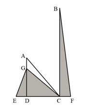

[代码描摹高清 PNG](../../../images/code_hd/1142.png) · [SVG](../../../images/code_hd/1142.svg)（原图为准）

A.3200 B.3600 C.4000 D.4800

来源：[2024年浙江省公务员录用考试《行测》题（A类）（网友回忆版）.pdf](https://github.com/dumarstoft-ship-it/xingce/blob/407016b55b49581efa3771bb59a2dee8761d982f/2024%E5%B9%B4%E6%B5%99%E6%B1%9F%E7%9C%81%E5%85%AC%E5%8A%A1%E5%91%98%E5%BD%95%E7%94%A8%E8%80%83%E8%AF%95%E3%80%8A%E8%A1%8C%E6%B5%8B%E3%80%8B%E9%A2%98%EF%BC%88A%E7%B1%BB%EF%BC%89%EF%BC%88%E7%BD%91%E5%8F%8B%E5%9B%9E%E5%BF%86%E7%89%88%EF%BC%89.pdf)，PDF 第 11、12 页。

## 第 66 题 · 数量关系

`ZJ2024-A类-066`

某工厂有100个零件，从1-100编号后将编号为奇数的零件拿掉，余下50个零件按顺序重新从1开始编号后将编
号为奇数的零件拿掉，重复上述操作直到剩下一个零件，那么余下这个零件最初的编号是多少？
A.32 B.50 C.64 D.100

来源：[2024年浙江省公务员录用考试《行测》题（A类）（网友回忆版）.pdf](https://github.com/dumarstoft-ship-it/xingce/blob/407016b55b49581efa3771bb59a2dee8761d982f/2024%E5%B9%B4%E6%B5%99%E6%B1%9F%E7%9C%81%E5%85%AC%E5%8A%A1%E5%91%98%E5%BD%95%E7%94%A8%E8%80%83%E8%AF%95%E3%80%8A%E8%A1%8C%E6%B5%8B%E3%80%8B%E9%A2%98%EF%BC%88A%E7%B1%BB%EF%BC%89%EF%BC%88%E7%BD%91%E5%8F%8B%E5%9B%9E%E5%BF%86%E7%89%88%EF%BC%89.pdf)，PDF 第 12 页。

## 第 67 题 · 数量关系

`ZJ2024-A类-067`

如图所示有25个点，行、列都以相等的间隔排列。用其中4个点作为顶点连接成正方形，那么有多少种不同边
长的正方形？

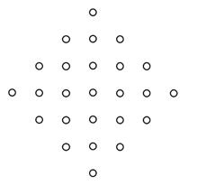

[代码描摹高清 PNG](../../../images/code_hd/289.png) · [SVG](../../../images/code_hd/289.svg)（原图为准）

A.4 B.5 C.6 D.7

来源：[2024年浙江省公务员录用考试《行测》题（A类）（网友回忆版）.pdf](https://github.com/dumarstoft-ship-it/xingce/blob/407016b55b49581efa3771bb59a2dee8761d982f/2024%E5%B9%B4%E6%B5%99%E6%B1%9F%E7%9C%81%E5%85%AC%E5%8A%A1%E5%91%98%E5%BD%95%E7%94%A8%E8%80%83%E8%AF%95%E3%80%8A%E8%A1%8C%E6%B5%8B%E3%80%8B%E9%A2%98%EF%BC%88A%E7%B1%BB%EF%BC%89%EF%BC%88%E7%BD%91%E5%8F%8B%E5%9B%9E%E5%BF%86%E7%89%88%EF%BC%89.pdf)，PDF 第 12 页。

## 第 68 题 · 数量关系

`ZJ2024-A类-068`

某同学在某天12：15-13：15内随机一个时刻开始午睡，午睡时长为0-1小时内的随机时间。问该同学在14：00
之后起床的概率为：
A.1/16
B.1/32
C.1/48
D.1/64

来源：[2024年浙江省公务员录用考试《行测》题（A类）（网友回忆版）.pdf](https://github.com/dumarstoft-ship-it/xingce/blob/407016b55b49581efa3771bb59a2dee8761d982f/2024%E5%B9%B4%E6%B5%99%E6%B1%9F%E7%9C%81%E5%85%AC%E5%8A%A1%E5%91%98%E5%BD%95%E7%94%A8%E8%80%83%E8%AF%95%E3%80%8A%E8%A1%8C%E6%B5%8B%E3%80%8B%E9%A2%98%EF%BC%88A%E7%B1%BB%EF%BC%89%EF%BC%88%E7%BD%91%E5%8F%8B%E5%9B%9E%E5%BF%86%E7%89%88%EF%BC%89.pdf)，PDF 第 12 页。

## 第 69 题 · 数量关系

`ZJ2024-A类-069`

某班级有6名学生坐在一排，上课铃响后慌乱中回到座位上，结果只有2人坐到了自己的位置，只有2个相邻的
同学坐到了对方的位置。问有多少种这样的情况？
A.12 B.18 C.24 D.36

来源：[2024年浙江省公务员录用考试《行测》题（A类）（网友回忆版）.pdf](https://github.com/dumarstoft-ship-it/xingce/blob/407016b55b49581efa3771bb59a2dee8761d982f/2024%E5%B9%B4%E6%B5%99%E6%B1%9F%E7%9C%81%E5%85%AC%E5%8A%A1%E5%91%98%E5%BD%95%E7%94%A8%E8%80%83%E8%AF%95%E3%80%8A%E8%A1%8C%E6%B5%8B%E3%80%8B%E9%A2%98%EF%BC%88A%E7%B1%BB%EF%BC%89%EF%BC%88%E7%BD%91%E5%8F%8B%E5%9B%9E%E5%BF%86%E7%89%88%EF%BC%89.pdf)，PDF 第 12 页。

## 第 70 题 · 数量关系

`ZJ2024-A类-070`

某自助餐厅提供羊肉串，小王怕浪费每次最多只拿3串。已知他正好吃了10串，那么他共有多少种不同的拿
法？
A.44 B.81 C.149 D.274

来源：[2024年浙江省公务员录用考试《行测》题（A类）（网友回忆版）.pdf](https://github.com/dumarstoft-ship-it/xingce/blob/407016b55b49581efa3771bb59a2dee8761d982f/2024%E5%B9%B4%E6%B5%99%E6%B1%9F%E7%9C%81%E5%85%AC%E5%8A%A1%E5%91%98%E5%BD%95%E7%94%A8%E8%80%83%E8%AF%95%E3%80%8A%E8%A1%8C%E6%B5%8B%E3%80%8B%E9%A2%98%EF%BC%88A%E7%B1%BB%EF%BC%89%EF%BC%88%E7%BD%91%E5%8F%8B%E5%9B%9E%E5%BF%86%E7%89%88%EF%BC%89.pdf)，PDF 第 12 页。

## 第 71 题 · 判断推理

`ZJ2024-A类-071`

从所给的四个选项中，选择最合适的一个填入问号处，使之呈现一定的规律性：

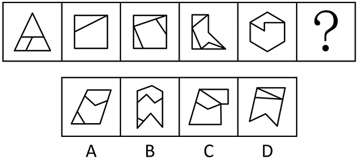

A.A B.B C.C D.D

来源：[2024年浙江省公务员录用考试《行测》题（A类）（网友回忆版）.pdf](https://github.com/dumarstoft-ship-it/xingce/blob/407016b55b49581efa3771bb59a2dee8761d982f/2024%E5%B9%B4%E6%B5%99%E6%B1%9F%E7%9C%81%E5%85%AC%E5%8A%A1%E5%91%98%E5%BD%95%E7%94%A8%E8%80%83%E8%AF%95%E3%80%8A%E8%A1%8C%E6%B5%8B%E3%80%8B%E9%A2%98%EF%BC%88A%E7%B1%BB%EF%BC%89%EF%BC%88%E7%BD%91%E5%8F%8B%E5%9B%9E%E5%BF%86%E7%89%88%EF%BC%89.pdf)，PDF 第 12、13 页。

## 第 72 题 · 判断推理

`ZJ2024-A类-072`

从所给的四个选项中，选择最合适的一个填入问号处，使之呈现一定的规律性：

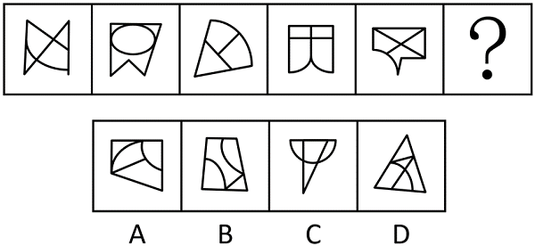

A.A B.B C.C D.D

来源：[2024年浙江省公务员录用考试《行测》题（A类）（网友回忆版）.pdf](https://github.com/dumarstoft-ship-it/xingce/blob/407016b55b49581efa3771bb59a2dee8761d982f/2024%E5%B9%B4%E6%B5%99%E6%B1%9F%E7%9C%81%E5%85%AC%E5%8A%A1%E5%91%98%E5%BD%95%E7%94%A8%E8%80%83%E8%AF%95%E3%80%8A%E8%A1%8C%E6%B5%8B%E3%80%8B%E9%A2%98%EF%BC%88A%E7%B1%BB%EF%BC%89%EF%BC%88%E7%BD%91%E5%8F%8B%E5%9B%9E%E5%BF%86%E7%89%88%EF%BC%89.pdf)，PDF 第 13 页。

## 第 73 题 · 判断推理

`ZJ2024-A类-073`

从所给的四个选项中，选择最合适的一个填入问号处，使之呈现一定的规律性：

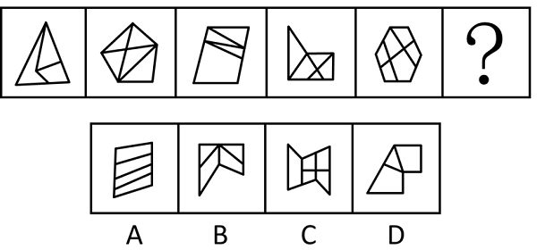

A.A B.B C.C D.D

来源：[2024年浙江省公务员录用考试《行测》题（A类）（网友回忆版）.pdf](https://github.com/dumarstoft-ship-it/xingce/blob/407016b55b49581efa3771bb59a2dee8761d982f/2024%E5%B9%B4%E6%B5%99%E6%B1%9F%E7%9C%81%E5%85%AC%E5%8A%A1%E5%91%98%E5%BD%95%E7%94%A8%E8%80%83%E8%AF%95%E3%80%8A%E8%A1%8C%E6%B5%8B%E3%80%8B%E9%A2%98%EF%BC%88A%E7%B1%BB%EF%BC%89%EF%BC%88%E7%BD%91%E5%8F%8B%E5%9B%9E%E5%BF%86%E7%89%88%EF%BC%89.pdf)，PDF 第 13 页。

## 第 74 题 · 判断推理

`ZJ2024-A类-074`

把下面的六个图形分为两类，使每一类图形都有各自的共同特征或规律，分类正确的一项是：

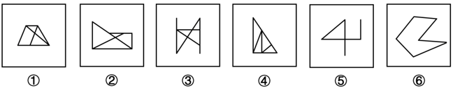

A.①④⑤，②③⑥ B.①②⑥，③④⑤ C.①⑤⑥，②③④ D.①③④，②⑤⑥

来源：[2024年浙江省公务员录用考试《行测》题（A类）（网友回忆版）.pdf](https://github.com/dumarstoft-ship-it/xingce/blob/407016b55b49581efa3771bb59a2dee8761d982f/2024%E5%B9%B4%E6%B5%99%E6%B1%9F%E7%9C%81%E5%85%AC%E5%8A%A1%E5%91%98%E5%BD%95%E7%94%A8%E8%80%83%E8%AF%95%E3%80%8A%E8%A1%8C%E6%B5%8B%E3%80%8B%E9%A2%98%EF%BC%88A%E7%B1%BB%EF%BC%89%EF%BC%88%E7%BD%91%E5%8F%8B%E5%9B%9E%E5%BF%86%E7%89%88%EF%BC%89.pdf)，PDF 第 13 页。

## 第 75 题 · 判断推理

`ZJ2024-A类-075`

把下面的六个图形分为两类，使每一类图形都有各自的共同特征或规律，分类正确的一项是：

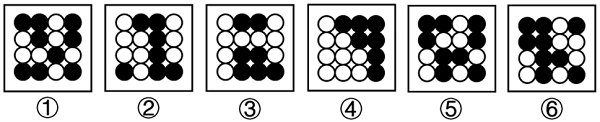

A.①②③，④⑤⑥ B.①③④，②⑤⑥ C.①④⑥，②③⑤ D.①⑤⑥，②③④

来源：[2024年浙江省公务员录用考试《行测》题（A类）（网友回忆版）.pdf](https://github.com/dumarstoft-ship-it/xingce/blob/407016b55b49581efa3771bb59a2dee8761d982f/2024%E5%B9%B4%E6%B5%99%E6%B1%9F%E7%9C%81%E5%85%AC%E5%8A%A1%E5%91%98%E5%BD%95%E7%94%A8%E8%80%83%E8%AF%95%E3%80%8A%E8%A1%8C%E6%B5%8B%E3%80%8B%E9%A2%98%EF%BC%88A%E7%B1%BB%EF%BC%89%EF%BC%88%E7%BD%91%E5%8F%8B%E5%9B%9E%E5%BF%86%E7%89%88%EF%BC%89.pdf)，PDF 第 14 页。

## 第 76 题 · 判断推理

`ZJ2024-A类-076`

把下面的六个图形分为两类，使每一类图形都有各自的共同特征或规律，分类正确的一项是：

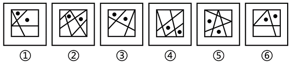

A.①②⑥，③④⑤ B.①③④，②⑤⑥ C.①③⑥，②④⑤ D.①④⑥，②③⑤

来源：[2024年浙江省公务员录用考试《行测》题（A类）（网友回忆版）.pdf](https://github.com/dumarstoft-ship-it/xingce/blob/407016b55b49581efa3771bb59a2dee8761d982f/2024%E5%B9%B4%E6%B5%99%E6%B1%9F%E7%9C%81%E5%85%AC%E5%8A%A1%E5%91%98%E5%BD%95%E7%94%A8%E8%80%83%E8%AF%95%E3%80%8A%E8%A1%8C%E6%B5%8B%E3%80%8B%E9%A2%98%EF%BC%88A%E7%B1%BB%EF%BC%89%EF%BC%88%E7%BD%91%E5%8F%8B%E5%9B%9E%E5%BF%86%E7%89%88%EF%BC%89.pdf)，PDF 第 14 页。

## 第 77 题 · 判断推理

`ZJ2024-A类-077`

把下面的六个图形分为两类，使每一类图形都有各自的共同特征或规律，分类正确的一项是：

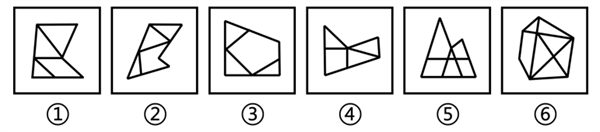

A.①④⑥，②③⑤ B.①②③，④⑤⑥ C.①③④，②⑤⑥ D.①②④，③⑤⑥

来源：[2024年浙江省公务员录用考试《行测》题（A类）（网友回忆版）.pdf](https://github.com/dumarstoft-ship-it/xingce/blob/407016b55b49581efa3771bb59a2dee8761d982f/2024%E5%B9%B4%E6%B5%99%E6%B1%9F%E7%9C%81%E5%85%AC%E5%8A%A1%E5%91%98%E5%BD%95%E7%94%A8%E8%80%83%E8%AF%95%E3%80%8A%E8%A1%8C%E6%B5%8B%E3%80%8B%E9%A2%98%EF%BC%88A%E7%B1%BB%EF%BC%89%EF%BC%88%E7%BD%91%E5%8F%8B%E5%9B%9E%E5%BF%86%E7%89%88%EF%BC%89.pdf)，PDF 第 14 页。

## 第 78 题 · 判断推理

`ZJ2024-A类-078`

把下面的六个图形分为两类，使每一类图形都有各自的共同特征或规律，分类正确的一项是：

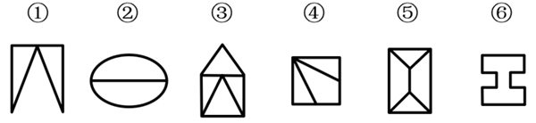

A.①③④，②⑤⑥ B.①③⑥，②④⑤ C.①②⑤，③④⑥ D.①④⑥，②③⑤

来源：[2024年浙江省公务员录用考试《行测》题（A类）（网友回忆版）.pdf](https://github.com/dumarstoft-ship-it/xingce/blob/407016b55b49581efa3771bb59a2dee8761d982f/2024%E5%B9%B4%E6%B5%99%E6%B1%9F%E7%9C%81%E5%85%AC%E5%8A%A1%E5%91%98%E5%BD%95%E7%94%A8%E8%80%83%E8%AF%95%E3%80%8A%E8%A1%8C%E6%B5%8B%E3%80%8B%E9%A2%98%EF%BC%88A%E7%B1%BB%EF%BC%89%EF%BC%88%E7%BD%91%E5%8F%8B%E5%9B%9E%E5%BF%86%E7%89%88%EF%BC%89.pdf)，PDF 第 14 页。

## 第 79 题 · 判断推理

`ZJ2024-A类-079`

左边给定的是纸盒的外表面展开图，右边哪项能够由它折叠而成？

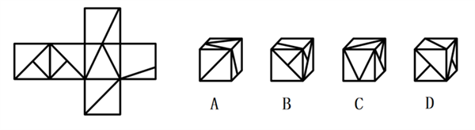

A.A B.B C.C D.D

来源：[2024年浙江省公务员录用考试《行测》题（A类）（网友回忆版）.pdf](https://github.com/dumarstoft-ship-it/xingce/blob/407016b55b49581efa3771bb59a2dee8761d982f/2024%E5%B9%B4%E6%B5%99%E6%B1%9F%E7%9C%81%E5%85%AC%E5%8A%A1%E5%91%98%E5%BD%95%E7%94%A8%E8%80%83%E8%AF%95%E3%80%8A%E8%A1%8C%E6%B5%8B%E3%80%8B%E9%A2%98%EF%BC%88A%E7%B1%BB%EF%BC%89%EF%BC%88%E7%BD%91%E5%8F%8B%E5%9B%9E%E5%BF%86%E7%89%88%EF%BC%89.pdf)，PDF 第 14 页。

## 第 80 题 · 判断推理

`ZJ2024-A类-080`

左边的立体图形是由①、②和③组成的，下列哪项可以填入问号处？

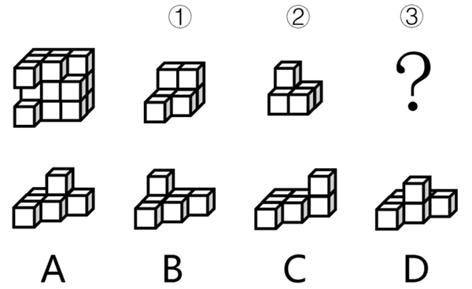

A.A B.B C.C D.D

来源：[2024年浙江省公务员录用考试《行测》题（A类）（网友回忆版）.pdf](https://github.com/dumarstoft-ship-it/xingce/blob/407016b55b49581efa3771bb59a2dee8761d982f/2024%E5%B9%B4%E6%B5%99%E6%B1%9F%E7%9C%81%E5%85%AC%E5%8A%A1%E5%91%98%E5%BD%95%E7%94%A8%E8%80%83%E8%AF%95%E3%80%8A%E8%A1%8C%E6%B5%8B%E3%80%8B%E9%A2%98%EF%BC%88A%E7%B1%BB%EF%BC%89%EF%BC%88%E7%BD%91%E5%8F%8B%E5%9B%9E%E5%BF%86%E7%89%88%EF%BC%89.pdf)，PDF 第 14、15 页。

## 第 81 题 · 判断推理

`ZJ2024-A类-081`

素数是指在大于1的自然数中，除了1和它本身以外不再有其他因数的自然数，孪生素数是指两个相差为2的素
数。
根据上述定义，下列均属于孪生素数的是：
A.2和3；101和103 B.29和31；41和43
C.5和7；623和625 D.11和13；69和71

来源：[2024年浙江省公务员录用考试《行测》题（A类）（网友回忆版）.pdf](https://github.com/dumarstoft-ship-it/xingce/blob/407016b55b49581efa3771bb59a2dee8761d982f/2024%E5%B9%B4%E6%B5%99%E6%B1%9F%E7%9C%81%E5%85%AC%E5%8A%A1%E5%91%98%E5%BD%95%E7%94%A8%E8%80%83%E8%AF%95%E3%80%8A%E8%A1%8C%E6%B5%8B%E3%80%8B%E9%A2%98%EF%BC%88A%E7%B1%BB%EF%BC%89%EF%BC%88%E7%BD%91%E5%8F%8B%E5%9B%9E%E5%BF%86%E7%89%88%EF%BC%89.pdf)，PDF 第 15 页。

## 第 82 题 · 判断推理

`ZJ2024-A类-082`

军事威慑是指国家或政治集团，通过显示武力或表示准备用武力的决心，迫使对方屈从于自己的意志，不敢采
取或升级敌对行动的军事行动。
根据上述定义，下列情形不属于军事威慑的是：
A.在关系紧张的国家周边进行军事演习 B.对外宣布正在研发某项高端军事技术
C.对关系紧张国家的战略物资实施禁运 D.有针对性地大规模部署军事进攻设施

来源：[2024年浙江省公务员录用考试《行测》题（A类）（网友回忆版）.pdf](https://github.com/dumarstoft-ship-it/xingce/blob/407016b55b49581efa3771bb59a2dee8761d982f/2024%E5%B9%B4%E6%B5%99%E6%B1%9F%E7%9C%81%E5%85%AC%E5%8A%A1%E5%91%98%E5%BD%95%E7%94%A8%E8%80%83%E8%AF%95%E3%80%8A%E8%A1%8C%E6%B5%8B%E3%80%8B%E9%A2%98%EF%BC%88A%E7%B1%BB%EF%BC%89%EF%BC%88%E7%BD%91%E5%8F%8B%E5%9B%9E%E5%BF%86%E7%89%88%EF%BC%89.pdf)，PDF 第 15 页。

## 第 83 题 · 判断推理

`ZJ2024-A类-083`

述补短语是由述语和补语前后两部分组成的，补语用来补充说明述语的动作行为的情况、结果、处所、数量、
时间等；述宾短语是由述语和宾语前后两部分组成的，宾语是述语所表示的动作或现象所支配或关涉到的对
象。
根据上述定义，下列属于述补短语的是：
A.力度刚好 B.打开电脑 C.反应强烈 D.大江东去

来源：[2024年浙江省公务员录用考试《行测》题（A类）（网友回忆版）.pdf](https://github.com/dumarstoft-ship-it/xingce/blob/407016b55b49581efa3771bb59a2dee8761d982f/2024%E5%B9%B4%E6%B5%99%E6%B1%9F%E7%9C%81%E5%85%AC%E5%8A%A1%E5%91%98%E5%BD%95%E7%94%A8%E8%80%83%E8%AF%95%E3%80%8A%E8%A1%8C%E6%B5%8B%E3%80%8B%E9%A2%98%EF%BC%88A%E7%B1%BB%EF%BC%89%EF%BC%88%E7%BD%91%E5%8F%8B%E5%9B%9E%E5%BF%86%E7%89%88%EF%BC%89.pdf)，PDF 第 15 页。

## 第 84 题 · 判断推理

`ZJ2024-A类-084`

外向投射是指将自己不喜欢的观念、冲动或品质夸张性地归于他人，以避免或减轻内心的不安与痛苦的心理防
御机制。
根据上述定义，下列属于外向投射的是：
A.小赵考试没有考好愤而撕了试卷
B.小钱做了坏事后，为减轻内疚感，转而投身慈善事业
C.小孙其实很自卑，但在实际行动和言谈中却表现出过分自信
D.小李骨折住院时常常焦躁不安，动辄发怒，责怪家人照料不周，埋怨医务人员未尽心尽责

来源：[2024年浙江省公务员录用考试《行测》题（A类）（网友回忆版）.pdf](https://github.com/dumarstoft-ship-it/xingce/blob/407016b55b49581efa3771bb59a2dee8761d982f/2024%E5%B9%B4%E6%B5%99%E6%B1%9F%E7%9C%81%E5%85%AC%E5%8A%A1%E5%91%98%E5%BD%95%E7%94%A8%E8%80%83%E8%AF%95%E3%80%8A%E8%A1%8C%E6%B5%8B%E3%80%8B%E9%A2%98%EF%BC%88A%E7%B1%BB%EF%BC%89%EF%BC%88%E7%BD%91%E5%8F%8B%E5%9B%9E%E5%BF%86%E7%89%88%EF%BC%89.pdf)，PDF 第 15 页。

## 第 85 题 · 判断推理

`ZJ2024-A类-085`

20世纪60年代，已是制成品出口主要国家的荷兰发现大量天然气，荷兰政府大力发展天然气业，出口剧增，国
际收入出现顺差，经济显现繁荣景象，但蓬勃发展的天然气业却严重打击了荷兰的农业和其他工业部门，削弱
了制成品出口行业的国际竞争力。到20世纪70年代，荷兰遭受到通货膨胀上升、制成品出口下降、收入增长率
降低、失业率增加的困扰。这种资源产业在繁荣时期价格膨胀是以牺牲其他行业为代价的现象，国际上称之为
“荷兰病”。
根据上述定义，下列属于“荷兰病”的是：
A.经济极不发达的甲国在其国境内发现了大油田，创造了大量就业机会，大大提高了国民收入水平
B.十年前，乙国的经济支柱产业是汽车制造业，目前该国已转型为金融大国，汽车制造行业不断萎缩
C.丙国经济常年依赖农产品出口，在农业上投入了大量劳动力，导致该国其他行业的发展一直停滞不前
D.重工业国家丁国发现了大量矿藏资源，大批工人向采矿业转移，导致工业人才流失，工业生产力逐年下降，
供求矛盾加剧

来源：[2024年浙江省公务员录用考试《行测》题（A类）（网友回忆版）.pdf](https://github.com/dumarstoft-ship-it/xingce/blob/407016b55b49581efa3771bb59a2dee8761d982f/2024%E5%B9%B4%E6%B5%99%E6%B1%9F%E7%9C%81%E5%85%AC%E5%8A%A1%E5%91%98%E5%BD%95%E7%94%A8%E8%80%83%E8%AF%95%E3%80%8A%E8%A1%8C%E6%B5%8B%E3%80%8B%E9%A2%98%EF%BC%88A%E7%B1%BB%EF%BC%89%EF%BC%88%E7%BD%91%E5%8F%8B%E5%9B%9E%E5%BF%86%E7%89%88%EF%BC%89.pdf)，PDF 第 15、16 页。

## 第 86 题 · 判断推理

`ZJ2024-A类-086`

防卫不适时，是指在不法侵害行为尚未开始，或者已经结束的情况下，对不法侵害者实行的防卫行为；假想防
卫，是指行为人由于主观认识上的错误，误认为有不法侵害的存在，实施防卫行为结果造成损害的行为；挑拨
防卫，是指以挑拨寻衅等不正当手段，故意激怒对方，引诱对方对自己进行侵害，然后以“正当防卫”为借
口，实行加害的行为。
根据上述定义，下列说法正确的是：
A.甲和乙驾车行驶时发生剐蹭，二人下车后发生口角，甲从车内拿出裁纸刀，乙见状立刻回到车内，驾车将甲
撞伤，乙的行为属于挑拨防卫
B.甲因住楼上的乙家经常发出噪音，上楼与乙理论未果，二人不欢而散。翌日，甲、乙迎面碰见，乙认为甲要
伺机报复，便先袭击了甲，乙的行为属于防卫不适时
C.甲、乙二人在饭店吃饭，酒后发生肢体冲突，此时乙的朋友丙进入饭店，试图劝阻二人，甲认为丙是乙叫来
的打手，便拿起酒瓶将乙和丙打伤，甲的行为属于假想防卫
D.甲将自己的房屋出租给乙，租期一年，三个月后甲、乙因设施损坏问题发生争吵，争吵间甲说乙如果敢动手
就不退还押金，乙气不过，将甲打成重伤，甲的行为属于挑拨防卫

来源：[2024年浙江省公务员录用考试《行测》题（A类）（网友回忆版）.pdf](https://github.com/dumarstoft-ship-it/xingce/blob/407016b55b49581efa3771bb59a2dee8761d982f/2024%E5%B9%B4%E6%B5%99%E6%B1%9F%E7%9C%81%E5%85%AC%E5%8A%A1%E5%91%98%E5%BD%95%E7%94%A8%E8%80%83%E8%AF%95%E3%80%8A%E8%A1%8C%E6%B5%8B%E3%80%8B%E9%A2%98%EF%BC%88A%E7%B1%BB%EF%BC%89%EF%BC%88%E7%BD%91%E5%8F%8B%E5%9B%9E%E5%BF%86%E7%89%88%EF%BC%89.pdf)，PDF 第 16 页。

## 第 87 题 · 判断推理

`ZJ2024-A类-087`

自然法主张一定的权利因为人类本性中的美德而固然存在，由自然赋予；成文法是指国家机关依照一定的程序
制定和颁布的，表现为条文形式的法律文件；习惯法是指独立于国家制定法之外，依据某种社会权威和社会组
织，具有一定强制性的行为规范的总和。
根据上述定义，下列属于习惯法的是：
A.举事以为人者，众助之；举事以自为者，众去之
B.凡教唆词讼，及为人作词状，增减情罪诬告人者，与犯人同罪
C.上圣卓然先行敬让博爱之德者，众心说而从之。从之成群，是为君矣；归而往之，是为王矣
D.议得我辈同行业者，不与现在行家弟兄亲戚，以及管账之人合伙合业，以防明充暗顶之渐，违者公罚

来源：[2024年浙江省公务员录用考试《行测》题（A类）（网友回忆版）.pdf](https://github.com/dumarstoft-ship-it/xingce/blob/407016b55b49581efa3771bb59a2dee8761d982f/2024%E5%B9%B4%E6%B5%99%E6%B1%9F%E7%9C%81%E5%85%AC%E5%8A%A1%E5%91%98%E5%BD%95%E7%94%A8%E8%80%83%E8%AF%95%E3%80%8A%E8%A1%8C%E6%B5%8B%E3%80%8B%E9%A2%98%EF%BC%88A%E7%B1%BB%EF%BC%89%EF%BC%88%E7%BD%91%E5%8F%8B%E5%9B%9E%E5%BF%86%E7%89%88%EF%BC%89.pdf)，PDF 第 16 页。

## 第 88 题 · 判断推理

`ZJ2024-A类-088`

锚定效应是指当人们需要对某个事件做定量估测时，会将先前获得的某些特定数值作为起始值，起始值像锚一
样制约着估测值。在做决策时，倾向于过度利用这一起始值，快速做出判断，但这种判断往往是与现实有偏差
的。
根据上述定义，下列不涉及锚定效应的是：
A.小李原本6点下班，最近调整为5点下班，他觉得下班后的时间变得很长
B.在奢侈品店看到一款百元包会觉得便宜，在地摊上看到同款百元包会觉得贵
C.小王听说某护肤品卖200元，但他去超市后发现，该护肤品在搞促销，只卖100元，他非常惊喜，觉得“太便
宜了”，于是一次性买了5瓶
D.先让两组参与者判断尼罗河的长度是否长于5000km/短于5000km，再让两组参与者分别估计尼罗河的具体长
度，结果发现，被询问“是否长于5000km”的参与者比被询问“是否短于5000km”的参与者报告的尼罗河具体
长度更长

来源：[2024年浙江省公务员录用考试《行测》题（A类）（网友回忆版）.pdf](https://github.com/dumarstoft-ship-it/xingce/blob/407016b55b49581efa3771bb59a2dee8761d982f/2024%E5%B9%B4%E6%B5%99%E6%B1%9F%E7%9C%81%E5%85%AC%E5%8A%A1%E5%91%98%E5%BD%95%E7%94%A8%E8%80%83%E8%AF%95%E3%80%8A%E8%A1%8C%E6%B5%8B%E3%80%8B%E9%A2%98%EF%BC%88A%E7%B1%BB%EF%BC%89%EF%BC%88%E7%BD%91%E5%8F%8B%E5%9B%9E%E5%BF%86%E7%89%88%EF%BC%89.pdf)，PDF 第 16 页。

## 第 89 题 · 判断推理

`ZJ2024-A类-089`

电子官僚主义是指近些年随着电子化、信息化而产生的一种官僚主义形式，主要表现为过度依赖电子化政务、
信息化管理、网上办理、台账管理等形式，不考虑实际工作问题，其实质上是脱离实际、脱离群众、高高在
上。
根据上述定义，下列不属于电子官僚主义的是：
A.某县政府召集乡镇干部开会，传达上级会议和文件精神，要求无法现场参会的人员线上参会、电子签到
B.某年轻干部不深入一线、不下乡调研，通过各式各样的“电子台账”，坐在办公室里就完成本部门的任务
C.某上级部门要求下级部门所有工作都要签订“项目责任书”，要求线上实时更新、反馈和上报各种材料和数
据
D.某部门强调“规范审批、落实责任”，即使线下完成的审批事项也要求服务对象在信息化系统中再次提交留
痕

来源：[2024年浙江省公务员录用考试《行测》题（A类）（网友回忆版）.pdf](https://github.com/dumarstoft-ship-it/xingce/blob/407016b55b49581efa3771bb59a2dee8761d982f/2024%E5%B9%B4%E6%B5%99%E6%B1%9F%E7%9C%81%E5%85%AC%E5%8A%A1%E5%91%98%E5%BD%95%E7%94%A8%E8%80%83%E8%AF%95%E3%80%8A%E8%A1%8C%E6%B5%8B%E3%80%8B%E9%A2%98%EF%BC%88A%E7%B1%BB%EF%BC%89%EF%BC%88%E7%BD%91%E5%8F%8B%E5%9B%9E%E5%BF%86%E7%89%88%EF%BC%89.pdf)，PDF 第 16、17 页。

## 第 90 题 · 判断推理

`ZJ2024-A类-090`

学习重组性迁移是指重新组合原有认知系统中某些构成要素或成分，调整各成分间的关系或建立新的联系，从
而应用于新情境；学习同化性迁移是指不改变原有的认知结构，直接将原有的认知经验应用到本质特征相同的
一类事物中去。
根据上述定义，下列属于学习重组性迁移的是：
A.小张认为某现象符合马太效应，所以用其来分析
B.小李套用从书本上学到的数学公式解答数学应用题
C.源于西方的新发展观可直接解释东南亚国家的一些发展问题
D.将工程学的某个理论适当修改，用来解释教育领域的相关问题

来源：[2024年浙江省公务员录用考试《行测》题（A类）（网友回忆版）.pdf](https://github.com/dumarstoft-ship-it/xingce/blob/407016b55b49581efa3771bb59a2dee8761d982f/2024%E5%B9%B4%E6%B5%99%E6%B1%9F%E7%9C%81%E5%85%AC%E5%8A%A1%E5%91%98%E5%BD%95%E7%94%A8%E8%80%83%E8%AF%95%E3%80%8A%E8%A1%8C%E6%B5%8B%E3%80%8B%E9%A2%98%EF%BC%88A%E7%B1%BB%EF%BC%89%EF%BC%88%E7%BD%91%E5%8F%8B%E5%9B%9E%E5%BF%86%E7%89%88%EF%BC%89.pdf)，PDF 第 17 页。

## 第 91 题 · 判断推理

`ZJ2024-A类-091`

觉察：察觉
A.互相：相互 B.和平：平和 C.黄金：金黄 D.年少：少年

来源：[2024年浙江省公务员录用考试《行测》题（A类）（网友回忆版）.pdf](https://github.com/dumarstoft-ship-it/xingce/blob/407016b55b49581efa3771bb59a2dee8761d982f/2024%E5%B9%B4%E6%B5%99%E6%B1%9F%E7%9C%81%E5%85%AC%E5%8A%A1%E5%91%98%E5%BD%95%E7%94%A8%E8%80%83%E8%AF%95%E3%80%8A%E8%A1%8C%E6%B5%8B%E3%80%8B%E9%A2%98%EF%BC%88A%E7%B1%BB%EF%BC%89%EF%BC%88%E7%BD%91%E5%8F%8B%E5%9B%9E%E5%BF%86%E7%89%88%EF%BC%89.pdf)，PDF 第 17 页。

## 第 92 题 · 判断推理

`ZJ2024-A类-092`

米醋：米酒
A.茶壶：茶砖 B.水库：水沟 C.棉花：棉衣 D.石雕：石碑

来源：[2024年浙江省公务员录用考试《行测》题（A类）（网友回忆版）.pdf](https://github.com/dumarstoft-ship-it/xingce/blob/407016b55b49581efa3771bb59a2dee8761d982f/2024%E5%B9%B4%E6%B5%99%E6%B1%9F%E7%9C%81%E5%85%AC%E5%8A%A1%E5%91%98%E5%BD%95%E7%94%A8%E8%80%83%E8%AF%95%E3%80%8A%E8%A1%8C%E6%B5%8B%E3%80%8B%E9%A2%98%EF%BC%88A%E7%B1%BB%EF%BC%89%EF%BC%88%E7%BD%91%E5%8F%8B%E5%9B%9E%E5%BF%86%E7%89%88%EF%BC%89.pdf)，PDF 第 17 页。

## 第 93 题 · 判断推理

`ZJ2024-A类-093`

比赛：规则：公平
A.驾驶：警察：秩序 B.表演：剧本：原创 C.手术：灯光：明亮 D.爬山：手杖：结实

来源：[2024年浙江省公务员录用考试《行测》题（A类）（网友回忆版）.pdf](https://github.com/dumarstoft-ship-it/xingce/blob/407016b55b49581efa3771bb59a2dee8761d982f/2024%E5%B9%B4%E6%B5%99%E6%B1%9F%E7%9C%81%E5%85%AC%E5%8A%A1%E5%91%98%E5%BD%95%E7%94%A8%E8%80%83%E8%AF%95%E3%80%8A%E8%A1%8C%E6%B5%8B%E3%80%8B%E9%A2%98%EF%BC%88A%E7%B1%BB%EF%BC%89%EF%BC%88%E7%BD%91%E5%8F%8B%E5%9B%9E%E5%BF%86%E7%89%88%EF%BC%89.pdf)，PDF 第 17 页。

## 第 94 题 · 判断推理

`ZJ2024-A类-094`

乌鸡：公鸡：雏鸡
A.军刀：钢刀：菜刀 B.城门：石门：拱门 C.质数：单数：负数 D.泰山：名山：高山

来源：[2024年浙江省公务员录用考试《行测》题（A类）（网友回忆版）.pdf](https://github.com/dumarstoft-ship-it/xingce/blob/407016b55b49581efa3771bb59a2dee8761d982f/2024%E5%B9%B4%E6%B5%99%E6%B1%9F%E7%9C%81%E5%85%AC%E5%8A%A1%E5%91%98%E5%BD%95%E7%94%A8%E8%80%83%E8%AF%95%E3%80%8A%E8%A1%8C%E6%B5%8B%E3%80%8B%E9%A2%98%EF%BC%88A%E7%B1%BB%EF%BC%89%EF%BC%88%E7%BD%91%E5%8F%8B%E5%9B%9E%E5%BF%86%E7%89%88%EF%BC%89.pdf)，PDF 第 17 页。

## 第 95 题 · 判断推理

`ZJ2024-A类-095`

钟表：电子表：机械表
A.火车：动车：轿车 B.计算：笔算：心算 C.武器：火器：兵器 D.家常菜：鲁菜：粤菜

来源：[2024年浙江省公务员录用考试《行测》题（A类）（网友回忆版）.pdf](https://github.com/dumarstoft-ship-it/xingce/blob/407016b55b49581efa3771bb59a2dee8761d982f/2024%E5%B9%B4%E6%B5%99%E6%B1%9F%E7%9C%81%E5%85%AC%E5%8A%A1%E5%91%98%E5%BD%95%E7%94%A8%E8%80%83%E8%AF%95%E3%80%8A%E8%A1%8C%E6%B5%8B%E3%80%8B%E9%A2%98%EF%BC%88A%E7%B1%BB%EF%BC%89%EF%BC%88%E7%BD%91%E5%8F%8B%E5%9B%9E%E5%BF%86%E7%89%88%EF%BC%89.pdf)，PDF 第 17 页。

## 第 96 题 · 判断推理

`ZJ2024-A类-096`

茅草：草屋：屋檐
A.马匹：马车：车轮 B.茶叶：茶杯：杯盖 C.船帆：帆船：船锚 D.树木：木桌：桌腿

来源：[2024年浙江省公务员录用考试《行测》题（A类）（网友回忆版）.pdf](https://github.com/dumarstoft-ship-it/xingce/blob/407016b55b49581efa3771bb59a2dee8761d982f/2024%E5%B9%B4%E6%B5%99%E6%B1%9F%E7%9C%81%E5%85%AC%E5%8A%A1%E5%91%98%E5%BD%95%E7%94%A8%E8%80%83%E8%AF%95%E3%80%8A%E8%A1%8C%E6%B5%8B%E3%80%8B%E9%A2%98%EF%BC%88A%E7%B1%BB%EF%BC%89%EF%BC%88%E7%BD%91%E5%8F%8B%E5%9B%9E%E5%BF%86%E7%89%88%EF%BC%89.pdf)，PDF 第 17 页。

## 第 97 题 · 判断推理

`ZJ2024-A类-097`

外资企业：国有企业：集体企业
A.篮球比赛：男足比赛：女足比赛 B.水力发电：火力发电：潮汐发电
C.多程机票：单程机票：往返机票 D.巾帼英雄：民族英雄：抗日英雄

来源：[2024年浙江省公务员录用考试《行测》题（A类）（网友回忆版）.pdf](https://github.com/dumarstoft-ship-it/xingce/blob/407016b55b49581efa3771bb59a2dee8761d982f/2024%E5%B9%B4%E6%B5%99%E6%B1%9F%E7%9C%81%E5%85%AC%E5%8A%A1%E5%91%98%E5%BD%95%E7%94%A8%E8%80%83%E8%AF%95%E3%80%8A%E8%A1%8C%E6%B5%8B%E3%80%8B%E9%A2%98%EF%BC%88A%E7%B1%BB%EF%BC%89%EF%BC%88%E7%BD%91%E5%8F%8B%E5%9B%9E%E5%BF%86%E7%89%88%EF%BC%89.pdf)，PDF 第 17 页。

## 第 98 题 · 判断推理

`ZJ2024-A类-098`

雷阵雨 对于 （    ） 相当于 （    ） 对于 金砖五国
A.极端天气 俄罗斯 B.多云转晴 东盟十国 C.阵雨 合作组织 D.雷雨交加 发展中国家

来源：[2024年浙江省公务员录用考试《行测》题（A类）（网友回忆版）.pdf](https://github.com/dumarstoft-ship-it/xingce/blob/407016b55b49581efa3771bb59a2dee8761d982f/2024%E5%B9%B4%E6%B5%99%E6%B1%9F%E7%9C%81%E5%85%AC%E5%8A%A1%E5%91%98%E5%BD%95%E7%94%A8%E8%80%83%E8%AF%95%E3%80%8A%E8%A1%8C%E6%B5%8B%E3%80%8B%E9%A2%98%EF%BC%88A%E7%B1%BB%EF%BC%89%EF%BC%88%E7%BD%91%E5%8F%8B%E5%9B%9E%E5%BF%86%E7%89%88%EF%BC%89.pdf)，PDF 第 17 页。

## 第 99 题 · 判断推理

`ZJ2024-A类-099`

销售平台 对于 （    ） 相当于 （    ） 对于 剪纸艺术
A.销售渠道 文化遗产 B.商品 窗花 C.电子商铺 手工艺术 D.客服人员 艺术院校

来源：[2024年浙江省公务员录用考试《行测》题（A类）（网友回忆版）.pdf](https://github.com/dumarstoft-ship-it/xingce/blob/407016b55b49581efa3771bb59a2dee8761d982f/2024%E5%B9%B4%E6%B5%99%E6%B1%9F%E7%9C%81%E5%85%AC%E5%8A%A1%E5%91%98%E5%BD%95%E7%94%A8%E8%80%83%E8%AF%95%E3%80%8A%E8%A1%8C%E6%B5%8B%E3%80%8B%E9%A2%98%EF%BC%88A%E7%B1%BB%EF%BC%89%EF%BC%88%E7%BD%91%E5%8F%8B%E5%9B%9E%E5%BF%86%E7%89%88%EF%BC%89.pdf)，PDF 第 17 页。

## 第 100 题 · 判断推理

`ZJ2024-A类-100`

建筑工人 对于 （    ） 相当于 （    ） 对于 汽车芯片
A.高楼大厦；芯片厂商 B.焊工；手机芯片 C.建筑；汽车 D.工人宿舍；汽车零件

来源：[2024年浙江省公务员录用考试《行测》题（A类）（网友回忆版）.pdf](https://github.com/dumarstoft-ship-it/xingce/blob/407016b55b49581efa3771bb59a2dee8761d982f/2024%E5%B9%B4%E6%B5%99%E6%B1%9F%E7%9C%81%E5%85%AC%E5%8A%A1%E5%91%98%E5%BD%95%E7%94%A8%E8%80%83%E8%AF%95%E3%80%8A%E8%A1%8C%E6%B5%8B%E3%80%8B%E9%A2%98%EF%BC%88A%E7%B1%BB%EF%BC%89%EF%BC%88%E7%BD%91%E5%8F%8B%E5%9B%9E%E5%BF%86%E7%89%88%EF%BC%89.pdf)，PDF 第 17 页。

## 第 101 题 · 判断推理

`ZJ2024-A类-101`

某酒店张贴这样的标语：严禁携带易燃品、易爆品、危险品入住。
以下哪项陈述中所包含的逻辑错误与题干中的最相似？
A.许多农户养了鸡、鸭、家禽，大大增加了收入
B.罗先生收藏了许多古代的工笔画、写意画、山水画
C.花园里开着五颜六色的红花、黄花、粉花，甚为美丽
D.小红在文具店里购买了铅笔、橡皮、小刀等学习用品

来源：[2024年浙江省公务员录用考试《行测》题（A类）（网友回忆版）.pdf](https://github.com/dumarstoft-ship-it/xingce/blob/407016b55b49581efa3771bb59a2dee8761d982f/2024%E5%B9%B4%E6%B5%99%E6%B1%9F%E7%9C%81%E5%85%AC%E5%8A%A1%E5%91%98%E5%BD%95%E7%94%A8%E8%80%83%E8%AF%95%E3%80%8A%E8%A1%8C%E6%B5%8B%E3%80%8B%E9%A2%98%EF%BC%88A%E7%B1%BB%EF%BC%89%EF%BC%88%E7%BD%91%E5%8F%8B%E5%9B%9E%E5%BF%86%E7%89%88%EF%BC%89.pdf)，PDF 第 17、18 页。

## 第 102 题 · 判断推理

`ZJ2024-A类-102`

张、王、李、赵、钱、孙6人是某单位的优秀员工，在全面深化改革方面取得了很大的成就，现有甲、乙、
丙、丁四种奖项可以申报，每名员工只能申报一种奖项，且每种奖项都有1至2名员工申报，已知以下情况：
（1）申报乙奖的员工比甲奖的多；
（2）申报丁奖的员工比丙奖的多；
（3）若李、赵中至少有1名申报甲奖，则王申报丁奖；
（4）若张、李、赵中至少有1名申报乙奖，则只有钱申报丁奖；
（5）孙申报丙奖。
根据以上信息，可以得出以下哪项结论？
A.张申报丙奖 B.赵、钱申报乙奖 C.王、李申报丁奖 D.李、赵申报丁奖

来源：[2024年浙江省公务员录用考试《行测》题（A类）（网友回忆版）.pdf](https://github.com/dumarstoft-ship-it/xingce/blob/407016b55b49581efa3771bb59a2dee8761d982f/2024%E5%B9%B4%E6%B5%99%E6%B1%9F%E7%9C%81%E5%85%AC%E5%8A%A1%E5%91%98%E5%BD%95%E7%94%A8%E8%80%83%E8%AF%95%E3%80%8A%E8%A1%8C%E6%B5%8B%E3%80%8B%E9%A2%98%EF%BC%88A%E7%B1%BB%EF%BC%89%EF%BC%88%E7%BD%91%E5%8F%8B%E5%9B%9E%E5%BF%86%E7%89%88%EF%BC%89.pdf)，PDF 第 18 页。

## 第 103 题 · 判断推理

`ZJ2024-A类-103`

市美术馆近期举办“小读者”系列活动，活动包含若干项目。报名情况如下：
（1）小读者在艺术阅读和版画实践课中至少参加了一个；
（2）小读者如果参加了艺术阅读，则没有参加书法小课堂；
（3）小苏参加了书法小课堂；
美术馆馆长知道上述情况后断定，小苏也参加了手工剪纸活动。以下哪项如果为真，可以成为美术馆馆长判断
的前提？
A.小苏没有参加艺术阅读 B.小苏没有参加版画实践课
C.参加了手工剪纸活动的也参加了版画实践课 D.不参加手工剪纸活动的都不参加版画实践课

来源：[2024年浙江省公务员录用考试《行测》题（A类）（网友回忆版）.pdf](https://github.com/dumarstoft-ship-it/xingce/blob/407016b55b49581efa3771bb59a2dee8761d982f/2024%E5%B9%B4%E6%B5%99%E6%B1%9F%E7%9C%81%E5%85%AC%E5%8A%A1%E5%91%98%E5%BD%95%E7%94%A8%E8%80%83%E8%AF%95%E3%80%8A%E8%A1%8C%E6%B5%8B%E3%80%8B%E9%A2%98%EF%BC%88A%E7%B1%BB%EF%BC%89%EF%BC%88%E7%BD%91%E5%8F%8B%E5%9B%9E%E5%BF%86%E7%89%88%EF%BC%89.pdf)，PDF 第 18 页。

## 第 104 题 · 判断推理

`ZJ2024-A类-104`

“经常掰手指发出响声是一种不健康的习惯，因为掰手指发出的响声实际上是关节互相摩擦的声音，经常掰手
指会磨损手指关节导致手指关节炎。”为验证这一观点，研究人员将200余名实验对象分为2组进行了严谨的对
比实验，经长期观察后得出了结论：经常掰手指作响与手指关节炎没有明显的相关性。
以下哪项如果为真，最有可能是研究人员通过实验得到的论据？
A.掰手指发出的声响是关节腔中滑液气泡破裂的声音，并非关节摩擦的声音
B.与不掰手指的人相比，经常掰手指的人手部握力和关节强度均有不同程度下降
C.经统计，手指关节炎与病患年龄显著相关，年龄越大，患手指关节炎的概率越高
D.经统计，实验期间，在经常掰手指的实验组中，仅有1人因遗传因素患手指关节炎

来源：[2024年浙江省公务员录用考试《行测》题（A类）（网友回忆版）.pdf](https://github.com/dumarstoft-ship-it/xingce/blob/407016b55b49581efa3771bb59a2dee8761d982f/2024%E5%B9%B4%E6%B5%99%E6%B1%9F%E7%9C%81%E5%85%AC%E5%8A%A1%E5%91%98%E5%BD%95%E7%94%A8%E8%80%83%E8%AF%95%E3%80%8A%E8%A1%8C%E6%B5%8B%E3%80%8B%E9%A2%98%EF%BC%88A%E7%B1%BB%EF%BC%89%EF%BC%88%E7%BD%91%E5%8F%8B%E5%9B%9E%E5%BF%86%E7%89%88%EF%BC%89.pdf)，PDF 第 18 页。

## 第 105 题 · 判断推理

`ZJ2024-A类-105`

体温调节模式假说认为，变温动物因为需要吸收外部热量调节体温，因此代谢率通常较低，而恒温动物由内部
产生热量，代谢率较高，因此变温动物比恒温动物衰老速度慢。就像人们觉得老鼠衰老快，是因为它们新陈代
谢率很高，而海龟衰老慢，是因为它们新陈代谢率很低。
以下哪项如果为真，最能削弱上述假说?
A.有壳这种物理特征保护，海龟的衰老速度较慢，寿命更长
B.研究显示，变温动物的衰老率远高于或远低于相似体型恒温动物的衰老率
C.得出上述假说的研究主要集中在动物园的动物或少数野生动物中，且获得的证据参差不齐
D.部分变温动物的衰老可忽略不计，包括青蛙、海龟等，一旦过了繁殖期，它们死亡的可能性不会随着年龄的
增长而改变

来源：[2024年浙江省公务员录用考试《行测》题（A类）（网友回忆版）.pdf](https://github.com/dumarstoft-ship-it/xingce/blob/407016b55b49581efa3771bb59a2dee8761d982f/2024%E5%B9%B4%E6%B5%99%E6%B1%9F%E7%9C%81%E5%85%AC%E5%8A%A1%E5%91%98%E5%BD%95%E7%94%A8%E8%80%83%E8%AF%95%E3%80%8A%E8%A1%8C%E6%B5%8B%E3%80%8B%E9%A2%98%EF%BC%88A%E7%B1%BB%EF%BC%89%EF%BC%88%E7%BD%91%E5%8F%8B%E5%9B%9E%E5%BF%86%E7%89%88%EF%BC%89.pdf)，PDF 第 18 页。

## 第 106 题 · 判断推理

`ZJ2024-A类-106`

近日，某地区出现一例感染性腹泻病例，经诊断为霍乱。得知此消息后，生活在该地区附近的小李提醒身边的
人说：“霍乱是甲类传染病，致死率非常高，近期应该减少出门，减少感染几率。”
以下哪项如果为真，最能反驳小李的观点？
A.从2018年开始，我国霍乱病例不断下降，近5年无死亡病例
B.霍乱主要通过粪口途径传播，不会通过空气或皮肤接触传播
C.接触霍乱患者或带菌者后，只要及时清洁和消毒即可避免感染
D.霍乱由于发病急、病情重、传染快、传播广泛被列为甲类传染病

来源：[2024年浙江省公务员录用考试《行测》题（A类）（网友回忆版）.pdf](https://github.com/dumarstoft-ship-it/xingce/blob/407016b55b49581efa3771bb59a2dee8761d982f/2024%E5%B9%B4%E6%B5%99%E6%B1%9F%E7%9C%81%E5%85%AC%E5%8A%A1%E5%91%98%E5%BD%95%E7%94%A8%E8%80%83%E8%AF%95%E3%80%8A%E8%A1%8C%E6%B5%8B%E3%80%8B%E9%A2%98%EF%BC%88A%E7%B1%BB%EF%BC%89%EF%BC%88%E7%BD%91%E5%8F%8B%E5%9B%9E%E5%BF%86%E7%89%88%EF%BC%89.pdf)，PDF 第 18、19 页。

## 第 107 题 · 判断推理

`ZJ2024-A类-107`

进入秋季以来，国际化肥价格呈爆发式上涨，氮肥、磷肥、钾肥比上一年同期都有大幅上涨。对此，有关专家
表示，近期受多种因素叠加影响，化肥价格上涨明显，但价格与市场需求量相关，国内肥料价格很快就会回到
正常水平。
专家最不可能基于以下哪项得出上述观点？
A.肥价过高，粮价不稳，经销商和农户购肥积极性减弱
B.农业用肥即将度过高峰期进入淡季，需求量将会下降
C.原料价格上涨，生产成本过高，多家化肥企业暂停生产
D.我国延长收紧化肥出口时间，变相增加了国内化肥供应

来源：[2024年浙江省公务员录用考试《行测》题（A类）（网友回忆版）.pdf](https://github.com/dumarstoft-ship-it/xingce/blob/407016b55b49581efa3771bb59a2dee8761d982f/2024%E5%B9%B4%E6%B5%99%E6%B1%9F%E7%9C%81%E5%85%AC%E5%8A%A1%E5%91%98%E5%BD%95%E7%94%A8%E8%80%83%E8%AF%95%E3%80%8A%E8%A1%8C%E6%B5%8B%E3%80%8B%E9%A2%98%EF%BC%88A%E7%B1%BB%EF%BC%89%EF%BC%88%E7%BD%91%E5%8F%8B%E5%9B%9E%E5%BF%86%E7%89%88%EF%BC%89.pdf)，PDF 第 19 页。

## 第 108 题 · 判断推理

`ZJ2024-A类-108`

男性的性染色体为XY，Y来自父亲，X来自母亲；女性的性染色体为XX，来自父母双方。一项研究表明，决定
智商的人类基因绝大部分来自X染色体。因此，男性智商只取决于母亲的智商，女性智商则取决于双亲的智
商。
以下哪项如果为真，最能质疑上述结论？
A.男性发生智力障碍的概率是女性的1.4-1.9倍
B.X染色体40%以上的基因在大脑中表达，这一比例远高于Y染色体
C.母亲与儿子的智商相关程度比父亲与儿子的智商相关程度高约10%
D.该研究结果通过统计分析大量人类智商数据得出，并非由基因测序获得

来源：[2024年浙江省公务员录用考试《行测》题（A类）（网友回忆版）.pdf](https://github.com/dumarstoft-ship-it/xingce/blob/407016b55b49581efa3771bb59a2dee8761d982f/2024%E5%B9%B4%E6%B5%99%E6%B1%9F%E7%9C%81%E5%85%AC%E5%8A%A1%E5%91%98%E5%BD%95%E7%94%A8%E8%80%83%E8%AF%95%E3%80%8A%E8%A1%8C%E6%B5%8B%E3%80%8B%E9%A2%98%EF%BC%88A%E7%B1%BB%EF%BC%89%EF%BC%88%E7%BD%91%E5%8F%8B%E5%9B%9E%E5%BF%86%E7%89%88%EF%BC%89.pdf)，PDF 第 19 页。

## 第 109 题 · 判断推理

`ZJ2024-A类-109`

近日，某款磁性笔销量大增，买家主要是中小学生。磁性笔由多个磁力小部件组成，依靠强大的磁性可任意变
换出不同的造型，颇具娱乐性。磁性笔商家称，磁性笔能开发智力，寓教于乐，让孩子爱上写字，学龄以上孩
子都可以安全使用。
以下哪项如果为真，最能质疑商家的说法？
A.该磁性笔磁力小部件重金属超标，可能对使用者健康造成危害
B.某调查发现，初三的大部分学生认为磁性笔很无聊，是给小孩子玩的
C.家长普遍反映，孩子上课只顾着玩磁性笔，听课效率比以前下降了很多
D.一个四岁孩子在玩磁性笔时不慎吞咽了散落的磁力小部件，造成肠穿孔

来源：[2024年浙江省公务员录用考试《行测》题（A类）（网友回忆版）.pdf](https://github.com/dumarstoft-ship-it/xingce/blob/407016b55b49581efa3771bb59a2dee8761d982f/2024%E5%B9%B4%E6%B5%99%E6%B1%9F%E7%9C%81%E5%85%AC%E5%8A%A1%E5%91%98%E5%BD%95%E7%94%A8%E8%80%83%E8%AF%95%E3%80%8A%E8%A1%8C%E6%B5%8B%E3%80%8B%E9%A2%98%EF%BC%88A%E7%B1%BB%EF%BC%89%EF%BC%88%E7%BD%91%E5%8F%8B%E5%9B%9E%E5%BF%86%E7%89%88%EF%BC%89.pdf)，PDF 第 19 页。

## 第 110 题 · 判断推理

`ZJ2024-A类-110`

研究人员从分析受试者的呼吸开始，筛选可用于生物识别认证的化合物，共发现了28种可行的化合物。在此基
础上，他们开发了一个有16个通道的嗅觉传感器阵列，每个通道都可识别特定范围的化合物。传感器数据随后
被传递到机器学习系统中，分析每个人的呼吸组成，并以此区分个人的特征。研究人员根据结果表示，呼吸可
作为身份验证的识别信号。
以下哪项如果为真，最能削弱上述观点？
A.实验受试者仅20人，样本量太少
B.呼吸样本波动性极高，很容易受饮食、环境甚至情绪影响
C.16个嗅觉传感器通道较少，识别呼吸的个人特征时准确率并不稳定
D.即使患呼吸道疾病，一个人呼吸运动的独特性也会在很长时间内保持不变

来源：[2024年浙江省公务员录用考试《行测》题（A类）（网友回忆版）.pdf](https://github.com/dumarstoft-ship-it/xingce/blob/407016b55b49581efa3771bb59a2dee8761d982f/2024%E5%B9%B4%E6%B5%99%E6%B1%9F%E7%9C%81%E5%85%AC%E5%8A%A1%E5%91%98%E5%BD%95%E7%94%A8%E8%80%83%E8%AF%95%E3%80%8A%E8%A1%8C%E6%B5%8B%E3%80%8B%E9%A2%98%EF%BC%88A%E7%B1%BB%EF%BC%89%EF%BC%88%E7%BD%91%E5%8F%8B%E5%9B%9E%E5%BF%86%E7%89%88%EF%BC%89.pdf)，PDF 第 19 页。
