# 2025 年浙江行测（A类） · 题目

保留原题号。来源页码按 PDF 实际页数计，从 1 开始。答案及解析另见 answers.md。

## 第 21 题 · 言语理解与表达

`ZJ2025-A类-021`

打造文化软实力要提升讲好中国故事的能力，传播者不仅要熟悉外国人会感兴趣的中国故事，还要能跨越文化
差异障碍，了解占据主导地位的西方媒体的运行规则， ____ ，方有胜算。
填入画横线部分最恰当的一项是：
A.知己知彼 B.别出心裁 C.胸有成竹 D.兼收并蓄

来源：[2025年浙江省公务员录用考试《行测》题（A类）（网友回忆版）.pdf](https://github.com/dumarstoft-ship-it/xingce/blob/407016b55b49581efa3771bb59a2dee8761d982f/2025%E5%B9%B4%E6%B5%99%E6%B1%9F%E7%9C%81%E5%85%AC%E5%8A%A1%E5%91%98%E5%BD%95%E7%94%A8%E8%80%83%E8%AF%95%E3%80%8A%E8%A1%8C%E6%B5%8B%E3%80%8B%E9%A2%98%EF%BC%88A%E7%B1%BB%EF%BC%89%EF%BC%88%E7%BD%91%E5%8F%8B%E5%9B%9E%E5%BF%86%E7%89%88%EF%BC%89.pdf)，PDF 第 6 页。

## 第 22 题 · 言语理解与表达

`ZJ2025-A类-022`

评论工作者不仅是当下文艺实践的参与者、见证者，更是实践的学生。要紧贴当代文艺实际，置身文艺现场，
发现规律、揭示本质，言之有物，言之成理，避免 ____ 。
填入画横线部分最恰当的一项是：
A.凌空蹈虚 B.言不及义 C.人云亦云 D.虚有其表

来源：[2025年浙江省公务员录用考试《行测》题（A类）（网友回忆版）.pdf](https://github.com/dumarstoft-ship-it/xingce/blob/407016b55b49581efa3771bb59a2dee8761d982f/2025%E5%B9%B4%E6%B5%99%E6%B1%9F%E7%9C%81%E5%85%AC%E5%8A%A1%E5%91%98%E5%BD%95%E7%94%A8%E8%80%83%E8%AF%95%E3%80%8A%E8%A1%8C%E6%B5%8B%E3%80%8B%E9%A2%98%EF%BC%88A%E7%B1%BB%EF%BC%89%EF%BC%88%E7%BD%91%E5%8F%8B%E5%9B%9E%E5%BF%86%E7%89%88%EF%BC%89.pdf)，PDF 第 6 页。

## 第 23 题 · 言语理解与表达

`ZJ2025-A类-023`

高等院校只有主动融入国家战略和行业发展，人才培养工作才能适应新技术新产业新业态发展需要。要让学科
交叉融合成为高校创新发展的“ ____ ”，培养出更多能够 ____ 科技革命和产业变革的拔尖创新人才，更好服
务经济社会发展。
依次填入画横线部分最恰当的一项是：
A.生力军 催生 B.催化剂 引领 C.组合拳 驱动 D.最强音 升级

来源：[2025年浙江省公务员录用考试《行测》题（A类）（网友回忆版）.pdf](https://github.com/dumarstoft-ship-it/xingce/blob/407016b55b49581efa3771bb59a2dee8761d982f/2025%E5%B9%B4%E6%B5%99%E6%B1%9F%E7%9C%81%E5%85%AC%E5%8A%A1%E5%91%98%E5%BD%95%E7%94%A8%E8%80%83%E8%AF%95%E3%80%8A%E8%A1%8C%E6%B5%8B%E3%80%8B%E9%A2%98%EF%BC%88A%E7%B1%BB%EF%BC%89%EF%BC%88%E7%BD%91%E5%8F%8B%E5%9B%9E%E5%BF%86%E7%89%88%EF%BC%89.pdf)，PDF 第 6 页。

## 第 24 题 · 言语理解与表达

`ZJ2025-A类-024`

正如林语堂先生所言，“中国人的性情，往往安放在那些器物之中”。年轻人对中国传统物件 ____ 生活方式的
钟爱、追求，不仅仅是在盘扣、丝绸、茶叶等符号化的单品上，更在于“留白”“写意”“含蓄”“天人合
一”等精神 ____ ，形成了文化和哲学上的逻辑，在更深层面引起共振共鸣。
依次填入画横线部分最恰当的一项是：
A.乃至 内核 B.以及 世界 C.包括 层面 D.甚至 境界

来源：[2025年浙江省公务员录用考试《行测》题（A类）（网友回忆版）.pdf](https://github.com/dumarstoft-ship-it/xingce/blob/407016b55b49581efa3771bb59a2dee8761d982f/2025%E5%B9%B4%E6%B5%99%E6%B1%9F%E7%9C%81%E5%85%AC%E5%8A%A1%E5%91%98%E5%BD%95%E7%94%A8%E8%80%83%E8%AF%95%E3%80%8A%E8%A1%8C%E6%B5%8B%E3%80%8B%E9%A2%98%EF%BC%88A%E7%B1%BB%EF%BC%89%EF%BC%88%E7%BD%91%E5%8F%8B%E5%9B%9E%E5%BF%86%E7%89%88%EF%BC%89.pdf)，PDF 第 6 页。

## 第 25 题 · 言语理解与表达

`ZJ2025-A类-025`

公元前800年到公元前200年间，地球的北纬30°上下，东方、西方群星璀璨，老子、孔子、柏拉图、亚里士多
德······这些伟大的思想家或 ____ ，或接踵而出。在西方，这个时代称为轴心时代；在东方，称之为
百家争鸣。无论在东方还是西方，这个时代都被称为人类 ____ 的时代。
依次填入画横线部分最恰当的一项是：
A.纷至沓来 顿悟 B.拂袖而归 省悟 C.络绎不绝 醒悟 D.联袂登场 觉醒

来源：[2025年浙江省公务员录用考试《行测》题（A类）（网友回忆版）.pdf](https://github.com/dumarstoft-ship-it/xingce/blob/407016b55b49581efa3771bb59a2dee8761d982f/2025%E5%B9%B4%E6%B5%99%E6%B1%9F%E7%9C%81%E5%85%AC%E5%8A%A1%E5%91%98%E5%BD%95%E7%94%A8%E8%80%83%E8%AF%95%E3%80%8A%E8%A1%8C%E6%B5%8B%E3%80%8B%E9%A2%98%EF%BC%88A%E7%B1%BB%EF%BC%89%EF%BC%88%E7%BD%91%E5%8F%8B%E5%9B%9E%E5%BF%86%E7%89%88%EF%BC%89.pdf)，PDF 第 6 页。

## 第 26 题 · 言语理解与表达

`ZJ2025-A类-026`

我国长期重视生猪产业发展，农业农村部先后制定多项有 ____ 、针对性的政策，并依据生产规律及市场波
动，立足中长期规划持续展开跨周期调控。只有用地、环评、金融等长效性政策相继落实，监测预警与形势研
判得到加强，才能有效避免生产和价格出现 ____ ，避免损害养猪场户基础生产能力，确保产业健康发展。
依次填入画横线部分最恰当的一项是：
A.全局性 一波三折 B.战略性 起伏不定 C.前瞻性 大起大落 D.时代性 一泻千里

来源：[2025年浙江省公务员录用考试《行测》题（A类）（网友回忆版）.pdf](https://github.com/dumarstoft-ship-it/xingce/blob/407016b55b49581efa3771bb59a2dee8761d982f/2025%E5%B9%B4%E6%B5%99%E6%B1%9F%E7%9C%81%E5%85%AC%E5%8A%A1%E5%91%98%E5%BD%95%E7%94%A8%E8%80%83%E8%AF%95%E3%80%8A%E8%A1%8C%E6%B5%8B%E3%80%8B%E9%A2%98%EF%BC%88A%E7%B1%BB%EF%BC%89%EF%BC%88%E7%BD%91%E5%8F%8B%E5%9B%9E%E5%BF%86%E7%89%88%EF%BC%89.pdf)，PDF 第 6 页。

## 第 27 题 · 言语理解与表达

`ZJ2025-A类-027`

信息网络时代，个人门户的传播模式占据主导地位，每一位用户作为一个节点，成为一个传播中心，信息流量
____ 。用户与信息的角色定位也从开始时的双向选择，演变为信息 ____ 人类。
依次填入画横线部分最恰当的一项是：
A.水涨船高 主宰 B.与日俱增 支配 C.突飞猛进 驾驭 D.瞬息万变 操纵

来源：[2025年浙江省公务员录用考试《行测》题（A类）（网友回忆版）.pdf](https://github.com/dumarstoft-ship-it/xingce/blob/407016b55b49581efa3771bb59a2dee8761d982f/2025%E5%B9%B4%E6%B5%99%E6%B1%9F%E7%9C%81%E5%85%AC%E5%8A%A1%E5%91%98%E5%BD%95%E7%94%A8%E8%80%83%E8%AF%95%E3%80%8A%E8%A1%8C%E6%B5%8B%E3%80%8B%E9%A2%98%EF%BC%88A%E7%B1%BB%EF%BC%89%EF%BC%88%E7%BD%91%E5%8F%8B%E5%9B%9E%E5%BF%86%E7%89%88%EF%BC%89.pdf)，PDF 第 6 页。

## 第 28 题 · 言语理解与表达

`ZJ2025-A类-028`

任何事业的成功，都不是一蹴而就的，没有前面的 ____ 、铺路垫石，就没有后面的显山露水、出彩出色。越
是长久基业、长远大事，越离不开“甘坐冷板凳，甘吃清苦饭”的“种树人”默默付出，这种无私奉献精神自
古及今 ____ ，并被共产党人不断发扬光大。
依次填入画横线部分最恰当的一项是：
A.筚路蓝缕 不绝如缕 B.宵衣旰食 源远流长 C.深谋远虑 相沿不辍 D.卧薪尝胆 一脉相传

来源：[2025年浙江省公务员录用考试《行测》题（A类）（网友回忆版）.pdf](https://github.com/dumarstoft-ship-it/xingce/blob/407016b55b49581efa3771bb59a2dee8761d982f/2025%E5%B9%B4%E6%B5%99%E6%B1%9F%E7%9C%81%E5%85%AC%E5%8A%A1%E5%91%98%E5%BD%95%E7%94%A8%E8%80%83%E8%AF%95%E3%80%8A%E8%A1%8C%E6%B5%8B%E3%80%8B%E9%A2%98%EF%BC%88A%E7%B1%BB%EF%BC%89%EF%BC%88%E7%BD%91%E5%8F%8B%E5%9B%9E%E5%BF%86%E7%89%88%EF%BC%89.pdf)，PDF 第 6 页。

## 第 29 题 · 言语理解与表达

`ZJ2025-A类-029`

复盘一些网暴事件不难发现，绝大多数攻击都是基于一种道德判断，尽管这种道德判断是盲目的、偏激的，但
施暴者却 ____ ，将这种道德判断强加在受害者身上。面对网暴，任何试图摆事实、讲道理的努力都 ____ ，
反倒是为他们提供了更多“情绪劳动”的线索和资源。
依次填入画横线部分最恰当的一项是：
A.自欺欺人 徒劳无功 B.自以为是 无济于事 C.不以为然 百无一用 D.不辨真伪 于事无补

来源：[2025年浙江省公务员录用考试《行测》题（A类）（网友回忆版）.pdf](https://github.com/dumarstoft-ship-it/xingce/blob/407016b55b49581efa3771bb59a2dee8761d982f/2025%E5%B9%B4%E6%B5%99%E6%B1%9F%E7%9C%81%E5%85%AC%E5%8A%A1%E5%91%98%E5%BD%95%E7%94%A8%E8%80%83%E8%AF%95%E3%80%8A%E8%A1%8C%E6%B5%8B%E3%80%8B%E9%A2%98%EF%BC%88A%E7%B1%BB%EF%BC%89%EF%BC%88%E7%BD%91%E5%8F%8B%E5%9B%9E%E5%BF%86%E7%89%88%EF%BC%89.pdf)，PDF 第 7 页。

## 第 30 题 · 言语理解与表达

`ZJ2025-A类-030`

如果仔细观察每一块岩石，就会发现它们的色彩、纹路以及形状都 ____ 。岩石呈现出不同的外观，是因为它
们生成的原因各不相同。岩石的生成同时也反映出地球的历史。看起来 ____ 、随便散落于路边的岩石，其实
浑身刻满了波谲云诡的地质演化史。
依次填入画横线部分最恰当的一项是：
A.自成一体 微不足道 B.大相径庭 平淡无奇 C.迥然不同 千篇一律 D.独具一格 默默无闻

来源：[2025年浙江省公务员录用考试《行测》题（A类）（网友回忆版）.pdf](https://github.com/dumarstoft-ship-it/xingce/blob/407016b55b49581efa3771bb59a2dee8761d982f/2025%E5%B9%B4%E6%B5%99%E6%B1%9F%E7%9C%81%E5%85%AC%E5%8A%A1%E5%91%98%E5%BD%95%E7%94%A8%E8%80%83%E8%AF%95%E3%80%8A%E8%A1%8C%E6%B5%8B%E3%80%8B%E9%A2%98%EF%BC%88A%E7%B1%BB%EF%BC%89%EF%BC%88%E7%BD%91%E5%8F%8B%E5%9B%9E%E5%BF%86%E7%89%88%EF%BC%89.pdf)，PDF 第 7 页。

## 第 31 题 · 言语理解与表达

`ZJ2025-A类-031`

当下，人们的消费观念更趋 ____ ，量贩零食店里的商品物美价廉，正 ____ 了这一消费趋势。和传统经销渠道不
同，量贩零食企业往往通过带量采购等方式，尽可能降低商品价格，以价格优势 ____ 用户黏性。
依次填入画横线部分最恰当的一项是：
A.务实 显示 建构 B.成熟 符合 提升 C.理性 契合 换取 D.勤俭 预示 获得

来源：[2025年浙江省公务员录用考试《行测》题（A类）（网友回忆版）.pdf](https://github.com/dumarstoft-ship-it/xingce/blob/407016b55b49581efa3771bb59a2dee8761d982f/2025%E5%B9%B4%E6%B5%99%E6%B1%9F%E7%9C%81%E5%85%AC%E5%8A%A1%E5%91%98%E5%BD%95%E7%94%A8%E8%80%83%E8%AF%95%E3%80%8A%E8%A1%8C%E6%B5%8B%E3%80%8B%E9%A2%98%EF%BC%88A%E7%B1%BB%EF%BC%89%EF%BC%88%E7%BD%91%E5%8F%8B%E5%9B%9E%E5%BF%86%E7%89%88%EF%BC%89.pdf)，PDF 第 7 页。

## 第 32 题 · 言语理解与表达

`ZJ2025-A类-032`

近年来，太空领域 ____ 。美国、法国成立太空部队，中国、美国发射火星探测器。有人说，太空竞争已 ____
。但与冷战期间的美苏太空竞赛相比，当前太空竞赛呈现多极化、战场化、产业化三大新特点。这将严重 ____
现有太空秩序，国际社会亟需建章立制，予以规范。
依次填入画横线部分最恰当的一项是：
A.龙争虎斗 箭在弦上 动摇 B.风起云涌 卷土重来 冲击
C.如火如荼 愈演愈烈 挑战 D.变幻莫测 死灰复燃 扰乱

来源：[2025年浙江省公务员录用考试《行测》题（A类）（网友回忆版）.pdf](https://github.com/dumarstoft-ship-it/xingce/blob/407016b55b49581efa3771bb59a2dee8761d982f/2025%E5%B9%B4%E6%B5%99%E6%B1%9F%E7%9C%81%E5%85%AC%E5%8A%A1%E5%91%98%E5%BD%95%E7%94%A8%E8%80%83%E8%AF%95%E3%80%8A%E8%A1%8C%E6%B5%8B%E3%80%8B%E9%A2%98%EF%BC%88A%E7%B1%BB%EF%BC%89%EF%BC%88%E7%BD%91%E5%8F%8B%E5%9B%9E%E5%BF%86%E7%89%88%EF%BC%89.pdf)，PDF 第 7 页。

## 第 33 题 · 言语理解与表达

`ZJ2025-A类-033`

①南至广东、北至陕北，甚至甘肃、青海、宁夏等西北地区，都出土了具有长江下游地区鲜明特征的玉器
②不论是四川成都的三星堆遗址，还是殷墟妇好墓，都出土了良渚人的玉琮，证明其与良渚有着密切的联系
③由此可见，中华文化经历了一个从多元发展融合而成文化共同体的过程
④良渚文化不是“灭亡”了，而是融入了更大的中华文化里
⑤良渚人五千年前发明玉琮，随后其影响力开始向四周扩散
⑥良渚文化和后来的文明是有关联的
将上述6个句子重新排列，语序正确的是：
A.⑥①③⑤②④ B.⑤②④⑥①③ C.⑥①⑤②③④ D.⑤①⑥②④③

来源：[2025年浙江省公务员录用考试《行测》题（A类）（网友回忆版）.pdf](https://github.com/dumarstoft-ship-it/xingce/blob/407016b55b49581efa3771bb59a2dee8761d982f/2025%E5%B9%B4%E6%B5%99%E6%B1%9F%E7%9C%81%E5%85%AC%E5%8A%A1%E5%91%98%E5%BD%95%E7%94%A8%E8%80%83%E8%AF%95%E3%80%8A%E8%A1%8C%E6%B5%8B%E3%80%8B%E9%A2%98%EF%BC%88A%E7%B1%BB%EF%BC%89%EF%BC%88%E7%BD%91%E5%8F%8B%E5%9B%9E%E5%BF%86%E7%89%88%EF%BC%89.pdf)，PDF 第 7 页。

## 第 34 题 · 言语理解与表达

`ZJ2025-A类-034`

最近一年，之江实验室天文计算研究中心基于FAST的观测数据共发现了31颗脉冲星，其中包括15颗长周期脉冲
星。该研究中心团队曾仅用170小时完成约172TB数据的处理，相当于每小时速览1024部容量为1GB的电影。团
队负责人表示，利用中心自研的AI算法等智能计算技术辅助处理数据，可以让研究人员从繁重的数据分析中解
放出来，将更多精力投入到理解数据背后的物理图像中，大大提高科研效率。
如果想夸赞之江实验室天文计算研究中心的成就，这段文字可用的标题是：
A.炼得“金刚钻”敢揽“瓷器活” B.只有勇于探索才能遥遥领先
C.高效源于专业成功源于细节 D.不经一番寒彻骨怎得梅花扑鼻香

来源：[2025年浙江省公务员录用考试《行测》题（A类）（网友回忆版）.pdf](https://github.com/dumarstoft-ship-it/xingce/blob/407016b55b49581efa3771bb59a2dee8761d982f/2025%E5%B9%B4%E6%B5%99%E6%B1%9F%E7%9C%81%E5%85%AC%E5%8A%A1%E5%91%98%E5%BD%95%E7%94%A8%E8%80%83%E8%AF%95%E3%80%8A%E8%A1%8C%E6%B5%8B%E3%80%8B%E9%A2%98%EF%BC%88A%E7%B1%BB%EF%BC%89%EF%BC%88%E7%BD%91%E5%8F%8B%E5%9B%9E%E5%BF%86%E7%89%88%EF%BC%89.pdf)，PDF 第 7 页。

## 第 35 题 · 言语理解与表达

`ZJ2025-A类-035`

产业链是指各个产业部门之间基于一定的技术经济联系和时空布局关系而客观形成的链条式关联形态。产业链
涵盖产品生产或服务提供的全过程，包括动力提供、原材料生产、技术研发、中间品制造、终端产品制造乃至
流通和消费等环节，是产业组织、生产过程和价值实现的统一。“产业链现代化”是产业现代化内涵的延伸、
细化，其实质是用当代科学技术和先进产业组织方式来改造传统产业、培育新兴产业，使产业链具备高端链接
能力、自主可控能力、全球资源配置能力和领先于国际市场的竞争力。
接下来应该不会重点谈论：
A.衡量产业链现代化水平的客观标准 B.提升产业链现代化水平的主要途径
C.产业链现代化与经济发展目标的关系 D.社会分工推动产业链组织深化的过程

来源：[2025年浙江省公务员录用考试《行测》题（A类）（网友回忆版）.pdf](https://github.com/dumarstoft-ship-it/xingce/blob/407016b55b49581efa3771bb59a2dee8761d982f/2025%E5%B9%B4%E6%B5%99%E6%B1%9F%E7%9C%81%E5%85%AC%E5%8A%A1%E5%91%98%E5%BD%95%E7%94%A8%E8%80%83%E8%AF%95%E3%80%8A%E8%A1%8C%E6%B5%8B%E3%80%8B%E9%A2%98%EF%BC%88A%E7%B1%BB%EF%BC%89%EF%BC%88%E7%BD%91%E5%8F%8B%E5%9B%9E%E5%BF%86%E7%89%88%EF%BC%89.pdf)，PDF 第 7、8 页。

## 第 36 题 · 言语理解与表达

`ZJ2025-A类-036`

在野外，小龙虾的适应力和繁殖力都非常强，当处于溶氧量极低的污水中时，它们能爬出水面，将空气吸入鳃
腔进行呼吸；也能爬上陆地，从一片水域迁移到另一片水域；甚至栖息的水塘干涸了，也能在淤泥中掘洞，躲
藏在里面长达4个月，直到雨水再度来临。小龙虾食性极杂，无所不吃。除了吃水中的动物尸体和有机碎屑之
外，也捕食本土鱼类的卵和幼鱼，本土两栖类的卵和蝌蚪，啃食水生植被，甚至有可能进入水田破坏秧苗。小
龙虾喜欢挖掘洞穴的习性也使得它们可能会对水田和鱼塘造成破坏，甚至毁坏土质堤坝等水利设施，引发管涌
和决堤。
这段文字没有提及小龙虾的：
A.生态危害 B.摄食习性 C.繁殖方式 D.栖息环境

来源：[2025年浙江省公务员录用考试《行测》题（A类）（网友回忆版）.pdf](https://github.com/dumarstoft-ship-it/xingce/blob/407016b55b49581efa3771bb59a2dee8761d982f/2025%E5%B9%B4%E6%B5%99%E6%B1%9F%E7%9C%81%E5%85%AC%E5%8A%A1%E5%91%98%E5%BD%95%E7%94%A8%E8%80%83%E8%AF%95%E3%80%8A%E8%A1%8C%E6%B5%8B%E3%80%8B%E9%A2%98%EF%BC%88A%E7%B1%BB%EF%BC%89%EF%BC%88%E7%BD%91%E5%8F%8B%E5%9B%9E%E5%BF%86%E7%89%88%EF%BC%89.pdf)，PDF 第 8 页。

## 第 37 题 · 言语理解与表达

`ZJ2025-A类-037`

阿尔茨海默病分为家族性和散发性，特征均为大脑中有毒蛋白质的积累。前者与基因突变引起的相关蛋白质积
累有关，而在更普遍的散发性阿尔茨海默病中，有毒蛋白质积累的触发机制尚不清楚。研究人员提出一种假
设，即大脑中有毒蛋白质的积累是被称为泛素-蛋白酶体系统的蛋白质清除机制失效造成的。为了验证假设，
他们建立了人类神经元模型系统，用以观察泛素-蛋白酶体系统在阿尔茨海默病发展过程中的参与情况。结果
表明，该系统对清除“缺陷”蛋白质、维持细胞健康具有重要作用。
这段文字主要介绍：
A.阿尔茨海默病的分型与典型特征 B.大脑中蛋白质清除机制失效的原因
C.基因突变对泛素-蛋白酶体系统的影响 D.散发性阿尔茨海默病致病机制的新发现

来源：[2025年浙江省公务员录用考试《行测》题（A类）（网友回忆版）.pdf](https://github.com/dumarstoft-ship-it/xingce/blob/407016b55b49581efa3771bb59a2dee8761d982f/2025%E5%B9%B4%E6%B5%99%E6%B1%9F%E7%9C%81%E5%85%AC%E5%8A%A1%E5%91%98%E5%BD%95%E7%94%A8%E8%80%83%E8%AF%95%E3%80%8A%E8%A1%8C%E6%B5%8B%E3%80%8B%E9%A2%98%EF%BC%88A%E7%B1%BB%EF%BC%89%EF%BC%88%E7%BD%91%E5%8F%8B%E5%9B%9E%E5%BF%86%E7%89%88%EF%BC%89.pdf)，PDF 第 8 页。

## 第 39 题 · 言语理解与表达

`ZJ2025-A类-039`

研究表明，患有孤独症的儿童不喜欢眼神接触，观察幼儿目光有助于预判孤独症。研究人员利用眼动追踪技
术，对1500多名幼儿展开研究。他们为幼儿播放一段视频，数百个重要的“社交线索”会在其中呈现。在此期
间，眼动追踪工具会测量幼儿的眼动，每秒捕获大约120个测量值。观看行为是儿童学习说话的基础，正常成
长的儿童会注意这些“社交线索”并随之调整目光。新的技术手段量化了被遗漏的“社交线索”的数量、程度
和时间，可实现早期诊断孤独症并判断其严重程度，尽早实施个性化治疗。
这段文字意在表明：
A.幼儿孤独症诊断时间有望进一步缩短 B.眼神接触数据是孤独症诊断的重要指标
C.眼动追踪技术有助于早期诊断孤独症幼儿 D.实现幼儿眼动行为量化观察具有重要意义

来源：[2025年浙江省公务员录用考试《行测》题（A类）（网友回忆版）.pdf](https://github.com/dumarstoft-ship-it/xingce/blob/407016b55b49581efa3771bb59a2dee8761d982f/2025%E5%B9%B4%E6%B5%99%E6%B1%9F%E7%9C%81%E5%85%AC%E5%8A%A1%E5%91%98%E5%BD%95%E7%94%A8%E8%80%83%E8%AF%95%E3%80%8A%E8%A1%8C%E6%B5%8B%E3%80%8B%E9%A2%98%EF%BC%88A%E7%B1%BB%EF%BC%89%EF%BC%88%E7%BD%91%E5%8F%8B%E5%9B%9E%E5%BF%86%E7%89%88%EF%BC%89.pdf)，PDF 第 9 页。

## 第 40 题 · 言语理解与表达

`ZJ2025-A类-040`

以下是某机构关于年轻人“断亲”现象的调查所收集到的部分留言：
“本来就不熟，聊起来更加尴尬。”
“一些亲戚什么都要问什么都想管。”
“遇到困难和问题时亲戚都是隐身的。”
“不想听一年到头见不了几面的亲戚指指点点。”
“表面上关心，实际上拿自己的孩子和你疯狂对比。”
从这些留言中可以概括出年轻人选择“断亲”的原因不包括：
A.反感亲戚毫无边界感的尬聊 B.亲缘关系无法提供有益帮助
C.平时联系少导致缺乏共同话题 D.亲戚之间相互攀比造成利益冲突

来源：[2025年浙江省公务员录用考试《行测》题（A类）（网友回忆版）.pdf](https://github.com/dumarstoft-ship-it/xingce/blob/407016b55b49581efa3771bb59a2dee8761d982f/2025%E5%B9%B4%E6%B5%99%E6%B1%9F%E7%9C%81%E5%85%AC%E5%8A%A1%E5%91%98%E5%BD%95%E7%94%A8%E8%80%83%E8%AF%95%E3%80%8A%E8%A1%8C%E6%B5%8B%E3%80%8B%E9%A2%98%EF%BC%88A%E7%B1%BB%EF%BC%89%EF%BC%88%E7%BD%91%E5%8F%8B%E5%9B%9E%E5%BF%86%E7%89%88%EF%BC%89.pdf)，PDF 第 9 页。

## 第 41 题 · 言语理解与表达

`ZJ2025-A类-041`

从机械化战争到信息化战争，再到智能化战争，战争形态在科技的推动下，发生质变已成必然趋势，也引发了
人们的担忧。首先，由于人工智能无法理解人类生命的价值及其损失的意义，将其运用于杀人本身就违反人性
原则。其次，人工智能模型的准确性在很大程度上取决于训练数据的质量和数量，但数据总是存在错误和偏差
的风险，而人工智能系统输出的任何偏差都可能产生严重的后果，特别是在军事行动中。战争中如果人工智能
做出错误决定，导致平民意外伤亡，谁来承担责任？
这段文字思考了人工智能在战争中的困境，不包括：
A.伦理困境 B.法律困境 C.技术困境 D.政治困境

来源：[2025年浙江省公务员录用考试《行测》题（A类）（网友回忆版）.pdf](https://github.com/dumarstoft-ship-it/xingce/blob/407016b55b49581efa3771bb59a2dee8761d982f/2025%E5%B9%B4%E6%B5%99%E6%B1%9F%E7%9C%81%E5%85%AC%E5%8A%A1%E5%91%98%E5%BD%95%E7%94%A8%E8%80%83%E8%AF%95%E3%80%8A%E8%A1%8C%E6%B5%8B%E3%80%8B%E9%A2%98%EF%BC%88A%E7%B1%BB%EF%BC%89%EF%BC%88%E7%BD%91%E5%8F%8B%E5%9B%9E%E5%BF%86%E7%89%88%EF%BC%89.pdf)，PDF 第 9 页。

## 第 42 题 · 言语理解与表达

`ZJ2025-A类-042`

要让机器听清、听懂人类语言并不是一件容易的事。语音识别研究中有一道最具挑战性的典型难题被称为“鸡
尾酒会”效应，即远场环境、噪声干扰、多人语音混叠等现象导致的语音识别困难。针对这一难题，研发团队
提出了多通道语音信号时空分离建模方法，即先将人声和不同的噪音分离，再进行建模。同时，团队还提出多
维度语音属性<u>解耦表征</u>方法。简单来说就是解耦、提取内容、韵律、音色等语音属性，以便更准确地识别和传
达语音信息，使得复杂场景下语音识别准确率得到显著提升。
根据上下文，画线词“解耦表征”的意思是：
A.更准确地识别和传达语音信息的方法 B.根据语音属性将不同声源的语音分离出来
C.利用技术降低噪音影响、加强语音识别的方法 D.多维度分析以提升复杂场景下语音识别准确率

来源：[2025年浙江省公务员录用考试《行测》题（A类）（网友回忆版）.pdf](https://github.com/dumarstoft-ship-it/xingce/blob/407016b55b49581efa3771bb59a2dee8761d982f/2025%E5%B9%B4%E6%B5%99%E6%B1%9F%E7%9C%81%E5%85%AC%E5%8A%A1%E5%91%98%E5%BD%95%E7%94%A8%E8%80%83%E8%AF%95%E3%80%8A%E8%A1%8C%E6%B5%8B%E3%80%8B%E9%A2%98%EF%BC%88A%E7%B1%BB%EF%BC%89%EF%BC%88%E7%BD%91%E5%8F%8B%E5%9B%9E%E5%BF%86%E7%89%88%EF%BC%89.pdf)，PDF 第 9、10 页。

## 第 43 题 · 言语理解与表达

`ZJ2025-A类-043`

市场化的志愿填报指导，说白了是利用“信息差”赚钱。学校、教育部门等联合“出手”，充分发挥各自优
势，为考生提供专业、系统、免费的志愿填报指导，不啻为一场志愿填报服务的“供给侧改革”。“阳光志
愿”这一权威选择，有利于帮助考生和家长“避坑”，缓解选择焦虑。高考志愿填报指导服务普惠化，也更契
合高考公平的内在要求。毕竟，不是每个家庭都有条件去购买高价志愿填报指导服务。同时，更科学、靠谱的
“官方”版志愿填报指导服务上线，也能倒逼相应的市场化服务规范发展，产生良币驱逐劣币的正向作用。
根据这段文字，“阳光志愿”可能是：
A.高校招生信息服务平台 B.志愿填报指导服务系统
C.高考志愿填报咨询公司 D.高校毕业生就业指导机构

来源：[2025年浙江省公务员录用考试《行测》题（A类）（网友回忆版）.pdf](https://github.com/dumarstoft-ship-it/xingce/blob/407016b55b49581efa3771bb59a2dee8761d982f/2025%E5%B9%B4%E6%B5%99%E6%B1%9F%E7%9C%81%E5%85%AC%E5%8A%A1%E5%91%98%E5%BD%95%E7%94%A8%E8%80%83%E8%AF%95%E3%80%8A%E8%A1%8C%E6%B5%8B%E3%80%8B%E9%A2%98%EF%BC%88A%E7%B1%BB%EF%BC%89%EF%BC%88%E7%BD%91%E5%8F%8B%E5%9B%9E%E5%BF%86%E7%89%88%EF%BC%89.pdf)，PDF 第 10 页。

## 第 44 题 · 言语理解与表达

`ZJ2025-A类-044`

体育文化是我国传统文化的重要组成部分，随着科技革命的不断深入，体育文化传承发展迎来了新的机遇。数
字科技能够提供新的体育文化传播发展平台，将先进的数字设备应用到体育赛事活动中，通过云数据平台进行
赛事活动宣传，丰富赛事的文化内涵。数字体育还可通过技术创新，不断推出数字化的体育文化产品，进一步
达到普及体育运动的目的。
最适合做这段文字标题的是：
A.数字技术：促进体育文化繁荣的新媒介 B.数字体育：体育产业高质量发展新动能
C.体育文化：普及全民体育运动的新抓手 D.体育传播：数字技术带来发展的新机遇

来源：[2025年浙江省公务员录用考试《行测》题（A类）（网友回忆版）.pdf](https://github.com/dumarstoft-ship-it/xingce/blob/407016b55b49581efa3771bb59a2dee8761d982f/2025%E5%B9%B4%E6%B5%99%E6%B1%9F%E7%9C%81%E5%85%AC%E5%8A%A1%E5%91%98%E5%BD%95%E7%94%A8%E8%80%83%E8%AF%95%E3%80%8A%E8%A1%8C%E6%B5%8B%E3%80%8B%E9%A2%98%EF%BC%88A%E7%B1%BB%EF%BC%89%EF%BC%88%E7%BD%91%E5%8F%8B%E5%9B%9E%E5%BF%86%E7%89%88%EF%BC%89.pdf)，PDF 第 10 页。

## 第 45 题 · 言语理解与表达

`ZJ2025-A类-045`

____ ，这是诗歌鉴赏和审美体验对诗歌创作提出的要求。钱钟书在《谈艺录》中说：“夫言情写景，贵
有余不尽。然所谓有余不尽，如万绿丛中之着点红，作者举一隅而读者以三隅反。见点红而知嫣红姹紫正无限
在。”诗作里的一点“红”，透露了春天的气息；读者在鉴赏中举一反三，自然会在脑海中浮现出万紫千红的
春色。
填入画横线部分最恰当的一项是：
A.诗以简约含蓄为贵 B.诗以言辞优美为贵 C.诗以情感真挚为贵 D.诗以浑然天成为贵

来源：[2025年浙江省公务员录用考试《行测》题（A类）（网友回忆版）.pdf](https://github.com/dumarstoft-ship-it/xingce/blob/407016b55b49581efa3771bb59a2dee8761d982f/2025%E5%B9%B4%E6%B5%99%E6%B1%9F%E7%9C%81%E5%85%AC%E5%8A%A1%E5%91%98%E5%BD%95%E7%94%A8%E8%80%83%E8%AF%95%E3%80%8A%E8%A1%8C%E6%B5%8B%E3%80%8B%E9%A2%98%EF%BC%88A%E7%B1%BB%EF%BC%89%EF%BC%88%E7%BD%91%E5%8F%8B%E5%9B%9E%E5%BF%86%E7%89%88%EF%BC%89.pdf)，PDF 第 10 页。

## 第 46 题 · 言语理解与表达

`ZJ2025-A类-046`

哲学家将人类看作“语言动物”。大约7万年前，常被野兽捕食的智人获得了语言，便强大起来，稳居地球食
物链的最高端，演化为今天的人类。而文字和印刷术的发明，打破了时间、空间对口语的限制，改变了知识传
播的方式与速度，改善了人类的记忆习惯与思维方式，推动了社会进步。工业化极大地延伸了人类体力，而今
人类进入高速移动互联网和语言智能时代，脑力又得到延伸，这将是人类演化史中又一个划时代的进步。可以
说，人类形成发展的历程，就是获取语言、使用语言、发展语言、创新语言的过程。
这段文字意在说明：
A.语言智能化的划时代意义 B.语言是人类社会得以运转的基础
C.人类社会的进步离不开语言的发展 D.语言是人类区别于其他动物的重要标志

来源：[2025年浙江省公务员录用考试《行测》题（A类）（网友回忆版）.pdf](https://github.com/dumarstoft-ship-it/xingce/blob/407016b55b49581efa3771bb59a2dee8761d982f/2025%E5%B9%B4%E6%B5%99%E6%B1%9F%E7%9C%81%E5%85%AC%E5%8A%A1%E5%91%98%E5%BD%95%E7%94%A8%E8%80%83%E8%AF%95%E3%80%8A%E8%A1%8C%E6%B5%8B%E3%80%8B%E9%A2%98%EF%BC%88A%E7%B1%BB%EF%BC%89%EF%BC%88%E7%BD%91%E5%8F%8B%E5%9B%9E%E5%BF%86%E7%89%88%EF%BC%89.pdf)，PDF 第 10 页。

## 第 47 题 · 言语理解与表达

`ZJ2025-A类-047`

中华文明源远流长，能够实现有序传承、永续传承，一个重要原因在于重视古籍整理研究。做好古籍内容的挖
掘、阐释、传播等工作，把宝贵的文化遗产保护好、传承好、发展好，对赓续中华文脉、弘扬民族精神、增强
国家文化软实力具有重要意义。近年来，有关部门和地方加强古籍信息采集，摸清国内外中华古籍资源和保存
状况；提升古籍修复能力，加强濒危古籍抢救性修复；发挥科技保护支撑作用，推动古籍保护关键技术突破和
修复设备研发······实践表明，增强系统思维，从整体上提高古籍保护水平，有助于“唤醒”沉睡的古
籍，为推动中华优秀传统文化创造性转化、创新性发展提供更多养分。
这段文字意在强调：
A.传承中华优秀传统文化离不开对古籍的挖掘、阐释和传播
B.提高古籍保护水平是保护中华文明宝贵文化遗产的重要措施
C.技术进步有助于从整体上提高我国古籍挖掘、修复和保护水平
D.做好古籍保护工作对推动中华优秀传统文化的传承和发展至关重要

来源：[2025年浙江省公务员录用考试《行测》题（A类）（网友回忆版）.pdf](https://github.com/dumarstoft-ship-it/xingce/blob/407016b55b49581efa3771bb59a2dee8761d982f/2025%E5%B9%B4%E6%B5%99%E6%B1%9F%E7%9C%81%E5%85%AC%E5%8A%A1%E5%91%98%E5%BD%95%E7%94%A8%E8%80%83%E8%AF%95%E3%80%8A%E8%A1%8C%E6%B5%8B%E3%80%8B%E9%A2%98%EF%BC%88A%E7%B1%BB%EF%BC%89%EF%BC%88%E7%BD%91%E5%8F%8B%E5%9B%9E%E5%BF%86%E7%89%88%EF%BC%89.pdf)，PDF 第 10、11 页。

## 第 48 题 · 言语理解与表达

`ZJ2025-A类-048`

图书作为文化产品，如非珍本、藏本，其价格发展是有一定规律的。长期以来，我国图书市场一直在薄利状态
下运转，然而，最近读者却大呼“买不起”，图书市场的高定价成为人们诟病的因素，进而网络书店的低折扣
满足了读者的期待。但是，网络书店的低折扣是否真给读者带来了实惠，是值得商榷的。这一场奇特的博弈，
说到底，是图书市场的价格调控失灵所导致的。
下列说法与这段文字不相符的是：
A.我国图书市场长期处于薄利状态
B.珍贵图书的价格发展具有一定特殊性
C.图书市场中出现的低折扣不一定给读者带来实惠
D.读者对低折扣的期待是图书市场价格调控失灵的主因

来源：[2025年浙江省公务员录用考试《行测》题（A类）（网友回忆版）.pdf](https://github.com/dumarstoft-ship-it/xingce/blob/407016b55b49581efa3771bb59a2dee8761d982f/2025%E5%B9%B4%E6%B5%99%E6%B1%9F%E7%9C%81%E5%85%AC%E5%8A%A1%E5%91%98%E5%BD%95%E7%94%A8%E8%80%83%E8%AF%95%E3%80%8A%E8%A1%8C%E6%B5%8B%E3%80%8B%E9%A2%98%EF%BC%88A%E7%B1%BB%EF%BC%89%EF%BC%88%E7%BD%91%E5%8F%8B%E5%9B%9E%E5%BF%86%E7%89%88%EF%BC%89.pdf)，PDF 第 11 页。

## 第 49 题 · 言语理解与表达

`ZJ2025-A类-049`

传统旅游有追求“冬暖夏凉”的季节性特征，现在游客则追求极致体验性。冬季到北方体验冰雪旅游，夏季到
南方体验水上和高空项目，南北方全时段都有旺盛的体验需求。这就要求传统旅游城市从自然景观向娱乐文旅
融合等消费场景过渡，加大“非热点时段”的旅游硬件设施和软性服务的整体供给能力。许多传统旅游城市因
旅游需求旺盛而提升了“以游客为导向”的服务能级，服务更加主动、热情、精细、有活力，城市服务治理整
体提升。
这段文字意在说明：
A.旅游市场及游客需求日益多样化 B.传统旅游的价值仍有待进一步挖掘
C.传统旅游城市需开发旅游消费新业态 D.新的旅游需求推动城市服务升级优化

来源：[2025年浙江省公务员录用考试《行测》题（A类）（网友回忆版）.pdf](https://github.com/dumarstoft-ship-it/xingce/blob/407016b55b49581efa3771bb59a2dee8761d982f/2025%E5%B9%B4%E6%B5%99%E6%B1%9F%E7%9C%81%E5%85%AC%E5%8A%A1%E5%91%98%E5%BD%95%E7%94%A8%E8%80%83%E8%AF%95%E3%80%8A%E8%A1%8C%E6%B5%8B%E3%80%8B%E9%A2%98%EF%BC%88A%E7%B1%BB%EF%BC%89%EF%BC%88%E7%BD%91%E5%8F%8B%E5%9B%9E%E5%BF%86%E7%89%88%EF%BC%89.pdf)，PDF 第 11 页。

## 第 50 题 · 言语理解与表达

`ZJ2025-A类-050`

老年人在选择养老方式时，往往会综合考虑居住环境、养老成本、医疗资源、交通便利程度等因素。此外，两
代人是否同住、是否方便家人照顾，也是影响银发族养老选择的重要因素。大城市消费水平高，养老成本也
高。老年人选择去邻近小城市居住，既可以减轻家庭经济负担，又方便在大城市工作的子女就近照顾。这种跨
城养老模式在很多国家和地区流行，中小城市养老服务机构承接老年人的积极性也很高。银发族热衷跨城养
老，除了因为这种方式的性价比相对较高，还在于铁路、公路等交通网络不断织密，让说走就走的跨城生活成
为可能。
这段文字意在说明：
A.跨城养老模式或将成为未来趋势 B.中小城市成为跨城养老模式首选
C.养老方式的选择要考虑多方因素 D.跨城养老模式的便利性越来越强

来源：[2025年浙江省公务员录用考试《行测》题（A类）（网友回忆版）.pdf](https://github.com/dumarstoft-ship-it/xingce/blob/407016b55b49581efa3771bb59a2dee8761d982f/2025%E5%B9%B4%E6%B5%99%E6%B1%9F%E7%9C%81%E5%85%AC%E5%8A%A1%E5%91%98%E5%BD%95%E7%94%A8%E8%80%83%E8%AF%95%E3%80%8A%E8%A1%8C%E6%B5%8B%E3%80%8B%E9%A2%98%EF%BC%88A%E7%B1%BB%EF%BC%89%EF%BC%88%E7%BD%91%E5%8F%8B%E5%9B%9E%E5%BF%86%E7%89%88%EF%BC%89.pdf)，PDF 第 11 页。

## 第 51 题 · 数量关系

`ZJ2025-A类-051`

-7，1，11，24，42，67，（    ）
A.103 B.109 C.116 D.122

来源：[2025年浙江省公务员录用考试《行测》题（A类）（网友回忆版）.pdf](https://github.com/dumarstoft-ship-it/xingce/blob/407016b55b49581efa3771bb59a2dee8761d982f/2025%E5%B9%B4%E6%B5%99%E6%B1%9F%E7%9C%81%E5%85%AC%E5%8A%A1%E5%91%98%E5%BD%95%E7%94%A8%E8%80%83%E8%AF%95%E3%80%8A%E8%A1%8C%E6%B5%8B%E3%80%8B%E9%A2%98%EF%BC%88A%E7%B1%BB%EF%BC%89%EF%BC%88%E7%BD%91%E5%8F%8B%E5%9B%9E%E5%BF%86%E7%89%88%EF%BC%89.pdf)，PDF 第 11 页。

## 第 52 题 · 数量关系

`ZJ2025-A类-052`

2，1，1，3/2，3，15/2，（ ）
A.9
B.16
C.35/2
D.45/2

来源：[2025年浙江省公务员录用考试《行测》题（A类）（网友回忆版）.pdf](https://github.com/dumarstoft-ship-it/xingce/blob/407016b55b49581efa3771bb59a2dee8761d982f/2025%E5%B9%B4%E6%B5%99%E6%B1%9F%E7%9C%81%E5%85%AC%E5%8A%A1%E5%91%98%E5%BD%95%E7%94%A8%E8%80%83%E8%AF%95%E3%80%8A%E8%A1%8C%E6%B5%8B%E3%80%8B%E9%A2%98%EF%BC%88A%E7%B1%BB%EF%BC%89%EF%BC%88%E7%BD%91%E5%8F%8B%E5%9B%9E%E5%BF%86%E7%89%88%EF%BC%89.pdf)，PDF 第 11 页。

## 第 53 题 · 数量关系

`ZJ2025-A类-053`

5，2，8，-4，20，-28，（    ）
A.44 B.56 C.68 D.80

来源：[2025年浙江省公务员录用考试《行测》题（A类）（网友回忆版）.pdf](https://github.com/dumarstoft-ship-it/xingce/blob/407016b55b49581efa3771bb59a2dee8761d982f/2025%E5%B9%B4%E6%B5%99%E6%B1%9F%E7%9C%81%E5%85%AC%E5%8A%A1%E5%91%98%E5%BD%95%E7%94%A8%E8%80%83%E8%AF%95%E3%80%8A%E8%A1%8C%E6%B5%8B%E3%80%8B%E9%A2%98%EF%BC%88A%E7%B1%BB%EF%BC%89%EF%BC%88%E7%BD%91%E5%8F%8B%E5%9B%9E%E5%BF%86%E7%89%88%EF%BC%89.pdf)，PDF 第 12 页。

## 第 54 题 · 数量关系

`ZJ2025-A类-054`

7/9，−2/3，1，0，3，6，21，（ ）
A.27 B.35 C.60 D.63

来源：[2025年浙江省公务员录用考试《行测》题（A类）（网友回忆版）.pdf](https://github.com/dumarstoft-ship-it/xingce/blob/407016b55b49581efa3771bb59a2dee8761d982f/2025%E5%B9%B4%E6%B5%99%E6%B1%9F%E7%9C%81%E5%85%AC%E5%8A%A1%E5%91%98%E5%BD%95%E7%94%A8%E8%80%83%E8%AF%95%E3%80%8A%E8%A1%8C%E6%B5%8B%E3%80%8B%E9%A2%98%EF%BC%88A%E7%B1%BB%EF%BC%89%EF%BC%88%E7%BD%91%E5%8F%8B%E5%9B%9E%E5%BF%86%E7%89%88%EF%BC%89.pdf)，PDF 第 12 页。

## 第 55 题 · 数量关系

`ZJ2025-A类-055`

3，2，1/3，1，9，4，5/9，（ ）
A.5/8
B.3/2
C.6
D.12

来源：[2025年浙江省公务员录用考试《行测》题（A类）（网友回忆版）.pdf](https://github.com/dumarstoft-ship-it/xingce/blob/407016b55b49581efa3771bb59a2dee8761d982f/2025%E5%B9%B4%E6%B5%99%E6%B1%9F%E7%9C%81%E5%85%AC%E5%8A%A1%E5%91%98%E5%BD%95%E7%94%A8%E8%80%83%E8%AF%95%E3%80%8A%E8%A1%8C%E6%B5%8B%E3%80%8B%E9%A2%98%EF%BC%88A%E7%B1%BB%EF%BC%89%EF%BC%88%E7%BD%91%E5%8F%8B%E5%9B%9E%E5%BF%86%E7%89%88%EF%BC%89.pdf)，PDF 第 12 页。

## 第 56 题 · 数量关系

`ZJ2025-A类-056`

农学院学生采集了甲、乙两个品种的水稻样本各若干份，其中36份为有效样本。已知乙品种采集样本30份，那
么甲品种的有效样本比乙品种的无效样本：
A.多6份 B.多12份 C.少6份 D.少12份

来源：[2025年浙江省公务员录用考试《行测》题（A类）（网友回忆版）.pdf](https://github.com/dumarstoft-ship-it/xingce/blob/407016b55b49581efa3771bb59a2dee8761d982f/2025%E5%B9%B4%E6%B5%99%E6%B1%9F%E7%9C%81%E5%85%AC%E5%8A%A1%E5%91%98%E5%BD%95%E7%94%A8%E8%80%83%E8%AF%95%E3%80%8A%E8%A1%8C%E6%B5%8B%E3%80%8B%E9%A2%98%EF%BC%88A%E7%B1%BB%EF%BC%89%EF%BC%88%E7%BD%91%E5%8F%8B%E5%9B%9E%E5%BF%86%E7%89%88%EF%BC%89.pdf)，PDF 第 12 页。

## 第 57 题 · 数量关系

`ZJ2025-A类-057`

某地从A、B、C三所高校分别招聘了50名应届毕业生，并将他们分配到15个基层单位。已知每个基层单位最少
分配3人，且任意2个基层单位分配到的人数都不相同。问A校毕业生最少被分配到多少个基层单位中？
A.3 B.4 C.5 D.6

来源：[2025年浙江省公务员录用考试《行测》题（A类）（网友回忆版）.pdf](https://github.com/dumarstoft-ship-it/xingce/blob/407016b55b49581efa3771bb59a2dee8761d982f/2025%E5%B9%B4%E6%B5%99%E6%B1%9F%E7%9C%81%E5%85%AC%E5%8A%A1%E5%91%98%E5%BD%95%E7%94%A8%E8%80%83%E8%AF%95%E3%80%8A%E8%A1%8C%E6%B5%8B%E3%80%8B%E9%A2%98%EF%BC%88A%E7%B1%BB%EF%BC%89%EF%BC%88%E7%BD%91%E5%8F%8B%E5%9B%9E%E5%BF%86%E7%89%88%EF%BC%89.pdf)，PDF 第 12 页。

## 第 58 题 · 数量关系

`ZJ2025-A类-058`

甲、乙两名工人同时开始生产相同数量的零件，两人手工生产的效率都是2个/小时，用机器生产的效率都是6
个/小时。已知甲先用机器生产任务总量的一半，然后换手工生产直至完成；乙先手工生产t小时，然后再用机
器生产t小时，正好完成任务。问以下折线图中，最能准确反映甲（实线）和乙（虚线）两人生产用时和产量之
间关系的是：
A. 

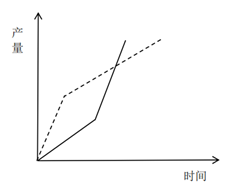

B. 

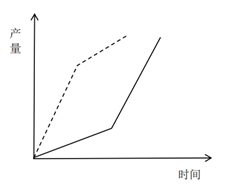

C. 

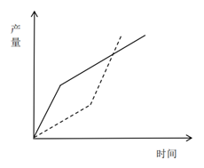

D. 

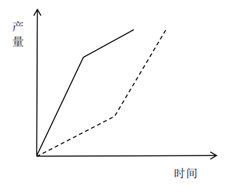

来源：[2025年浙江省公务员录用考试《行测》题（A类）（网友回忆版）.pdf](https://github.com/dumarstoft-ship-it/xingce/blob/407016b55b49581efa3771bb59a2dee8761d982f/2025%E5%B9%B4%E6%B5%99%E6%B1%9F%E7%9C%81%E5%85%AC%E5%8A%A1%E5%91%98%E5%BD%95%E7%94%A8%E8%80%83%E8%AF%95%E3%80%8A%E8%A1%8C%E6%B5%8B%E3%80%8B%E9%A2%98%EF%BC%88A%E7%B1%BB%EF%BC%89%EF%BC%88%E7%BD%91%E5%8F%8B%E5%9B%9E%E5%BF%86%E7%89%88%EF%BC%89.pdf)，PDF 第 12、13 页。

## 第 59 题 · 数量关系

`ZJ2025-A类-059`

一项任务，甲、乙分别单独完成的天数之和是合作完成天数的4.5倍。任务开始后，甲、乙先合作12天，乙再单
独工作12天，恰好完成。已知甲的效率比乙高，那么甲单独完成这项任务需要多少天？
A.24 B.30 C.48 D.60

来源：[2025年浙江省公务员录用考试《行测》题（A类）（网友回忆版）.pdf](https://github.com/dumarstoft-ship-it/xingce/blob/407016b55b49581efa3771bb59a2dee8761d982f/2025%E5%B9%B4%E6%B5%99%E6%B1%9F%E7%9C%81%E5%85%AC%E5%8A%A1%E5%91%98%E5%BD%95%E7%94%A8%E8%80%83%E8%AF%95%E3%80%8A%E8%A1%8C%E6%B5%8B%E3%80%8B%E9%A2%98%EF%BC%88A%E7%B1%BB%EF%BC%89%EF%BC%88%E7%BD%91%E5%8F%8B%E5%9B%9E%E5%BF%86%E7%89%88%EF%BC%89.pdf)，PDF 第 13 页。

## 第 60 题 · 数量关系

`ZJ2025-A类-060`

甲处室有6人，乙处室有4人，甲处室平均年龄比乙处室大1.5岁。甲处室新进了小张，乙处室新进了老张，老张
比小张大20岁，他们来了之后甲处室平均年龄比乙处室小2岁。问老张比乙处室原来的平均年龄大多少岁？
A.5 B.7.5 C.12.5 D.15

来源：[2025年浙江省公务员录用考试《行测》题（A类）（网友回忆版）.pdf](https://github.com/dumarstoft-ship-it/xingce/blob/407016b55b49581efa3771bb59a2dee8761d982f/2025%E5%B9%B4%E6%B5%99%E6%B1%9F%E7%9C%81%E5%85%AC%E5%8A%A1%E5%91%98%E5%BD%95%E7%94%A8%E8%80%83%E8%AF%95%E3%80%8A%E8%A1%8C%E6%B5%8B%E3%80%8B%E9%A2%98%EF%BC%88A%E7%B1%BB%EF%BC%89%EF%BC%88%E7%BD%91%E5%8F%8B%E5%9B%9E%E5%BF%86%E7%89%88%EF%BC%89.pdf)，PDF 第 13 页。

## 第 61 题 · 数量关系

`ZJ2025-A类-061`

小李开车从静止开始匀加速行驶10分钟后，再匀速行驶20分钟，然后开始第二次匀加速行驶13.5千米。已知两
次匀加速行驶总距离与匀速行驶距离相等，那么匀速行驶的速度是多少千米/小时？
A.54 B.63 C.72 D.81

来源：[2025年浙江省公务员录用考试《行测》题（A类）（网友回忆版）.pdf](https://github.com/dumarstoft-ship-it/xingce/blob/407016b55b49581efa3771bb59a2dee8761d982f/2025%E5%B9%B4%E6%B5%99%E6%B1%9F%E7%9C%81%E5%85%AC%E5%8A%A1%E5%91%98%E5%BD%95%E7%94%A8%E8%80%83%E8%AF%95%E3%80%8A%E8%A1%8C%E6%B5%8B%E3%80%8B%E9%A2%98%EF%BC%88A%E7%B1%BB%EF%BC%89%EF%BC%88%E7%BD%91%E5%8F%8B%E5%9B%9E%E5%BF%86%E7%89%88%EF%BC%89.pdf)，PDF 第 13 页。

## 第 62 题 · 数量关系

`ZJ2025-A类-062`

篮球比赛中，三分线内，投中一次得2分，三分线外，投中一次得3分；若被犯规，则获得罚球机会，投中一次
得1分。某场比赛，小张2分球命中率为62.5%，3分球命中率为44.4%，最终得分25分。已知小张罚球次数为7
次，那么他的罚球命中率在以下哪个范围？
A.30%-40% B.40%-50% C.50%-60% D.60%-70%

来源：[2025年浙江省公务员录用考试《行测》题（A类）（网友回忆版）.pdf](https://github.com/dumarstoft-ship-it/xingce/blob/407016b55b49581efa3771bb59a2dee8761d982f/2025%E5%B9%B4%E6%B5%99%E6%B1%9F%E7%9C%81%E5%85%AC%E5%8A%A1%E5%91%98%E5%BD%95%E7%94%A8%E8%80%83%E8%AF%95%E3%80%8A%E8%A1%8C%E6%B5%8B%E3%80%8B%E9%A2%98%EF%BC%88A%E7%B1%BB%EF%BC%89%EF%BC%88%E7%BD%91%E5%8F%8B%E5%9B%9E%E5%BF%86%E7%89%88%EF%BC%89.pdf)，PDF 第 13 页。

## 第 63 题 · 数量关系

`ZJ2025-A类-063`

某年级从A、B、C、D四个班招募96名志愿者，其中A班志愿者人数占总数的1/3，B班志愿者人数比C班多4人，
D班志愿者人数比其他三个班都少。问D班最多能有多少名志愿者？
A.18 B.19 C.20 D.21

来源：[2025年浙江省公务员录用考试《行测》题（A类）（网友回忆版）.pdf](https://github.com/dumarstoft-ship-it/xingce/blob/407016b55b49581efa3771bb59a2dee8761d982f/2025%E5%B9%B4%E6%B5%99%E6%B1%9F%E7%9C%81%E5%85%AC%E5%8A%A1%E5%91%98%E5%BD%95%E7%94%A8%E8%80%83%E8%AF%95%E3%80%8A%E8%A1%8C%E6%B5%8B%E3%80%8B%E9%A2%98%EF%BC%88A%E7%B1%BB%EF%BC%89%EF%BC%88%E7%BD%91%E5%8F%8B%E5%9B%9E%E5%BF%86%E7%89%88%EF%BC%89.pdf)，PDF 第 13 页。

## 第 64 题 · 数量关系

`ZJ2025-A类-064`

某班级只有两个宿舍的男生，每宿舍4人。每周从这8人中随机抽取一人担任周管理员，同一人不连续两周担任
管理员。问开学前三周的管理员都来自同一宿舍的概率在以下哪个范围？
A.0%-10% B.10%-20% C.20%-30% D.30%-40%

来源：[2025年浙江省公务员录用考试《行测》题（A类）（网友回忆版）.pdf](https://github.com/dumarstoft-ship-it/xingce/blob/407016b55b49581efa3771bb59a2dee8761d982f/2025%E5%B9%B4%E6%B5%99%E6%B1%9F%E7%9C%81%E5%85%AC%E5%8A%A1%E5%91%98%E5%BD%95%E7%94%A8%E8%80%83%E8%AF%95%E3%80%8A%E8%A1%8C%E6%B5%8B%E3%80%8B%E9%A2%98%EF%BC%88A%E7%B1%BB%EF%BC%89%EF%BC%88%E7%BD%91%E5%8F%8B%E5%9B%9E%E5%BF%86%E7%89%88%EF%BC%89.pdf)，PDF 第 13 页。

## 第 65 题 · 数量关系

`ZJ2025-A类-065`

某商店门口排了一列100米长的直线队伍，小明随机站在队伍的某处。小明的妈妈在队伍里随机找个位置喊小
明的名字，如果小明距离她不超过25米，就能听到。问小明听到他妈妈呼喊的概率是多少？
A.1/4
B.3/8
C.7/16
D.1/2

来源：[2025年浙江省公务员录用考试《行测》题（A类）（网友回忆版）.pdf](https://github.com/dumarstoft-ship-it/xingce/blob/407016b55b49581efa3771bb59a2dee8761d982f/2025%E5%B9%B4%E6%B5%99%E6%B1%9F%E7%9C%81%E5%85%AC%E5%8A%A1%E5%91%98%E5%BD%95%E7%94%A8%E8%80%83%E8%AF%95%E3%80%8A%E8%A1%8C%E6%B5%8B%E3%80%8B%E9%A2%98%EF%BC%88A%E7%B1%BB%EF%BC%89%EF%BC%88%E7%BD%91%E5%8F%8B%E5%9B%9E%E5%BF%86%E7%89%88%EF%BC%89.pdf)，PDF 第 13、14 页。

## 第 66 题 · 数量关系

`ZJ2025-A类-066`

一块四边形田地ABCD如下图所示，已知△AOD、△AOB和△COD的面积分别为9平方千米、15平方千米和
12平方千米，CD长8千米。问B点到CD的距离为多少千米？

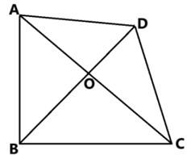

[代码描摹高清 PNG](../../../images/code_hd/233.png) · [SVG](../../../images/code_hd/233.svg)（原图为准）

A.6 B.7 C.8 D.9

来源：[2025年浙江省公务员录用考试《行测》题（A类）（网友回忆版）.pdf](https://github.com/dumarstoft-ship-it/xingce/blob/407016b55b49581efa3771bb59a2dee8761d982f/2025%E5%B9%B4%E6%B5%99%E6%B1%9F%E7%9C%81%E5%85%AC%E5%8A%A1%E5%91%98%E5%BD%95%E7%94%A8%E8%80%83%E8%AF%95%E3%80%8A%E8%A1%8C%E6%B5%8B%E3%80%8B%E9%A2%98%EF%BC%88A%E7%B1%BB%EF%BC%89%EF%BC%88%E7%BD%91%E5%8F%8B%E5%9B%9E%E5%BF%86%E7%89%88%EF%BC%89.pdf)，PDF 第 14 页。

## 第 67 题 · 数量关系

`ZJ2025-A类-067`

商场促销甲、乙、丙3种商品，单价分别为300元、500元和700元。一次购买1000元及以上者，可获赠品1份。
小张打算消费不超过1600元，他在所有可能消费组合中随机选择1种，获赠品的概率是多少？
A.7/15
B.8/17
C.11/17
D.7/10

来源：[2025年浙江省公务员录用考试《行测》题（A类）（网友回忆版）.pdf](https://github.com/dumarstoft-ship-it/xingce/blob/407016b55b49581efa3771bb59a2dee8761d982f/2025%E5%B9%B4%E6%B5%99%E6%B1%9F%E7%9C%81%E5%85%AC%E5%8A%A1%E5%91%98%E5%BD%95%E7%94%A8%E8%80%83%E8%AF%95%E3%80%8A%E8%A1%8C%E6%B5%8B%E3%80%8B%E9%A2%98%EF%BC%88A%E7%B1%BB%EF%BC%89%EF%BC%88%E7%BD%91%E5%8F%8B%E5%9B%9E%E5%BF%86%E7%89%88%EF%BC%89.pdf)，PDF 第 14 页。

## 第 68 题 · 数量关系

`ZJ2025-A类-068`

单位每周三组织篮球活动。已知2024年1月1日是周一，那么2024年组织5次活动的月份有几个？
A.1 B.2 C.3 D.4

来源：[2025年浙江省公务员录用考试《行测》题（A类）（网友回忆版）.pdf](https://github.com/dumarstoft-ship-it/xingce/blob/407016b55b49581efa3771bb59a2dee8761d982f/2025%E5%B9%B4%E6%B5%99%E6%B1%9F%E7%9C%81%E5%85%AC%E5%8A%A1%E5%91%98%E5%BD%95%E7%94%A8%E8%80%83%E8%AF%95%E3%80%8A%E8%A1%8C%E6%B5%8B%E3%80%8B%E9%A2%98%EF%BC%88A%E7%B1%BB%EF%BC%89%EF%BC%88%E7%BD%91%E5%8F%8B%E5%9B%9E%E5%BF%86%E7%89%88%EF%BC%89.pdf)，PDF 第 14 页。

## 第 69 题 · 数量关系

`ZJ2025-A类-069`

一块直角梯形空地ABCD如右图所示，其中AD=AC=2AB。现准备在图中三角形区域ABC建设特色生态园，并在
图中与两条边相切的圆形区域建设特色花坛。已知D点到圆上任一点最短距离为AB长度的一半，那么特色生态
园与特色花坛的面积比值在以下哪个范围？

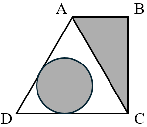

A.小于1 B.1-1.5 C.1.5-2 D.大于2

来源：[2025年浙江省公务员录用考试《行测》题（A类）（网友回忆版）.pdf](https://github.com/dumarstoft-ship-it/xingce/blob/407016b55b49581efa3771bb59a2dee8761d982f/2025%E5%B9%B4%E6%B5%99%E6%B1%9F%E7%9C%81%E5%85%AC%E5%8A%A1%E5%91%98%E5%BD%95%E7%94%A8%E8%80%83%E8%AF%95%E3%80%8A%E8%A1%8C%E6%B5%8B%E3%80%8B%E9%A2%98%EF%BC%88A%E7%B1%BB%EF%BC%89%EF%BC%88%E7%BD%91%E5%8F%8B%E5%9B%9E%E5%BF%86%E7%89%88%EF%BC%89.pdf)，PDF 第 14 页。

## 第 70 题 · 数量关系

`ZJ2025-A类-070`

四朵荷花随机出现在一个圆形池塘的任意位置，可以用一根过池塘圆心的笔直竹竿将四朵荷花都划分在同一边
的概率是多少？
A.1/8
B.1/4
C.3/8
D.1/2

来源：[2025年浙江省公务员录用考试《行测》题（A类）（网友回忆版）.pdf](https://github.com/dumarstoft-ship-it/xingce/blob/407016b55b49581efa3771bb59a2dee8761d982f/2025%E5%B9%B4%E6%B5%99%E6%B1%9F%E7%9C%81%E5%85%AC%E5%8A%A1%E5%91%98%E5%BD%95%E7%94%A8%E8%80%83%E8%AF%95%E3%80%8A%E8%A1%8C%E6%B5%8B%E3%80%8B%E9%A2%98%EF%BC%88A%E7%B1%BB%EF%BC%89%EF%BC%88%E7%BD%91%E5%8F%8B%E5%9B%9E%E5%BF%86%E7%89%88%EF%BC%89.pdf)，PDF 第 14、15 页。

## 第 71 题 · 判断推理

`ZJ2025-A类-071`

从所给的四个选项中，选择最合适的一个填入问号处，使之呈现一定的规律性。

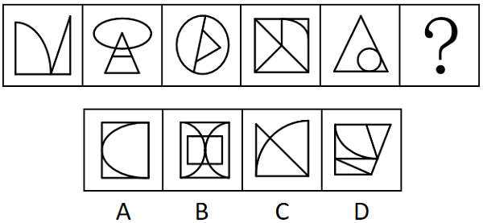

A.A B.B C.C D.D

来源：[2025年浙江省公务员录用考试《行测》题（A类）（网友回忆版）.pdf](https://github.com/dumarstoft-ship-it/xingce/blob/407016b55b49581efa3771bb59a2dee8761d982f/2025%E5%B9%B4%E6%B5%99%E6%B1%9F%E7%9C%81%E5%85%AC%E5%8A%A1%E5%91%98%E5%BD%95%E7%94%A8%E8%80%83%E8%AF%95%E3%80%8A%E8%A1%8C%E6%B5%8B%E3%80%8B%E9%A2%98%EF%BC%88A%E7%B1%BB%EF%BC%89%EF%BC%88%E7%BD%91%E5%8F%8B%E5%9B%9E%E5%BF%86%E7%89%88%EF%BC%89.pdf)，PDF 第 15 页。

## 第 72 题 · 判断推理

`ZJ2025-A类-072`

从所给的四个选项中，选择最合适的一个填入问号处，使之呈现一定的规律性：

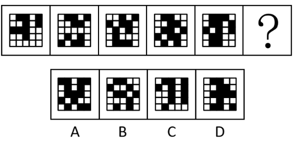

A.A B.B C.C D.D

来源：[2025年浙江省公务员录用考试《行测》题（A类）（网友回忆版）.pdf](https://github.com/dumarstoft-ship-it/xingce/blob/407016b55b49581efa3771bb59a2dee8761d982f/2025%E5%B9%B4%E6%B5%99%E6%B1%9F%E7%9C%81%E5%85%AC%E5%8A%A1%E5%91%98%E5%BD%95%E7%94%A8%E8%80%83%E8%AF%95%E3%80%8A%E8%A1%8C%E6%B5%8B%E3%80%8B%E9%A2%98%EF%BC%88A%E7%B1%BB%EF%BC%89%EF%BC%88%E7%BD%91%E5%8F%8B%E5%9B%9E%E5%BF%86%E7%89%88%EF%BC%89.pdf)，PDF 第 15 页。

## 第 73 题 · 判断推理

`ZJ2025-A类-073`

从所给的四个选项中，选择最合适的一个填入问号处，使之呈现一定的规律性。

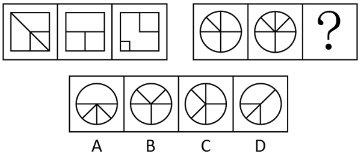

A.A B.B C.C D.D

来源：[2025年浙江省公务员录用考试《行测》题（A类）（网友回忆版）.pdf](https://github.com/dumarstoft-ship-it/xingce/blob/407016b55b49581efa3771bb59a2dee8761d982f/2025%E5%B9%B4%E6%B5%99%E6%B1%9F%E7%9C%81%E5%85%AC%E5%8A%A1%E5%91%98%E5%BD%95%E7%94%A8%E8%80%83%E8%AF%95%E3%80%8A%E8%A1%8C%E6%B5%8B%E3%80%8B%E9%A2%98%EF%BC%88A%E7%B1%BB%EF%BC%89%EF%BC%88%E7%BD%91%E5%8F%8B%E5%9B%9E%E5%BF%86%E7%89%88%EF%BC%89.pdf)，PDF 第 15、16 页。

## 第 74 题 · 判断推理

`ZJ2025-A类-074`

从所给的四个选项中，选择最合适的一个填入问号处，使之呈现一定的规律性。

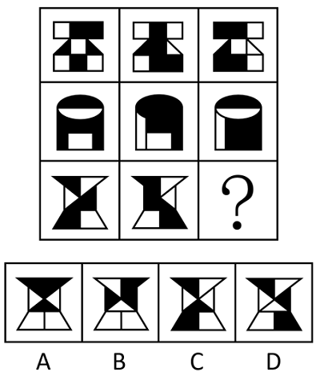

A.A B.B C.C D.D

来源：[2025年浙江省公务员录用考试《行测》题（A类）（网友回忆版）.pdf](https://github.com/dumarstoft-ship-it/xingce/blob/407016b55b49581efa3771bb59a2dee8761d982f/2025%E5%B9%B4%E6%B5%99%E6%B1%9F%E7%9C%81%E5%85%AC%E5%8A%A1%E5%91%98%E5%BD%95%E7%94%A8%E8%80%83%E8%AF%95%E3%80%8A%E8%A1%8C%E6%B5%8B%E3%80%8B%E9%A2%98%EF%BC%88A%E7%B1%BB%EF%BC%89%EF%BC%88%E7%BD%91%E5%8F%8B%E5%9B%9E%E5%BF%86%E7%89%88%EF%BC%89.pdf)，PDF 第 16 页。

## 第 75 题 · 判断推理

`ZJ2025-A类-075`

从所给的四个选项中，选择最合适的一个填入问号处，使之呈现一定的规律性。

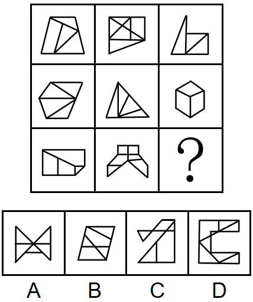

A.A B.B C.C D.D

来源：[2025年浙江省公务员录用考试《行测》题（A类）（网友回忆版）.pdf](https://github.com/dumarstoft-ship-it/xingce/blob/407016b55b49581efa3771bb59a2dee8761d982f/2025%E5%B9%B4%E6%B5%99%E6%B1%9F%E7%9C%81%E5%85%AC%E5%8A%A1%E5%91%98%E5%BD%95%E7%94%A8%E8%80%83%E8%AF%95%E3%80%8A%E8%A1%8C%E6%B5%8B%E3%80%8B%E9%A2%98%EF%BC%88A%E7%B1%BB%EF%BC%89%EF%BC%88%E7%BD%91%E5%8F%8B%E5%9B%9E%E5%BF%86%E7%89%88%EF%BC%89.pdf)，PDF 第 16、17 页。

## 第 76 题 · 判断推理

`ZJ2025-A类-076`

把下面的六个图形分为两类，使每一类图形都有各自的共同特征或规律，分类正确的一项是：

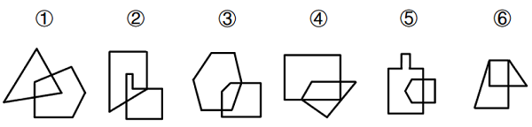

A.①②③，④⑤⑥ B.①②⑥，③④⑤ C.①④⑥，②③⑤ D.①⑤⑥，②③④

来源：[2025年浙江省公务员录用考试《行测》题（A类）（网友回忆版）.pdf](https://github.com/dumarstoft-ship-it/xingce/blob/407016b55b49581efa3771bb59a2dee8761d982f/2025%E5%B9%B4%E6%B5%99%E6%B1%9F%E7%9C%81%E5%85%AC%E5%8A%A1%E5%91%98%E5%BD%95%E7%94%A8%E8%80%83%E8%AF%95%E3%80%8A%E8%A1%8C%E6%B5%8B%E3%80%8B%E9%A2%98%EF%BC%88A%E7%B1%BB%EF%BC%89%EF%BC%88%E7%BD%91%E5%8F%8B%E5%9B%9E%E5%BF%86%E7%89%88%EF%BC%89.pdf)，PDF 第 17 页。

## 第 77 题 · 判断推理

`ZJ2025-A类-077`

把下面的六个图形分为两类，使每一类图形都有各自的共同特征或规律，分类正确的一项是：

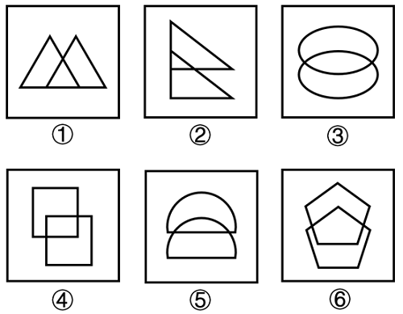

A.①②③，④⑤⑥ B.①②⑤，③④⑥ C.①③④，②⑤⑥ D.①③⑤，②④⑥

来源：[2025年浙江省公务员录用考试《行测》题（A类）（网友回忆版）.pdf](https://github.com/dumarstoft-ship-it/xingce/blob/407016b55b49581efa3771bb59a2dee8761d982f/2025%E5%B9%B4%E6%B5%99%E6%B1%9F%E7%9C%81%E5%85%AC%E5%8A%A1%E5%91%98%E5%BD%95%E7%94%A8%E8%80%83%E8%AF%95%E3%80%8A%E8%A1%8C%E6%B5%8B%E3%80%8B%E9%A2%98%EF%BC%88A%E7%B1%BB%EF%BC%89%EF%BC%88%E7%BD%91%E5%8F%8B%E5%9B%9E%E5%BF%86%E7%89%88%EF%BC%89.pdf)，PDF 第 17 页。

## 第 78 题 · 判断推理

`ZJ2025-A类-078`

已知5个完全相同的纸盒依次摆在一起如下图所示。则与纸盒的面①相对的面为：

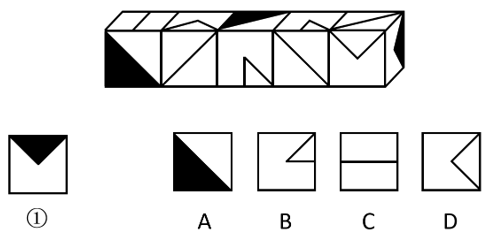

A.A B.B C.C D.D

来源：[2025年浙江省公务员录用考试《行测》题（A类）（网友回忆版）.pdf](https://github.com/dumarstoft-ship-it/xingce/blob/407016b55b49581efa3771bb59a2dee8761d982f/2025%E5%B9%B4%E6%B5%99%E6%B1%9F%E7%9C%81%E5%85%AC%E5%8A%A1%E5%91%98%E5%BD%95%E7%94%A8%E8%80%83%E8%AF%95%E3%80%8A%E8%A1%8C%E6%B5%8B%E3%80%8B%E9%A2%98%EF%BC%88A%E7%B1%BB%EF%BC%89%EF%BC%88%E7%BD%91%E5%8F%8B%E5%9B%9E%E5%BF%86%E7%89%88%EF%BC%89.pdf)，PDF 第 18 页。

## 第 79 题 · 判断推理

`ZJ2025-A类-079`

左图为一个实心长方体、一个挖孔长方体和一个四面体组合成的多面体，问下列哪一个不可能是其视图？

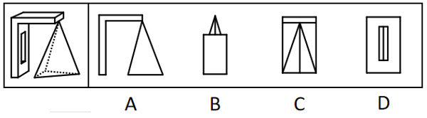

A.A B.B C.C D.D

来源：[2025年浙江省公务员录用考试《行测》题（A类）（网友回忆版）.pdf](https://github.com/dumarstoft-ship-it/xingce/blob/407016b55b49581efa3771bb59a2dee8761d982f/2025%E5%B9%B4%E6%B5%99%E6%B1%9F%E7%9C%81%E5%85%AC%E5%8A%A1%E5%91%98%E5%BD%95%E7%94%A8%E8%80%83%E8%AF%95%E3%80%8A%E8%A1%8C%E6%B5%8B%E3%80%8B%E9%A2%98%EF%BC%88A%E7%B1%BB%EF%BC%89%EF%BC%88%E7%BD%91%E5%8F%8B%E5%9B%9E%E5%BF%86%E7%89%88%EF%BC%89.pdf)，PDF 第 18 页。

## 第 80 题 · 判断推理

`ZJ2025-A类-080`

墙角堆码共计15个纸箱，左侧为堆码的效果图，堆码纸箱的俯视图可能是：

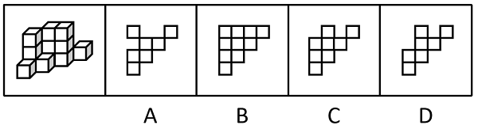

A.A B.B C.C D.D

来源：[2025年浙江省公务员录用考试《行测》题（A类）（网友回忆版）.pdf](https://github.com/dumarstoft-ship-it/xingce/blob/407016b55b49581efa3771bb59a2dee8761d982f/2025%E5%B9%B4%E6%B5%99%E6%B1%9F%E7%9C%81%E5%85%AC%E5%8A%A1%E5%91%98%E5%BD%95%E7%94%A8%E8%80%83%E8%AF%95%E3%80%8A%E8%A1%8C%E6%B5%8B%E3%80%8B%E9%A2%98%EF%BC%88A%E7%B1%BB%EF%BC%89%EF%BC%88%E7%BD%91%E5%8F%8B%E5%9B%9E%E5%BF%86%E7%89%88%EF%BC%89.pdf)，PDF 第 18 页。

## 第 81 题 · 判断推理

`ZJ2025-A类-081`

台灯：装饰
A.脸盆：洗漱 B.空调：风扇 C.食醋：除垢 D.蜡烛：氛围

来源：[2025年浙江省公务员录用考试《行测》题（A类）（网友回忆版）.pdf](https://github.com/dumarstoft-ship-it/xingce/blob/407016b55b49581efa3771bb59a2dee8761d982f/2025%E5%B9%B4%E6%B5%99%E6%B1%9F%E7%9C%81%E5%85%AC%E5%8A%A1%E5%91%98%E5%BD%95%E7%94%A8%E8%80%83%E8%AF%95%E3%80%8A%E8%A1%8C%E6%B5%8B%E3%80%8B%E9%A2%98%EF%BC%88A%E7%B1%BB%EF%BC%89%EF%BC%88%E7%BD%91%E5%8F%8B%E5%9B%9E%E5%BF%86%E7%89%88%EF%BC%89.pdf)，PDF 第 18 页。

## 第 82 题 · 判断推理

`ZJ2025-A类-082`

装订：成册
A.考试：学习 B.灌溉：收割 C.煅烧：打磨 D.调解：止争

来源：[2025年浙江省公务员录用考试《行测》题（A类）（网友回忆版）.pdf](https://github.com/dumarstoft-ship-it/xingce/blob/407016b55b49581efa3771bb59a2dee8761d982f/2025%E5%B9%B4%E6%B5%99%E6%B1%9F%E7%9C%81%E5%85%AC%E5%8A%A1%E5%91%98%E5%BD%95%E7%94%A8%E8%80%83%E8%AF%95%E3%80%8A%E8%A1%8C%E6%B5%8B%E3%80%8B%E9%A2%98%EF%BC%88A%E7%B1%BB%EF%BC%89%EF%BC%88%E7%BD%91%E5%8F%8B%E5%9B%9E%E5%BF%86%E7%89%88%EF%BC%89.pdf)，PDF 第 18 页。

## 第 83 题 · 判断推理

`ZJ2025-A类-083`

小麦：麦芽糖
A.驴皮：阿胶 B.糖蒜：腊八蒜 C.腰果：坚果 D.八宝粥：小米

来源：[2025年浙江省公务员录用考试《行测》题（A类）（网友回忆版）.pdf](https://github.com/dumarstoft-ship-it/xingce/blob/407016b55b49581efa3771bb59a2dee8761d982f/2025%E5%B9%B4%E6%B5%99%E6%B1%9F%E7%9C%81%E5%85%AC%E5%8A%A1%E5%91%98%E5%BD%95%E7%94%A8%E8%80%83%E8%AF%95%E3%80%8A%E8%A1%8C%E6%B5%8B%E3%80%8B%E9%A2%98%EF%BC%88A%E7%B1%BB%EF%BC%89%EF%BC%88%E7%BD%91%E5%8F%8B%E5%9B%9E%E5%BF%86%E7%89%88%EF%BC%89.pdf)，PDF 第 18 页。

## 第 84 题 · 判断推理

`ZJ2025-A类-084`

铁皮桶：油桶
A.汤勺：漏勺 B.金饰：手镯 C.党费：工资 D.章鱼：鱿鱼

来源：[2025年浙江省公务员录用考试《行测》题（A类）（网友回忆版）.pdf](https://github.com/dumarstoft-ship-it/xingce/blob/407016b55b49581efa3771bb59a2dee8761d982f/2025%E5%B9%B4%E6%B5%99%E6%B1%9F%E7%9C%81%E5%85%AC%E5%8A%A1%E5%91%98%E5%BD%95%E7%94%A8%E8%80%83%E8%AF%95%E3%80%8A%E8%A1%8C%E6%B5%8B%E3%80%8B%E9%A2%98%EF%BC%88A%E7%B1%BB%EF%BC%89%EF%BC%88%E7%BD%91%E5%8F%8B%E5%9B%9E%E5%BF%86%E7%89%88%EF%BC%89.pdf)，PDF 第 18 页。

## 第 85 题 · 判断推理

`ZJ2025-A类-085`

观光车：景区
A.使馆：首都 B.灭火器：建筑 C.界碑：边境 D.文物：拍卖行

来源：[2025年浙江省公务员录用考试《行测》题（A类）（网友回忆版）.pdf](https://github.com/dumarstoft-ship-it/xingce/blob/407016b55b49581efa3771bb59a2dee8761d982f/2025%E5%B9%B4%E6%B5%99%E6%B1%9F%E7%9C%81%E5%85%AC%E5%8A%A1%E5%91%98%E5%BD%95%E7%94%A8%E8%80%83%E8%AF%95%E3%80%8A%E8%A1%8C%E6%B5%8B%E3%80%8B%E9%A2%98%EF%BC%88A%E7%B1%BB%EF%BC%89%EF%BC%88%E7%BD%91%E5%8F%8B%E5%9B%9E%E5%BF%86%E7%89%88%EF%BC%89.pdf)，PDF 第 18 页。

## 第 86 题 · 判断推理

`ZJ2025-A类-086`

消毒水：消毒
A.部队锅：部队 B.橄榄球：橄榄 C.葡萄酒：葡萄 D.减脂餐：减脂

来源：[2025年浙江省公务员录用考试《行测》题（A类）（网友回忆版）.pdf](https://github.com/dumarstoft-ship-it/xingce/blob/407016b55b49581efa3771bb59a2dee8761d982f/2025%E5%B9%B4%E6%B5%99%E6%B1%9F%E7%9C%81%E5%85%AC%E5%8A%A1%E5%91%98%E5%BD%95%E7%94%A8%E8%80%83%E8%AF%95%E3%80%8A%E8%A1%8C%E6%B5%8B%E3%80%8B%E9%A2%98%EF%BC%88A%E7%B1%BB%EF%BC%89%EF%BC%88%E7%BD%91%E5%8F%8B%E5%9B%9E%E5%BF%86%E7%89%88%EF%BC%89.pdf)，PDF 第 18 页。

## 第 87 题 · 判断推理

`ZJ2025-A类-087`

鸠占鹊巢：鹤立鸡群
A.风生水起：马不停蹄 B.狐假虎威：鱼跃龙门 C.龙腾四海：雁过留声 D.鹰击长空：螳臂当车

来源：[2025年浙江省公务员录用考试《行测》题（A类）（网友回忆版）.pdf](https://github.com/dumarstoft-ship-it/xingce/blob/407016b55b49581efa3771bb59a2dee8761d982f/2025%E5%B9%B4%E6%B5%99%E6%B1%9F%E7%9C%81%E5%85%AC%E5%8A%A1%E5%91%98%E5%BD%95%E7%94%A8%E8%80%83%E8%AF%95%E3%80%8A%E8%A1%8C%E6%B5%8B%E3%80%8B%E9%A2%98%EF%BC%88A%E7%B1%BB%EF%BC%89%EF%BC%88%E7%BD%91%E5%8F%8B%E5%9B%9E%E5%BF%86%E7%89%88%EF%BC%89.pdf)，PDF 第 18、19 页。

## 第 88 题 · 判断推理

`ZJ2025-A类-088`

撕心裂肺：眉开眼笑
A.推心置腹：尔虞我诈 B.鸡鸣狗吠：不毛之地 C.亦步亦趋：人云亦云 D.称雨道晴：如胶似漆

来源：[2025年浙江省公务员录用考试《行测》题（A类）（网友回忆版）.pdf](https://github.com/dumarstoft-ship-it/xingce/blob/407016b55b49581efa3771bb59a2dee8761d982f/2025%E5%B9%B4%E6%B5%99%E6%B1%9F%E7%9C%81%E5%85%AC%E5%8A%A1%E5%91%98%E5%BD%95%E7%94%A8%E8%80%83%E8%AF%95%E3%80%8A%E8%A1%8C%E6%B5%8B%E3%80%8B%E9%A2%98%EF%BC%88A%E7%B1%BB%EF%BC%89%EF%BC%88%E7%BD%91%E5%8F%8B%E5%9B%9E%E5%BF%86%E7%89%88%EF%BC%89.pdf)，PDF 第 19 页。

## 第 89 题 · 判断推理

`ZJ2025-A类-089`

锂电池：芯片：充电宝
A.马车：蒸汽机：机车 B.炒锅：铁铲：炊具 C.无纺布：皮筋：口罩 D.应用软件：屏幕：手机

来源：[2025年浙江省公务员录用考试《行测》题（A类）（网友回忆版）.pdf](https://github.com/dumarstoft-ship-it/xingce/blob/407016b55b49581efa3771bb59a2dee8761d982f/2025%E5%B9%B4%E6%B5%99%E6%B1%9F%E7%9C%81%E5%85%AC%E5%8A%A1%E5%91%98%E5%BD%95%E7%94%A8%E8%80%83%E8%AF%95%E3%80%8A%E8%A1%8C%E6%B5%8B%E3%80%8B%E9%A2%98%EF%BC%88A%E7%B1%BB%EF%BC%89%EF%BC%88%E7%BD%91%E5%8F%8B%E5%9B%9E%E5%BF%86%E7%89%88%EF%BC%89.pdf)，PDF 第 19 页。

## 第 90 题 · 判断推理

`ZJ2025-A类-090`

青山 对于 （    ）相当于 教室 对于 （    ）
A.绿水 操场 B.郊游 实践 C.树木 电脑 D.白云 教师

来源：[2025年浙江省公务员录用考试《行测》题（A类）（网友回忆版）.pdf](https://github.com/dumarstoft-ship-it/xingce/blob/407016b55b49581efa3771bb59a2dee8761d982f/2025%E5%B9%B4%E6%B5%99%E6%B1%9F%E7%9C%81%E5%85%AC%E5%8A%A1%E5%91%98%E5%BD%95%E7%94%A8%E8%80%83%E8%AF%95%E3%80%8A%E8%A1%8C%E6%B5%8B%E3%80%8B%E9%A2%98%EF%BC%88A%E7%B1%BB%EF%BC%89%EF%BC%88%E7%BD%91%E5%8F%8B%E5%9B%9E%E5%BF%86%E7%89%88%EF%BC%89.pdf)，PDF 第 19 页。

## 第 91 题 · 判断推理

`ZJ2025-A类-091`

照护综合征是指一个人因专注于照护生病、受伤或残疾的亲人而过度劳累或精神上陷于压抑状态，导致身心健
康受损的病症。
根据上述定义，下列不属于照护综合征的是：
A.“照顾生病的父母半年，我感觉整个人都陷入了黑暗，现在还没缓过劲来，电话铃声一响整个人就哆嗦。”
B.“这家坐轮椅的老爷子太难伺候了，累死累活照顾他还经常挨骂，还要被扣工资，我受不了了，不想干
了。”
C.“我起早贪黑照顾了瘫痪在床的父亲两年，他还总不满意，经常训斥我。现在好了，我也累倒了，住院
了。”
D.“昨天奶奶说，她一个人照顾双目失明的爷爷太累了，要么儿女们轮流来照顾，要么找个专职保姆，反正她
受不了，不管了。”

来源：[2025年浙江省公务员录用考试《行测》题（A类）（网友回忆版）.pdf](https://github.com/dumarstoft-ship-it/xingce/blob/407016b55b49581efa3771bb59a2dee8761d982f/2025%E5%B9%B4%E6%B5%99%E6%B1%9F%E7%9C%81%E5%85%AC%E5%8A%A1%E5%91%98%E5%BD%95%E7%94%A8%E8%80%83%E8%AF%95%E3%80%8A%E8%A1%8C%E6%B5%8B%E3%80%8B%E9%A2%98%EF%BC%88A%E7%B1%BB%EF%BC%89%EF%BC%88%E7%BD%91%E5%8F%8B%E5%9B%9E%E5%BF%86%E7%89%88%EF%BC%89.pdf)，PDF 第 19 页。

## 第 92 题 · 判断推理

`ZJ2025-A类-092`

史翠珊效应是指试图阻止大众了解某些内容，或压制特定的网络信息，结果适得其反，使该内容或信息被更多
人所了解。
根据上述定义，下列体现史翠珊效应的是：
A.某煤矿老板为掩盖事故真相，向调查记者行贿，行贿过程被酒店监控全程记录下来
B.某自媒体散布当地某企业偷税漏税的谣言，该企业随即在网上发布辟谣视频，引发了更多关注
C.某明星丑闻被一家媒体掌握，该明星威胁媒体不许曝光此事，被媒体将威胁短信和丑闻一并曝光，结果上了
热搜
D.某网红故意与人发生冲突并将冲突视频发布到网上，视频爆火之后因害怕承担刑事责任，该网红主动删除视
频

来源：[2025年浙江省公务员录用考试《行测》题（A类）（网友回忆版）.pdf](https://github.com/dumarstoft-ship-it/xingce/blob/407016b55b49581efa3771bb59a2dee8761d982f/2025%E5%B9%B4%E6%B5%99%E6%B1%9F%E7%9C%81%E5%85%AC%E5%8A%A1%E5%91%98%E5%BD%95%E7%94%A8%E8%80%83%E8%AF%95%E3%80%8A%E8%A1%8C%E6%B5%8B%E3%80%8B%E9%A2%98%EF%BC%88A%E7%B1%BB%EF%BC%89%EF%BC%88%E7%BD%91%E5%8F%8B%E5%9B%9E%E5%BF%86%E7%89%88%EF%BC%89.pdf)，PDF 第 19 页。

## 第 93 题 · 判断推理

`ZJ2025-A类-093`

《通用规范汉字表》将收录的汉字分为三个等级：一级字为常用字，主要满足基础教育和文化普及的基本用字
需要；二级字的使用度仅次于一级字，主要满足出版印刷、辞书编纂和信息处理等方面的一般用字需要；三级
字是姓氏人名、地名、科学技术术语和中小学语文教材文言文用字中未进入一、二级字表的较通用的字，主要
满足信息化时代与大众生活密切相关的专门领域的用字需要。
根据上述定义，下列汉字分级最有可能正确的是：
A.一级字：秀；二级字：砫；三级字：闸 B.一级字：甩；二级字：偻；三级字：昄
C.一级字：坋；二级字：苓；三级字：蒄 D.一级字：焘；二级字：泻；三级字：兀

来源：[2025年浙江省公务员录用考试《行测》题（A类）（网友回忆版）.pdf](https://github.com/dumarstoft-ship-it/xingce/blob/407016b55b49581efa3771bb59a2dee8761d982f/2025%E5%B9%B4%E6%B5%99%E6%B1%9F%E7%9C%81%E5%85%AC%E5%8A%A1%E5%91%98%E5%BD%95%E7%94%A8%E8%80%83%E8%AF%95%E3%80%8A%E8%A1%8C%E6%B5%8B%E3%80%8B%E9%A2%98%EF%BC%88A%E7%B1%BB%EF%BC%89%EF%BC%88%E7%BD%91%E5%8F%8B%E5%9B%9E%E5%BF%86%E7%89%88%EF%BC%89.pdf)，PDF 第 19 页。

## 第 94 题 · 判断推理

`ZJ2025-A类-094`

三明治法则是指在批评他人时把批评夹在表扬或期待中间，从而使被批评者更好地接受批评和建议。
根据上述定义，下列没有体现三明治法则的是：
A.“看得出你调研下了很大功夫，但在撰写正文时分析角度过于单一，可惜了你辛苦调研得来的宝贵数据。”
B.“这项业务你一向做得不错，这次怎么完成得这么马虎？我相信以你的能力一定可以想出妥当的补救办
法。”
C.“你以前总喜欢打断别人说话，今天竟然能够等她表达完意见再发言，我真感到惊讶。你今后要是能一直这
样就好了。”
D.“人格独立是你的优点，但这件事如果你当时解释一下大家就理解了，我们都不想因为一个误会而失去你这
么好的朋友。”

来源：[2025年浙江省公务员录用考试《行测》题（A类）（网友回忆版）.pdf](https://github.com/dumarstoft-ship-it/xingce/blob/407016b55b49581efa3771bb59a2dee8761d982f/2025%E5%B9%B4%E6%B5%99%E6%B1%9F%E7%9C%81%E5%85%AC%E5%8A%A1%E5%91%98%E5%BD%95%E7%94%A8%E8%80%83%E8%AF%95%E3%80%8A%E8%A1%8C%E6%B5%8B%E3%80%8B%E9%A2%98%EF%BC%88A%E7%B1%BB%EF%BC%89%EF%BC%88%E7%BD%91%E5%8F%8B%E5%9B%9E%E5%BF%86%E7%89%88%EF%BC%89.pdf)，PDF 第 19、20 页。

## 第 95 题 · 判断推理

`ZJ2025-A类-095`

汉语中有一类名词连名词的复合词，其词素组合顺序为，前一个词素是被修饰、被限定的成分，后一个词素是
修饰、限定成分，称为“正偏式”名-名复合词。
根据上述定义，下列属于“正偏式”名-名复合词的是：
A.火舌 B.布衣 C.兄弟 D.车速

来源：[2025年浙江省公务员录用考试《行测》题（A类）（网友回忆版）.pdf](https://github.com/dumarstoft-ship-it/xingce/blob/407016b55b49581efa3771bb59a2dee8761d982f/2025%E5%B9%B4%E6%B5%99%E6%B1%9F%E7%9C%81%E5%85%AC%E5%8A%A1%E5%91%98%E5%BD%95%E7%94%A8%E8%80%83%E8%AF%95%E3%80%8A%E8%A1%8C%E6%B5%8B%E3%80%8B%E9%A2%98%EF%BC%88A%E7%B1%BB%EF%BC%89%EF%BC%88%E7%BD%91%E5%8F%8B%E5%9B%9E%E5%BF%86%E7%89%88%EF%BC%89.pdf)，PDF 第 20 页。

## 第 96 题 · 判断推理

`ZJ2025-A类-096`

节能诊断是指根据企业工艺流程及流程中每个生产节点上的能源消耗状况和能源利用率等情况，发现问题，并
用系统学方法找出问题的根本，预测节能潜力，提出具体技术措施的过程。
根据上述定义，下列可能属于节能诊断的是：
A.某机构按照国家标准对某建筑的能源利用率进行计算评估
B.某政府部门组织专家对其办公大楼新建的供暖设备进行验收
C.某机构对一企业工艺流程中的工业固废综合利用情况进行评估
D.某咨询机构根据一钢铁企业工艺流程中能耗情况提出节能建议

来源：[2025年浙江省公务员录用考试《行测》题（A类）（网友回忆版）.pdf](https://github.com/dumarstoft-ship-it/xingce/blob/407016b55b49581efa3771bb59a2dee8761d982f/2025%E5%B9%B4%E6%B5%99%E6%B1%9F%E7%9C%81%E5%85%AC%E5%8A%A1%E5%91%98%E5%BD%95%E7%94%A8%E8%80%83%E8%AF%95%E3%80%8A%E8%A1%8C%E6%B5%8B%E3%80%8B%E9%A2%98%EF%BC%88A%E7%B1%BB%EF%BC%89%EF%BC%88%E7%BD%91%E5%8F%8B%E5%9B%9E%E5%BF%86%E7%89%88%EF%BC%89.pdf)，PDF 第 20 页。

## 第 97 题 · 判断推理

`ZJ2025-A类-097`

词语遮蔽效应是指当需要记忆的事件难以用语言来把握时，词语化可能反而会有损记忆，导致记忆错觉的现
象。
根据上述定义，下列体现词语遮蔽效应的是：
A.在学习新课文时反复朗读背诵的学生比未反复朗读背诵的学生默写成绩更好
B.在外出采风时认真临摹风景的人比用语言文字将风景描写出来的人对风景细节的记忆更为深刻
C.初次品酒时用语言描述不同白酒味道的人，对白酒的再认好于那些没有对酒味进行语言描述的人
D.两个人同时目击犯罪过程，用语言复述现场情况的人对犯罪过程的记忆比另一个没有用语言复述的人更不准
确

来源：[2025年浙江省公务员录用考试《行测》题（A类）（网友回忆版）.pdf](https://github.com/dumarstoft-ship-it/xingce/blob/407016b55b49581efa3771bb59a2dee8761d982f/2025%E5%B9%B4%E6%B5%99%E6%B1%9F%E7%9C%81%E5%85%AC%E5%8A%A1%E5%91%98%E5%BD%95%E7%94%A8%E8%80%83%E8%AF%95%E3%80%8A%E8%A1%8C%E6%B5%8B%E3%80%8B%E9%A2%98%EF%BC%88A%E7%B1%BB%EF%BC%89%EF%BC%88%E7%BD%91%E5%8F%8B%E5%9B%9E%E5%BF%86%E7%89%88%EF%BC%89.pdf)，PDF 第 20 页。

## 第 98 题 · 判断推理

`ZJ2025-A类-098`

角误差是指被评价者在某一方面表现不佳，导致评价者对此人其他所有方面均给予较低的评价。
根据上述定义，下列属于角误差的是：
A.甲匆忙参加一项面试，没准备正式的服装，尽管面试表现优异，但最终面试分数很低
B.乙的单位在年度绩效考核中，考核组给全单位员工的评语相差不多，全部员工都被评为“合格”
C.丙在公司的比赛中获得技能大奖，部门领导给予其能力突出、团结同事、爱岗敬业的评价，丙因此获得部门
年度优秀员工荣誉
D.丁在单位参加了一个核心技术攻关组并与同组的同事一起取得了理想的成果，但其他组员太出色了，导致丁
的绩效评价低于应有等级

来源：[2025年浙江省公务员录用考试《行测》题（A类）（网友回忆版）.pdf](https://github.com/dumarstoft-ship-it/xingce/blob/407016b55b49581efa3771bb59a2dee8761d982f/2025%E5%B9%B4%E6%B5%99%E6%B1%9F%E7%9C%81%E5%85%AC%E5%8A%A1%E5%91%98%E5%BD%95%E7%94%A8%E8%80%83%E8%AF%95%E3%80%8A%E8%A1%8C%E6%B5%8B%E3%80%8B%E9%A2%98%EF%BC%88A%E7%B1%BB%EF%BC%89%EF%BC%88%E7%BD%91%E5%8F%8B%E5%9B%9E%E5%BF%86%E7%89%88%EF%BC%89.pdf)，PDF 第 20 页。

## 第 99 题 · 判断推理

`ZJ2025-A类-099`

无意识代偿是指人在无意识状态下通过寻求某方面的满足或成就，来弥补或掩盖自己在另一方面的弱点、缺陷
或挫败感的策略。
根据上述定义，下列属于无意识代偿的是：
A.穷困潦倒的老张，靠给村里人做短工维持生计，但在与别人闲聊时，总是会不经意提起自己祖上是大官
B.一出生就没有双臂的小王，从小就自立自强，她学会用脚料理自己的生活，用脚写字，不仅顺利读完高中，
还考上了大学
C.智商低于常人的阿甘，学业不佳，且因背部畸形在腿部装有金属支架，但一次被追逐的经历却意外开启了他
惊人的运动天赋
D.长期忍受丈夫肢体与语言暴力的小赛，为维持亲朋好友对自己婚姻美满的印象，常在社交平台上晒出与丈夫
摆拍的合影“秀恩爱”

来源：[2025年浙江省公务员录用考试《行测》题（A类）（网友回忆版）.pdf](https://github.com/dumarstoft-ship-it/xingce/blob/407016b55b49581efa3771bb59a2dee8761d982f/2025%E5%B9%B4%E6%B5%99%E6%B1%9F%E7%9C%81%E5%85%AC%E5%8A%A1%E5%91%98%E5%BD%95%E7%94%A8%E8%80%83%E8%AF%95%E3%80%8A%E8%A1%8C%E6%B5%8B%E3%80%8B%E9%A2%98%EF%BC%88A%E7%B1%BB%EF%BC%89%EF%BC%88%E7%BD%91%E5%8F%8B%E5%9B%9E%E5%BF%86%E7%89%88%EF%BC%89.pdf)，PDF 第 20 页。

## 第 100 题 · 判断推理

`ZJ2025-A类-100`

第三航权是一个国家授予另一个国家定期或不定期国际航班在其领土内卸下来自承运人本国的旅客或货物的权
利。第四航权是一个国家授予另一个国家定期或不定期国际航班在其领土内装上前往承运人本国的旅客或货物
的权利。
根据上述定义，下列体现了第四航权的是：
A.加拿大航空在洛杉矶与墨西哥城的航线市场上提供服务
B.新加坡民航飞机在飞往芝加哥航线上经停厦门，上下客货
C.中国民航飞机从北京运载货物在东京进港，然后运载乘客返回
D.美国民航飞机承运旧金山-上海航线，中间在安克雷奇加油维修

来源：[2025年浙江省公务员录用考试《行测》题（A类）（网友回忆版）.pdf](https://github.com/dumarstoft-ship-it/xingce/blob/407016b55b49581efa3771bb59a2dee8761d982f/2025%E5%B9%B4%E6%B5%99%E6%B1%9F%E7%9C%81%E5%85%AC%E5%8A%A1%E5%91%98%E5%BD%95%E7%94%A8%E8%80%83%E8%AF%95%E3%80%8A%E8%A1%8C%E6%B5%8B%E3%80%8B%E9%A2%98%EF%BC%88A%E7%B1%BB%EF%BC%89%EF%BC%88%E7%BD%91%E5%8F%8B%E5%9B%9E%E5%BF%86%E7%89%88%EF%BC%89.pdf)，PDF 第 21 页。

## 第 101 题 · 判断推理

`ZJ2025-A类-101`

某单位所有正式编制员工都参加了周末举办的团建活动，该单位后勤部门所有员工都不是正式编制员工，综合
部门有的员工没有参加周末举办的团建活动。
由此可以推出该单位：
A.综合部门有的员工不是正式编制员工 B.有的正式编制员工不是综合部门的员工
C.后勤部门有的员工没有参加周末举办的团建活动 D.后勤部门所有员工都参加了周末举办的团建活动

来源：[2025年浙江省公务员录用考试《行测》题（A类）（网友回忆版）.pdf](https://github.com/dumarstoft-ship-it/xingce/blob/407016b55b49581efa3771bb59a2dee8761d982f/2025%E5%B9%B4%E6%B5%99%E6%B1%9F%E7%9C%81%E5%85%AC%E5%8A%A1%E5%91%98%E5%BD%95%E7%94%A8%E8%80%83%E8%AF%95%E3%80%8A%E8%A1%8C%E6%B5%8B%E3%80%8B%E9%A2%98%EF%BC%88A%E7%B1%BB%EF%BC%89%EF%BC%88%E7%BD%91%E5%8F%8B%E5%9B%9E%E5%BF%86%E7%89%88%EF%BC%89.pdf)，PDF 第 21 页。

## 第 102 题 · 判断推理

`ZJ2025-A类-102`

小贾、小易、小白、小单4人参加夏令营，每人先从雏鹰行动营、精英成长营、综合素质营3类中选择1类，再
从该类别中选择1-3个夏令营。已知：
（1）小贾和小单选择的夏令营种类和数量均不同；
（2）有1人选择了1个夏令营，有2人选择了2个夏令营；
（3）小白选择综合素质营中的3个夏令营；
（4）每类夏令营都有人选择，小易和小单选择了雏鹰行动营。
由此可以推出：
A.小易选择了2个夏令营 B.小贾和小白选择了同一类夏令营
C.有人与小白选择了相同的类别或数量 D.小单选择了雏鹰行动营中的2个夏令营

来源：[2025年浙江省公务员录用考试《行测》题（A类）（网友回忆版）.pdf](https://github.com/dumarstoft-ship-it/xingce/blob/407016b55b49581efa3771bb59a2dee8761d982f/2025%E5%B9%B4%E6%B5%99%E6%B1%9F%E7%9C%81%E5%85%AC%E5%8A%A1%E5%91%98%E5%BD%95%E7%94%A8%E8%80%83%E8%AF%95%E3%80%8A%E8%A1%8C%E6%B5%8B%E3%80%8B%E9%A2%98%EF%BC%88A%E7%B1%BB%EF%BC%89%EF%BC%88%E7%BD%91%E5%8F%8B%E5%9B%9E%E5%BF%86%E7%89%88%EF%BC%89.pdf)，PDF 第 21 页。

## 第 103 题 · 判断推理

`ZJ2025-A类-103`

一场歌唱比赛，甲、乙、丙、丁4人包揽前四名。关于排名情况，4名观众的猜测如下：
观众1：只要乙获得亚军，甲就能获得季军；
观众2：丙获得冠军，或者丁不是第四名；
观众3：甲未获得季军；
观众4：丙获得亚军。
结果发现只有1名观众的猜测为真，由此可以推出：
A.甲获得冠军 B.乙获得第四名 C.丙获得亚军 D.丁获得季军

来源：[2025年浙江省公务员录用考试《行测》题（A类）（网友回忆版）.pdf](https://github.com/dumarstoft-ship-it/xingce/blob/407016b55b49581efa3771bb59a2dee8761d982f/2025%E5%B9%B4%E6%B5%99%E6%B1%9F%E7%9C%81%E5%85%AC%E5%8A%A1%E5%91%98%E5%BD%95%E7%94%A8%E8%80%83%E8%AF%95%E3%80%8A%E8%A1%8C%E6%B5%8B%E3%80%8B%E9%A2%98%EF%BC%88A%E7%B1%BB%EF%BC%89%EF%BC%88%E7%BD%91%E5%8F%8B%E5%9B%9E%E5%BF%86%E7%89%88%EF%BC%89.pdf)，PDF 第 21 页。

## 第 104 题 · 判断推理

`ZJ2025-A类-104`

小李和小王玩石头剪刀布，有人赢两次就获胜。已知他们分出了胜负，且到结束时小李一共出了9个手指，小
王一共出了5个手指。
问以下哪个选项不可能发生？
A.小李连赢两次并获胜 B.两人连续三次没分出胜负
C.小李一度落后情况下逆转获胜 D.小王一度落后情况下逆转获胜

来源：[2025年浙江省公务员录用考试《行测》题（A类）（网友回忆版）.pdf](https://github.com/dumarstoft-ship-it/xingce/blob/407016b55b49581efa3771bb59a2dee8761d982f/2025%E5%B9%B4%E6%B5%99%E6%B1%9F%E7%9C%81%E5%85%AC%E5%8A%A1%E5%91%98%E5%BD%95%E7%94%A8%E8%80%83%E8%AF%95%E3%80%8A%E8%A1%8C%E6%B5%8B%E3%80%8B%E9%A2%98%EF%BC%88A%E7%B1%BB%EF%BC%89%EF%BC%88%E7%BD%91%E5%8F%8B%E5%9B%9E%E5%BF%86%E7%89%88%EF%BC%89.pdf)，PDF 第 21 页。

## 第 105 题 · 判断推理

`ZJ2025-A类-105`

某研究团队在2013-2020年对分布在德国南部和奥地利的白鹳进行技术跟踪，收集的跟踪数据能确定白鹳的迁
徙路线。结果显示，白鹳的飞行路线在不断变化，路过一些新地方。专家认为白鹳通过学习不断完善迁徙路
线。
以下哪项如果为真，最有可能是专家得出结论的论据?
A.成年白鹳会教幼鸟各种捕食技能
B.白鹳在迁徙目的地附近会探索一些新地方，更好地过冬
C.迁徙途中遇到突发的危险，白鹳会绕路避险，但不会改变目的地
D.随着迁徙次数增多，白鹳迁徙路线更优，完成时间更短，耗费能量更少

来源：[2025年浙江省公务员录用考试《行测》题（A类）（网友回忆版）.pdf](https://github.com/dumarstoft-ship-it/xingce/blob/407016b55b49581efa3771bb59a2dee8761d982f/2025%E5%B9%B4%E6%B5%99%E6%B1%9F%E7%9C%81%E5%85%AC%E5%8A%A1%E5%91%98%E5%BD%95%E7%94%A8%E8%80%83%E8%AF%95%E3%80%8A%E8%A1%8C%E6%B5%8B%E3%80%8B%E9%A2%98%EF%BC%88A%E7%B1%BB%EF%BC%89%EF%BC%88%E7%BD%91%E5%8F%8B%E5%9B%9E%E5%BF%86%E7%89%88%EF%BC%89.pdf)，PDF 第 21、22 页。

## 第 106 题 · 判断推理

`ZJ2025-A类-106`

金伯利岩是一种稀有的火山岩。从这些岩石上能看出火山曾猛烈喷发的痕迹，其化学和矿物成分也有别于地球
上其他岩浆岩。尤其是有些金伯利岩包含厘米级大小的稀有矿物晶体，如铁尖晶橄榄石和布氏岩等。因此，人
们推测这一类含有稀有矿物晶体的金伯利岩很可能来自地幔。
以下哪项如果为真，最能支持上述结论？
A.布氏岩是下地幔的一种主要矿物
B.铁尖晶橄榄石只能形成于上、下地幔之间的过渡带
C.有些金伯利岩中的矿物成分在地球表面无法稳定存在
D.这类金伯利岩和原始地幔中都含有锶和钕这两种元素

来源：[2025年浙江省公务员录用考试《行测》题（A类）（网友回忆版）.pdf](https://github.com/dumarstoft-ship-it/xingce/blob/407016b55b49581efa3771bb59a2dee8761d982f/2025%E5%B9%B4%E6%B5%99%E6%B1%9F%E7%9C%81%E5%85%AC%E5%8A%A1%E5%91%98%E5%BD%95%E7%94%A8%E8%80%83%E8%AF%95%E3%80%8A%E8%A1%8C%E6%B5%8B%E3%80%8B%E9%A2%98%EF%BC%88A%E7%B1%BB%EF%BC%89%EF%BC%88%E7%BD%91%E5%8F%8B%E5%9B%9E%E5%BF%86%E7%89%88%EF%BC%89.pdf)，PDF 第 22 页。

## 第 107 题 · 判断推理

`ZJ2025-A类-107`

某单位即将组织员工进行常规体检，小张说：“上周老王刚被查出了癌症晚期，单位年年组织做体检都没查出
来，说明这个体检根本没用！我还是不去了。”
以下哪项如果为真，不能反驳小张的观点？
A.老王患的是肝癌，早期发展到晚期只需数月 B.单位组织的常规体检项目难以查出早期癌症
C.单位在今年的体检项目中新增了癌症筛查项目 D.常规体检可以提前发现一些疾病，有助于及早治疗

来源：[2025年浙江省公务员录用考试《行测》题（A类）（网友回忆版）.pdf](https://github.com/dumarstoft-ship-it/xingce/blob/407016b55b49581efa3771bb59a2dee8761d982f/2025%E5%B9%B4%E6%B5%99%E6%B1%9F%E7%9C%81%E5%85%AC%E5%8A%A1%E5%91%98%E5%BD%95%E7%94%A8%E8%80%83%E8%AF%95%E3%80%8A%E8%A1%8C%E6%B5%8B%E3%80%8B%E9%A2%98%EF%BC%88A%E7%B1%BB%EF%BC%89%EF%BC%88%E7%BD%91%E5%8F%8B%E5%9B%9E%E5%BF%86%E7%89%88%EF%BC%89.pdf)，PDF 第 22 页。

## 第 108 题 · 判断推理

`ZJ2025-A类-108`

某研究发现，连续8周每天服用450-900毫克茶氨酸后，被试的睡眠满意度显著提高。某厂商因此推出一款含有
茶氨酸的饮料，并以该研究为主要内容拍摄广告，声称这款饮料有助于缓解失眠、促进睡眠。
以下哪项如果为真，最能质疑该厂商的说法？
A.该饮料茶氨酸含量较低，要达到450毫克的实验剂量，一天需要饮用4-5瓶
B.茶氨酸可通过影响大脑中的神经传导物质来减缓神经冲动，帮助缓解紧张情绪
C.茶氨酸易溶于水，能够消减咖啡碱引起的苦涩味并增强鲜味和甜味，使饮料味道更好
D.参与该研究的被试均患有症状为持续紧张不安的广泛焦虑症，且实验期间服用了抗抑郁药物

来源：[2025年浙江省公务员录用考试《行测》题（A类）（网友回忆版）.pdf](https://github.com/dumarstoft-ship-it/xingce/blob/407016b55b49581efa3771bb59a2dee8761d982f/2025%E5%B9%B4%E6%B5%99%E6%B1%9F%E7%9C%81%E5%85%AC%E5%8A%A1%E5%91%98%E5%BD%95%E7%94%A8%E8%80%83%E8%AF%95%E3%80%8A%E8%A1%8C%E6%B5%8B%E3%80%8B%E9%A2%98%EF%BC%88A%E7%B1%BB%EF%BC%89%EF%BC%88%E7%BD%91%E5%8F%8B%E5%9B%9E%E5%BF%86%E7%89%88%EF%BC%89.pdf)，PDF 第 22 页。

## 第 109 题 · 判断推理

`ZJ2025-A类-109`

某新闻媒体报道，某厂家生产的洗洁精含有甲醛，会危害人体健康。厂家对此回应：我厂生产的洗洁精确实含
有甲醛，但不会对使用者的健康构成威胁。
以下哪项如果为真，最能支持厂家的说法？
A.甲醛常作为洗洁精的防腐抗菌剂使用
B.厂家已采用其他成分替代甲醛，这种新成分对人体无害
C.正常使用该洗洁精不会产生甲醛残留，不存在健康隐患
D.经有关部门多次检测，该洗洁精都未检出甲醛含量超标

来源：[2025年浙江省公务员录用考试《行测》题（A类）（网友回忆版）.pdf](https://github.com/dumarstoft-ship-it/xingce/blob/407016b55b49581efa3771bb59a2dee8761d982f/2025%E5%B9%B4%E6%B5%99%E6%B1%9F%E7%9C%81%E5%85%AC%E5%8A%A1%E5%91%98%E5%BD%95%E7%94%A8%E8%80%83%E8%AF%95%E3%80%8A%E8%A1%8C%E6%B5%8B%E3%80%8B%E9%A2%98%EF%BC%88A%E7%B1%BB%EF%BC%89%EF%BC%88%E7%BD%91%E5%8F%8B%E5%9B%9E%E5%BF%86%E7%89%88%EF%BC%89.pdf)，PDF 第 22 页。

## 第 110 题 · 判断推理

`ZJ2025-A类-110`

一种观点认为，癌症可能具有传染性。一些患者罹患癌症后，其家人往往在不久之后也会查出相同的癌症。因
此，一旦发现家人患了癌症，应该做好隔离措施，以防传染。
以下哪项如果为真，最能质疑上述观点？
A.感染乙型或丙型肝炎病毒会增加患肝癌的风险
B.目前还没有任何研究表明癌症可以通过接触或空气传染
C.类似的生活饮食习惯是家庭成员患同类癌症的主要外因
D.家庭成员先后患同类癌症的案例中，大多数是因为家族遗传

来源：[2025年浙江省公务员录用考试《行测》题（A类）（网友回忆版）.pdf](https://github.com/dumarstoft-ship-it/xingce/blob/407016b55b49581efa3771bb59a2dee8761d982f/2025%E5%B9%B4%E6%B5%99%E6%B1%9F%E7%9C%81%E5%85%AC%E5%8A%A1%E5%91%98%E5%BD%95%E7%94%A8%E8%80%83%E8%AF%95%E3%80%8A%E8%A1%8C%E6%B5%8B%E3%80%8B%E9%A2%98%EF%BC%88A%E7%B1%BB%EF%BC%89%EF%BC%88%E7%BD%91%E5%8F%8B%E5%9B%9E%E5%BF%86%E7%89%88%EF%BC%89.pdf)，PDF 第 22 页。
