# 2026 年浙江行测（A类） · 题目

保留原题号。来源页码按 PDF 实际页数计，从 1 开始。答案及解析另见 answers.md。

## 第 21 题 · 言语理解与表达

`ZJ2026-A类-021`

氦 ____ ，在地球上，它的主要存在形式是单独离散的氦原子，即氦气，几乎不与任何元素发生化学反应。氦
气轻盈飘逸，它的密度很小，是除了氢气以外密度最小的物质。
填入画横线部分最恰当的一项是：
A.独善其身 B.独树一帜 C.独来独往 D.独一无二

来源：[2026年浙江省公务员录用考试《行测》题（A类）（网友回忆版）.pdf](https://github.com/dumarstoft-ship-it/xingce/blob/407016b55b49581efa3771bb59a2dee8761d982f/2026%E5%B9%B4%E6%B5%99%E6%B1%9F%E7%9C%81%E5%85%AC%E5%8A%A1%E5%91%98%E5%BD%95%E7%94%A8%E8%80%83%E8%AF%95%E3%80%8A%E8%A1%8C%E6%B5%8B%E3%80%8B%E9%A2%98%EF%BC%88A%E7%B1%BB%EF%BC%89%EF%BC%88%E7%BD%91%E5%8F%8B%E5%9B%9E%E5%BF%86%E7%89%88%EF%BC%89.pdf)，PDF 第 6 页。

## 第 22 题 · 言语理解与表达

`ZJ2026-A类-022`

“办不成事”窗口冷清，是政务服务效能日益提升的 ____ ，反映出制度越来越完善，流程越来越规范、服务越
来越优质、群众办事越来越方便。这扇窗口是一面镜子，时刻提醒着党员干部要持续关注群众需求，不断提升
履职能力；它依然是一种保障，能够在群众遇到困难时提供 ____ 的帮助。
依次填入画横线部分最恰当的一项是：
A.写照 托底 B.成效 精准 C.证明 应有 D.缩影 必要

来源：[2026年浙江省公务员录用考试《行测》题（A类）（网友回忆版）.pdf](https://github.com/dumarstoft-ship-it/xingce/blob/407016b55b49581efa3771bb59a2dee8761d982f/2026%E5%B9%B4%E6%B5%99%E6%B1%9F%E7%9C%81%E5%85%AC%E5%8A%A1%E5%91%98%E5%BD%95%E7%94%A8%E8%80%83%E8%AF%95%E3%80%8A%E8%A1%8C%E6%B5%8B%E3%80%8B%E9%A2%98%EF%BC%88A%E7%B1%BB%EF%BC%89%EF%BC%88%E7%BD%91%E5%8F%8B%E5%9B%9E%E5%BF%86%E7%89%88%EF%BC%89.pdf)，PDF 第 6 页。

## 第 23 题 · 言语理解与表达

`ZJ2026-A类-023`

建设科学城有利于探索新时期教育、科技、人才融合发展的新模式， ____ 科学、技术、产业一体化发展的系统
性突破，形成系统效应和乘数效应，让科学城成为塑造科技与产业发展的新动能和新优势的“ ____ ”。
依次填入画横线部分最恰当的一项是：
A.建构 催化剂 B.催生 试验田 C.激活 火车头 D.推动 攻坚战

来源：[2026年浙江省公务员录用考试《行测》题（A类）（网友回忆版）.pdf](https://github.com/dumarstoft-ship-it/xingce/blob/407016b55b49581efa3771bb59a2dee8761d982f/2026%E5%B9%B4%E6%B5%99%E6%B1%9F%E7%9C%81%E5%85%AC%E5%8A%A1%E5%91%98%E5%BD%95%E7%94%A8%E8%80%83%E8%AF%95%E3%80%8A%E8%A1%8C%E6%B5%8B%E3%80%8B%E9%A2%98%EF%BC%88A%E7%B1%BB%EF%BC%89%EF%BC%88%E7%BD%91%E5%8F%8B%E5%9B%9E%E5%BF%86%E7%89%88%EF%BC%89.pdf)，PDF 第 6 页。

## 第 24 题 · 言语理解与表达

`ZJ2026-A类-024`

今天，很多昆曲工作者在探索昆曲的发展之路，有结合流行元素的，有挖掘新题材的，有 ____ 现代科技的。而
我们则着力推动昆曲文化的复原和传承，力求让观众获得 ____ 的昆曲观剧体验。
依次填入画横线部分最恰当的一项是：
A.展现 无与伦比 B.融入 原汁原味 C.混合 妙趣横生 D.运用 身临其境

来源：[2026年浙江省公务员录用考试《行测》题（A类）（网友回忆版）.pdf](https://github.com/dumarstoft-ship-it/xingce/blob/407016b55b49581efa3771bb59a2dee8761d982f/2026%E5%B9%B4%E6%B5%99%E6%B1%9F%E7%9C%81%E5%85%AC%E5%8A%A1%E5%91%98%E5%BD%95%E7%94%A8%E8%80%83%E8%AF%95%E3%80%8A%E8%A1%8C%E6%B5%8B%E3%80%8B%E9%A2%98%EF%BC%88A%E7%B1%BB%EF%BC%89%EF%BC%88%E7%BD%91%E5%8F%8B%E5%9B%9E%E5%BF%86%E7%89%88%EF%BC%89.pdf)，PDF 第 6 页。

## 第 25 题 · 言语理解与表达

`ZJ2026-A类-025`

蹭知名企业，注册相似的名称博人气、抓流量，达到 ____ 的效果······在商业竞争日益激烈的今天，
一些不良商家走上“歪门邪道”，通过商业碰瓷来谋取不正当利益。这种“搭便车”的歪风邪气如任其长期存
在，将衍化成为严重破坏市场生态的毒瘤，不仅让消费者真假难辨，而且 ____ 企业的创新动力和消费者的信任
基础。
依次填入画横线部分最恰当的一项是：
A.鱼龙混杂 蚕食 B.滥竽充数 危害 C.鱼目混珠 侵蚀 D.掩人耳目 削弱

来源：[2026年浙江省公务员录用考试《行测》题（A类）（网友回忆版）.pdf](https://github.com/dumarstoft-ship-it/xingce/blob/407016b55b49581efa3771bb59a2dee8761d982f/2026%E5%B9%B4%E6%B5%99%E6%B1%9F%E7%9C%81%E5%85%AC%E5%8A%A1%E5%91%98%E5%BD%95%E7%94%A8%E8%80%83%E8%AF%95%E3%80%8A%E8%A1%8C%E6%B5%8B%E3%80%8B%E9%A2%98%EF%BC%88A%E7%B1%BB%EF%BC%89%EF%BC%88%E7%BD%91%E5%8F%8B%E5%9B%9E%E5%BF%86%E7%89%88%EF%BC%89.pdf)，PDF 第 6、7 页。

## 第 26 题 · 言语理解与表达

`ZJ2026-A类-026`

优秀的文旅纪录片，往往以更具真实性的镜头语言、平实的叙事手法来浓缩一个地方的“精华”，将当地的人
文特色、历史底蕴、风味生活 ____ ，从而展现小情趣、小美好。当游客循着文旅纪录片中的线索 ____ 时，
会惊喜地发现“买家秀”与“卖家秀”相差无几，这份期待便稳稳当当地落了地。
依次填入画横线部分最恰当的一项是：
A.和盘托出 循迹溯源 B.娓娓道来 按图索骥
C.平铺直叙 顺藤摸瓜 D.条分缕析 独辟蹊径

来源：[2026年浙江省公务员录用考试《行测》题（A类）（网友回忆版）.pdf](https://github.com/dumarstoft-ship-it/xingce/blob/407016b55b49581efa3771bb59a2dee8761d982f/2026%E5%B9%B4%E6%B5%99%E6%B1%9F%E7%9C%81%E5%85%AC%E5%8A%A1%E5%91%98%E5%BD%95%E7%94%A8%E8%80%83%E8%AF%95%E3%80%8A%E8%A1%8C%E6%B5%8B%E3%80%8B%E9%A2%98%EF%BC%88A%E7%B1%BB%EF%BC%89%EF%BC%88%E7%BD%91%E5%8F%8B%E5%9B%9E%E5%BF%86%E7%89%88%EF%BC%89.pdf)，PDF 第 7 页。

## 第 27 题 · 言语理解与表达

`ZJ2026-A类-027`

城市更新，一头连着民生福祉，一头连着城市发展。城市管理者要以绣花功夫 ____ 城市肌理，深切 ____ 人民群
众的真实诉求，把握城市更新与保护的关系，补齐城市短板，提升城市界面“颜值”，不断满足人民美好生活
的需要，让民生幸福 ____ 。
依次填入画横线部分最恰当的一项是：
A.打磨 洞悉 绵延不断 B.修饰 倾听 花开遍地 C.刻画 回应 落地生根 D.雕琢 体察 触手可及

来源：[2026年浙江省公务员录用考试《行测》题（A类）（网友回忆版）.pdf](https://github.com/dumarstoft-ship-it/xingce/blob/407016b55b49581efa3771bb59a2dee8761d982f/2026%E5%B9%B4%E6%B5%99%E6%B1%9F%E7%9C%81%E5%85%AC%E5%8A%A1%E5%91%98%E5%BD%95%E7%94%A8%E8%80%83%E8%AF%95%E3%80%8A%E8%A1%8C%E6%B5%8B%E3%80%8B%E9%A2%98%EF%BC%88A%E7%B1%BB%EF%BC%89%EF%BC%88%E7%BD%91%E5%8F%8B%E5%9B%9E%E5%BF%86%E7%89%88%EF%BC%89.pdf)，PDF 第 7 页。

## 第 28 题 · 言语理解与表达

`ZJ2026-A类-028`

发挥主动性去探究问题，综合运用已有知识去探索解决问题的方法，是研学的主要目的。强化探究性不仅要根
据 ____ 的研究主题进行，而且要针对在旅行中孩子们提出的 ____ 问题持续推进，这样才能让孩子们深入探究。
研学的组织者要善于 ____ 孩子们感兴趣的研究主题，鼓励孩子去探索，避免只学不研，或者研究流于形式。
依次填入画横线部分最恰当的一项是：
A.预设 鲜活 捕捉 B.现有 真实 延伸 C.设计 新奇 激发 D.既定 实际 引导

来源：[2026年浙江省公务员录用考试《行测》题（A类）（网友回忆版）.pdf](https://github.com/dumarstoft-ship-it/xingce/blob/407016b55b49581efa3771bb59a2dee8761d982f/2026%E5%B9%B4%E6%B5%99%E6%B1%9F%E7%9C%81%E5%85%AC%E5%8A%A1%E5%91%98%E5%BD%95%E7%94%A8%E8%80%83%E8%AF%95%E3%80%8A%E8%A1%8C%E6%B5%8B%E3%80%8B%E9%A2%98%EF%BC%88A%E7%B1%BB%EF%BC%89%EF%BC%88%E7%BD%91%E5%8F%8B%E5%9B%9E%E5%BF%86%E7%89%88%EF%BC%89.pdf)，PDF 第 7 页。

## 第 29 题 · 言语理解与表达

`ZJ2026-A类-029`

①北京地区也有，称作“燕京八景”，也称“燕山八景”“北京八景”“燕台八景”
②祖国河山大好，各地皆有名胜，常常概之以“八景”“十景”之名
③这个说法历史悠久，距今已有800多年，影响也很深远，即使是放在全国范围内来看，也是很有名的
④历朝历代的文人对八景吟咏不绝，八景为文人创作提供了灵感和素材，文人的诗篇又丰富了八景的文化内
涵，甚至影响着八景景观的重建与再塑
⑤“燕京八景”也因此而成为北京景观与文化史中饶有趣味的话题
⑥“燕京八景”自然是对北京地区名胜的总结，但其意义又不止于此
将以上6个句子重新排列，语序正确的一项是：
A.②①③⑥④⑤ B.②④①⑤③⑥ C.⑥④③②①⑤ D.②①③⑤⑥④

来源：[2026年浙江省公务员录用考试《行测》题（A类）（网友回忆版）.pdf](https://github.com/dumarstoft-ship-it/xingce/blob/407016b55b49581efa3771bb59a2dee8761d982f/2026%E5%B9%B4%E6%B5%99%E6%B1%9F%E7%9C%81%E5%85%AC%E5%8A%A1%E5%91%98%E5%BD%95%E7%94%A8%E8%80%83%E8%AF%95%E3%80%8A%E8%A1%8C%E6%B5%8B%E3%80%8B%E9%A2%98%EF%BC%88A%E7%B1%BB%EF%BC%89%EF%BC%88%E7%BD%91%E5%8F%8B%E5%9B%9E%E5%BF%86%E7%89%88%EF%BC%89.pdf)，PDF 第 7 页。

## 第 30 题 · 言语理解与表达

`ZJ2026-A类-030`

智能防撞系统可开启碰撞警示，必要时还将自动刹车；借助AR，智能头盔抬头显示技术把导航等信息“虚拟成
像”，骑乘者可提前看到导航路线指引；自平衡技术与辅助驾驶技术，可帮助降低摩托车操控难度；智能骑行
服、手套，可集成一些控制按钮或传感器，达成智能化人车交互；手机投屏、赛道模式、弹射起步功能
······随着新一代信息技术深入应用，摩托骑行变得更加 ____ 。
填入画横线部分最恰当的一项是：
A.智能、自如、自由 B.安全、便捷、炫酷 C.简单、洒脱、风驰电掣 D.方便、轻松、随心所欲

来源：[2026年浙江省公务员录用考试《行测》题（A类）（网友回忆版）.pdf](https://github.com/dumarstoft-ship-it/xingce/blob/407016b55b49581efa3771bb59a2dee8761d982f/2026%E5%B9%B4%E6%B5%99%E6%B1%9F%E7%9C%81%E5%85%AC%E5%8A%A1%E5%91%98%E5%BD%95%E7%94%A8%E8%80%83%E8%AF%95%E3%80%8A%E8%A1%8C%E6%B5%8B%E3%80%8B%E9%A2%98%EF%BC%88A%E7%B1%BB%EF%BC%89%EF%BC%88%E7%BD%91%E5%8F%8B%E5%9B%9E%E5%BF%86%E7%89%88%EF%BC%89.pdf)，PDF 第 7 页。

## 第 31 题 · 言语理解与表达

`ZJ2026-A类-031`

我们生活的这个世界，碰撞声总是充斥耳边。俗话说“ ____ ”，可俗话又说“天意难违”；俗话
说“ ____ ”，可俗话又说“留得青山在，不怕没柴烧”。很多话看似自相矛盾，但在各自语境里又恰如
其分。
依次填入画横线部分最恰当的一项是：
A.人定胜天 宁为玉碎，不为瓦全 B.事在人为 捡了芝麻，丢了西瓜
C.谋事在人 青山不常在，绿水难长流 D.成事在天 忍一时风平浪静，退一步海阔天空

来源：[2026年浙江省公务员录用考试《行测》题（A类）（网友回忆版）.pdf](https://github.com/dumarstoft-ship-it/xingce/blob/407016b55b49581efa3771bb59a2dee8761d982f/2026%E5%B9%B4%E6%B5%99%E6%B1%9F%E7%9C%81%E5%85%AC%E5%8A%A1%E5%91%98%E5%BD%95%E7%94%A8%E8%80%83%E8%AF%95%E3%80%8A%E8%A1%8C%E6%B5%8B%E3%80%8B%E9%A2%98%EF%BC%88A%E7%B1%BB%EF%BC%89%EF%BC%88%E7%BD%91%E5%8F%8B%E5%9B%9E%E5%BF%86%E7%89%88%EF%BC%89.pdf)，PDF 第 7 页。

## 第 32 题 · 言语理解与表达

`ZJ2026-A类-032`

《吴越春秋》记载的《弹歌》用八个字勾勒出先民制弓、狩猎的场景；陈子昂《登幽州台歌》，无一字奇险，
却冠绝千古。 ____ 。古希腊《荷马史诗》洋洋洒洒48卷，再现特洛伊战争的壮阔与英雄返乡的艰辛；白
居易《长恨歌》840字七言诗行，将帝王爱情与王朝兴衰织成一曲悲歌。
填入画横线部分最恰当的一项是：
A.诗是抒情的，直接诉诸情感，又是最经济的，语短而意长
B.读诗，不是读者的单向“解码”，而是与作者的“同频共振”
C.无论古今中外、短章史诗，诗歌始终在做一件事：用语言超越语言
D.如果说短诗以“留白”激发无尽想象，那么长诗则以“铺陈”描摹无尽世界

来源：[2026年浙江省公务员录用考试《行测》题（A类）（网友回忆版）.pdf](https://github.com/dumarstoft-ship-it/xingce/blob/407016b55b49581efa3771bb59a2dee8761d982f/2026%E5%B9%B4%E6%B5%99%E6%B1%9F%E7%9C%81%E5%85%AC%E5%8A%A1%E5%91%98%E5%BD%95%E7%94%A8%E8%80%83%E8%AF%95%E3%80%8A%E8%A1%8C%E6%B5%8B%E3%80%8B%E9%A2%98%EF%BC%88A%E7%B1%BB%EF%BC%89%EF%BC%88%E7%BD%91%E5%8F%8B%E5%9B%9E%E5%BF%86%E7%89%88%EF%BC%89.pdf)，PDF 第 8 页。

## 第 33 题 · 言语理解与表达

`ZJ2026-A类-033`

粗菜细做是潮菜传承中不变的技巧。比如潮州名菜护国菜，选取番薯叶鲜嫩的部位，与高汤炖煮，色泽碧绿、
香醇软滑；摆盘讲究，呈现泾渭分明的太极图案。相传南宋少帝赵员逃至潮州，饥渴交加时，寺庙僧人以野菜
煮成汤肴献上，赵员吃后觉得美味无比，赐名“护国菜”。
这段文字没有提及护国菜的：
A.烹饪方式 B.传承途径 C.视觉美感 D.名字由来

来源：[2026年浙江省公务员录用考试《行测》题（A类）（网友回忆版）.pdf](https://github.com/dumarstoft-ship-it/xingce/blob/407016b55b49581efa3771bb59a2dee8761d982f/2026%E5%B9%B4%E6%B5%99%E6%B1%9F%E7%9C%81%E5%85%AC%E5%8A%A1%E5%91%98%E5%BD%95%E7%94%A8%E8%80%83%E8%AF%95%E3%80%8A%E8%A1%8C%E6%B5%8B%E3%80%8B%E9%A2%98%EF%BC%88A%E7%B1%BB%EF%BC%89%EF%BC%88%E7%BD%91%E5%8F%8B%E5%9B%9E%E5%BF%86%E7%89%88%EF%BC%89.pdf)，PDF 第 8 页。

## 第 34 题 · 言语理解与表达

`ZJ2026-A类-034`

码洋是一本图书定价和销售册数的乘积。据统计，2024年我国图书零售市场码洋规模达1129亿元，总体规模保
持稳定。从不同渠道码洋结构比例看，平台电商码洋比重为40.9%、内容电商码洋比重为30.4%、垂直及其他电
商和实体店占比分别为14.7%和14.0%。从各类图书的码洋构成来看，少儿类是码洋比重最大的类别，为
28.16%，其次是教辅类，码洋比重为25.33%，文学和学术文化类码洋比重在7%至9%。
根据这段文字，可以得出：
A.我国图书零售市场线上码洋规模逐年提升
B.2024年少儿类和教辅类图书码洋涨幅最高
C.图书零售业已构建起线上线下融合发展体系
D.码洋规模主要受销售册数影响，与图书定价关系不大

来源：[2026年浙江省公务员录用考试《行测》题（A类）（网友回忆版）.pdf](https://github.com/dumarstoft-ship-it/xingce/blob/407016b55b49581efa3771bb59a2dee8761d982f/2026%E5%B9%B4%E6%B5%99%E6%B1%9F%E7%9C%81%E5%85%AC%E5%8A%A1%E5%91%98%E5%BD%95%E7%94%A8%E8%80%83%E8%AF%95%E3%80%8A%E8%A1%8C%E6%B5%8B%E3%80%8B%E9%A2%98%EF%BC%88A%E7%B1%BB%EF%BC%89%EF%BC%88%E7%BD%91%E5%8F%8B%E5%9B%9E%E5%BF%86%E7%89%88%EF%BC%89.pdf)，PDF 第 8 页。

## 第 35 题 · 言语理解与表达

`ZJ2026-A类-035`

生活在网络环境中，没有所谓的“空闲时间”，通勤时刷短视频、吃饭时看直播，甚至洗澡时也要戴着耳机听
播客。人们即使在休憩或旅行中，也难以找到独处的状态：度假时，朋友圈定位与九宫格照片发布的优先级高
于欣赏日出日落；户外运动时，隔十分钟就想看看手机，生怕错过“重要”信息。安静让他们变得烦躁不安，
仿佛独处意味着被世界抛弃，必须用持续的信息输入填满每分钟。这种对“空闲”的恐惧，本质上是对自我的
陌生——当剥离了网络标签和社交互动，我们是否还能认识那个独处的自己？
文中“对‘空闲’的恐惧”指的是：
A.担心错过网络世界的重要信息 B.害怕在独处中暴露真实自我
C.无法适应没有即时反馈的生活 D.因网络社交中断而迷失自我

来源：[2026年浙江省公务员录用考试《行测》题（A类）（网友回忆版）.pdf](https://github.com/dumarstoft-ship-it/xingce/blob/407016b55b49581efa3771bb59a2dee8761d982f/2026%E5%B9%B4%E6%B5%99%E6%B1%9F%E7%9C%81%E5%85%AC%E5%8A%A1%E5%91%98%E5%BD%95%E7%94%A8%E8%80%83%E8%AF%95%E3%80%8A%E8%A1%8C%E6%B5%8B%E3%80%8B%E9%A2%98%EF%BC%88A%E7%B1%BB%EF%BC%89%EF%BC%88%E7%BD%91%E5%8F%8B%E5%9B%9E%E5%BF%86%E7%89%88%EF%BC%89.pdf)，PDF 第 8 页。

## 第 36 题 · 言语理解与表达

`ZJ2026-A类-036`

十多年前，一项针对2000名英国成年人的调查首次提出可能有爱好基因的存在。只要看看他们的家谱和他们祖
先的喜好，就会发现他们强烈倾向于某些类型的活动。科学家甚至发现了一种特殊的基因变体，这种变体决定
了填字游戏是否会吸引你。当然，这与你是否擅长无关。不少科技企业花费了大量时间寻找所谓的人才基因，
即可能赋予一个人天生独特能力的基因变体，使一个人能够被引导到他最能发挥价值的领域。但到目前为止，
似乎对于所有的天赋，无论是数字运算、音乐能力还是运动能力，基因只会产生很小的影响。
下列说法与这段文字意思相符的是：
A.基因在潜意识中支配着我们的行为 B.我们的行为很大程度上源于自身意志
C.未来也许能找到赋予某种天赋的人才基因 D.基因可能影响着我们进行某些活动的自然倾向

来源：[2026年浙江省公务员录用考试《行测》题（A类）（网友回忆版）.pdf](https://github.com/dumarstoft-ship-it/xingce/blob/407016b55b49581efa3771bb59a2dee8761d982f/2026%E5%B9%B4%E6%B5%99%E6%B1%9F%E7%9C%81%E5%85%AC%E5%8A%A1%E5%91%98%E5%BD%95%E7%94%A8%E8%80%83%E8%AF%95%E3%80%8A%E8%A1%8C%E6%B5%8B%E3%80%8B%E9%A2%98%EF%BC%88A%E7%B1%BB%EF%BC%89%EF%BC%88%E7%BD%91%E5%8F%8B%E5%9B%9E%E5%BF%86%E7%89%88%EF%BC%89.pdf)，PDF 第 8 页。

## 第 37 题 · 言语理解与表达

`ZJ2026-A类-037`

西夏文字参照汉字形体创制，特点主要有：根据汉字部首偏旁创制，借鉴汉字的横、竖、撇、捺、钩、折笔
画，唯独放弃单个“挑”画不用，常把挑和点连写，类似汉字“两点水”的行书写法；一字一音，字形方正，
与契丹、女真字相仿，类似“八分字”，共有6000多字；文字笔画重复、雷同的较多，笔画多在8至20画之
间；西夏文字斜画较多，撇、捺等斜画比汉字丰富，有较多的会意字、音义合成字。总体而言，西夏文字的笔
画非常均匀规范，严谨而美观。
关于西夏文字，文中没有提及：
A.创制时间 B.字形特点 C.文字数量 D.造字依据

来源：[2026年浙江省公务员录用考试《行测》题（A类）（网友回忆版）.pdf](https://github.com/dumarstoft-ship-it/xingce/blob/407016b55b49581efa3771bb59a2dee8761d982f/2026%E5%B9%B4%E6%B5%99%E6%B1%9F%E7%9C%81%E5%85%AC%E5%8A%A1%E5%91%98%E5%BD%95%E7%94%A8%E8%80%83%E8%AF%95%E3%80%8A%E8%A1%8C%E6%B5%8B%E3%80%8B%E9%A2%98%EF%BC%88A%E7%B1%BB%EF%BC%89%EF%BC%88%E7%BD%91%E5%8F%8B%E5%9B%9E%E5%BF%86%E7%89%88%EF%BC%89.pdf)，PDF 第 8、9 页。

## 第 38 题 · 言语理解与表达

`ZJ2026-A类-038`

传统“正史”中，《史记》和《汉书》双峰并峙，影响深远，而两者间的异同高下之比较，也成了中国史学史
上最有兴味的话题之一。有的时代人们喜欢《史记》，有时则更喜欢《汉书》，概略地说，大约中唐之前，人
们甲班乙马，宋以后，人们劣固优迁。汉唐间，《汉书》对《史记》占有压倒性优势，因为《史记》被当作诽
谤愤怨之书。中唐之后，文风递变，《史记》开始受到青睐，宋人如郑樵和刘辰翁都贬低《汉书》。到明代，
文学领域的拟古派、唐宋派都对《史记》推崇备至。清代随着考据学兴起，《汉书》地位相对升高而《史记》
稍诎，但也算不上扳回一局。
这段文字没有提到下列哪一现象的原因？
A.中唐之前甲班乙马 B.宋代之后劣固优迁
C.《汉书》在清代地位有所提升 D.《史记》被认为带有“诽谤”之意

来源：[2026年浙江省公务员录用考试《行测》题（A类）（网友回忆版）.pdf](https://github.com/dumarstoft-ship-it/xingce/blob/407016b55b49581efa3771bb59a2dee8761d982f/2026%E5%B9%B4%E6%B5%99%E6%B1%9F%E7%9C%81%E5%85%AC%E5%8A%A1%E5%91%98%E5%BD%95%E7%94%A8%E8%80%83%E8%AF%95%E3%80%8A%E8%A1%8C%E6%B5%8B%E3%80%8B%E9%A2%98%EF%BC%88A%E7%B1%BB%EF%BC%89%EF%BC%88%E7%BD%91%E5%8F%8B%E5%9B%9E%E5%BF%86%E7%89%88%EF%BC%89.pdf)，PDF 第 9 页。

## 第 39 题 · 言语理解与表达

`ZJ2026-A类-039`

“西方中心主义”的科学史长期宣扬科学、科学精神、科学思维、科学成就是西方特有的先进事物，中国历史
上没有或乏善可陈。如一些观点认为，“在中国，系统化的、自然主义的思维得不到发展”“中国的科学是微
不足道的······”这些观点接受“西方中心主义”知识灌输，把中国历史上各种科学技术成就包括一些
科学原理的发现和研究，如勾股定理、星体运行规律、医学原理等都贬低成“实用技术”。这种将“科学原
理”与“实用技术”割裂的逻辑，本质上是用西方近代科学标准剪裁中国古代科技史，忽视了不同文明对“科
学”的多元定义。
这段文字意在指出“西方中心主义”科学史观的哪一错误？
A.将科学精神与技术应用割裂看待 B.忽视中国古代科技成就的实用性价值
C.混淆“科学原理”与“实用技术”的概念边界 D.以西方近代科学标准否定中国古代科学技术成就

来源：[2026年浙江省公务员录用考试《行测》题（A类）（网友回忆版）.pdf](https://github.com/dumarstoft-ship-it/xingce/blob/407016b55b49581efa3771bb59a2dee8761d982f/2026%E5%B9%B4%E6%B5%99%E6%B1%9F%E7%9C%81%E5%85%AC%E5%8A%A1%E5%91%98%E5%BD%95%E7%94%A8%E8%80%83%E8%AF%95%E3%80%8A%E8%A1%8C%E6%B5%8B%E3%80%8B%E9%A2%98%EF%BC%88A%E7%B1%BB%EF%BC%89%EF%BC%88%E7%BD%91%E5%8F%8B%E5%9B%9E%E5%BF%86%E7%89%88%EF%BC%89.pdf)，PDF 第 9 页。

## 第 41 题 · 言语理解与表达

`ZJ2026-A类-041`

中国传统的造纸方法是先用水疏散植物纤维，同时施胶（主要用杨桃藤等植物胶）以改善纸抗水性，然后抄纸
再加压，榨出纸膜中的水分，最后烘（晾、晒）干形成纸张。而传统古籍修复也是用浆水（小麦粉制成）使纸
纤维疏松膨胀，将古籍原纸和修复纸两纸纤维黏合，最后晾干水分，恢复纸张平整。因此用传统方法修复对古
籍的损害最小。
文中将造纸与修复技术对比，主要目的是：
A.说明古籍修复技术的历史渊源 B.揭示古代造纸与修复技术的传承关系
C.论证传统修复方法对古籍损害小的原因 D.比较植物纤维在不同工艺中的应用差异

来源：[2026年浙江省公务员录用考试《行测》题（A类）（网友回忆版）.pdf](https://github.com/dumarstoft-ship-it/xingce/blob/407016b55b49581efa3771bb59a2dee8761d982f/2026%E5%B9%B4%E6%B5%99%E6%B1%9F%E7%9C%81%E5%85%AC%E5%8A%A1%E5%91%98%E5%BD%95%E7%94%A8%E8%80%83%E8%AF%95%E3%80%8A%E8%A1%8C%E6%B5%8B%E3%80%8B%E9%A2%98%EF%BC%88A%E7%B1%BB%EF%BC%89%EF%BC%88%E7%BD%91%E5%8F%8B%E5%9B%9E%E5%BF%86%E7%89%88%EF%BC%89.pdf)，PDF 第 10 页。

## 第 42 题 · 言语理解与表达

`ZJ2026-A类-042`

自2017年微软小冰发表诗集以来，人工智能在写作领域掀起变革。其核心优势源于算法支持，既体现在日常文
案的即时性输出——如文心一言10秒生成格式规范的新闻稿，又延伸至感性创作的高效性——小冰以平均4秒/
首的速度创作“雨”主题诗歌，且能连续产出不重复内容。这种优势突破了写作受限于灵感枯竭、时间耗费的
困境，正如人们所说“AI创造力不会枯竭”，而人类创作则受内外因素制约，难以持续稳定输出。
这段文字的论证结构是（    ）。
A.提出现象→分析成因→对比论证→揭示影响
B.引入话题→列举优势→比较差异→得出结论
C.点明变革→例证支撑→引用观点→指出局限
D.引出主题→数据论证→理论分析→预测趋势

来源：[2026年浙江省公务员录用考试《行测》题（A类）（网友回忆版）.pdf](https://github.com/dumarstoft-ship-it/xingce/blob/407016b55b49581efa3771bb59a2dee8761d982f/2026%E5%B9%B4%E6%B5%99%E6%B1%9F%E7%9C%81%E5%85%AC%E5%8A%A1%E5%91%98%E5%BD%95%E7%94%A8%E8%80%83%E8%AF%95%E3%80%8A%E8%A1%8C%E6%B5%8B%E3%80%8B%E9%A2%98%EF%BC%88A%E7%B1%BB%EF%BC%89%EF%BC%88%E7%BD%91%E5%8F%8B%E5%9B%9E%E5%BF%86%E7%89%88%EF%BC%89.pdf)，PDF 第 10 页。

## 第 43 题 · 言语理解与表达

`ZJ2026-A类-043`

量子信息分三大块：量子计算机、量子通信、量子精密测量。其共同特点是利用量子态进行信息处理、测量或
者传输，但操控量子态需要非常高精尖的严苛环境，目前主要应用于专业领域，并没有任何在医疗健康领域的
应用，更不可能用一个手环去操控量子态。所谓的“用量子能量、标量波引起DNA、线粒体共振，给身体带来
能量”，仅仅是把公众接触较少的词汇堆砌在一起，是彻底的伪科学骗局。而一些人之所以会觉得它们有效，
主要是因为心理暗示。
这段文字意在：
A.驳斥量子手环具有治病、提供能量的功能 B.强调量子信息在特定领域的应用是伪科学
C.证明量子手环在治疗中起到了安慰剂作用 D.介绍量子信息在医疗健康方面的相关应用

来源：[2026年浙江省公务员录用考试《行测》题（A类）（网友回忆版）.pdf](https://github.com/dumarstoft-ship-it/xingce/blob/407016b55b49581efa3771bb59a2dee8761d982f/2026%E5%B9%B4%E6%B5%99%E6%B1%9F%E7%9C%81%E5%85%AC%E5%8A%A1%E5%91%98%E5%BD%95%E7%94%A8%E8%80%83%E8%AF%95%E3%80%8A%E8%A1%8C%E6%B5%8B%E3%80%8B%E9%A2%98%EF%BC%88A%E7%B1%BB%EF%BC%89%EF%BC%88%E7%BD%91%E5%8F%8B%E5%9B%9E%E5%BF%86%E7%89%88%EF%BC%89.pdf)，PDF 第 10 页。

## 第 44 题 · 言语理解与表达

`ZJ2026-A类-044`

### 共用材料

每到假期，在良渚古城遗址公园的公众考古区，招募成团的公众考古志愿者总会如约而至，来自浙江省文
物考古研究所良渚工作站的专家会耐心地给志愿者讲解良渚文化和考古知识。
“________” 杭州市民小杨听得津津有味。第一次体验考古的他兴奋地挥着手铲，走向发掘体验区内画好
的方格网，跃跃欲试。
良渚古城遗址公园的社教专员先教大家学习如何使用考古手铲、刷子等工具，然后指导大家开始铲边、刮
面、捡拾等程序。一把手铲，开启一段探知悠久文明的惊喜之旅。半小时后，小杨捧着刚刚挖出来的文物，向
大家展示。专家初步断定，这是一块商周时期的陶片，距今有两三千年的历史。收获惊喜，更要做好保护。志
愿者给挖到的 “宝贝” 挨个儿登记、贴标签，并装袋封存，完成考古日志。
“参加公众考古活动让我对考古工作有了更直观、更深入的认识，也能更深刻地感受良渚文明的魅
力。” 小杨说。

填入画横线部分最恰当的一项是：
A.我今天一定能挖出点东西！ B.我从小就喜欢考古，今天是来圆梦的！
C.没想到考古里藏着这么多有趣的知识！ D.啊！赶紧开始挖吧！我已经迫不及待了！

来源：[2026年浙江省公务员录用考试《行测》题（A类）（网友回忆版）.pdf](https://github.com/dumarstoft-ship-it/xingce/blob/407016b55b49581efa3771bb59a2dee8761d982f/2026%E5%B9%B4%E6%B5%99%E6%B1%9F%E7%9C%81%E5%85%AC%E5%8A%A1%E5%91%98%E5%BD%95%E7%94%A8%E8%80%83%E8%AF%95%E3%80%8A%E8%A1%8C%E6%B5%8B%E3%80%8B%E9%A2%98%EF%BC%88A%E7%B1%BB%EF%BC%89%EF%BC%88%E7%BD%91%E5%8F%8B%E5%9B%9E%E5%BF%86%E7%89%88%EF%BC%89.pdf)，PDF 第 11 页。

## 第 45 题 · 言语理解与表达

`ZJ2026-A类-045`

### 共用材料

每到假期，在良渚古城遗址公园的公众考古区，招募成团的公众考古志愿者总会如约而至，来自浙江省文
物考古研究所良渚工作站的专家会耐心地给志愿者讲解良渚文化和考古知识。
“________” 杭州市民小杨听得津津有味。第一次体验考古的他兴奋地挥着手铲，走向发掘体验区内画好
的方格网，跃跃欲试。
良渚古城遗址公园的社教专员先教大家学习如何使用考古手铲、刷子等工具，然后指导大家开始铲边、刮
面、捡拾等程序。一把手铲，开启一段探知悠久文明的惊喜之旅。半小时后，小杨捧着刚刚挖出来的文物，向
大家展示。专家初步断定，这是一块商周时期的陶片，距今有两三千年的历史。收获惊喜，更要做好保护。志
愿者给挖到的 “宝贝” 挨个儿登记、贴标签，并装袋封存，完成考古日志。
“参加公众考古活动让我对考古工作有了更直观、更深入的认识，也能更深刻地感受良渚文明的魅
力。” 小杨说。

这段新闻报道，有两处直接引用当事人的话，作者最主要的意图是（    ）。
A.提升新闻报道的可读性 B.凸显新闻采访的重要性
C.增强报道的现场感和可信度 D.借当事人之口，说出作者想说的话

来源：[2026年浙江省公务员录用考试《行测》题（A类）（网友回忆版）.pdf](https://github.com/dumarstoft-ship-it/xingce/blob/407016b55b49581efa3771bb59a2dee8761d982f/2026%E5%B9%B4%E6%B5%99%E6%B1%9F%E7%9C%81%E5%85%AC%E5%8A%A1%E5%91%98%E5%BD%95%E7%94%A8%E8%80%83%E8%AF%95%E3%80%8A%E8%A1%8C%E6%B5%8B%E3%80%8B%E9%A2%98%EF%BC%88A%E7%B1%BB%EF%BC%89%EF%BC%88%E7%BD%91%E5%8F%8B%E5%9B%9E%E5%BF%86%E7%89%88%EF%BC%89.pdf)，PDF 第 11 页。

## 第 46 题 · 数量关系

`ZJ2026-A类-046`

甲、乙两个蓄水池，水深分别为8米、5米。8：30开始，甲蓄水池中的水匀速注入到乙蓄水池。甲蓄水池水深
每小时减少0.2米，乙蓄水池水深每小时增加0.3米。问什么时刻两个蓄水池中水深相同？
A.14：30 B.15：00 C.15：30 D.16：00

来源：[2026年浙江省公务员录用考试《行测》题（A类）（网友回忆版）.pdf](https://github.com/dumarstoft-ship-it/xingce/blob/407016b55b49581efa3771bb59a2dee8761d982f/2026%E5%B9%B4%E6%B5%99%E6%B1%9F%E7%9C%81%E5%85%AC%E5%8A%A1%E5%91%98%E5%BD%95%E7%94%A8%E8%80%83%E8%AF%95%E3%80%8A%E8%A1%8C%E6%B5%8B%E3%80%8B%E9%A2%98%EF%BC%88A%E7%B1%BB%EF%BC%89%EF%BC%88%E7%BD%91%E5%8F%8B%E5%9B%9E%E5%BF%86%E7%89%88%EF%BC%89.pdf)，PDF 第 11 页。

## 第 47 题 · 数量关系

`ZJ2026-A类-047`

现有200克浓度未知的硝酸铵溶液，加入100克浓度为30%的硝酸铵溶液，再蒸发150克水后，溶液浓度恰好为
40%。问原溶液的浓度是多少？
A.15% B.20% C.25% D.30%

来源：[2026年浙江省公务员录用考试《行测》题（A类）（网友回忆版）.pdf](https://github.com/dumarstoft-ship-it/xingce/blob/407016b55b49581efa3771bb59a2dee8761d982f/2026%E5%B9%B4%E6%B5%99%E6%B1%9F%E7%9C%81%E5%85%AC%E5%8A%A1%E5%91%98%E5%BD%95%E7%94%A8%E8%80%83%E8%AF%95%E3%80%8A%E8%A1%8C%E6%B5%8B%E3%80%8B%E9%A2%98%EF%BC%88A%E7%B1%BB%EF%BC%89%EF%BC%88%E7%BD%91%E5%8F%8B%E5%9B%9E%E5%BF%86%E7%89%88%EF%BC%89.pdf)，PDF 第 11 页。

## 第 48 题 · 数量关系

`ZJ2026-A类-048`

甲、乙两人在同一户外徒步路线上开展训练，他们早上8点同时出发，匀速前进。甲每小时比乙多走1千米，11
点甲开始休息1小时，乙继续前进，并在12点赶上甲。问此时乙走了多少千米？
A.9 B.12 C.15 D.18

来源：[2026年浙江省公务员录用考试《行测》题（A类）（网友回忆版）.pdf](https://github.com/dumarstoft-ship-it/xingce/blob/407016b55b49581efa3771bb59a2dee8761d982f/2026%E5%B9%B4%E6%B5%99%E6%B1%9F%E7%9C%81%E5%85%AC%E5%8A%A1%E5%91%98%E5%BD%95%E7%94%A8%E8%80%83%E8%AF%95%E3%80%8A%E8%A1%8C%E6%B5%8B%E3%80%8B%E9%A2%98%EF%BC%88A%E7%B1%BB%EF%BC%89%EF%BC%88%E7%BD%91%E5%8F%8B%E5%9B%9E%E5%BF%86%E7%89%88%EF%BC%89.pdf)，PDF 第 11 页。

## 第 49 题 · 数量关系

`ZJ2026-A类-049`

某部门规定，员工每工作4天休息1天。已知员工甲、乙、丙、丁分别在9月1日、2日、3日、4日休息，那么9月
份4人同时在岗工作多少天？
A.3 B.4 C.5 D.6

来源：[2026年浙江省公务员录用考试《行测》题（A类）（网友回忆版）.pdf](https://github.com/dumarstoft-ship-it/xingce/blob/407016b55b49581efa3771bb59a2dee8761d982f/2026%E5%B9%B4%E6%B5%99%E6%B1%9F%E7%9C%81%E5%85%AC%E5%8A%A1%E5%91%98%E5%BD%95%E7%94%A8%E8%80%83%E8%AF%95%E3%80%8A%E8%A1%8C%E6%B5%8B%E3%80%8B%E9%A2%98%EF%BC%88A%E7%B1%BB%EF%BC%89%EF%BC%88%E7%BD%91%E5%8F%8B%E5%9B%9E%E5%BF%86%E7%89%88%EF%BC%89.pdf)，PDF 第 11 页。

## 第 50 题 · 数量关系

`ZJ2026-A类-050`

乒乓球馆有14张球桌正在进行趣味比赛，其中双打总人数是单打的1.5倍。已知参与单打的男生人数13人，参与
双打的男生人数15人，那么参与单打的女生人数比参与双打的女生人数：
A.少4人 B.多4人 C.少6人 D.多6人

来源：[2026年浙江省公务员录用考试《行测》题（A类）（网友回忆版）.pdf](https://github.com/dumarstoft-ship-it/xingce/blob/407016b55b49581efa3771bb59a2dee8761d982f/2026%E5%B9%B4%E6%B5%99%E6%B1%9F%E7%9C%81%E5%85%AC%E5%8A%A1%E5%91%98%E5%BD%95%E7%94%A8%E8%80%83%E8%AF%95%E3%80%8A%E8%A1%8C%E6%B5%8B%E3%80%8B%E9%A2%98%EF%BC%88A%E7%B1%BB%EF%BC%89%EF%BC%88%E7%BD%91%E5%8F%8B%E5%9B%9E%E5%BF%86%E7%89%88%EF%BC%89.pdf)，PDF 第 11 页。

## 第 51 题 · 数量关系

`ZJ2026-A类-051`

6名运动员站成2行3列的方队，要求小张和小王前后相邻，小李和小吴左右相邻。问有多少种不同的站法？
A.16 B.32 C.48 D.96

来源：[2026年浙江省公务员录用考试《行测》题（A类）（网友回忆版）.pdf](https://github.com/dumarstoft-ship-it/xingce/blob/407016b55b49581efa3771bb59a2dee8761d982f/2026%E5%B9%B4%E6%B5%99%E6%B1%9F%E7%9C%81%E5%85%AC%E5%8A%A1%E5%91%98%E5%BD%95%E7%94%A8%E8%80%83%E8%AF%95%E3%80%8A%E8%A1%8C%E6%B5%8B%E3%80%8B%E9%A2%98%EF%BC%88A%E7%B1%BB%EF%BC%89%EF%BC%88%E7%BD%91%E5%8F%8B%E5%9B%9E%E5%BF%86%E7%89%88%EF%BC%89.pdf)，PDF 第 11 页。

## 第 52 题 · 数量关系

`ZJ2026-A类-052`

小李10天共做了41道数学题，任意两天做的题数相差不超过2道。问他最多有几天做了5道题？
A.3 B.4 C.5 D.6

来源：[2026年浙江省公务员录用考试《行测》题（A类）（网友回忆版）.pdf](https://github.com/dumarstoft-ship-it/xingce/blob/407016b55b49581efa3771bb59a2dee8761d982f/2026%E5%B9%B4%E6%B5%99%E6%B1%9F%E7%9C%81%E5%85%AC%E5%8A%A1%E5%91%98%E5%BD%95%E7%94%A8%E8%80%83%E8%AF%95%E3%80%8A%E8%A1%8C%E6%B5%8B%E3%80%8B%E9%A2%98%EF%BC%88A%E7%B1%BB%EF%BC%89%EF%BC%88%E7%BD%91%E5%8F%8B%E5%9B%9E%E5%BF%86%E7%89%88%EF%BC%89.pdf)，PDF 第 11 页。

## 第 53 题 · 数量关系

`ZJ2026-A类-053`

某企业在甲、乙两个项目上共投资160万元，最终共收回资金200万元，已知甲项目和乙项目的收益率分别为
40%和16%，那么该企业在甲项目上投资了多少万元？
A.60 B.70 C.80 D.90

来源：[2026年浙江省公务员录用考试《行测》题（A类）（网友回忆版）.pdf](https://github.com/dumarstoft-ship-it/xingce/blob/407016b55b49581efa3771bb59a2dee8761d982f/2026%E5%B9%B4%E6%B5%99%E6%B1%9F%E7%9C%81%E5%85%AC%E5%8A%A1%E5%91%98%E5%BD%95%E7%94%A8%E8%80%83%E8%AF%95%E3%80%8A%E8%A1%8C%E6%B5%8B%E3%80%8B%E9%A2%98%EF%BC%88A%E7%B1%BB%EF%BC%89%EF%BC%88%E7%BD%91%E5%8F%8B%E5%9B%9E%E5%BF%86%E7%89%88%EF%BC%89.pdf)，PDF 第 11 页。

## 第 54 题 · 数量关系

`ZJ2026-A类-054`

小王开网店销售花篮，网店开业前已经做下51个花篮。网店开业后，小王边做边卖，每2天做1个，每天卖出2
个。问第几天网店中花篮第一次售空？
A.32 B.33 C.34 D.35

来源：[2026年浙江省公务员录用考试《行测》题（A类）（网友回忆版）.pdf](https://github.com/dumarstoft-ship-it/xingce/blob/407016b55b49581efa3771bb59a2dee8761d982f/2026%E5%B9%B4%E6%B5%99%E6%B1%9F%E7%9C%81%E5%85%AC%E5%8A%A1%E5%91%98%E5%BD%95%E7%94%A8%E8%80%83%E8%AF%95%E3%80%8A%E8%A1%8C%E6%B5%8B%E3%80%8B%E9%A2%98%EF%BC%88A%E7%B1%BB%EF%BC%89%EF%BC%88%E7%BD%91%E5%8F%8B%E5%9B%9E%E5%BF%86%E7%89%88%EF%BC%89.pdf)，PDF 第 12 页。

## 第 55 题 · 数量关系

`ZJ2026-A类-055`

小张从营地出发，骑车向东偏南方向行进60千米后，左转90°继续行进45千米到达营地正东方向的位置。问他
保持当前方向再行进35千米，与营地之间的直线距离为多少千米？
A.80 B.90 C.100 D.120

来源：[2026年浙江省公务员录用考试《行测》题（A类）（网友回忆版）.pdf](https://github.com/dumarstoft-ship-it/xingce/blob/407016b55b49581efa3771bb59a2dee8761d982f/2026%E5%B9%B4%E6%B5%99%E6%B1%9F%E7%9C%81%E5%85%AC%E5%8A%A1%E5%91%98%E5%BD%95%E7%94%A8%E8%80%83%E8%AF%95%E3%80%8A%E8%A1%8C%E6%B5%8B%E3%80%8B%E9%A2%98%EF%BC%88A%E7%B1%BB%EF%BC%89%EF%BC%88%E7%BD%91%E5%8F%8B%E5%9B%9E%E5%BF%86%E7%89%88%EF%BC%89.pdf)，PDF 第 12 页。

## 第 56 题 · 数量关系

`ZJ2026-A类-056`

甲、乙、丙三个车间同时分别加工120个零件。2小时后，甲车间还剩48个未加工，乙车间还剩12个未加工，丙
车间已加工完20分钟。现有270个零件的新任务需要分配给三个车间，要求加工同时开始同时结束，那么丙车
间比甲车间多分配多少个零件？
A.30 B.60 C.90 D.120

来源：[2026年浙江省公务员录用考试《行测》题（A类）（网友回忆版）.pdf](https://github.com/dumarstoft-ship-it/xingce/blob/407016b55b49581efa3771bb59a2dee8761d982f/2026%E5%B9%B4%E6%B5%99%E6%B1%9F%E7%9C%81%E5%85%AC%E5%8A%A1%E5%91%98%E5%BD%95%E7%94%A8%E8%80%83%E8%AF%95%E3%80%8A%E8%A1%8C%E6%B5%8B%E3%80%8B%E9%A2%98%EF%BC%88A%E7%B1%BB%EF%BC%89%EF%BC%88%E7%BD%91%E5%8F%8B%E5%9B%9E%E5%BF%86%E7%89%88%EF%BC%89.pdf)，PDF 第 12 页。

## 第 57 题 · 数量关系

`ZJ2026-A类-057`

甲、乙两船在静水中的速度相同，现甲从上游A点、乙从下游B点同时出发匀速相向而行，且同时在A、B之间
的C点放下一个竹排顺水流漂行。一段时间后甲、乙与竹排的距离分别为2千米和8千米，且均未与竹排相遇。
已知AC距离x千米，BC距离y千米，那么x和y的数量关系为：
A.x-y=3 B.x-y=6 C.y-x=3 D.y-x=6

来源：[2026年浙江省公务员录用考试《行测》题（A类）（网友回忆版）.pdf](https://github.com/dumarstoft-ship-it/xingce/blob/407016b55b49581efa3771bb59a2dee8761d982f/2026%E5%B9%B4%E6%B5%99%E6%B1%9F%E7%9C%81%E5%85%AC%E5%8A%A1%E5%91%98%E5%BD%95%E7%94%A8%E8%80%83%E8%AF%95%E3%80%8A%E8%A1%8C%E6%B5%8B%E3%80%8B%E9%A2%98%EF%BC%88A%E7%B1%BB%EF%BC%89%EF%BC%88%E7%BD%91%E5%8F%8B%E5%9B%9E%E5%BF%86%E7%89%88%EF%BC%89.pdf)，PDF 第 12 页。

## 第 58 题 · 数量关系

`ZJ2026-A类-058`

某快餐店1份盒饭售价40元，1杯奶茶售价10元。如果2份盒饭和1杯奶茶配套出售，打九折，可获利20元；如果
4份盒饭和3杯奶茶配套出售，打八折，可获利24元。那么按原价出售，1份盒饭比1杯奶茶多获利多少元？
A.7 B.7.5 C.8 D.8.5

来源：[2026年浙江省公务员录用考试《行测》题（A类）（网友回忆版）.pdf](https://github.com/dumarstoft-ship-it/xingce/blob/407016b55b49581efa3771bb59a2dee8761d982f/2026%E5%B9%B4%E6%B5%99%E6%B1%9F%E7%9C%81%E5%85%AC%E5%8A%A1%E5%91%98%E5%BD%95%E7%94%A8%E8%80%83%E8%AF%95%E3%80%8A%E8%A1%8C%E6%B5%8B%E3%80%8B%E9%A2%98%EF%BC%88A%E7%B1%BB%EF%BC%89%EF%BC%88%E7%BD%91%E5%8F%8B%E5%9B%9E%E5%BF%86%E7%89%88%EF%BC%89.pdf)，PDF 第 12 页。

## 第 59 题 · 数量关系

`ZJ2026-A类-059`

如下图所示，某操场形状由两个半圆形和一个矩形组成。已知两个半圆形的面积之和是矩形面积的7/6倍，矩形
的周长为500米，那么操场外轮廓的长度为多少米？

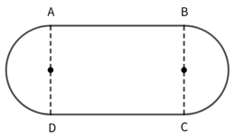

[代码描摹高清 PNG](../../../images/code_hd/439.png) · [SVG](../../../images/code_hd/439.svg)（原图为准）

A.200+100π
B.300+100π
C.100+300π
D.200+300π

来源：[2026年浙江省公务员录用考试《行测》题（A类）（网友回忆版）.pdf](https://github.com/dumarstoft-ship-it/xingce/blob/407016b55b49581efa3771bb59a2dee8761d982f/2026%E5%B9%B4%E6%B5%99%E6%B1%9F%E7%9C%81%E5%85%AC%E5%8A%A1%E5%91%98%E5%BD%95%E7%94%A8%E8%80%83%E8%AF%95%E3%80%8A%E8%A1%8C%E6%B5%8B%E3%80%8B%E9%A2%98%EF%BC%88A%E7%B1%BB%EF%BC%89%EF%BC%88%E7%BD%91%E5%8F%8B%E5%9B%9E%E5%BF%86%E7%89%88%EF%BC%89.pdf)，PDF 第 12 页。

## 第 60 题 · 数量关系

`ZJ2026-A类-060`

某旅行团有10位游客，平均年龄为35岁，且年龄各不相同。已知他们当中最大者比最小者大25岁，那么年龄最
小的3人年龄之和最大可能为多少岁？
A.87 B.88 C.89 D.90

来源：[2026年浙江省公务员录用考试《行测》题（A类）（网友回忆版）.pdf](https://github.com/dumarstoft-ship-it/xingce/blob/407016b55b49581efa3771bb59a2dee8761d982f/2026%E5%B9%B4%E6%B5%99%E6%B1%9F%E7%9C%81%E5%85%AC%E5%8A%A1%E5%91%98%E5%BD%95%E7%94%A8%E8%80%83%E8%AF%95%E3%80%8A%E8%A1%8C%E6%B5%8B%E3%80%8B%E9%A2%98%EF%BC%88A%E7%B1%BB%EF%BC%89%EF%BC%88%E7%BD%91%E5%8F%8B%E5%9B%9E%E5%BF%86%E7%89%88%EF%BC%89.pdf)，PDF 第 12 页。

## 第 61 题 · 数量关系

`ZJ2026-A类-061`

某公司从3个部门共选派8人参加会议。已知甲部门人数是乙、丙部门人数之和的一半，乙部门人数占甲、乙、
丙部门总人数的20%，丙部门比甲部门多2人。如果每个部门至少选派2人，至多选派3人，那么选派出的8人有
多少种不同组合？
A.560 B.780 C.920 D.1610

来源：[2026年浙江省公务员录用考试《行测》题（A类）（网友回忆版）.pdf](https://github.com/dumarstoft-ship-it/xingce/blob/407016b55b49581efa3771bb59a2dee8761d982f/2026%E5%B9%B4%E6%B5%99%E6%B1%9F%E7%9C%81%E5%85%AC%E5%8A%A1%E5%91%98%E5%BD%95%E7%94%A8%E8%80%83%E8%AF%95%E3%80%8A%E8%A1%8C%E6%B5%8B%E3%80%8B%E9%A2%98%EF%BC%88A%E7%B1%BB%EF%BC%89%EF%BC%88%E7%BD%91%E5%8F%8B%E5%9B%9E%E5%BF%86%E7%89%88%EF%BC%89.pdf)，PDF 第 12 页。

## 第 62 题 · 数量关系

`ZJ2026-A类-062`

小张计划在假期剩余的13天完成A、B、C三本书的阅读。已知阅读A书需要连续2天，阅读B书需要连续3天，阅
读C书需要连续4天。问在所有可能的阅读方案中随机选择一种，没有阅读的4天都不相连的概率是多少？
A.1/10
B.1/15
C.1/20
D.1/35

来源：[2026年浙江省公务员录用考试《行测》题（A类）（网友回忆版）.pdf](https://github.com/dumarstoft-ship-it/xingce/blob/407016b55b49581efa3771bb59a2dee8761d982f/2026%E5%B9%B4%E6%B5%99%E6%B1%9F%E7%9C%81%E5%85%AC%E5%8A%A1%E5%91%98%E5%BD%95%E7%94%A8%E8%80%83%E8%AF%95%E3%80%8A%E8%A1%8C%E6%B5%8B%E3%80%8B%E9%A2%98%EF%BC%88A%E7%B1%BB%EF%BC%89%EF%BC%88%E7%BD%91%E5%8F%8B%E5%9B%9E%E5%BF%86%E7%89%88%EF%BC%89.pdf)，PDF 第 12、13 页。

## 第 63 题 · 数量关系

`ZJ2026-A类-063`

从1，2，3，4，5，6，7，8，9，10十个数中随机选择两个数，它们的最大公约数为1的概率是多少？
A.2/3
B.31/45
C.11/15
D.7/9

来源：[2026年浙江省公务员录用考试《行测》题（A类）（网友回忆版）.pdf](https://github.com/dumarstoft-ship-it/xingce/blob/407016b55b49581efa3771bb59a2dee8761d982f/2026%E5%B9%B4%E6%B5%99%E6%B1%9F%E7%9C%81%E5%85%AC%E5%8A%A1%E5%91%98%E5%BD%95%E7%94%A8%E8%80%83%E8%AF%95%E3%80%8A%E8%A1%8C%E6%B5%8B%E3%80%8B%E9%A2%98%EF%BC%88A%E7%B1%BB%EF%BC%89%EF%BC%88%E7%BD%91%E5%8F%8B%E5%9B%9E%E5%BF%86%E7%89%88%EF%BC%89.pdf)，PDF 第 13 页。

## 第 64 题 · 数量关系

`ZJ2026-A类-064`

小赵制作一件手工作品，需要将一个长方体纸盒的每条棱和每个面的对角线用细木条加以固定。制作完成后，
他发现仅用了3种不同长度的细木条，且最短的细木条长度为1分米。问该纸盒的体积为多少立方分米？
A.√2
B.2
C.2√2
D.√6

来源：[2026年浙江省公务员录用考试《行测》题（A类）（网友回忆版）.pdf](https://github.com/dumarstoft-ship-it/xingce/blob/407016b55b49581efa3771bb59a2dee8761d982f/2026%E5%B9%B4%E6%B5%99%E6%B1%9F%E7%9C%81%E5%85%AC%E5%8A%A1%E5%91%98%E5%BD%95%E7%94%A8%E8%80%83%E8%AF%95%E3%80%8A%E8%A1%8C%E6%B5%8B%E3%80%8B%E9%A2%98%EF%BC%88A%E7%B1%BB%EF%BC%89%EF%BC%88%E7%BD%91%E5%8F%8B%E5%9B%9E%E5%BF%86%E7%89%88%EF%BC%89.pdf)，PDF 第 13 页。

## 第 65 题 · 数量关系

`ZJ2026-A类-065`

根据节假日放假规定，当且仅当元旦在周三时，不会形成小长假。问在连续的10年中，这种情况最少会出现多
少次？
A.0 B.1 C.2 D.3

来源：[2026年浙江省公务员录用考试《行测》题（A类）（网友回忆版）.pdf](https://github.com/dumarstoft-ship-it/xingce/blob/407016b55b49581efa3771bb59a2dee8761d982f/2026%E5%B9%B4%E6%B5%99%E6%B1%9F%E7%9C%81%E5%85%AC%E5%8A%A1%E5%91%98%E5%BD%95%E7%94%A8%E8%80%83%E8%AF%95%E3%80%8A%E8%A1%8C%E6%B5%8B%E3%80%8B%E9%A2%98%EF%BC%88A%E7%B1%BB%EF%BC%89%EF%BC%88%E7%BD%91%E5%8F%8B%E5%9B%9E%E5%BF%86%E7%89%88%EF%BC%89.pdf)，PDF 第 13 页。

## 第 66 题 · 判断推理

`ZJ2026-A类-066`

从所给的四个选项中，选择最合适的一个填入问号处，使之呈现一定的规律：

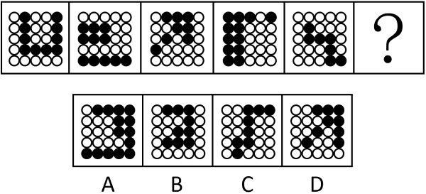

A.A B.B C.C D.D

来源：[2026年浙江省公务员录用考试《行测》题（A类）（网友回忆版）.pdf](https://github.com/dumarstoft-ship-it/xingce/blob/407016b55b49581efa3771bb59a2dee8761d982f/2026%E5%B9%B4%E6%B5%99%E6%B1%9F%E7%9C%81%E5%85%AC%E5%8A%A1%E5%91%98%E5%BD%95%E7%94%A8%E8%80%83%E8%AF%95%E3%80%8A%E8%A1%8C%E6%B5%8B%E3%80%8B%E9%A2%98%EF%BC%88A%E7%B1%BB%EF%BC%89%EF%BC%88%E7%BD%91%E5%8F%8B%E5%9B%9E%E5%BF%86%E7%89%88%EF%BC%89.pdf)，PDF 第 13 页。

## 第 67 题 · 判断推理

`ZJ2026-A类-067`

从所给的四个选项中，选择最合适的一个填入问号处，使之呈现一定的规律性：

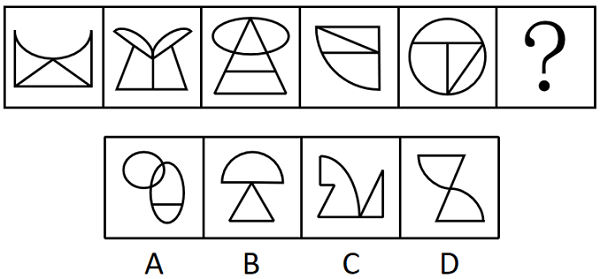

A.A B.B C.C D.D

来源：[2026年浙江省公务员录用考试《行测》题（A类）（网友回忆版）.pdf](https://github.com/dumarstoft-ship-it/xingce/blob/407016b55b49581efa3771bb59a2dee8761d982f/2026%E5%B9%B4%E6%B5%99%E6%B1%9F%E7%9C%81%E5%85%AC%E5%8A%A1%E5%91%98%E5%BD%95%E7%94%A8%E8%80%83%E8%AF%95%E3%80%8A%E8%A1%8C%E6%B5%8B%E3%80%8B%E9%A2%98%EF%BC%88A%E7%B1%BB%EF%BC%89%EF%BC%88%E7%BD%91%E5%8F%8B%E5%9B%9E%E5%BF%86%E7%89%88%EF%BC%89.pdf)，PDF 第 13、14 页。

## 第 68 题 · 判断推理

`ZJ2026-A类-068`

从所给的四个选项中，选择最合适的一个填入问号处，使之呈现一定的规律性：

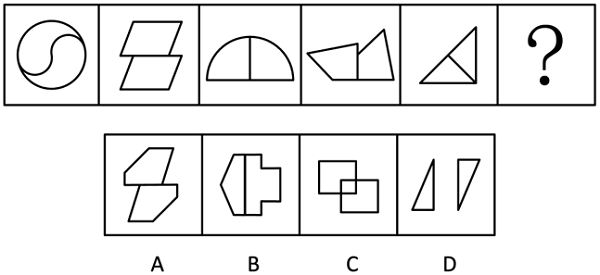

A.A B.B C.C D.D

来源：[2026年浙江省公务员录用考试《行测》题（A类）（网友回忆版）.pdf](https://github.com/dumarstoft-ship-it/xingce/blob/407016b55b49581efa3771bb59a2dee8761d982f/2026%E5%B9%B4%E6%B5%99%E6%B1%9F%E7%9C%81%E5%85%AC%E5%8A%A1%E5%91%98%E5%BD%95%E7%94%A8%E8%80%83%E8%AF%95%E3%80%8A%E8%A1%8C%E6%B5%8B%E3%80%8B%E9%A2%98%EF%BC%88A%E7%B1%BB%EF%BC%89%EF%BC%88%E7%BD%91%E5%8F%8B%E5%9B%9E%E5%BF%86%E7%89%88%EF%BC%89.pdf)，PDF 第 14 页。

## 第 69 题 · 判断推理

`ZJ2026-A类-069`

从所给的四个选项中，选择最合适的一项填入问号处，使之呈现一定的规律性：

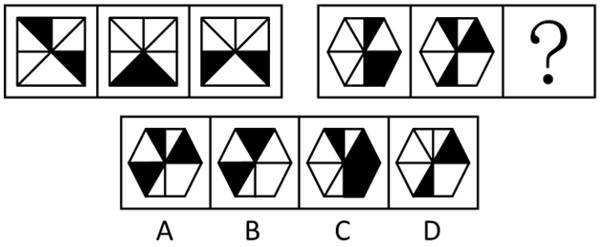

A.A B.B C.C D.D

来源：[2026年浙江省公务员录用考试《行测》题（A类）（网友回忆版）.pdf](https://github.com/dumarstoft-ship-it/xingce/blob/407016b55b49581efa3771bb59a2dee8761d982f/2026%E5%B9%B4%E6%B5%99%E6%B1%9F%E7%9C%81%E5%85%AC%E5%8A%A1%E5%91%98%E5%BD%95%E7%94%A8%E8%80%83%E8%AF%95%E3%80%8A%E8%A1%8C%E6%B5%8B%E3%80%8B%E9%A2%98%EF%BC%88A%E7%B1%BB%EF%BC%89%EF%BC%88%E7%BD%91%E5%8F%8B%E5%9B%9E%E5%BF%86%E7%89%88%EF%BC%89.pdf)，PDF 第 14 页。

## 第 70 题 · 判断推理

`ZJ2026-A类-070`

从所给的四个选项中，选择最合适的一个填入问号处，使之呈现一定的规律性：

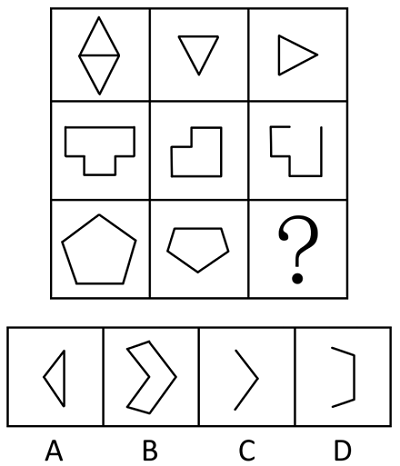

A.A B.B C.C D.D

来源：[2026年浙江省公务员录用考试《行测》题（A类）（网友回忆版）.pdf](https://github.com/dumarstoft-ship-it/xingce/blob/407016b55b49581efa3771bb59a2dee8761d982f/2026%E5%B9%B4%E6%B5%99%E6%B1%9F%E7%9C%81%E5%85%AC%E5%8A%A1%E5%91%98%E5%BD%95%E7%94%A8%E8%80%83%E8%AF%95%E3%80%8A%E8%A1%8C%E6%B5%8B%E3%80%8B%E9%A2%98%EF%BC%88A%E7%B1%BB%EF%BC%89%EF%BC%88%E7%BD%91%E5%8F%8B%E5%9B%9E%E5%BF%86%E7%89%88%EF%BC%89.pdf)，PDF 第 14、15 页。

## 第 71 题 · 判断推理

`ZJ2026-A类-071`

把下面的六个图形分为两类，使每一类图形都有各自的共同特征或规律，分类正确的一项是：

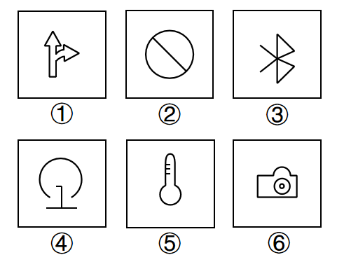

A.①②③，④⑤⑥ B.①②⑤，③④⑥ C.①③⑥，②④⑤ D.①④⑤，②③⑥

来源：[2026年浙江省公务员录用考试《行测》题（A类）（网友回忆版）.pdf](https://github.com/dumarstoft-ship-it/xingce/blob/407016b55b49581efa3771bb59a2dee8761d982f/2026%E5%B9%B4%E6%B5%99%E6%B1%9F%E7%9C%81%E5%85%AC%E5%8A%A1%E5%91%98%E5%BD%95%E7%94%A8%E8%80%83%E8%AF%95%E3%80%8A%E8%A1%8C%E6%B5%8B%E3%80%8B%E9%A2%98%EF%BC%88A%E7%B1%BB%EF%BC%89%EF%BC%88%E7%BD%91%E5%8F%8B%E5%9B%9E%E5%BF%86%E7%89%88%EF%BC%89.pdf)，PDF 第 15 页。

## 第 72 题 · 判断推理

`ZJ2026-A类-072`

从所给的四个选项中，选择最合适的一个填入问号处，使之呈现一定的规律性：

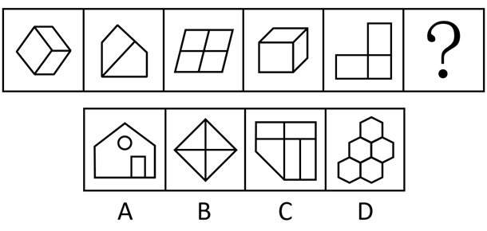

A.A B.B C.C D.D

来源：[2026年浙江省公务员录用考试《行测》题（A类）（网友回忆版）.pdf](https://github.com/dumarstoft-ship-it/xingce/blob/407016b55b49581efa3771bb59a2dee8761d982f/2026%E5%B9%B4%E6%B5%99%E6%B1%9F%E7%9C%81%E5%85%AC%E5%8A%A1%E5%91%98%E5%BD%95%E7%94%A8%E8%80%83%E8%AF%95%E3%80%8A%E8%A1%8C%E6%B5%8B%E3%80%8B%E9%A2%98%EF%BC%88A%E7%B1%BB%EF%BC%89%EF%BC%88%E7%BD%91%E5%8F%8B%E5%9B%9E%E5%BF%86%E7%89%88%EF%BC%89.pdf)，PDF 第 15、16 页。

## 第 73 题 · 判断推理

`ZJ2026-A类-073`

把下面的六个图形分为两类，使每一类图形都有各自的共同特征或规律，分类正确的一项是：

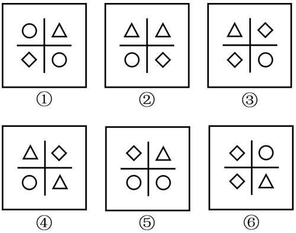

A.①②④，③⑤⑥ B.①③④，②⑤⑥ C.①③⑤，②④⑥ D.①④⑥，②③⑤

来源：[2026年浙江省公务员录用考试《行测》题（A类）（网友回忆版）.pdf](https://github.com/dumarstoft-ship-it/xingce/blob/407016b55b49581efa3771bb59a2dee8761d982f/2026%E5%B9%B4%E6%B5%99%E6%B1%9F%E7%9C%81%E5%85%AC%E5%8A%A1%E5%91%98%E5%BD%95%E7%94%A8%E8%80%83%E8%AF%95%E3%80%8A%E8%A1%8C%E6%B5%8B%E3%80%8B%E9%A2%98%EF%BC%88A%E7%B1%BB%EF%BC%89%EF%BC%88%E7%BD%91%E5%8F%8B%E5%9B%9E%E5%BF%86%E7%89%88%EF%BC%89.pdf)，PDF 第 16 页。

## 第 74 题 · 判断推理

`ZJ2026-A类-074`

左边给定的是纸盒外表面的展开图，右边哪一项能由它折叠而成？

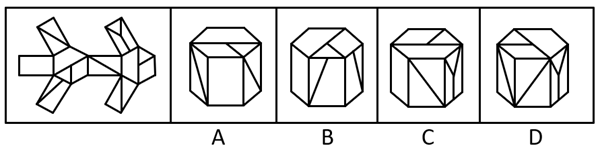

A.A B.B C.C D.D

来源：[2026年浙江省公务员录用考试《行测》题（A类）（网友回忆版）.pdf](https://github.com/dumarstoft-ship-it/xingce/blob/407016b55b49581efa3771bb59a2dee8761d982f/2026%E5%B9%B4%E6%B5%99%E6%B1%9F%E7%9C%81%E5%85%AC%E5%8A%A1%E5%91%98%E5%BD%95%E7%94%A8%E8%80%83%E8%AF%95%E3%80%8A%E8%A1%8C%E6%B5%8B%E3%80%8B%E9%A2%98%EF%BC%88A%E7%B1%BB%EF%BC%89%EF%BC%88%E7%BD%91%E5%8F%8B%E5%9B%9E%E5%BF%86%E7%89%88%EF%BC%89.pdf)，PDF 第 16 页。

## 第 75 题 · 判断推理

`ZJ2026-A类-075`

下面是某立体图形的正面和后面，它由三个完全相同的小立体图形组成，该小立体图形是：

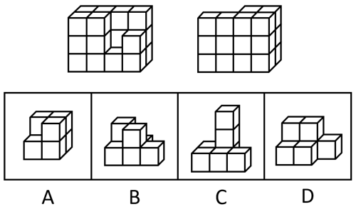

A.A B.B C.C D.D

来源：[2026年浙江省公务员录用考试《行测》题（A类）（网友回忆版）.pdf](https://github.com/dumarstoft-ship-it/xingce/blob/407016b55b49581efa3771bb59a2dee8761d982f/2026%E5%B9%B4%E6%B5%99%E6%B1%9F%E7%9C%81%E5%85%AC%E5%8A%A1%E5%91%98%E5%BD%95%E7%94%A8%E8%80%83%E8%AF%95%E3%80%8A%E8%A1%8C%E6%B5%8B%E3%80%8B%E9%A2%98%EF%BC%88A%E7%B1%BB%EF%BC%89%EF%BC%88%E7%BD%91%E5%8F%8B%E5%9B%9E%E5%BF%86%E7%89%88%EF%BC%89.pdf)，PDF 第 16、17 页。

## 第 76 题 · 判断推理

`ZJ2026-A类-076`

板鞋：鞋
A.青海：海 B.土匪：匪 C.河马：马 D.水银：银

来源：[2026年浙江省公务员录用考试《行测》题（A类）（网友回忆版）.pdf](https://github.com/dumarstoft-ship-it/xingce/blob/407016b55b49581efa3771bb59a2dee8761d982f/2026%E5%B9%B4%E6%B5%99%E6%B1%9F%E7%9C%81%E5%85%AC%E5%8A%A1%E5%91%98%E5%BD%95%E7%94%A8%E8%80%83%E8%AF%95%E3%80%8A%E8%A1%8C%E6%B5%8B%E3%80%8B%E9%A2%98%EF%BC%88A%E7%B1%BB%EF%BC%89%EF%BC%88%E7%BD%91%E5%8F%8B%E5%9B%9E%E5%BF%86%E7%89%88%EF%BC%89.pdf)，PDF 第 17 页。

## 第 77 题 · 判断推理

`ZJ2026-A类-077`

抗日战争时期：解放战争时期
A.日新：月异 B.秋收冬藏：春生夏长
C.弱冠之年：而立之年 D.朝饮木兰之坠露：夕餐秋菊之落英

来源：[2026年浙江省公务员录用考试《行测》题（A类）（网友回忆版）.pdf](https://github.com/dumarstoft-ship-it/xingce/blob/407016b55b49581efa3771bb59a2dee8761d982f/2026%E5%B9%B4%E6%B5%99%E6%B1%9F%E7%9C%81%E5%85%AC%E5%8A%A1%E5%91%98%E5%BD%95%E7%94%A8%E8%80%83%E8%AF%95%E3%80%8A%E8%A1%8C%E6%B5%8B%E3%80%8B%E9%A2%98%EF%BC%88A%E7%B1%BB%EF%BC%89%EF%BC%88%E7%BD%91%E5%8F%8B%E5%9B%9E%E5%BF%86%E7%89%88%EF%BC%89.pdf)，PDF 第 17 页。

## 第 78 题 · 判断推理

`ZJ2026-A类-078`

鸭绒被：卤鸭头
A.棉花：棉被 B.铅笔芯：钻石 C.人参：西洋参 D.牛排：牛角梳

来源：[2026年浙江省公务员录用考试《行测》题（A类）（网友回忆版）.pdf](https://github.com/dumarstoft-ship-it/xingce/blob/407016b55b49581efa3771bb59a2dee8761d982f/2026%E5%B9%B4%E6%B5%99%E6%B1%9F%E7%9C%81%E5%85%AC%E5%8A%A1%E5%91%98%E5%BD%95%E7%94%A8%E8%80%83%E8%AF%95%E3%80%8A%E8%A1%8C%E6%B5%8B%E3%80%8B%E9%A2%98%EF%BC%88A%E7%B1%BB%EF%BC%89%EF%BC%88%E7%BD%91%E5%8F%8B%E5%9B%9E%E5%BF%86%E7%89%88%EF%BC%89.pdf)，PDF 第 17 页。

## 第 79 题 · 判断推理

`ZJ2026-A类-079`

天下大事：必作于细
A.积善之家：必有余庆 B.工欲善其事：必先利其器
C.治国有常：利民为本 D.有朋自远方来：不亦乐乎

来源：[2026年浙江省公务员录用考试《行测》题（A类）（网友回忆版）.pdf](https://github.com/dumarstoft-ship-it/xingce/blob/407016b55b49581efa3771bb59a2dee8761d982f/2026%E5%B9%B4%E6%B5%99%E6%B1%9F%E7%9C%81%E5%85%AC%E5%8A%A1%E5%91%98%E5%BD%95%E7%94%A8%E8%80%83%E8%AF%95%E3%80%8A%E8%A1%8C%E6%B5%8B%E3%80%8B%E9%A2%98%EF%BC%88A%E7%B1%BB%EF%BC%89%EF%BC%88%E7%BD%91%E5%8F%8B%E5%9B%9E%E5%BF%86%E7%89%88%EF%BC%89.pdf)，PDF 第 17 页。

## 第 80 题 · 判断推理

`ZJ2026-A类-080`

举手：示意：点头
A.握手：礼仪：敬礼 B.义务：纳税：选举 C.罢工：游行：抗议 D.界限：界碑：界河

来源：[2026年浙江省公务员录用考试《行测》题（A类）（网友回忆版）.pdf](https://github.com/dumarstoft-ship-it/xingce/blob/407016b55b49581efa3771bb59a2dee8761d982f/2026%E5%B9%B4%E6%B5%99%E6%B1%9F%E7%9C%81%E5%85%AC%E5%8A%A1%E5%91%98%E5%BD%95%E7%94%A8%E8%80%83%E8%AF%95%E3%80%8A%E8%A1%8C%E6%B5%8B%E3%80%8B%E9%A2%98%EF%BC%88A%E7%B1%BB%EF%BC%89%EF%BC%88%E7%BD%91%E5%8F%8B%E5%9B%9E%E5%BF%86%E7%89%88%EF%BC%89.pdf)，PDF 第 17 页。

## 第 81 题 · 判断推理

`ZJ2026-A类-081`

实现：现实
A.适合：合适 B.代替：替代 C.离别：别离 D.积累：累积

来源：[2026年浙江省公务员录用考试《行测》题（A类）（网友回忆版）.pdf](https://github.com/dumarstoft-ship-it/xingce/blob/407016b55b49581efa3771bb59a2dee8761d982f/2026%E5%B9%B4%E6%B5%99%E6%B1%9F%E7%9C%81%E5%85%AC%E5%8A%A1%E5%91%98%E5%BD%95%E7%94%A8%E8%80%83%E8%AF%95%E3%80%8A%E8%A1%8C%E6%B5%8B%E3%80%8B%E9%A2%98%EF%BC%88A%E7%B1%BB%EF%BC%89%EF%BC%88%E7%BD%91%E5%8F%8B%E5%9B%9E%E5%BF%86%E7%89%88%EF%BC%89.pdf)，PDF 第 17 页。

## 第 82 题 · 判断推理

`ZJ2026-A类-082`

消防栓：按摩椅
A.火山口：三江源 B.金钟罩：铁布衫 C.传染病：急救车 D.助听器：防晒霜

来源：[2026年浙江省公务员录用考试《行测》题（A类）（网友回忆版）.pdf](https://github.com/dumarstoft-ship-it/xingce/blob/407016b55b49581efa3771bb59a2dee8761d982f/2026%E5%B9%B4%E6%B5%99%E6%B1%9F%E7%9C%81%E5%85%AC%E5%8A%A1%E5%91%98%E5%BD%95%E7%94%A8%E8%80%83%E8%AF%95%E3%80%8A%E8%A1%8C%E6%B5%8B%E3%80%8B%E9%A2%98%EF%BC%88A%E7%B1%BB%EF%BC%89%EF%BC%88%E7%BD%91%E5%8F%8B%E5%9B%9E%E5%BF%86%E7%89%88%EF%BC%89.pdf)，PDF 第 17 页。

## 第 83 题 · 判断推理

`ZJ2026-A类-083`

结婚登记：身份证：户口本
A.睡觉：床：枕头 B.成功：运气：努力 C.登山：鞋子：登山杖 D.考试：准考证：签字笔

来源：[2026年浙江省公务员录用考试《行测》题（A类）（网友回忆版）.pdf](https://github.com/dumarstoft-ship-it/xingce/blob/407016b55b49581efa3771bb59a2dee8761d982f/2026%E5%B9%B4%E6%B5%99%E6%B1%9F%E7%9C%81%E5%85%AC%E5%8A%A1%E5%91%98%E5%BD%95%E7%94%A8%E8%80%83%E8%AF%95%E3%80%8A%E8%A1%8C%E6%B5%8B%E3%80%8B%E9%A2%98%EF%BC%88A%E7%B1%BB%EF%BC%89%EF%BC%88%E7%BD%91%E5%8F%8B%E5%9B%9E%E5%BF%86%E7%89%88%EF%BC%89.pdf)，PDF 第 17 页。

## 第 84 题 · 判断推理

`ZJ2026-A类-084`

物理学家：化学家：居里夫人
A.整数：正数：质数 B.硫酸：铜：硫酸铜
C.办公室：卧室：电脑 D.公司职员：自媒体博主：文艺青年

来源：[2026年浙江省公务员录用考试《行测》题（A类）（网友回忆版）.pdf](https://github.com/dumarstoft-ship-it/xingce/blob/407016b55b49581efa3771bb59a2dee8761d982f/2026%E5%B9%B4%E6%B5%99%E6%B1%9F%E7%9C%81%E5%85%AC%E5%8A%A1%E5%91%98%E5%BD%95%E7%94%A8%E8%80%83%E8%AF%95%E3%80%8A%E8%A1%8C%E6%B5%8B%E3%80%8B%E9%A2%98%EF%BC%88A%E7%B1%BB%EF%BC%89%EF%BC%88%E7%BD%91%E5%8F%8B%E5%9B%9E%E5%BF%86%E7%89%88%EF%BC%89.pdf)，PDF 第 17 页。

## 第 85 题 · 判断推理

`ZJ2026-A类-085`

（    ） 对于 木雕 相当于 花雕酒 对于 （    ）
A.黄杨木 糯米 B.装饰 陪嫁 C.石雕 莲子酒 D.雕塑艺术 发酵

来源：[2026年浙江省公务员录用考试《行测》题（A类）（网友回忆版）.pdf](https://github.com/dumarstoft-ship-it/xingce/blob/407016b55b49581efa3771bb59a2dee8761d982f/2026%E5%B9%B4%E6%B5%99%E6%B1%9F%E7%9C%81%E5%85%AC%E5%8A%A1%E5%91%98%E5%BD%95%E7%94%A8%E8%80%83%E8%AF%95%E3%80%8A%E8%A1%8C%E6%B5%8B%E3%80%8B%E9%A2%98%EF%BC%88A%E7%B1%BB%EF%BC%89%EF%BC%88%E7%BD%91%E5%8F%8B%E5%9B%9E%E5%BF%86%E7%89%88%EF%BC%89.pdf)，PDF 第 17 页。

## 第 86 题 · 判断推理

`ZJ2026-A类-086`

表层扮演是情绪劳动的一种策略，指个体隐藏真实情绪，按照工作要求伪装出特定外在情绪表现的行为模式；
深层扮演指个体通过调整内在真实情感以符合工作要求的情绪表达方式，它强调内在情绪体验与外在表现的一
致性。
根据上述定义，下列体现深层扮演的是：
A.服务员面对顾客投诉强忍怒火保持职业微笑 B.护士换位思考理解患者焦虑后主动安抚情绪
C.客服人员机械背诵标准化礼貌用语应对咨询 D.销售员因业绩压力自发对产品产生强烈信心

来源：[2026年浙江省公务员录用考试《行测》题（A类）（网友回忆版）.pdf](https://github.com/dumarstoft-ship-it/xingce/blob/407016b55b49581efa3771bb59a2dee8761d982f/2026%E5%B9%B4%E6%B5%99%E6%B1%9F%E7%9C%81%E5%85%AC%E5%8A%A1%E5%91%98%E5%BD%95%E7%94%A8%E8%80%83%E8%AF%95%E3%80%8A%E8%A1%8C%E6%B5%8B%E3%80%8B%E9%A2%98%EF%BC%88A%E7%B1%BB%EF%BC%89%EF%BC%88%E7%BD%91%E5%8F%8B%E5%9B%9E%E5%BF%86%E7%89%88%EF%BC%89.pdf)，PDF 第 17、18 页。

## 第 87 题 · 判断推理

`ZJ2026-A类-087`

无边界组织指打破传统组织内部的横向（部门间）、纵向（层级间）、外部（与客户/供应商间）的预设边界，
以灵活授权团队取代固定部门，加强信息自由流通与资源动态配置的组织设计模式。
根据上述定义，下列属于无边界组织的是：
A.连锁餐饮企业通过标准化流程管理各分店运营 B.政府机构采用垂直管理体系确保政策统一执行
C.公司根据项目需要进行跨职能部门团队动态组合 D.企业通过部门分工和逐级审批制度保障运营效率

来源：[2026年浙江省公务员录用考试《行测》题（A类）（网友回忆版）.pdf](https://github.com/dumarstoft-ship-it/xingce/blob/407016b55b49581efa3771bb59a2dee8761d982f/2026%E5%B9%B4%E6%B5%99%E6%B1%9F%E7%9C%81%E5%85%AC%E5%8A%A1%E5%91%98%E5%BD%95%E7%94%A8%E8%80%83%E8%AF%95%E3%80%8A%E8%A1%8C%E6%B5%8B%E3%80%8B%E9%A2%98%EF%BC%88A%E7%B1%BB%EF%BC%89%EF%BC%88%E7%BD%91%E5%8F%8B%E5%9B%9E%E5%BF%86%E7%89%88%EF%BC%89.pdf)，PDF 第 18 页。

## 第 88 题 · 判断推理

`ZJ2026-A类-088`

情境变量是实验或自然环境中可影响个体行为或心理过程的外部因素，如物理距离、社会文化背景等。
根据上述定义，下列属于情境变量的是：
A.实验中恒定的光照强度 B.被试完成问卷时的情绪状态
C.企业员工绩效考核的量化指标 D.跨文化研究中不同国家的礼仪规范差异

来源：[2026年浙江省公务员录用考试《行测》题（A类）（网友回忆版）.pdf](https://github.com/dumarstoft-ship-it/xingce/blob/407016b55b49581efa3771bb59a2dee8761d982f/2026%E5%B9%B4%E6%B5%99%E6%B1%9F%E7%9C%81%E5%85%AC%E5%8A%A1%E5%91%98%E5%BD%95%E7%94%A8%E8%80%83%E8%AF%95%E3%80%8A%E8%A1%8C%E6%B5%8B%E3%80%8B%E9%A2%98%EF%BC%88A%E7%B1%BB%EF%BC%89%EF%BC%88%E7%BD%91%E5%8F%8B%E5%9B%9E%E5%BF%86%E7%89%88%EF%BC%89.pdf)，PDF 第 18 页。

## 第 89 题 · 判断推理

`ZJ2026-A类-089`

光杆动词式把字句，是指“把+名词+光杆动词”，即动词后无任何附加成分的句子；动趋式把字句，是指“把
+名词+动趋式动补短语”的句子，其中动趋式动补短语表达了行为发生的趋势。
根据上述定义，下列属于动趋式把字句的是：
A.你别把家门上锁 B.母亲把剩菜带回来
C.你别把小问题复杂化 D.我建议大会把这个提案取消

来源：[2026年浙江省公务员录用考试《行测》题（A类）（网友回忆版）.pdf](https://github.com/dumarstoft-ship-it/xingce/blob/407016b55b49581efa3771bb59a2dee8761d982f/2026%E5%B9%B4%E6%B5%99%E6%B1%9F%E7%9C%81%E5%85%AC%E5%8A%A1%E5%91%98%E5%BD%95%E7%94%A8%E8%80%83%E8%AF%95%E3%80%8A%E8%A1%8C%E6%B5%8B%E3%80%8B%E9%A2%98%EF%BC%88A%E7%B1%BB%EF%BC%89%EF%BC%88%E7%BD%91%E5%8F%8B%E5%9B%9E%E5%BF%86%E7%89%88%EF%BC%89.pdf)，PDF 第 18 页。

## 第 90 题 · 判断推理

`ZJ2026-A类-090`

转口贸易是指商品生产国与消费国通过第三国（或地区）转手进行的贸易活动，生产国和消费国不直接进行买
卖，货物在第三国不经过加工或仅进行简单分类、包装等非本质改变。
根据上述定义，下列属于转口贸易的是：
A.迪拜将伊朗原油提炼成成品油后销往欧洲
B.新加坡从中国进口手机零部件，组装后出口至印度
C.智利铜矿经秘鲁港口卸货后，直接原箱装船运往日本
D.中国纺织品出口至荷兰，荷兰贸易商更换原产地证明文件后转卖至英国

来源：[2026年浙江省公务员录用考试《行测》题（A类）（网友回忆版）.pdf](https://github.com/dumarstoft-ship-it/xingce/blob/407016b55b49581efa3771bb59a2dee8761d982f/2026%E5%B9%B4%E6%B5%99%E6%B1%9F%E7%9C%81%E5%85%AC%E5%8A%A1%E5%91%98%E5%BD%95%E7%94%A8%E8%80%83%E8%AF%95%E3%80%8A%E8%A1%8C%E6%B5%8B%E3%80%8B%E9%A2%98%EF%BC%88A%E7%B1%BB%EF%BC%89%EF%BC%88%E7%BD%91%E5%8F%8B%E5%9B%9E%E5%BF%86%E7%89%88%EF%BC%89.pdf)，PDF 第 18 页。

## 第 91 题 · 判断推理

`ZJ2026-A类-091`

剪切增稠是指剪切速率或者剪切应力增加到某一个数值时，液体中形成了新的结构，引起了阻力的增加，导致
液体的表观黏度增大，同时伴随着体积胀大的现象。
根据上述定义，下列现象属于剪切增稠的是：
A.块状的老酸奶经搅拌后变成较稀的液体
B.陷入沼泽时，快速挣扎会让沼泽变稀，下陷速度加快
C.液体防弹衣中的液体被高速的子弹击中时会迅速膨胀变硬
D.敲击瓶底或大力甩瓶身可以让粘在瓶底的剩余番茄酱流出

来源：[2026年浙江省公务员录用考试《行测》题（A类）（网友回忆版）.pdf](https://github.com/dumarstoft-ship-it/xingce/blob/407016b55b49581efa3771bb59a2dee8761d982f/2026%E5%B9%B4%E6%B5%99%E6%B1%9F%E7%9C%81%E5%85%AC%E5%8A%A1%E5%91%98%E5%BD%95%E7%94%A8%E8%80%83%E8%AF%95%E3%80%8A%E8%A1%8C%E6%B5%8B%E3%80%8B%E9%A2%98%EF%BC%88A%E7%B1%BB%EF%BC%89%EF%BC%88%E7%BD%91%E5%8F%8B%E5%9B%9E%E5%BF%86%E7%89%88%EF%BC%89.pdf)，PDF 第 18 页。

## 第 92 题 · 判断推理

`ZJ2026-A类-092`

随机变量X1和X2独立，是指X1的取值不影响X2的取值，X2的取值也不影响X1的取值；随机变量X1和X2服从同
一分布，是指X1和X2在取值范围内的概率分布一致。如果一些随机变量服从同一分布，并且互相独立，那么这
些随机变量是独立同分布。
根据上述定义，下列随机变量是独立同分布的是：
A.甲、乙两人先后抽奖，甲、乙抽中奖的情况
B.甲、乙两人先后掷骰子，甲、乙掷出点数的情况
C.实力差距悬殊的甲、乙两棋手进行比赛，甲、乙的胜负情况
D.在街上随机选择一名男性甲和一名女性乙，甲、乙的身高情况

来源：[2026年浙江省公务员录用考试《行测》题（A类）（网友回忆版）.pdf](https://github.com/dumarstoft-ship-it/xingce/blob/407016b55b49581efa3771bb59a2dee8761d982f/2026%E5%B9%B4%E6%B5%99%E6%B1%9F%E7%9C%81%E5%85%AC%E5%8A%A1%E5%91%98%E5%BD%95%E7%94%A8%E8%80%83%E8%AF%95%E3%80%8A%E8%A1%8C%E6%B5%8B%E3%80%8B%E9%A2%98%EF%BC%88A%E7%B1%BB%EF%BC%89%EF%BC%88%E7%BD%91%E5%8F%8B%E5%9B%9E%E5%BF%86%E7%89%88%EF%BC%89.pdf)，PDF 第 18 页。

## 第 93 题 · 判断推理

`ZJ2026-A类-093`

求同求异并用法是探求现象间因果联系的一种方法，是指在被研究现象出现的若干正面场合中，都有一个相同
的先行情况出现，而在被研究现象不出现的若干反面场合中，该先行情况都不出现，则该先行情况就是被研究
现象的原因。
根据上述定义，下列体现求同求异并用法的是：
A.世界杯期间，小明第一晚边看边喝浓茶，失眠了；第二晚边看边喝咖啡，失眠了；第三晚边看边吸烟，失眠
了。可见吸烟、喝咖啡和喝浓茶是失眠的原因
B.体质相同的双胞胎兄弟在饭店用餐，一个吃了冰激凌后出现腹痛；另一个没吃冰激凌未出现腹痛，两人吃的
其他食物完全相同。可见吃冰激凌是腹痛的原因
C.电脑维修店接待了几位因电脑中毒前来维修的顾客，他们的电脑品牌、型号各有不同，但他们的电脑在中毒
前都运行了同一个软件。可见该软件可能存在木马程序
D.失足青年的家庭一般都不稳定，有的父母离异，有的父母对孩子关心帮助不够；而没有失足的青年家庭较为
稳定，父母经常关心和帮助他们。可见家庭不稳定是青年失足的重要原因

来源：[2026年浙江省公务员录用考试《行测》题（A类）（网友回忆版）.pdf](https://github.com/dumarstoft-ship-it/xingce/blob/407016b55b49581efa3771bb59a2dee8761d982f/2026%E5%B9%B4%E6%B5%99%E6%B1%9F%E7%9C%81%E5%85%AC%E5%8A%A1%E5%91%98%E5%BD%95%E7%94%A8%E8%80%83%E8%AF%95%E3%80%8A%E8%A1%8C%E6%B5%8B%E3%80%8B%E9%A2%98%EF%BC%88A%E7%B1%BB%EF%BC%89%EF%BC%88%E7%BD%91%E5%8F%8B%E5%9B%9E%E5%BF%86%E7%89%88%EF%BC%89.pdf)，PDF 第 18、19 页。

## 第 94 题 · 判断推理

`ZJ2026-A类-094`

具身智能是指智能体（如机器人、无人机、智能汽车等）通过物理实体与环境实时交互，不断修正自身模型和
策略，在不断变化的环境中做出实时反应，实现感知、认知、决策和行动一体化。
根据上述定义，下列场景中没有体现具身智能的是：
A.无人机按计划路线对稻田进行农药喷洒，实现“科技助农”
B.作战机器人实时分析环境数据，在复杂地形中自主行走和避障
C.自动驾驶汽车在绿灯变红前3秒钟，做出“加速驶过路口”的决策
D.人形机器人“消防员”正在灭火，突然看到被困群众，立马上前安抚他们

来源：[2026年浙江省公务员录用考试《行测》题（A类）（网友回忆版）.pdf](https://github.com/dumarstoft-ship-it/xingce/blob/407016b55b49581efa3771bb59a2dee8761d982f/2026%E5%B9%B4%E6%B5%99%E6%B1%9F%E7%9C%81%E5%85%AC%E5%8A%A1%E5%91%98%E5%BD%95%E7%94%A8%E8%80%83%E8%AF%95%E3%80%8A%E8%A1%8C%E6%B5%8B%E3%80%8B%E9%A2%98%EF%BC%88A%E7%B1%BB%EF%BC%89%EF%BC%88%E7%BD%91%E5%8F%8B%E5%9B%9E%E5%BF%86%E7%89%88%EF%BC%89.pdf)，PDF 第 19 页。

## 第 95 题 · 判断推理

`ZJ2026-A类-095`

片面谬误是指用特例为自己的错误开脱。人们都不喜欢被证明自己的言行是错误的，所以当他们被证明是错误
的时候，总会想办法给自己找理由。
根据上述定义，下列属于片面谬误的是：
A.领导指出小王工作出了差错，小王说那天自己身体刚好不舒服
B.小赵年终考核垫底，他自我安慰道，不管怎么考核，总有人是最差的
C.老师批评小孙考试经常出现计算错误，小孙妈妈说孩子一着急就这样
D.小李超常发挥获得比赛二等奖，他心里想，再多答对一题就能得一等奖了

来源：[2026年浙江省公务员录用考试《行测》题（A类）（网友回忆版）.pdf](https://github.com/dumarstoft-ship-it/xingce/blob/407016b55b49581efa3771bb59a2dee8761d982f/2026%E5%B9%B4%E6%B5%99%E6%B1%9F%E7%9C%81%E5%85%AC%E5%8A%A1%E5%91%98%E5%BD%95%E7%94%A8%E8%80%83%E8%AF%95%E3%80%8A%E8%A1%8C%E6%B5%8B%E3%80%8B%E9%A2%98%EF%BC%88A%E7%B1%BB%EF%BC%89%EF%BC%88%E7%BD%91%E5%8F%8B%E5%9B%9E%E5%BF%86%E7%89%88%EF%BC%89.pdf)，PDF 第 19 页。

## 第 96 题 · 判断推理

`ZJ2026-A类-096`

某单位拟对辖区内酒店进行升级提星，要求酒店必须基本设施完备，并且要通过卫生部门的严格考核。
以下哪项为真，说明升级提星这项工作没有遵守要求？
（1）酒店成功升级提星，但没有通过卫生部门的严格考核
（2）酒店成功升级提星，但酒店内没有空调、吹风机等基本设施
（3）酒店基本设施完备，且通过了卫生部门的严格考核，但是没有升级提星
A.（1）（2） B.（2）（3） C.（3） D.（1）（2）（3）

来源：[2026年浙江省公务员录用考试《行测》题（A类）（网友回忆版）.pdf](https://github.com/dumarstoft-ship-it/xingce/blob/407016b55b49581efa3771bb59a2dee8761d982f/2026%E5%B9%B4%E6%B5%99%E6%B1%9F%E7%9C%81%E5%85%AC%E5%8A%A1%E5%91%98%E5%BD%95%E7%94%A8%E8%80%83%E8%AF%95%E3%80%8A%E8%A1%8C%E6%B5%8B%E3%80%8B%E9%A2%98%EF%BC%88A%E7%B1%BB%EF%BC%89%EF%BC%88%E7%BD%91%E5%8F%8B%E5%9B%9E%E5%BF%86%E7%89%88%EF%BC%89.pdf)，PDF 第 19 页。

## 第 97 题 · 判断推理

`ZJ2026-A类-097`

某商店现有歌手甲的专辑A、B各一张，歌手乙的专辑C、D各一张，歌手丙的专辑E、F各一张，共6张专辑，需
将它们放在横向排列的1~6号货架，每个货架摆放一张。已知：（1）A和C不相邻；（2）F和C不相邻；（3）
有且仅有一张甲的专辑在最边上的货架。
如果C在2号货架，E在4号货架，那么以下哪项可能为真？
A.B在1号货架 B.B在5号货架 C.D在5号货架 D.D在6号货架

来源：[2026年浙江省公务员录用考试《行测》题（A类）（网友回忆版）.pdf](https://github.com/dumarstoft-ship-it/xingce/blob/407016b55b49581efa3771bb59a2dee8761d982f/2026%E5%B9%B4%E6%B5%99%E6%B1%9F%E7%9C%81%E5%85%AC%E5%8A%A1%E5%91%98%E5%BD%95%E7%94%A8%E8%80%83%E8%AF%95%E3%80%8A%E8%A1%8C%E6%B5%8B%E3%80%8B%E9%A2%98%EF%BC%88A%E7%B1%BB%EF%BC%89%EF%BC%88%E7%BD%91%E5%8F%8B%E5%9B%9E%E5%BF%86%E7%89%88%EF%BC%89.pdf)，PDF 第 19 页。

## 第 98 题 · 判断推理

`ZJ2026-A类-098`

某校举办演讲比赛，琪琪、依依、冰冰、鑫鑫、磊磊、静静6人均获了奖，其中一等奖1人，二等奖2人，三等
奖3人。已知：
(1)除非琪琪获得二等奖，否则冰冰获得一等奖；
(2)只有鑫鑫获得三等奖且静静获得二等奖，琪琪和依依才能至少有一人获得二等奖；
(3)如果鑫鑫获得三等奖，那么冰冰获得二等奖，且依依不是三等奖。
根据上述信息，以下哪项一定为真？
A.冰冰未获得一等奖 B.琪琪获得二等奖 C.鑫鑫未获得一等奖 D.磊磊获得三等奖

来源：[2026年浙江省公务员录用考试《行测》题（A类）（网友回忆版）.pdf](https://github.com/dumarstoft-ship-it/xingce/blob/407016b55b49581efa3771bb59a2dee8761d982f/2026%E5%B9%B4%E6%B5%99%E6%B1%9F%E7%9C%81%E5%85%AC%E5%8A%A1%E5%91%98%E5%BD%95%E7%94%A8%E8%80%83%E8%AF%95%E3%80%8A%E8%A1%8C%E6%B5%8B%E3%80%8B%E9%A2%98%EF%BC%88A%E7%B1%BB%EF%BC%89%EF%BC%88%E7%BD%91%E5%8F%8B%E5%9B%9E%E5%BF%86%E7%89%88%EF%BC%89.pdf)，PDF 第 19、20 页。

## 第 99 题 · 判断推理

`ZJ2026-A类-099`

下列诗句中描述的两者逻辑关系，与“但使龙城飞将在，不教胡马度阴山”中“龙城飞将在”与“胡马度阴
山”关系一致的是：
A.“黄沙百战穿金甲，不破楼兰终不还”中“破楼兰”与“还”
B.“问渠那得清如许？为有源头活水来”中“清如许”与“源头活水来”
C.“不畏浮云遮望眼，自缘身在最高层”中“浮云遮望眼”与“身在最高层”
D.“若非群玉山头见，会向瑶台月下逢”中“群玉山头见”与“瑶台月下逢”

来源：[2026年浙江省公务员录用考试《行测》题（A类）（网友回忆版）.pdf](https://github.com/dumarstoft-ship-it/xingce/blob/407016b55b49581efa3771bb59a2dee8761d982f/2026%E5%B9%B4%E6%B5%99%E6%B1%9F%E7%9C%81%E5%85%AC%E5%8A%A1%E5%91%98%E5%BD%95%E7%94%A8%E8%80%83%E8%AF%95%E3%80%8A%E8%A1%8C%E6%B5%8B%E3%80%8B%E9%A2%98%EF%BC%88A%E7%B1%BB%EF%BC%89%EF%BC%88%E7%BD%91%E5%8F%8B%E5%9B%9E%E5%BF%86%E7%89%88%EF%BC%89.pdf)，PDF 第 20 页。

## 第 100 题 · 判断推理

`ZJ2026-A类-100`

穗行数指玉米果穗上籽粒的行数。近日，有自媒体称，可以通过观察穗行数来判断玉米是否为转基因产品：从
玉米底部看穗行数，正好12行的是非转基因玉米，多于12行的就是转基因玉米。
以下哪项如果为真，不能反驳该自媒体的观点？
A.调控玉米产量性状的过程非常复杂，当前技术难以通过转基因改变玉米穗行数
B.转基因玉米转入的基因一般为抗虫、抗倒、抗旱、耐涝相关基因，不会影响玉米外观
C.穗行数性状受到遗传和环境等多重因素影响，同一品种在不同单株之间也存在穗行数波动
D.玉米穗行数由其遗传基因决定，玉米穗轴上的小花是成对排列的，因此玉米穗行数始终为双数

来源：[2026年浙江省公务员录用考试《行测》题（A类）（网友回忆版）.pdf](https://github.com/dumarstoft-ship-it/xingce/blob/407016b55b49581efa3771bb59a2dee8761d982f/2026%E5%B9%B4%E6%B5%99%E6%B1%9F%E7%9C%81%E5%85%AC%E5%8A%A1%E5%91%98%E5%BD%95%E7%94%A8%E8%80%83%E8%AF%95%E3%80%8A%E8%A1%8C%E6%B5%8B%E3%80%8B%E9%A2%98%EF%BC%88A%E7%B1%BB%EF%BC%89%EF%BC%88%E7%BD%91%E5%8F%8B%E5%9B%9E%E5%BF%86%E7%89%88%EF%BC%89.pdf)，PDF 第 20 页。

## 第 101 题 · 判断推理

`ZJ2026-A类-101`

动物毛发的自我更新和生长依赖于毛囊干细胞的周期性增殖和分化，年龄增长会使毛囊干细胞变僵硬，妨碍毛
发再生。近日有研究发现，当毛囊干细胞中由肌动球蛋白组成的细胞骨架软化时，细胞会膨大并发生一系列反
应，成功促使老龄小鼠毛发再生。因此，增强毛囊干细胞中微核糖核酸分子miR-205的表达可使细胞软化并促
进毛发生长。
上述结论的成立需要补充以下哪项作为前提?
A.miR-205影响着毛发的软硬程度 B.可以通过基因手段增强miR-205表达
C.miR-205能抑制毛囊干细胞增殖和分化 D.miR-205对软化细胞骨架起着重要作用

来源：[2026年浙江省公务员录用考试《行测》题（A类）（网友回忆版）.pdf](https://github.com/dumarstoft-ship-it/xingce/blob/407016b55b49581efa3771bb59a2dee8761d982f/2026%E5%B9%B4%E6%B5%99%E6%B1%9F%E7%9C%81%E5%85%AC%E5%8A%A1%E5%91%98%E5%BD%95%E7%94%A8%E8%80%83%E8%AF%95%E3%80%8A%E8%A1%8C%E6%B5%8B%E3%80%8B%E9%A2%98%EF%BC%88A%E7%B1%BB%EF%BC%89%EF%BC%88%E7%BD%91%E5%8F%8B%E5%9B%9E%E5%BF%86%E7%89%88%EF%BC%89.pdf)，PDF 第 20 页。

## 第 102 题 · 判断推理

`ZJ2026-A类-102`

1970年联合国教科文组织规定，自1970年以后，凡是通过非法渠道从一些国家走私文物的，一经查明，就要无
条件退还。我国文物主要是在清末和民国时期流失，不符合“1970年以后”的条件；且时过境迁，文物几经转
手，哪个环节属于合法收购，哪些属于战争掠夺，异国博物馆收购时是否合法等，早已没有清晰的证据链；再
加上部分国家的博物馆傲慢无礼，极大地增加了追索难度。因此，跨境文物追索几乎是不可能完成的任务。
以下哪项如果为真，最能质疑上述观点?
A.除了按照国际公约，还可通过条约、协议等其他方法来追索流失文物
B.历史上，文物的大规模流失源自于数百年来不公正的国际政治经济秩序
C.按国际公约精神和伦理道德原则解决文物归属争议纠纷有很大局限性
D.从全球范围来看，文物走私是仅次于毒品走私和武器走私的第三大非法贸易

来源：[2026年浙江省公务员录用考试《行测》题（A类）（网友回忆版）.pdf](https://github.com/dumarstoft-ship-it/xingce/blob/407016b55b49581efa3771bb59a2dee8761d982f/2026%E5%B9%B4%E6%B5%99%E6%B1%9F%E7%9C%81%E5%85%AC%E5%8A%A1%E5%91%98%E5%BD%95%E7%94%A8%E8%80%83%E8%AF%95%E3%80%8A%E8%A1%8C%E6%B5%8B%E3%80%8B%E9%A2%98%EF%BC%88A%E7%B1%BB%EF%BC%89%EF%BC%88%E7%BD%91%E5%8F%8B%E5%9B%9E%E5%BF%86%E7%89%88%EF%BC%89.pdf)，PDF 第 20 页。

## 第 103 题 · 判断推理

`ZJ2026-A类-103`

人类的大脑在进化的过程中，发展出了一套完全不以逻辑推理、仅仅耗费少量心理资源就能迅速作出决策的决
策系统。该系统有助于人类祖先在纷繁复杂的外部环境中迅速作出对自身和种群生存有利的决策，人类的情绪
在这个过程中扮演了重要角色。与依靠逻辑规则的理性分析相比，我们对刺激所产生的情绪反应更加迅速，这
种即时的情绪反应有助于我们更加快速地规避风险。因此，任何情绪反应对人来说都是有意义的。
以下哪项如果为真，不能支持上述结论？
A.情绪反应的是内心的需求，每一种情绪都有其价值
B.许多疾病都与情绪相关，坏情绪直接损害人的健康
C.大脑在决策时进行理性分析，会耗费大量的能量和时间
D.不被我们喜欢的负面情绪是在提示风险，有利于人的生存

来源：[2026年浙江省公务员录用考试《行测》题（A类）（网友回忆版）.pdf](https://github.com/dumarstoft-ship-it/xingce/blob/407016b55b49581efa3771bb59a2dee8761d982f/2026%E5%B9%B4%E6%B5%99%E6%B1%9F%E7%9C%81%E5%85%AC%E5%8A%A1%E5%91%98%E5%BD%95%E7%94%A8%E8%80%83%E8%AF%95%E3%80%8A%E8%A1%8C%E6%B5%8B%E3%80%8B%E9%A2%98%EF%BC%88A%E7%B1%BB%EF%BC%89%EF%BC%88%E7%BD%91%E5%8F%8B%E5%9B%9E%E5%BF%86%E7%89%88%EF%BC%89.pdf)，PDF 第 20 页。

## 第 104 题 · 判断推理

`ZJ2026-A类-104`

当人体摄入过多的蛋白质时，肾脏必须更加努力工作以清除额外产生的含氮废物。长此以往可能会导致肾小球
滤过率升高，从而增加肾脏的工作负担，加速肾脏损伤。因此有人认为，健身人群长期喝蛋白粉会伤肾。
以下哪项如果为真，最能反驳上述观点？
A.熬夜、劳累、高油高盐饮食等是导致肾病的主要原因
B.运动会使肌肉纤维发生损伤，需要更多蛋白质来修复
C.比起欧美国家，我国人均每日蛋白质摄入量要低不少
D.研究表明，喝蛋白粉与其他摄入蛋白质方式无明显区别

来源：[2026年浙江省公务员录用考试《行测》题（A类）（网友回忆版）.pdf](https://github.com/dumarstoft-ship-it/xingce/blob/407016b55b49581efa3771bb59a2dee8761d982f/2026%E5%B9%B4%E6%B5%99%E6%B1%9F%E7%9C%81%E5%85%AC%E5%8A%A1%E5%91%98%E5%BD%95%E7%94%A8%E8%80%83%E8%AF%95%E3%80%8A%E8%A1%8C%E6%B5%8B%E3%80%8B%E9%A2%98%EF%BC%88A%E7%B1%BB%EF%BC%89%EF%BC%88%E7%BD%91%E5%8F%8B%E5%9B%9E%E5%BF%86%E7%89%88%EF%BC%89.pdf)，PDF 第 20、21 页。

## 第 105 题 · 判断推理

`ZJ2026-A类-105`

王妈妈：“我家孩子今天没写作业又被老师批评了。”
夏妈妈：“他今天不写作业，明天就不想上学，后天就会辍学走向犯罪，要好好教训一下了。”
下列对话中所犯的逻辑错误与题干最相似的是：
A.小刘：“这款无糖奶茶，甜吗？”
店员：“无糖就是没放糖，你怕太甜就选这个。”
B.小张：“应该适当减少塑料的使用，保护环境。”
小陈：“取消塑料使用会导致工厂停产，带来更大的危害。”
C.小李：“我不太喜欢爬山，怕膝盖受力太大。”
小赵：“你不喜欢爬山，就是不爱大自然，就会错过生活中的美好。”
D.小周：“我觉得神不存在，没有证据能证明神存在。”
小林：“钟表有构造有规律，是人造出来的；世界也有构造有规律，就一定是神造出来的。”

来源：[2026年浙江省公务员录用考试《行测》题（A类）（网友回忆版）.pdf](https://github.com/dumarstoft-ship-it/xingce/blob/407016b55b49581efa3771bb59a2dee8761d982f/2026%E5%B9%B4%E6%B5%99%E6%B1%9F%E7%9C%81%E5%85%AC%E5%8A%A1%E5%91%98%E5%BD%95%E7%94%A8%E8%80%83%E8%AF%95%E3%80%8A%E8%A1%8C%E6%B5%8B%E3%80%8B%E9%A2%98%EF%BC%88A%E7%B1%BB%EF%BC%89%EF%BC%88%E7%BD%91%E5%8F%8B%E5%9B%9E%E5%BF%86%E7%89%88%EF%BC%89.pdf)，PDF 第 21 页。
